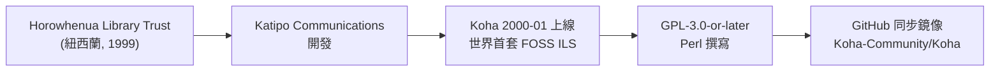
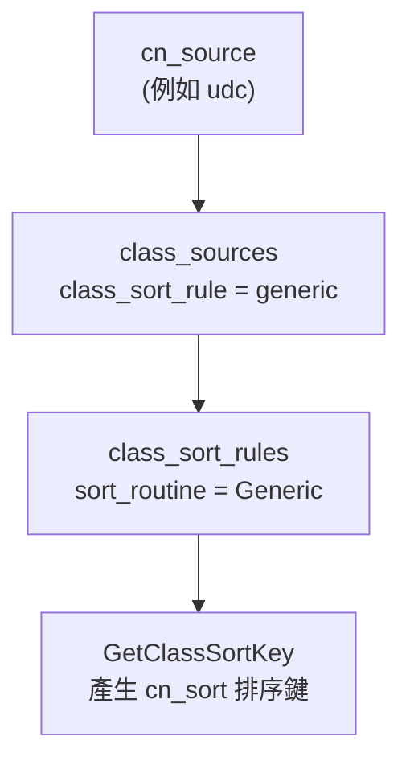

# Koha 如何支援通用十進分類法 (Universal Decimal Classification, UDC)

## 摘要

Koha 是一套自由開源的整合性圖書館系統 (Integrated Library System, ILS)[^koha-repo]。Koha 對通用十進分類法 (Universal Decimal Classification, UDC) 的支援，並非透過獨立的 UDC 模組，而是建立在兩層既有的通用機制之上：(1) 「分類來源 (classification sources)」授權值機制，以及 (2) 「索書號排列與拆分規則」機制。UDC 在 Koha 中是以內建分類來源代碼 `udc` 的形式預先定義，但預設為停用狀態，需由管理者啟用[^class-sources-yml]。UDC 分類號本身儲存於標準 MARC 欄位 (MARC21 的 080 欄、UNIMARC 的 675 欄)，而 UDC 的「來源標記」則儲存於 Koha 專屬欄位 (記錄層級的 942$2、館藏層級的 952$2 或 UNIMARC 995$4)[^koha-manual-admin]。換言之，Koha 支援 UDC 的方式是「通用分類架構 + 標準 MARC 欄位對映」，而非為 UDC 量身打造的專用邏輯；這也導致 UDC 排序只能沿用通用的 (generic) 排列規則，而非 UDC 專屬的排序演算法[^class-sources-yml]。

---

## 一、背景：什麼是 Koha 與 UDC

### 1.1 Koha 專案背景

Koha 是世界上第一套自由開源的整合性圖書館系統，1999 年由紐西蘭的 Katipo Communications 為 Horowhenua Library Trust 開發，並於 2000 年 1 月上線[^koha-wiki]。其名稱來自毛利語 (Māori)，意為「禮物」或「捐贈」[^koha-wiki]。Koha 以 Perl 為主要開發語言，採用 GNU 通用公共授權條款第 3 版或之後版本 (GPL-3.0-or-later) 釋出[^koha-repo]。

以 GitHub 上的同步鏡像 (`Koha-Community/Koha`) 為準，截至 2026-10-24 的公開數據為：**約 595 顆星 (stars)**、305 次 fork、主要語言 Perl、授權 GPL-3.0[^koha-api]。需注意該 GitHub 儲存庫官方描述本身即說明它是「官方儲存庫的同步鏡像」，正式的問題追蹤與補丁提交使用社群自架的 Bugzilla，而非 GitHub Issues[^koha-repo]。因此 GitHub 星數並不能完全反映 Koha 的實際採用規模。



### 1.2 什麼是 UDC

通用十進分類法 (Universal Decimal Classification, UDC) 是 1895 年起由 Dewey 十進分類法 (DDC) 發展而來的分類體系，但兩者後來在編排與哲學上已差異甚大[^loc-080]。UDC 與 DDC 的主要區別在於：UDC 有大量擴充 (尤其在類別 5 與 6 的科學與技術領域)，並且除阿拉伯數字與單一小數點外，還使用多種符號 (例如冒號、括號、加號、斜線、等號等)[^loc-080]。這些複合符號正是後續討論 UDC 在 Koha 中排序問題的關鍵。

---

## 二、核心機制：分類來源 (Classification Sources)

Koha 支援各種分類法的第一層機制是「分類來源」。所有分類來源儲存於資料庫資料表 `class_sources`，其結構如下[^kohastructure]：

| 欄位 | 型別 | 說明 |
|---|---|---|
| `cn_source` | varchar(10) | 分類來源代碼 (主鍵)，如 `ddc`、`lcc`、`udc` |
| `description` | longtext | 人類可讀名稱 |
| `used` | tinyint(4) | 是否啟用 (1 為啟用，預設 0 停用) |
| `class_sort_rule` | varchar(10) | 排列 (filing) 規則代碼 |
| `class_split_rule` | varchar(10) | 拆分 (splitting) 規則代碼 |

### 2.1 UDC 為內建但預設停用的分類來源

Koha 安裝時，透過安裝資料檔 `installer/data/mysql/en/mandatory/class_sources.yml` 預先寫入分類來源。其中與 UDC 相關的定義如下[^class-sources-yml]：

```yaml
        - cn_source: "udc"
          description: "Universal Decimal Classification"
          used: 0
          class_sort_rule: "generic"
          class_split_rule: "generic"
```

同一檔案中的預設分類來源對照如下[^class-sources-yml]：

| 分類來源代碼 | 名稱 | 預設啟用 (`used`) | 排列規則 | 拆分規則 |
|---|---|---|---|---|
| `ddc` | Dewey Decimal Classification | 1 (是) | dewey | dewey |
| `lcc` | Library of Congress Classification | 1 (是) | lcc | lcc |
| **`udc`** | **Universal Decimal Classification** | **0 (否)** | **generic** | **generic** |
| `sudocs` | SuDoc Classification (U.S. GPO) | 0 (否) | generic | generic |
| `anscr` | ANSCR (Sound Recordings) | 0 (否) | generic | generic |
| `z` | Other/Generic Classification Scheme | 0 (否) | generic | generic |

由此可見，**UDC 在 Koha 中是「已預先定義、但預設不啟用」的分類來源**。圖書館若使用 UDC，必須由管理者在介面上手動將 `udc` 設為「使用中 (in use)」[^koha-manual-admin]。

### 2.2 分類來源與 MARC 欄位的對映

分類來源代碼會透過 MARC 架構 (framework) 對映到實體欄位。依據 Koha 手冊，分類來源儲存於資料庫的 `items.cn_source` 與 `biblioitems.cn_source` 欄位，分別對映到 MARC 欄位 `952$2` (MARC21 館藏層級) 與 `942$2` (記錄層級)[^koha-manual-admin]。在 UNIMARC 架構定義檔中，可明確看到對映關係[^unimarc-framework]：

```yaml
        - tagfield: "995"      # UNIMARC 館藏欄位
          tagsubfield: "4"
          liblibrarian: "Source of classification or shelving scheme"
          kohafield: items.cn_source
          authorised_value: cn_source
```

```yaml
        - tagfield: "942"      # 記錄層級 (MARC21 與 UNIMARC 共用)
          tagsubfield: "2"
          liblibrarian: "Source of classification or shelving scheme"
          kohafield: biblioitems.cn_source
```

也就是說，當館員在編目時於 `942$2` 選擇「Universal Decimal Classification」時，實際上就是寫入了授權值 `udc`[^koha-manual-admin]。

### 2.3 系統偏好 `DefaultClassificationSource`

Koha 有一個系統偏好 (system preference) `DefaultClassificationSource`，用於決定編目新記錄時，分類來源欄位的預設值[^sysprefs]。在安裝基礎資料 `sysprefs.sql` 中，其預設值為[^sysprefs]：

```sql
('DefaultClassificationSource','ddc'),
```

即預設為 Dewey。Koha 手冊對此偏好的說明為「使用 ___ 作為預設分類來源」，其可選值包含 ANSCR、Dewey、LCC、Other/Generic、SuDoc，以及 **Universal Decimal Classification**[^koha-manual-admin]。

值得注意的是，`DefaultClassificationSource` 僅影響**新增**項目的預設值，並不會回溯更改既有項目[^koha-manual-pref]。因此若圖書館要從 DDC 改用 UDC，需要另行批次處理既有館藏。

### 2.4 在地化設定會將 UDC 設為預設

某些地區的在地化客製檔會直接把 UDC 設為預設分類來源。例如俄語 (ru-RU) 的在地化檔 `localization/ru-RU/custom.sql` 中，就將分類來源全面改寫為含 UDC 的組合，並執行[^ru-custom]：

```sql
UPDATE systempreferences SET value = 'udc' WHERE variable = 'DefaultClassificationSource';
```

這說明在 UDC 使用率高的地區，Koha 社群是以「在地化客製」的方式，讓 UDC 成為預設選項。

---

## 三、UDC 分類號在 MARC 中的儲存欄位

Koha 支援兩套 MARC 架構，UDC 分類號在兩者中的標準欄位不同：

| 面向 | MARC21 | UNIMARC |
|---|---|---|
| UDC 分類號欄位 | **080** | **675** |
| 分類來源 (記錄層級) | 942$2 | 942$2 |
| 分類來源 (館藏層級) | 952$2 | 995$4 |

### 3.1 MARC21 的 080 欄

在 MARC21 中，UDC 分類號記錄於 080 欄「Universal Decimal Classification Number」[^loc-080]。該欄位為可重複 (repeatable)，用於記錄同一件資料的多個 UDC 分類號[^loc-080]。其子欄位包括[^loc-080]：

- `$a` — UDC 分類號
- `$b` — 項號 (item number，如 Cutter 號、日期、詞語等)
- `$x` — 通用輔助細分 (common auxiliary subdivision，以括號、方括號、撇號或連字號等分隔)
- `$2` — 版本識別 (edition identifier)

第一指標表示版本類型 (`#` 無資訊、`0` 完整版、`1` 節略版)[^loc-080]。Koha 對 080 欄亦有直接的呈現支援，例如其 ISBD 系統偏好的預設值中就包含 UDC 欄位的輸出格式[^sysprefs]：

```
#080|<br/><br/><label>Universal Decimal Class. No.: </label>|{ 080a }{ 080x }{ / 080b }|
```

此外，Koha 的 MARC21 權威架構 (authority framework) 也定義了 080 欄為「Universal Decimal Classification number」，顯示 UDC 在權威記錄層級同樣有欄位支援[^marc21-auth]。

### 3.2 UNIMARC 的 675 欄

在 UNIMARC 中，UDC 分類號記錄於 675 欄。Koha 的 UNIMARC 預設書目架構定義檔中即明列此欄[^unimarc-framework]：

```yaml
        - tagfield: "675"
          liblibrarian: "Universal Decimal Classification (UDC)"
          libopac: "Universal Decimal Classification (UDC)"
          repeatable: 1
          mandatory: 0
```

UNIMARC 的 675 欄子欄位包括：`$a` (UDC 號，單一或範圍起始)、`$b` (範圍結束)、`$c` (說明詞)、`$v` (UDC 版本)、`$z` (版本語言)、`$3` (分類記錄識別號)[^unimarc-auth]。

### 3.3 檢索索引 (Zebra) 中的 UDC

Koha 預設檢索引擎 Zebra 的索引定義中，也為 UDC 保留了專屬屬性。在 `etc/zebradb/biblios/etc/bib1.att` 中定義了[^bib1att]：

```
att 14    UDC-classification
```

對應的 CCL 檢索語法設定 (`ccl.properties`) 亦定義 080 欄對應的 UDC 分類屬性[^ccl]：

```
#Classification-UDC     14  A classification number from    080
#                           Universal Decimal
#                           Classification, a system based
#                           on the Dewey Decimal
#                           Classification.
```

（以上於 `ccl.properties` 中為註解狀態，表示該對應為預先備置但未強制啟用的設定。）[^ccl]

---

## 四、UDC 索書號的排列 (Filing) 與拆分 (Splitting)

### 4.1 分類來源 → 排列規則 → 排序函式 的解析流程

Koha 以三層結構解析排序行為。核心模組 `C4::ClassSource.pm` 的 `GetClassSort` 函式運作如下[^classsource-pm]：

1. 依傳入的 `cn_source` 取出分類來源；
2. 若無對應來源，則改用系統偏好 `DefaultClassificationSource`；
3. 由分類來源的 `class_sort_rule` 取出對應的排列規則；
4. 取得該規則的 `sort_routine`，最後呼叫 `GetClassSortKey` 產生排序鍵。



### 4.2 UDC 使用通用 (Generic) 排列規則

如前述，UDC 在 `class_sources.yml` 中被指定為 `class_sort_rule: "generic"`[^class-sources-yml]。Koha 內建的排列規則僅有三種[^class-sources-yml]：

| 排列規則 | 用途 | 排序函式 |
|---|---|---|
| `dewey` | DDC 專用 | Dewey |
| `lcc` | LCC 專用 | LCC |
| `generic` | 通用 (UDC、SuDoc、ANSCR、Other 皆用此) | Generic |

**Koha 並沒有 UDC 專屬的排列規則。** UDC 沿用通用規則，其排序鍵產生邏輯 (來自 `C4::ClassSortRoutine::Generic`) 為[^classsort-generic]：

> - 串接分類部分與項號部分；
> - 移除前後空白；
> - 將每段空白轉為底線；
> - 轉為大寫，並移除所有非字母、非數字、非底線的字元。

這段邏輯以純字串方式處理，**不會**針對 UDC 的複合符號 (如 `62:001.12`、`94(497.4)`) 進行專屬的正規化。相較之下，Dewey 規則會將第二段數字群補零成 15 位數字以利數值排序，UDC 則無此待遇。因此對含複雜符號的 UDC 號而言，排序結果可能不如 DDC 精確。

### 4.3 拆分規則

拆分規則用於將索書號拆成多行，以便列印於書標 (spine label)[^koha-manual-admin]。UDC 使用 `class_split_rule: "generic"`[^class-sources-yml]，對應的 `C4::ClassSplitRoutine::Generic` 邏輯為：以空白為分隔將索書號拆成任意段數，並在必要時將最後一段的「數字緊接非數字」再切開[^classsplit-generic]。Koha 內建的拆分規則有 Dewey、LCC、Generic 三種，另可自訂 RegEx 規則[^koha-manual-admin]。

### 4.4 排序鍵的儲存

產生的正規化排序鍵會儲存於 `items.cn_sort` 或 `biblioitems.cn_sort`[^koha-manual-admin]。Koha 的書架瀏覽器 (shelf browser) 與索書號瀏覽即依賴此欄位。

---

## 五、實際導入 UDC 的作業流程

綜合 Koha 手冊與社群郵件論壇的討論，圖書館若要從 DDC 改用 UDC，需依序完成下列步驟：

1. **啟用 UDC 分類來源**：於「管理 > 分類來源 (Administration > Classification sources)」將 `udc` 設為「使用中 (in use)」[^koha-manual-admin]。
2. **設定系統偏好**：將 `DefaultClassificationSource` 設為 UDC，以確保新編目項目自始即使用 UDC[^koha-manual-pref]。Koha 發布經理 Katrin Fischer 在社群論壇中明確指出：此偏好「會改變項目架構的預設值，但不會改變既有項目」，並建議「現在就設定，以確保新項目從一開始就以 UDC 編目」[^mailing-list]。
3. **批次更新既有館藏**：將既有項目的 `942$2` (及館藏層級的來源欄位) 批次改為 `udc`；社群討論中特別追問「是否只有 942$2 需要更改」，顯示這是導入 UDC 時最需留意的細節[^mailing-list]。
4. **重新產生排序鍵**：執行維護腳本 `misc/maintenance/touch_all_items.pl`，以新的通用排列規則重新計算 `cn_sort`[^mailing-list]。

社群中一位使用 UNIMARC + UDC 的小型私人圖書館使用者 (Inês M. Ferreira) 便曾因發現系統偏好仍為 DDC 而提出此問題，該討論串成為 Koha 社群中 UDC 導入流程的實務參考[^mailing-list]。

---

## 六、限制與已知問題

### 6.1 缺乏 UDC 專屬排序規則

最大的限制是 Koha **沒有為 UDC 設計專屬的排列/拆分規則**[^class-sources-yml]。UDC 只能使用通用規則，該規則會直接移除 `:`、`(`、`)`、`+`、`/`、`=` 等 UDC 核心符號[^classsort-generic]，因此含複合符號的 UDC 號其排序結果可能不符合 UDC 邏輯上的預期順序。

### 6.2 排序鍵因編輯而遺失

社群亦有其他已知問題：[^bug-27509][^bug-26051]

- **Bug 27509**（已修復，2021）：在編輯館藏但未變更 `cn_source` 或索書號時，`cn_sort` 值會被清空變為 NULL。原因是 `cn_sort` 並非由介面傳入，而是在 `Koha::Item->store` 中依 `itemcallnumber` 與 `cn_source` 產生，未被傳入時會被 `set_or_blank` 設為 undef。此問題對 UDC 使用者同樣造成影響。修補已進入 21.05.00、20.11.02、20.05.08[^bug-27509]。
- **Bug 26051**（已修復，2021）：使用 Elasticsearch 時，依索書號排序使用了錯誤的欄位 (`local-classification`)，導致排序不正確，並可能出現「No results found」等錯誤。修補方式為改以 `cn-sort` 欄位排序 (與 Zebra 行為一致)，並在 `mappings.yaml` 中為 `cn-sort` 加上 `sort=1`。修補已進入 21.05.00、20.11.04、20.05.10[^bug-26051]。

### 6.3 地區採用差異

UDC 在各地的使用率差異極大。UDC 聯盟 (UDC Consortium) 的「全球使用者 (Users Worldwide)」調查將各國使用情形分為 A、B、C 三級：A 為國內多數圖書館使用的主導分類法；B 為與其他分類法併用；C 為極少使用[^udcc-users]。依該調查，歐洲屬 A 級者包括阿爾巴尼亞、波士尼亞、保加利亞、克羅埃西亞、捷克、愛沙尼亞、匈牙利、拉脫維亞、立陶宛、波蘭、葡萄牙、羅馬尼亞、塞爾維亞、斯洛伐克、斯洛維尼亞、西班牙、烏克蘭等；B 級包括白俄羅斯、比利時、丹麥、芬蘭、法國、挪威、俄羅斯、瑞典、瑞士等；而**台灣 (Taiwan) 被列為 C 級 (極少使用)**，中國、韓國、日本 (B 級)、新加坡等亞洲國家亦多屬 B 或 C 級[^udcc-users]。該調查指出，2012 年起的新研究初步證實歐洲單獨就有超過 14 萬所圖書館使用 UDC[^udcc-users]。

因此，Koha + UDC 的實際組合在實務上較常見於歐洲 (尤其南歐與東歐) 的圖書館；台灣本地圖書館以 DDC 較為普遍。社群論壇中實際使用 UNIMARC + UDC 的案例 (Inês M. Ferreira 的小型私人圖書館) 即為一例[^mailing-list]。

---

## 七、綜合對照表

| 面向 | Koha 對 UDC 的支援 |
|---|---|
| 分類來源代碼 | `udc` |
| 是否內建 | 是 (預先定義於 `class_sources.yml`) |
| 預設是否啟用 | 否 (`used: 0`)，須手動啟用 |
| 資料庫儲存欄位 | `items.cn_source`、`biblioitems.cn_source` |
| MARC 對映 (來源標記) | 942$2 (記錄層級)；952$2 (MARC21 館藏)；995$4 (UNIMARC 館藏) |
| UDC 分類號 MARC 欄位 | MARC21: 080；UNIMARC: 675 |
| 排列規則 | generic (通用) |
| 拆分規則 | generic (通用) |
| 排序鍵欄位 | `items.cn_sort`、`biblioitems.cn_sort` |
| 系統偏好 | `DefaultClassificationSource` (預設 `ddc`，可設為 `udc`) |
| Zebra 檢索屬性 | `UDC-classification` (att 14)，對映 080 欄 |
| 是否有 UDC 專屬排序演算法 | 否 |
| 導入後續作業 | 批次更新 942$2，執行 `touch_all_items.pl` |

---

## 八、結論

Koha 對通用十進分類法 (UDC) 的支援，本質上是**以通用分類架構承載 UDC，而非打造 UDC 專屬模組**。具體而言：

1. UDC 以分類來源代碼 `udc` 內建於 `class_sources`，但預設停用，需管理者啟用[^class-sources-yml]。
2. UDC 分類號使用標準 MARC 欄位：MARC21 的 080 欄與 UNIMARC 的 675 欄[^loc-080][^unimarc-framework]；來源標記則存於 Koha 專屬的 942$2 與 952$2/995$4，並對映至 `cn_source` 資料庫欄位[^koha-manual-admin]。
3. UDC 的排序與拆分**只能使用通用 (generic) 規則**，該規則以純字串方式處理並會移除 UDC 的複合符號，因此對複雜 UDC 號的排序可能不理想，這是目前最主要的技術限制[^class-sources-yml][^classsort-generic]。
4. 導入 UDC 需搭配 `DefaultClassificationSource` 偏好設定與批次更新既有館藏、重新執行 `touch_all_items.pl` 等作業[^koha-manual-pref][^mailing-list]。

總結而言，Koha 讓 UDC 使用者「可用」，但在排序精確度上並未提供與 DDC、LCC 同等級的專屬支援。

---

[^koha-repo]: Koha Community. (n.d.). *Koha-Community/Koha: Koha is a free software integrated library system (ILS)*. GitHub. Retrieved 2026-10-24, from https://github.com/Koha-Community/Koha

[^koha-api]: GitHub REST API. (2026). *Repository metadata for Koha-Community/Koha* (595 stars, 305 forks, language Perl, license GPL-3.0). Retrieved 2026-10-24, from https://api.github.com/repos/Koha-Community/Koha

[^koha-wiki]: Wikipedia contributors. (n.d.). *Koha (software)*. Wikipedia. Retrieved 2026-10-24, from https://en.wikipedia.org/wiki/Koha_(software)

[^class-sources-yml]: Koha Development Team. (2020). *class_sources.yml* (Default classification sources and filing rules for Koha). Koha source repository, installer/data/mysql/en/mandatory/. Retrieved 2026-10-24, from https://raw.githubusercontent.com/Koha-Community/Koha/refs/heads/main/installer/data/mysql/en/mandatory/class_sources.yml

[^kohastructure]: Koha Development Team. (n.d.). *kohastructure.sql* (Table structure for table `class_sources` and `class_sort_rules`). Koha source repository, installer/data/mysql/. Retrieved 2026-10-24, from https://raw.githubusercontent.com/Koha-Community/Koha/main/installer/data/mysql/kohastructure.sql

[^classsource-pm]: Koha Development Team. (2022). *C4/ClassSource.pm*. Koha source repository. Retrieved 2026-10-24, from https://raw.githubusercontent.com/Koha-Community/Koha/main/C4/ClassSource.pm

[^classsort-generic]: Koha Development Team. (2007). *C4::ClassSortRoutine::Generic* (generic call number sorting key routine). Koha perldoc. Retrieved 2026-10-24, from https://perldoc.koha-community.org/C4/ClassSortRoutine/Generic.html

[^classsplit-generic]: Koha Development Team. (2018). *C4/ClassSplitRoutine/Generic.pm*. Koha source repository. Retrieved 2026-10-24, from https://raw.githubusercontent.com/Koha-Community/Koha/main/C4/ClassSplitRoutine/Generic.pm

[^sysprefs]: Koha Development Team. (n.d.). *sysprefs.sql* (Default values for `DefaultClassificationSource` and the ISBD preference containing the 080 field). Koha source repository, installer/data/mysql/mandatory/. Retrieved 2026-10-24, from https://raw.githubusercontent.com/Koha-Community/Koha/refs/heads/main/installer/data/mysql/mandatory/sysprefs.sql

[^koha-manual-admin]: Koha Community. (n.d.). *Administration: Classification sources, filing rules, and splitting rules*. Koha manual (latest). Retrieved 2026-10-24, from https://koha-community.org/manual/latest/en/html/administration.html

[^koha-manual-pref]: Koha Community. (n.d.). *DefaultClassificationSource preference*. Koha manual. Retrieved 2026-10-24, from https://koha-community.org/manual/24.05/en/html/catalogingpreferences.html#defaultclassificationsource

[^unimarc-framework]: Koha Development Team. (n.d.). *unimarc_framework_DEFAULT.yml* (675 field definition and 995$4 / 942$2 source-of-classification mappings). Koha source repository, installer/data/mysql/en/marcflavour/unimarc/mandatory/. Retrieved 2026-10-24, from https://raw.githubusercontent.com/Koha-Community/Koha/main/installer/data/mysql/en/marcflavour/unimarc/mandatory/unimarc_framework_DEFAULT.yml

[^unimarc-auth]: Koha Development Team. (n.d.). *UNIMARC authentication and classification field definitions (675 field subfields)*. Koha source repository. Retrieved 2026-10-24, from https://raw.githubusercontent.com/Koha-Community/Koha/main/installer/data/mysql/en/marcflavour/unimarc/mandatory/unimarc_framework_DEFAULT.yml

[^marc21-auth]: Koha Development Team. (n.d.). *authorities_normal_marc21.yml* (080 field defined as UNIVERSAL DECIMAL CLASSIFICATION NUMBER). Koha source repository, installer/data/mysql/en/marcflavour/marc21/mandatory/. Retrieved 2026-10-24, from https://raw.githubusercontent.com/Koha-Community/Koha/main/installer/data/mysql/en/marcflavour/marc21/mandatory/authorities_normal_marc21.yml

[^loc-080]: Library of Congress. (2017). *080 - Universal Decimal Classification Number (MARC 21 Bibliographic)*. Retrieved 2026-10-24, from https://www.loc.gov/marc/bibliographic/bd080.html

[^bib1att]: Koha Development Team. (n.d.). *bib1.att* (att 14 UDC-classification). Koha source repository, etc/zebradb/biblios/etc/. Retrieved 2026-10-24, from https://github.com/Koha-Community/Koha/blob/main/etc/zebradb/biblios/etc/bib1.att

[^ccl]: Koha Development Team. (n.d.). *ccl.properties* (Classification-UDC attribute 14 mapped to field 080). Koha source repository, etc/zebradb/. Retrieved 2026-10-24, from https://github.com/Koha-Community/Koha/blob/main/etc/zebradb/ccl.properties

[^ru-custom]: Koha Development Team. (n.d.). *custom.sql* (ru-RU localization setting DefaultClassificationSource to 'udc'). Koha source repository, installer/data/mysql/localization/ru-RU/. Retrieved 2026-10-24, from https://github.com/Koha-Community/Koha/blob/main/installer/data/mysql/localization/ru-RU/custom.sql

[^mailing-list]: Koha mailing list (katipo archive). (2020-2021). *Thread on migrating a small library to UDC in Koha, including guidance from Katrin Fischer on DefaultClassificationSource, 942$2, and touch_all_items.pl*. Retrieved 2026-10-24, from https://www.mail-archive.com/koha%40lists.katipo.co.nz/msg26579.html

[^bug-27509]: Koha Community. (2021). *Bug 27509 - cn_sort value is lost when editing an item without changing cn_source or itemcallnumber*. Koha Bugzilla. Retrieved 2026-10-24, from https://bugs.koha-community.org/bugzilla3/show_bug.cgi?id=27509

[^bug-26051]: Koha Community. (2021). *Bug 26051 - Elasticsearch uses the wrong field for callnumber sorting*. Koha Bugzilla. Retrieved 2026-10-24, from https://bugs.koha-community.org/bugzilla3/show_bug.cgi?id=26051

[^udcc-users]: UDC Consortium. (n.d.). *UDC Users Worldwide*. Retrieved 2026-10-24, from https://udcc.org/index.php/site/page?view=users_worldwide
