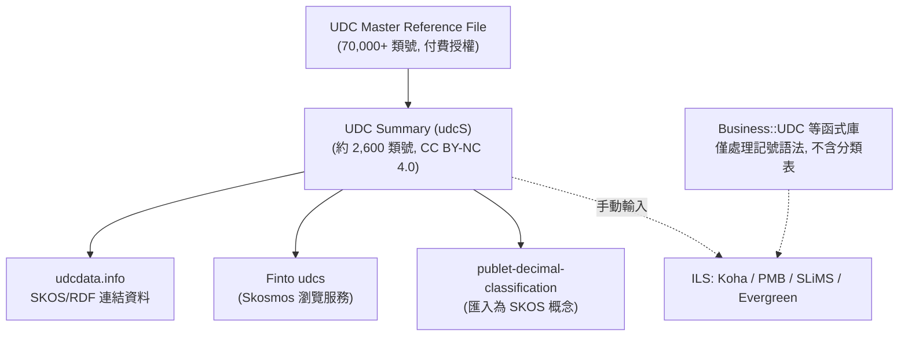

# 支援通用十進分類法 (UDC) 的自由與開源軟體調查

## 摘要

通用十進分類法 (Universal Decimal Classification，簡稱 UDC) 是一套歷史悠久、國際通用的圖書與文獻分類系統，目前由 UDC 聯盟 (UDC Consortium) 擁有與維護[^udcwiki]。本報告調查目前以自由／開源軟體 (FOSS) 形式存在、且以某種方式支援 UDC 的專案，涵蓋：圖書館自動化系統 (ILS)、資源探索層、數位館藏系統、UDC 專用剖析／驗證函式庫，以及以 SKOS／Linked Data 形式提供 UDC 詞彙的服務。

調查的關鍵前提是：UDC 的**完整資料表**（UDC Master Reference File，MRF，2011 年版含超過 70,000 個類號）受 UDC 聯盟的著作權保護，需付費授權；而**節略版 UDC Summary**（約 2,600 個類號）則以 CC BY-NC 4.0（姓名標示-非商業性）釋出[^udcsummary]。因此多數開源專案是以「支援 UDC 記號語法」或「串接 UDC Summary」的方式運作，而非內建完整分類表。

## 什麼是 UDC

UDC 由比利時文獻學家 Paul Otlet 與 Henri La Fontaine 於 19 世紀末、20 世紀初發展，起源於對杜威十進分類法 (DDC) 的改編與擴充。它是一種**分面分類法** (faceted classification)，除了主類表外還具有通用輔助表（語言、形式、地點、時間等）與連接符號，允許透過合成 (synthesis) 建立複合類號，以描述單一列舉式分類法無法窮盡的跨領域主題[^udcwiki]。

UDC 目前被約 130 個國家、約 150,000 個圖書館使用，並用於約 30 個國家的國家書目[^udcwiki]。自 1993 年起，UDC 以資料庫格式（即 UDC MRF）維護與發行，2011 年版 MRF 含超過 70,000 個類號[^udcwiki]。

UDC 的記號本身設計即適合機器處理，因此長年應用於自動化排序裝置與現代圖書館線上公用目錄 (OPAC)[^udcwiki]。

## 授權現況：為何開源專案多不內建完整 UDC

| 資料集 | 規模 | 授權 | 備註 |
|---|---|---|---|
| UDC Master Reference File (MRF) | 70,000+ 類號 | 需付費授權 | 完整官方分類表[^udcwiki] |
| UDC Summary (udcS) | 約 2,600 類號 | CC BY-NC 4.0 | 非商業用途可自由使用[^udcsummary] |
| UDC Summary Linked Data | 約 2,600 類號 | CC BY-NC 4.0 | SKOS/RDF 格式[^udcsummary] |

UDC Summary 自 2011 年起以連結資料 (Linked Data) 形式提供，並以 SKOS 詞彙形式發布[^udcsummary]。這使得「合法且可重用的 UDC 資料」實際上以節略版為主。以下 mermaid 圖說明資料來源與軟體之間的關係：

## 一、圖書館自動化系統 (ILS)

### Koha

Koha 是 GNU GPL v3 授權的自由軟體 ILS，GitHub 主倉庫有 595 顆星[^kohagh]。Koha 在安裝資料中預先定義了名為 `udc` 的分類來源，描述為「Universal Decimal Classification」，但預設為**未啟用** (`used: 0`)，且採用通用的排序與切分規則 (`generic`)[^kohacfg]。相對於 DDC 與 LCC 預設為啟用 (`used: 1`)，UDC 需要管理者手動開啟。Koha 僅提供分類來源的「欄位定義」，**不隨附 UDC 分類表資料**，類號需由編目者手動輸入。

### PMB

PMB（早期名為 PhpMyBibli）是一套以 PHP 撰寫、採 CeCILL-2.0 授權的自由軟體 ILS，由法國公司 PMB Services 持續維護[^pmb]。依據其公開說明，PMB「可整合不同的排序計畫：DEWEY、UDC、PCDM 或任何自訂排序計畫」，顯示 UDC 可作為一級分類選項[^pmb]。PMB 支援 UNIMARC 編目格式、Z39.50 與 OAI 協定[^pmb]。

### SLiMS (Senayan Library Management System)

SLiMS 在東南亞（尤其印尼）廣泛使用，採 GNU GPL v3 授權，GitHub 上有 250 顆星[^slimsgh]。SLiMS 的 MARC 處理模組將 MARC 欄位 080 明確定義為「Universal Decimal Classification Number」，支援 UDC 類號、項目編號與通用輔助細分等子欄位[^slimsmarc]。

### Evergreen

Evergreen 是 GNU GPL v2 授權的 ILS，GitHub 上有 157 顆星，主要被大型圖書館聯盟採用[^evgh]。Evergreen 支援多種分類體系；UDC 類號可儲存於 MARC 084（其他分類號）欄位或透過自訂分類外掛處理[^evgsearch]。相對於 DDC/LCC，UDC 並非開箱即用的預設選項。

### FOLIO

FOLIO (Future of Libraries is Open) 是採用 Apache-2.0 授權的模組化圖書館服務平台，其館藏模組 (mod-inventory-storage) 同樣為 Apache-2.0[^foliogh]。FOLIO 以 MARC 紀錄為基礎，可透過 MARC 欄位與資料匯入模組支援 UDC 編目，但屬於通用分類欄位機制，而非 UDC 專屬功能。

## 二、資源探索層與數位館藏系統

### VuFind

VuFind 是 GNU GPL v2 授權的資源探索入口，GitHub 上有 306 顆星[^vufindgh]。VuFind 本身並非編目系統，但可索引與顯示 MARC 紀錄中的任意欄位，因此若紀錄含 MARC 080（UDC）欄位，VuFind 可加以索引與呈現[^vufindsearch]。核心 VuFind 並沒有 UDC 專屬模組（無 UDC 階層瀏覽功能）。

### Omeka S

Omeka S 是 GNU GPL v3 授權、供大學與圖書館等機構使用的網路出版與數位館藏系統，GitHub 上有 527 顆星[^omekagh]。Omeka S 隨附的 Dublin Core Terms 詞彙中包含 `dcterms:UDC` 屬性，定義為「通用十進分類法所指定的概念資源集合」，並連往 UDC 聯盟網站[^omekasearch]。不過 Omeka 只把 UDC 當作一個中繼資料欄位，未提供 UDC 查詢或自動完成功能。

## 三、UDC 專用函式庫與工具

這是整個生態中最貼近「以 UDC schema／規格為核心」的一群專案。

### Business::UDC (Perl)

Business::UDC 是一套以 Perl 撰寫、處理 UDC 記號的函式庫，採 BSD 2-Clause 授權，GitHub 上 0 顆星[^budcgh]。它提供 Tokenizer、Parser、抽象語法樹 (AST) 與 `is_valid` 驗證，能判斷 UDC 字串（如 `821.111(73)-31"19"`）是否語法有效[^budcpod]。其開發由捷克共和國國家圖書館的長期策略研究計畫 (DKRVO 2024–2028，領域 11：Linked Open Data) 支持[^budcpod]。此專案是目前維護最積極的 UDC 記號處理函式庫之一（版本 0.10 於 2026-10-18 發布）[^budccpan]。本質上它處理的是 UDC 的**記號語法與規格**，而非分類表資料。

### Mo::utils::UDC (Perl)

Mo::utils::UDC 是上述函式庫的配套模組，提供 `check_udc()` 驗證函式，供 Mo 框架的 Perl 應用檢查資料值是否為語法正確的 UDC 字串，底層使用 Business::UDC[^moudcgh]。採 BSD 2-Clause 授權，0 顆星[^moudcgh]。

### curatorian/classification (JSON 資料)

此倉庫以機器可讀的 JSON 格式提供 DDC、UDC、LCC 三套圖書館分類法的資料，並包含英文與印尼文（Bahasa Indonesia）兩種版本，供開發者建立搜尋介面、驗證索書號或教育工具[^curator]. GitHub 上 0 顆星，倉庫未附授權檔[^curator]。它直接提供 UDC 資料的 JSON 表示，是少數「以資料形式包含 UDC schema」的專案之一。

### publet-decimal-classification (PDC)

PDC (Extended Publet Decimal Classification) 以 Apache-2.0 授權（資料部分為 CC BY-SA 4.0），將 UDC Summary 約 2,400 個類號匯入為 SKOS 概念，每個類號對應一個概念，並在其上擴充更細的類號[^pdc]。它同時保留原始 UDC Summary 的 SKOS/Turtle 檔 (`data/udc-summary/udcs.ttl`) 並記錄下載來源與校驗碼[^pdc]。GitHub 上 0 顆星，但在「把 UDC Summary 轉為可再利用資料集」方面做法完整（含可重現的匯入腳本與測試）[^pdcgh]。

### Calibre_Universal_Decimal_Classification (Python)

這是一支 Python 腳本，讀取 Calibre 電子書庫後，依 UDC 分類將書籍整理成資料夾結構[^calibre]。GitHub 上 9 顆星，最後更新於 2017 年，未附授權檔[^calibregh]。

### UDCTaggerProject (Python/機器學習)

此專案是以 BERT 與 T5 模型自動為書名／描述指派 UDC 類號的概念驗證，採 MIT 授權，GitHub 上 1 顆星[^taggergh]。它明確聲明**不包含 UDC 分類表**（因著作權限制），且目前僅支援以字母「A」開頭的 UDC 類別[^tagger]。

### UDCSummary (PHP 網頁工具)

`artisgrit/UDCSummary` 是一個以 PHP 撰寫、用於瀏覽 UDC Summary 分類表的網頁前端／鏡像，含翻譯資料、編輯工具與匯出功能[^udcsumgh]。GitHub 上 0 顆星，未附授權檔[^udcsumgh]。

### book_organiser (Python)

`shantonob/book_organiser` 是一套電子書編目系統，具中繼資料擷取、去重、UDC 分類與網頁介面；其 UDC 分類採「多標籤關鍵字評分」，涵蓋 10 個 UDC 大類[^bookorg]。GitHub 上 0 顆星，未附授權檔[^bookorgh]。它的 UDC 支援屬於自身實作的特徵掃描式分類，而非使用官方分類表。

## 四、以 SKOS／Linked Data 提供 UDC 的服務

這些服務本身多為開源軟體（或其資料可被開源軟體取用），是開源專案串接 UDC 的主要來源。

### UDC Summary (udcsummary.info)

由 UDC 聯盟提供的官方節略版 UDC 線上瀏覽服務，約 2,600 個類號，含超過 50 種語言的翻譯，並提供各式匯出格式[^udcsummary]。資料以 CC BY-NC 4.0 釋出，可自由重製與再利用（非商業、需姓名標示）[^udcsummary]。

### udcdata.info (UDC Linked Data)

自 2011 年起提供 UDC Summary 的 SKOS 連結資料，可透過查詢取得 RDF 形式資料[^udcsummary]。此服務是將 UDC 作為知識組織系統 (KOS) 發布為連結資料的案例，相關方法與挑戰亦見於學術文獻[^slavic]。

### Finto (udcs) 與 Skosmos

Finto 是芬蘭國家圖書館 (National Library of Finland) 營運的詞彙服務，其 `udcs` 端點以可瀏覽、可搜尋的 SKOS 詞彙形式提供 UDC Summary（含英文、芬蘭文、瑞典文等）[^finsearch]。其背後的開源軟體 Skosmos 是一套以 SKOS 與 SPARQL 為基礎的詞彙瀏覽器，採 PHP 撰寫，GitHub 上有 269 顆星[^skosmosgh]。

## 綜合比較

| 專案 | 類型 | 授權 | GitHub 星數 | UDC 支援方式 |
|---|---|---|---|---|
| Koha | ILS | GPL-3.0 | 595[^kohagh] | 預設分類來源 (未啟用)，MARC 欄位，無分類表 |
| PMB | ILS | CeCILL-2.0 | 非 GitHub[^pmb] | 可整合 UDC 排序計畫 |
| SLiMS | ILS | GPL-3.0 | 250[^slimsgh] | MARC 080 欄位定義 |
| Evergreen | ILS | GPL-2.0 | 157[^evgh] | MARC 084／自訂外掛 |
| FOLIO | LSP | Apache-2.0 | 倉庫各自[^foliogh] | 通用分類欄位／MARC |
| VuFind | 探索層 | GPL-2.0 | 306[^vufindgh] | 索引 MARC 080，無專屬模組 |
| Omeka S | 數位館藏 | GPL-3.0 | 527[^omekagh] | DC 詞彙 `dcterms:UDC` |
| Business::UDC | Perl 函式庫 | BSD-2-Clause | 0[^budcgh] | UDC 記號剖析／驗證／AST |
| Mo::utils::UDC | Perl 模組 | BSD-2-Clause | 0[^moudcgh] | UDC 字串驗證 |
| curatorian/classification | JSON 資料 | 未標示 | 0[^curator] | UDC 資料之 JSON 表示 |
| publet-decimal-classification | 資料集 | Apache-2.0 / CC BY-SA 4.0 | 0[^pdcgh] | 匯入 UDC Summary 為 SKOS |
| Calibre UDC Script | Python 腳本 | 未標示 | 9[^calibregh] | 依 UDC 整理 Calibre 書庫 |
| UDCTaggerProject | ML 應用 | MIT | 1[^taggergh] | 自動指派 UDC 類號（僅 A 類） |
| UDCSummary | PHP 網頁 | 未標示 | 0[^udcsumgh] | UDC Summary 瀏覽／鏡像 |
| book_organiser | 編目系統 | 未標示 | 0[^bookorgh] | 關鍵字評分式 UDC 分類 |
| UDC Summary | 資料／服務 | CC BY-NC 4.0 | 非軟體[^udcsummary] | 官方節略版 SKOS/RDF |
| Skosmos (Finto) | 詞彙瀏覽器 | 開源（見倉庫） | 269[^skosmosgh] | 承載 UDC Summary 瀏覽服務 |

## 結論

1. **若目標是「在 ILS 中實際使用 UDC 編目」**：Koha 是最成熟的選擇，它內建 `udc` 分類來源（需啟用）、支援相關 MARC 欄位，但其本身不含 UDC 分類表資料，類號須自行輸入或另尋資料來源[^kohacfg]。SLiMS 與 PMB 亦具備 UDC 支援[^slimsmarc][^pmb]。
2. **若目標是「程式化處理 UDC 記號（剖析／驗證）」**：Business::UDC 是維護最積極、功能最完整的開源函式庫，且明確以 UDC 記號規格為核心[^budcpod]。
3. **若目標是「取得可重用的 UDC 資料 schema」**：官方來源為 UDC Summary（CC BY-NC 4.0），可透過 udcdata.info 的 SKOS/RDF 或 Finto 取得[^udcsummary][^finsearch]；社群亦有 JSON 與 SKOS 形式的再封裝（curatorian/classification、publet-decimal-classification）[^curator][^pdc]。
4. **重要限制**：完整 UDC 分類表（MRF）為付費授權資料，任何開源專案若聲稱內含完整 UDC 表，需查證其授權正當性；多數合法專案僅處理記號語法或使用節略版 Summary[^udcwiki][^udcsummary]。

## 註腳

[^udcwiki]: Universal Decimal Classification. (n.d.). In Wikipedia. Retrieved 2026-10-24, from https://en.wikipedia.org/wiki/Universal_Decimal_Classification
[^udcsummary]: UDC Consortium. (n.d.). What is the UDC Summary? Retrieved 2026-10-24, from https://udcsummary.info/about.htm
[^kohagh]: Koha Community. (n.d.). Koha [Computer software]. GitHub. Retrieved 2026-10-24, from https://github.com/Koha-Community/Koha
[^kohacfg]: Koha Development Team. (2020). class_sources.yml [Source code]. GitHub. Retrieved 2026-10-24, from https://github.com/Koha-Community/Koha/blob/main/installer/data/mysql/en/mandatory/class_sources.yml
[^pmb]: PMB (software). (n.d.). In Wikipedia. Retrieved 2026-10-24, from https://en.wikipedia.org/wiki/PMB_(software)
[^slimsgh]: SLiMS. (n.d.). SLiMS 9 Bulian [Computer software]. GitHub. Retrieved 2026-10-24, from https://github.com/slims/slims9_bulian
[^slimsmarc]: SLiMS. (n.d.). MARC 080 field definition (Universal Decimal Classification Number) [Source code]. GitHub. Retrieved 2026-10-24, from https://github.com/slims/slims9_bulian
[^evgh]: Evergreen Library System. (n.d.). Evergreen ILS [Computer software]. GitHub. Retrieved 2026-10-24, from https://github.com/evergreen-library-system/Evergreen
[^evgsearch]: Evergreen ILS. (n.d.). Evergreen ILS official site. Retrieved 2026-10-24, from https://evergreen-ils.org/
[^foliogh]: FOLIO. (n.d.). mod-inventory-storage [Computer software]. GitHub. Retrieved 2026-10-24, from https://github.com/folio-org/mod-inventory-storage
[^vufindgh]: VuFind. (n.d.). VuFind [Computer software]. GitHub. Retrieved 2026-10-24, from https://github.com/vufind-org/vufind
[^vufindsearch]: VuFind. (n.d.). VuFind documentation. Retrieved 2026-10-24, from https://vufind.org/
[^omekagh]: Omeka. (n.d.). Omeka S [Computer software]. GitHub. Retrieved 2026-10-24, from https://github.com/omeka/omeka-s
[^omekasearch]: Omeka. (n.d.). Dublin Core Terms vocabulary (dcterms:UDC) [Source code]. GitHub. Retrieved 2026-10-24, from https://github.com/omeka/omeka-s
[^budcgh]: Špaček, M. J. (2026). Business-UDC [Computer software]. GitHub. Retrieved 2026-10-24, from https://github.com/michal-josef-spacek/Business-UDC
[^budcpod]: Špaček, M. J. (2026). Business::UDC [Perl module documentation]. MetaCPAN. Retrieved 2026-10-24, from https://fastapi.metacpan.org/v1/pod/Business::UDC
[^budccpan]: Špaček, M. J. (2026). Business-UDC 0.10 [Computer software release]. MetaCPAN. Retrieved 2026-10-24, from https://fastapi.metacpan.org/v1/release/Business-UDC
[^moudcgh]: Špaček, M. J. (2026). Mo-utils-UDC [Computer software]. GitHub. Retrieved 2026-10-24, from https://github.com/michal-josef-spacek/Mo-utils-UDC
[^curator]: Curatorian. (2026). Library Classification - DDC, UDC and LCC [Data repository]. GitHub. Retrieved 2026-10-24, from https://github.com/curatorian/classification
[^pdc]: Schryer, R. (2026). PDC: the Extended Publet Decimal Classification [Computer software]. GitHub. Retrieved 2026-10-24, from https://github.com/schryer/publet-decimal-classification
[^pdcgh]: Schryer, R. (2026). publet-decimal-classification [Computer software]. GitHub. Retrieved 2026-10-24, from https://github.com/schryer/publet-decimal-classification
[^calibre]: Farhour, F. (2017). Calibre_Universal_Decimal_Classification [Computer software]. GitHub. Retrieved 2026-10-24, from https://github.com/ffarhour/Calibre_Universal_Decimal_Classification
[^calibregh]: Farhour, F. (2017). Calibre_Universal_Decimal_Classification [Computer software]. GitHub. Retrieved 2026-10-24, from https://github.com/ffarhour/Calibre_Universal_Decimal_Classification
[^tagger]: UDC Tagger Project. (2025). UDCTaggerProject [Computer software]. GitHub. Retrieved 2026-10-24, from https://github.com/JCFDGG/UDCTaggerProject
[^taggergh]: UDC Tagger Project. (2025). UDCTaggerProject [Computer software]. GitHub. Retrieved 2026-10-24, from https://github.com/JCFDGG/UDCTaggerProject
[^udcsumgh]: Artisgrit. (2025). UDCSummary [Computer software]. GitHub. Retrieved 2026-10-24, from https://github.com/artisgrit/UDCSummary
[^bookorg]: Book Organiser. (2026). Ebook cataloguing system with UDC classification [Computer software]. GitHub. Retrieved 2026-10-24, from https://github.com/shantonob/book_organiser
[^bookorgh]: Book Organiser. (2026). book_organiser [Computer software]. GitHub. Retrieved 2026-10-24, from https://github.com/shantonob/book_organiser
[^slavic]: Slavic, A., Siebes, R., & Scharnhorst, A. (2022). Publishing a Knowledge Organization System as Linked Data: The Case of the Universal Decimal Classification. arXiv. Retrieved 2026-10-24, from https://arxiv.org/abs/2205.01395
[^finsearch]: National Library of Finland. (n.d.). Finto: UDC Summary. Retrieved 2026-10-24, from https://finto.fi/udcs/en/
[^skosmosgh]: National Library of Finland. (n.d.). Skosmos [Computer software]. GitHub. Retrieved 2026-10-24, from https://github.com/NatLibFi/Skosmos
