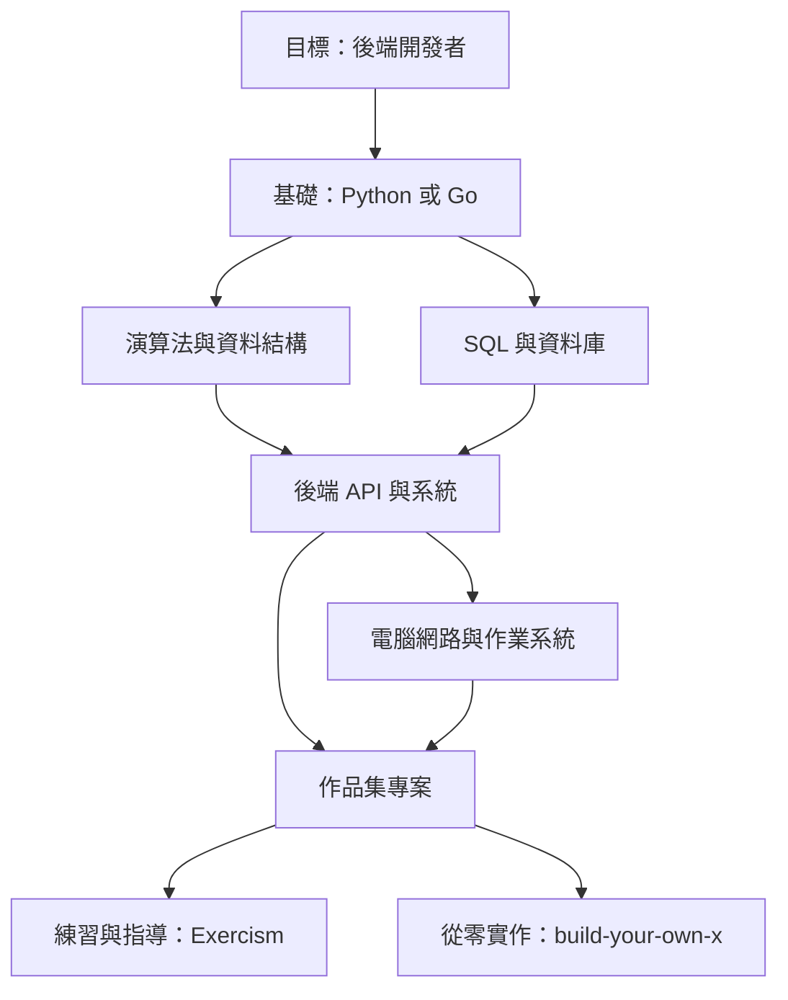

# Boot.dev 的自由開源軟體 (FOSS) 替代方案

## 摘要

Boot.dev 是一個以遊戲化 (gamification) 為核心、專注於後端開發與電腦科學的付費線上學習平台[^bootabout]。本報告首先說明 Boot.dev 的產品定位與商業模式，接著盤點可作為其「自由開源軟體 (Free and Open Source Software, FOSS)」替代方案的資源，並以 GitHub 星數、授權條款、涵蓋主題與學習形式進行比較，最後提出以 FOSS 資源重組 Boot.dev 學習路徑的建議。

本報告聚焦於「自由」與「開源」兩層意義：軟體授權允許自由使用、修改與散布，且內容可被社群檢視與再利用。需要留意的是，部分替代方案（例如 roadmap.sh）雖可免費存取，但其內容授權並非 OSI 認可的開源授權，本報告會明確標註此差異。

## 一、Boot.dev 是什麼

Boot.dev 由 Lane Wagner 創立，原本是為協助其配偶從放射技術師轉職為軟體工程師而建立[^bootabout]。其定位介於「數千美元的程式訓練營」與「數萬美元的大學學位」之間，訴求以「健身房會員費」等級的價格提供學習資源[^bootabout]。

### 1.1 教學形式

Boot.dev 的核心方法是「閱讀簡短課程 → 撰寫程式碼 → 通過自動化測試 → 重複」[^bootabout]。平台提供瀏覽器內建開發環境，學員無須在本機設定環境即可執行程式碼；官方明確表示目標族群是「偏好寫程式而非看影片」的學習者[^bootabout]。

平台亦提供名為「Boots」的 AI 助教，採用蘇格拉底式提問引導，且使用該助教會在遊戲機制上被扣分，藉此鼓勵學員自行解決問題[^bootabout]。

### 1.2 涵蓋語言與學習路徑

Boot.dev 教授的語言包括 Python、Go、TypeScript/JavaScript、SQL，以及用於記憶體管理課程的 C[^bootabout]。官方學習路徑包括[^bootabout]：

- **後端開發者（Python/Go）**：16 門課程與 8 個專案，約 12 個月。
- **後端開發者（Python/TypeScript）**：以 TypeScript/Node.js 取代 Go。
- **DevOps（Python/Go）**：15 門課程與 4 個專案，涵蓋 AWS、CI/CD、Kubernetes。
- **資料分析師（Python）**：11 門課程與 5 個專案，涵蓋 SQL、網頁爬蟲、Pandas。

### 1.3 定價與遊戲化

依 2026 年底的資訊，Boot.dev 提供免費模式（每門課前幾章可互動，其餘唯讀）、月費約 59 美元、年費約 399 美元、學生折扣與購買力平價 (PPP) 定價，並提供 30 天退款保證[^bootabout]。遊戲化機制包括排行榜、公會 (guilds)、經驗值、等級、連續學習紀錄 (streaks) 與成就系統[^bootabout]。

### 1.4 開源程度

**Boot.dev 平台本身並非開源**：官方網站、課程內容與後端皆為專有 (proprietary)[^bootcli]。唯一開源的是學員用來執行與提交課程的 Go 命令列工具 `bootdev`，採 MIT 授權，GitHub 星數約 2,878[^bootcli]。換言之，市面上並不存在一個功能完全對等的 Boot.dev 開源複製品。

## 二、FOSS 替代方案總覽

下表整理各替代方案的定位與 GitHub 星數（星數為 2026-10-24 自 GitHub API 取得之數值）。

| 方案 | 定位 | 主要涵蓋 | 授權 | GitHub 星數 |
|---|---|---|---|---|
| freeCodeCamp | 互動式課程與認證 | 後端 API、Python、關聯式資料庫 | BSD-3-Clause | 457,889[^fcc] |
| The Odin Project | 專案導向全端課程 | Node.js、Rails、SQL、Git | 自有授權 (NOASSERTION) | 13,183[^odin] |
| Full Stack Open | 大學開設的免費課程 | Node.js、Express、MongoDB、GraphQL、TypeScript | 自有授權 (NOASSERTION) | 2,238[^fso] |
| OSSU 電腦科學 | 自學 CS 學位路徑 | 演算法、系統、網路、資料庫 | MIT | 210,332[^ossu] |
| Exercism | 帶程式碼指導的練習平台 | 85+ 種語言（含 Go、Python） | AGPL-3.0 (網站) | 7,598[^exercism] |
| build-your-own-x | 從零實作教學清單 | Redis、Git、SQLite 等 | 無授權檔 | 556,091[^byox] |
| free-programming-books | 免費書籍索引 | 全領域程式設計 | CC-BY-4.0 | 400,043[^fpb] |
| Go by Example | 註解式 Go 範例 | Go 語言 | 無授權檔 | 8,210[^gobyexample] |
| roadmap.sh | 學習路線圖 | 後端、DevOps 路線圖 | 自有版權授權（非 OSI） | 約 370,400[^roadmap] |

## 三、各方案深入說明

### 3.1 freeCodeCamp

freeCodeCamp 是 GitHub 上星數最高的專案之一（457,889 星），其程式碼庫與課程皆採 BSD-3-Clause 授權開源[^fcc]。它的「Back End Development and APIs」認證與「Python」認證，與 Boot.dev 的後端主題高度重疊；平台亦提供「Relational Databases」認證涵蓋 SQL[^fcc]。學習形式為互動式練習加專案，完成後可取得認證。與 Boot.dev 的差異在於：freeCodeCamp 涵蓋範圍更廣（含前端、機器學習），但缺乏 Boot.dev 那種一致的遊戲化敘事與嚴格後端聚焦。

### 3.2 The Odin Project

The Odin Project 是一套完整的開源網頁開發課程，課程倉庫 `TheOdinProject/curriculum` 約 13,183 星[^odin]。它採「Foundation 基礎 → 全端 Ruby on Rails 或全端 JavaScript」兩條主線，涵蓋 HTML/CSS、JavaScript、Node.js、SQL、Git 與求職準備[^odin]。其專案比重高，適合累積作品集。須注意的是，其課程倉庫授權標示為 NOASSERTION（非標準 OSI 授權），使用時應詳閱其授權條款[^odin]。

### 3.3 Full Stack Open

Full Stack Open 由赫爾辛基大學電腦科學系開設，是一門免費的現代全端課程，教材以 Node.js、Express、MongoDB、GraphQL、TypeScript、CI/CD 與容器 (Docker) 為核心[^fso]。學員可免費取得 ECTS 大學學分[^fso]。其教材倉庫約 2,238 星，授權標示為 NOASSERTION（實務上為 Creative Commons BY-NC-SA 系列）[^fso]。它是免費資源中後端深度最完整的選項之一。

### 3.4 OSSU 電腦科學

Open Source Society University (OSSU) 的 `computer-science` 倉庫約 210,332 星，採 MIT 授權[^ossu]。它將 MIT、哈佛、史丹佛、普林斯頓等校的免費課程串成等同於 CS 學士的完整路徑，涵蓋程式設計、離散數學、演算法、作業系統、網路、資料庫與機器學習[^ossu]。相較於 Boot.dev 偏實作，OSSU 更偏學術理論，適合想補齊電腦科學基礎者。

### 3.5 Exercism

Exercism 是一個完全開源（網站為 AGPL-3.0）的練習與指導平台，提供 85 種以上語言軌道，其中 Go 與 Python 軌道對後端學習者特別相關[^exercism]。其最大特色是社群志工提供的人工程式碼指導 (mentoring)，學員提交解答後可獲得回饋[^exercism]。Exercism 本身不是「課程」，而是最適合與 OSSU 或 The Odin Project 搭配使用的練習平台。

### 3.6 build-your-own-x 與 CodeCrafters 的免費對應

Boot.dev 常被拿來與商業平台 CodeCrafters 相比，後者主打「從零重建 Redis、Git、SQLite 等真實工具」[^cc]。其開源替代並非單一平台，而是一份清單：`codecrafters-io/build-your-own-x`（約 556,091 星）收錄了以各種語言從零實作熱門技術的教學[^byox]。它雖非互動式平台，卻是免費重現 CodeCrafters 學習體驗最直接的資源。

### 3.7 補充資源

- **Go by Example**（8,210 星）：以註解式完整可執行程式範例講解 Go 語言，適合 Boot.dev 的 Go 路徑搭配使用[^gobyexample]。
- **free-programming-books**（400,043 星，CC-BY-4.0）：橫跨 30 多種語言的免費書籍索引，涵蓋 Go、Python、演算法、資料庫與網路[^fpb]。
- **roadmap.sh**（約 370,400 星）：提供後端、DevOps、Go、SQL 等互動式學習路線圖[^roadmap]。須特別聲明，roadmap.sh 內容採自有版權授權，**並非 OSI 認可的開源授權**，僅供個人使用，不得重製或再散布其內容[^roadmap]。

## 四、以 FOSS 重組 Boot.dev 學習路徑

| Boot.dev 主題 | FOSS 替代資源 |
|---|---|
| Python 基礎 | freeCodeCamp Python 認證、Exercism Python 軌道 |
| Go 基礎 | Go by Example、Exercism Go 軌道 |
| 演算法與資料結構 | OSSU Core Theory、freeCodeCamp Coding Interview Prep |
| SQL / 資料庫 | freeCodeCamp Relational Databases、OSSU Databases |
| 後端 API | freeCodeCamp Back-End Development、Full Stack Open |
| 電腦網路 | OSSU Core Systems（Computer Networking） |
| 作業系統 | OSSU Core Systems（Nand2Tetris、OSTEP） |
| Git / 開發工具 | The Odin Project Git 課程、OSSU CS Tools（MIT Missing Semester） |
| 作品集專案 | The Odin Project 專案、Full Stack Open 練習 |
| 練習與指導 | Exercism（含人工程式碼指導） |
| 從零實作真實工具 | build-your-own-x |

## 五、來源批判性反思

以下針對本報告主要來源進行可信度與性質評估：

- **Boot.dev 官方頁面（about、faq、pricing）**：屬第一手來源，對產品功能與定價的敘述可信，但行銷性質濃厚，其優勢描述應視為廠商主張而非中立評價[^bootabout]。部分定價資訊引自第三方評測網站，價格可能隨時間變動，讀者應以官方頁面最新公告為準。
- **GitHub API 數據**：星數為 2026-10-24 擷取的快照，會隨時間變動，僅反映社群關注度，不完全等於教材品質[^fcc][^ossu][^byox]。
- **授權條款**：The Odin Project 與 Full Stack Open 的倉庫標示為 NOASSERTION，代表 GitHub 無法自動識別標準授權，實際條款須人工確認；roadmap.sh 採限制性自有授權，與 FOSS 訴求相左，本報告已明確排除於嚴格 FOSS 清單之外[^odin][^fso][^roadmap]。
- **平台定位差異**：本報告所列方案無任何一個能完整複製 Boot.dev「遊戲化 + 後端聚焦 + 內建執行環境 + AI 助教」的整合體驗；最接近的組合是以 The Odin Project 或 Full Stack Open 作為主課程，搭配 Exercism 練習。

## 六、結論

1. Boot.dev 平台本身不開源，僅其 CLI 工具開源；不存在功能對等的單一開源替代品[^bootcli]。
2. 最接近的免費開源組合為：**Full Stack Open 或 The Odin Project（主課程）+ OSSU（CS 基礎）+ Exercism（練習與指導）+ build-your-own-x（實作專案）**。
3. freeCodeCamp 提供互動式課程與認證，是最接近 Boot.dev「互動練習」形式且星數最高的開源專案[^fcc]。
4. 選擇時須留意授權差異：OSSU、Exercism 網站與 freeCodeCamp 屬標準開源授權；The Odin Project、Full Stack Open 為 NOASSERTION；roadmap.sh 則非開源[^ossu][^exercism][^fcc][^odin][^fso][^roadmap]。

## 參考文獻

[^bootabout]: Boot.dev. (n.d.). About, FAQ, and Pricing. Retrieved 2026-10-24, from https://www.boot.dev/about ; https://www.boot.dev/faq ; https://www.boot.dev/pricing

[^bootcli]: bootdotdev. (2024, April 4). bootdev: CLI used to complete coding challenges and lessons on Boot.dev. GitHub. Retrieved 2026-10-24, from https://github.com/bootdotdev/bootdev

[^fcc]: freeCodeCamp. (n.d.). freeCodeCamp.org's open-source codebase and curriculum. GitHub. Retrieved 2026-10-24, from https://github.com/freeCodeCamp/freeCodeCamp

[^odin]: The Odin Project. (n.d.). The open curriculum for learning web development. GitHub. Retrieved 2026-10-24, from https://github.com/TheOdinProject/curriculum

[^fso]: Full Stack Open. (n.d.). Full Stack Open course material. GitHub. Retrieved 2026-10-24, from https://github.com/fullstack-hy2020/fullstack-hy2020.github.io ; https://fullstackopen.com

[^ossu]: Open Source Society University. (n.d.). Path to a free self-taught education in Computer Science. GitHub. Retrieved 2026-10-24, from https://github.com/ossu/computer-science

[^exercism]: Exercism. (n.d.). Crowd-sourced code mentorship. GitHub. Retrieved 2026-10-24, from https://github.com/exercism/exercism ; https://exercism.org

[^byox]: CodeCrafters. (n.d.). Master programming by recreating your favorite technologies from scratch. GitHub. Retrieved 2026-10-24, from https://github.com/codecrafters-io/build-your-own-x

[^fpb]: EbookFoundation. (n.d.). Freely available programming books. GitHub. Retrieved 2026-10-24, from https://github.com/EbookFoundation/free-programming-books

[^gobyexample]: McGrana, M. (n.d.). Go by Example. GitHub. Retrieved 2026-10-24, from https://github.com/mmcgrana/gobyexample

[^roadmap]: Ahmed, K. (n.d.). developer-roadmap. GitHub. Retrieved 2026-10-24, from https://github.com/kamranahmedse/developer-roadmap ; https://roadmap.sh

[^cc]: CodeCrafters. (n.d.). CodeCrafters. Retrieved 2026-10-24, from https://codecrafters.io
