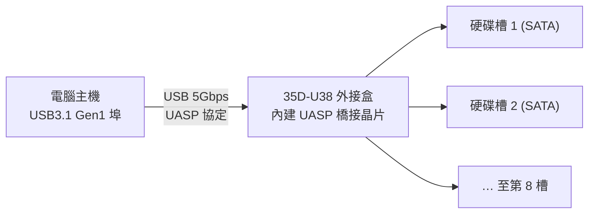

# 伽利略 USB3.1 Gen1 8層抽取式硬碟外接盒（35D-U38）是否支援 USB Attached SCSI（UASP）？

## 摘要

**結論：支援。** 伽利略（品牌英文名 DigiFusion／Galileo，製造商為明恒股份有限公司）型號 **35D-U38** 的 USB3.1 Gen1 八層抽取式硬碟外接盒，其官方產品頁面與多家通路商品頁均明確標示「晶片內建 **UASP** 穩定加速」[^galileo][^autobuy]。UASP（USB Attached SCSI Protocol，USB 附加 SCSI 協定）即本題所指的 USB Attached SCSI。UASP 屬晶片內建功能，在 Windows 8／8.1／10／11 上使用系統內建驅動即可啟用；在較舊的 Windows XP／Vista／7 上則需搭配硬體廠商或晶片廠商提供的 UASP 驅動[^isunfar]。

## 什麼是 UASP？

USB Attached SCSI Protocol（UASP，又稱 UAS）是一種較新的 USB 大量儲存傳輸協定，用於取代舊式的 BOT（Bulk-Only Transport）協定。它可讓 USB 對 SATA 橋接晶片以更有效率的方式指令排隊與傳輸，藉此提升循序與隨機存取效能、降低延遲[^uas-wiki]。因此，產品文案中的「UASP 穩定加速」指的就是此協定所帶來的傳輸效率提升，而非額外的獨立加速硬體。

## 證據：官方與通路規格

### 官方產品頁面

明恒股份有限公司（伽利略）官方網站 35D-U38 產品頁面的產品特色第一、二點載明[^galileo]：

- 「USB3.1 Gen1 5Gbps介面。8槽獨立電源，有效節能省電」
- 「**晶片內建UASP穩定加速**，支援S.M.A.R.T硬碟檢測資訊」
- 「支援SATA 2.5吋硬碟/SSD, 3.5吋硬碟（3.5吋單槽可支援到22TB以上!）」
- 「具有8公分散熱風扇（4段式調節），強效散熱」
- 「具備自動休眠有效節能，短路時自動斷電安全保護」

### 通路商品頁面

AUTOBUY 購物中心的 35D-U38 商品頁，商品特色第一點同樣為「**晶片內建UASP穩定加速**，符合SATAIII規範」[^autobuy]。這與官方頁面敘述一致，可相互佐證。

### UASP 啟用條件（作業系統與驅動）

順發（isunfar）線上購物的商品頁提供了更細緻的說明：本產品晶片支援 UASP 功能，需搭配 **Win 10／8／8.1 內建驅動（UASP）**；而 **Win XP／Vista／7 需使用硬體廠商 3.0 卡或晶片廠商所提供之 UASP 驅動**[^isunfar]。官方規格另載明作業系統支援 Windows 11／10／8.1／8／7／Vista／XP、Mac OS 10.4 以上、Linux Kernel 3.x 以上[^autobuy]。

## 規格重點整理

| 項目 | 內容 |
|---|---|
| 產品型號 | 35D-U38 |
| 品牌／製造商 | 伽利略（DigiFusion／Galileo）／明恒股份有限公司 |
| 電腦連接介面 | USB3.1 Gen1（USB3.0，5Gbps），相容 USB3.1 Gen2／2.0 |
| 內接硬碟介面 | 2.5 吋／3.5 吋 SATA HDD、SSD（符合 SATA III 規範） |
| 硬碟槽數 | 8 槽，每槽獨立電源開關 |
| UASP | **支援**（晶片內建 UASP 穩定加速） |
| S.M.A.R.T. | 支援（需自備軟體） |
| 單槽最大容量 | 3.5 吋單槽可支援 22TB 以上 |
| 散熱 | 8 公分風扇 2 個，4 段式調節 |
| 電源 | 內建 AC 100～240V／50～60Hz |
| 尺寸／重量 | 256mm × 151mm × 314mm（長×寬×高）／約 5 kg（不含硬碟） |
| 作業系統 | Windows 11／10／8.1／8／7／Vista／XP、Mac OS 10.4+、Linux Kernel 3.x+ |
| 保固 | 原廠一年保固 |

上述規格來源為官方產品頁面[^galileo]與 AUTOBUY 商品頁[^autobuy]。

## 來源評論與侷限（批判性反思）

- **官方敘述為第一手且明確**：UASP 支援由製造商明恒股份有限公司本身的產品頁直接聲明[^galileo]，並在多個獨立通路（AUTOBUY[^autobuy]、順發[^isunfar]等）重複出現，來源間彼此一致，可信度高。
- **確切橋接晶片型號未公開**：官方與各通路頁面均**未**揭露 35D-U38 內部使用的 USB-to-SATA 橋接晶片型號（如 JMicron、ASMedia 等）。網路上亦缺乏針對此型號的拆機（teardown）或技術評測。因此，本報告僅能確認「規格標示支援 UASP」，無法從硬體晶片層面獨立驗證。
- **UASP 在多槽（port multiplier）架構的實測資料缺乏**：此為單一 USB 埠連接 8 顆硬碟之多槽外接盒，其實際 UASP 傳輸效能與相容性，尚無公開的獨立實測（如 CrystalDiskMark 成績）可供佐證。若對效能有嚴格需求，建議以實機在目標作業系統上驗證。
- **驅動條件須留意**：於 Windows 8 以上為內建驅動即插即用；於 Windows 7 及更早版本需自備 UASP 驅動，否則可能退回 BOT 模式而無法享受到 UASP 加速[^isunfar]。

## 參考文獻

[^galileo]: 明恒股份有限公司（n.d.）。伽利略 USB3.1 Gen1 8層抽取式硬碟外接盒。Retrieved 2026-10-24, from https://www.galileo.com.tw/?list_31/183.html

[^autobuy]: AUTOBUY購物中心（n.d.）。伽利略 USB3.1 Gen1 8層抽取式硬碟外接盒 (35D-U38)。Retrieved 2026-10-24, from https://www.autobuy.tw/3c/prod_325629

[^isunfar]: 順發線上購物（n.d.）。GALILEO 伽利略 AH(35D-U38) USB3.1Gen 1 8槽外接盒。Retrieved 2026-10-24, from https://isunfar.com.tw/product/?prodseq=262254

[^uas-wiki]: USB Attached SCSI (n.d.). Retrieved 2026-10-24, from https://en.wikipedia.org/wiki/USB_Attached_SCSI
