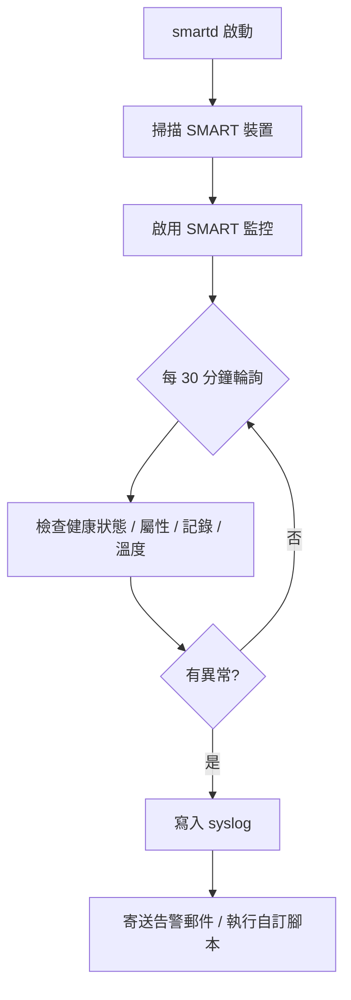

# smartd 與 hdparm：Linux 硬碟健康監控與參數調校工具介紹

## 摘要

本文介紹 Linux 上兩個與實體儲存裝置密切相關的命令列工具：**smartd**（SMART 磁碟健康監控常駐程式）與 **hdparm**（SATA/IDE 裝置參數查詢與設定工具）。兩者用途互補：smartd 屬於「觀測與告警」，負責持續監看硬碟的 S.M.A.R.T. 健康指標並在異常時發出通知；hdparm 則屬於「設定與調校」，用於查詢硬碟資訊、調整電源管理、效能參數、噪音控制與 ATA 安全功能。本文說明兩者的原理、主要設定、常見選項、使用情境與風險。

---

## 1. 背景：S.M.A.R.T. 是什麼

S.M.A.R.T.（Self-Monitoring, Analysis and Reporting Technology，自我監控、分析與回報技術）是內建於多數現代硬碟（HDD）與固態硬碟（SSD）中的監控機制。磁碟韌體會持續記錄各種屬性（attribute），例如重新配置磁區數、溫度、讀寫錯誤率、通電時數、SSD 磨損程度等，用以提早偵測磁碟即將故障的徵兆。smartmontools 這套工具即是讀取這些硬體資料並以人類可讀或機器可解析（JSON/YAML）的格式呈現[^smtools]。

支援的介面類型包括 ATA/SATA（HDD 與 SSD）、NVMe（現代 SSD）、SCSI/SAS（企業級硬碟）、經由 SAT（SCSI/ATA Translation）連接的 USB 儲存裝置，以及位於硬體 RAID 控制器（如 3ware、MegaRAID、AACRAID、CCISS 等）後方的磁碟[^smtools]。

---

## 2. smartd：SMART 磁碟監控常駐程式

### 2.1 定位與運作原理

**smartd** 是 **smartmontools** 套件中的背景常駐程式（daemon），負責長時間持續監控儲存裝置的健康狀態。其運作步驟如下[^smartd8]：

1. **啟動與裝置探索**：啟動時掃描所有支援 SMART 的裝置（如 `/dev/sd*`、`/dev/hd*`、`/dev/nvme*`）。若無設定檔，預設會監控所有探索到的裝置。
2. **啟用 SMART**：在 ATA 裝置上會嘗試啟用 SMART 監控（等同 `smartctl -s on`）。
3. **週期性輪詢**：預設每 **30 分鐘**（可用 `-i N` 調整）檢查一次，內容包括 SMART 健康狀態、屬性值的變化、錯誤記錄計數、自我測試記錄失敗、溫度門檻，以及待處理/無法修正磁區計數。
4. **記錄**：問題會透過 syslog 記錄，通常寫入 `/var/log/syslog` 或 `/var/log/messages`。
5. **電子郵件告警**：可設定在偵測到問題時寄送警告信件。
6. **訊號處理**：`SIGUSR1` 強制立即檢查、`SIGHUP` 重新載入設定檔。



### 2.2 設定檔 `/etc/smartd.conf`

設定檔決定監控哪些裝置、執行哪些檢查。語法規則為：每行一個裝置（可用反斜線 `\` 續行）、`#` 開始為註解、`DEVICESCAN` 自動掃描所有支援 SMART 的裝置並套用後續指令、`DEFAULT` 設定其後裝置項目的預設指令[^smartdconf]。

常用指令（directive）整理如下[^smartdconf]：

| 指令 | 說明 |
|---|---|
| `-d TYPE` | 裝置類型：`ata`、`scsi`、`nvme`、`sat`、`megaraid,N`、`3ware,N`、`cciss,N`、`removable`、`ignore` 等 |
| `-n POWERMODE[,N][,q]` | Nocheck：低電源模式下不喚醒磁碟。值為 `never`、`sleep`、`standby`、`idle` |
| `-H [MASK]` | 檢查 SMART 健康狀態（失敗為 LOG_CRIT） |
| `-l TYPE` | 監控 SMART 記錄：`error`、`xerror`、`selftest`、`scterc,READTIME,WRITETIME` 等 |
| `-f` | 檢查 Usage 屬性（老化/壽命終止）是否失敗 |
| `-p` / `-u` / `-t` | 回報 Prefailure 屬性變化 / Usage 屬性變化 / 兩者（`-t` = `-p -u`） |
| `-a` | 完整監控，等同 `-H -f -t -l error -l selftest -l selfteststs`（未指定指令時的預設） |
| `-I ID` | 忽略某屬性的變化追蹤（例如避免溫度屬性 194/231 造成雜訊） |
| `-R ID[!]` | 當某屬性原始值變化時回報，加 `!` 表示視為嚴重 |
| `-C ID[+]` | 當前待處理磁區計數非零時回報（`+` 表示僅在增加時回報） |
| `-U ID[+]` | 離線無法修正磁區計數非零時回報 |
| `-W DIFF[,INFO[,CRIT]]` | 溫度監控：變化達 DIFF 回報、達 INFO 記錄、達 CRIT 記錄並寄信 |
| `-m ADD` | 告警收件者電子郵件（可逗號分隔多個） |
| `-M TYPE` | 郵件行為：`once`、`always`、`daily`、`diminishing`、`test`、`exec PATH` |
| `-s REGEXP` | 排程自我測試，格式 `T/MM/DD/d/HH`；`:` 加後綴可錯開執行時間 |
| `-o on\|off` | 啟用/停用 SMART 自動離線測試 |
| `-S on\|off` | 啟用/停用屬性自動儲存 |
| `-e NAME[,VALUE]` | 啟動時設定裝置參數：`aam`、`apm`、`lookahead`、`security-freeze`、`standby`、`wcache`、`dsn` |
| `-F TYPE` | 韌體錯誤的因應方式：`none`、`nologdir`、`samsung`、`samsung3` 等 |
| `-v ID,FORMAT[,NAME]` | 廠商專屬屬性格式設定 |

設定範例[^smartdconf][^awsm]：

```
# 監控 /dev/sda 全部檢查，並寄信給管理員
/dev/sda -a -m admin@example.com

# 掃描所有裝置，忽略溫度屬性變化，每天凌晨 2 點執行短測試
DEVICESCAN -a -I 194 -s S/../.././02

# 溫度監控：變化 4 度回報、40 度記錄、45 度告警
/dev/sdc -H -W 4,40,45 -m admin@example.com -M daily
```

### 2.3 常駐程式命令列選項

smartd 本身的命令列選項包括[^smartd8]：

| 選項 | 說明 |
|---|---|
| `-d, --debug` | 前景執行、不 fork、詳細輸出 |
| `-i N, --interval=N` | 輪詢間隔秒數（預設 1800 秒 = 30 分鐘） |
| `-c FILE, --configfile=FILE` | 使用替代設定檔 |
| `-q WHEN, --quit=WHEN` | 退出行為：`nodev`、`errors`、`never`、`onecheck` |
| `-l FACILITY, --logfacility=FACILITY` | syslog facility（預設 `daemon`） |
| `-A PREFIX, --attributelog=PREFIX` | 將屬性值記錄為 CSV 檔 |
| `-s PREFIX, --savestates=PREFIX` | 跨重啟保存狀態（溫度、郵件計數、排程） |
| `-w PATH, --warnexec=PATH` | 自訂警告腳本（預設 `smartd_warning.sh`） |

### 2.4 自我測試類型

smartmontools 提供三種對使用者資料安全無害的自我測試[^awsm]：

| 測試類型 | 說明 |
|---|---|
| **Short（短測試）** | 快速偵測問題，通常約 1 分鐘 |
| **Extended/Long（長測試）** | 與短測試相同但檢查全盤表面，無時間上限（例：約 74 分鐘） |
| **Conveyance（運送測試）** | 偵測運送過程造成的損傷，約 2 分鐘 |
| **Selective（選擇性測試）** | 針對特定 LBA 範圍測試 |

```bash
smartctl -t short /dev/sda       # 執行短測試
smartctl -t long  /dev/sda       # 執行長測試
smartctl -H       /dev/sda       # 查看健康狀態
smartctl -l selftest /dev/sda    # 查看測試結果
smartctl -x       /dev/sda       # 顯示詳細資訊
```

在 Arch Linux 上，smartd 以 systemd 單元 `smartd.service` 管理，透過 `systemctl start/enable smartd` 啟停與開機啟用[^awsm]。

---

## 3. hdparm：SATA/IDE 裝置參數查詢與設定

### 3.1 定位與原理

**hdparm** 是 Linux 上用來查詢與設定 SATA/IDE（以及部分 SCSI/SAS）硬碟參數的命令列工具，由 Mark Lord（Linux (E)IDE 驅動程式原始主要開發者）撰寫，採 BSD 授權，最新穩定版本為 9.65（2022 年 9 月）[^wiki-hdparm]。它透過 Linux SATA/PATA/SAS 的「libata」子系統及舊 IDE 驅動子系統所支援的各種核心介面運作[^man-hdparm]。

其主要用途包括[^man-hdparm]：

1. **查詢硬碟資訊**：型號、序號、幾何結構、能力、支援模式、安全功能等。
2. **效能調校**：調整 DMA 模式、32 位元 I/O、讀取預取、多磁區 I/O、寫入快取、中斷處理。
3. **電源管理**：控制休眠計時器、進階電源管理（APM）、立即休眠/待機命令。
4. **效能基準測試**：透過緩衝快取測量循序讀取速度（`-t`）與快取/記憶體吞吐量（`-T`）。
5. **噪音控制**：以效能換取降低硬碟噪音。
6. **安全功能**：透過 ATA 安全功能集設定、解鎖或清除硬碟密碼。
7. **低階維護**：讀寫個別磁區、管理主機保護區（HPA）與裝置設定覆蓋（DCO）。

### 3.2 常用選項

**資訊與識別**[^man-hdparm]：

| 選項 | 說明 |
|---|---|
| `-I` | 直接向硬碟請求詳細識別資訊（型號、序號、韌體、支援模式、安全狀態） |
| `-i` | 顯示核心開機時儲存的識別資訊（較簡略） |
| `-g` | 顯示磁碟幾何結構與裝置大小 |
| `-C` | 檢查目前電源模式：`active/idle`、`standby`、`sleeping`、`unknown` |

**效能調校**[^man-hdparm]：

| 選項 | 說明 |
|---|---|
| `-d` | 取得/設定 DMA 旗標（`-d1` 啟用，`-d0` 停用） |
| `-c` | 取得/設定 32 位元 I/O 支援（`3` 為啟用並含同步序列） |
| `-m` | 取得/設定多磁區計數（IDE Block Mode），可降低 CPU 負擔 |
| `-A` | 啟用/停用讀取預取（read-lookahead） |
| `-a` | 取得/設定檔案系統讀取預取磁區數 |
| `-W` | 取得/設定寫入快取（`-W1` 啟用，`-W0` 停用） |
| `-X` | 設定 IDE 傳輸模式（如 `-X udma2`） |

**基準測試**[^man-hdparm]：

| 選項 | 說明 |
|---|---|
| `-t` | 測量裝置讀取（緩衝磁碟讀取）耗時 |
| `-T` | 測量快取讀取（處理器、快取、記憶體吞吐量） |
| `--direct` | 搭配 `-t` 使用 O_DIRECT 繞過頁面快取 |
| `--offset` | 在 `-t` 時指定 GiB 偏移，測量磁碟不同區域效能 |

**電源管理與休眠**[^man-hdparm]：

| 選項 | 說明 |
|---|---|
| `-S` | 設定待機（休眠）逾時。`0` 停用；1-240 為 5 秒倍數；241-251 為 30 分鐘倍數；252 為 21 分；255 為 21 分 15 秒 |
| `-B` | 設定 APM 等級。1-127 允許休眠、128-254 不允許、255 停用 APM。數值越低越省電 |
| `-y` | 立即強制進入待機（低電源）模式 |
| `-Y` | 立即強制進入睡眠（最低電源，需重置喚醒） |
| `-J` | 取得/設定 WD Green 硬碟的 idle3 逾時（8-300 秒） |

**噪音管理與 ATA 參數**[^man-hdparm]：

| 選項 | 說明 |
|---|---|
| `-M` | 設定自動噪音管理（AAM）。128 最安靜/最慢，254 最快/最吵 |
| `-Q` | 取得/設定命令佇列深度（SATA 的 NCQ 深度） |
| `-F` | 清除硬碟上的寫入快取緩衝 |
| `-k` / `-K` | 設定設定值在軟重置後是否保留 |
| `-s` | 啟用/停用開機時進入待機（可用於 RAID 多碟順序啟動） |

**低階與危險操作**[^man-hdparm]：

| 選項 | 說明 |
|---|---|
| `--read-sector` | 讀取特定磁區並以十六進位顯示 |
| `--write-sector` | 對特定磁區寫入零（極危險） |
| `--make-bad-sector` | 刻意製造壞磁區（異常危險） |
| `--fibmap` | 顯示檔案在磁碟上佔用的磁區範圍 |
| `--trim-sector-ranges` | SSD 專用，請韌體丟棄無用磁區（異常危險） |
| `--dco-restore` | 將所有硬碟設定還原為出廠預設（極度危險） |
| `-N` | 取得/設定主機保護區（HPA）可見磁區上限 |
| `--fwdownload` | 下載並更新硬碟韌體（極度危險） |

### 3.3 效能調校流程範例

```bash
hdparm -v  /dev/sda            # 查看目前設定
hdparm -I  /dev/sda            # 取得詳細硬碟資訊
hdparm -d1 /dev/sda            # 啟用 DMA
hdparm -c3 /dev/sda            # 啟用 32 位元 I/O
hdparm -m16 /dev/sda           # 設定多磁區計數
hdparm -W1 /dev/sda            # 啟用寫入快取
hdparm -A1 /dev/sda            # 啟用讀取預取
hdparm -tT /dev/sda            # 基準測試（裝置讀取 + 快取讀取）
hdparm --direct -t /dev/sda    # 繞過頁面快取的原始裝置讀取測試
```

hdparm 手冊指出，使用 DMA「幾乎總能帶來最佳效能，具備高 I/O 吞吐量與低 CPU 使用率」；而多磁區模式「通常可將磁碟 I/O 的作業系統負擔降低 30-50%」[^man-hdparm]。

### 3.4 電源管理與休眠設定

hdparm 提供完整的電源管理工具組[^man-hdparm]：

```bash
hdparm -y /dev/sda          # 立即待機（休眠）
hdparm -Y /dev/sda          # 立即睡眠（最深層省電，需重置喚醒）
hdparm -S 120 /dev/sda      # 閒置 10 分鐘後休眠（120 × 5 秒）
hdparm -S 0 /dev/sda        # 停用自動休眠
hdparm -B 127 /dev/sda      # 積極省電（允許休眠）
hdparm -B 254 /dev/sda      # 最佳效能（避免休眠）
hdparm -B 255 /dev/sda      # 完全停用 APM
hdparm -J 30 /dev/sda       # WD Green idle3 逾時設為 30 秒（Linux 建議值）
```

ArchWiki 指出，過於積極的電源管理會因頻繁的磁頭停駐與休眠循環而**縮短硬碟壽命**[^awhdparm]。

### 3.5 安全功能（ATA 安全功能集）

hdparm 實作 ATA 安全功能集，運作於硬碟韌體層級，而非檔案系統/作業系統層級[^man-hdparm]：

| 命令 | 說明 |
|---|---|
| `--security-set-pass PWD` | 設定密碼並鎖定硬碟 |
| `--security-unlock PWD` | 以密碼解鎖硬碟 |
| `--security-disable PWD` | 永久停用硬碟鎖定 |
| `--security-erase PWD` | 以覆寫方式清除硬碟所有資料 |
| `--security-erase-enhanced PWD` | 強化清除（廠商專屬） |
| `--security-freeze` | 凍結安全設定直到下次開機重置 |
| `--security-prompt-for-password` | 互動式輸入密碼（避免密碼出現在 shell 歷史中） |

> 這些是**危險**操作。hdparm 手冊警告，Linux 核心在 2.6.12（可能更晚）之前無法妥善處理 security unlock 與 disable 命令，可能導致 segfault，甚至核心 panic[^man-hdparm]。

### 3.6 設定持久化

hdparm 的設定是**易失性的**，重開機後即失效[^wiki-hdparm]。常見的持久化方法包括[^awhdparm]：

1. **udev 規則**：`/etc/udev/rules.d/69-hdparm.rules`
   ```
   ACTION=="add|change", SUBSYSTEM=="block", KERNEL=="sda", RUN+="/usr/bin/hdparm -B 254 -S 0 /dev/sda"
   ```
   也可針對所有旋轉式硬碟：
   ```
   ACTION=="add|change", SUBSYSTEM=="block", ENV{DEVTYPE}=="disk", KERNEL=="sd*", ATTRS{queue/rotational}=="1", RUN+="/usr/bin/hdparm -B 127 $env{DEVNAME}"
   ```
2. **systemd 單元**：建立 oneshot 服務。
3. **systemd-sleep 掛鉤**：`/usr/lib/systemd/system-sleep/`（於暫停/休眠後重新套用）。
4. **`/etc/hdparm.conf`**：部分發行版（如 Debian/Ubuntu）於開機時讀取；Arch Linux 未提供或記載此方式。

---

## 4. 兩者比較與關係

| 面向 | smartd | hdparm |
|---|---|---|
| 套件 | smartmontools | hdparm |
| 主要角色 | 健康監控與告警（觀測） | 參數查詢與設定（調校） |
| 執行方式 | 背景常駐（`smartd.service`） | 單次命令列工具 |
| 依賴技術 | S.M.A.R.T. | ATA/SATA/libata 核心介面 |
| 典型輸出 | syslog 記錄、告警郵件 | 螢幕輸出、裝置參數變更 |
| 設定持久化 | `/etc/smartd.conf` | udev/systemd/`hdparm.conf` |
| 風險等級 | 低（唯讀監控為主） | 中至高（部分操作極危險） |

兩者可以並用：例如以 smartd 持續監控溫度與磁區異常，並用 `smartd.conf` 的 `-e` 指令在啟動時同時設定硬碟的 APM、讀取預取等參數，或改用 hdparm 進行更細緻的調校[^smartdconf]。

**互補關係**：hdparm 最初為 IDE 硬碟設計，sdparm 為 SCSI 硬碟設計；如今儲存介面是 IDE 與 SCSI 的混合體，因此 hdparm(8) 與 sdparm(8) 彼此互補[^awhdparm]。

---

## 5. 使用情境建議

**smartd 適用於**[^smartdconf][^awsm]：

- 早期故障偵測：及早發現重新配置磁區數（屬性 5）上升、待處理磁區（197）、離線無法修正磁區（198）。
- 溫度監控：對過熱硬碟告警（如 `-W 2,40,45`）。
- 排程自我測試：每天短測試、每週長測試，主動找出壞磁區。
- RAID 控制卡後方磁碟：以 `-d` 指令監控 MegaRAID、3ware、Areca、cciss 等。
- 筆電省電：以 `-n standby,15,q` 避免每次輪詢都喚醒硬碟。
- 資料中心健康儀表板：以 `-A` 將屬性記錄為 CSV，供 Prometheus、Grafana 等取用。
- NVMe 監控：檢查 critical warning、可用備用區、使用百分比與溫度。

**hdparm 適用於**[^man-hdparm][^awhdparm]：

- 查看硬碟型號與詳細資訊（`hdparm -I`）。
- 效能量測（`hdparm -tT`）與傳輸模式調校。
- 閒置硬碟休眠省電（`hdparm -S`）。
- 外接硬碟拔除前立即停駐/休眠（`hdparm -Y`）。
- 降低吵雜硬碟噪音（`hdparm -M 128`）。
- 修正 WD Green 過度磁頭停駐問題（`hdparm -J 30`）。
- 檢查電源狀態（`hdparm -C`）、查詢 NCQ 深度（`hdparm -Q`）。

---

## 6. 風險與注意事項

- **hdparm 高風險操作**：`--write-sector`、`--make-bad-sector`、`--dco-restore`、`--fwdownload`、`--security-erase` 等可能造成資料遺失、系統當機或硬碟永久損壞。Wikipedia 指出，視參數而定，hdparm 可能導致電腦當機或讓磁碟資料無法存取，且「除了謹慎的嘗試錯誤外，沒有可靠方法能為特定控制器-磁碟組合決定最佳設定」[^wiki-hdparm]。ArchWiki 亦警告，變更磁碟預設參數可能凍結系統，甚至**不可逆地損壞磁碟**[^awhdparm]。
- **電源管理反效果**：同時使用 `-B` 與 `-S` 時，若 APM 值小於 128，硬碟可能在 `-S` 逾時值之前就先休眠，造成比預期更積極的停駐/休眠，增加磨損[^awhdparm]。
- **設定非持久**：hdparm 設定於重開機後失效，須以 udev 或 systemd 持久化[^wiki-hdparm]。
- **smartd 相對安全**：主要以唯讀方式監控，但自訂告警腳本（`-M exec`）與 `-e` 相關硬碟設定仍應謹慎。

---

## 7. 結論

smartd 與 hdparm 分別代表 Linux 硬碟管理的兩個面向：**監控**與**控制**。smartd 透過 S.M.A.R.T. 提供持續、自動化的健康監控與告警，是預防資料遺失的第一道防線；hdparm 則提供對硬碟底層參數的直接控制，適用於效能調校、省電、噪音控制與安全設定。由於兩者用途互補，實務上常同時部署：以 smartd 長期監看硬碟健康，並在必要時以 hdparm 進行細部調校與電源管理，同時留意後者的高風險操作與設定持久化需求。

---

## 參考文獻

[^smtools]: smartmontools. (n.d.). *smartmontools*. Retrieved 2026-10-24, from https://www.smartmontools.org/

[^smartd8]: SMARTMONTOOLS. (n.d.). *smartd(8) — Linux manual page*. Retrieved 2026-10-24, from https://manpages.debian.org/testing/smartmontools/smartd.8.en.html

[^smartdconf]: SMARTMONTOOLS. (n.d.). *smartd.conf(5) — Linux manual page*. Retrieved 2026-10-24, from https://manpages.debian.org/testing/smartmontools/smartd.conf.5.en.html

[^man-hdparm]: LORD, M. (n.d.). *hdparm(8) — Linux manual page*. Retrieved 2026-10-24, from https://man7.org/linux/man-pages/man8/hdparm.8.html

[^awhdparm]: ArchWiki. (n.d.). *hdparm*. Retrieved 2026-10-24, from https://wiki.archlinux.org/title/Hdparm

[^awsm]: ArchWiki. (n.d.). *smartmontools*. Retrieved 2026-10-24, from https://wiki.archlinux.org/title/Smartmontools

[^wiki-hdparm]: Wikipedia. (n.d.). *hdparm*. Retrieved 2026-10-24, from https://en.wikipedia.org/wiki/Hdparm

## 來源評析

- **smartmontools 官方網站與 man page**（`smartd.8`、`smartd.conf.5`）：由專案維護者撰寫，權威性最高，內容與最新版本同步，適合作為設定指令與運作原理的主要依據。
- **ArchWiki（hdparm、smartmontools）**：社群維護但品質嚴謹，提供實務操作、設定持久化範例與明確的風險警告，適合補充官方文件未涵蓋的發行版實務。
- **hdparm man page（man7.org）**：工具作者 Mark Lord 撰寫的手冊，對各選項語意與危險性描述最精確。
- **Wikipedia**：適合作為背景與歷史概覽，但 hdparm 條目帶有「需要更多引用」標記（自 2014 年 10 月起），且未討論 libata 等現代子系統的脈絡，故僅作輔助佐證，關鍵技術細節均另以官方來源交叉驗證。
