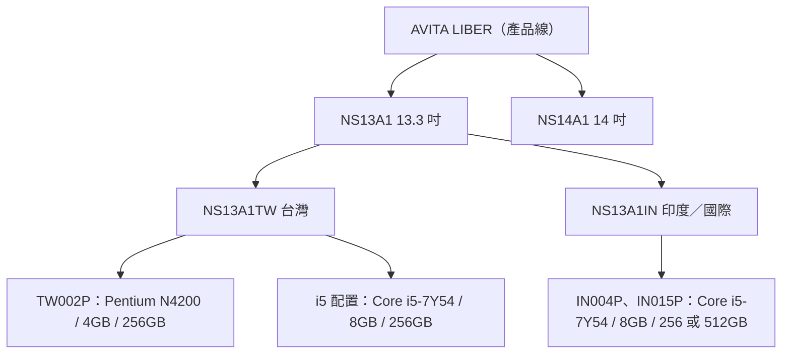

# AVITA LIBER 13.3 吋（NS13A1TW）硬體規格調查報告

## 摘要

AVITA LIBER 13.3 吋筆電（型號 NS13A1TW）是香港新創公司 Nexstgo Company Ltd. 旗下科技品牌 AVITA 的初代筆電產品，於 2017 年 12 月 11 日在台灣發表、12 月 12 日雙 12 檔期正式開賣[^launch-tw][^launch-technews]。本報告針對搭載 Intel Core i5-7Y54 與 8GB 記憶體的機型，整理其官方規格、連接埠、機身尺寸、電池與各項硬體細節，並特別指出跨來源之間存在的資訊落差（連接埠配置、鍵盤背光、無線網卡標準）。

使用者回報的偵測資訊為 `Intel i5-7Y54 (4) @ 3.200GHz` 與 `7859MiB` 記憶體：前者對應核心數 2、執行緒 4（2 核 4 緒）與最高渦輪時脈 3.20 GHz[^ark]；後者約為 8 GB 扣除內建顯示記憶體保留後的可用容量，與 8GB 機型相符。

---

## 1. 機型識別

AVITA LIBER 13.3 吋的產品編號體系如下：

| 層級 | 內容 |
|------|------|
| 產品線 | AVITA LIBER |
| 系列 | NS13A1（13.3 吋）、NS14A1（14 吋） |
| 台灣機型前綴 | `NS13A1TW`，後接三位數字與 `P`（例如 `NS13A1TW002P`）[^amazon-kb] |
| 國際（印度）機型前綴 | `NS13A1IN`（例如 `NS13A1IN004P`、`NS13A1IN015P`）[^digit][^mobilespecs-in015p] |

需要特別注意的是：`NS13A1TW00xP` 後綴屬於**同一機身底盤**下的不同配置。已確認的台灣入門機型 `NS13A1TW002P` 為 Pentium N4200 + 4GB + 256GB SSD 配置[^mobile01-tw002p]；而 i5-7Y54 + 8GB 的高階配置在台灣零售通路（PChome 24h）以「AVITA LIBER 美國品牌 丁香紫 Intel 七代 i5-7Y54/8GB/256GSSD/13.3IPS FHD 輕薄美型筆電」之名上架，未在公開頁面上標示完整後綴[^pchome]。硬體 ID 資料庫 drvhub 對 `NS13A1TW` 同時列出 Intel HD Graphics 500（Apollo Lake 用）與 Intel HD Graphics 615（Kaby Lake-Y 用）兩套顯示驅動[^drvhub]，可佐證此機型前綴橫跨 Pentium 與 Core i5 兩種處理器配置。

---

## 2. 官方規格（2018 年 AVITA 香港官網原廠規格頁）

下列項目直接取自 AVITA 官方網站 2018 年 3 月 14 日的存檔快照，是全系列共通的官方規格，可信度最高[^avita-spec]：

| 項目 | 官方規格（13.3 吋） |
|------|---------------------|
| 作業系統 | Windows 10 Home |
| 處理器 | 第 7 代 Intel Celeron N3350 起，最高至 Intel Core i5[^avita-spec] |
| 顯示器 | 13.3 吋 FHD（1920×1080） |
| 記憶體 | 4GB／8GB DDR3 1600MHz |
| 顯示晶片 | Intel HD Graphics |
| 儲存 | 128GB／256GB／512GB SSD |
| 網路攝影機 | 720p HD |
| 音效 | 1W × 2 立體聲喇叭、內建雙陣列數位麥克風 |
| 鍵盤 | 孤島式鍵盤（背光為選配） |
| 無線 | IEEE 802.11 b/g/n/ac |
| 藍牙 | Bluetooth v4.0 |
| 連接埠 | USB 3.0 × 2、USB 3.0 Type-C（支援螢幕輸出與充電）× 1、MicroSD 讀卡機 × 1、3.5mm 耳機／麥克風複合孔 × 1、Mini HDMI × 1 |
| 尺寸 | 315（寬）× 212（高）× 15（深）mm |
| 重量 | 1.37 kg |
| 變壓器 | 40W AC 變壓器 |
| 電池 | Li-ion 電池，36Wh，續航最高 10 小時 |
| 材質 | 鋁合金 |
| 顏色 | 黑／銀／太空灰／其他顏色 |
| 隨附配件 | AC 變壓器、Mini HDMI 轉 HDMI 轉接頭 |

官方頁面另標註：最薄處 5mm、180 度平躺轉軸、72% NTSC 色域、1000:1 對比度、螢幕 1920×1080、立體聲 2 聲道，以及 802.11ac 為「比 802.11n 快三倍、最高 1300Mbps」[^avita-overview]。官方同時聲明「規格可能因國家而異，請向當地經銷商確認」[^avita-spec]。

---

## 3. 處理器：Intel Core i5-7Y54

取自 Intel 官方 ARK 規格資料庫[^ark]：

| 項目 | 規格 |
|------|------|
| 產品系列 | 第 7 代 Intel Core i5 處理器 |
| 代號 | Kaby Lake |
| 垂直市場 | 行動裝置 |
| 製程 | 14 nm |
| 上市日期 | 2016 年第 3 季 |
| 行銷狀態 | 已停產 |
| 核心數 | 2 |
| 執行緒數 | 4 |
| 處理器基礎頻率 | 1.20 GHz |
| 最高渦輪頻率 | 3.20 GHz |
| 快取 | 4 MB Intel Smart Cache |
| 匯流排速度 | 4 GT/s |
| TDP | 4.5 W |
| 可配置 TDP-up | 7 W（基礎頻率 1.60 GHz） |
| 可配置 TDP-down | 3.5 W（基礎頻率 600 MHz） |
| 最大記憶體 | 16 GB |
| 記憶體類型 | LPDDR3-1866、DDR3L-1600 |
| 記憶體通道 | 2 |
| 最大記憶體頻寬 | 29.8 GB/s |
| 內建顯示 | Intel HD Graphics 615 |
| 顯示基礎／最高動態頻率 | 300 MHz／950 MHz |
| PCI Express 版本 | 3.0（最高 10 條通道） |
| 封裝 | FCBGA1515，20.5 × 16.5 mm |
| TJUNCTION | 100°C |

技術支援包含 Intel Turbo Boost 2.0、Hyper-Threading、Speed Shift、VT-x、VT-d、AES-NI、AVX2、SpeedStep、Boot Guard、OS Guard[^ark]。

對照使用者觀察到的 `i5-7Y54 (4) @ 3.200GHz`：`(4)` 即 4 條執行緒（2 核心 + Hyper-Threading）[^ark]，`3.200GHz` 為最高渦輪頻率[^ark]。此處理器 TDP 僅 4.5W，屬 Y 系列超低功耗行動處理器。

---

## 4. 記憶體與儲存

| 項目 | 規格 | 來源 |
|------|------|------|
| 記憶體容量 | 8GB（另有 4GB 配置） | 官方[^avita-spec] |
| 記憶體類型 | DDR3 1600MHz | 官方[^avita-spec] |
| 記憶體插槽 | 1 個（單條 8GB，焊於主機板） | mobilespecs[^mobilespecs-in015p] |
| 可否升級 | 否，記憶體為 onboard 焊死 | Mobile01 評測與通路規格[^mobile01-i5][^digit] |
| 儲存 | 256GB SSD（另有 128GB／512GB） | 官方[^avita-spec] |
| 儲存介面 | M.2 SATA（SanDisk 品牌，台灣 i5 機型） | Mobile01 評測[^mobile01-i5] |
| 可否升級 | 可，僅 M.2 SSD 可自行更換 | 通路規格[^digit] |

使用者觀察到的 `7859MiB` 約等於 7.67 GiB，是 8GB 總容量扣除內建顯示記憶體保留區後的作業系統可用值，與 8GB onboard 配置一致。

---

## 5. 連接埠

**官方版本**（2018 年官網規格頁）[^avita-spec][^avita-overview]：

- USB 3.0 Type-A × 2
- USB 3.0 Type-C × 1（支援螢幕輸出與充電）
- Mini HDMI × 1（隨附 Mini HDMI 轉 HDMI 轉接頭）
- MicroSD 讀卡機 × 1
- 3.5mm 耳機／麥克風複合孔 × 1
- DC 電源孔（40W AC 變壓器）

**實機配置**（台灣 Mobile01 i5-7Y54 開箱評測）[^mobile01-i5]：

| 側面 | 連接埠 |
|------|--------|
| 左側 | USB 3.0 × 1 |
| 右側 | 電源孔、USB 3.0 × 1、USB Type-C × 1、耳機孔、Micro HDMI、Micro SD 卡槽 |

**資訊落差說明**：關於 Type-C 是否可為筆電充電，來源彼此矛盾。官方 2018 年規格頁將 Type-C 標為「Display out & Charging」[^avita-spec]，官方產品概述頁更寫成「USB-C 3.0 x 1（Quick Charge）」[^avita-overview]；但第三方評測與台灣使用者經驗顯示筆電本體仍以專用變壓器（DC 圓孔，19V 2.1A／40W）充電為主[^mobile01-tw002p][^gp-review]。另外，部分通路規格表僅列出 1 個 USB Type-C[^giznext]，亦有通路與規格資料庫完全未列 Type-C[^mobilespecs-in015p]；這些差異可能源於機型年份與區域配置不同，應以實機為準。

**無線網路**：官方標示 802.11 b/g/n/ac[^avita-spec]，藍牙 v4.0[^avita-spec]。硬體 ID 資料庫顯示實際無線模組為 Intel Dual Band Wireless-AC 3165（PCI\VEN_8086&DEV_3165）、藍牙為 Intel Wireless Bluetooth（USB\VID_8087&PID_0A2A）[^drvhub]。然而多份第三方通路規格表僅列 802.11 b/g/n[^digit][^mobilespecs-in015p]，與官方 ac 標示不符，讀者需留意。

**不具備的連接埠**：無 RJ-45 有線網路孔（需 USB 轉接）[^digit]。

---

## 6. 顯示器、機身與電池

| 項目 | 規格 | 來源 |
|------|------|------|
| 尺寸 | 13.3 吋（對角 33.78 cm） | 通路規格[^mobilespecs-in015p] |
| 解析度 | 1920×1080（FHD） | 官方[^avita-spec] |
| 面板 | IPS，LED 背光 | 通路規格[^mobilespecs-in015p] |
| 色域／對比 | 72% NTSC／1000:1 | 官方[^avita-overview] |
| 觸控 | 無 | 通路規格[^mobilespecs-in015p] |
| 機身尺寸 | 315 × 212 × 15 mm（最薄處 5mm） | 官方[^avita-spec][^avita-overview] |
| 重量 | 1.37 kg | 官方[^avita-spec] |
| 機身材質 | 鋁合金，180 度平躺轉軸 | 官方[^avita-spec][^avita-overview] |
| 電池 | Li-ion / Li-polymer，36Wh | 官方[^avita-spec][^avita-overview] |
| 電池型號 | PT3488127-2S（2ICP3/88/127），2 芯 | 台灣通路[^pchome-batt] |
| 續航（官方） | 最高 10 小時 | 官方[^avita-spec] |
| 變壓器 | 40W AC（DC 19V 2.1A） | 官方[^avita-spec] |
| 作業系統 | Windows 10 Home（64 位元） | 官方[^avita-spec] |
| 網路攝影機 | 720p HD | 官方[^avita-spec] |
| 音效 | 1W × 2 立體聲喇叭、雙陣列數位麥克風 | 官方[^avita-spec] |

**重量落差**：官方標示 1.37 kg[^avita-spec]；部分第三方通路規格表標示 1.35 kg[^digit][^giznext]。差異可能來自不同儲存或無線模組配置。台灣 Mobile01 評測者主觀描述其重量「與先前使用的 MacBook Air 差不多」[^mobile01-i5]。

**鍵盤背光**：官方規格頁將背光列為**選配**（"Island-type Keyboard (with Backlit - Optional)"）[^avita-spec]。第三方通路規格表對同一機型的敘述不一致，有標示「背光」者[^giznext]，亦有未提及背光者[^mobilespecs-in015p]；台灣 i5-7Y54 開箱評測未提及背光[^mobile01-i5]。因此可合理推論：**背光非全系列標準配置，部分區域或年份機型才有**。

---

## 7. 上市、定價與通路（台灣）

| 項目 | 內容 | 來源 |
|------|------|------|
| 品牌母公司 | Nexstgo Company Ltd.（香港） | 官方頁尾[^avita-spec] |
| 台灣發表日 | 2017-12-11（11 日宣布，12 日正式開賣） | TechNews[^launch-technews]、NOWnews[^launch-tw] |
| 產品分線 | AVITA LIBER（標準）、AVITA LIBER Glamour Collection（繽紛款） | Mobile01 新聞[^launch-mobile01] |
| 處理器選項（標準） | Celeron N3350、Pentium N4200 | Mobile01 新聞[^launch-mobile01] |
| 處理器選項（Glamour） | Core m3-7Y30、Core i5-7Y54、Core i7-7Y75 | Mobile01 新聞[^launch-mobile01]、NOWnews[^launch-tw] |
| 起始售價 | NT$15,900（標準）／NT$21,900（Glamour） | NOWnews[^launch-tw] |
| 雙 12 限量優惠 | 約 4 折、NT$12,120，限量 50 台（線上 30 台、實體 20 台） | NOWnews[^launch-tw]、TechNews[^launch-technews] |
| i5-7Y54／8GB／256GB 參考價 | 討論區提及 NT$28,900；評測留言提及「2 萬左右」 | Mobile01[^launch-mobile01][^mobile01-i5] |
| 通路 | PChome、Yahoo 購物中心、momo、蝦皮、friDay、ETMALL | NOWnews[^launch-tw] |

台灣 i5-7Y54 機型評測發布於 2018-05-29[^mobile01-i5]。目前（2026 年）主要電商已無全新庫存，i5-7Y54 版本多見於二手通路[^pchome]。

---

## 8. 使用者實測與效能定位

美國 Laptop Mag 評測（搭載相同 i5-7Y54 系列）提供以下量化數據[^laptopmag]：

| 項目 | 結果 |
|------|------|
| 續航（Wi-Fi 網頁瀏覽、150 尼特） | 5 小時 39 分 |
| Geekbench 4.1（整體） | 6,186（同類平均 9,614） |
| 3DMark Ice Storm Unlimited | 38,167（同類平均 69,486） |
| 檔案傳輸（4.97GB） | 268 MB/s |
| Excel 巨量資料運算 | 3 分 37 秒 |
| HandBrake 4K→1080p 轉檔 | 51 分 9 秒 |

台灣 Mobile01 評測者對 i5-7Y54 機型的使用心得：適合文書處理、基本修圖與 Full HD 影片播放（含 3D 內容），SanDisk 256GB SSD 讀寫速度尚可；機身比 MacBook Air 更薄、觸控板比 MacBook Pro 13 吋寬約 1 公分；附贈 Micro HDMI 轉接頭，內建 Miracast 無線投影可順暢輸出 1080p[^mobile01-i5]。留言區則有批評認為「兩萬左右」價位性價比偏低，指出第 8 代 U 系列處理器效能明顯優於 7Y54[^mobile01-i5]。

Y 系列 4.5W 處理器的效能定位低於同世代 U 系列（15W），此為選購時的主要取捨[^ark][^mobile01-i5]。

---

## 9. 規格衝突與來源批判性反思

1. **USB Type-C 數量與充電能力**：官方規格頁與概述頁標示 1 個 Type-C 且支援充電[^avita-spec][^avita-overview]，但通路規格表與第三方評測出現「有 1 個」「未列」兩種版本[^giznext][^mobilespecs-in015p]，實機經驗又以 DC 圓孔充電為主[^mobile01-tw002p]。可能原因：機型年份／區域版本不同，或通路規格表抄錄不完整。**官方頁面本身即註明規格因國家而異**，建議以實機標籤與實測為準[^avita-spec]。
2. **無線網路標準**：官方標示 802.11 b/g/n/ac[^avita-spec]，硬體 ID 顯示為 Intel AC 3165（支援 ac）[^drvhub]，但部分通路規格表僅列 b/g/n[^digit][^mobilespecs-in015p]。有鑑於硬體 ID 是實際驅動偵測結果，**ac 支援的可信度較高**。
3. **鍵盤背光**：官方標示為選配[^avita-spec]，第三方來源分歧[^giznext][^mobilespecs-in015p]。此為「部分配置」而非全系列固定規格。
4. **重量 1.35 vs 1.37 kg**：官方為 1.37 kg[^avita-spec]，第三方通路多為 1.35 kg[^digit][^giznext]。差異極小，實務上無顯著影響。
5. **型號後綴未能完全確認**：台灣 i5-7Y54 的完整 SKU 後綴未在任何公開頁面明確標示，目前僅能確認其屬於 `NS13A1TW` 前綴、且與已確認的 `NS13A1TW002P`（Pentium N4200）共用底盤[^mobile01-tw002p][^pchome][^drvhub]。
6. **官方台灣頁面已消失**：AVITA 台灣官網最早的 Wayback Machine 快照為 2019-09-18，當時原始 LIBER 已被新機取代，原始 NS13A1 台灣產品頁未被保存[^wayback-tw]。本報告因而改用香港官網 2018 年快照作為官方規格依據[^avita-spec]。
7. **第三方規格資料庫品質**：mobilespecs.net、digit.in、giznext 等聚合站的資料彼此高度相似，可能互相抄錄而非各自驗證；本報告僅將其用於官方文件未涵蓋或需交叉比對之處。

---

## 附錄：規格速查表

| 項目 | 規格 |
|------|------|
| 產品名稱 | AVITA LIBER 13.3 吋 |
| 型號 | NS13A1TW（台灣；完整後綴未公開確認） |
| 作業系統 | Windows 10 Home 64-bit |
| 處理器 | Intel Core i5-7Y54（Kaby Lake、14nm、2 核 4 緒、1.2GHz／渦輪 3.2GHz、4MB 快取、TDP 4.5W） |
| 內建顯示 | Intel HD Graphics 615（300MHz／最高 950MHz） |
| 記憶體 | 8GB DDR3-1600（onboard 焊死，不可升級） |
| 儲存 | 256GB M.2 SATA SSD（可更換） |
| 顯示器 | 13.3 吋 IPS FHD 1920×1080、72% NTSC、1000:1、非觸控 |
| 連接埠 | USB 3.0 Type-A × 2、USB Type-C × 1、Mini HDMI × 1、MicroSD × 1、3.5mm 複合音訊 × 1、DC 電源孔 |
| 無線 | Intel Dual Band Wireless-AC 3165（802.11 b/g/n/ac）、Bluetooth 4.0／4.2 |
| 電池 | Li-ion 36Wh（PT3488127-2S）、官方續航最高 10 小時 |
| 變壓器 | 40W AC（DC 19V 2.1A） |
| 機身 | 315 × 212 × 15 mm（最薄處 5mm）、1.37 kg、鋁合金、180 度轉軸 |
| 網路攝影機 | 720p HD |
| 音效 | 1W × 2 立體聲喇叭、雙陣列數位麥克風 |
| 指紋辨識 | 無 |
| 光碟機 | 無 |
| 有線網路 | 無（需 USB 轉接） |
| 台灣上市 | 2017-12-12 |
| 台灣起始售價 | NT$15,900 起（i5 機型約 NT$20,000–28,900） |

---

## 參考文獻

[^ark]: Intel Corporation. (n.d.). *Intel® Core™ i5-7Y54 Processor (4M Cache, up to 3.20 GHz) specifications*. Retrieved 2026-10-24, from https://www.intel.com/content/www/us/en/products/sku/95452/intel-core-i57y54-processor-4m-cache-up-to-3-20-ghz/specifications.html

[^avita-spec]: AVITA (Nexstgo Company Ltd.). (2018, March 14). *AVITA LIBER Tech Spec — AVITA LIBER (13.3-inch) / (14-inch)* [Archived web page]. Retrieved 2026-10-24, from https://web.archive.org/web/20180314230249/http://avita.com:80/hk/product/liber/spec

[^avita-overview]: AVITA (Nexstgo Company Ltd.). (2018, March 14). *AVITA LIBER Overview — Inside-out Vibrancy* [Archived web page]. Retrieved 2026-10-24, from https://web.archive.org/web/20180314194224/http://avita.com/hk/product/liber

[^launch-technews]: 陳冠榮. (2017, December 11). 搶搭雙 12 購物熱潮，AVITA LIBER 多彩筆電在台上市. *TechNews 科技新報*. Retrieved 2026-10-24, from https://ccc.technews.tw/2017/12/11/avita-launch-liber-notebooks-in-taiwan/

[^launch-tw]: NOWnews 今日新聞. (2017, December 11). *AVITA LIBER 筆電在台上市相關報導*. Retrieved 2026-10-24, from https://www.nownews.com/news/2660328

[^launch-mobile01]: Mobile01. (2017, December 11). *AVITA LIBER 在台上市發表討論（含各配置與售價）*. Retrieved 2026-10-24, from https://www.mobile01.com/topicdetail.php?f=159&t=5340117

[^mobile01-i5]: 爆肝工程師. (2018, May 29). *AVITA LIBER 13.3 吋 i5-7Y54／8GB／256GB SSD 開箱評測*. Mobile01. Retrieved 2026-10-24, from https://www.mobile01.com/topicdetail.php?f=159&t=5473868

[^mobile01-tw002p]: Mobile01. (2018, January 17). *AVITA LIBER NS13A1TW002P 開箱（Pentium N4200／4GB／256GB）*. Retrieved 2026-10-24, from https://www.mobile01.com/topicdetail.php?f=159&t=5368500

[^pchome]: PChome 24h 購物. (n.d.). *AVITA LIBER 美國品牌 丁香紫 Intel 七代 i5-7Y54/8GB/256GSSD/13.3IPS FHD 輕薄美型筆電*. Retrieved 2026-10-24, from https://24h.pchome.com.tw/prod/DHAAFS-A9008MNLZ

[^pchome-batt]: PChome 24h 購物. (n.d.). *PT3488127-2S 電池 AVITA PT3488127-2S 電池 LIBER NS13A NS14A 2ICP3/88/127*. Retrieved 2026-10-24, from https://24h.pchome.com.tw/prod/DHAAFS-A9008MNLZ

[^digit]: Digit.in. (n.d.). *Avita Liber NS13A1 Laptop (7th Gen Core i5/8GB/512GB SSD/Win10) specifications*. Retrieved 2026-10-24, from https://www.digit.in/laptops/avita-liber-ns13a1-laptop-7th-gen-core-i5-8gb-512gb-ssd-win10.html

[^giznext]: GizNext. (n.d.). *Avita Liber NS13A1 Laptop (7th Gen Core i5/8GB/512GB SSD/Win10) specifications*. Retrieved 2026-10-24, from https://www.giznext.com/laptops/avita-liber-ns13a1-laptop-7th-gen-core-i5-8gb-512gb-ssd-win10-gnt

[^mobilespecs-in015p]: mobilespecs.net. (n.d.). *Avita Liber NS13A1IN015P full specifications*. Retrieved 2026-10-24, from https://mobilespecs.net/laptop/Avita/Avita_Liber_NS13A1IN015P.html

[^drvhub]: DriverHub. (n.d.). *Drivers for Laptops AVITA NS13A1TW*. Retrieved 2026-10-24, from https://www.drvhub.net/laptops/avita/ns13a1tw

[^laptopmag]: Laptop Mag. (n.d.). *Avita Liber review*. Retrieved 2026-10-24, from https://www.laptopmag.com/reviews/laptops/avita-liber

[^gp-review]: Gadget Pilipinas. (2019, March). *Avita Liber 13 lifestyle review*. Retrieved 2026-10-24, from https://www.gadgetpilipinas.net/2019/03/avita-liber-13-lifestyle-review/

[^amazon-kb]: Amazon. (n.d.). *Replacement keyboard compatible with NS13A1TW002P / 003P / 004P / 005P*. Retrieved 2026-10-24, from https://www.amazon.com/Keyboard-NS13A1TW002P-NS13A1TW003P-NS13A1TW004P-NS13A1TW005P/dp/B0CLJ61QPZ

[^wayback-tw]: Internet Archive. (2019, September 18). *AVITA Taiwan official site snapshot*. Retrieved 2026-10-24, from https://web.archive.org/web/20190918090611/https://www.avita.com/tw
