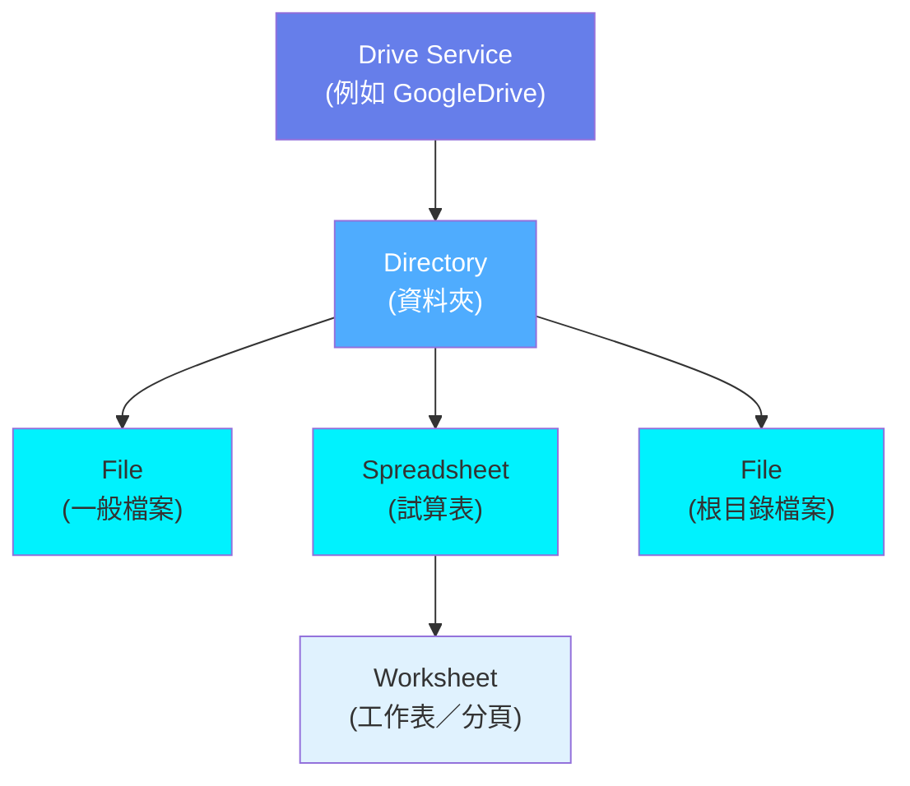
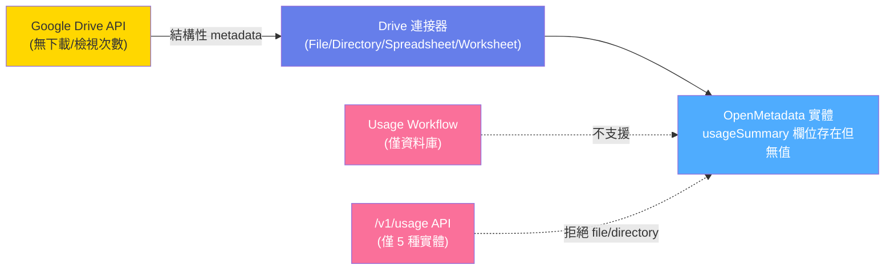

# OpenMeta（OpenMetadata）能否處理 Drive Asset 的「下載、讀取次數」等使用量後設資料？

## 摘要

本報告回答一個具體問題：**OpenMeta（正確名稱為 OpenMetadata）能否處理來自 Drive Assets 的使用量後設資料，例如下載次數（downloads）、讀取次數（reads）、瀏覽次數（views）？**

結論分三層：

1. **原生連接器層**：OpenMetadata 的 Drive 服務（Google Drive 連接器，Beta）**只抽取結構性後設資料**（目錄、檔案、試算表、工作表的名稱、路徑、大小、擁有者、標籤、時間戳），**不抽取下載、讀取或瀏覽次數**[^om-drive-doc]。
2. **平台資料模型層**：OpenMetadata 的 `File`、`Directory`、`Spreadsheet`、`Worksheet` 實體**確實有 `usageSummary` 欄位**（可存放每日／每週／每月計數與百分位排名），但**沒有內建的 Drive 用法工作流程（Usage Workflow）會去填充它**[^om-usage-workflow][^om-file-schema]。
3. **資料來源層**：**Google Drive API 本身不提供任何逐檔的下載次數、檢視次數或讀取次數欄位**，Drive Activity API 也不記錄「view」或「download」動作[^gdrive-files][^gdrive-activity]。因此就算想抓，來源端也沒有現成資料。

換言之，答案是：**無法直接處理，但資料模型留有可自建填充的欄位，且來源端本身缺乏這些指標**。

---

## 背景：先釐清「OpenMeta」指什麼

「OpenMeta」在本主題中指的是 **OpenMetadata**，一套開源的後設資料（metadata）與資料情境（context）平台[^om-repo]。其 GitHub 儲存庫在檢索時有 15,578 顆星，授權為 Apache 2.0[^om-repo]。另外市面上另有同名的商業資料平台 OpenMeta（open-meta.com）與 ERP 框架 OpenMeta（openmeta.info），但都與本題的 Drive 後設資料無關，故不納入討論。

OpenMetadata 在 **2.0.x** 版本導入了 **Drive Service（磁碟服務）** 這個新的服務類型，用來目錄化雲端檔案儲存服務中的檔案、目錄、試算表與工作表[^om-epic22157]。目前支援的 Drive 平台列舉為 `GoogleDrive`、`SharePoint`、`Sftp`、`CustomDrive`[^om-driveservice-schema]。



上圖為 Drive 服務的實體階層，改編自官方 Drive Service 標準文件的階層圖[^om-drive-std]。

---

## 第一層：Drive 連接器實際抽取什麼

以最成熟的 **Google Drive 連接器**（文件中標示為 **BETA**）為例，官方文件說明其能力如下[^om-drive-doc]：

- 需要 GCP 服務帳戶，權限範圍為 `drive.readonly`、`drive.metadata.readonly`，以及處理 Google Sheets 時的 `spreadsheets.readonly`。
- 可抽取**目錄、檔案、試算表、工作表**的後設資料。
- 支援以正規表示式過濾目錄、檔案、試算表、工作表。
- 官方文件明確指出：**「Profiler 與 data quality 工作流程不支援此連接器。」**（"Profiler and data quality workflows are not supported for this connector."）

從 Google Drive 連接器的原始碼可進一步確認抽取的欄位範圍。目錄查詢時，程式請求的欄位為 `id, name, parents, createdTime, modifiedTime, size, shared, webViewLink, description, owners`[^om-drive-source]；檔案查詢時，請求欄位為 `id, name, parents, createdTime, modifiedTime, size, mimeType, webViewLink, description, owners`[^om-drive-source]。

**這些請求中沒有任何下載、檢視或讀取次數欄位。** 產出的 `CreateFileRequest` 只帶入 `name`、`displayName`、`description`、`service`、`directory`、`mimeType`、`size`、`webViewLink`[^om-drive-source]。目錄的 `CreateDirectoryRequest` 則帶入 `name`、`directoryType`、`displayName`、`description`、`service`、`parent`、`sourceUrl`、`path`、`isShared`[^om-drive-source]。

`CreateFileRequest` 的 JSON Schema 亦不含 `usageSummary`，僅有 `extension`（自訂屬性容器）等欄位[^om-createfile]。也就是說，**Drive 連接器在寫入實體時，既未計算也未傳送任何使用量計數。**

---

## 第二層：OpenMetadata 資料模型是否有「使用量」欄位

這一層是關鍵，因為「連接器沒做」與「平台做不到」是兩回事。

### File / Directory / Spreadsheet / Worksheet 都有 `usageSummary`

OpenMetadata 的 `File` 實體 JSON Schema 定義了 `usageSummary` 欄位[^om-file-schema]：

```json
"usageSummary": {
  "description": "Latest usage information for this file.",
  "$ref": "../../type/usageDetails.json",
  "default": null
}
```

同樣的欄位也出現在 `Directory`[^om-directory-schema]、`Spreadsheet`[^om-spreadsheet-schema] 與 `Worksheet`[^om-worksheet-schema] 的 Schema 中。這四個 Drive 實體**在型別層級都保留了 `usageSummary`**。

`usageSummary` 參照的 `usageDetails.json` 定義了每日、每週、每月三組 `usageStats`，每組含 `count`（整數，最小值 0）與可選的 `percentileRank`（0 至 100 的百分位排名），另有 `date`（UTC 日期）[^om-usagedetails]：

```json
{
  "dailyStats": { "count": 0, "percentileRank": 0.0 },
  "weeklyStats": { "count": 0, "percentileRank": 0.0 },
  "monthlyStats": { "count": 0, "percentileRank": 0.0 },
  "date": "YYYY-MM-DD"
}
```

### 但 Usage Workflow 只服務資料庫

OpenMetadata 的 **Usage Workflow** 是填充 `usageSummary` 的官方機制，但它**僅支援資料庫連接器**[^om-usage-workflow]。官方文件列出的支援清單為：BigQuery、Clickhouse、Databricks、Exasol、MSSQL、PostgreSQL、Redshift、Snowflake[^om-usage-workflow]。**Drive 服務不在其中，且沒有 `DriveServiceQueryUsagePipeline` 這類管線型別存在。**

**程式碼層面亦可驗證。** `UsageRepository` 中的 `addUsage` 方法使用 `switch` 判斷實體型別，僅接受 5 種實體：`TABLE`、`PIPELINE`、`DASHBOARD`、`CHART`、`MLMODEL`；其餘一律拋出 `UnhandledServerException`（`entityTypeNotSupported`）[^om-usagerepo]：

```java
switch (type) {
  case TABLE -> tableEntityUsage(...);
  case PIPELINE -> pipelineEntityUsage(...);
  case DASHBOARD -> dashboardEntityUsage(...);
  case CHART -> chartEntityUsage(...);
  case MLMODEL -> mlModelEntityUsage(...);
  default -> throw new UnhandledServerException(
      CatalogExceptionMessage.entityTypeNotSupported(entityType));
}
```

對應的 REST 端點為 `/v1/usage/{entity}/{id}` 與 `/v1/usage/{entity}/name/{fqn}`（GET 讀取、POST 建立、PUT 建立或更新）[^om-usageresource]。因為 `file`、`directory`、`spreadsheet`、`worksheet` 不在上述 switch 白名單內，**即使開發者直接呼叫 `/v1/usage/file/{id}` 上報次數，伺服器端也會拒絕**[^om-usagerepo]。

### `usageSummary` 在 Drive 實體上的目前狀態

`FileRepository.clearFields` 只有在欄位集合包含 `"usageSummary"` 時才保留該值，否則設為 `null`[^om-filerepo]；`FileResource` 也把 `usageSummary` 註冊為需要 `VIEW_USAGE` 權限的欄位[^om-fileresource]。這說明**欄位是被正式承認的**，但由於沒有任何 Drive 用法管線或上報路徑會寫入它，實務上 Drive 資產的 `usageSummary` 會長期維持 `null`。



上圖總結目前的斷鏈：欄位存在，但來源、連接器、上報 API 三處都不支援 Drive 使用量。

---

## 第三層：資料來源本身是否提供這些指標

就算 OpenMetadata 願意擴充，還有一個更根本的限制：**Google Drive 端點本身沒有這些計數。**

### Google Drive API v3 的檔案欄位

Google Drive API v3 的 `files` 資源提供 `createdTime`、`modifiedTime`、`modifiedByMeTime`、`viewedByMeTime`、`viewedByMe`、`sharedWithMeTime`、`version`、`modifiedByMe`、`headRevisionId` 等時間與版本欄位[^gdrive-files]。重點在於：

- `viewedByMeTime` 與 `viewedByMe` **只反映「目前驗證使用者自己」是否檢視過**，不是全體檢視次數[^gdrive-files]。
- `version` 是伺服器端變更的單調遞增版本號，**不是檢視或下載次數**[^gdrive-files]。
- **沒有任何 `downloadCount`、`viewCount`、`readCount` 之類的彙總欄位**[^gdrive-files]。

### Google Drive Activity API 也記錄不到 view / download

Google Drive Activity API（v2）可查詢項目上的活動事件，其 `ActionDetail` 支援的動作類型包含 `create`、`edit`、`move`、`rename`、`delete`、`restore`、`permissionChange`、`comment`、`dlpChange`、`reference`、`settingsChange`、`appliedLabelChange`[^gdrive-activity]。**其中沒有 `view` 或 `download` 動作類型**；純粹的檢視或下載不會產生事件[^gdrive-activity]。

因此結論是：**OpenMetadata 抓不到 Drive 下載／讀取次數，部分原因是 Google Drive 根本沒有把這些數字暴露出來。**

---

## 可行的替代做法

雖然沒有原生支援，但若組織確實需要在 OpenMetadata 中保存「下載次數」等自訂指標，公開資訊支持以下幾條路線。

### 路線一：Custom Properties（寫入 `extension`）

OpenMetadata 採 schema-first，支援為**所有**資料資產類型建立自訂屬性[^om-customprop-ui]。`File` 與 `Directory` 的 Schema 都有 `extension` 欄位（`entityExtension`），用來存放自訂鍵值[^om-file-schema][^om-directory-schema]。

作法是先對 `file` 實體型別建立一個整數型自訂屬性（例如 `downloadCount`），再以 PATCH 寫入個別檔案的值。官方範例即是以 PATCH 將值寫入 `extension`[^om-customprop-api]：

```
PATCH /api/v1/drives/files/{id}
Content-Type: application/json-patch+json
[ { "op": "add", "path": "/extension", "value": { "downloadCount": 42 } } ]
```

- **優點**：零開發即可落地，可從 Custom Properties 分頁檢視。
- **缺點**：`extension` 只是任意鍵值，**不會產生官方 `usageSummary` 的每日／每週／每月聚合與百分位排名，也不會出現在 Explore 的「依每週使用量排序」等既有 UI 表面**，因為那些表面讀取的是 `usageSummary.weeklyStats.count` / `percentileRank`[^om-filerepo]。此路線只是把數字存起來備查。

支援的自訂屬性型別相當多，包含 Integer、Number、Date、Date Time、Duration、Time、Timestamp、Enum、String、Markdown、Email、Entity Reference 等[^om-customprop-ui]。

### 路線二：自建填充 `usageSummary`（需要擴充伺服器端）

要讓數字真正進入官方的使用量語意（含聚合與百分位），需要**修改 `UsageRepository` 的 switch 白名單以接納 `file`/`directory`，或新增 Drive 專屬的用法管線型別**。`Directory` 與 `File` 的 Schema 都已有 `usageSummary` 欄位，且 `UsageDetails` 型別已備妥每日／每週／每月結構，因此資料模型無須變更，缺的是伺服器與管線端的支援[^om-usagerepo][^om-file-schema][^om-usagedetails]。

- **優點**：貼合既有語意，可進入百分位排名與搜尋排序。
- **缺點**：非設定可達成，需自行維護客製分支或向官方提案。

### 路線三：Custom Connector（自建 Drive 來源）

OpenMetadata 支援 **Custom Drive Connector**：以 Python 類別繼承 `Source` 並實作 `prepare`、`_iter`、`test_connection`，產出 `CreateFileRequest` 等實體請求[^om-custom-drive]。官方提供可參考的測試實作範例[^om-custom-drive]。

- **優點**：可完全掌控要抽取與傳送的欄位，包含把外部系統的下載／讀取數字放進 `extension`。
- **缺點**：官方文件已說明 **Custom Drive 服務表單不提供 `sourcePythonClass` 欄位**，需以 YAML 設定 `sourcePythonClass` 並透過 CLI 執行[^om-custom-drive]；且 `CreateFileRequest` 仍不含 `usageSummary`，若要走官方使用量語意仍受路線二的伺服器限制[^om-createfile]。

### 路線四：MCP 工具 `patch_entity`

OpenMetadata 提供 MCP 伺服器，其中 `patch_entity` 工具可用 JSON Patch（RFC 6902）更新既有實體屬性；`create_entity` 亦接受 `extension` 參數（格式為 `{propertyName: value}`）[^om-mcp]。不過 MCP 工具清單中的實體型別列舉以資料庫、儀表板、主題、管線、ML 模型等為主，**未列出 Drive 的 file/directory**[^om-mcp]。因此 MCP 是否可套用於 Drive 實體，需以實際部署版本驗證（本報告不推測未經公開來源確認的行為）。

### 路線五（非同一件事）：Data Insights 的「Most Viewed Data Assets」

需要特別澄清，避免混淆：OpenMetadata 的 **Data Insights** 報表中確實有「Most Viewed Data Assets（最常被檢視的資料資產）」、「Page Views by Data Assets（各資產類型的頁面檢視數）」等圖表[^om-insights-report]。但這些**統計的是 OpenMetadata 平台內部的頁面瀏覽行為（使用者開啟某資產頁面的次數），不是 Drive 檔案被下載或讀取的次數**[^om-insights-report]。兩者語意不同，**不能拿來當作 drive asset 的下載數**。

---

## 綜合對照表

| 問題 | 答案 | 依據 |
| :-- | :-- | :-- |
| Drive 連接器會抽取下載／讀取／檢視次數嗎？ | **不會**，只抽取結構性後設資料 | [^om-drive-doc][^om-drive-source] |
| `File`/`Directory`/`Spreadsheet`/`Worksheet` 有 `usageSummary` 欄位嗎？ | **有**，型別層級已保留 | [^om-file-schema][^om-directory-schema][^om-spreadsheet-schema][^om-worksheet-schema] |
| Usage Workflow 支援 Drive 嗎？ | **不支援**，僅支援 8 個資料庫連接器 | [^om-usage-workflow] |
| `/v1/usage` API 接受 file/directory 嗎？ | **不接受**，僅 5 種實體 | [^om-usagerepo][^om-usageresource] |
| Google Drive API 提供逐檔下載／檢視次數嗎？ | **不提供** | [^gdrive-files] |
| Drive Activity API 記錄 view / download 嗎？ | **不記錄** | [^gdrive-activity] |
| 可用自訂屬性存自訂計數嗎？ | **可以**，寫入 `extension` | [^om-customprop-api][^om-customprop-ui] |
| Data Insights 的「Most Viewed」是檔案下載數嗎？ | **不是**，是平台內部頁面檢視數 | [^om-insights-report] |

---

## 結論

對「OpenMeta 能否處理 Drive Asset 的下載、讀取等使用量後設資料」這個問題，精確答案是：

- **原生、開箱即用層面：不能。** Drive 連接器只做結構性後設資料；Usage Workflow 只涵蓋資料庫；`/v1/usage` API 只接受 table/pipeline/dashboard/chart/mlmodel 五種實體。
- **資料模型層面：有留位子。** 四個 Drive 實體都有 `usageSummary`，`UsageDetails` 結構完整，只是沒有官方路徑把值寫進去，一般呈現 `null`。
- **來源層面：指標本身多半不存在。** Google Drive API 與 Drive Activity API 都不提供逐檔的下載／檢視／讀取次數，因此即便平台願意擴充，仍須另有資料來源（例如自建存取記錄、外部分析系統）。
- **可行替代：** 以自訂屬性（`extension`）暫存自訂計數最快；若要進入官方使用量語意（聚合、百分位、搜尋排序），需擴充伺服器端的 Usage 支援或自建 Drive 用法管線。

---

## 來源

[^om-repo]: open-metadata. (2026). *OpenMetadata* [Repository metadata]. GitHub. Retrieved 2026-10-26, from https://api.github.com/repos/open-metadata/OpenMetadata

[^om-drive-doc]: OpenMetadata. (n.d.). *Google Drive Connector | OpenMetadata Drive Guide*. Retrieved 2026-10-26, from https://docs.open-metadata.org/v2.0.x/connectors/drive/googledrive

[^om-drive-std]: OpenMetadata Standards. (n.d.). *Drive Service*. Retrieved 2026-10-26, from https://openmetadatastandards.org/data-assets/storage/drive-service/

[^om-driveservice-schema]: OpenMetadata. (n.d.). *driveService.json* [JSON Schema]. Retrieved 2026-10-26, from https://raw.githubusercontent.com/open-metadata/OpenMetadata/main/openmetadata-spec/src/main/resources/json/schema/entity/services/driveService.json

[^om-drive-source]: OpenMetadata. (2025). *Google Drive source implementation* [Source code]. Retrieved 2026-10-26, from https://raw.githubusercontent.com/open-metadata/OpenMetadata/main/ingestion/src/metadata/ingestion/source/drive/googledrive/metadata.py

[^om-epic22157]: OpenMetadata. (2025, July 11). *Add Drive Service Support to OpenMetadata* (Issue No. 22157). GitHub. Retrieved 2026-10-26, from https://github.com/open-metadata/OpenMetadata/issues/22157

[^om-file-schema]: OpenMetadata. (n.d.). *file.json* [JSON Schema]. Retrieved 2026-10-26, from https://raw.githubusercontent.com/open-metadata/OpenMetadata/main/openmetadata-spec/src/main/resources/json/schema/entity/data/file.json

[^om-directory-schema]: OpenMetadata. (n.d.). *directory.json* [JSON Schema]. Retrieved 2026-10-26, from https://raw.githubusercontent.com/open-metadata/OpenMetadata/main/openmetadata-spec/src/main/resources/json/schema/entity/data/directory.json

[^om-spreadsheet-schema]: OpenMetadata. (n.d.). *spreadsheet.json* [JSON Schema]. Retrieved 2026-10-26, from https://raw.githubusercontent.com/open-metadata/OpenMetadata/main/openmetadata-spec/src/main/resources/json/schema/entity/data/spreadsheet.json

[^om-worksheet-schema]: OpenMetadata. (n.d.). *worksheet.json* [JSON Schema]. Retrieved 2026-10-26, from https://raw.githubusercontent.com/open-metadata/OpenMetadata/main/openmetadata-spec/src/main/resources/json/schema/entity/data/worksheet.json

[^om-usagedetails]: OpenMetadata. (n.d.). *usageDetails.json* [JSON Schema]. Retrieved 2026-10-26, from https://raw.githubusercontent.com/open-metadata/OpenMetadata/main/openmetadata-spec/src/main/resources/json/schema/type/usageDetails.json

[^om-usage-workflow]: OpenMetadata. (n.d.). *Usage Workflow Guide | OpenMetadata Ingestion Workflows*. Retrieved 2026-10-26, from https://docs.open-metadata.org/v2.0.x/connectors/ingestion/workflows/usage

[^om-usagerepo]: OpenMetadata. (n.d.). *UsageRepository.java* [Source code]. Retrieved 2026-10-26, from https://raw.githubusercontent.com/open-metadata/OpenMetadata/main/openmetadata-service/src/main/java/org/openmetadata/service/jdbi3/UsageRepository.java

[^om-usageresource]: OpenMetadata. (n.d.). *UsageResource.java* [Source code]. Retrieved 2026-10-26, from https://raw.githubusercontent.com/open-metadata/OpenMetadata/main/openmetadata-service/src/main/java/org/openmetadata/service/resources/usage/UsageResource.java

[^om-filerepo]: OpenMetadata. (n.d.). *FileRepository.java* [Source code]. Retrieved 2026-10-26, from https://raw.githubusercontent.com/open-metadata/OpenMetadata/main/openmetadata-service/src/main/java/org/openmetadata/service/jdbi3/FileRepository.java

[^om-fileresource]: OpenMetadata. (n.d.). *FileResource.java* [Source code]. Retrieved 2026-10-26, from https://raw.githubusercontent.com/open-metadata/OpenMetadata/main/openmetadata-service/src/main/java/org/openmetadata/service/resources/drives/FileResource.java

[^om-createfile]: OpenMetadata. (n.d.). *createFile.json* [JSON Schema]. Retrieved 2026-10-26, from https://raw.githubusercontent.com/open-metadata/OpenMetadata/main/openmetadata-spec/src/main/resources/json/schema/api/data/createFile.json

[^om-customprop-api]: OpenMetadata. (n.d.). *How to Add a Custom Property to an Entity with API*. Retrieved 2026-10-26, from https://docs.open-metadata.org/v2.0.x/developers/custom-properties

[^om-customprop-ui]: OpenMetadata. (n.d.). *How to Create a Custom Property for a Data Asset*. Retrieved 2026-10-26, from https://docs.open-metadata.org/v2.0.x/how-to-guides/guide-for-data-users/custom

[^om-custom-drive]: OpenMetadata. (n.d.). *Custom Drive Connector | Build & Extend OpenMetadata Easily*. Retrieved 2026-10-26, from https://docs.open-metadata.org/v2.0.x/connectors/drive/custom-drive

[^om-mcp]: OpenMetadata. (n.d.). *MCP Tools Reference*. Retrieved 2026-10-26, from https://docs.open-metadata.org/v2.0.x/how-to-guides/mcp/reference

[^om-insights-report]: OpenMetadata. (n.d.). *Data Insights Report*. Retrieved 2026-10-26, from https://docs.open-metadata.org/latest/how-to-guides/data-insights/report

[^gdrive-files]: Google. (n.d.). *Files | Google Drive API v3*. Retrieved 2026-10-26, from https://developers.google.com/drive/api/v3/reference/files

[^gdrive-activity]: Google. (n.d.). *ActionDetail | Drive Activity API v2*. Retrieved 2026-10-26, from https://developers.google.com/drive/activity/v2/reference/rest/v2/activity/actiondetail
