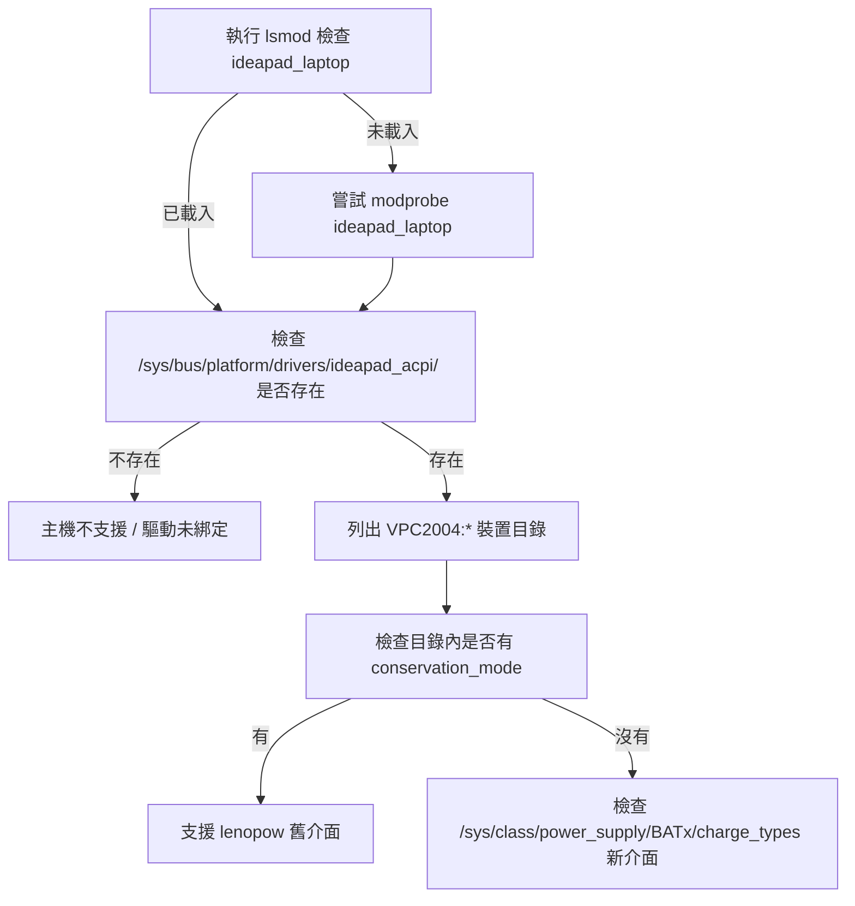

# 如何檢查主機是否支援 lenopow（Lenovo IdeaPad/Legion 電池保育模式）

## 摘要

`lenopow` 是一支以 Bash 撰寫的包裝腳本，用來在 Lenovo IdeaPad 與 LEGION 筆電上啟用或停用韌體層級的「電池保育模式」（battery conservation mode），使充電上限從一般的 95–100% 降到約 55–60%，以延長電池壽命[^repo]。由於它只是一個作業系統層級的包裝器，本身並不偵測硬體，主機是否「支援」完全取決於 Linux 核心是否已載入 `ideapad_laptop` 驅動，以及該驅動是否在 sysfs 中曝露對應的屬性節點[^archwiki]。

本報告說明如何逐步檢查主機是否具備 `lenopow` 運作所需的前提條件，並說明核心社群近年將此介面標準化的變動。

## 背景：lenopow 的運作原理

`lenopow` 的原始碼中，將要存取的 sysfs 路徑寫死為：

```bash
readonly BATTERY_PROTECTION='/sys/bus/platform/drivers/ideapad_acpi/VPC2004:00/conservation_mode'
readonly BATTERY_PROTECTION_ON=1
readonly BATTERY_PROTECTION_OFF=0
```

`--status` 讀取該檔案、`--enable` 寫入 `1`、`--disable` 寫入 `0`（透過 `sudo` 寫入）[^src]。因此「主機是否支援 lenopow」等價於「該路徑是否存在且可讀寫」。README 列出執行需求為 `bash` 與 `linux >= 4.14`[^repo]。



## 檢查步驟

### 步驟一：確認核心驅動已載入

`ideapad-laptop` 核心模組（模組名稱 `ideapad_laptop`）負責繫結 ACPI 平台裝置並曝露 `conservation_mode`[^archwiki]。先檢查是否已載入：

```bash
lsmod | grep ideapad_laptop
```

若沒有輸出，可嘗試手動載入：

```bash
modprobe ideapad_laptop
```

### 步驟二：確認 ACPI 平台裝置與屬性存在

驅動載入後，會在以驅動名命名的目錄下建立對應的裝置節點。常見路徑為 `/sys/bus/platform/drivers/ideapad_acpi/VPC2004:00/conservation_mode`[^archwiki]：

```bash
ls /sys/bus/platform/drivers/ideapad_acpi/
cat /sys/bus/platform/drivers/ideapad_acpi/VPC2004:00/conservation_mode
```

`conservation_mode` 屬性的 ABI 文件記載其正式路徑為 `/sys/bus/platform/devices/VPC2004:*/conservation_mode`，自核心 4.14（2017 年 8 月）加入，用於限制最大充電百分比約 50–60%[^abi]。

### 步驟三：處理裝置名稱變異

`VPC2004:00` 並非所有機型都相同。Arch Wiki 明確指出「此功能的存在與實作方式依機型而異，特別是 `VPC2004:00` 這個資料夾名稱可能不同」[^archwiki]。因此若上述路徑不存在，應改用萬用字元搜尋：

```bash
ls -d /sys/bus/platform/devices/VPC2004:*/
```

或直接尋找所有含 `conservation_mode` 的節點：

```bash
ls /sys/bus/platform/devices/*/conservation_mode
```

由於 `/sys/bus/platform/drivers/ideapad_acpi/VPC2004:00/` 通常是指向 `/sys/bus/platform/devices/VPC2004:00/` 的符號連結，兩個路徑存取的是同一裝置[^archwiki]，因此也可直接從 `devices` 目錄檢查。

### 步驟四：確認是否為新版標準化介面（charge_types）

核心社群已將此功能標準化。自 2025 年 6 月起，核心將 `conservation_mode` 標記為 **obsolete（已淘汰）**，改以標準化的電源供應類別屬性 `charge_types` 取代[^commit]。此變更由 Jelle van der Waa（Red Hat）提出，目的是讓 UPower 等使用者空間工具能統一偵測各廠牌的電池長壽模式[^commit]。

舊屬性並未被移除，只是讀寫時會產生棄用警告：

```text
conservation_mode attribute has been deprecated, see charge_types.
```

新版介面位於電池的 power supply 裝置下，而非平台裝置：

```bash
cat /sys/class/power_supply/BAT0/charge_types
# 例如輸出：Standard [Long_Life]
```

其中 `[Long_Life]` 的方括號代表目前啟用的模式；若要啟用保育模式，即選擇 `Long Life`[^commit]。

### 步驟五：一次檢查全部條件

整合上述步驟的單行檢查（不需 `sudo`，僅讀取）：

```bash
lsmod | grep -q ideapad_laptop \
  && ls /sys/bus/platform/devices/*/conservation_mode 2>/dev/null \
  && echo "舊介面可用（lenopow 相容）" \
  || cat /sys/class/power_supply/BAT*/charge_types 2>/dev/null
```

若舊介面路徑存在，`lenopow` 可直接使用；若只有 `charge_types` 存在，則 `lenopow`（版本 1.0.4）因其路徑寫死而無法運作，需改用 `charge_types` 或等待上游更新[^src][^commit]。

## 相容性對照

| 檢查項目 | 指令 | 支援 lenopow 的判準 |
| :--- | :--- | :--- |
| 核心模組 | `lsmod \| grep ideapad_laptop` | 有輸出 |
| 平台裝置目錄 | `ls /sys/bus/platform/drivers/ideapad_acpi/` | 目錄存在 |
| 舊版屬性 | `cat /sys/bus/platform/devices/VPC2004:*/conservation_mode` | 檔案存在 |
| 新版屬性 | `cat /sys/class/power_supply/BAT0/charge_types` | 顯示 `[Long_Life]` |

## 專案狀態與評估

`makifdb/lenopow` 目前約有 37 顆星、4 個 fork，無發布任何 release[^repo]。專案規模小、屬高度利基（niche）的單機工具，但因為目標主題本身即為小眾領域，此類低星專案仍具參考價值。其原始碼極簡（單一腳本），維護負擔低，但同時也代表它不會自動適應核心介面的變動（如 `charge_types` 標準化）。

來源評析：本報告的核心技術依據主要來自 Arch Wiki 與 Linux 核心的 ABI 文件，兩者均屬權威且持續維護的來源；`charge_types` 的變動則來自核心 commit 本身，屬第一手資料。唯需注意不同機型與核心版本的行為差異，實務上應以主機實際的 sysfs 內容為最終判準。

## 參考文獻

[^repo]: makifdb. (n.d.). *lenopow: A script to enable/disable battery conservation mode in Lenovo Ideapad/LEGION notebooks*. GitHub. Retrieved 2026-10-24, from https://github.com/makifdb/lenopow

[^src]: makifdb. (n.d.). *lenopow* (Version 1.0.4) [Computer software]. Retrieved 2026-10-24, from https://raw.githubusercontent.com/makifdb/lenopow/main/lenopow

[^archwiki]: ArchWiki. (n.d.). *Laptop/Lenovo — Battery conservation mode*. Arch Linux Wiki. Retrieved 2026-10-24, from https://wiki.archlinux.org/title/Laptop/Lenovo

[^abi]: Linux Kernel Documentation. (n.d.). *sysfs-platform-ideapad-laptop* (ABI/obsolete). Retrieved 2026-10-24, from https://www.kernel.org/doc/Documentation/ABI/obsolete/sysfs-platform-ideapad-laptop

[^commit]: van der Waa, J. (2025, June 11). *platform/x86: ideapad: Expose charge_types* (Commit da8f2708f9b69707f4efeb432a18395e46b4666f). Linux Kernel. Retrieved 2026-10-24, from https://github.com/torvalds/linux/commit/da8f2708f9b69707f4efeb432a18395e46b4666f
