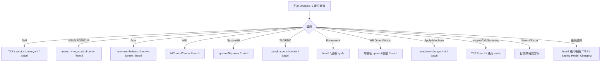

# lenopow 替代方案：不支援機種的 Linux 電池充電上限工具調查

## 摘要

`lenopow` 是一支簡單的 shell script，用於在 Linux 上切換 **Lenovo IdeaPad 與 Legion** 筆電的「電池保育模式」（conservation mode），將充電上限從 95–100% 降到 55–60%，藉此延長電池壽命[^lenopow]。然而它僅支援 Lenovo 特定機種，對於 Dell、HP、ASUS、Acer、MSI、LG、Samsung、Huawei、Framework、System76、TUXEDO、Apple MacBook 等其他品牌的筆電並不適用。

本報告調查在不被 `lenopow` 支援的機種上，可以用來設定電池充電上限的替代工具與方案，並依「跨品牌通用工具」與「各品牌專用工具」兩大類整理，最後提供品牌對照表與選擇建議。所有結論皆來自網路檢索與官方文件，並附上 APA 格式之註腳。

## 背景：Linux 的標準充電控制介面

在 Linux 核心中，電源供應類別（power supply class）定義了三個與充電控制相關的標準 sysfs 屬性，只要硬體／驅動支援，就會出現在 `/sys/class/power_supply/BAT*/` 之下[^sysfs]：

| Sysfs 檔案 | 說明 |
|---|---|
| `charge_control_end_threshold` | 停止充電的門檻（百分比 0–100），寫入 80 代表充到 80% 即停止 |
| `charge_control_start_threshold` | 重新開始充電的門檻（百分比 0–100），寫入 70 代表低於 70% 才恢復充電 |
| `charge_behaviour` | 充電行為模式（例如 `auto`、`inhibit-charge`） |

多數替代工具本質上都是「偵測你的機種 → 找到對應的 sysfs 檔案 → 寫入數值」。因此，只要核心驅動有正確暴露這些屬性，任何通用工具都能運作；反之若硬體／驅動完全不暴露，則需要客製化核心模組。

## 一、跨品牌通用工具（適用於不被 lenopow 支援的機種）

### batctl（Ooooze/batctl）

目前品牌覆蓋率最廣的單一工具，是一個以 Go 撰寫、零執行期相依性的 TUI + CLI 程式，會自動偵測 16 種以上廠牌後端，並在無法辨識時退回通用 sysfs 後端[^batctl]。支援 Acer、Lenovo ThinkPad、ASUS、Dell、Lenovo IdeaPad、Huawei、Samsung、LG Gram、MSI、Framework、System76、Sony VAIO、Toshiba/Dynabook、Tuxedo（Clevo）、Apple Silicon、Microsoft Surface，以及通用後備方案[^batctl]。內建 `max-lifespan`（20/80）、`balanced`（40/80）、`plugged-in`（70/80）、`full-charge`（0/100）等預設組合，並可透過 systemd 服務在重開機／休眠後保持設定[^batctl]。授權為 MIT，約 167 顆星[^batctl]。

這是「非 Lenovo 機種」最推薦的單一工具，因為它一次覆蓋絕大多數品牌。

### TLP（linrunner/TLP）

Linux 筆電電源最佳化的老牌權威工具，約 3.3k 顆星，GPL-2.0 授權[^tlp]。除了充電門檻設定外，還整合電源設定檔、無線裝置管理等功能；其 `tlp setcharge` 與 `tlp stat` 指令可統一設定多品牌筆電的充電門檻[^tlp]。TLP 特別支援 Huawei（`charge_control_thresholds`）、LG Gram（`battery_care_limit` 與 `charge_control_end_threshold`）、Samsung（`battery_life_extender`）等非標準介面機種[^huawei][^lg][^samsung]。

### Battery Health Charging（maniacx/Battery-Health-Charging）

GNOME Shell 擴充套件，約 414 顆星，GPL-3.0 授權，在 GNOME 擴充套件市集的下載量超過 21 萬次[^bhc]。支援 Asus、LG、Samsung、Sony/Vaio、Huawei、Toshiba/Dynabook、System76、Lenovo（IdeaPad/Legion）、ThinkPad、Panasonic、Fujitsu、Dell、Chromebook，並可透過額外相依套件支援 Acer、MSI、Tuxedo、Slimbook、Purism Librem、Gigabyte Aero/Aorus、Apple MacBook、Framework、Razer 等[^bhc]。以 GNOME 使用者而言，這是最省事的跨品牌圖形化解決方案。

### auto-cpufreq（AdnanHodzic/auto-cpufreq）

約 7.9k 顆星、GPL-3.0 授權[^autocpufreq]。本質是 CPU 省電／效能最佳化工具，但自 v2.2.0 起加入電池充電門檻設定（`enable_thresholds`、`start_threshold`、`stop_threshold`），並支援 Lenovo、ASUS 與一般支援 `charge_control_end_threshold` 的硬體[^autocpufreq]。適合已使用它管理 CPU 省電的使用者一併設定充電門檻。

### power-profiles-daemon

Freedesktop.org 的標準電源設定檔服務，透過核心的 `platform_profile` 介面運作，已原生整合進 GNOME、KDE Plasma 6、COSMIC[^ppd]。它本身不直接設定充電門檻，而是管理電源設定檔，但對於透過 `platform_profile` 控制充電行為的機種（如部分 HP）有其角色[^tlp]。

### ptc0/battery-threshold

一個以 Python 撰寫、建立 systemd 服務的簡單腳本，直接使用標準的 `charge_control_end_threshold` sysfs 屬性，適用於任何核心有暴露該屬性的筆電[^ptc0]。星數為 0，屬極簡方案，適合想自行掌握簡單腳本的使用者[^ptc0]。

### KDE PowerDevil（內建）與 Plasma 小工具

KDE Plasma 6.1 起，電源管理（PowerDevil）已在「系統設定 → 電源管理」中內建電池充電門檻支援，直接讀寫 sysfs，適用於任何核心支援的筆電[^powerdevil]。此外社群亦有 `plasma-charge-limit`（Nevaberry）與 `ThinkCharge`（GregorBoxer-sudo）等 Plasma 6 面板小工具，提供 50%/80%/90%/100% 一鍵設定與自動電源設定檔切換[^plasma][^thinkcharge]。

## 二、各品牌專用工具

### Dell

- **TLP** 支援 Dell 的 `dell_laptop` 驅動與標準門檻介面[^tlp]。
- **Dell Command Configure（`smbios-battery-ctl`）** 為 Dell 官方工具，可設定自訂充電區間，例如 `pkexec smbios-battery-ctl --set-charging-mode=custom --set-custom-charge-interval=55 60`[^dell].
- `rikych-hue/dell-battery-threshold` 為一個 systemd 服務小專案（星數 0），於 Precision 7730 測試，寫入 75–80% 門檻，適用任何支援 `charge_control_start/end_threshold` 的筆電[^dellscript]。

### ASUS（ROG / TUF）

- **asusctl + rog-control-center**（OpenGamingCollective/asusctl），約 657 顆星、MPL-2.0 授權，為 ASUS ROG 筆電的完整控制堆疊，包含 `asusd` 常駐程式、`asusctl` CLI 與 `rog-control-center` GUI，支援充電門檻、風扇曲線、GPU MUX 切換、Aura RGB 等[^asusctl]。
- ASUS 機種通常使用 `asus_wmi` 驅動；部分型號僅接受 40、60、80 等特定門檻值[^batctl]。

### Acer

- **frederik-h/acer-wmi-battery** 是 Acer Linux 充電控制的代表性核心驅動（約 333 顆星），暴露 `/sys/bus/wmi/drivers/acer-wmi-battery/health_mode`（80% 上限開關）與校正模式，於 Swift 3 開發並確認支援多款機種[^acerwmi]。核心模組名為 `acer-wmi-battery.ko`。
- **0x7375646F/Linuwu-Sense**（約 273 顆星）針對 Acer Predator/Nitro 電競筆電，提供電池上限（80%）、風扇、RGB、校正等完整硬體控制，核心模組名為 `linuwu_sense`[^linuwu]。

### MSI

**MControlCenter**（dmitry-s93/MControlCenter），約 720 顆星、GPL-3.0 授權，為 MSI 筆電的完整控制中心，支援電池充電門檻、效能模式切換、風扇控制、鍵盤背光等，使用 `msi-ec` 核心驅動[^mcc]。

### System76

**system76-power**（pop-os/system76-power），約 643 顆星、GPL-3.0 授權、Rust 撰寫，為 System76 筆電的電源與顯示切換常駐程式，內含電池充電門檻管理（Battery/Balanced/Performance 設定檔與 D-Bus 自訂門檻），亦可在一般硬體上部分運作[^s76]。

### TUXEDO（Clevo）

**tuxedo-control-center**（tuxedocomputers/tuxedo-control-center），約 648 顆星、GPL-3.0 授權，提供 CPU 核心數、風扇、充電設定檔等完整系統調校，並含 `tccd` 常駐程式[^tuxedo]。Tuxedo（Clevo）機種的門檻為離散值，開始門檻 40/50/60/70/80/95、停止門檻 60/70/80/90/100[^batctl]。

### Framework

Framework 筆電透過核心的 `cros_charge-control` 驅動暴露標準介面，任何寫入 `charge_control_end_threshold` 的工具皆可使用；`batctl` 亦支援其充電行為控制（`charge_behaviour`），開始門檻需 EC 韌體 v3 以上[^batctl]。

### HP（Omen / Victus）

HP 的情況較特殊，許多新型 Omen/Victus 筆電缺乏核心層級的 `charge_control_end_threshold` 支援：

- **TUXOV/hp-wmi-fan-and-backlight-control**（約 41 顆星）為修補版 `hp-wmi` DKMS 核心驅動，提供風扇、鍵盤 RGB、平台設定檔切換，是 HP 驅動層控制的基礎[^tuxov]。
- **rizhamhd/hp-victus-linux-charge-limit**（約 1 顆星）為實驗性方案，透過上述修補驅動暴露 `charge_behaviour`（`auto` / `inhibit-charge`），以軟體控制的充電視窗取代韌體數值門檻，並以 systemd timer 每約 30 秒檢查一次[^hpvictus]。
- **AaritDev/Omen-battery-checker**（星數 0）則僅為通知工具（Python/PyQt6），在 80% 時發出桌面通知，並非核心層級的充電限制器[^omen]。

需注意：並無公開存在的名為「hp-ctrl」的充電限制工具（經檢索確認不存在）[^hpctrl]。

### Apple MacBook（Linux）

- **jtbrough/macbook-charge-limit**（約 16 顆星、MIT 授權）針對 Intel MacBook，透過 ioperm/inb/outb 寫入 Apple SMC 的 `BCLM`/`BFCL` 鍵，並含 systemd 持久化，僅能在 Apple 硬體上執行[^macbook]。
- Apple Silicon（Asahi Linux）則透過 `macsmc_power` 驅動暴露介面，`batctl` 支援其 80/100 門檻[^batctl]。

### 其他品牌

- **Huawei MateBook**：`huawei-wmi` 驅動提供非標準的 `/sys/devices/platform/huawei-wmi/charge_control_thresholds`，需一次寫入「開始 結束」兩個值（如 `echo "0 80"`）[^huawei]。
- **LG Gram**：`lg-laptop` 驅動透過電池 hook 暴露標準的 `charge_control_end_threshold`，另有舊版別名 `/sys/devices/platform/lg-laptop/battery_care_limit`（寫入 80 或 100）[^lg]。
- **Samsung**：`samsung-laptop` 驅動提供布林值的 `/sys/devices/platform/samsung/battery_life_extender`（1 = 限制 80%，0 = 充到 100%）[^samsung]。
- **Xiaomi / Razer**：主線核心並無提供充電門檻控制的專門驅動（`xiaomi-wmi` 僅處理熱鍵），目前無確認可用的充電上限方案[^xiaomi][^razer]。

## 三、品牌對照表

| 品牌／機種 | 建議工具 | 核心驅動 |
|---|---|---|
| Dell | TLP、batctl、smbios-battery-ctl | `dell_laptop` |
| ASUS ROG/TUF | asusctl + rog-control-center、batctl | `asus_wmi` |
| Acer | acer-wmi-battery、Linuwu-Sense、batctl | `acer-wmi-battery` / `linuwu_sense` |
| MSI | MControlCenter、batctl | `msi-ec` |
| System76 | system76-power、batctl | `system76_acpi` |
| TUXEDO（Clevo） | tuxedo-control-center、batctl | `clevo_acpi` |
| Framework | batctl、通用 sysfs | `cros_charge-control` |
| HP Omen/Victus | 修補版 hp-wmi 驅動、batctl | 客製 `hp-wmi` |
| Apple MacBook（Intel） | macbook-charge-limit | Apple SMC（BCLM） |
| Apple Silicon（Asahi） | batctl、通用 sysfs | `macsmc_power` |
| Huawei MateBook | TLP、batctl、通用 sysfs | `huawei-wmi` |
| LG Gram | TLP、batctl、通用 sysfs | `lg-laptop` |
| Samsung | TLP、batctl、通用 sysfs | `samsung-laptop` |
| 任何筆電 | batctl（通用後備）、TLP、Battery Health Charging | 標準 `charge_control_*_threshold` |

## 四、選擇建議

1. **想要一支工具通吃多品牌**：首選 **batctl**，它覆蓋 16 種以上廠牌並具通用後備，且為單一 Go 靜態執行檔、零相依[^batctl]。
2. **想要最成熟、最廣為人知的方案**：**TLP**（約 3.3k 顆星）是 Linux 筆電電源管理的黃金標準，對非標準介面（Huawei/LG/Samsung）支援尤其完整[^tlp]。
3. **GNOME 使用者**：安裝 **Battery Health Charging** 擴充套件，跨品牌且下載量龐大[^bhc]。
4. **KDE Plasma 使用者**：Plasma 6.1 起已內建充電門檻設定，或使用 `plasma-charge-limit` 小工具[^powerdevil][^plasma]。
5. **品牌專用需求**：ASUS 用 asusctl、MSI 用 MControlCenter、System76 用 system76-power、TUXEDO 用 tuxedo-control-center、Acer 用 acer-wmi-battery、Apple MacBook 用 macbook-charge-limit。
6. **HP 使用者**：情況最複雜，可能需要修補版 `hp-wmi` 核心驅動與實驗性腳本，並承擔較高風險[^hpvictus]。

特別提醒：`lenopow` 本身僅約 37 顆星[^lenopow]，屬小眾專案；上述替代工具中，TLP（3.3k）、auto-cpufreq（7.9k）等社群活躍度與成熟度遠高於它，對非 Lenovo 機種而言更值得優先考慮。

## 資料來源批判性反思

1. **來源權威性差異大**：本報告多數星數與功能描述來自各專案 GitHub 頁面或官方文件，屬第一手資料，可信度高；但部分工具（如 HP、Acer 的充電腳本）星數極低（0–41 顆星），維護活躍度與長期可靠性存疑，讀者採用前應自行評估。
2. **核心介面需以實機驗證**：sysfs 屬性是否實際存在，取決於核心版本、機種型號與 EC 韌體，工具能「偵測到」不代表一定可寫入成功，建議以 `ls /sys/class/power_supply/BAT*/` 實機確認。
3. **AI 檢索工具可能出錯**：本調查中曾出現檢索代理回報錯誤的專案路徑（例如 `schinfo/lenopow` 與 `makifdb/lenopow` 混淆），以及虛構專案（如 `skilchen/charge-limit` 實際不存在）。本報告已針對關鍵專案重新查證並剔除無法確認的條目；仍有少數低星專案僅憑檢索結果記錄，尚未逐一直接驗證。
4. **品牌支援常有例外**：同一品牌不同型號差異極大（尤其 HP、ASUS），品牌層級的「支援」僅為概略指引，實際仍須依型號與核心版本測試。

## 註腳

[^lenopow]: makifdb. (n.d.). lenopow [Computer software]. Retrieved 2026-10-24, from https://github.com/makifdb/lenopow
[^sysfs]: The Linux Kernel Archives. (n.d.). Power supply class. Retrieved 2026-10-24, from https://www.kernel.org/doc/html/latest/power/power_supply_class.html
[^batctl]: Ooooze. (n.d.). batctl: Battery charge threshold manager for Linux laptops [Computer software]. Retrieved 2026-10-24, from https://github.com/Ooooze/batctl
[^tlp]: linrunner. (n.d.). TLP: Linux advanced power management [Computer software]. Retrieved 2026-10-24, from https://github.com/linrunner/TLP
[^bhc]: maniacx. (n.d.). Battery Health Charging [Computer software]. Retrieved 2026-10-24, from https://github.com/maniacx/Battery-Health-Charging
[^autocpufreq]: AdnanHodzic. (n.d.). auto-cpufreq: Automatic CPU speed & power optimizer for Linux [Computer software]. Retrieved 2026-10-24, from https://github.com/AdnanHodzic/auto-cpufreq
[^ppd]: freedesktop.org. (n.d.). power-profiles-daemon. Retrieved 2026-10-24, from https://gitlab.freedesktop.org/hadess/power-profiles-daemon
[^ptc0]: ptc0. (n.d.). battery-threshold [Computer software]. Retrieved 2026-10-24, from https://github.com/ptc0/battery-threshold
[^powerdevil]: KDE. (n.d.). PowerDevil [Computer software]. Retrieved 2026-10-24, from https://github.com/KDE/powerdevil
[^plasma]: Nevaberry. (n.d.). plasma-charge-limit [Computer software]. Retrieved 2026-10-24, from https://github.com/Nevaberry/plasma-charge-limit
[^thinkcharge]: GregorBoxer-sudo. (n.d.). ThinkCharge [Computer software]. Retrieved 2026-10-24, from https://github.com/GregorBoxer-sudo/ThinkCharge
[^dell]: maniacx. (n.d.). Device compatibility: Dell. In Battery Health Charging. Retrieved 2026-10-24, from https://maniacx.github.io/Battery-Health-Charging/device-compatibility/dell
[^dellscript]: rikych-hue. (n.d.). dell-battery-threshold [Computer software]. Retrieved 2026-10-24, from https://github.com/rikych-hue/dell-battery-threshold
[^asusctl]: OpenGamingCollective. (n.d.). asusctl: A control daemon, CLI tools, and a collection of crates for interacting with ASUS ROG laptops [Computer software]. Retrieved 2026-10-24, from https://github.com/OpenGamingCollective/asusctl
[^acerwmi]: frederik-h. (n.d.). acer-wmi-battery: Linux kernel driver for Acer WMI battery health control [Computer software]. Retrieved 2026-10-24, from https://github.com/frederik-h/acer-wmi-battery
[^linuwu]: 0x7375646F. (n.d.). Linuwu-Sense: Linux kernel module for Acer Predator/Nitro laptops [Computer software]. Retrieved 2026-10-24, from https://github.com/0x7375646F/Linuwu-Sense
[^mcc]: dmitry-s93. (n.d.). MControlCenter: A program for changing settings on MSI laptops [Computer software]. Retrieved 2026-10-24, from https://github.com/dmitry-s93/MControlCenter
[^s76]: pop-os. (n.d.). system76-power [Computer software]. Retrieved 2026-10-24, from https://github.com/pop-os/system76-power
[^tuxedo]: tuxedocomputers. (n.d.). TUXEDO Control Center [Computer software]. Retrieved 2026-10-24, from https://github.com/tuxedocomputers/tuxedo-control-center
[^tuxov]: TUXOV. (n.d.). hp-wmi-fan-and-backlight-control [Computer software]. Retrieved 2026-10-24, from https://github.com/TUXOV/hp-wmi-fan-and-backlight-control
[^hpvictus]: rizhamhd. (n.d.). hp-victus-linux-charge-limit [Computer software]. Retrieved 2026-10-24, from https://github.com/rizhamhd/hp-victus-linux-charge-limit
[^omen]: AaritDev. (n.d.). Omen-battery-checker [Computer software]. Retrieved 2026-10-24, from https://github.com/AaritDev/Omen-battery-checker
[^hpctrl]: GitHub. (n.d.). Repository search for "hp-ctrl" battery charge. Retrieved 2026-10-24, from https://github.com/search?q=hp-ctrl+battery
[^macbook]: jtbrough. (n.d.). macbook-charge-limit [Computer software]. Retrieved 2026-10-24, from https://github.com/jtbrough/macbook-charge-limit
[^huawei]: The Linux Kernel Archives. (n.d.). huawei-wmi.c. Retrieved 2026-10-24, from https://github.com/torvalds/linux/blob/master/drivers/platform/x86/huawei-wmi.c
[^lg]: The Linux Kernel Archives. (n.d.). lg-laptop.c. Retrieved 2026-10-24, from https://github.com/torvalds/linux/blob/master/drivers/platform/x86/lg-laptop.c
[^samsung]: The Linux Kernel Archives. (n.d.). samsung-laptop.c. Retrieved 2026-10-24, from https://github.com/torvalds/linux/blob/master/drivers/platform/x86/samsung-laptop.c
[^xiaomi]: The Linux Kernel Archives. (n.d.). xiaomi-wmi.c. Retrieved 2026-10-24, from https://github.com/torvalds/linux/blob/master/drivers/platform/x86/xiaomi-wmi.c
[^razer]: GitHub. (n.d.). Repository search for Razer Linux battery charge threshold. Retrieved 2026-10-24, from https://github.com/search?q=razer+linux+battery+charge+threshold
