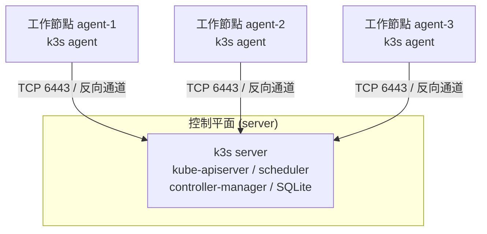
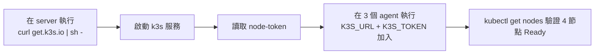

# 建置 4 節點 K3s 叢集：1 控制平面 + 3 工作節點逐步指南

## 摘要

本報告提供一套可重現的逐步指南，說明如何以 **K3s** 建置一個包含 **1 個控制平面節點（server）** 與 **3 個工作節點（agent）** 的 Kubernetes 叢集。內容涵蓋架構規畫、硬體與網路前置需求、控制平面安裝、取得並分發 token、三個工作節點的加入、kubeconfig 設定、叢集驗證，以及標籤／汙點、設定檔管理與解除安裝等維運操作。所有步驟與指令皆依據 K3s 官方文件，並於文末以註腳列出參考來源。

本報告為獨立文件，閱讀者無需具備任何背景知識；文中需要的全部上下文均收錄於本報告內。

## 1. 架構總覽

本指南採用的拓樸為單一控制平面（single-server）搭配三個工作節點。此架構的資料存放區預設為內嵌的 **SQLite**，適用於測試、開發與小型生產環境；由於只有一個 server，控制平面本身不具備高可用性（HA）[^arch]。若需要控制平面高可用，官方建議改以內嵌 etcd 並使用多個 server 節點，這不在本報告範圍內[^ha]。



節點之間的通訊採「反向通道（reverse tunneling）」設計：agent 主動向 server 建立對外連線，kubelet 的流量則經由該通道回傳，因此工作節點不需要對外開放額外連接埠[^req]。

## 2. 前置需求

### 2.1 硬體與作業系統

K3s 的支援架構包含 `x86_64`、`armhf` 與 `arm64/aarch64`，並預期可在多數現代 Linux 系統上運作，例如 SUSE、RHEL/CentOS/Fedora、Ubuntu/Debian 及 Raspberry Pi[^req]。最低硬體需求如下表[^req]：

| 節點類型 | CPU | 記憶體 |
|---|---|---|
| Server（控制平面） | 2 核心 | 2 GB |
| Agent（工作節點） | 1 核心 | 512 MB |

此外，官方強烈建議使用 SSD，尤其是 etcd 對寫入相當敏感，在 ARM 平台上應避免使用 SD 卡或 eMMC 作為 server 節點的儲存媒體[^req]。

### 2.2 主機名稱唯一性

每個節點的主機名稱必須唯一。若無法保證唯一，可透過 `--with-node-id` 附加隨機 ID，或使用 `--node-name` 與環境變數 `$K3S_NODE_NAME` 指定節點名稱[^req]。

### 2.3 網路連接埠

叢集運作需要下列輸入連接埠（inbound）開放[^req]：

| 協定 | 連接埠 | 來源 → 目的 | 用途 |
|---|---|---|---|
| TCP | 6443 | Agents → Servers | K3s supervisor 與 Kubernetes API Server |
| UDP | 8472 | 所有節點 | Flannel VXLAN |
| UDP | 51820 | 所有節點 | Flannel WireGuard（IPv4） |
| UDP | 51821 | 所有節點 | Flannel WireGuard（IPv6） |
| TCP | 2379–2380 | Servers → Servers | 內嵌 etcd（僅 HA 需要） |
| TCP | 10250 | 所有節點 | kubelet 指標與 API |
| TCP | 5001 | 所有節點 | 內嵌分散式映像倉庫（Spegel） |

其中連接埠 **8472（VXLAN）不應對外網公開**，節點應置於防火牆之後[^req]。若使用自訂 CNI 取代 Flannel，則不需開放 Flannel 相關連接埠[^req]。

### 2.4 防火牆設定

若作業系統使用防火牆，官方建議停用或在信任區域中加入 Pod 與 Service 的 CIDR[^req]：

- **firewalld**：`systemctl disable firewalld --now`，或開放 `6443/tcp`，並將 `10.42.0.0/16`（Pod）與 `10.43.0.0/16`（Service）設為信任來源[^req]。
- **UFW**：`ufw disable`，或開放 `6443/tcp` 與上述兩個 CIDR[^req]。

### 2.5 Raspberry Pi／ARM 的 cgroup 設定

在標準 Raspberry Pi OS 上 cgroup 預設未啟用，需於 `/boot/firmware/cmdline.txt`（較舊版本為 `/boot/cmdline.txt`）附加下列參數後重開機[^req]：

```
cgroup_memory=1 cgroup_enable=memory
```

### 2.6 節點規畫範例

本報告假設的節點配置如下（請依實際環境調整 IP 與主機名稱）：

| 角色 | 主機名稱 | IP 位址 |
|---|---|---|
| 控制平面 | k3s-server | 10.0.0.10 |
| 工作節點 1 | k3s-agent-1 | 10.0.0.11 |
| 工作節點 2 | k3s-agent-2 | 10.0.0.12 |
| 工作節點 3 | k3s-agent-3 | 10.0.0.13 |

## 3. 步驟一：安裝控制平面（Server）

控制平面的安裝使用官方安裝腳本，其網址為 `https://get.k3s.io`[^quick]。於控制平面節點上以 root 權限執行[^quick]：

```bash
curl -sfL https://get.k3s.io | sh -
```

若需要指定節點對外公告的 IP、Flannel 使用的網路介面，或設定 kubeconfig 權限，可傳入旗標[^quick][^config]：

```bash
curl -sfL https://get.k3s.io | sh -s - \
  --node-ip 10.0.0.10 \
  --flannel-iface eth0 \
  --write-kubeconfig-mode 644
```

安裝腳本會將 K3s 安裝為 systemd（或 openrc）服務，該服務會在開機或崩潰後自動重啟，並安裝 `kubectl`、`crictl`、`ctr`、`k3s-killall.sh` 與 `k3s-uninstall.sh` 等工具；同時將 kubeconfig 寫入 `/etc/rancher/k3s/k3s.yaml`[^quick]。

僅以 `K3S_URL` 有無來區分角色：未設定 `K3S_URL` 時節點預設為 server 模式[^config]。

## 4. 步驟二：取得並分發 Token

工作節點加入叢集時需要共用密鑰 token。此 token 儲存於 server 節點上的下列路徑[^quick]：

```bash
sudo cat /var/lib/rancher/k3s/server/node-token
```

請妥善記錄此字串，後續三個工作節點的加入指令都會用到。若希望為 agent 使用獨立 token，可改用 `K3S_AGENT_TOKEN`[^quick]。

## 5. 步驟三：設定控制平面的 kubectl 存取

安裝完成後，server 節點上的 `/etc/rancher/k3s/k3s.yaml` 即為叢集的 kubeconfig。K3s 內建的 `k3s kubectl` 指令在未設定 `KUBECONFIG` 時會自動使用此路徑[^installation]。若要讓一般使用者使用標準 `kubectl`，可匯出環境變數[^installation]：

```bash
export KUBECONFIG=/etc/rancher/k3s/k3s.yaml
kubectl get nodes
```

亦可僅對單一指令生效：

```bash
KUBECONFIG=/etc/rancher/k3s/k3s.yaml kubectl get pods --all-namespaces
```

kubeconfig 檔案預設由 root 擁有且權限為 `600`。若要允許非特權使用者讀取，可於安裝時設定模式[^installation]：

```bash
curl -sfL https://get.k3s.io | INSTALL_K3S_EXEC="server" sh -s - --write-kubeconfig-mode 644
```

或在設定檔（見第 8 節）中寫入 `write-kubeconfig-mode: "0644"`[^config]。

若要在其他機器（例如管理用的筆電）操作叢集，可複製 `/etc/rancher/k3s/k3s.yaml` 至該機器，並將其 `server:` 欄位由 `127.0.0.1` 改為控制平面的 IP，再將其指向該檔案即可。此為 kubeconfig 的一般用法，非 K3s 專屬。

## 6. 步驟四：加入三個工作節點（Agent）

在工作節點上，透過 `K3S_URL` 與 `K3S_TOKEN` 兩個環境變數進行安裝。設定 `K3S_URL` 會使安裝腳本將節點配置為 agent 模式[^quick][^config]：

```bash
curl -sfL https://get.k3s.io | K3S_URL=https://10.0.0.10:6443 K3S_TOKEN=<node-token> sh -
```

請對三個工作節點分別執行上述指令（將 `<node-token>` 替換為第 4 節取得的字串）。若需一併指定節點 IP 或 Flannel 介面，可附加旗標[^quick]：

```bash
curl -sfL https://get.k3s.io | K3S_URL=https://10.0.0.10:6443 K3S_TOKEN=<node-token> sh -s - \
  --node-ip 10.0.0.11 \
  --flannel-iface eth0
```

agent 安裝後會啟動 `k3s-agent` 服務[^installation]。三個工作節點的加入流程完全相同，僅 `--node-ip` 需各自對應自己的 IP。

## 7. 步驟五：驗證叢集

回到控制平面節點，確認四個節點皆已就緒[^installation]：

```bash
kubectl get nodes
```

成功的輸出應顯示一個 `control-plane`（或 `master`）角色與三個 `worker` 角色的節點，且狀態為 `Ready`。



若節點未出現，可檢查服務狀態與日誌[^installation]：

```bash
# 於 server 節點
sudo systemctl status k3s
sudo journalctl -u k3s -f

# 於 agent 節點
sudo systemctl status k3s-agent
sudo journalctl -u k3s-agent -f
```

## 8. 進階：以設定檔管理組態

除命令列旗標外，K3s 支援 YAML 設定檔，預設路徑為 `/etc/rancher/k3s/config.yaml`，並可透過 `--config` 或環境變數 `K3S_CONFIG_FILE` 更改[^config]。CLI 旗標與 YAML 鍵名一一對應，**使用連字號**（例如 `--write-kubeconfig-mode` 對應 `write-kubeconfig-mode`，而非底線形式）[^config]。範例[^config]：

```yaml
# /etc/rancher/k3s/config.yaml
write-kubeconfig-mode: "0644"
tls-san:
  - "k3s.example.com"
node-label:
  - "foo=bar"
  - "something=amazing"
```

此設定等價於下列命令列[^config]：

```bash
k3s server \
  --write-kubeconfig-mode "0644" \
  --tls-san "k3s.example.com" \
  --node-label "foo=bar" \
  --node-label "something=amazing"
```

另支援 drop-in 目錄 `/etc/rancher/k3s/config.yaml.d/*.yaml`，檔案依字母順序載入；相同鍵以最後載入者為準，於鍵尾加上 `+` 可改為附加而非覆寫[^config]。

## 9. 進階：節點標籤與汙點

標籤與汙點可在註冊時透過 `--node-label` 與 `--node-taint` 設定，但**僅能在註冊當下加入一次**，之後無法透過 K3s 指令修改[^installation]。範例如下[^installation]：

```bash
curl -sfL https://get.k3s.io | sh -s - \
  --node-label foo=bar \
  --node-taint key1=value1:NoExecute
```

註冊後若要變更，改用標準 `kubectl` 指令[^installation]：

```bash
# 新增標籤
kubectl label nodes k3s-agent-1 disktype=ssd

# 移除標籤
kubectl label nodes k3s-agent-1 disktype-

# 新增汙點
kubectl taint nodes k3s-agent-1 key1=value1:NoSchedule

# 移除汙點
kubectl taint nodes k3s-agent-1 key1=value1:NoSchedule-
```

有效的汙點 effect 包含 `NoSchedule`、`PreferNoSchedule` 與 `NoExecute`[^installation]。

## 10. 服務管理與解除安裝

K3s 安裝腳本會將服務設為開機／崩潰後自動重啟[^quick]。常見的服務管理指令如下[^installation]：

```bash
# server 節點
sudo systemctl status k3s
sudo systemctl restart k3s
sudo systemctl stop k3s
sudo systemctl enable k3s

# agent 節點
sudo systemctl status k3s-agent
sudo systemctl restart k3s-agent
sudo systemctl stop k3s-agent
sudo systemctl enable k3s-agent
```

若要停止所有 K3s 容器並重置 containerd 狀態（但不刪除叢集資料），可執行 `sudo /usr/local/bin/k3s-killall.sh`[^installation]。

解除安裝會停止所有 Pod 並刪除本機叢集資料、Local Storage 的 Persistent Volume 資料、節點設定與所有 CLI 工具，但**不會**移除外部資料存放區或外部 PV 的資料[^installation]。解除安裝指令如下[^installation]：

```bash
# server 節點
sudo /usr/local/bin/k3s-uninstall.sh

# agent 節點
sudo /usr/local/bin/k3s-agent-uninstall.sh
```

若計畫將節點重新加入既有叢集，建議先從叢集刪除該節點，以清除 `kube-system` 命名空間中對應的 `.node-password.k3s` secret[^installation]：

```bash
kubectl delete node k3s-agent-1
```

## 11. 關鍵設計取捨的批判性反思

本指南選擇單一 server 搭配 SQLite 的架構，係因其設定最為單純、資源需求最低；然而此設計的代價是**控制平面無高可用性**，一旦 server 失效，整個叢集的控制層即無法運作[^ha]。若工作負載具備生產等級的可用性需求，應改採官方建議的內嵌 etcd 多 server 架構[^ha]。

此外，文中大量依賴官方安裝腳本 `get.k3s.io` 以 `curl | sh` 方式執行，這種「下載即執行」的模式在安全實務上具爭議（無法在執行前檢視內容）。惟此為 K3s 官方文件所載的標準安裝方式[^quick]，本報告忠實呈現；在受管制環境中，建議改以下載後檢視、或透過套件管理器與離線安裝等替代途徑。

本報告的所有事實性陳述皆來自 K3s 官方文件，屬第一手權威來源。官方文件隨版本演進可能更新，實際部署前請以當下最新文件為準。

## 參考文獻

K3s. (n.d.-a). *Quick-start*. K3s Documentation. Retrieved 2026-10-24, from https://docs.k3s.io/quick-start

K3s. (n.d.-b). *Requirements*. K3s Documentation. Retrieved 2026-10-24, from https://docs.k3s.io/installation/requirements

K3s. (n.d.-c). *Configuration*. K3s Documentation. Retrieved 2026-10-24, from https://docs.k3s.io/installation/configuration

K3s. (n.d.-d). *Installation*. K3s Documentation. Retrieved 2026-10-24, from https://docs.k3s.io/installation

K3s. (n.d.-e). *High availability with embedded etcd*. K3s Documentation. Retrieved 2026-10-24, from https://docs.k3s.io/datastore/ha-embedded

K3s. (n.d.-f). *Architecture*. K3s Documentation. Retrieved 2026-10-24, from https://docs.k3s.io/architecture

[^quick]: K3s. (n.d.-a). *Quick-start*. K3s Documentation. Retrieved 2026-10-24, from https://docs.k3s.io/quick-start
[^req]: K3s. (n.d.-b). *Requirements*. K3s Documentation. Retrieved 2026-10-24, from https://docs.k3s.io/installation/requirements
[^config]: K3s. (n.d.-c). *Configuration*. K3s Documentation. Retrieved 2026-10-24, from https://docs.k3s.io/installation/configuration
[^installation]: K3s. (n.d.-d). *Installation*. K3s Documentation. Retrieved 2026-10-24, from https://docs.k3s.io/installation
[^ha]: K3s. (n.d.-e). *High availability with embedded etcd*. K3s Documentation. Retrieved 2026-10-24, from https://docs.k3s.io/datastore/ha-embedded
[^arch]: K3s. (n.d.-f). *Architecture*. K3s Documentation. Retrieved 2026-10-24, from https://docs.k3s.io/architecture
