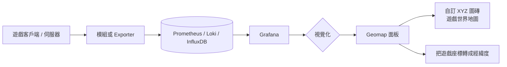

# Grafana Geomap 應用於遊戲領域的實際案例調查

## 摘要

Grafana 的 Geomap 面板誕生於 Grafana 8.1（2021 年 8 月），其設計初衷是把地理座標（經緯度）標記、熱圖與路線繪製在真實世界地圖底圖上[^geomap-release]。由於 Geomap 支援「XYZ 圖磚層」（XYZ Tile layer），可載入任意 `{z}/{x}/{y}` 圖磚伺服器，社群便開始把它拿來當作**遊戲世界地圖**使用，而非真實地理地圖[^geomap-docs]。

本報告調查公開可查的案例，發現應用大致可分成三類：

1. **Sim racing（模擬賽車）遙測**：把車輛在賽道上的即時位置畫在 Geomap 上。
2. **FiveM / GTA V 伺服器監控**：把玩家事件與位置標記在 GTA V 遊戲地圖圖磚上。
3. **其他遊戲伺服器（DayZ、Rust、Minecraft）**：多為指標監控，部分仍在等待上游功能或尚未出現 Geomap 成品。

核心技術障礙在於：**Geomap 只支援 EPSG:4326（經緯度）座標系**[^geomap-github-44240]。遊戲世界通常使用平面卡氏座標（例如 Minecraft 的 X/Z、GTA V 的世界座標），因此所有案例都必須自行把遊戲座標「投影」或「假裝」成經緯度。

## 一、Geomap 成為遊戲地圖的技術基礎

### 1.1 XYZ 圖磚層

Geomap 面板的底圖層提供「XYZ Tile layer」，只要設定含 `{z}/{x}/{y}` 的 URL 模板，即可載入任何切片地圖伺服器，例如官方範例 `https://tile.openstreetmap.org/{z}/{x}/{y}.png`[^geomap-docs]。這正是把遊戲地圖當底圖的關鍵機制。

### 1.2 座標系限制

Geomap 原生僅處理經緯度座標，社群多次要求支援非地理的平面座標系，但未被實作。2022-06-28，使用者在 Grafana 官方 issue「Geomap Panel Improvements/Features」（#44240）留言：

> It would be nice to be able to change the projection. For example, I need a 2D projection for a simple game map, but I can't use the Geomap Panel.

（大意：希望能更改投影方式，例如我需要為簡單的遊戲地圖使用 2D 投影，但目前無法使用 Geomap 面板。）[^geomap-github-44240]

另有 2022-12-26 的討論 #60756「Geomap - simple 2d coordinate map」，使用者表示想用平面座標加上自訂 PNG 底圖，但同樣未獲官方支援，最終被告知需自行把座標轉成經緯度[^geomap-github-60756]。這說明了社群實務上的一致做法：**把遊戲座標硬轉成經緯度空間**。

## 二、案例一：Sim racing 遙測

### 2.1 grafana-simracing-telemetry（87 stars）

- 倉庫：`alexanderzobnin/grafana-simracing-telemetry`
- 星數：87、Fork 數：11、授權 Apache-2.0
- 作者：Alexander Zobnin（Grafana-Zabbix 外掛的作者，知名 Grafana 貢獻者）
- 支援遊戲：Assetto Corsa Competizione、Assetto Corsa（實驗性）、iRacing、Dirt Rally 2.0、BeamNG Drive、Forza Horizon 5、Forza Horizon 4（實驗性）
- 說明：「Simracing Telemetry data source plugin makes it possible to visualize telemetry data from various simracing titles ... in Grafana.」（讓各種模擬賽車遊戲的遙測資料可在 Grafana 中視覺化）[^simracing]

此專案是一個 **Grafana Data Source 外掛**，可直接把遊戲的即時遙測（圈速、速度、油門、煞車等）餵進 Grafana 儀表板[^simracing]。

**關於 Geomap 的釐清**：README 文字中**並未**明講使用 Geomap 面板，也未提及任何地圖面板[^simracing-readme]。作者在 2022-05-12 於 Reddit r/simracing 的發文亦未使用「Geomap」一詞[^reddit-simracing]。不過其儀表板截圖中可見賽道路線圖。因此「此專案使用 Geomap 呈現車輛位置」屬於**尚未被官方文件證實**的推測，讀者宜保留。可觀看官方 demo 影片與 releases 進一步確認[^simracing]。

### 2.2 Assetto Corsa 遙測服務（社群案例）

另有社群為 Assetto Corsa 打造的遙測服務，將資料寫入 InfluxDB 後於 Grafana 呈現，儀表板包含賽道位置圖與速度、油門、煞車、檔位、RPM 等面板。作者於 2021 年在 Reddit r/grafana 發文分享[^reddit-ac]。此案例同樣以「賽道地圖位置」為核心視覺化。

## 三、案例二：FiveM / GTA V 伺服器（採用度最高）

### 3.1 Qbox 的 qbx_grafana_map（12 stars，47 台伺服器採用）

- 倉庫：`Qbox-project/qbx_grafana_map`（12 stars、5 forks）
- 官方文件：`https://docs.qbox.re/dashboard/logging/geomap`
- 採用度（第三方追蹤）：**47 台 FiveM 伺服器**執行，掃描時線上玩家 305 人，14 天平均約 409 人在線[^fivesearch]

此資源的定位是「A simple resource to push logs to Grafana|Loki and visualize it on a geomap.」（把日誌推送到 Grafana/Loki 並在 geomap 上視覺化的簡單資源）[^qbx-github]。它會把玩家事件（斷線、爆炸，選配每 15 秒記錄位置）寫入 Loki，再以 Geomap 呈現。

**最關鍵的技術示範**：它把 Geomap 的底圖換成 **GTA V 官方遊戲地圖圖磚**，使用的是 Rockstar 自己的圖磚伺服器[^qbox-docs]：

| 樣式 | 圖磚 URL |
|---|---|
| Render（渲染） | `https://s.rsg.sc/sc/images/games/GTAV/map/render/{z}/{x}/{y}.jpg` |
| Game（遊戲風） | `https://s.rsg.sc/sc/images/games/GTAV/map/game/{z}/{x}/{y}.jpg` |
| Print（印刷風） | `https://s.rsg.sc/sc/images/games/GTAV/map/print/{z}/{x}/{y}.jpg` |

由於 FiveM 世界座標與地圖座標不一致，資源提供 `gameToMap` 轉換函式[^qbox-docs]：

```lua
local coords = GetEntityCoords(PlayerPedId())
local lon, lat = exports.qbx_grafana_map:gameToMap(coords.x, coords.y)

lib.logger(playerSource, 'custom_event', 'custom_message',
    ('lon:%s'):format(lon), ('lat:%s'):format(lat))
```

輸入為遊戲世界座標 `coords.x`、`coords.y`，輸出為可餵給 Geomap 的 `lon`、`lat`[^qbox-docs]。這是「把遊戲世界座標硬轉成經緯度」策略最具體的公開實作。

### 3.2 fivem-watch（26 stars）— 對照組

- 倉庫：`rnaefe/fivem-watch`（26 stars）
- 說明：「Open-source FiveM monitoring stack with live player map and on-demand stream relay.」（開源 FiveM 監控堆疊，含即時玩家地圖與隨選串流）[^fivem-watch]

此專案提供 GTA V 衛星地圖與玩家標記，但**使用自製的 React 地圖，與 Grafana 完全無關**[^fivem-watch]。列出它作為對照，說明並非所有「遊戲玩家地圖」都走 Grafana 路線。

### 3.3 fivem-prometheus（26 stars）

- 倉庫：`Hellslicer/fivem-prometheus`（26 stars、11 forks）
- 提供 FiveM FX Server 的 Prometheus endpoint，附帶一份 `grafanaDashboard.json` 範例儀表板[^fivem-prometheus]

README 中**未提及 Geomap**，屬伺服器效能指標監控，並非地圖視覺化案例。

### 3.4 社群論壇：遊戲伺服器位置的 Geomap

Grafana 官方論壇有一則主題「GeoMap - Ability for users to search for a specific name of item on the GeoMap」，使用者明言：

> I have a GeoMap Dashboard of server locations for a game I play.

（大意：我有一份遊戲伺服器位置的 Geomap 儀表板。）[^grafana-forum]

相關 GitHub issue #114941 於 2025-12-06 開啟[^grafana-forum]。此案例屬於「以真實地理座標標記遊戲伺服器位置」的一般地理用法，與遊戲內地圖不同。

## 四、案例三：其他遊戲伺服器監控

### 4.1 DayZ — MetricZ（18 stars）

- 倉庫：`WoozyMasta/metricz`（18 stars、7 forks）
- 說明：「DayZ server mod that exports engine, gameplay, and world metrics to Prometheus.」（把 DayZ 引擎、玩法與世界指標輸出到 Prometheus 的伺服器模組）[^metricz]

此模組明確規劃地理空間功能：「Full map visualization (Player/Transport tracking) is implemented but pending upstream updates in Grafana」（完整地圖視覺化—玩家／載具追蹤—已實作，但需等待 Grafana 上游更新），並引用 Grafana PR #114371 與 #114947[^metricz]。它使用自架的 DZMap 圖磚層。這是一個**仍在等待上游合併、尚未正式發布 Geomap 成品**的案例。

### 4.2 Rust 伺服器指標（無 Geomap）

- Grafana 儀表板 ID 17574「Rust Server Metrics」，作者 metrics-ent（cobaltent），2022-12-09 發布，僅 1 個修訂版本[^rust-dashboard]

經檢視其面板組態，**全部為 timeseries（時間序列）面板，沒有 Geomap 或任何地圖面板**[^rust-dashboard]。它監控幀率、幀時間、玩家數、記憶體、實體數、網路延遲等。列為「遊戲 + Grafana 但無 Geomap」的對照。

### 4.3 Minecraft（尚無公開 Geomap 成品）

搜尋後**未發現任何公開的 Minecraft Geomap 儀表板**。既有 Minecraft 相關 Grafana 儀表板（如 ID 24441 Minecraft Player、ID 25941 等）皆為 Stat 與 Timeseries 面板，玩家位置以表格文字呈現，非地圖[^mairwun]。技術上可行（把玩家 X/Z 座標轉成經緯度、載入 dynmap/squaremap/BlueMap 的 XYZ 圖磚），但至今無人以 Geomap 完成並公開。

### 4.4 座標熱圖的替代面板

`alexandrainst/alexandra-trackmap-panel`（**79 stars**）是一款 Grafana 地圖面板外掛，可把座標畫成 markers、hexbin、ant path 或 heatmap，功能與 Geomap 重疊、但提供 Geomap 沒有的 hexbin 與 ant path[^trackmap]。該專案已於 **2024-01-25 封存**（唯讀）[^trackmap]。它並非遊戲專用，但常被用來做玩家座標熱圖。

## 五、綜合比較



| 案例 | 遊戲 | 星數 | 是否用 Geomap | 狀態 |
|---|---|---|---|---|
| grafana-simracing-telemetry | ACC / iRacing / Forza 等 | 87 | 未在文件中證實 | 活躍 |
| Assetto Corsa 遙測服務 | Assetto Corsa | n/a | 推測（賽道位置圖） | 2021 社群分享 |
| qbx_grafana_map | FiveM / GTA V | 12 | **是（確證）** | 47 台伺服器採用 |
| fivem-watch | FiveM / GTA V | 26 | 否（自製地圖） | 活躍 |
| fivem-prometheus | FiveM | 26 | 否 | 有儀表板 JSON |
| MetricZ | DayZ | 18 | 規劃中，等待上游 PR | 釋出候選 |
| Rust Server Metrics | Rust | n/a | 否（全 timeseries） | 2022 發布 |
| Minecraft 相關儀表板 | Minecraft | n/a | 否 | 無 Geomap 成品 |
| alexandra-trackmap-panel | 通用 | 79 | 替代方案 | 2024-01-25 封存 |

## 六、批判性反思

- **直接使用 Geomap 的證據強度不一**：本報告中，只有 **qbx_grafana_map 有官方文件明確佐證**使用 Geomap 面板與自訂 GTA V 圖磚[^qbox-docs]。simracing 專案雖有賽道地圖截圖，但文件與作者貼文皆未提 Geomap，屬**弱證據**，不宜當作確證[^simracing-readme][^reddit-simracing]。
- **星數普遍偏低**：除 simracing（87★）與 trackmap 外掛（79★）外，其餘專案星數介於 12–26★。依本專案的研究規範，低星專案需附背景說明；此處保留是因為該主題本身即屬小眾，公開案例稀少[^agent-zone-rules]。
- **座標系是共同瓶頸**：幾乎所有案例都花力氣把遊戲座標轉成經緯度。Grafana 官方至今未支援平面卡氏座標或自訂投影，相關需求（#44240、#60756、#58482）多數仍未實作或仍開啟[^geomap-github-44240][^geomap-github-60756][^geomap-issue-58482]。
- **來源偏社群、非廠商正式發布**：除 Grafana 官方文件與 AWS 部落格外，其餘多為個人倉庫、Reddit 與論壇，權威性有限，但時間點新、且附有可驗證的程式碼與設定。
- **採用度數字來源為第三方追蹤站**：qbx_grafana_map 的「47 台伺服器」來自第三方掃描網站，屬估算而非官方統計，僅供量級參考[^fivesearch]。

## 參考文獻

[^agent-zone-rules]: Agent Zone. (n.d.). Agent Zone 研究報告規範. Retrieved 2026-10-24, from 本專案 `agent-zone/000_README.md`

[^geomap-release]: Grafana Labs. (2021, August 5). Grafana 8.1 released: New Geomap and Annotations panels, updated plugin management and more. Retrieved 2026-10-24, from https://grafana.com/blog/2021/08/05/grafana-8.1-released-new-geomap-and-annotations-panels-updated-plugin-management-and-more/

[^geomap-docs]: Grafana Labs. (n.d.). Geomap. Retrieved 2026-10-24, from https://grafana.com/docs/grafana/latest/visualizations/panels-visualizations/visualizations/geomap/

[^geomap-github-44240]: Grafana Labs. (2022, June 28). Geomap Panel Improvements/Features (#44240) [Issue comment by ziggi]. Retrieved 2026-10-24, from https://github.com/grafana/grafana/issues/44240#issuecomment-1168818621

[^geomap-github-60756]: Grafana Labs. (2022, December 26). Geomap - simple 2d coordinate map (#60756) [Discussion]. Retrieved 2026-10-24, from https://github.com/grafana/grafana/discussions/60756

[^geomap-issue-58482]: Grafana Labs. (2022, November 8). Support template variable interpolation in XYZ tile layer URL (#58482) [Issue]. Retrieved 2026-10-24, from https://github.com/grafana/grafana/issues/58482

[^simracing]: Zobnin, A. (n.d.). grafana-simracing-telemetry. Retrieved 2026-10-24, from https://github.com/alexanderzobnin/grafana-simracing-telemetry

[^simracing-readme]: Zobnin, A. (n.d.). README. In grafana-simracing-telemetry. Retrieved 2026-10-24, from https://github.com/alexanderzobnin/grafana-simracing-telemetry/blob/master/README.md

[^reddit-simracing]: Zobnin, A. (2022, May 12). Grafana dashboards for simracing [Online forum post]. Reddit, r/simracing. Retrieved 2026-10-24, from https://www.reddit.com/r/simracing/comments/uo53jk/grafana_dashboards_for_simracing/

[^reddit-ac]: r/grafana. (2021). Telemetry service for Assetto Corsa video game [Online forum post]. Reddit. Retrieved 2026-10-24, from https://www.reddit.com/r/grafana/comments/mxqimb/telemetry_service_for_assetto_corsa_video_game/

[^qbx-github]: Qbox Project. (n.d.). qbx_grafana_map. Retrieved 2026-10-24, from https://github.com/Qbox-project/qbx_grafana_map

[^qbox-docs]: Qbox Project. (n.d.). GTA V Map. Retrieved 2026-10-24, from https://docs.qbox.re/dashboard/logging/geomap

[^fivesearch]: OXince. (n.d.). qbx_grafana_map [Resource usage tracker]. Retrieved 2026-10-24, from https://tracker.oxince.com/resource/qbx_grafana_map

[^fivem-watch]: Naefe, R. (n.d.). fivem-watch. Retrieved 2026-10-24, from https://github.com/rnaefe/fivem-watch

[^fivem-prometheus]: Hellslicer. (n.d.). fivem-prometheus. Retrieved 2026-10-24, from https://github.com/Hellslicer/fivem-prometheus

[^grafana-forum]: Grafana Labs. (n.d.). GeoMap - Ability for users to search for a specific name of item on the GeoMap [Online forum post]. Grafana Community. Retrieved 2026-10-24, from https://community.grafana.com/t/geomap-ability-for-users-to-search-for-a-specific-name-of-item-on-the-geomap/127098

[^metricz]: WoozyMasta. (n.d.). metricz. Retrieved 2026-10-24, from https://github.com/WoozyMasta/metricz

[^rust-dashboard]: metrics-ent. (2022, December 9). Rust Server Metrics [Grafana dashboard 17574]. Retrieved 2026-10-24, from https://grafana.com/grafana/dashboards/17574-rust-server-metrics/

[^mairwun]: MairwunNx. (n.d.). minecraft-grafana. Retrieved 2026-10-24, from https://github.com/MairwunNx/minecraft-grafana

[^trackmap]: Alexandra Institute. (n.d.). alexandra-trackmap-panel. Retrieved 2026-10-24, from https://github.com/alexandrainst/alexandra-trackmap-panel
