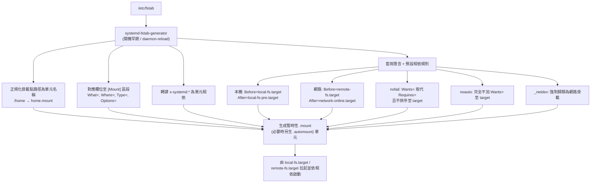

# `/etc/fstab` 在 Linux 上的作用機制

## 摘要

`/etc/fstab`（file system table，檔案系統表）是 Linux 系統上用於描述「靜態檔案系統資訊」的純文字設定檔。它本身不是執行檔、也不是常駐服務，而是一份僅供程式「讀取」的宣告式資料，由系統管理員負責維護[^fstab5]。它的核心作用是告訴系統：哪些裝置或遠端資源應該被掛載到哪些目錄、使用何種檔案系統、套用哪些掛載選項，以及開機時是否要進行檔案系統檢查[^fstab5]。

在 systemd 時代之前，開機時是由初始化腳本呼叫 `mount -a` 逐行讀取 `/etc/fstab` 來完成掛載；在現代以 systemd 為基礎的發行版上，則改由 `systemd-fstab-generator` 於開機早期將每一行轉譯成原生的 `.mount`／`.swap` 單元（unit），交由 systemd 的相依性圖來排程[^fstabgen][^arch].

本報告依序說明檔案結構、六個欄位的語意、開機時的兩種處理路徑（傳統 `mount -a` 與 systemd generator），以及幾個關鍵選項（`defaults`、`nofail`、`noauto`、`UUID`）的行為差異。

## 一、檔案定位與基本語法

`/etc/fstab` 是「靜態檔案系統資訊」的描述檔，程式只會讀取、不會寫入；它由管理員手動維護[^fstab5]。檔案內容由逐行的紀錄（record）組成，每一非空行描述一個檔案系統，欄位之間以「定位字元（tab）或空白」分隔[^fstab5]。空行與以 `#` 開頭的行會被忽略[^fstab5]。

紀錄的**順序具有意義**，因為 `fsck`、`mount`、`umount` 會依序逐行走訪[^fstab5]。若欄位內本身含有空白或定位字元，必須以跳脫序列表示：空白為 `\040`、定位字元為 `\011`，即使在引號內亦然（例如 `LABEL="foo\040bar"`）[^fstab5]。

典型的檔案樣貌如下：

```fstab
# <device>        <mount-point>  <type>  <options>                   <dump>  <pass>
LABEL=t-home2     /home          ext4    defaults,auto_da_alloc    0       2
UUID=abc-123      /boot          ext4    defaults                  1       2
/dev/sdb1         none           swap    sw                        0       0
server:/export    /mnt/nfs       nfs     defaults                  0       0
```

## 二、六個欄位逐一解析

每一行共有六個欄位，依序為 `fs_spec`、`fs_file`、`fs_vfstype`、`fs_mntops`、`fs_freq`、`fs_passno`[^fstab5]。

### 欄位一 `fs_spec`：裝置或來源

描述要掛載的區塊裝置、遠端檔案系統、交換檔／裝置，或檔案系統映像。可接受的幾種形式包括[^fstab5]：

- 裝置路徑：`/dev/sda1`、`/dev/cdrom`
- UUID：`UUID=3e6be9de-8139-11d1-9106-a43f08d823a6`
- 標籤：`LABEL=Boot` 或 `LABEL="foo\040bar"`
- 分割區層級識別碼：`PARTUUID`／`PARTLABEL`
- NFS 形式：`<host>:<dir>`
- 虛擬檔案系統：如 `proc`、或 `tmpfs` 所用的 `none`

實務上建議使用 `UUID=` 或 `LABEL=`，而非 `/dev/sda1` 這類裝置路徑，因為裝置名稱是依硬體偵測順序動態指派，增減硬碟時可能改變，而 UUID 儲存於檔案系統的超級區塊（superblock），不隨核心裝置命名變動而改變[^fstab5]。

### 欄位二 `fs_file`：掛載點

檔案系統要掛載到的目錄。若是交換區，此欄位應填 `none`；若掛載點名稱含空白或定位字元，需以 `\040`、`\011` 跳脫[^fstab5]。

### 欄位三 `fs_vfstype`：檔案系統類型

指定檔案系統類型，例如 `ext4`、`xfs`、`btrfs`、`f2fs`、`vfat`、`ntfs`、`tmpfs`、`sysfs`、`proc`、`iso9660`、`nfs`、`cifs`、`squashfs` 等；`swap` 代表交換檔或分割區；`none` 則常用於 bind 或 move 掛載。也可以給予逗號分隔的多個型別，子類型則以 `.subtype` 後綴表示，例如 `fuse.sshfs`[^fstab5]。

### 欄位四 `fs_mntops`：掛載選項

以逗號分隔的選項清單，本欄位可省略。常見選項整理如下[^fstab5]：

| 選項 | 意義 |
|------|------|
| `defaults` | 核心預設值：`rw`、`suid`、`dev`、`exec`、`auto`、`nouser`、`async` |
| `noauto` | 執行 `mount -a`（例如開機）時「不要」掛載 |
| `auto` | `noauto` 的反面；開機自動掛載（預設） |
| `user` | 允許任何使用者掛載 |
| `owner` | 允許裝置擁有者掛載 |
| `nofail` | 裝置不存在時不報錯 |
| `ro` / `rw` | 唯讀 / 可讀寫 |
| `noexec` | 禁止執行此檔案系統上的執行檔 |
| `nosuid` | 忽略 suid／sgid 位元 |
| `nodev` | 不解譯字元／區塊裝置 |
| `comment` / `x-<name>` | 供維護 fstab 的程式使用 |

systemd 另外理解許多 `x-systemd.*` 擴充選項，詳見第四節[^fstabgen]。

### 欄位五 `fs_freq`：傾印頻率

供 `dump(8)` 指令判斷哪些檔案系統需要被備份（dump）。若不填則預設為 `0`（不傾印）。在現代系統上幾乎一律為 `0`[^fstab5]。

### 欄位六 `fs_passno`：fsck 檢查順序

供 `fsck(8)` 判斷開機時檔案系統檢查的順序[^fstab5]：

- `0`：不檢查該檔案系統
- `1`：根檔案系統（最先檢查）
- `2`：其他檔案系統；同一硬碟上的檔案系統依序檢查，不同硬碟上的則可平行檢查以利用硬體平行性

需注意的是，`systemd-fstab-generator` 會把 `passno` 欄位視為「簡單的布林值」：`0` 代表不檢查、非 `0` 代表要檢查，數值順序本身被捨棄，僅保留「根檔案系統仍早於其他檔案系統被檢查」這項規則[^fstabgen]。

## 三、開機時的兩條處理路徑

### 傳統路徑：`mount -a`

在 systemd 之前，開機是由初始化腳本呼叫 `mount -a`（等同 `mount --all`）來完成掛載，語法為[^mount8]：

```bash
mount -a [-t type] [-O optlist]
```

其關鍵行為包括[^mount8]：

- 掛載所有檔案系統，但「略過」帶有 `noauto` 關鍵字者
- 依 `/etc/fstab` 中出現的順序逐一掛載
- `-F` 旗標可讓每個掛載各自 fork，達到平行掛載
- `-t ext4` 可限制只處理 ext4；`-O no_netdev` 可限制非網路裝置
- 需先掛載 `/proc` 與 `/sys`（因此這兩者應排在 fstab 前段）
- 交換項目會被靜默忽略，交換需改用 `swapon -a`
- `-o` 可覆寫 fstab 中的選項（util-linux v2.35 起）

在現代 systemd 發行版上，`mount -a` **不再**用於開機；它已被視為舊式做法，建議改用 `findmnt --verify` 來檢查 fstab 的正確性[^mount8]。

### 現代路徑：`systemd-fstab-generator`

在 systemd 系統上，`/etc/fstab` 於開機時**不會**被 `mount` 直接讀取，而是由 `systemd-fstab-generator`（一種「generator」，見 `systemd.generator(7)`）負責轉譯[^fstabgen][^arch]：

1. **執行時機**：開機早期，以及每次執行 `systemctl daemon-reload` 時[^fstabgen]
2. **做什麼**：把 `/etc/fstab` 的每一行即時轉成原生的 `.mount` 與 `.swap` 單元檔，這些生成的單元置於 runtime 目錄（通常位於 `/run/systemd/generator/` 之下）[^fstabgen]
3. **單元命名**：以掛載點的「正規化路徑」命名，將 `/` 置換為 `-`。例如 `/home` → `home.mount`，`/mnt/data` → `mnt-data.mount`[^fstabgen]
4. **符號連結處理**：generator 會解析 `/etc/fstab` 項目中的符號連結，以相容於歷史上的 init 系統[^fstabgen]
5. **核心命令列控制**：`fstab=no`／`rd.fstab=no` 完全停用轉譯；`systemd.swap=no` 忽略交換項目；`systemd.mount-extra=WHAT:WHERE[:FSTYPE[:OPTIONS]]` 可注入額外掛載[^fstabgen]
6. **憑證支援**：`fstab.extra` 憑證（systemd v254 起）可注入額外的 fstab 風格項目，而無須更動 `/etc/fstab`[^fstabgen]

掛載單元的命名對照整理如下[^fstabgen]：

| 掛載點 | 單元名稱 |
|--------|----------|
| `/` | `-.mount` |
| `/home` | `home.mount` |
| `/home/lennart` | `home-lennart.mount` |
| `/mnt/data` | `mnt-data.mount` |

掛載單元必須「依其所控制的掛載點目錄」命名，且不可使用範本（template），也不能透過符號連結增加多個名稱[^fstabgen]。

以下是兩種路徑的比較[^mount8][^fstabgen]：

| 面向 | `mount -a`（傳統） | `systemd-fstab-generator` |
|------|--------------------|---------------------------|
| 執行時機 | 開機時的 init 腳本 | 開機早期 + `systemctl daemon-reload` |
| 機制 | 逐項直接呼叫 `mount(8)` | 生成 `.mount` 單元檔 |
| 相依處理 | 依 fstab 順序循序進行 | 完整的 systemd 相依圖（`After=`、`Requires=`、`Wants=`） |
| 平行性 | 需 `-F` 旗標 | 單元平行啟動，自動完成 |
| 失敗處理 | 裝置不存在可能卡住開機 | `nofail` 可容許優雅續行 |
| 進階功能 | 無 | automount、裝置逾時、makefs、growfs 等 |

## 四、systemd 擴充選項與相依性

### `x-systemd.*` 選項

systemd 在 fstab 中額外理解下列選項[^fstabgen]：

| 選項 | 效果 |
|------|------|
| `x-systemd.requires=<unit\|path>` | 對另一單元加入 `Requires=` + `After=` 相依 |
| `x-systemd.wants=<unit\|path>` | 同上，但用較弱的 `Wants=` |
| `x-systemd.before=` / `x-systemd.after=` | 加入 `Before=` 或 `After=` 排序相依 |
| `x-systemd.wanted-by=` / `x-systemd.required-by=` | 使本掛載成為另一單元的 `WantedBy=`／`RequiredBy=`，並**抑制**預設的 target 相依 |
| `x-systemd.automount` | 一併生成 automount 單元，實現隨需掛載 |
| `x-systemd.idle-timeout=<time>` | 設定 automount 單元的閒置逾時 |
| `x-systemd.device-timeout=<time>` | 等待裝置出現的時間上限（僅 fstab 適用） |
| `x-systemd.mount-timeout=<time>` | 等待掛載指令完成的時間上限（僅 fstab 適用） |
| `x-systemd.makefs` | 掛載前於裝置上初始化檔案系統 |
| `x-systemd.growfs` | 將檔案系統擴張至填滿區塊裝置 |
| `x-systemd.rw-only` | 若可讀寫掛載失敗，不回退為唯讀 |
| `x-systemd.device-bound=<bool>` | 控制是否以 `BindsTo=` 綁定底層裝置 |
| `x-systemd.graceful-option=<option>` | 僅在核心支援時追加某掛載選項 |
| `_netdev` | 強制視為網路掛載（適用於 iSCSI 等） |

### 自動建立的相依性

對**本機檔案系統**，systemd 會自動加上：`After=local-fs-pre.target`、`Before=local-fs.target`，以及對 `umount.target` 的 `Before=` + `Conflicts=`[^fstabgen]。

對**網路檔案系統**，則加上：`After=remote-fs-pre.target`、`network.target`、`network-online.target`，以及 `Before=remote-fs.target`[^fstabgen]。

掛載單元之間也有隱含相依：樹狀結構中位於某掛載點之下者，會對父掛載取得 `Requires=` 與 `After=`；區塊裝置則對應 `.device` 單元取得 `Requires=`、`StopPropagatedFrom=`、`After=`[^fstabgen]。

## 五、關鍵選項行為深入

### `defaults`

代表核心預設值：`rw`、`suid`、`dev`、`exec`、`auto`、`nouser`、`async`。並不存在單一硬編碼的集合，實際內容視檔案系統類型與核心認定而定[^fstab5]。

### `nofail`

`nofail` 是開機韌性的關鍵選項[^fstabgen]：

- 掛載單元對 `local-fs.target` 或 `remote-fs.target` 而言只是**被想要**（`Wants=`）而非**被要求**（`Requires=`）
- 掛載單元**不會**被排在這些 target 之前，因此開機不會等待它
- 若掛載失敗，開機仍會繼續，不會進入緊急模式（emergency mode）
- 常見搭配 `x-systemd.before=local-fs.target`，以在「不強制要求」的前提下取得排序效果

### `noauto`

若設定 `noauto`，該掛載**不會**被加入 target 的 `Wants=` 相依，因此開機時不會自動掛載，除非被其他單元明確拉起；它仍可被指名手動掛載[^fstabgen]。

### `UUID=`

以檔案系統的通用唯一識別碼（Universally Unique Identifier）識別，經由 `/dev/disk/by-uuid/` 解析。UUID 儲存於檔案系統的超級區塊，跨重開機與硬體重組皆保持一致，因此優於裝置路徑[^fstab5]。`LABEL=` 同理，經 `/dev/disk/by-label/` 解析，並可用 `e2label`（ext4）、`xfs_admin`（XFS）、`fatlabel`（FAT）等工具設定[^fstab5]。

## 六、開機流程總覽

以一個實際的 fstab 為例[^fstabgen]：

```fstab
UUID=abc-123  /      ext4    defaults          1  1
UUID=def-456  /boot  ext4    defaults          1  2
UUID=ghi-789  /home  ext4    defaults,nofail   0  2
server:/share /mnt   nfs     _netdev           0  0
```

在 systemd 系統上的處理流程可表示為[^fstabgen][^arch]：



具體而言[^fstabgen][^arch]：

1. **initrd 階段**：generator 於 initrd 中執行，依 `root=`（或 fstab 中的 UUID）指定的根裝置掛載至 `/sysroot`
2. **主機階段**：切換至真正的根之後，generator 再次執行
   - `-.mount`（根 `/`）以 `passno=1` 建立，由 `systemd-fsck@.service` 最先檢查
   - `boot.mount` 以非 `0` 的 `passno` 建立，於根之後檢查
   - `home.mount` 帶 `nofail`，即使 `/home` 不存在開機仍續行，該單元僅被 `local-fs.target`「想要」而非「要求」
   - `mnt.mount` 帶 `_netdev`，排在 `network.target`、`network-online.target` 之後，位於 `remote-fs-pre.target` 與 `remote-fs.target` 之間
3. 所有生成的 `.mount` 單元由其對應 target 拉起，並依相依順序啟動
4. 日後若修改 `/etc/fstab`，需執行 `systemctl daemon-reload` 以重新生成單元

## 七、來源評析

本報告的核心事實主要來自 man7.org 收錄的 Linux man-pages 與 freedesktop.org 的 systemd 官方文件，兩者皆屬一手權威來源：`fstab(5)`、`mount(8)` 為 util-linux 專案維護的官方手冊，`systemd-fstab-generator(8)`、`systemd.mount(5)`、`systemd.special(7)` 則為 systemd 上游官方文件，更新即時、對版本差異的說明最為準確[^fstab5][^mount8][^fstabgen]。需留意的是，不同發行版與 systemd 版本間仍可能存在細節差異（例如 `fstab.extra` 憑證自 v254 才引入、`mount -a` 的 `-o` 覆寫自 util-linux v2.35 起），因此實際行為仍應以目標系統的 `man` 頁面為準。此外，本報告未採用部落格或論壇等二手來源，以避免傳遞過時或未經驗證的資訊。

## 參考文獻

[^fstab5]: fstab(5) — Linux manual page. (n.d.). Retrieved 2026-10-24, from https://man7.org/linux/man-pages/man5/fstab.5.html

[^fstabgen]: systemd-fstab-generator — systemd manual page. (n.d.). Retrieved 2026-10-24, from https://www.freedesktop.org/software/systemd/man/latest/systemd-fstab-generator.html

[^mount8]: mount(8) — Linux manual page. (n.d.). Retrieved 2026-10-24, from https://man7.org/linux/man-pages/man8/mount.8.html

[^arch]: systemd.mount(5) — systemd manual page. (n.d.). Retrieved 2026-10-24, from https://www.freedesktop.org/software/systemd/man/latest/systemd.mount.html
