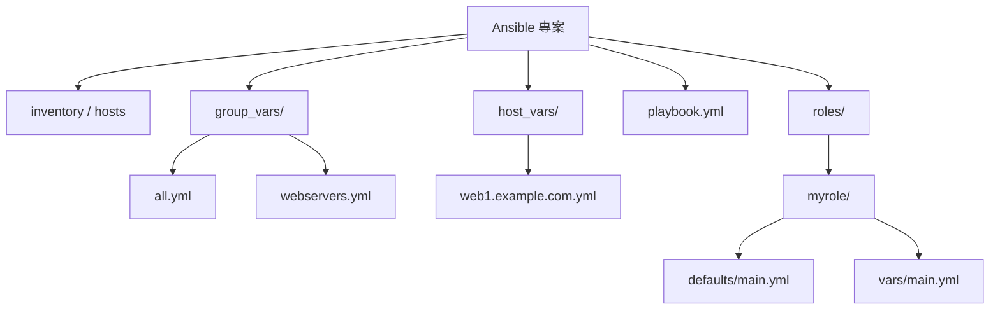

# Ansible 的變數機制：Ansible 版本的 `.env`？

## 摘要

許多應用程式使用 `.env` 檔（dotenv）管理設定值與機密，而 Ansible 自動化工具並沒有單一對應的 `.env` 檔格式。取而代之的是一套分層、可覆寫的「變數（variables）」系統。本報告說明 Ansible 變數的定義位置、優先序（precedence）、環境變數讀取方式，以及用於保護機密的 Ansible Vault，最後對照 `.env` 的使用情境，整理出實務上最接近「Ansible 版 .env」的作法。

---

## 1. 背景：什麼是 `.env` 檔

`.env` 檔是一種純文字設定檔，通常包含 `KEY=VALUE` 形式的行，用來在程式啟動時注入環境變數（environment variables）。它常見於十二要素應用程式（12-Factor App）方法論，將設定與程式碼分離，並把機密（如 API 金鑰、資料庫密碼）放在版本控制之外[^dotenv]。

Ansible 本身不使用 `.env` 作為原生設定格式。要理解「Ansible 版的 `.env`」，必須先理解 Ansible 的變數系統。

---

## 2. Ansible 變數可以定義在哪裡

Ansible 會載入它找到的**所有**變數，最後再依「優先序」決定哪個值勝出[^vars]。變數可來自下列位置：

- **Inventory（清單檔）**：在主機清單檔中直接定義主機變數（host vars）與群組變數（group vars）。
- **`group_vars/` 與 `host_vars/` 目錄**：分別以群組名與主機名命名的 YAML 檔。`group_vars/all` 適用於所有主機。這些目錄可放在 inventory 檔旁，或 playbook 旁[^vars]。
- **Playbook 的 `vars:`**：在 play 層級直接定義變數。
- **`vars_files`**：在 play 中引用外部 YAML/JSON 變數檔。
- **`vars_prompt`**：執行時互動式提示使用者輸入。
- **Role 的 `defaults/main.yml`**：優先序最低，用於提供可輕易覆寫的預設值。
- **Role 的 `vars/main.yml`**：優先序較高，較不易被覆寫。
- **`set_fact`**：執行期間以主機為範圍動態設定變數。
- **`register`**：把任務的回傳結果存成變數。
- **`--extra-vars`（`-e`）**：命令列傳入，優先序最高。
- **環境變數**：透過 `env` lookup 讀取（見第 4 節）。

Ansible 的官方文件把變數放置位置整理為 inventory、play、included files 與 roles、執行時（runtime）四大類[^vars]。

### 目錄結構示意



---

## 3. 變數優先序（Precedence）

這是 Ansible 變數系統的核心。當同一個變數名稱在多處被定義，優先序高者勝出。官方文件列出**由低到高**的完整順序如下[^prec][^vars]：

| 順序 | 來源 |
|---|---|
| 01 | 命令列值（例如 `-u my_user`，這些嚴格說不是變數） |
| 02 | Role defaults（`roles/x/defaults/main.yml`） |
| 03 | Inventory 檔或 inventory script 的 group vars |
| 04 | Inventory 的 `group_vars/all` |
| 05 | Playbook 的 `group_vars/all` |
| 06 | Inventory 的 `group_vars/*` |
| 07 | Playbook 的 `group_vars/*` |
| 08 | Inventory 檔或 script 的 host vars |
| 09 | Inventory 的 `host_vars/*` |
| 10 | Playbook 的 `host_vars/*` |
| 11 | Host facts 與已快取的 set_fact |
| 12 | Play vars（play 中的 `vars:`） |
| 13 | Play `vars_prompt` |
| 14 | Play `vars_files` |
| 15 | Role vars（`roles/x/vars/main.yml`） |
| 16 | Block vars（僅限 `block:` 內任務） |
| 17 | Task vars（僅限該任務） |
| 18 | `include_vars` |
| 19 | Registered vars 與 set_fact |
| 20 | Role（含 `include_role`）的 params |
| 21 | Include params |
| 22 | **Extra vars**（`-e "user=my_user"`）— 永遠勝出 |

> 原則：**越晚定義、越主動指定、範圍越明確的變數，優先序越高**[^vars]。

此外，在更上層還有一份「一般優先序」規則，說明設定檔、命令列選項、playbook 關鍵字與變數之間的關係[^general]：

| 層級 | 類別 |
|---|---|
| 1（最低） | 設定（`ansible.cfg`、環境變數） |
| 2 | 命令列選項 |
| 3 | Playbook 關鍵字 |
| 4 | 變數（此層內 extra vars 最高） |
| 5（最高） | 直接賦值（模組/外掛選項直接內嵌） |

Extra vars 屬於第 4 層，但在變數之中優先序最高，可覆寫包含 inventory 變數與 playbook `vars:` 在內的一切[^general]。`--extra-vars` 支援三種格式：`key=value`、JSON 字串、以及 `@檔案`（JSON/YAML 檔）[^runtime]。

```bash
# key=value（值一律視為字串）
ansible-playbook release.yml -e "version=1.23.45 other_variable=foo"

# JSON 字串（支援布林、整數、清單等型別）
ansible-playbook arcade.yml -e '{"pacman":"mrs","ghosts":["inky","pinky","clyde","sue"]}'

# 從檔案讀取變數
ansible-playbook release.yml -e "@vars/production.yaml"
```

---

## 4. 讀取環境變數：`env` lookup 外掛

Ansible 內建的 `ansible.builtin.env` lookup 外掛可查詢**控制節點（control node）**上、執行 Ansible 時所處的環境變數[^env]。語法如下：

```yaml
vars:
  my_home: "{{ lookup('ansible.builtin.env', 'HOME') }}"
```

重點特性[^env]：

- 讀取的是**控制節點**的環境變數，**不是**遠端受管主機的環境變數。
- 自 `ansible-core` 2.13 起支援 `default` 關鍵字參數：`lookup('env', 'MY_VAR', default='world')`。
- 舊版可用 Jinja2 濾鏡替代：`lookup('env', 'MY_VAR') | default('world', True)`。
- 傳入 `default=undef()` 可讓環境變數未設定時直接報錯，而不是回傳空字串。
- 回傳型別永遠是字串清單。
- 建議使用完整名稱 `ansible.builtin.env`，以避免與其他 collection 的 `env` 衝突。

這是 Ansible 中最接近 `.env`「環境變數」語意的原生機制。

---

## 5. 保護機密：Ansible Vault

`.env` 常見的問題是機密以明文存放。Ansible 的對應方案是 **Ansible Vault**，可加密整個檔案或單一變數值[^vault]。

### 基本指令

```bash
# 建立新的加密檔
ansible-vault create secrets.yml

# 加密既有檔案
ansible-vault encrypt vars/passwords.yml

# 檢視（解密輸出到 stdout）
ansible-vault view secrets.yml

# 就地編輯
ansible-vault edit secrets.yml

# 永久解密
ansible-vault decrypt secrets.yml

# 更換密碼
ansible-vault rekey secrets.yml
```

### 行內加密單一變數

`encrypt_string` 可將單一值加密後直接內嵌於明文 YAML 中[^encrypt]：

```bash
ansible-vault encrypt_string --vault-password-file a_password_file 'foobar' --name 'the_secret'
```

產生：

```yaml
the_secret: !vault |
      $ANSIBLE_VAULT;1.1;AES256
      62313365396662343061393464336163383764373764613633653634306231386433626436623361
      ...
```

亦可從標準輸入加密以避免密碼進入 shell 歷史紀錄：

```bash
echo -n 'letmein' | ansible-vault encrypt_string --vault-id dev@a_password_file --stdin-name 'db_password'
```

### 檔案格式標頭

每個加密區塊以標頭開頭，格式為 `$ANSIBLE_VAULT;<版本>;<加密法>;[vault_id]`[^format]：

| 欄位 | 意義 | 範例 |
|---|---|---|
| `$ANSIBLE_VAULT` | 魔術前綴，標識此為 vault 加密內容 | `$ANSIBLE_VAULT` |
| `<版本>` | 格式版本（`1.1` 或 `1.2`） | `1.1` / `1.2` |
| `<加密法>` | 加密演算法 | `AES256` |
| `<vault_id>` | 選用的標籤，對應特定密碼來源 | `dev` / `prod` |

無 vault ID 時為 `$ANSIBLE_VAULT;1.1;AES256`；有 vault ID 時版本升為 `1.2`，例如 `$ANSIBLE_VAULT;1.2;AES256;dev`[^encrypt]。

### 多重密碼與 vault ID

vault ID 是搭配 `--vault-id label@source` 使用的標籤，讓不同環境（dev/prod）或不同團隊可以使用不同密碼[^encrypt]：

```bash
ansible-playbook site.yml --vault-id dev@dev_pass --vault-id prod@prod_pass
```

加密內容會帶上對應的 vault ID 標籤，Ansible 執行時依標籤比對正確的密碼來源。

### 注意事項

- 整個檔案加密（`ansible-vault encrypt`）支援 `rekey` 更換密碼；但**行內加密的變數不支援 rekey**，換密碼時必須重新加密[^encrypt]。
- 執行時提供密碼的方式包括 `--ask-vault-password`、`--vault-password-file`、`--vault-id`，以及環境變數 `ANSIBLE_VAULT_PASSWORD_FILE`[^vault]。

---

## 6. `.env` 在 Ansible 中的實務作法

Ansible 官方**沒有**內建的 dotenv lookup 外掛。`community.general` collection（v13.5.0）的外掛索引中查無任何名稱含 `dot` 或 `env` 的 lookup 外掛[^cg]。因此社群實務上以三種方式處理 `.env`：

### 方法 A：Shell 包裝腳本 + `env` lookup（最普遍）

以包裝腳本在執行前將 `.env` 載入環境，再由 playbook 以 `lookup('env', ...)` 讀取[^gist]：

```bash
#!/bin/bash
set -o nounset -o pipefail -o errexit
set -o allexport
source "$(dirname "$0")/.env"
set +o allexport
exec ansible-playbook "$@"
```

Playbook 內：

```yaml
vars:
  sudo_password: "{{ lookup('env', 'SUDO_PASSWORD') }}"
  install_apache: "{{ lookup('env', 'INSTALL_APACHE') == 'true' }}"
```

此作法最為成熟簡單，且 `env` lookup 屬於 `ansible-core`，無須額外安裝。

### 方法 B：第三方 `ansible-dotenv-lookup`

第三方外掛 `mdklatt/ansible-dotenv-lookup` 可直接解析 `.env` 檔[^dotenvgit]。截至查證時，該專案星數為 4、僅有 4 次提交、無正式 release，授權為 MIT。它遵循 Smartmob RFC 2 規範（不支援續行），需要 Python 3.8+。

使用方式為將 `dotenv.py` 放入 playbook 旁的 `lookup_plugins/` 目錄，然後：

```yaml
vars:
  my_var: "{{ lookup('dotenv', 'VARIABLE_NAME') }}"
```

主要參數僅 `file`（預設為 `.env`），**沒有** `path` 或 `rekey` 參數。由於維護度低、採用度低，較適合簡單情境。

### 方法 C：內建 `ini` lookup（若 `.env` 格式相容）

若 `.env` 檔格式接近 INI，可用 `ansible.builtin.ini` lookup 讀取[^ini]。它使用 Python 的 `configparser`，預設區段為 `global`：

```yaml
vars:
  my_key: "{{ lookup('ansible.builtin.ini', 'MY_KEY', file='.env') }}"
```

注意限制[^ini]：

- **不會**自動去除值前後的引號（`KEY="abc"` 會回傳含引號的 `"abc"`）。
- **不支援** `export KEY=value` 這種前綴寫法。
- 支援 `#`、`;` 註解與空行。
- 自 `ansible-core` 2.13 起可使用 `type=properties` 讀取 Java `.properties` 檔。

---

## 7. 對照表：`.env` 與 Ansible 的對應

| `.env` 概念 | Ansible 對應機制 |
|---|---|
| `KEY=VALUE` 設定值 | `vars:`、`group_vars/`、`host_vars/`、`vars_files` |
| 環境變數注入 | `lookup('env', ...)`（讀控制節點環境） |
| `.env` 檔本身 | 無原生格式；用 Shell 包裝、第三方 dotenv 外掛，或 `ini` lookup |
| 機密加密 | Ansible Vault（檔案層或變數層） |
| 依環境覆寫 | 依群組/主機/優先序分層覆寫 |
| 執行時臨時覆寫 | `--extra-vars`（優先序最高） |
| 預設值 | Role `defaults/main.yml` |

---

## 8. 結論

- Ansible 沒有一個等同 `.env` 的原生檔案格式，而是以**分層變數系統**取代；變數可定義於 inventory、`group_vars`/`host_vars`、playbook、role 與執行時命令列，並依 22 級優先序決定勝出值[^vars][^prec]。
- 最接近 `.env` 環境變數語意的是內建 `env` lookup，但它讀取的是**控制節點**環境，而非遠端主機[^env]。
- 機密保護應使用 **Ansible Vault**，可加密整個檔案或用 `encrypt_string` 行內加密單一變數[^vault][^encrypt]。
- 若要直接讀取 `.env` 檔，實務上以「Shell 包裝腳本 + `env` lookup」最成熟；第三方 `ansible-dotenv-lookup` 可行但維護度低；`ini` lookup 僅適用於格式相容的簡單檔[^gist][^dotenvgit][^ini]。

---

## 參考文獻

[^dotenv]: Wikipedia. (n.d.). Environment variable. Retrieved 2026-10-24, from https://en.wikipedia.org/wiki/Environment_variable

[^vars]: Ansible Project. (n.d.). Using variables. Ansible Documentation. Retrieved 2026-10-24, from https://docs.ansible.com/ansible/latest/playbook_guide/playbooks_variables.html

[^prec]: Ansible Project. (n.d.). Variable precedence: Where should I put a variable? Ansible Documentation. Retrieved 2026-10-24, from https://docs.ansible.com/ansible/latest/playbook_guide/playbooks_variables.html#variable-precedence-where-should-i-put-a-variable

[^general]: Ansible Project. (n.d.). General precedence rules. Ansible Documentation. Retrieved 2026-10-24, from https://docs.ansible.com/ansible/latest/reference_appendices/general_precedence.html

[^runtime]: Ansible Project. (n.d.). Defining variables at runtime. Ansible Documentation. Retrieved 2026-10-24, from https://docs.ansible.com/ansible/latest/playbook_guide/playbooks_variables.html#defining-variables-at-runtime

[^env]: Ansible Project. (n.d.). ansible.builtin.env lookup. Ansible Documentation. Retrieved 2026-10-24, from https://docs.ansible.com/ansible/latest/collections/ansible/builtin/env_lookup.html

[^vault]: Ansible Project. (n.d.). Protecting sensitive data with Ansible vault. Ansible Documentation. Retrieved 2026-10-24, from https://docs.ansible.com/ansible/latest/vault_guide/vault_guide.html

[^encrypt]: Ansible Project. (n.d.). Encrypting content with Ansible Vault. Ansible Documentation. Retrieved 2026-10-24, from https://docs.ansible.com/ansible/latest/vault_guide/vault_encrypting_content.html

[^format]: Ansible Project. (n.d.). Using encrypted variables and files. Ansible Documentation. Retrieved 2026-10-24, from https://docs.ansible.com/ansible/latest/vault_guide/vault_using_encrypted_content.html

[^cg]: Ansible Project. (n.d.). community.general collection index. Ansible Documentation. Retrieved 2026-10-24, from https://docs.ansible.com/projects/ansible/latest/collections/community/general/index.html

[^dotenvgit]: Klatt, M. (n.d.). ansible-dotenv-lookup [Computer software]. GitHub. Retrieved 2026-10-24, from https://github.com/mdklatt/ansible-dotenv-lookup

[^ini]: Ansible Project. (n.d.). ansible.builtin.ini lookup. Ansible Documentation. Retrieved 2026-10-24, from https://docs.ansible.com/ansible/latest/collections/ansible/builtin/ini_lookup.html

[^gist]: Unal, B. (n.d.). Ansible loading environment (.env) files [Gist]. GitHub. Retrieved 2026-10-24, from https://gist.github.com/berkayunal/ccb1c3511f02d41b7654de17bced30b7
