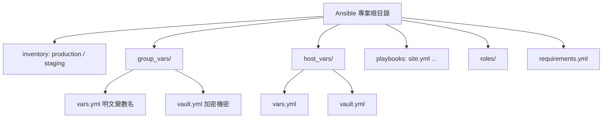

# Ansible 實務上的變數管理：哪些檔案會被加進 `.gitignore`？

## 摘要

本報告說明 Ansible 在真實專案中如何組織與管理變數，並進一步回答一個具體問題：**在一個 Ansible 專案裡，哪些檔案應該被加進 `.gitignore`，哪些應該進版控？** 核心原則是「提交宣告（declaration），不提交產物（artifact）」，以及「機密永遠加密後才進版控，解密用的密碼永遠不進版控」。本報告涵蓋標準目錄結構、變數分層、機密處理、依賴管理，並給出一份可直接使用的 `.gitignore` 範本。

---

## 1. Ansible 專案的標準目錄結構

Ansible 官方文件建議的專案配置如下[^setup]：

```
production                # production 環境的 inventory 檔
staging                   # staging 環境的 inventory 檔

group_vars/
   group1.yml             # 特定群組的變數
   group2.yml
host_vars/
   hostname1.yml          # 特定主機的變數
   hostname2.yml

library/                  # 自訂模組（選用）
module_utils/             # 自訂 module_utils（選用）
filter_plugins/           # 自訂 filter 外掛（選用）

site.yml                  # 主 playbook
webservers.yml            # webserver 層的 playbook
dbservers.yml             # dbserver 層的 playbook
tasks/                    # 從 playbook include 的任務檔
    webservers-extra.yml

roles/
    common/               # 一個「role」
        tasks/main.yml
        handlers/main.yml
        templates/ntp.conf.j2
        files/bar.txt
        vars/main.yml     # role 變數（優先序高）
        defaults/main.yml # 預設變數（優先序低）
        meta/main.yml     # role 依賴與 Galaxy 資訊
        library/          # role 專屬自訂模組
        module_utils/
        lookup_plugins/
    webtier/
    monitoring/
    fooapp/
```

另一種常見配置是把 inventory 依環境拆成目錄[^setup]：

```
inventories/
   production/
       hosts
       group_vars/
       host_vars/
   staging/
       hosts
       group_vars/
       host_vars/
```

依環境拆分 inventory 不只是整潔問題。官方文件明確指出：若把 production 與 development 放在同一份 inventory，則使用該 inventory 的人就能取得 production 的機密（因為所有 vault 密碼都必須在該 inventory 使用時可用）[^tips]。

### 結構示意



---

## 2. 變數實務：放在哪裡、如何分層

Ansible 會載入所有找到的變數，再依優先序決定勝出值[^vars]。實務上常見的變數放置決策如下：

| 變數類型 | 建議放置位置 | 理由 |
|---|---|---|
| 適用所有主機的全域設定 | `group_vars/all.yml` | 一處定義，全體適用 |
| 特定群組設定 | `group_vars/<group>.yml` | Web/DB 等分層 |
| 單一主機設定 | `host_vars/<host>.yml` | 主機特有值 |
| Role 的可覆寫預設值 | `roles/<role>/defaults/main.yml` | 優先序最低，易覆寫 |
| Role 的固定內部值 | `roles/<role>/vars/main.yml` | 優先序較高 |
| 執行時臨時覆寫 | `--extra-vars`（`-e`） | 優先序最高，永遠勝出 |
| 機密（密碼、金鑰） | `vault.yml`（加密） | 加密後才進版控 |

官方列出的完整優先序（由低到高）為[^prec][^vars]：

| 順序 | 來源 |
|---|---|
| 02 | Role defaults（`defaults/main.yml`） |
| 03–07 | inventory / playbook 的 `group_vars`（`all` 再到個別群組） |
| 08–10 | inventory / playbook 的 `host_vars` |
| 11 | host facts 與已快取的 set_fact |
| 12 | Play vars |
| 13 | Play `vars_prompt` |
| 14 | Play `vars_files` |
| 15 | Role vars（`vars/main.yml`） |
| 16 | Block vars |
| 17 | Task vars |
| 18 | `include_vars` |
| 19 | Registered vars 與 set_fact |
| 20–21 | Role / include params |
| 22 | **Extra vars**（永遠勝出） |

> 原則：越晚定義、越明確指定、範圍越小的變數，優先序越高[^vars]。

---

## 3. 機密處理：`vars` + `vault` 模式

官方「General tips」文件建議的做法是「讓加密變數保持可見（Keep vaulted variables safely visible）」，具體步驟如下[^tips]：

1. 建立以群組命名的子目錄，例如 `group_vars/webservers/`。
2. 在該目錄內建立兩個檔案：`vars.yml`（明文）與 `vault.yml`（加密）。
3. 在 `vars.yml` 中定義**所有**變數，包含機密變數，但機密的值指向 vault 變數：
   ```yaml
   # group_vars/webservers/vars.yml
   db_host: localhost
   db_password: "{{ vault_db_password }}"
   ```
4. 在 `vault.yml` 中只放機密值，並以 `vault_` 前綴命名：
   ```yaml
   # group_vars/webservers/vault.yml（加密）
   vault_db_password: s3cret!
   ```
5. 用 `ansible-vault encrypt` 加密 `vault.yml`。
6. Playbook 中使用**未加密的變數名**（`db_password`），Ansible 會自動解析間接引用。

此模式的價值在於：變數名稱維持明文、可被 `grep` 搜尋，而機密值保持加密。同樣的模式也適用 `host_vars/<hostname>/`[^tips]。

### 加密單一值

若只有零星幾個機密，可用 `ansible-vault encrypt_string` 直接行內加密[^encrypt]：

```bash
ansible-vault encrypt_string --vault-password-file a_password_file 'foobar' --name 'the_secret'
```

產生帶 `!vault |` 標籤與 `$ANSIBLE_VAULT;1.1;AES256` 標頭的內容。

---

## 4. 依賴管理：`requirements.yml`

Ansible Galaxy 的 `requirements.yml` 是專案的依賴清單，同時宣告 roles 與 collections[^galaxy]：

```yaml
---
roles:
  - name: geerlingguy.java
    version: "1.9.6"

collections:
  - name: community.general
    version: ">=7.0.0"
    source: https://galaxy.ansible.com
```

安裝指令[^galaxy]：

```bash
ansible-galaxy install -r requirements.yml
```

檔案副檔名必須是 `.yml` 或 `.yaml`，否則 `ansible-galaxy` 會以已棄用的舊格式解讀[^galaxy]。

**關鍵原則**：`requirements.yml`（宣告）要進版控，而安裝後產生的 `roles/`、`collections/` 目錄（產物）要 `.gitignore`。這與 `package.json` 對 `node_modules/`、`go.mod` 對 module cache 的模式完全一致[^galaxy]。理由包含[^galaxy]：

1. **可重現性**：以釘住版本號的 `requirements.yml` 為唯一真實來源，任何人重跑安裝都能得到相同依賴。
2. **避免倉庫膨脹**：roles/collections 可能包含數千檔案、數 MB 內容。
3. **易於合併**：升級版本只是 `requirements.yml` 的一行 diff，不會產生大量雜訊。
4. **CI/CD 相容**：CI 流程可在建置階段重新安裝，取得乾淨的依賴樹。

---

## 5. 哪些檔案該進 `.gitignore`？

### 5.1 官方與社群範本

GitHub 官方的 Ansible `.gitignore` 範本非常精簡，僅包含[^ghignore]：

```gitignore
# The default root path for Ansible config files on the controller
.ansible/

# Retry files generated for failed Ansible playbook runs
*.retry
```

Ansible 專案自身的 `.gitignore` 則可作為更完整的參考，包含 `.retry`、`.out`、`.cache`、`.pytest_cache`、`.tox`、`.env`、`.venv`、`venv/`、`credentials.yml`、`Vagrantfile`、`.vagrant`、`.vscode/`、`.idea`、`*.swp`、`.DS_Store`、`*.egg-info/` 等[^selfignore]。

安插一點重要脈絡：`credentials.yml` 正是 Ansible 自身專案忽略的機密檔名之一[^selfignore]，顯示「機密檔不進版控」是業界共識。

### 5.2 判斷準則

| 類別 | 進版控？ | 理由 |
|---|---|---|
| `ansible.cfg` | **是**（多數情況） | 定義專案設定；確保密碼路徑等機密不寫死其中 |
| inventory 檔 | **是** | 結構本身有價值；機密以 vault 加密後放入 |
| `group_vars` / `host_vars` 的 `vars.yml` | **是** | 明文變數名，可搜尋 |
| `group_vars` / `host_vars` 的 `vault.yml` | **是**（已加密） | 加密內容安全，團隊需共用 |
| `requirements.yml` | **是** | 依賴宣告 |
| `*.retry` | **否** | 失敗重試檔，每次執行重新產生 |
| `.ansible/` | **否** | 專案本機快取（ansible-lint 亦建議忽略）[^lintusage] |
| `.cache/`、`.pytest_cache/`、`.tox/` | **否** | 執行期快取 |
| vault 密碼檔（`.vault_pass` 等） | **否** | 外洩即等於全部機密外洩 |
| `roles/`、`collections/`（Galaxy 安裝） | **否** | 由 `requirements.yml` 重建 |
| SSH 私鑰（`*.pem`、`id_rsa` 等） | **否** | 私鑰絕不進版控 |
| Python bytecode、venv | **否** | 平台相依產物 |
| 日誌、編輯器暫存檔 | **否** | 機器相依或使用者專屬 |

> 最常見的誤解是把 `vault.yml` 也加入 `.gitignore`。**加密後的 vault 檔應該進版控**，只有解密用的密碼檔不該進版控[^tips]。

---

## 6. 可直接使用的 `.gitignore` 範本

```
# ── Ansible 執行期與產物 ──
*.retry
*.out
.ansible/
.cache/
ansible.log

# ── Vault 密碼檔：絕不提交 ──
.vault_pass
.vault_password
*.vault_pass

# ── 已安裝的 Galaxy 依賴（由 requirements.yml 重建）──
roles/
collections/
!requirements.yml

# ── Python bytecode 與虛擬環境 ──
__pycache__/
*.py[cod]
.venv/
venv/
env/
ENV/

# ── SSH 私鑰：絕不提交 ──
*.pem
*.key
id_rsa*
id_ed25519*
ssh_key*

# ── 編輯器與作業系統檔 ──
.vscode/
.idea/
*.swp
*.swo
*~
.DS_Store

# ── 備份與暫存 ──
*.bkp
*.bak
*.tmp
*.old

# ── 測試與覆蓋率 ──
.pytest_cache/
.tox/
htmlcov/
.coverage
.molecule/

# ── Vagrant ──
.vagrant/
```

注意：若專案內含自行開發的 role（而非全來自 Galaxy），則不應整包忽略 `roles/`，而應只忽略從 Galaxy 安裝的來源，例如改用獨立的 `galaxy-roles/` 目錄或更精確的比對樣式[^selfignore]。

---

## 7. 結論

- Ansible 採用**分層變數系統**而非單一設定檔：全域用 `group_vars/all`，群組用 `group_vars/<group>`，主機用 `host_vars/<host>`，role 預設放 `defaults/main.yml`，執行期覆寫用 `--extra-vars`[^vars][^setup]。
- 機密採 `vars.yml`（明文變數名）+ `vault.yml`（加密值）模式，讓變數名可搜尋、值受保護[^tips]。
- `.gitignore` 的核心準則有兩條：**(a)** 提交宣告（`requirements.yml`、`ansible.cfg`、inventory、`vars.yml`）而非產物（`roles/`、`collections/`、`.ansible/`、`*.retry`）；**(b)** 加密的 `vault.yml` 進版控，但解密密碼檔（`.vault_pass`）、SSH 私鑰等絕不進版控[^ghignore][^galaxy][^tips]。
- 官方 GitHub 範本僅含 `.ansible/` 與 `*.retry` 兩行，實務上常需再補上密碼檔、Galaxy 依賴、Python 與 SSH 相關樣式[^ghignore][^selfignore]。

---

## 參考文獻

[^setup]: Ansible Project. (n.d.). Sample Ansible setup. Ansible Documentation. Retrieved 2026-10-24, from https://docs.ansible.com/ansible/latest/tips_tricks/sample_setup.html

[^vars]: Ansible Project. (n.d.). Using variables. Ansible Documentation. Retrieved 2026-10-24, from https://docs.ansible.com/ansible/latest/playbook_guide/playbooks_variables.html

[^prec]: Ansible Project. (n.d.). Variable precedence: Where should I put a variable? Ansible Documentation. Retrieved 2026-10-24, from https://docs.ansible.com/ansible/latest/playbook_guide/playbooks_variables.html#variable-precedence-where-should-i-put-a-variable

[^tips]: Ansible Project. (n.d.). General tips. Ansible Documentation. Retrieved 2026-10-24, from https://docs.ansible.com/ansible/latest/tips_tricks/ansible_tips_tricks.html

[^encrypt]: Ansible Project. (n.d.). Encrypting content with Ansible Vault. Ansible Documentation. Retrieved 2026-10-24, from https://docs.ansible.com/ansible/latest/vault_guide/vault_encrypting_content.html

[^galaxy]: Ansible Project. (n.d.). Galaxy user guide. Ansible Documentation. Retrieved 2026-10-24, from https://docs.ansible.com/ansible/latest/galaxy/user_guide.html

[^ghignore]: GitHub. (n.d.). Ansible.gitignore [Computer software]. GitHub. Retrieved 2026-10-24, from https://github.com/github/gitignore/blob/main/Global/Ansible.gitignore

[^selfignore]: Ansible Project. (n.d.). .gitignore [Computer software]. GitHub. Retrieved 2026-10-24, from https://github.com/ansible/ansible/blob/devel/.gitignore

[^lintusage]: Ansible Project. (n.d.). Usage. Ansible Lint Documentation. Retrieved 2026-10-24, from https://docs.ansible.com/projects/lint/usage/
