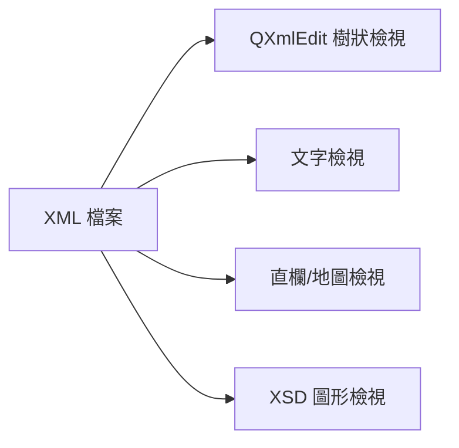
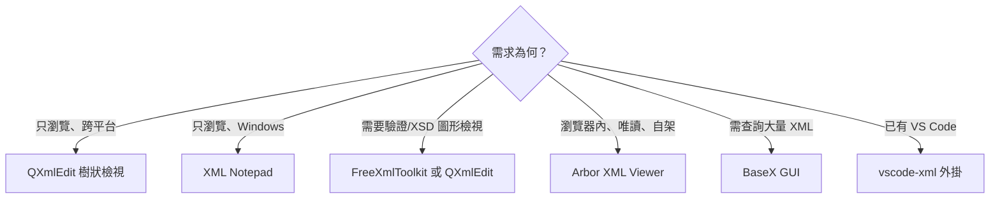

# 自由開源軟體 (FOSS) 的 XML 閱讀器／瀏覽器（圖形介面）

## 摘要

本文調查「以圖形使用者介面 (GUI) 閱讀、瀏覽 XML 檔案」的自由開源軟體 (Free and Open Source Software, FOSS)。核心結論是：**專門且僅供閱讀 XML 的 FOSS 桌面程式極少**，市場上絕大多數專案是「編輯器」，閱讀只是其附帶功能；真正以「唯讀瀏覽」為定位者多為小型或新興專案。因此實務上多數人採用「通用編輯器加上 XML 外掛」或「XML 編輯器的樹狀檢視模式」來達成瀏覽需求。

本文依「定位」將候選工具分為三類：

1. **雙用途桌面編輯器**（同時具備樹狀瀏覽與編輯能力，跨平台）
2. **平台限定或 IDE 型工具**
3. **網頁／自架瀏覽器**（唯讀，於瀏覽器內執行）

## 背景：為何「唯讀 XML 瀏覽器」是稀有類別

XML（Extensible Markup Language，可延伸標記語言）是一種用於描述結構化資料的標記語言。由於 XML 常被用於設定檔、交換格式與文件標記，開發者對它的操作需求通常是「編輯」而非「純閱讀」，因此生態系自然傾向發展功能完整的編輯器。純瀏覽器的需求多半被以下替代方案吸收：文字編輯器的語法著色、IDE 的結構樹、或瀏覽器內建的 XML 檢視。這解釋了為何在 GitHub 上搜尋 "xml viewer"，結果多為程式庫元件（React／Vue 元件）、特定格式（如 Office Open XML）檢視器，或情境專用工具，而非通用桌面應用。

## 一、雙用途桌面編輯器（跨平台）

這類工具以樹狀結構呈現 XML，同時允許編輯。若只需要「瀏覽」，它們的樹狀檢視已足夠。

### 1. QXmlEdit

Qt 框架撰寫的 XML 編輯器與 XSD 檢視器，採 LGPL 授權，主要語言為 C++。GitHub 專案 `lbellonda/qxmledit` 於本次查核時有 181 顆星、49 個分支，最後一次推送為 2026-08-14[^qxmledit-repo]。官方釋出檔的最後版本為 `QXmlEdit-0.9.18`，日期為 2023-02-09[^qxmledit-sf]。

其瀏覽相關特色包含：可自訂的階層樹狀檢視、圖形化 XSD 檢視器、直欄檢視、地圖檢視，以及可將超大 XML 檔切割為片段與比對 XML/XSD 檔案[^qxmledit-sf]。適合需要處理大型檔案與檢視結構描述的使用者。

### 2. FreeXmlToolkit

以 Java／JavaFX 撰寫的一體化 XML 工具組，採 Apache-2.0 授權。GitHub 專案 `karlkauc/FreeXmlToolkit` 於本次查核時為 10 顆星、2 個分支；最新釋出為 `v2.6.0`，日期 2026-10-25，並提供 Windows (`exe`/`msi`)、macOS (`dmg`/`pkg`)、Linux (`deb`/`rpm`/AppImage) 與平台無關 Java 映像等安裝檔[^freetoolkit-repo][^freetoolkit-rel]。

瀏覽與檢視特色包含：圖形樹狀檢視、文字檢視、格狀（表格）檢視、XPath 測試、XSD／Schematron／JSON Schema 驗證、XSD 轉 HTML 文件、XSLT 轉換、以 Apache FOP 產生 PDF、數位簽章與範例資料產生[^freetoolkit-repo]。屬於功能最廣的一體化選擇，但專案規模小、社群支援有限。

### 3. BaseX GUI

BaseX 主要是原生 XML 資料庫與 XQuery／XPath 處理器，但其圖形介面包含樹狀瀏覽、互動式 XQuery 編輯器與資料視覺化，因此也可當作檢視器使用。採 BSD 3-Clause 授權，主要語言 Java。GitHub 專案 `BaseXdb/basex` 於本次查核時有 769 顆星、279 個分支，且當日仍有推送紀錄，維護極為活躍[^basex-repo]。

若使用情境涉及大量 XML 檔案的查詢與瀏覽（而非單檔閱讀），BaseX 的資料庫能力是最大優勢；但若只需偶爾開啟一個 XML 檔，其學習成本與資料庫架構屬多餘負擔。

### 4. EditiX

以 Java 撰寫的跨平台 XML 編輯器，GitHub 專案 `AlexandreBrillant/Editix-xml-editor` 於本次查核時有 77 顆星、29 個分支，最後推送為 2026-09-10，預設分支名稱為 `2027`，顯示版本週期已推進至 2027 版[^editix-repo]。專案描述自稱為「現代、開源的 XML 編輯器」，但授權欄位為 `NOASSERTION`（GitHub 無法自動辨識），且官方網站另有付費延伸套件，授權狀態需自行向專案確認[^editix-repo]。

## 二、平台限定與 IDE 型工具

### 5. XML Notepad（微軟，Windows 限定）

微軟開源（MIT 授權）的 XML 瀏覽與編輯工具，以 C# 撰寫，**僅支援 Windows**。GitHub 專案 `microsoft/XmlNotepad` 於本次查核時有 1,197 顆星、240 個分支，最新釋出 `2.9.0.22` 日期為 2026-06-08[^xmlnotepad-repo][^xmlnotepad-rel]。

其設計以「直覺的瀏覽與編輯介面」為目標，提供樹狀檢視與節點文字檢視互相連動、依 XSD 的 IntelliSense、無限復原／重做、XML 差異比對、XSLT 輸出檢視、XInclude，以及從 XSD 產生 XML 等功能[^xmlnotepad-repo]。在純瀏覽體驗上，它是本文中成熟度與人氣最高的選項，但平台限制明顯。

### 6. VS Code 加上 Red Hat XML 擴充（跨平台）

由 Red Hat 維護的 `vscode-xml` 擴充，採 EPL-2.0 授權，2026-06-08 釋出 0.29.3 版[^vscodexml-rel]。GitHub 專案於本次查核時有 332 顆星、103 個分支[^vscodexml-repo]。其底層為 Eclipse LemMinX 語言伺服器，提供 XSD／DTD／RELAX NG 驗證、結構描述感知的自動完成、格式化與 XPath 支援。自 0.15.0 版起不再需要 Java[^vscodexml-rel]。

注意：微軟官方的 VS Code 二進位檔為專有授權，若要求全鏈路開源，應改用 **VSCodium** 或其它以 MIT 原始碼自行建置的發行版。此方案的定位是「編輯器加上外掛」，並不提供獨立的樹狀瀏覽視窗。

| 工具 | 授權 | 平台 | 主要語言 | GitHub 星數 | 最新版本／日期 | 定位 |
|---|---|---|---|---|---|---|
| QXmlEdit | LGPL | Win/Mac/Linux | C++ | 181 | 0.9.18 / 2023-02-09 | 編輯器（含樹狀瀏覽） |
| FreeXmlToolkit | Apache-2.0 | Win/Mac/Linux | Java | 10 | v2.6.0 / 2026-10-25 | 編輯器（一體化） |
| BaseX GUI | BSD-3-Clause | Win/Mac/Linux | Java | 769 | 持續推送 | 資料庫＋檢視 |
| EditiX | 未明確（NOASSERTION） | Win/Mac/Linux | Java | 77 | 分支 `2027` | 編輯器 |
| XML Notepad | MIT | Windows 限定 | C# | 1,197 | 2.9.0.22 / 2026-06-08 | 編輯器（樹狀瀏覽強） |
| vscode-xml | EPL-2.0 | Win/Mac/Linux | TypeScript | 332 | 0.29.3 / 2026-06-08 | 編輯器外掛 |

## 三、網頁／自架唯讀瀏覽器

此類工具在瀏覽器內解析 XML，不上傳伺服器，屬於真正的「唯讀檢視器」，但需要自行部署靜態檔案或在本機開啟。

### 7. Arbor XML Viewer

GitHub 專案 `giantsoup/xmlviewer` 自述為「純本機的網頁應用，用可收合的樹狀結構、搜尋、統計與鍵盤快速鍵檢視 XML 檔案」，採 MIT 授權，以 TypeScript 撰寫（Preact／Vite）[^arbor-repo]。專案建立於 2026-03-16，於本次查核時為 0 顆星、0 個分支[^arbor-repo]。它是本文中定位最貼近「唯讀 XML 瀏覽器」的專案，但因極新且無社群驗證，成熟度與長期維護風險須自行評估。

### 8. 其他小型網頁檢視元件

GitHub 上另有若干同類專案，但多為程式庫元件或情境專用工具，而非通用桌面瀏覽器，例如：`alissonmbr/react-xml-viewer`（MIT，42 顆星）為 React 元件[^reactxml];`alex-solx/xml-viewer-component`（MIT，5 顆星）為 StencilJS 網頁元件[^xmlcomp];`juliangruber/xml-viewer` 自 2016 年後未再更新[^jgruber]。這些適合嵌入自有網頁，而非作為獨立工具使用。

## 四、來源批判與可信度反思

本節依「來源權威性、時效性、可驗證性」評估本文證據。

- **結構描述欄位（授權、星數、推送日期、釋出日期）**：本文所有星數、分支數、授權、最新推送與釋出日期，均取自 GitHub REST API 的即時回應，屬於第一手且可重現的資料，可信度高[^qxmledit-repo][^xmlnotepad-repo][^basex-repo][^freetoolkit-repo][^vscodexml-repo][^editix-repo][^arbor-repo]。唯獨「星數」會隨時間變動，讀者應視其為查核當日 (2026-10-29) 的快照。
- **功能描述**：部分功能敘述來自搜尋彙整的二手整理，未逐一在原始文件中驗證。因此本文對功能採「概括性描述」，未精確到版本號層級；讀者若需精確功能清單，應查閱各專案官方文件。
- **授權標示的陷阱**：EditiX 的 GitHub 授權欄位為 `NOASSERTION`，即 GitHub 無法自動辨識其授權檔[^editix-repo]。QXmlEdit 亦同樣為 `NOASSERTION`[^qxmledit-repo]。這**不代表專案非開源**（QXmlEdit 官方與社群普遍標示為 LGPL），但代表自動化欄位不足以作為授權判斷依據，實務上應以專案內的 LICENSE 檔與官方聲明為準。
- **低星數專案的取捨**：Arbor XML Viewer 為 0 顆星、FreeXmlToolkit 為 10 顆星，皆遠低於一般篩選門檻（約 100 顆星）。本文仍收錄，原因是「唯讀 XML 瀏覽器」本身屬小眾類別，此類專案稀少，若不收錄則會遺漏該類別唯一貼近需求的選項。但其長期維護風險應明確告知讀者。
- **未納入的專有軟體**：業界知名的 oXygen XML Editor、Altova XMLSpy、Liquid XML Editor 等均為商業專有授權，不符合 FOSS 條件，故列為排除對象。本文不對其功能做評價。

## 五、結論與建議

1. **若只需跨平台瀏覽**：首選 **QXmlEdit**，其樹狀檢視、直欄與地圖檢視成熟，且對大檔案有專門處理；授權為 LGPL，適合自由軟體生態。
2. **若在 Windows 且重視瀏覽體驗**：**XML Notepad** 是成熟度與人氣最高的選擇（MIT 授權，1,197 顆星）。
3. **若需要驗證與 XSD 圖形檢視的一體化工具**：**FreeXmlToolkit** 功能最廣且提供多平台安裝檔，但社群規模極小。
4. **若需查詢大量 XML**：**BaseX GUI** 兼具資料庫與瀏覽能力，維護最活躍。
5. **若明確要求「唯讀、瀏覽器內執行、可自架」**：目前唯一貼近的選項是 **Arbor XML Viewer**，但屬實驗性專案，不宜用於關鍵流程。
6. **若已使用 VS Code 生態**：安裝 Red Hat XML 擴充即可，但需注意官方二進位非開源，全開源需求應改用 VSCodium。

**整體觀察**：FOSS 生態中，「XML 編輯器」供給充足且不乏高成熟度專案，「唯讀 XML 瀏覽器」則長期供給不足。這是一個「需求存在但未被專門滿足」的縫隙，也解釋了為何實務上多用編輯器的樹狀模式來替代專用瀏覽器。

## 參考文獻

[^qxmledit-repo]: lbellonda. (2026). *lbellonda/qxmledit: QXmlEdit XML editor* [Source code]. GitHub. Retrieved 2026-10-29, from https://github.com/lbellonda/qxmledit

[^qxmledit-sf]: lbellonda. (2023). *QXmlEdit Files*. SourceForge. Retrieved 2026-10-29, from https://sourceforge.net/projects/qxmledit/files/

[^freetoolkit-repo]: karlkauc. (2026). *karlkauc/FreeXmlToolkit: Free XML Toolkit* [Source code]. GitHub. Retrieved 2026-10-29, from https://github.com/karlkauc/FreeXmlToolkit

[^freetoolkit-rel]: karlkauc. (2026, October 25). *Version 2.6.0* [Release]. GitHub. Retrieved 2026-10-29, from https://github.com/karlkauc/FreeXmlToolkit/releases/tag/v2.6.0

[^basex-repo]: BaseXdb. (2026). *BaseXdb/basex: BaseX Main Repository* [Source code]. GitHub. Retrieved 2026-10-29, from https://github.com/BaseXdb/basex

[^editix-repo]: AlexandreBrillant. (2026). *AlexandreBrillant/Editix-xml-editor: EditiX XML Editor* [Source code]. GitHub. Retrieved 2026-10-29, from https://github.com/AlexandreBrillant/Editix-xml-editor

[^xmlnotepad-repo]: Microsoft. (2026). *microsoft/XmlNotepad: XML Notepad provides a simple intuitive User Interface for browsing and editing XML documents* [Source code]. GitHub. Retrieved 2026-10-29, from https://github.com/microsoft/XmlNotepad

[^xmlnotepad-rel]: lovettchris. (2026, June 8). *Xml Notepad 2.9.0.22* [Release]. GitHub. Retrieved 2026-10-29, from https://github.com/microsoft/XmlNotepad/releases/tag/2.9.0.22

[^vscodexml-repo]: Red Hat. (2026). *redhat-developer/vscode-xml: Editing XML in Visual Studio Code made easy* [Source code]. GitHub. Retrieved 2026-10-29, from https://github.com/redhat-developer/vscode-xml

[^vscodexml-rel]: Red Hat. (2026, June 8). *0.29.3* [Release]. GitHub. Retrieved 2026-10-29, from https://github.com/redhat-developer/vscode-xml/releases/tag/0.29.3

[^arbor-repo]: giantsoup. (2026). *giantsoup/xmlviewer: Local-only web app for inspecting XML files in the browser with a collapsible tree, search, stats, and keyboard shortcuts* [Source code]. GitHub. Retrieved 2026-10-29, from https://github.com/giantsoup/xmlviewer

[^reactxml]: alissonmbr. (2026). *alissonmbr/react-xml-viewer* [Source code]. GitHub. Retrieved 2026-10-29, from https://github.com/alissonmbr/react-xml-viewer

[^xmlcomp]: alex-solx. (2026). *alex-solx/xml-viewer-component: web component that prettifies xml* [Source code]. GitHub. Retrieved 2026-10-29, from https://github.com/alex-solx/xml-viewer-component

[^jgruber]: juliangruber. (2016). *juliangruber/xml-viewer: Render and interact with XML in the browser* [Source code]. GitHub. Retrieved 2026-10-29, from https://github.com/juliangruber/xml-viewer
