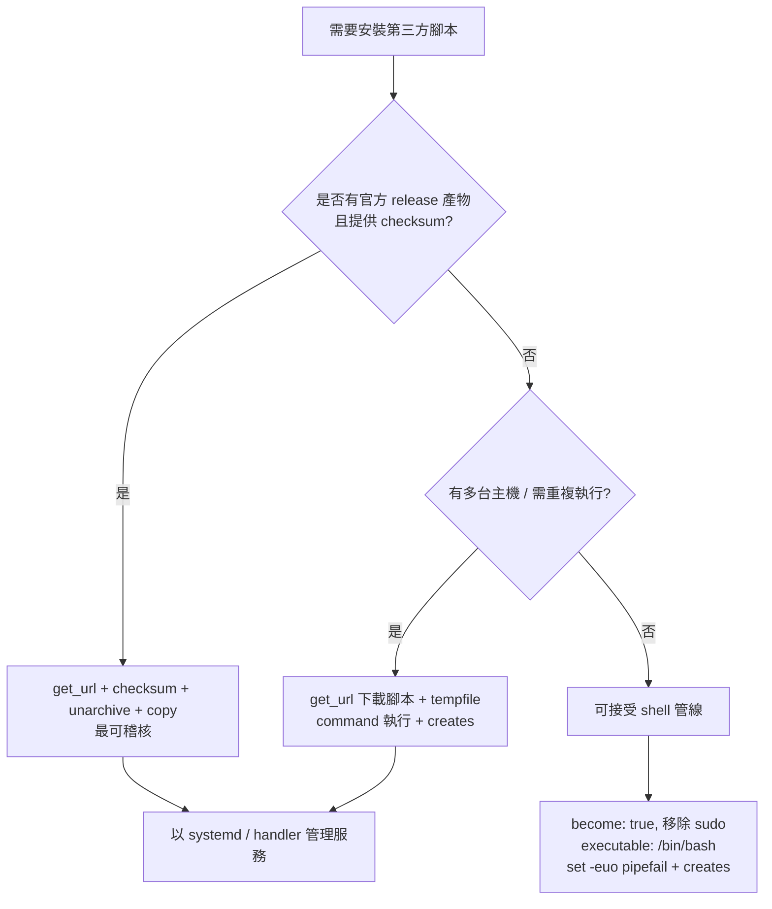

# 在 Ansible 中正確執行 `curl -fsSL ... | sudo bash` 的方法

## 摘要

`curl -fsSL <url> | sudo bash` 是安裝腳本的常見一行指令，但它與 Ansible 的執行模型有兩個根本衝突：Ansible 的特權提升（`become`）作用於整個任務層級，而非管線中的單一指令；且管線的結束碼預設只反映最後一個指令，`curl` 的失敗會被吞掉。因此正確做法不是把這一行原封不動塞進 `shell` 模組，而是把它拆解為「下載 → 驗證 → 執行 → 清理」四個可重複、可檢核的步驟。本文以 `batctl`（一個 Linux 筆電電池充電閾值管理工具，GitHub 168 顆星）的安裝腳本為具體案例，說明各種寫法的風險與建議設定。[^batctl_repo][^ansible_shell]

---

## 一、為什麼不能直接照抄那一行

### 1.1 `sudo` 在 Ansible 中是重複且危險的

Ansible 的 `become` 會在遠端把整個指令加上 `sudo -H -S -n` 前綴執行，其中 `-n` 代表「若需要密碼就立即失敗、不要互動詢問」；密碼本身透過專用通道傳遞，而不是走 stdin。[^sudo_become] 這表示：

- 任務若已設定 `become: true`，指令內的 `sudo` 是多餘的；它不是「提升權限」，而是在已經 root 的 shell 裡再開一次 sudo。
- 若任務**沒有**設定 `become: true`，指令內的 `sudo` 因為沒有 TTY（Ansible 的 SSH 連線是非互動的）而可能直接失敗或卡住等待密碼，這正是 Ansible 論壇上「curl | bash 會停在要 sudo 密碼」的典型症狀。[^forum_curlbash]

換句話說，`sudo` 應該由 `become: true` 表達，而不是寫在字串裡。

### 1.2 管線會隱藏 `curl` 的失敗

Bash 的管線結束碼預設是**最後一個**指令的結束碼，除非啟用 `pipefail`：`false | true` 會回傳 0，因為 `true` 成功了。[^bash_pipelines] 因此

```bash
curl -fsSL https://example.com/install.sh | bash
```

即使 `curl` 因 404、DNS 失敗或 TLS 錯誤而回非零值，只要 `bash` 讀到空輸入後正常結束，整個管線仍回傳 0，Ansible 便回報「成功」——但實際上什麼都沒裝。[^bash_set]

`curl -fsSL` 的 `-f` 雖然會在 HTTP 4xx/5xx 時讓 curl 回傳非零，但這個結束碼在沒有 `pipefail` 的情況下根本傳不出管線。

### 1.3 邊下載邊執行本身有結構性風險

管線寫法讓「下載」與「執行」同時發生，於是出現兩個問題：

1. **部分執行**：連線中斷時，`bash` 可能已經執行了下載到的前半段腳本。
2. **伺服器可偵測到「被管線進 shell」**：伺服器可以先送出會暫停的內容，觀察到管線背壓後再改送另一份內容，由於 HTTPS 只保護傳輸、不保證伺服器每次送出的內容一致，這種手法可讓「你檢查過的內容」與「實際執行的內容」不同。[^curlbash_risk][^curlbash_wrong]

先落地成檔案再執行，可讓檔案可被檢視、可被雜湊比對、下載中斷時不會執行半套。[^curlbash_risk]

---

## 二、最低限度可用的寫法（不建議，但要知道自己在做什麼）

若確實只能照抄該行，至少必須補上 `become`、`bash` 與 `pipefail`，並關閉 changed 誤報：

```yaml
- name: 安裝 batctl（管線寫法，僅在無法拆分時使用）
  ansible.builtin.shell:
    cmd: |
      set -euo pipefail
      curl -fsSL https://raw.githubusercontent.com/Ooooze/batctl/master/install.sh | bash
    executable: /bin/bash
    creates: /usr/bin/batctl
  become: true
  args:
    chdir: /tmp
```

要點說明：

| 設定 | 作用 |
|------|------|
| `executable: /bin/bash` | `shell` 預設用 `/bin/sh`，不保證有 `pipefail`；必須指定 bash。[^ansible_shell] |
| `set -euo pipefail` | 讓管線中任一指令失敗即中止，並讓 `curl` 的錯誤碼能傳出。[^bash_set] |
| `creates: /usr/bin/batctl` | 已安裝就跳過，提供最基本的冪等性；`shell`/`command` 的 `creates` 會在檔案存在時不執行。[^ansible_shell] |
| `become: true` | 取代指令內的 `sudo`；不可兩者並存。[^sudo_become] |
| 移除 `sudo` | 避免無 TTY 的巢狀 sudo 失敗。 |

即使如此，這種寫法仍然：無法驗證腳本內容、無法在 check mode 中正確預測、每次執行都以「整支重新安裝」的方式進行、且若上游腳本改動即行為改變。

---

## 三、建議寫法：下載後執行（get_url + tempfile + command）

Ansible 官方文件明確建議：當需要執行內嵌腳本時，優先考慮以 `script`、`template` 等模組取代 `shell` 的字串式腳本；而 `command` 模組在「不需 shell 功能」時應優先於 `shell`，因為它不經過 `/bin/sh`，沒有重導向與注入風險。[^ansible_shell][^ansible_command]

### 3.1 通用範本

```yaml
- name: 建立暫存安裝腳本
  ansible.builtin.tempfile:
    state: file
    suffix: .sh
    prefix: batctl-install.
  register: batctl_installer
  check_mode: false          # tempfile 不支援 check mode

- name: 下載安裝腳本
  ansible.builtin.get_url:
    url: https://raw.githubusercontent.com/Ooooze/batctl/master/install.sh
    dest: "{{ batctl_installer.path }}"
    mode: '0700'
    force: true
    validate_certs: true
  register: batctl_download

- name: 檢查是否已安裝
  ansible.builtin.stat:
    path: /usr/bin/batctl
  register: batctl_bin

- name: 執行安裝腳本
  ansible.builtin.command:
    cmd: "{{ batctl_installer.path }}"
    creates: /usr/bin/batctl
  become: true
  when: batctl_download is changed

- name: 移除暫存腳本
  ansible.builtin.file:
    path: "{{ batctl_installer.path }}"
    state: absent
  when: batctl_installer.path is defined
```

`get_url` 的 `force: true` 確保每次重抓（避免把舊版腳本當新版用），`mode: '0700'` 讓只有擁有者可執行，`validate_certs` 預設即為 `true`。[^ansible_geturl] `tempfile` 建立的檔案僅建立者可存取，並透過 `register` 回傳 `path` 供後續引用。[^ansible_tempfile]

### 3.2 更精簡的 `creates` 版本

若不需要保留腳本供稽核，`get_url` 直接寫到固定路徑搭配 `creates` 已足夠：

```yaml
- name: 下載 batctl 安裝腳本
  ansible.builtin.get_url:
    url: https://raw.githubusercontent.com/Ooooze/batctl/master/install.sh
    dest: /tmp/batctl-install.sh
    mode: '0700'
    force: true

- name: 執行 batctl 安裝腳本（已安裝則跳過）
  ansible.builtin.command:
    cmd: /tmp/batctl-install.sh
    creates: /usr/bin/batctl
  become: true

- name: 清理安裝腳本
  ansible.builtin.file:
    path: /tmp/batctl-install.sh
    state: absent
```

---

## 四、針對 batctl 的具體注意事項

`install.sh` 的行為直接決定了 Ansible 任務該如何寫。檢視來源可確認以下事實：

| 特性 | 內容 | 對 Ansible 的影響 |
|------|------|------------------|
| 需要 root | 腳本開頭 `check_root` 檢查 `EUID -ne 0`，否則以 `die` 中止 | 任務必須 `become: true`，且**不可**在指令內再寫 `sudo` |
| 安裝位置 | 二進位檔 `install -Dm755 ... /usr/bin/batctl`；systemd unit 寫入 `/etc/systemd/system/` | `creates: /usr/bin/batctl` 是正確的冪等判斷點 |
| 支援 `--version` | `--version VER` 可安裝指定版本 | 可用於鎖定版本，避免 master 分支腳本漂移 |
| 支援 `--no-systemd` | 跳過 systemd 服務安裝 | 容器或非 systemd 環境必須加上，否則會寫入無用的 unit |
| 支援 `--uninstall` | 移除 binary、兩個 unit 與 `/etc/batctl.conf` | 卸載以 `cmd: "{{ script }} --uninstall"` 表達即可，不需要 `bash -s --` 的技巧 |
| 會自行 reload | 腳本內呼叫 `systemctl daemon-reload`（若存在 systemctl） | Ansible 端不需額外 `systemd` handler |

由於 `command` 模組直接 exec 腳本（腳本有 shebang `#!/usr/bin/env bash` 且以 `0700` 下載），**參數可直接附加**，不必像管線寫法那樣需要 `bash -s -- --uninstall`：

```yaml
- name: 解除安裝 batctl
  ansible.builtin.command:
    cmd: /tmp/batctl-install.sh --uninstall
  become: true
```

### 4.1 鎖定版本 + 校驗的完整範例

GitHub Releases API 對每個 release asset 提供 `digest` 欄位（本例為 `sha256:d41ce5ac...` 與 `sha256:bf9b96ed...`），因此可跳過安裝腳本，直接用 `get_url` 的 `checksum` 下載官方 tarball，這是最可稽核的做法。[^github_release]

```yaml
- name: 依架構決定 asset 名稱
  ansible.builtin.set_fact:
    batctl_asset: >-
      batctl-{{ batctl_version }}-linux-{{
        'aarch64' if ansible_architecture in ['aarch64', 'arm64'] else 'x86_64'
      }}.tar.gz

- name: 下載官方 release
  ansible.builtin.get_url:
    url: >-
      https://github.com/Ooooze/batctl/releases/download/v{{ batctl_version }}/{{ batctl_asset }}
    dest: "/tmp/{{ batctl_asset }}"
    checksum: "sha256:{{ batctl_sha256 }}"
    mode: '0644'

- name: 解壓縮到暫存目錄
  ansible.builtin.unarchive:
    src: "/tmp/{{ batctl_asset }}"
    dest: /tmp/batctl-extract
    remote_src: true
    creates: /tmp/batctl-extract/batctl

- name: 安裝二進位檔
  ansible.builtin.copy:
    src: /tmp/batctl-extract/batctl
    dest: /usr/bin/batctl
    mode: '0755'
    remote_src: true
  become: true
```

`get_url` 的 `checksum` 會在檔案已存在時比對雜湊，相同則跳過下載，不同則替換，因此這段本身即具備冪等性與完整性驗證。[^ansible_geturl] 唯一缺少的是 systemd unit，需自行以 `copy`/`template` 模組管理，或仍以腳本安裝（`creates` 判斷）。

---

## 五、決策流程



---

## 六、常見錯誤對照表

| 錯誤寫法 | 問題 | 修正 |
|----------|------|------|
| `shell: curl ... \| sudo bash` 且 `become: true` | 巢狀 sudo，無 TTY 時可能失敗 | 移除指令中的 `sudo` |
| `shell: curl ... \| bash` 且無 `become` | 腳本 `check_root` 直接中止 | 加上 `become: true` |
| `shell: curl ... \| bash` 無 `executable` | `/bin/sh` 未必支援 `pipefail` | 指定 `executable: /bin/bash` |
| 無 `creates` | 每次執行都 changed，破壞冪等 | 加 `creates: /usr/bin/batctl` 或 `command` 模組 |
| 用 `bash -s -- --uninstall` | 只有管線寫法需要；直接執行腳本可直接傳參 | `cmd: "{{ script }} --uninstall"` |
| 只用 `curl -fsSL` 無 `pipefail` | curl 失敗被吞，假成功 | 下載後執行，或 `set -euo pipefail` |
| 容器裡跑完整安裝 | 寫入 systemd unit 但無法啟用 | 加 `--no-systemd` |

---

## 七、批判性反思與來源評析

- **Ansible 官方文件**（`shell`、`command`、`get_url`、`tempfile`、`sudo_become`）是本文技術主張的主要依據，屬第一手權威來源；文件中對 `shell` 的「若需安全且可預測，請改用 `command`」與 `creates`/`removes` 的語意描述明確，可信度高。[^ansible_shell][^ansible_geturl][^ansible_tempfile][^sudo_become]
- **GNU Bash 手冊**對 `pipefail` 與管線結束碼的定義屬規範性文件，無爭議。[^bash_pipelines][^bash_set]
- **`curl | bash` 風險文章**（tferdinand.net、stackharden.com）屬個人技術部落格，非同儕審查；其中「伺服器可偵測管線」的手法有具體示範，但其普遍性與實際被利用的頻率未經獨立量測，應視為「已知可行的手法」而非「已觀察到的大規模攻擊」。[^curlbash_risk][^curlbash_wrong]
- **batctl 專案**本身規模很小（168 顆星、7 個 fork、2026-03 後未再推送），屬小眾但主題明確的工具；其 `install.sh` 內容簡單可讀（約 230 行），無混淆或下載第三方二進位以外的行為，但仍應注意其從 `raw.githubusercontent.com/master` 取得腳本，意味著「腳本內容隨上游變動」，這正是建議鎖定版本或改用 release 產物的理由。[^batctl_repo][^batctl_readme][^github_release]
- **未取得佐證的部分**：本文未找到 Ansible 官方針對「特定第三方安裝腳本」的建議文件，因此第三章的 YAML 屬依官方模組語意自行組合的範例，非官方範例原文。

---

## 參考資料

[^batctl_repo]: Ooooze. (2026). batctl: Battery charge threshold manager for Linux laptops [Source code]. GitHub. Retrieved 2026-10-29, from https://github.com/Ooooze/batctl

[^batctl_readme]: Ooooze. (2026). batctl README. GitHub. Retrieved 2026-10-29, from https://raw.githubusercontent.com/Ooooze/batctl/master/README.md

[^github_release]: GitHub. (2026). Release batctl 2026.3.13 [Release metadata, including SHA-256 digests of release assets]. Retrieved 2026-10-29, from https://api.github.com/repos/Ooooze/batctl/releases/latest

[^ansible_shell]: Ansible Project. (2026). ansible.builtin.shell module: Execute shell commands on targets. Ansible Community Documentation. Retrieved 2026-10-29, from https://docs.ansible.com/ansible/latest/collections/ansible/builtin/shell_module.html

[^ansible_command]: Ansible Project. (2026). ansible.builtin.command module: Execute commands on targets. Ansible Community Documentation. Retrieved 2026-10-29, from https://docs.ansible.com/ansible/latest/collections/ansible/builtin/command_module.html

[^ansible_geturl]: Ansible Project. (2026). ansible.builtin.get_url module: Downloads files from HTTP, HTTPS, or FTP to node. Ansible Community Documentation. Retrieved 2026-10-29, from https://docs.ansible.com/ansible/latest/collections/ansible/builtin/get_url_module.html

[^ansible_tempfile]: Ansible Project. (2026). ansible.builtin.tempfile module: Creates temporary files and directories. Ansible Community Documentation. Retrieved 2026-10-29, from https://docs.ansible.com/ansible/latest/collections/ansible/builtin/tempfile_module.html

[^sudo_become]: Ansible Project. (2026). ansible.builtin.sudo become plugin. Ansible Community Documentation. Retrieved 2026-10-29, from https://docs.ansible.com/ansible/latest/collections/ansible/builtin/sudo_become.html

[^forum_curlbash]: Ansible Community Forum. (n.d.). Curl & bash does not work (newbie question). Retrieved 2026-10-29, from https://forum.ansible.com/t/curl-bash-does-not-work-newbie-question/1914

[^bash_pipelines]: Free Software Foundation. (n.d.). Pipelines. In Bash Reference Manual. Retrieved 2026-10-29, from https://www.gnu.org/software/bash/manual/html_node/Pipelines.html

[^bash_set]: Free Software Foundation. (n.d.). The Set Builtin. In Bash Reference Manual. Retrieved 2026-10-29, from https://www.gnu.org/software/bash/manual/html_node/The-Set-Builtin.html

[^curlbash_risk]: Ferdinand, T. (n.d.). Why curl | bash is a dangerous bad habit. Retrieved 2026-10-29, from https://tferdinand.net/en/why-curl-bash-is-a-dangerous-bad-habit/

[^curlbash_wrong]: StackHarden. (n.d.). Why curl | bash is the wrong default. Retrieved 2026-10-29, from https://stackharden.com/guides/curl-bash-wrong-default/
