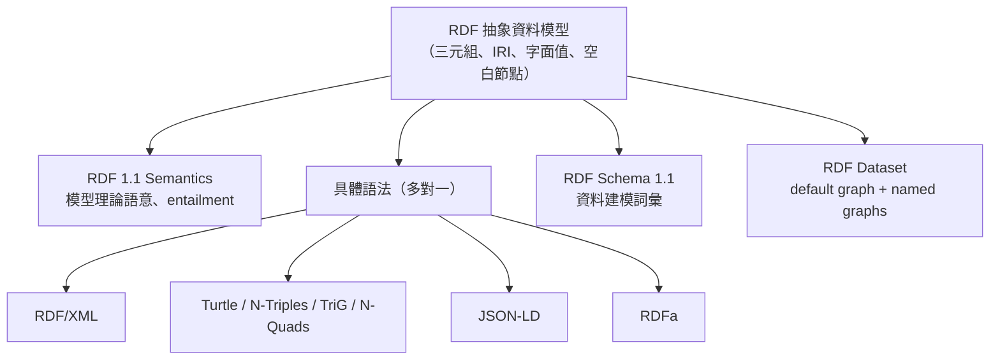
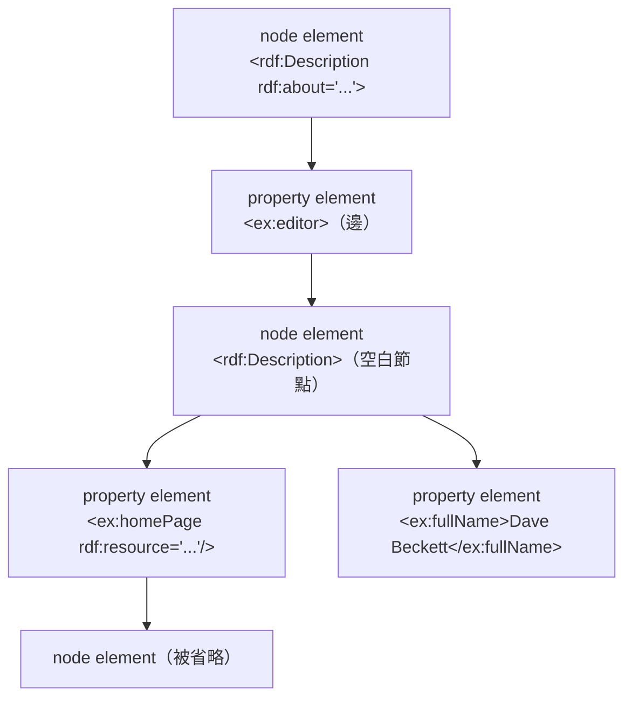
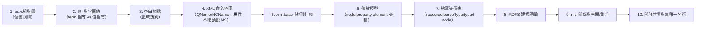

# 使用 RDF/XML 前必須具備的概念、心智模型、領域模型與領域知識

## 摘要

RDF/XML 常被誤認為「RDF 本身」，但它其實只是 RDF 抽象資料模型的一種**具體序列化語法（concrete syntax）**，其歷史地位來自 1990 年代末它是 W3C 第一個正式的 RDF 序列化格式[^rx-wiki]。因此，學習 RDF/XML 的真正門檻不在 XML 語法本身，而在於「要先在腦中建立一個圖形資料模型，再把 XML 當成該圖的編碼載體」。本文把前置知識拆成四層：概念（Concepts）、心智模型（Mental Models）、領域模型（Domain Models）、領域知識（Domain Knowledge），並指出哪些是**硬性前置條件**（不懂就一定寫錯），哪些是**加分知識**（不懂仍可讀寫，但無法判斷資料品質）。

本文假設讀者已具備基本的 XML 讀寫能力，但不預設任何語意網（Semantic Web）背景。

---

## 1. 定位：RDF/XML 在整個體系中的位置

理解 RDF/XML 的第一個前置條件，是搞清楚「資料模型 / 抽象語法 / 具體語法 / 語意」四者的分層。RDF 1.1 Concepts 定義抽象語法（資料模型），RDF 1.1 Semantics 定義模型理論語意，而 RDF/XML、Turtle、JSON-LD、N-Triples、RDFa 則是把同一張圖寫下來的不同具體語法[^rx-concepts][^rx-primer]。

關鍵推論有三點：

1. **同一個 RDF 圖可以有無窮多種 RDF/XML 寫法**，彼此邏輯等價；因此「格式正確」與「意義正確」是兩件事。
2. **RDF/XML 只能承載單一 RDF 圖（RDF graph）**，無法表達 RDF dataset（default graph 加多個 named graphs）[^rx-concepts]；需要多圖時必須改用 TriG、N-Quads 或 JSON-LD。
3. RDF/XML 的 MIME type 是 `application/rdf+xml`，建議副檔名為 `.rdf`[^rx-syntax]。

---

## 2. 概念層（Concepts）：不懂就會寫錯的硬性前置

### 2.1 三元組（Triple）與 RDF 陳述

RDF 的核心資料結構是三元組，由 **subject（主詞）– predicate（述詞）– object（受詞）** 三個位置組成；一組三元組構成一個 RDF 圖，可視覺化為「節點—有向邊—節點」的圖[^rx-concepts]。斷言一個三元組，就是宣稱「述詞所指的關係，成立於主詞與受詞所指的資源之間」，這個宣稱稱為 RDF statement[^rx-concepts]。

三種 RDF term（術語）與其位置限制，是必須背下來的**位置規則**：

| 位置 | 允許的 term | 說明 |
| --- | --- | --- |
| Subject | IRI 或空白節點 | 不能是字面值 |
| Predicate | 僅 IRI | 不能是字面值或空白節點 |
| Object | IRI、字面值或空白節點 | 三者皆可 |

此表直接推導出 RDF/XML 的結構限制：述詞永遠是元素名稱或屬性名稱（因為必須是 IRI），字面值只能出現在物件位置（因此只能是元素內容或屬性值）[^rx-concepts][^rx-syntax]。

### 2.2 IRI 是「全域名稱」而非「網址」

IRI（Internationalized Resource Identifier）是 URI 的推廣，允許非 ASCII 字元，語法見 RFC 3987；RDF 抽象語法中的 IRI **必須是絕對 IRI**，可含 fragment identifier，比較時採 Simple String Comparison，**不得額外做正規化**[^rx-concepts]。必須建立的概念是：

- IRI 的**參照物（referent）**由 IRI 擁有者透過規範或文件約定，RDF 本身不規定任何 IRI 代表什麼（除了 XSD datatype 等少數由規範固定者）[^rx-concepts]。
- 因此「`http://example.org/x` 這串字」與「該字串是否可被 HTTP 取得」是兩個獨立問題；可解參照（dereference）是 Linked Data 的期望，不是 RDF 的必要條件[^rx-concepts][^linkeddata]。

這條概念為何是 RDF/XML 的前置？因為 RDF/XML 用 **QName 拼接**來縮寫 IRI，若讀者不理解「IRI 是識別字而非位址」，就會誤以為 `xmlns:ex="http://example.org/stuff/1.0/"` 是一種「匯入檔案」。

### 2.3 字面值（Literal）：詞彙形式、資料型別、語言標籤

字面值不是 IRI，由三個要素組成：**lexical form（詞彙形式，Unicode 字串）**、**datatype IRI（資料型別）**，以及「若且唯若 datatype 為 `rdf:langString`」時的**非空語言標籤（language tag，依 BCP 47）**[^rx-concepts]。必須掌握的推論有：

- 沒有標明 datatype 也沒有語言標籤時，字面值預設為 `xsd:string`[^rx-concepts][^rx-syntax]。
- 語言標記字串的 datatype 是 `rdf:langString`，而非 `xsd:string`[^rx-primer]。
- **term 相等 ≠ 值相等**：`"1"^^xsd:integer` 與 `"01"^^xsd:integer` 值相同，但詞彙形式不同，因此不是同一個 RDF term[^rx-concepts]。這是 RDF 資料比對最常見的錯誤來源。
- 格式不合法的字面值（ill-typed literal）在語法上仍合法，只造成語意不一致；實作必須接受[^rx-concepts]。

### 2.4 空白節點（Blank Node）與其區域性識別

空白節點代表「存在某個東西，但不給它全域名稱」，可出現在 subject 與 object 位置；RDF 對其內部結構不作任何假設[^rx-concepts][^rx-primer]。關鍵細節：

- 空白節點識別字（blank node identifier，如 `_:x` 或 RDF/XML 的 `rdf:nodeID`）**不屬於抽象語法**，只在特定序列化或儲存體中有意義，且**不具持久性與可攜性**[^rx-concepts]。
- RDF/XML 中的 `rdf:nodeID` 作用域限於該 XML Infoset document information item[^rx-syntax]。
- 若需要更強的識別，可做 Skolemization：以全域唯一 IRI（建議使用 `/.well-known/genid/` 路徑下的 well-known IRI）系統性替換空白節點[^rx-concepts]。

### 2.5 RDF 圖是「集合」：順序與重複都不存在

RDF 圖被定義為三元組的**集合（set）**，因此：三元組沒有順序、重複的三元組在語意上只算一個、新增或移除三元組即得到「另一個」RDF 圖[^rx-concepts]。這條看似抽象的概念，直接影響 RDF/XML 的寫作實務：

- 文件中的元素順序在絕大多數情況下**沒有語意**；唯一例外是 `rdf:li` 依文件順序展開為 `rdf:_1`、`rdf:_2`……，以及 `rdf:parseType="Collection"` 依文件順序建立集合[^rx-syntax]。
- 兩張圖的等價性要用 **graph isomorphism**（空白節點間存在雙射）判定，不能逐字比對[^rx-concepts]。

### 2.6 詞彙表（Vocabulary）、命名空間 IRI 與前綴

RDF vocabulary 是一組「預期用於 RDF 圖中的 IRI」集合；這些 IRI 常共享一段共同子字串，稱為 namespace IRI，並慣例上對應一個短前綴（如 `rdf`、`rdfs`、`xsd`）[^rx-concepts]。**最容易被忽略的概念是**：namespace IRI 與前綴**不是 RDF 資料模型的形式部分**，而只是縮寫用的語法便利手段[^rx-concepts]。

必須記住的常用命名空間（RDF/XML 檔案幾乎一定會出現）：

| 前綴 | Namespace IRI | 用途 |
| --- | --- | --- |
| `rdf` | `http://www.w3.org/1999/02/22-rdf-syntax-ns#` | RDF 內建詞彙與語法名稱 |
| `rdfs` | `http://www.w3.org/2000/01/rdf-schema#` | RDF Schema 詞彙 |
| `xsd` | `http://www.w3.org/2001/XMLSchema#` | 資料型別 |

### 2.7 RDF Schema 的核心詞彙

RDF Schema 1.1 提供 RDF 的資料建模詞彙，是撰寫「有意義」的 RDF/XML 的最低知識門檻[^rdfs]。最小必要集合為：

| 構件 | 語法形式 | 說明 |
| --- | --- | --- |
| Class | `C rdf:type rdfs:Class` | 資源是一個 RDF 類別 |
| Property | `P rdf:type rdf:Property` | 資源是一個 RDF 屬性 |
| type | `I rdf:type C` | I 是 C 的實例；定義域 `rdfs:Resource`，值域 `rdfs:Class` |
| subClassOf | `C1 rdfs:subClassOf C2` | 具遞移性 |
| subPropertyOf | `P1 rdfs:subPropertyOf P2` | 具遞移性 |
| domain | `P rdfs:domain C` | P 的主詞是 C 的實例；**多個 domain 表示交集** |
| range | `P rdfs:range C` | P 的受詞是 C 的實例；**多個 range 表示交集** |
| label / comment | `R rdfs:label L` | 人類可讀名稱與說明，支援多語言標籤 |

必須理解的兩個非直覺點：

1. **RDF Schema 是「以屬性為中心」而非「以類別為中心」**。它不透過「類別擁有什麼屬性」來定義類別，而是反過來描述「某屬性適用於哪些類別的資源」；好處是任何人可在不重新定義既有類別的前提下，為既有資源補充新屬性[^rdfs]。
2. **RDF Schema 允許極大的建模自由**：同一個資源可以同時是類別與屬性，類別也可以是自身的實例，類別與實例之間沒有嚴格分界[^rx-primer]。

### 2.8 具體語法的等價性與資訊損失

RDF 1.1 Concepts 明確指出，具體語法可能提供多種編碼同一張圖的方式（前綴、相對 IRI、空白節點識別字、陳述順序），這些差異對**意義**沒有影響，只影響操作便利性[^rx-concepts]。這條概念是閱讀他人 RDF/XML 時「不要試圖用 XPath 硬套結構」的理論依據。

---

## 3. XML 側的前置知識

RDF/XML 是以 **Namespaces in XML、XML Information Set 與 XML Base** 為基礎定義的[^rx-syntax]。以下四項屬於硬性前置。

### 3.1 QName、展開名與 NCName 限制

XML 命名空間把名稱視為「展開名（expanded name）＝ namespace name + local name」的配對；文件中則以 **QName**（`prefix:localPart` 或無前綴的 `localPart`）書寫，其中 Prefix 與 LocalPart **都必須是 NCName**（即不含冒號的 XML Name）[^xmlns]。

三個必須內化的規則：

1. **命名空間名稱的比較是字串完全相同**，大小寫敏感，不做 %-escaping 的還原；因此 `http://www.example.org/~wilbur` 與 `http://www.example.org/%7Ewilbur` 是**不同**的命名空間[^xmlns]。這對 RDF 尤其致命，因為它會直接產生不同的 IRI。
2. **預設命名空間不套用於屬性名稱**；無前綴屬性的 namespace name 永遠沒有值[^xmlns]。這是初學者寫 RDF/XML 時最常見的 silent failure。
3. NCName 的字元限制使得**並非所有 IRI 都能用 QName 表達**。規範建議序列化器以「在最後一個非 NCName 字元之後切分」的方式拆解 IRI，並保證首字元為字母或底線；若 IRI 以非 NCName 字元結尾，則應拋出「此圖無法以 RDF/XML 序列化」的錯誤[^rx-syntax]。

### 3.2 XML Infoset 與「屬性是無序的」事實

RDF/XML 的語法是定義在 XML Information Set 的事件序列上，並以類似 SAX 的事件模型描述[^rx-syntax]。實務上需要的最小 Infoset 知識：

- 元素資訊項提供 `[local name]`、`[namespace name]`、`[children]`、`[attributes]`、`[parent]`、`[base URI]`。
- 屬性在 XML 中是**無序集合**，因此多個 property attribute 之間沒有先後語意；XML 也強制同一元素上屬性名唯一[^xmlns]，這就是 `rdf:li` 不能用屬性形式重複表達多個成員的原因。

### 3.3 xml:base 與相對 IRI 解析

XML Base 定義 `xml:base` 屬性，其值被視為 Legacy Extended IRI；元素的 base URI 依序為：自身 `xml:base`、父元素的 base URI、所屬實體的 base URI[^xmlbase]。RDF/XML 中，`rdf:about`、`rdf:resource`、`rdf:ID`、`rdf:datatype` 四個屬性所帶的 IRI 都會對 in-scope base URI 做解析[^rx-syntax]。

兩個必須知道的特例與陷阱：

- RFC 3986 未定義「單獨的 fragment identifier」（如 `#foo`）與空字串的解析方式；RDF/XML 自行規定：fragment 直接附加到 base URI，空字串則代入 base URI[^rx-syntax]。
- `xml:base=""` **不會**把 base URI 重設為文件本身的 URI；部分既有處理器卻如此實作，故規範強烈建議不要使用這種值[^xmlbase]。

由此得到一條重要的心智規則：**RDF/XML 文件的意義取決於它被放在哪裡**。搬動檔案、改變 `xml:base`，會靜默改變所有相對 IRI 的意義。

### 3.4 xml:lang 與語言的繼承

`xml:lang` 可用在任一 node element 或 property element 上，表示所包含內容的語言；最具體的 in-scope 語言會套用到 property element 的字串內容或 property attribute 值；`xml:lang=""` 表示「無語言標記」。**已具型別的字面值（含 XML literal）不受此屬性影響**[^rx-syntax]。

---

## 4. 心智模型（Mental Models）

概念是「知道有哪些東西」，心智模型是「知道它們如何組合、如何在腦中操作」。以下六個模型依序建立，缺一不可。

### 4.1 條紋模型（Stripes）：節點元素與屬性元素交替

RDF/XML 最核心的心智模型是 **striping（條紋）**：由於 RDF 圖是「節點—邊—節點」的圖，而 XML 是樹，編碼時元素必須**交替**代表節點與邊。慣例上，代表節點的稱為 **node element**（通常是 `rdf:Description`，或帶型別的 `ex:Document`），代表邊的稱為 **property element**（如 `ex:editor`、`dc:title`）[^rx-syntax][^stripes]。

Dan Brickley 的說法是：觀察 XML 的巢狀層級，奇數層元素描述節點、偶數層元素描述邊，這種交替即為「條紋」；`rdf:Description` 只是「某個 Resource」的佔位符，看到它就想成「存在一個資源……」[^stripes]。此模型能解釋 90% 的實務 RDF/XML，但需注意 `rdf:parseType` 會破壞單純的條紋計數[^stripes]。

### 4.2 圖→樹的投影模型（一棵樹可含多條路徑）

RDF/XML 文件的內容，可視為「覆蓋整張圖的一組路徑（node, arc, node, arc, …, node）」的集合，每條路徑變成一串交替巢狀的元素[^rx-syntax]。由此可知：

- 同一個節點可以在同一份文件中被多次描述（多個 `rdf:Description` 具有相同的 `rdf:about`），其效果等於把三元組併入同一張圖。
- 同一張圖可以寫成很深的單一路徑，也可以寫成很多淺的區塊，兩者等價。
- **相對地，樹的形狀不攜帶額外語意**，所以不能據此推論「子元素是父元素的組成部分」之類的結構關係。

### 4.3 縮寫即等價模型（Abbreviation is Equivalence）

RDF/XML 的重點在於：一組縮寫與其展開形式**產生完全相同的三元組**。必須能在腦中雙向轉換的形式包括：

| 形式 | 縮寫機制 | 等價於 |
| --- | --- | --- |
| 多個 property element 巢狀於同一 node element | 共用主詞 | 多個三元組共享主詞 |
| 空 property element + `rdf:resource` | 省略無後續邊的物件節點 | 物件為 IRI 的三元組 |
| property attribute（如 `dc:title="..."`） | 字串字面值升級為屬性 | 物件為字串字面值的三元組 |
| typed node element（如 `<ex:Document rdf:about="...">`） | 以型別 IRI 當元素名 | 隱含一個 `rdf:type` 三元組 |
| `rdf:parseType="Resource"` | 省略 `rdf:Description` 配對 | 物件為空白節點 |
| `rdf:parseType="Collection"` | 省略整個 `rdf:List` 結構 | `rdf:first`/`rdf:rest`/`rdf:nil` 鏈 |
| `rdf:li` | 容器成員依文件順序展開 | `rdf:_1`、`rdf:_2`…… |

使用 property attribute 有嚴格前提：該 property element 的內容必須是字串字面值、同一 node element 上不得重複、且所有相關的 in-scope `xml:lang` 必須相同[^rx-syntax]。`rdf:parseType="Resource"` 形成的 property-and-node 元素上，則不允許再放 property attribute 或 `rdf:nodeID`[^rx-syntax]。

### 4.4 「前綴只是名字的一部分」模型

最容易出錯的心智模型之一：前綴**只能用於元素名與屬性名**，**不能用於屬性值中的 IRI**。因此下列寫法是常見錯誤：

- 錯誤：`<ex:prop rdf:resource="ex:apple"/>`（`ex:` 在屬性值裡不是前綴）
- 正確：`<ex:prop rdf:resource="http://example.org/stuff/1.0/apple"/>`

RDF Primers 明確指出這個現象看起來很奇怪，但原因是前綴只能用在 XML 元素與屬性名稱上[^rx-primer]。

### 4.5 「位置決定意義」模型

由於相對 IRI 與 `rdf:ID` 都要對 base URI 解析，RDF/XML 的語意與「文件所在位置」綁定。`rdf:ID` 在 node element 上等價於 `rdf:about="#該值"`，且同一 base URI 下不得重複；在 property element 上則用於**再化（reification）**，把該元素產生的三元組變成一個可用 IRI 指涉的資源[^rx-syntax]。必須建立的直覺是：

- `rdf:ID` 是「相對於此文件」的區域命名，適合定義一組相關術語。
- `<ex:prop rdf:ID="triple1">blah</ex:prop>` 除了產生原本的三元組，還會額外產生 `rdf:subject`/`rdf:predicate`/`rdf:object`/`rdf:type rdf:Statement` 等再化三元組[^rx-syntax][^rdfs]。

### 4.6 開放世界與無唯一名稱假設

即使只是「讀」RDF/XML，也必須具備正確的推理心智模型，否則會對查詢結果作出錯誤解讀：

- **開放世界假設（Open World Assumption）**：資料庫中不存在的事實通常被視為偽；在 OWL/RDF 文件中，某事實只是「沒被寫出來」，仍可能為真[^owlprimer]。
- **無唯一名稱假設（No Unique Name Assumption）**：OWL 不假設不同名稱指向不同個體，這特別適合語意網情境，因為名稱可能由不同組織在不同時間各自命名而不自知地指向同一人；要表達相異必須明確使用 `owl:differentFrom`[^owlprimer]。

---

## 5. 領域模型（Domain Models）

「領域模型」談的是：把真實世界知識放進三元組世界時，可用的建模慣例與其代價。這是區分「能產生合法 RDF/XML」與「能產生可用知識圖」的分界線。

### 5.1 以屬性為中心的建模（property-centric modeling）

如 §2.7 所述，RDF Schema 描述的是屬性的 domain 與 range，而非類別的屬性清單[^rdfs]。實務上的建模流程因此變成：

1. 先決定有哪些**關係（屬性 IRI）**，再決定關係兩端的**類別**。
2. 允許他人在既有類別上追加新屬性，這是 Web 架構「任何人都能擴充描述」原則的體現[^rdfs]。
3. domain/range 只是**推論規則**（可據以推得型別），**不是驗證約束**；規範明確表示不規定應用該如何使用這些資訊[^rdfs]。若需要真正的驗證約束，必須另尋 SHACL 等機制（超出 RDF/XML 範圍）。

### 5.2 二元關係的極限與 n 元關係模式

RDF 的屬性本質上是**二元關係**，只能連接兩個個體（或個體與值）。三種典型需求因此需要中介結構[^nary]：

- 需要描述「關係本身」的屬性（如信心度、強度、時間）；
- 需要表達三個以上參與者的關係（如買方、賣方、標的物的交易）；
- 需要表達「其中一個參與者本身是有序清單」。

標準解法（Pattern 1）是**為該關係新增一個類別**，把關係實例化成一個節點，再分別連到各參與者；另一種（Pattern 2）是用清單承載參與者[^nary]。這是使用 RDF/XML 時最常見的「為什麼我的資料要多一層」的答案。

### 5.3 順序、容器與集合：三種不同語意

RDF 提供兩套容易混淆的機制，必須在建模時明確選擇[^rdfs]：

| 機制 | 形式語意 | 慣例用途 | 是否封閉 |
| --- | --- | --- | --- |
| `rdf:Bag` | 與 Seq/Alt 形式語意相同 | 告訴人類讀者「無序」 | 開放（無法宣告沒有其他成員） |
| `rdf:Seq` | 同上 | `rdf:_n` 的數字順序有意義 | 開放 |
| `rdf:Alt` | 同上 | 典型處理是挑一個成員，`rdf:_1` 為預設 | 開放 |
| `rdf:List` + `rdf:first`/`rdf:rest`/`rdf:nil` | 形式化的封閉清單（類 Lisp） | 需要「就這幾個，沒有更多」時 | 封閉 |

在 RDF/XML 中，`rdf:li` 與 `rdf:parseType="Collection"` 分別是上述兩套機制的語法糖[^rx-syntax]。**建模錯誤的典型症狀**是：用 `rdf:Bag` 表達「恰好三個作者」，結果語意上允許第四個作者存在。

### 5.4 三條階層軸

資料建模時必須能區分三種不同的「階層」：

1. **類別階層**：透過 `rdfs:subClassOf`，具遞移性。
2. **屬性階層**：透過 `rdfs:subPropertyOf`，具遞移性；RDF 容器成員屬性 `rdf:_n` 都是 `rdfs:member` 的子屬性[^rdfs]。
3. **資料型別階層**：所有 datatype 都是類別，每個 `rdfs:Datatype` 的實例都是 `rdfs:Literal` 的子類別[^rdfs]。

三者混用是知識圖品質低落的常見主因。

### 5.5 字面值的建模決策

需要事先決定的模型選擇：某個值該用**字面值**還是**資源**？判斷依據是「是否需要對它再說些什麼」。一旦選定字面值，就永遠無法再為它附加三元組（字面值不能當主詞）[^rx-concepts]。若選字面值，還需決定：

- 使用哪個 XSD datatype（規範建議使用 RDF 相容的 XSD 型別，其中 `xsd:hexBinary` 與 `xsd:base64Binary` 是唯一可安全傳輸二進位資料的型別）[^rx-concepts]；
- 是否加語言標籤（多語言名稱）；
- 詞彙形式是否正規化（因為 term 相等是字元逐字比較）[^rx-concepts]。

### 5.6 資料集切分與來源追溯

RDF dataset 由「恰好一個 default graph」與「零或多個 named graph」組成，每個 named graph 由 IRI 或空白節點命名[^rx-concepts]。重要的建模認知是：**graph name 並不必然指涉該圖**，規範只把它與圖語法性地配對，不對其指涉關係作任何形式限制[^rx-concepts]。實務上人們常假設「graph name 表示資料來源」，但這是 out-of-band 的社群慣例，無法在資料中標準表達[^rx-primer]。

由於 RDF/XML 無法表達 dataset，需要在 RDF/XML 專案中處理多來源時，通常會在**檔案層級**切分（一個檔案一張圖），並承擔「檢索 URL、文件名稱、graph name 混為一談」的缺點[^triG]。

### 5.7 命名策略

建模階段就必須決定的 IRI 慣例，包括：以 slash 或 hash 結尾的 namespace IRI、個體 IRI 的組成規則、是否可解參照。這與 Linked Data 四規則直接相關：以 URI 命名事物、使用 HTTP URI、被查詢時提供有用資訊、包含指向其他 URI 的連結[^linkeddata]。RDF/XML 沒有能力替你檢查這些，只能靠建模紀律。

### 5.8 與關聯式模型的對照

若讀者來自關聯式資料庫，最快的心智轉換是下表：

| 關聯式 | RDF | 差異要點 |
| --- | --- | --- |
| Table | Class / Property 的集合 | RDF 無固定 schema |
| Row | 一組共享主詞的三元組 | 主詞可跨表被描述 |
| Column | Predicate IRI | 述詞本身是一等資源，可再被描述 |
| Foreign key | 物件位置放 IRI | 無參照完整性約束 |
| NULL | 不存三元組 | 開放世界下不等於「不存在」 |
| Schema | RDFS/OWL 詞彙（另一張圖） | 描述與被描述者同構 |

---

## 6. 領域知識（Domain Knowledge）

### 6.1 規範文件家族與版本

使用 RDF/XML 前應知道它屬於 RDF 1.1 文件集，該集合包含：Concepts and Abstract Syntax、Semantics、各種具體語法（Turtle/TriG、JSON-LD、RDFa、N-Triples/N-Quads、RDF/XML）以及 RDF Schema[^rx-syntax]。RDF 1.1 XML Syntax 是 2004 年 RDF/XML Syntax Specification 的編輯修訂版，技術內容未變，唯一實質差異是 `rdf:XMLLiteral` 被標記為非規範性，以及 XMLLiteral 解析演算法更新以符合當前 XML 技術[^rx-syntax]。

### 6.2 RDF/XML 的歷史定位與現實採用

RDF/XML 是歷史上第一個 W3C 官方的 RDF 序列化格式，因此常被誤稱為「RDF」；它仍是 **OWL 2 的主要交換語法，且所有 OWL 2 工具必須支援**[^rx-wiki]。相對地，現代 RDF 使用者多偏好 Turtle、JSON-LD 等更易讀的語法[^rx-wiki]。

> **來源說明**：本文曾嘗試查證 Adobe XMP 與 RSS 1.0 對 RDF/XML 的採用情況，但相關檢索未取得可引用的原始文件，故不在此陳述，以免產生無出處的事實主張。

### 6.3 已知限制（必須在選型時就知道）

這些限制不是「寫錯」，而是**語法本身的表達力邊界**：

| 限制 | 內容 | 後果 |
| --- | --- | --- |
| QName/NCName 限制 | 述詞 IRI 的 local part 必須是合法 NCName；若 IRI 以非 NCName 字元結尾，該圖無法序列化[^rx-syntax] | 部分圖**根本無法**寫成 RDF/XML |
| 保留名稱 | 不得使用與 `syntaxTerms` 相同的 URI 作為述詞（例如以 `rdf:RDF` 等語法名稱為述詞）[^rx-syntax] | 與 `rdf:` 命名空間衝突的設計會失敗 |
| `rdf:HTML` | RDF/XML 無法序列化使用 `rdf:HTML` datatype 的圖[^rx-syntax] | 需改用 Turtle 等語法 |
| 無 dataset 支援 | RDF/XML 只能表達單一 RDF 圖[^rx-concepts][^triG] | 多圖需改用 TriG/N-Quads/JSON-LD |
| 不可擴充 `rdf:` 命名空間 | RDF/XML 文件不得使用「RDF namespace IRI 串接額外字元」的 XML 命名空間[^rx-syntax] | 無法在該命名空間下自創詞彙 |
| 語法變異極大 | 同一張圖有多種合法寫法，導致標準 XML 工具（XPath、XSLT）難以穩定套用 | 不應把 RDF/XML 當一般 XML 處理 |
| 冗長且不直觀 | 已被廣泛批評為不易人寫、不易人讀 | 手寫易錯，宜由程式產生 |

關於最後兩點，最具代表性的批評來自 Tim Bray 2003 年的文章：他認為 RDF 的概念「再簡單不過」（資源、屬性、值；一切都是 `(Resource, Property, Value)` 三元組），但 RDF/XML 的語法讓人「boggle（瞠目結舌）」；他甚至說自己「即使在腦中已把三元組列得很清楚，也從未真正正確寫出一段 RDF/XML」，並認為大量既存 RDF/XML「完全不可讀」。他強調這是因為 RDF/XML 忽略了 Web 的「View Source」教訓[^bray]。他也指出一個常被忽略的歷史事實：他本人參與發明了 RDF 語法，因此批評也適用於自己[^bray]。

### 6.4 語法名稱（syntax terms）與詞彙名稱的分野

RDF namespace `http://www.w3.org/1999/02/22-rdf-syntax-ns#` 下的名稱分為四類，必須能分辨「哪些是語法、哪些是概念」[^rx-syntax]：

| 類別 | 名稱 |
| --- | --- |
| 語法名稱（非概念） | `RDF`、`Description`、`ID`、`about`、`parseType`、`resource`、`li`、`nodeID`、`datatype` |
| 類別名稱 | `Seq`、`Bag`、`Alt`、`Statement`、`Property`、`XMLLiteral`、`List` |
| 屬性名稱 | `subject`、`predicate`、`object`、`type`、`value`、`first`、`rest`、`_n` |
| 資源名稱 | `nil` |

遇到其他名稱時，規範要求「應產生警告但照常處理」[^rx-syntax]。

### 6.5 工具鏈與驗證知識

必備的操作性知識：

- 解析器實作不必使用 SAX 或 XPath，也不必有特定建圖順序，且**可去除重複的述詞邊**[^rx-syntax]；因此不能依賴解析器的內部行為。
- 驗證方式應為「解析成三元組後與預期圖比對（考慮 isomorphism）」，而非文字比對[^rx-concepts]。
- 官方提供 RDF 1.1 Test Cases 作為一致性測試基礎[^rx-syntax]。
- 若要手動檢查，實務建議先把 RDF/XML 轉為 N-Triples/Turtle 再閱讀，因為「一份 RDF/XML 對應的三元組清單」比 XML 樹容易驗證[^bray]。

### 6.6 何時不該用 RDF/XML

綜合上述，選型判斷可歸納為：

- **適合**：既有 XML 生態系、需要與 OWL 2 工具交換資料、既有 RDF/XML 相容需求[^rx-wiki][^rx-syntax]。
- **不適合**：需要表達多圖／dataset、需要處理任意 IRI（可能不合法 NCName）、需要人手編輯與審閱、需要以既有 XML 工具做結構查詢。

---

## 7. 建議的學習順序

對應的自我檢核清單（能全部回答才算是「具備前置知識」）：

1. 給定一段 RDF/XML，能否逐條列出它產生的三元組（含空白節點對應關係）？
2. 給定一組三元組，能否寫出至少兩種語法不同但等價的 RDF/XML？
3. 能否說明為何 `<ex:p rdf:resource="ex:x"/>` 是錯的？
4. 能否說明 `rdf:ID="a"` 與 `rdf:about="#a"` 的差別，以及為何前者有唯一性檢查？
5. 能否判斷某個述詞 IRI 是否可能無法以 RDF/XML 表達？
6. 能否說明為何同一份文件中出現兩個 `rdf:about` 相同的 `rdf:Description` 是合法的？
7. 能否說明為何「查不到」不等於「不存在」？

---

## 8. 常見誤解對照表

| 誤解 | 正確理解 |
| --- | --- |
| RDF/XML 就是 RDF | RDF/XML 只是 RDF 的一種序列化語法[^rx-wiki][^rx-concepts] |
| 前綴可以在屬性值中使用 | 前綴僅適用於元素與屬性名稱[^rx-primer] |
| 無前綴屬性會繼承預設命名空間 | 預設命名空間不套用於屬性名稱[^xmlns] |
| XML 元素順序會影響語意 | 圖是集合；只有 `rdf:li` 與 `parseType="Collection"` 例外[^rx-concepts][^rx-syntax] |
| `rdf:Description` 是一個類別 | 它只是節點元素的通用佔位名稱[^stripes] |
| domain/range 是驗證約束 | 它們是推論規則，規範不規定應用如何使用[^rdfs] |
| 多個 `rdf:domain` 是聯集 | 是交集（主詞必須同時是所列類別的實例）[^rdfs] |
| 字串字面值都一樣 | `xsd:string`、`rdf:langString`、帶 datatype 者為不同 term[^rx-concepts] |
| 空白節點識別字可長期引用 | 僅限文件或儲存體區域，不可攜、不持久[^rx-concepts] |
| RDF/XML 可表達任何 RDF 圖 | 受 QName 與保留名稱限制，部分圖無法序列化[^rx-syntax] |

---

## 參考文獻

[^rx-concepts]: Cyganiak, R., Wood, D., & Lanthaler, M. (Eds.). (2014). *RDF 1.1 concepts and abstract syntax* (W3C Recommendation). World Wide Web Consortium. Retrieved 2026-10-29, from https://www.w3.org/TR/rdf11-concepts/

[^rx-syntax]: Gandon, F., & Schreiber, G. (Eds.). (2014). *RDF 1.1 XML syntax* (W3C Recommendation). World Wide Web Consortium. Retrieved 2026-10-29, from https://www.w3.org/TR/rdf-syntax-grammar/

[^rx-primer]: Schreiber, G., & Raimond, Y. (Eds.). (2014). *RDF 1.1 primer* (W3C Working Group Note). World Wide Web Consortium. Retrieved 2026-10-29, from https://www.w3.org/TR/rdf11-primer/

[^rdfs]: Brickley, D., & Guha, R. V. (Eds.). (2014). *RDF Schema 1.1* (W3C Recommendation). World Wide Web Consortium. Retrieved 2026-10-29, from https://www.w3.org/TR/rdf-schema/

[^rx-wiki]: Wikipedia contributors. (2025). RDF/XML. In *Wikipedia*. Retrieved 2026-10-29, from https://en.wikipedia.org/wiki/RDF/XML

[^xmlns]: Bray, T., Hollander, D., Layman, A., Tobin, R., & Thompson, H. S. (Eds.). (2009). *Namespaces in XML 1.0 (third edition)* (W3C Recommendation). World Wide Web Consortium. Retrieved 2026-10-29, from https://www.w3.org/TR/xml-names/

[^xmlbase]: Marsh, J., & Tobin, R. (Eds.). (2009). *XML Base (second edition)* (W3C Recommendation). World Wide Web Consortium. Retrieved 2026-10-29, from https://www.w3.org/TR/xmlbase/

[^stripes]: Brickley, D. (2001). *RDF: Understanding the striped RDF/XML syntax*. World Wide Web Consortium. Retrieved 2026-10-29, from https://www.w3.org/2001/10/stripes/

[^bray]: Bray, T. (2003, May 21). *The RDF.net challenge*. ongoing. Retrieved 2026-10-29, from https://www.tbray.org/ongoing/When/200x/2003/05/21/RDFNet

[^owlprimer]: Hitzler, P., Krötzsch, M., Parsia, B., Patel-Schneider, P. F., & Rudolph, S. (Eds.). (2012). *OWL 2 web ontology language primer (second edition)* (W3C Recommendation). World Wide Web Consortium. Retrieved 2026-10-29, from https://www.w3.org/TR/owl2-primer/

[^nary]: Noy, N., & Rector, A. (Eds.). (2006). *Defining n-ary relations on the Semantic Web* (W3C Working Group Note). World Wide Web Consortium. Retrieved 2026-10-29, from https://www.w3.org/TR/swbp-n-aryRelations/

[^linkeddata]: Berners-Lee, T. (2009). *Linked data* (Design Issues). World Wide Web Consortium. Retrieved 2026-10-29, from https://www.w3.org/DesignIssues/LinkedData.html

[^triG]: Carothers, G., & Seaborne, A. (Eds.). (2014). *RDF 1.1 TriG: RDF dataset language* (W3C Recommendation). World Wide Web Consortium. Retrieved 2026-10-29, from https://www.w3.org/TR/trig/
