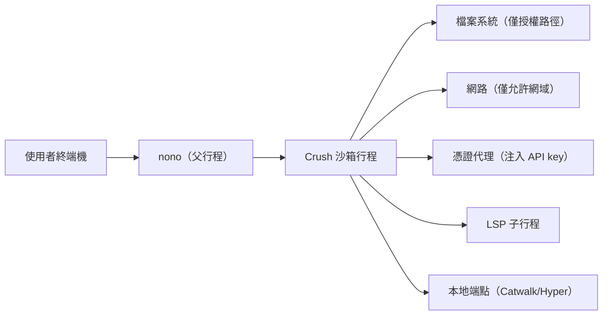

# 如何在 nono 沙箱中執行 charmbracelet/crush

## 摘要

本報告說明如何把終端機 AI 編碼助理 **Crush**（`charmbracelet/crush`）放進 **nono**（`nolabs-ai/nono`）所提供的核心層級（kernel-enforced）代理程式沙箱中執行。核心結論是：**nono 本身不隨附 Crush 的現成 pack，但 nono 是「代理程式無關（agent-agnostic）」的工具，可直接以自訂 profile 包裝任意二進位檔**，因此只要建立一個 Crush 專屬 profile，授予 Crush 所需的檔案系統、網路與憑證權限，即可讓 Crush 在沙箱內運作[^nono-arch][^nono-devworkflow]。本報告提供逐步指令、概念解說與一份可直接沿用的 profile 範例。

---

## 1. 背景：兩個專案是什麼

### 1.1 Crush

Crush 是由 Charm（`charmbracelet`）開發的開源終端機 AI 編碼助理，主打「glamourous agentic coding」，可在終端機中連接本機工具、程式碼與各式大型語言模型（LLM）[^crush-readme]。其 GitHub 專案約有 **28.9k 顆星**[^crush-stars]。

主要特性包括[^crush-readme]：

- **多模型**：支援多種 LLM，並可透過 OpenAI 或 Anthropic 相容 API 自行接入。
- **Session 制**：每個專案可維護多個工作階段與上下文。
- **LSP 強化**：使用 Language Server 取得額外上下文。
- **可擴充**：透過 MCP（HTTP、stdio、SSE）加入外部能力。
- **跨平台**：支援 macOS、Linux、Windows（PowerShell 與 WSL）、Android 及各種 BSD。

安裝方式（任選其一）[^crush-readme]：

```bash
# NPM（macOS、Linux、Windows）
npm install -g @charmland/crush

# Homebrew
brew install charmbracelet/tap/crush

# Go
go install github.com/charmbracelet/crush@latest
```

執行檔名稱為 `crush`[^crush-readme]。

### 1.2 nono

nono 是由 noLabs 開發的「代理程式執行期安全（agent runtime security）」工具，提供零信任、零設定、低延遲的代理程式沙箱，用以隔離 AI 代理程式及其使用的工具、憑證與指令[^nono-repo]。其 GitHub 專案約有 **4.8k 顆星**[^nono-repo]。

nono 保護六個面向[^nono-repo]：

1. **工具沙箱化**：每個工具在各自的核心層級沙箱中執行，控管檔案系統、網路、環境變數與憑證。
2. **憑證注入**：API key 不進入代理程式沙箱，改由代理（proxy）注入。
3. **網路存取**：以網域過濾與 L7（HTTP 方法／路徑）規則控管連線。
4. **供應鏈與技能驗證**：以 Sigstore 驗證 skill、hook 與指令檔的來源與完整性。
5. **密碼學稽核**：可驗證、防竄改的工作階段紀錄。
6. **回復與還原**：可檢視檔案變更並自快照還原。

nono 為**單一、免特權（unprivileged）二進位檔**，可在開發者筆電、Kubernetes pod、CI、容器或 microVM 中執行[^nono-repo]。

安裝方式（任選其一）[^nono-repo]：

```bash
# curl（Linux／macOS）
curl -fsSL https://nono.sh/install.sh | sh

# Homebrew
brew install nono

# Nix
nix run github:nolabs-ai/nono
```

---

## 2. 關鍵前提：nono 對任意代理程式的支援

nono 的一個核心設計是**與代理程式無關**：任何「行程（process）」都能放進 nono 沙箱，包含 CLI 工具、腳本，甚至互動式 shell；沙箱套用於整個行程樹，因此子行程也受到相同權限限制[^nono-devworkflow]。

最基礎的用法是：

```bash
nono run --allow . -- <COMMAND> [ARGS...]
```

這會替**任何指令**加上核心層級的檔案系統隔離、網路過濾、憑證注入與原子回復能力[^nono-devworkflow]。

> **重點**：nono 官方 pack registry（`nolabs-ai/nono-packs`）目前收錄 claude、codex、opencode、goose、pi、copilot-cli 等 18 個套件，但**沒有 crush 的 pack**[^nono-packs]。因此本報告採用「自訂 profile」路線，這也是 nono 官方對「未發布 pack 的代理程式」推薦的做法[^nono-devworkflow]。



---

## 3. 路線選擇

nono 官方文件對「非既有 pack 的代理程式」提供三種做法[^nono-devworkflow]：

| 做法 | 適用情境 | 指令模式 |
|---|---|---|
| A. 直接套用既有 runtime profile | 只想快速跑起來 | `nono run --profile node-dev -- crush` |
| B. 建立自訂 profile | 想要可重複、可共享 | `nono run --profile crush-local -- crush` |
| C. 臨時 CLI flag | 一次性測試 | `nono run --allow-cwd --read ~/.config/crush -- crush` |

Crush 需要寫入自身設定與狀態、需要連外呼叫模型供應商，並且會啟動 LSP 子行程，因此**建議採用做法 B**（自訂 profile），並搭配少數 CLI flag。以下逐步說明。

---

## 4. 逐步設定

### 4.1 安裝 Crush 與 nono

```bash
npm install -g @charmland/crush
curl -fsSL https://nono.sh/install.sh | sh
```

驗證：

```bash
crush --version
nono --version
```

### 4.2 檢視 Crush 的檔案與網路需求

在建立 profile 之前，先釐清 Crush 會用到什麼。依 README[^crush-readme]：

**設定與狀態路徑（Linux／XDG）**

| 用途 | 路徑 |
|---|---|
| 全域設定 | `~/.config/crush/`（或 `$XDG_CONFIG_HOME/crush/`） |
| 資料／狀態 | `~/.local/share/crush/`（或 `$XDG_DATA_HOME/crush/`） |
| 狀態檔 | `~/.local/share/crush/crush.json` |
| 專案 log | `./.crush/logs/crush.log` |
| 專案設定 | `./.crushrc`、`./crushrc` |

**Crush 需要寫入的檔案**[^crush-readme]：`~/.local/share/crush/crush.json`、`~/.config/crush/crushrc`、`~/.config/crush/themes/`，以及專案內的 log。

**網路端點**[^crush-readme][^crush-catwalk]：

| 網域 | 用途 |
|---|---|
| `catwalk.charm.land`（路徑 `/v3/providers`） | 啟動時抓取供應商與模型清單（Catwalk 自動更新） |
| `hyper.charm.land` | Charm Hyper 官方供應商 API 與驗證 |
| `api.anthropic.com` | Anthropic API |
| `api.openai.com` | OpenAI API |
| `openrouter.ai` | OpenRouter API |

其他依所選供應商而異（例如 `api.deepseek.com`、`api.x.ai` 等）[^crush-readme]。

> **可關閉 Catwalk 自動更新**：`CRUSH_DISABLE_PROVIDER_AUTO_UPDATE=1`，或於 `crushrc` 設定 `option provider-auto-update false`；關閉後改用內建的供應商清單[^crush-catwalk]。

### 4.3 建立自訂 profile

```bash
nono profile init crush-local --extends default --full
```

此指令會在 `~/.config/nono/profiles/crush-local.json` 產生骨架[^nono-profile-authoring]。

接著編輯該檔案（見 4.4 節範例），再進行驗證：

```bash
nono profile validate ~/.config/nono/profiles/crush-local.json
nono profile show crush-local
```

### 4.4 Crush 專屬 profile 範例

以下 profile 沿用 nono 的 JSON schema[^nono-profile-authoring]，並依 4.2 節需求配置。**請依實際環境調整路徑與供應商。**

```jsonc
{
  "$schema": "./nono-profile.schema.json",
  "meta": {
    "name": "crush-local",
    "version": "1.0.0",
    "description": "在 nono 沙箱中執行 Charm Crush"
  },
  "extends": "default",
  "workdir": { "access": "readwrite" },
  "filesystem": {
    "allow": ["$HOME/.config/crush", "$HOME/.local/share/crush"],
    "read": ["$HOME/.local/bin"]
  },
  "network": {
    "allow_domain": [
      "catwalk.charm.land",
      "hyper.charm.land",
      "api.anthropic.com",
      "api.openai.com",
      "openrouter.ai"
    ],
    "credentials": ["anthropic", "openai"]
  },
  "rollback": {
    "exclude_patterns": ["node_modules", ".git", "target", "__pycache__"]
  }
}
```

各區塊說明[^nono-profile-authoring]：

- **`workdir.access: "readwrite"`**：搭配 `--allow-cwd` 時，讓 Crush 可讀寫當前專案目錄。
- **`filesystem.allow`**：授予 Crush 設定與狀態目錄的讀寫權。
- **`filesystem.read`**：唯讀授予 `~/.local/bin`，確保 Crush 能透過 `PATH` 找到自己與工具。
- **`network.allow_domain`**：限制僅能連線至 Crush 所需網域。
- **`network.credentials`**：啟用憑證代理注入（見第 5 節）。
- **`rollback.exclude_patterns`**：避免對大型或版本控制目錄建立快照。

### 4.5 執行 Crush

```bash
# 先乾跑，確認權限符合預期（不實際執行）
nono run --profile crush-local --dry-run -- crush

# 實際啟動
nono run --profile crush-local --allow-cwd -- crush
```

`--dry-run` 會列出將授予的能力但不套用沙箱、也不執行指令[^nono-flags]。`--allow-cwd` 讓 nono 無須互動確認即授權當前工作目錄[^nono-flags]。

---

## 5. 憑證注入：避免 API key 進入沙箱

nono 提供兩種憑證來源，建議優先採用**代理注入（proxy injection）**，因為真實金鑰永遠不會進入沙箱[^nono-cred]：

```bash
nono run --profile crush-local --allow-cwd \
  --credential anthropic,openai -- crush
```

代理會在 `127.0.0.1:<port>` 提供反向代理，並自動設定如 `ANTHROPIC_BASE_URL`、`OPENAI_BASE_URL` 等環境變數，使多數 SDK 自動改走代理；沙箱內的行程只看到「幻影權杖（phantom token）」，真實 key 僅存在於主機端[^nono-cred]。

若偏好以環境變數注入，可改用**金鑰環注入（env credential injection）**，先將金鑰存入系統金鑰環，再注入為環境變數[^nono-cred]：

```bash
# macOS
security add-generic-password -s "nono" -a "anthropic_api_key" -w "sk-ant-..."

# 執行
nono run --profile crush-local --allow-cwd \
  --env-credential anthropic_api_key,openai_api_key -- crush
```

> **注意**：若採用環境變數注入，請在 profile 的 `environment.deny_vars` 中排除不需外洩的變數，以降風險[^nono-profile-authoring]。

---

## 6. LSP 與 PATH 的必要設定

Crush 會啟動 LSP 子行程（例如 `gopls`、`typescript-language-server`）[^crush-readme]。nono 文件指出一個重要陷阱：子行程以 `posix_spawnp()` 在 `PATH` 中搜尋執行檔，若任一 `PATH` 目錄對沙箱而言不可讀，核心會回傳 `EPERM`，`posix_spawnp()` 會**立即停止搜尋**（不像 `ENOENT` 會繼續找下一個）[^nono-lsp]。

因此必須對所有位於家目錄的 `PATH` 項目授予**讀取**權。常見者如下[^nono-lsp]：

| 工具 | 路徑 |
|---|---|
| Rust／cargo | `~/.cargo/bin` |
| Go | `~/go/bin` |
| Python／pyenv | `~/.pyenv/shims`、`~/.pyenv/bin` |
| Node／fnm | `~/.local/share/fnm` |
| Node／nvm | `~/.nvm` |
| Node／pnpm | `~/.local/share/pnpm` |
| 本機執行檔 | `~/.local/bin` |

先診斷自身 `PATH`：

```bash
echo "$PATH" | tr ':' '\n'
```

再把需要的家目錄項目加進 profile 的 `filesystem.read`（例如 4.4 節範例已加入 `~/.local/bin`），或以 CLI 追加[^nono-lsp]：

```bash
nono run --profile crush-local --allow-cwd \
  --read ~/.cargo/bin --read ~/go/bin -- crush
```

---

## 7. 驗證與測試

```bash
# 1. 驗證 profile 語法
nono profile validate ~/.config/nono/profiles/crush-local.json

# 2. 檢視合併後的完整權限
nono profile show crush-local

# 3. 與 default 比對差異
nono profile diff default crush-local

# 4. 乾跑
nono run --profile crush-local --dry-run --allow-cwd -- crush
```

上述 introspection 指令有助於在實際執行前確認能力集合[^nono-profile-authoring]。若遇到沙箱拒絕存取，nono 會提示哪些路徑被拒，可據此調整 profile。

---

## 8. 注意事項與限制

1. **單一沙箱權威原則**：nono 官方強調「偏好單一沙箱權威」，若代理程式自身帶有沙箱，建議關閉它、讓 nono 成為唯一的核心層級邊界[^nono-devworkflow]。對 Crush 而言，Crush 本身不是沙箱工具，因此 nono 自然成為唯一邊界。
2. **TUI 與終端機**：Crush 是 TUI 程式，需要 TTY。`nono run` 會保留終端機；若需在背景執行長時間工作階段，可用 `--detached` 並事後以 `nono attach` 附加[^nono-devworkflow]。
3. **本地端點**：若 Crush 或外掛需要 localhost 通訊埠，使用 `--open-port <PORT>`（可重複）[^nono-flags]。
4. **registry 狀態**：`nolabs-ai/nono-packs` 目前**無 crush 套件**[^nono-packs]；未來若社群發布，可直接改用 `nono pull` 取得官方驗證版本[^nono-packs]。
5. **資料完整性**：本報告的部分路徑與旗標細節來自官方 README 與文件頁面的擷取；實際行為可能隨版本變動，執行前請以 `nono --help`、`crush --help` 與 `nono profile show` 再行確認。

---

## 9. 結論

nono 的設計讓「把 Crush 關進沙箱」不需要任何官方 pack：只要一支自訂 profile，明確授予 Crush 的設定／狀態目錄、必要網域、憑證注入與 `PATH` 讀取權，再以 `nono run --profile crush-local --allow-cwd -- crush` 啟動即可。推薦流程為：安裝兩者 → 以 `nono profile init` 建立 profile → 依第 4.4 節範例調整 → 用 `nono profile validate`／`--dry-run` 驗證 → 以 `--credential` 進行安全憑證注入。如此便能在不讓 API key 進入沙箱、並保留檔案系統回復能力的前提下，安全地使用 Crush。

---

## 參考資料

[^crush-readme]: Charmbracelet. (n.d.). *crush* [README]. GitHub. Retrieved 2026-10-31, from https://github.com/charmbracelet/crush

[^crush-stars]: Charmbracelet. (n.d.). *crush* [GitHub repository]. Retrieved 2026-10-31, from https://github.com/charmbracelet/crush

[^nono-repo]: noLabs. (n.d.). *nono* [README]. GitHub. Retrieved 2026-10-31, from https://github.com/nolabs-ai/nono

[^nono-packs]: noLabs. (n.d.). *nono-packs* [GitHub repository]. Retrieved 2026-10-31, from https://github.com/nolabs-ai/nono-packs

[^nono-devworkflow]: noLabs. (n.d.). Developer workflows with arbitrary agents. *nono documentation*. Retrieved 2026-10-31, from https://nono.sh/docs/cli/usage/developer-workflows

[^nono-flags]: noLabs. (n.d.). CLI flags reference. *nono documentation*. Retrieved 2026-10-31, from https://nono.sh/docs/cli/usage/flags

[^nono-profile-authoring]: noLabs. (n.d.). Profile authoring. *nono documentation*. Retrieved 2026-10-31, from https://nono.sh/docs/cli/features/profile-authoring

[^nono-cred]: noLabs. (n.d.). Credential injection. *nono documentation*. Retrieved 2026-10-31, from https://nono.sh/docs/cli/features/credential-injection

[^nono-lsp]: noLabs. (n.d.). Enabling LSPs, linters, and dev tools. *nono documentation (Claude Code client page)*. Retrieved 2026-10-31, from https://nono.sh/docs/cli/clients/claude

[^nono-arch]: noLabs. (n.d.). Quickstart. *nono documentation*. Retrieved 2026-10-31, from https://nono.sh/docs/cli/getting_started/quickstart

[^crush-catwalk]: Charmbracelet. (n.d.). *catwalk* [GitHub repository]. Retrieved 2026-10-31, from https://github.com/charmbracelet/catwalk
