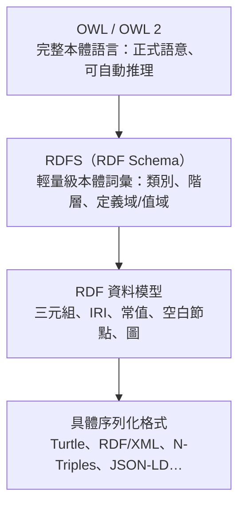

# RDF 檔案與本體論（Ontology）之間的關係

## 摘要

本文回答一個核心問題：**RDF（Resource Description Framework，資源描述框架）檔案與本體論（ontology）之間有關係嗎？**

簡短的答案是「有，而且是分層的從屬關係」：RDF 提供的是「資料模型」，本體論則是「對某個領域的概念與關係所做的正式、明確的規格」；而表達本體論的語言（RDFS 與 OWL）本身又是用 RDF 的三元組（triple）寫成的，因此**一份本體論檔案本身就是一份 RDF 文件**。換句話說，RDF 是底層語法與資料結構，本體論是建立在其上的語意層。

本文會先個別說明 RDF 與本體論，接著說明兩者的分層架構（RDF → RDFS → OWL）、RDF 的各種檔案格式（序列化格式），並以範例展示本體論概念如何以 RDF 三元組表示，最後釐清常見的誤解。

---

## 1. 什麼是 RDF

RDF 是 W3C（World Wide Web Consortium，全球資訊網協會）制定的一套**用於在網路上表示資訊的框架**。其抽象資料模型定義了兩項關鍵資料結構[^rdf12concepts]：

- **RDF 圖（RDF graph）**：由一組「主詞－述詞－受詞」（subject-predicate-object）三元組構成，用來描述資源。三元組中的元素可以是 IRI、空白節點（blank node）、具資料型別的常值（datatyped literal）或三元組詞項（triple term）。
- **RDF 資料集（RDF dataset）**：用來組織多個 RDF 圖，包含一個預設圖（default graph）與零個或多個具名圖（named graph）。

W3C 對 RDF 的定義原文為：「The Resource Description Framework (RDF) is a framework for representing information on the Web.」[^rdf12concepts]

RDF 的核心特徵包括：

| 特徵 | 說明 |
| --- | --- |
| 三元組結構 | 每個敘述都是「主詞－述詞－受詞」三元組 |
| 全域識別 | 主詞、述詞、受詞以 IRI 識別，可跨系統連結 |
| 圖模型 | 一組三元組構成有向標籤圖（directed labeled graph） |
| 不強制固定綱要 | RDF 本身不強制資料必須符合某種固定結構 |

RDF 的一個關鍵性質是：一個 IRI 所指涉的資源稱為其 **referent**。對於某些具有特定意義的 IRI（例如識別 XSD 資料型別的 IRI），其 referent 由規格固定；但對其他 IRI 而言，該 IRI 究竟指涉什麼，並非由 RDF 規格本身定義。其他規格可以固定 IRI 的 referent，或對 IRI 的 referent 施加其他限制[^rdf12concepts]。

RDF 規格明確指出，它只把 IRI 當作「圖資料模型中具全域唯一性的識別碼」來處理，並不定義互動模型；但這些 IRI 的可解參考（dereference）特性，正是「鏈結資料」（Linked Data）設計的基礎[^rdf12concepts]。

RDF 本身是抽象資料模型，可透過多種具體語法（concrete syntax）或序列化格式（serialization format）來儲存與交換，這點將在第 5 節說明[^rdf12concepts]。

---

## 2. 什麼是本體論（Ontology）

在資訊科學與電腦科學中，「本體論」指的是一份**針對某個領域（domain）之共享概念化的正式、明確規格**。這個用法借自哲學（哲學中的 Ontology 是對「存在」的系統性論述），但在人工智慧與知識表示領域，其意義轉為工程與知識表示上的概念[^gruber1993]。

最常被引用的定義來自 Tom Gruber[^gruber1993]：

> 「An ontology is an explicit specification of a conceptualization.」
> （本體論是對某個概念化的明確規格。）

Gruber 進一步解釋：所謂概念化（conceptualization）是「我們為了某個目的，對世界所做的一種抽象、簡化的觀點」（an abstract, simplified view of the world that we wish to represent for some purpose）。而在知識以宣告式形式（declarative formalism）表示時，可被表示的物件集合稱為「論域」（universe of discourse）[^gruber1993]。

Gruber 也提醒：「本體論常被等同於類別的分類階層、類別定義與涵蓋關係（subsumption），但本體論不必然僅限於這些形式。」本體論也不限於「保守定義」（conservative definitions，即傳統邏輯意義上只引入詞彙、不增加關於世界之知識的定義）；為了規格化一個概念化，我們需要陳述一些**公理（axioms）**，使其確實對所定義詞項的可能解讀形成限制[^gruber1995]。

後續學者在 Gruber 的基礎上提出更精煉的定義。Feilmayr 與 Wöß（2016）將本體論定義為[^feilmayr2016]：

> 「An ontology is a formal, explicit specification of a shared conceptualization that is characterized by high semantic expressiveness required for increased complexity.」
> （本體論是對共享概念化的一種正式、明確的規格，其特徵是具有應付更高複雜度所需的高語意表達力。）

相較於 Gruber 的原始定義，此定義補上了「正式（formal）」、「共享（shared）」與「高語意表達力」三項限定，以區別本體論與一般詞彙表或索引典（thesaurus）。

一份典型的本體論會包含以下元素：

- **類別（classes / concepts）**：事物的範疇，如 `Person`、`Organization`。
- **個體（individuals / instances）**：具體實體，如 `Mary`、`CompanyX`。
- **屬性（properties / relations）**：個體之間的關係，或個體與資料值之間的關係，如 `hasEmployer`、`hasAge`。
- **公理（axioms）**：對類別與屬性之間關係的邏輯限制，如 `subClassOf`、`disjointWith`、基數限制等。

W3C 在 OWL 2 的文件中以「形式化的詞彙表」來描述本體論：「Ontologies are formalized vocabularies of terms, often covering a specific domain and shared by a community of users. They specify the definitions of terms by describing their relationships with other terms in the ontology.」（本體論是術語的形式化詞彙表，通常涵蓋某個特定領域並由一群使用者共享；它們透過描述術語與本體論中其他術語的關係，來說明術語的定義。）[^owl2overview]

此外，OWL 2 的文件指出，本體論除了述詞性知識（terminological knowledge，即詞彙與其相互關係）之外，也可能包含所謂的斷言性知識（assertional knowledge，處理該領域的具體物件而非一般概念）[^owl2primer]。

---

## 3. 兩者的關係：分層架構

RDF 與本體論之間的關係，可以用一組層層堆疊的「語意網技術堆疊」來理解：RDF 是最底層的資料模型，RDFS 是輕量級的本體詞彙，OWL 則是功能完整、具備正式語意的本體語言。



這條堆疊線的關鍵意義在於：

1. **RDF 是資料模型層**：它定義「如何表示資料」（以三元組與圖），但不定義資料的意義。RDF 規格中說明，「圖式結構的抽象資料模型不是概念模型，而是這類建模的符號性、結構性基礎，使 RDF 詞彙的定義與使用、以及語意詮釋得以成立」[^rdf12concepts]。

2. **RDFS 是輕量級本體層**：RDFS（RDF Schema）建立在 RDF 之上，提供「用於規格化輕量級本體（lightweight ontologies）的詞彙」，並作為 RDF 的語意擴充[^rdf12schema]。RDFS 的規格說明：「RDF Schema 是 RDF 資料的資料建模詞彙，也是 RDF 的語意擴充。它提供描述相關資源群組及這些資源之間關係的機制。」[^rdf12schema]

3. **OWL 是完整本體語言層**：OWL 2 是「具備正式定義語意的語意網本體語言」，「OWL 2 本體論提供類別、屬性、個體與資料值，並且本身主要以 RDF 文件的形式交換」[^owl2overview]。

換言之，**RDF Schema 與 OWL 都是用 RDF 三元組來書寫的**。RDFS 規格明確表示：「RDF Schema 是以 RDF、使用本文件所述詞項來書寫的。」[^rdf12schema] OWL 2 的文件也說明：「OWL 2 本體論可與以 RDF 撰寫的資訊一起使用，而 OWL 2 本體論本身主要以 RDF 文件的形式交換。」（OWL 2 ontologies can be used along with information written in RDF, and OWL 2 ontologies themselves are primarily exchanged as RDF documents.）[^owl2overview]

因此，兩者的關係並非「兩種互不相干的東西」，而是**同一個堆疊的不同層次**：本體論是以 RDF 為底層表示媒介的語意層，而 RDF 是承載本體論與資料的底層模型。

---

## 4. 表達本體論的兩種語言：RDFS 與 OWL

### 4.1 RDFS（RDF Schema）

RDFS 規格開宗明義指出其兩項互補用途[^rdf12schema]：

> 「本文件服務兩項互補目的：一是將 RDF Schema 定義為規格化輕量級本體的詞彙，作為 RDF 語意中所描述之語意擴充的基礎；二是列舉 `rdf:` 與 `rdfs:` 命名空間中所定義的所有詞項，包含與本體建構相關的詞項，以及 RDF 應用中廣泛使用的通用詞項。」

RDFS 將資源分為若干群組，這些群組稱為**類別（classes）**，類別的成員稱為該類別的**實例（instances）**。`rdf:type` 屬性可用來聲明某資源是某類別的實例[^rdf12schema]。

RDFS 的核心詞彙包括：

| 詞項 | 用途 |
| --- | --- |
| `rdfs:Class` | 聲明某資源是一個類別 |
| `rdf:type` | 聲明某資源是某類別的實例 |
| `rdfs:subClassOf` | 定義類別階層（子類別關係，具遞移性） |
| `rdfs:subPropertyOf` | 定義屬性階層（子屬性關係，具遞移性） |
| `rdfs:domain` | 聲明使用某屬性的主詞所屬的類別 |
| `rdfs:range` | 聲明某屬性的值所屬的類別或資料型別 |
| `rdfs:label` | 提供資源的人類可讀名稱 |
| `rdfs:comment` | 提供資源的人類可讀描述 |

值得注意的是，RDFS 採取的是一種「以屬性為中心」（property-centric）的策略。RDFS 規格說明：RDFS 的類別與屬性系統類似 Java 等物件導向語言的型別系統，但不同之處在於，RDFS 不是以「某類別的實例可擁有什麼屬性」來定義類別，而是以「屬性適用於哪些類別的資源」來描述屬性，這正是 `domain` 與 `range` 機制的角色[^rdf12schema]。

RDFS 規格也很清楚地定位了自身與更豐富之本體語言之間的關係[^rdf12schema]：

> 「本規格並不試圖窮舉所有可能表示 RDF 類別與屬性意義的形式。RDF Schema 的策略是承認有許多技術可用來描述類別與屬性的意義。更豐富的詞彙或『本體』語言，例如 OWL、推論規則語言及其他形式（例如時態邏輯），都將對我們捕捉網路上資料之意義性推論的能力有所貢獻。」

此外，RDFS 的 `domain` 與 `range` 提供的基礎機制，**無法直接表達僅限於某個類別區域的屬性限制**；這類直接支援是由更豐富的網路本體語言（如 OWL）所提供[^rdf12schema]。

### 4.2 OWL（Web Ontology Language）

OWL 2 是 W3C 的「本體語言」，其抽象描述為[^owl2overview]：

> 「OWL 2 Web Ontology Language，非正式地稱為 OWL 2，是語意網的本體語言，具備正式定義的意義。OWL 2 本體論提供類別、屬性、個體與資料值，並且儲存為語意網文件。OWL 2 本體論可與以 RDF 撰寫的資訊一起使用，而 OWL 2 本體論本身主要以 RDF 文件的形式交換。」

OWL 2 的結構由一份概觀文件說明：圖中中央的橢圓代表**本體論**這個抽象概念，它可以被視為抽象結構，也可以被視為一個 **RDF 圖**（see 2.1 Ontologies）；上方是各種具體語法，下方則是兩種語意規格[^owl2overview]。

關鍵句在此[^owl2overview]：

> 「任何 OWL 2 本體論也可以被視為一個 RDF 圖。這兩種觀點之間的關係由 Mapping to RDF Graphs 文件所規格化，該文件定義了從結構形式到 RDF 圖形式的映射，以及反向映射。」
> （Any OWL 2 ontology can also be viewed as an RDF graph. The relationship between these two views is specified by the Mapping to RDF Graphs document...）

而 OWL 2 的 Mapping to RDF Graphs 文件進一步保證，這兩種表示法在語意上等價：對於任何 OWL 2 DL 本體論 *O*，令 *G = T(O)* 為轉換後的 RDF 圖，再令 *OG* 為對 *G* 套用反向轉換所得到的 OWL 2 DL 本體論，則 *O* 與 *OG* 在邏輯上等價 —— 亦即**它們擁有完全相同的模型集合**。這些轉換不會造成本體論形式意義的任何改變[^owl2rdfmapping]。

OWL 2 除了具備本體論的結構外，還提供兩種語意（Direct Semantics 與 RDF-Based Semantics）、以及三個子語言（profiles）[^owl2overview]：

| 子語言 | 特點與適用情境 |
| --- | --- |
| OWL 2 EL | 所有標準推論工作都有多項式時間演算法，適合需要極大型本體論、可犧牲表達力換取效能保證的應用 |
| OWL 2 QL | 可用標準關聯式資料庫技術以 LogSpace（AC0）回答合取查詢，適合用輕量本體論組織大量個體、且需以關聯式查詢直接存取資料的情境 |
| OWL 2 RL | 可用規則擴充的資料庫技術直接對 RDF 三元組進行多項式時間推理，適合直接以 RDF 三元組形式操作資料的情境 |

OWL 2 的 RDF-Based Semantics「直接為 RDF 圖賦予意義，因此也透過 Mapping to RDF graphs 間接為本體論結構賦予意義」，且「與 RDF Semantics 完全相容，並擴充了為 RDF 定義的語意條件」；RDF-Based Semantics 可不受限制地套用於**任何** OWL 2 本體論，因為任何 OWL 2 本體論都可映射為 RDF[^owl2overview]。

OWL 2 的主要交換語法是 RDF/XML —— 這是**唯一必須被所有 OWL 2 工具支援**的語法；其他語法（OWL/XML、Functional Syntax、Manchester Syntax、Turtle）則為選用[^owl2overview]。

---

## 5. RDF 的檔案格式（序列化格式）

RDF 是抽象資料模型，實際存在磁碟上或於網路上傳輸時，需要具體語法。RDF 規格說明「這個抽象資料模型可以用不同方式編碼，同時保留相同的結構」（This abstract data model can be encoded in different ways while preserving the same structure）[^rdf12concepts]。

常見的 RDF 序列化格式如下：

| 格式 | 常見副檔名 | 媒體型別 | 說明 |
| --- | --- | --- | --- |
| RDF/XML | `.rdf` | `application/rdf+xml` | 最早的 W3C 標準語法、以 XML 為基礎；亦是 OWL 2 唯一強制支援的交換語法[^owl2overview] |
| Turtle | `.ttl` | `text/turtle` | 「Terse RDF Triple Language」，讓 RDF 圖能以緊湊、自然的文字形式完整寫出[^turtle] |
| N-Triples | `.nt` | — | 每行一個三元組的極簡語法 |
| JSON-LD | `.jsonld` | `application/ld+json` | 以 JSON 為基礎，便於與網頁 API 整合 |
| TriG | `.trig` | — | Turtle 的擴充，可序列化多個具名圖（資料集） |
| N-Quads | `.nq` | — | N-Triples 的超集，增加第四個元素表示圖脈絡 |

以 Turtle 為例，其規格說明：「Turtle 文件是 RDF 圖的文字表示。」並提供 `@base` 與 `@prefix` 指示詞、以 `;` 分隔的述詞清單、以 `,` 分隔的受詞清單、代表 `rdf:type` 的 token `a`，以及常值等簡寫機制[^turtle]。Turtle 的媒體型別為 `text/turtle`，內容編碼一律為 UTF-8[^turtle]。

值得注意的是，**RDF/XML 常被誤稱為「RDF」**，但它其實只是眾多 RDF 序列化格式之一；RDF 本身是抽象資料模型，不是檔案格式。

一個重要的實務後果是：**本體論檔案與資料檔案使用完全相同的序列化格式**。因為本體論（以 RDFS 或 OWL 撰寫）本身就是一份 RDF 文件[^owl2overview][^rdf12schema]，所以一份 `.ttl` 檔案可能純粹是本體論（描述類別與屬性），可能純粹是資料（描述個體），也可能是兩者混雜。

---

## 6. 本體論概念如何以 RDF 三元組表達

本節以範例展示「本體論的抽象概念」如何一一對應到「RDF 三元組」。以下範例以 Turtle 語法表示。

### 6.1 宣告一個類別

一個類別本身就是一個資源，它以 `rdf:type` 連到 `owl:Class`（或 `rdfs:Class`）：

```turtle
@prefix owl:  <http://www.w3.org/2002/07/owl#> .
@prefix rdf:  <http://www.w3.org/1999/02/22-rdf-syntax-ns#> .
@prefix rdfs: <http://www.w3.org/2000/01/rdf-schema#> .
@prefix ex:   <http://example.org/> .

ex:Tea  rdf:type  owl:Class .
```

這與 RDFS 的說明一致：「`rdf:type` 屬性可用來聲明某資源是某類別的實例。」以及「C 是 `rdfs:Class` 的實例，而 R 是 C 的實例。」[^rdf12schema]

### 6.2 類別階層與屬性階層

子類別關係以 `rdfs:subClassOf` 表示；「若類別 C 是類別 C' 的子類別，則 C 的所有實例也都會是 C' 的實例。」而 `rdfs:subClassOf` 具有遞移性[^rdf12schema]。

```turtle
ex:GreenTea  rdfs:subClassOf  ex:Tea .
```

在 OWL 2 的 Mapping to RDF Graphs 對照表中，`SubClassOf(CE1 CE2)` 的映射結果正是 `T(CE1) rdfs:subClassOf T(CE2)`[^owl2rdfmapping]。

### 6.3 屬性的定義域與值域

```turtle
ex:hasIngredient  rdfs:domain  ex:Recipe ;
                  rdfs:range   ex:Ingredient .
```

RDFS 說明此三元組的意義：「`P rdfs:domain C` 表示 P 是 `rdf:Property` 類別的實例、C 是 `rdfs:Class` 類別的實例，且述詞為 P 之三元組的主詞所指涉的資源，是類別 C 的實例。」`rdfs:range` 則對受詞做相同的聲明[^rdf12schema]。

在 OWL 2 中，`ObjectPropertyDomain(OPE CE)` 映射為 `T(OPE) rdfs:domain T(CE)`，`ObjectPropertyRange(OPE CE)` 映射為 `T(OPE) rdfs:range T(CE)`[^owl2rdfmapping]。

### 6.4 OWL 的限制與集合運算

OWL 2 的表達力遠超 RDFS。例如 `ObjectSomeValuesFrom(OPE CE)`（存在量化）在 RDF 中表示為[^owl2rdfmapping]：

```turtle
_:x  rdf:type          owl:Restriction ;
     owl:onProperty    ex:hasChild ;
     owl:someValuesFrom ex:Person .
```

OWL 2 Primer 以「父母」為例：`Parent ≡ hasChild some Person` 表示「每一位 Parent 的實例都存在至少一個小孩，且該小孩是 Person 類別的成員」，此機制用來捕捉**不完整的知識**（例如得知 Bob 是父母，即可推論他至少有一個小孩，即使不知道其名稱）[^owl2primer]。

OWL 2 也提供類別集合運算，在 RDF 中對應為 `owl:intersectionOf`、`owl:unionOf`、`owl:complementOf`，例如 `Mother ≡ Woman ⊓ Parent` 以 Turtle 表示為[^owl2primer]：

```turtle
ex:Mother  owl:equivalentClass  [
    rdf:type            owl:Class ;
    owl:intersectionOf  ( ex:Woman ex:Parent )
] .
```

`owl:equivalentClass` 的語意是「兩個類別被視為等價，若它們包含完全相同的個體」；陳述 `ex:Person owl:equivalentClass ex:Human` 等同於同時陳述 Person 是 Human 的子類別、且 Human 是 Person 的子類別[^owl2primer]。

### 6.5 個體與資料值

個體的類別歸屬（ClassAssertion）映射為 `T(a) rdf:type T(CE)`；物件屬性斷言（ObjectPropertyAssertion）映射為 `T(a1) T(OP) T(a2)`；資料屬性斷言（DataPropertyAssertion）映射為 `T(a) T(DPE) T(lt)`[^owl2rdfmapping]。例如[^owl2primer]：

```turtle
ex:Mary  rdf:type  ex:Person .        # ClassAssertion
ex:John  ex:hasWife  ex:Mary .        # ObjectPropertyAssertion
ex:John  ex:hasAge   51 .             # DataPropertyAssertion
```

### 6.6 OWL 2 本體論標頭

一份 OWL 2 本體論的文件標頭，本身也是 RDF 三元組。OWL 2 的映射表將 `Ontology(ontologyIRI ...)` 映射為[^owl2rdfmapping]：

```turtle
ontologyIRI  rdf:type       owl:Ontology .
ontologyIRI  owl:imports    importedOntologyIRI .
```

如果需要對公理本身加註（axiom annotation），OWL 2 會引入一個 `owl:Axiom` 的空白節點，並以 `owl:annotatedSource`、`owl:annotatedProperty`、`owl:annotatedTarget` 指出被註解的來源、屬性與目標[^owl2rdfmapping]。這再次說明：**本體論中的每一個結構元素，最終都會落到 RDF 三元組上。**

---

## 7. RDF 資料與本體論的區別：TBox 與 ABox

雖然本體論與資料共用同一套格式與資料模型，但兩者在角色上仍有區別。OWL 2 Primer 將一個典型 OWL 2 文件的內容分為兩部分[^owl2primer]：

- **述詞性知識（terminological knowledge）**：提供詞彙（vocabulary）及其相互關係，是典型 OWL 2 文件的必要部分。
- **斷言性知識（assertional knowledge）**：處理該領域的具體物件，而非一般概念。

用資料庫來類比可能更直觀：述詞性知識相當於資料庫的**綱要（schema）**，斷言性知識則相當於資料庫的**內容**。OWL 2 Primer 指出，「斷言性資訊與資料庫內容、以及述詞性資訊與資料庫綱要之間，可以畫出某種類比」[^owl2primer]。

但這個類比有兩個重要的差異[^owl2primer]：

1. **開放世界假設（open-world assumption）**：若某個事實不存在於資料庫中，通常被視為偽（封閉世界假設）；但在 OWL 2 文件中，它可能只是「尚未陳述」（但可能是真的）。
2. **OWL 2 不是語法符合性的綱要語言**：不像 XML，OWL 2 並未提供詳盡手段來規定文件在語法上應如何結構化；「特別是，無法強制要求某項資訊（例如某人的社會安全號碼）必須在語法上存在」[^owl2primer]。

這點與 RDF 的「不強制固定綱要」特性相呼應：RDF「不強制要求固定的綱要；你可以新增述詞或連結新資料集，而不需改變既有結構」。因此，一份 RDF 檔案究竟「是本體論」還是「是資料」，取決於**它陳述了什麼**，而非取決於其檔案格式或副檔名。

在描述邏輯（Description Logic）的術語中，前者常被稱為 TBox（terminology box），後者為 ABox（assertion box）；在 RDF 圖上，兩者可能共存於同一個圖中。

---

## 8. 常見誤解釐清

| 誤解 | 釐清 |
| --- | --- |
| 「RDF 是一種檔案格式。」 | RDF 是抽象資料模型；`.rdf`（RDF/XML）只是其中一種序列化格式[^rdf12concepts]。 |
| 「RDF/XML 就是 RDF。」 | RDF/XML 是最早的 W3C 標準語法，但 RDF 本身是抽象資料模型，另有 Turtle、N-Triples、JSON-LD 等格式[^turtle]。 |
| 「RDF 與本體論是兩件無關的事。」 | 兩者是分層從屬：RDFS 與 OWL 都是用 RDF 三元組書寫的，本體論本身即為一份 RDF 文件[^owl2overview][^rdf12schema]。 |
| 「本體論一定是 OWL。」 | RDFS 本身就是「規格化輕量級本體」的詞彙，是一套輕量級本體語言[^rdf12schema]。RDFS 也在文件中建議，更豐富的詞彙或本體語言（如 OWL）可用於更複雜的表達[^rdf12schema]。 |
| 「RDF 檔案一定是資料，OWL 檔案一定是本體。」 | 本體論與資料共用相同的序列化格式；判斷依據是內容陳述的是詞彙還是個體，而非檔名[^owl2primer]。 |
| 「本體論會限制資料必須符合。」 | OWL 2 在開放世界假設下運作，且「不是語法符合性的綱要語言」，其 `domain`/`range` 聲明允許推論者**推論出更多知識**，而非構成對知識的限制[^owl2primer]。 |

關於最後一點，OWL 2 Primer 特別警告了一個常見的建模錯誤：若宣告 `hasAge` 的 domain 是 `Person`，又宣告 `Felix rdf:type Cat` 且 `Felix hasAge 9`，則從這些資訊可以推論出 Felix 也是 `Person`。文件說明：「請注意，domain（或 range）陳述不是對知識的限制，而是允許推論者推論出更多知識。如果我們如同範例所述，陳述年齡只給予人，那麼我們給予年齡的每個東西都會自動成為人。」[^owl2primer]

---

## 9. 結論

RDF 檔案與本體論之間確實存在密切且結構化的關係，可歸納為以下四點：

1. **RDF 是底層資料模型**，提供三元組與圖的結構，定義「如何表示」但不定義「意義為何」[^rdf12concepts]。
2. **本體論是語意層**，是對某領域共享概念化的正式、明確規格[^gruber1993][^feilmayr2016]。
3. **表達本體論的語言建立在 RDF 之上**：RDFS 是輕量級本體詞彙，OWL 2 是完整本體語言，而兩者本身都是用 RDF 三元組書寫的 RDF 文件[^rdf12schema][^owl2overview]。
4. **本體論與資料共用同一套序列化格式**（Turtle、RDF/XML、JSON-LD 等），差別在於陳述的內容是詞彙（TBox）還是個體（ABox）[^owl2primer][^turtle]。

用一句話總結：**RDF 是「語言」，本體論是「用該語言寫成的辭典與文法書」；而 RDFS 與 OWL 則定義了這本辭典與文法書該如何使用。**

---

## 參考文獻

[^rdf12concepts]: W3C. (2026). *RDF 1.2 Concepts and Abstract Data Model* (W3C Candidate Recommendation Snapshot, 2026-04-07). Retrieved 2026-10-31, from https://www.w3.org/TR/rdf12-concepts/

[^rdf12schema]: W3C. (2026). *RDF 1.2 Schema* (W3C Working Draft, 2026-10-23). Retrieved 2026-10-31, from https://www.w3.org/TR/rdf12-schema/

[^owl2overview]: W3C OWL Working Group. (2012). *OWL 2 Web Ontology Language Document Overview (Second Edition)* (W3C Recommendation, 2012-12-11). Retrieved 2026-10-31, from https://www.w3.org/TR/owl2-overview/

[^owl2primer]: Hitzler, P., Krötzsch, M., Parsia, B., Patel-Schneider, P. F., & Rudolph, S. (2012). *OWL 2 Web Ontology Language Primer (Second Edition)* (W3C Recommendation, 2012-12-11). Retrieved 2026-10-31, from https://www.w3.org/TR/owl2-primer/

[^owl2rdfmapping]: Patel-Schneider, P. F., & Motik, B. (2012). *OWL 2 Web Ontology Language Mapping to RDF Graphs (Second Edition)* (W3C Recommendation, 2012-12-11). Retrieved 2026-10-31, from https://www.w3.org/TR/owl2-mapping-to-rdf/

[^turtle]: Prud'hommeaux, E., & Carothers, G. (2014). *RDF 1.1 Turtle: Terse RDF Triple Language* (W3C Recommendation, 2014-02-25). Retrieved 2026-10-31, from https://www.w3.org/TR/turtle/

[^gruber1993]: Gruber, T. R. (1993). A translation approach to portable ontology specifications. *Knowledge Acquisition, 5*(2), 199-220. Retrieved 2026-10-31, from https://tomgruber.org/writing/ontolingua-kaj-1993

[^gruber1995]: Gruber, T. R. (1995). Toward principles for the design of ontologies used for knowledge sharing. *International Journal of Human-Computer Studies, 43*(5-6), 907-928. Retrieved 2026-10-31, from https://tomgruber.org/writing/onto-design.htm

[^feilmayr2016]: Feilmayr, C., & Wöß, W. (2016). An analysis of ontologies and their success factors for application to business. *Data & Knowledge Engineering, 101*, 1-23. https://doi.org/10.1016/j.datak.2015.11.003
