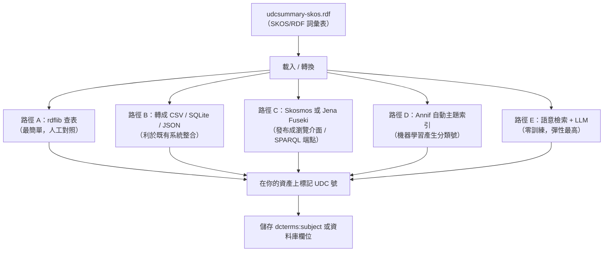
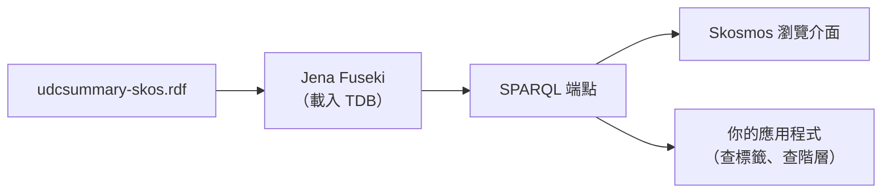
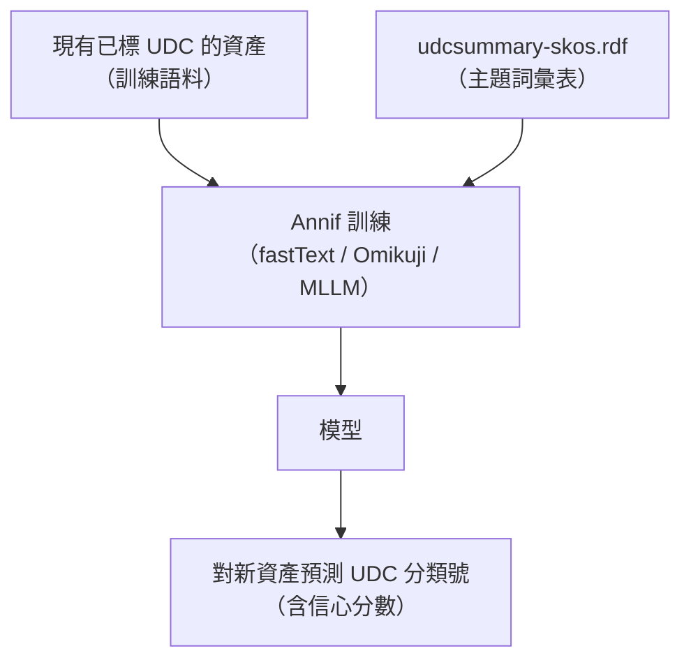
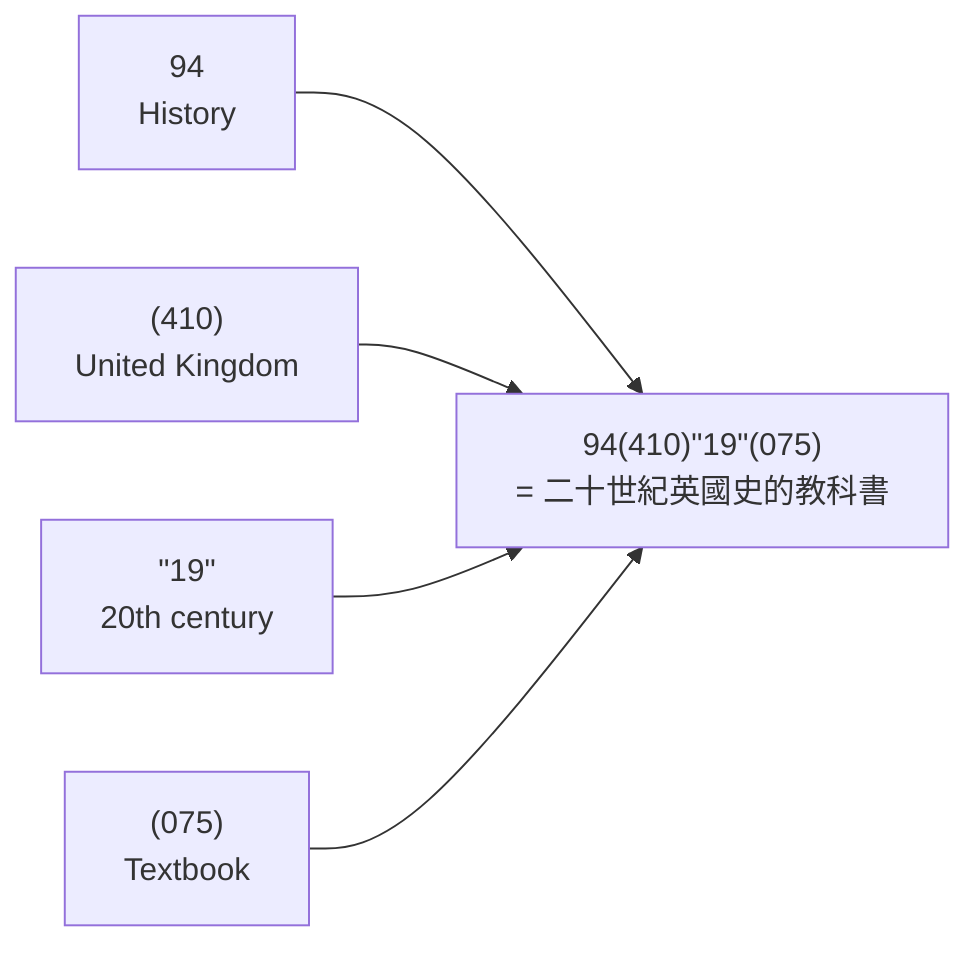
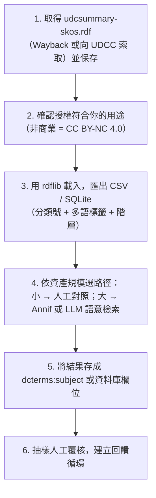

# 如何用 `udcsummary-skos.rdf` 對自己的資產做分類

## 摘要

`udcsummary-skos.rdf` 是「多語言國際十進位分類法摘要（Multilingual Universal Decimal Classification Summary，簡稱 UDC Summary）」的 SKOS/RDF 序列化檔案。它把 UDC 這套圖書資訊界的分類法，用 W3C 的 SKOS（Simple Knowledge Organization System）標準表達成機器可讀的 RDF 三元組[^skosref]。取得這個檔案之後，你可以把它當成一份「受控詞彙表（controlled vocabulary）」，替自己的資產（檔案、網頁、資料集、產品、圖片、文件）標上 UDC 分類號，或作為自動分類模型的標籤體系。

本報告先說明這個檔案的來源、授權與資料結構，接著給出五條實際可行的使用路徑（從最簡單的查表，到全自動語意分類），最後說明 UDC 分類號本身的組配語法，以及使用上的重要限制。

---

## 一、UDC 與 UDC Summary 是什麼

### 1.1 Universal Decimal Classification（UDC）

UDC 是一套以數字為主的通用分類法，由比利時學者 Paul Otlet 與 Henri La Fontaine 於十九世紀末在 Dewey Decimal Classification（DDC）的基礎上發展而來[^udcwiki]。它把人類知識分成十大類（0 到 9），其中第 4 類目前是空號（語言學已併入第 8 類，第 4 類保留給未來擴充）[^udcwiki]。

| 類號 | 英文標題 |
|------|----------|
| 0 | Science and Knowledge. Organization. Computer Science. Information Science. Documentation. Librarianship. Institutions. Publications |
| 1 | Philosophy. Psychology |
| 2 | Religion. Theology |
| 3 | Social Sciences |
| 4 | （空號，目前未使用） |
| 5 | Mathematics. Natural Sciences |
| 6 | Applied Sciences. Medicine. Technology |
| 7 | The Arts. Entertainment. Recreation. Sport |
| 8 | Language. Linguistics. Literature |
| 9 | Geography. Biography. History |

UDC 的一大特色是「分面（faceted）」設計：除了主類號，還可以用共同的輔助號（語言、形式、地點、時間、人種等）以及連接符號（`+`、`/`、`:`、`[]`、`*`）組配出非常精細的複合分類號[^udcwiki]。詳細語法見本報告第六節。

### 1.2 UDC Summary（`udcsummary-skos.rdf` 的內容）

UDC 完整的分類表稱為 UDC Master Reference File（MRF），內含超過 70,000 個類目，屬於 UDC Consortium（UDCC）的商業授權內容[^udcsummaryabout]。為了訓練、研究與推廣用途，UDCC 另外釋出了一個免費的子集，稱為 **UDC Summary**：

- 約 **2,600 個類目**，取自 **UDC MRF 2011** 版（其後對應 MRF12）[^udcsummaryabout]
- 依 UDCC Publication No. 088 發布，初次發布於 2009 年 10 月[^udcsummaryabout]
- 內容涵蓋主類號、共同輔助號、特殊輔助號，並力求對所有知識領域平均取樣[^udcsummaryabout]
- 以多語言資料庫維護，網站上列出 **57 種語言**（部分翻譯尚未完成）[^udctranslation]
- 明言用途為「作為 UDC 的示範資料，用於訓練、研究、各種資訊組織與檢索目的」，並已被全球圖書館與圖書館學校用於訓練與索引[^udcsummaryabout]

`udcsummary-skos.rdf` 就是把這份 Summary 以 SKOS 詞彙序列化成 RDF/XML 的檔案。

> 重點：**它是完整 UDC 的「摘要子集」，不是全部**。若需要完整的 70,000+ 類目，必須向 UDCC 申請 MRF 授權或訂閱 UDC Hub（見第五節）。

---

## 二、檔案從哪裡取得

### 2.1 官方來源與其現況

原本的 Linked Data 服務位於 `http://udcdata.info/`，自 2011 年起提供 SKOS 格式的 UDC Summary，並可下載 `udcsummary-skos.zip` 與 `udcsummary-skos.rdf`[^udcdata]。

**但目前 `udcdata.info` 已下線。** 該站公告：

> "Following the release of UDC MRF12, the content of the UDC Summary is being revised. Additionally, UDC Summary linked data will undergo change in access, presentation and structure. Therefore, the current UDC Summary linked data is unavailable until this work is complete. The new UDC data service will be available shortly."[^udcdata]

截至 2026 年 10 月，舊的 SPARQL 端點 `https://udcdata.info/sparql` 已回傳 404，且沒有新的公開 SPARQL 端點或 REST API 上線的證據[^udcdata][^udcdataaccess]。

### 2.2 目前的可行取得方式

| 方式 | 說明 | 連結 |
|------|------|------|
| **Internet Archive Wayback Machine（RDF 檔）** | `udcsummary-skos.rdf` 有三份含實際內容的封存（2013-12-31 約 3.15 MB、2016-12-12、2017-01-03，後兩者約 3.13 MB），經確認為有效的 SKOS RDF/XML | https://web.archive.org/web/20131231102532if_/http://udcdata.info/udcsummary-skos.rdf |
| **Internet Archive Wayback Machine（ZIP 檔）** | `udcsummary-skos.zip` 有五筆封存，2013-12-08 與 2015-08-03 兩筆為實際內容（各約 3.16 MB） | https://web.archive.org/web/*/http://udcdata.info/udcsummary-skos.zip |
| **向 UDCC 索取匯出檔** | UDC Summary 的匯出檔「依需求提供（available on demand）」，可寄信索取單語／雙語／多語、XML 等格式 | 寄 `udcs AT udcc.org`，說明用途[^udcexports] |
| **線上瀏覽** | UDC Summary 瀏覽介面仍正常運作，可查 57 種語言 | https://udcsummary.info/php/index.php[^udcsummary] |

**GitHub 上沒有任何官方或第三方倉庫收錄這個 RDF 檔。** 搜尋 `udcsummary-skos`、`udcdata.info`、「UDC Summary SKOS」等關鍵字，僅找到一個倉庫 `artisgrit/UDCSummary`（0 stars），且其內容是瀏覽 UDC Summary 的 PHP 網頁程式，並非 SKOS 資料本身[^githubsearch]。因此若你的手上已經有 `udcsummary-skos.rdf`，最務實的作法就是**自行保存並版本控管**該檔。

### 2.3 授權（非常重要）

- **UDC Summary 資料**目前以 **Creative Commons Attribution-NonCommercial 4.0 International（CC BY-NC 4.0）** 釋出[^udcsummaryabout]。使用時必須標註來源為 UDC Consortium，且 **不得用於商業用途**；若要商業使用，須另外取得 UDCC 授權。早期版本曾以 CC BY-SA 3.0 釋出[^udcdataaccess]。
- 官方要求的引用文字為：

  > Multilingual Universal Decimal Classification Summary (UDCC Publication No. 088) © UDC Consortium, 2013, released for use and distribution under the Creative Commons Attribution-NonCommercial 4.0 International license.[^udcsummaryabout]

- **UDC 分類號用於文件索引本身（人工標號）是免費且無限制的**；授權限制的是「複製、散布分類表內容」這件事[^udclicence]。也就是說，你自己拿摘要表來標資產，不會有授權問題；但如果你要**散布**這份分類表（例如內建在你的商業產品裡、或再發布給客戶），就需要付費授權。

---

## 三、檔案的資料結構（SKOS 模型）

### 3.1 什麼是 SKOS

SKOS 是 W3C 於 2009 年 8 月 18 日發布的正式建議標準（Recommendation），以 RDF 為基礎，用來表達「受控詞彙表」——包括索引典（thesauri）、分類法（classification schemes）、taxonomy、主題標目等[^skosref]。它的核心概念如下[^skosprimer]：

| SKOS 詞彙 | 意義 | 在 UDC 中的對應 |
|-----------|------|-----------------|
| `skos:Concept` | 一個抽象概念（分類節點） | 一個 UDC 類目 |
| `skos:prefLabel` | 該概念的首選名稱（可多語言） | 類目名稱（caption） |
| `skos:altLabel` | 別名、同義詞、縮寫 | 別名 |
| `skos:notation` | 分類用的代碼字串（帶型別） | **UDC 分類號**（如 `512`） |
| `skos:broader` / `skos:narrower` | 上位／下位概念（互為反屬性） | 類目階層的上／下層 |
| `skos:related` | 非階層的關聯 | 「參見（see also）」 |
| `skos:inScheme` | 此概念屬於哪個詞彙體系 | 屬於 UDC Summary |
| `skos:ConceptScheme` | 一整套詞彙體系 | UDC Summary 本體 |
| `skos:hasTopConcept` | 體系的頂層概念 | 頂層類目（如 MAIN TABLES） |
| `skos:note` / `skos:scopeNote` / `skos:example` | 各種註記、範圍註、範例 | 包含註、應用註、範圍註、範例 |

### 3.2 UDC Summary 的命名空間與 URI 規則

檔案使用的主要命名空間如下[^udcdata]：

| 前置詞 | 命名空間 URI |
|--------|--------------|
| `rdf` | `http://www.w3.org/1999/02/22-rdf-syntax-ns#` |
| `rdfs` | `http://www.w3.org/2000/01/rdf-schema#` |
| `skos` | `http://www.w3.org/2004/02/skos/core#` |
| `dcterms` | `http://purl.org/dc/terms/` |
| `owl` | `http://www.w3.org/2002/07/owl#` |
| `udc` | `http://udcdata.info/udc-schema#` |
| `crm` | `http://erlangen-crm.org/101001/` |

- 概念的 URI 形如 `http://udcdata.info/rdf/{數字ID}`，例如 `http://udcdata.info/rdf/078884`
- 詞彙體系（ConceptScheme）的 URI 是 `http://udcdata.info/udc-schema`
- `skos:notation` 使用自訂資料型別 `http://udcdata.info/UDCnotation` 來標示這是 UDC 分類號

### 3.3 UDC 元素與 SKOS 的對應表

udcdata.info 公布的對應關係如下[^udcdata]：

| UDC 元素 | SKOS 詞彙 | 備註 |
|----------|-----------|------|
| UDC 分類號（notation） | `skos:notation` | 使用 `UDCnotation` 型別 |
| 類目識別碼（URI） | `skos:Concept` | 唯一數字 ID |
| 上位類目 | `skos:broader` | |
| 下位類目 | `skos:narrower` | |
| 類目名稱（caption） | `skos:prefLabel` | 可多語言 |
| 包含註（including note） | `skos:note`（子屬性 `udc:includingNote`） | 補述未列出的細目內容 |
| 應用註（application note） | `skos:note`（子屬性 `udc:applicationNote`） | 組號指示 |
| 範圍註（scope note） | `skos:scopeNote` | |
| 範例（examples） | `skos:example` | |
| 參見（see also） | `skos:related` | |
| 體系歸屬 | `skos:inScheme` | |
| 頂層概念 | `skos:hasTopConcept` | |

### 3.4 實際內容範例

以下為頂層「AUXILIARY TABLES（輔助表）」類目的實際 RDF/XML 片段[^udcrdf078884]：

```xml
<?xml version="1.0" encoding="utf-8"?>
<rdf:RDF xmlns:rdf="http://www.w3.org/1999/02/22-rdf-syntax-ns#"
         xmlns:dcterms="http://purl.org/dc/terms/"
         xmlns:owl="http://www.w3.org/2002/07/owl#"
         xmlns:rdfs="http://www.w3.org/2000/01/rdf-schema#"
         xmlns:skos="http://www.w3.org/2004/02/skos/core#"
         xmlns:udc="http://udcdata.info/udc-schema#">
  <skos:ConceptScheme rdf:about="http://udcdata.info/udc-schema">
    <rdf:type rdf:resource="http://www.w3.org/2004/02/skos/core#ConceptScheme"/>
    <dcterms:title>UDC Summary</dcterms:title>
    <skos:hasTopConcept rdf:resource="http://udcdata.info/rdf/078884"/>
  </skos:ConceptScheme>
  <skos:Concept rdf:about="http://udcdata.info/rdf/078884">
    <skos:inScheme rdf:resource="http://udcdata.info/udc-schema"/>
    <skos:notation rdf:datatype="http://udcdata.info/UDCnotation">-</skos:notation>
    <skos:prefLabel xml:lang="en">AUXILIARY TABLES</skos:prefLabel>
    <skos:narrower rdf:resource="http://udcdata.info/rdf/078885"/>
  </skos:Concept>
</rdf:RDF>
```

注意 `skos:notation` 的值是純分類號（例如 `-`、`--`、`512`），而 `skos:prefLabel` 才是人類可讀的類目名稱（帶 `xml:lang` 語言標籤）。

---

## 四、用這個檔案替資產分類：五條實務路徑

下圖為整體可選路徑的概觀：



### 路徑 A：用 rdflib 直接載入並查表（最快上手）

Python 的 `rdflib` 是處理 RDF 最通用的函式庫（GitHub 約 2.5k stars，BSD-3-Clause 授權），內建 SKOS 命名空間、支援 SPARQL 1.1[^rdflib]。

```python
from rdflib import Graph
from rdflib.namespace import RDF, SKOS

g = Graph()
g.parse("udcsummary-skos.rdf", format="xml")

# 列出所有類目：UDC 分類號 + 英文名稱
for concept in g.subjects(RDF.type, SKOS.Concept):
    notation = next(g.objects(concept, SKOS.notation), None)
    en_label = next(
        (lbl.value for lbl in g.objects(concept, SKOS.prefLabel) if lbl.language == "en"),
        None,
    )
    print(f"{concept}  [{notation}]  {en_label}")
```

多語言標籤的處理方式：`skos:prefLabel` 的每個值是 `rdflib.term.Literal`，可用 `.language` 判斷語言（例如 `"zh"`、`"en"`）、`.value` 取得字串[^rdflib]。

### 路徑 B：轉換成 CSV / SQLite / JSON，接進既有系統

若你的資產管理系統（DAM、CMDB、資料目錄）不支援 RDF，最務實的作法是把詞彙表攤平成表格[^rdflib]：

```python
import csv
from rdflib import Graph
from rdflib.namespace import RDF, SKOS

g = Graph()
g.parse("udcsummary-skos.rdf", format="xml")

with open("udc_concepts.csv", "w", newline="", encoding="utf-8") as f:
    w = csv.writer(f)
    w.writerow(["uri", "notation", "prefLabel_en", "prefLabel_zh", "broader"])
    for c in g.subjects(RDF.type, SKOS.Concept):
        notation = next(g.objects(c, SKOS.notation), "")
        get = lambda lang: next(
            (l.value for l in g.objects(c, SKOS.prefLabel) if l.language == lang), ""
        )
        broader = ";".join(str(b) for b in g.objects(c, SKOS.broader))
        w.writerow([c, notation, get("en"), get("zh"), broader])
```

同樣的模式可以改成寫入 SQLite 資料表，或以 `json.dump` 輸出 JSON。若要驗證或淨化 SKOS 結構，可用 **Skosify**（National Library of Finland，GitHub 約 68 stars，MIT 授權）做推論補齊（自動產生 inverse 關係、top concept 標記等）並轉成 Turtle 以利後續處理[^skosify]。

### 路徑 C：發布成瀏覽介面或 SPARQL 端點

- **Skosmos**（GitHub 約 269 stars）是開放原始碼的 SKOS 詞彙瀏覽器（PHP），透過 SPARQL 端點讀取詞彙表，提供網頁介面與 REST API，可瀏覽階層、搜尋概念、多語言顯示。芬蘭國家圖書館的 Finto 服務即建構於此[^skosmos]。
- **Apache Jena / Fuseki** 與 **Eclipse RDF4J** 是 Java 生態的 RDF 框架，可將 RDF/XML 載入持久化三元組儲存（TDB/TDB2），並以 HTTP 提供 SPARQL 端點，讓其他系統查詢分類表[^rdflib]。



### 路徑 D：用 Annif 做自動主題索引（適合大量資產）

**Annif** 是芬蘭國家圖書館開發的多演算法自動主題索引工具（GitHub 約 274 stars，Apache 2.0），專為圖書館、檔案館、博物館設計，並驅動 Finto AI 服務[^annif]。

- Annif **原生支援 SKOS/RDF 作為主題詞彙表輸入**，支援 rdflib 所支援的所有序列化格式（RDF/XML、Turtle、N-Triples）[^annifvocab]。它也支援詞彙表內的 notation 代碼（例如 UDC 分類號），可直接把 UDC 號當成預測標籤[^annif]。
- 可用後端包含：TF-IDF（基準）、fastText（詞向量）、Omikuji（極端多標籤分類，品質最佳）、MLLM（類 Maui 的詞彙比對，會利用 SKOS 的 broader/narrower/related 關係）、YAKE（無監督關鍵詞抽取）以及各種集成（Ensemble、PAV、nn_ensemble）[^annif]。
- 已有同儕審查研究將 Annif 用於瑞典圖書館後設資料的自動 **DDC** 分類（Golub 等，2024，*Journal of Documentation*）；同一套方法可套用到 UDC[^annif]。另有學術性的 **UDC Tagger** 概念驗證（BERT/T5，GitHub 1 star），但僅涵蓋部分類別、尚未可用於生產環境[^udctagger]。

典型訓練流程（以你自己的資產為例）：



若你手上完全沒有已標註的訓練資料，則建議走路徑 E。

### 路徑 E：語意檢索加 LLM（零訓練，最適合個人資產）

若資產數量不大、或你沒有已標好的訓練語料，最有效率的方式是「檢索 + 生成」：

1. 用路徑 B 把 `udcsummary-skos.rdf` 轉成每列「分類號 + 名稱 + 上位類目 + 範圍註」的表格。
2. 把每個類目的文字（名稱、範圍註、包含註、範例）做文字嵌入（embeddings），建立向量索引。
3. 對要分類的資產取出標題／描述／內容摘要，同樣做嵌入，用餘弦相似度取回最接近的數個 UDC 類目作為候選。
4. 把候選清單與資產內容交給 LLM，讓它在候選中挑選並輸出 UDC 分類號，同時要求引用理由。

此路線的優點是完全不需要訓練、可解釋、且能處理多語言（UDC Summary 本身有 57 種語言標籤）[^udctranslation]。缺點是需要 LLM 與嵌入模型，且分類一致性不如專門訓練過的模型穩定。

另外，若只是要對照人名、地名、機構名之類的字串，**OpenRefine**（GitHub 約 12.1k stars）搭配 `csv-reconcile`（Python，Dice 係數模糊比對，約 88 stars）或 `reconcile-csv`（約 131 stars）可以把雜亂文字對應到詞彙表的正規標籤，適合做半人工的清理工作[^openrefine][^csvreconcile]。

### 各路徑比較

| 路徑 | 需要訓練資料 | 適合規模 | 技術門檻 | 主要工具 |
|------|--------------|----------|----------|----------|
| A. rdflib 查表 | 否 | 小（人工對照） | 低 | rdflib |
| B. 轉 CSV/SQLite | 否 | 中 | 低 | rdflib、skosify |
| C. Skosmos / Fuseki | 否 | 中（多人查詢） | 中 | Skosmos、Jena、RDF4J |
| D. Annif 自動索引 | 是 | 大（成千上萬筆） | 中高 | Annif、Omikuji、fastText |
| E. 語意檢索 + LLM | 否 | 中小 | 中 | 向量資料庫 + LLM |

### 標記資產的方式

不論走哪條路徑，最後都要把「資產 ↔ UDC 概念」的關係記錄下來。在 RDF 世界裡，標準作法是使用 Dublin Core 的 `dcterms:subject` 指向 SKOS 概念[^skosprimer]：

```turtle
<https://example.org/assets/report-2026> a foaf:Document ;
    dct:title "2026 年度技術報告" ;
    dct:subject <http://udcdata.info/rdf/xxxxx> .   # 對應某個 UDC Summary 概念
```

若你的資產管理系統是關聯式資料庫，實務上只要新增一個 `udc_notation` 欄位（存分類號字串）與一個 `udc_uri` 欄位（存概念 URI）即可，必要時再另外建一張「資產－分類號」的多對多關聯表。

---

## 五、UDC 分類號的組配語法

要把 UDC 用得準，需要理解它的組號規則。除了主類號，UDC 定義了多組共同的輔助號，以及連接符號[^udcwiki]：

### 5.1 共同輔助號

| 符號 | 名稱 | 意義 | 範例 |
|------|------|------|------|
| `=...` | 語文輔助號 | 文件語言或語言主題 | `=111` 英語、`=112.2` 德語 |
| `(0...)` | 形式輔助號 | 文件的實體／文獻形式 | `(075)` 教科書、`(05)` 期刊、`(084.3)` 地圖 |
| `(1/9)` | 地點輔助號 | 地理區域 | `(410)` 英國、`(73)` 美國、`(4)` 歐洲 |
| `(=...)` | 人種／族群輔助號 | 民族、語族 | `(=111)` 英語系民族 |
| `"..."` | 時間輔助號 | 年代、時期、期間 | `"19"` 二十世紀 |
| `-02` / `-03` / `-04` / `-05` | 一般特性輔助號 | 性質 / 材料 / 關係與作業 / 人物特性 | `-052` 使用者、`-053` 年齡層 |

### 5.2 連接符號

| 符號 | 名稱 | 意義 | 範例 |
|------|------|------|------|
| `+` | 加號 | 並列（協調）多個主題 | `59+636` 動物學與動物飼養 |
| `/` | 斜線 | 連續延伸（範圍） | `592/599` 系統動物學 |
| `:` | 冒號 | 兩主題間的關係 | `17:7` 倫理學與藝術的關係 |
| `[ ]` | 方括號 | 分組，釐清運算順序 | `311:[622+669](485)` 瑞典礦冶統計 |
| `*` | 星號 | 引入非 UDC 的外部標記 | `523.4*433` 小行星 Eros |
| `A/Z` | 字母延伸 | 直接以字母細分 | `821.133.1MOL` 法國文學中莫里哀的作品 |

### 5.3 複合分類號解構範例

以 `94(410)"19"(075)` 為例[^udcwiki]：



---

## 六、重要限制與注意事項

1. **只是子集**：UDC Summary 約 2,600 個類目，完整 UDC 有 70,000+ 類目。你的資產若需要細分到冷門主題，摘要表很可能查不到對應類號，此時只能取得較寬的上位類號，或向 UDCC 申請 MRF 授權[^udcsummaryabout]。
2. **資料版本偏舊**：Summary 的內容對應 UDC MRF 2011（其後對應 MRF12），而 UDC 每年更新。若分類精度要求高，需注意版本落差[^udcdataaccess][^udcsummaryabout]。
3. **官方服務下線**：`udcdata.info` 的 Linked Data 服務目前不可用，沒有公開 SPARQL 端點；未來將由「新的 UDC 資料服務」取代，但截至 2026 年 10 月尚未上線[^udcdata]。因此請自行保存檔案，不要依賴線上擷取。
4. **授權限制（最關鍵）**：Summary 採 **CC BY-NC 4.0**，**僅限非商業用途**，且須標註 UDCC。商業用途或散布分類表需要另外付費授權（MRF 授權年費從 €350 到 €4,300 不等；出版授權另有價目）[^udcsummaryabout][^udclicence]。但**純粹用 UDC 號標記自己的文件索引是免費且無限制的**[^udclicence]。換言之：內部拿來標資產沒問題；把它內建進要賣的產品、或再散布給客戶則需要授權。
5. **RDF 處理的效能考量**：2,600 個概念、3 MB 左右的 RDF/XML 用 rdflib 全量載入記憶體完全可行；若要用於高頻查詢的線上服務，建議載入三元組儲存（Jena TDB/RDF4J）並建立索引[^rdflib]。
6. **自動分類的一致性**：機器學習路徑（Annif）需要足量且一致的訓練語料；少量資料時建議走路徑 E 並保留人工覆核，避免分類結果漂移[^annif]。

---

## 七、建議的實作順序



一句話總結：`udcsummary-skos.rdf` 本身只是一份「機器可讀的分類標籤體系」；它的價值在於可以載入 RDF 工具（rdflib）、發布成查詢服務（Skosmos/Fuseki）、或直接餵給自動分類模型（Annif、LLM 語意檢索），讓你替資產指派一致且多語的 UDC 分類號——但務必留意它只是完整 UDC 的子集，且授權僅限非商業用途。

---

## 參考文獻

[^skosref]: W3C. (2009, August 18). *SKOS Simple Knowledge Organization System Reference* (W3C Recommendation). Retrieved 2026-10-31, from https://www.w3.org/TR/skos-reference/

[^skosprimer]: W3C. (2009, August 18). *SKOS Simple Knowledge Organization System Primer* (W3C Working Group Note). Retrieved 2026-10-31, from https://www.w3.org/TR/skos-primer/

[^udcwiki]: Universal Decimal Classification. (n.d.). In *Wikipedia*. Retrieved 2026-10-31, from https://en.wikipedia.org/wiki/Universal_Decimal_Classification

[^udcsummary]: UDC Consortium. (n.d.). *Multilingual Universal Decimal Classification Summary*. Retrieved 2026-10-31, from https://udcsummary.info/php/index.php?lang=en

[^udcsummaryabout]: UDC Consortium. (n.d.). *About the UDC Summary: Conditions of use*. Retrieved 2026-10-31, from https://udcsummary.info/about.htm

[^udcexports]: UDC Consortium. (n.d.). *UDC Summary exports*. Retrieved 2026-10-31, from https://udcsummary.info/exports.htm

[^udctranslation]: UDC Consortium. (n.d.). *UDC Summary translations and completion statistics*. Retrieved 2026-10-31, from https://udcsummary.info/translation.htm

[^udcdata]: UDC Consortium. (n.d.). *UDC Summary Linked Data (udcdata.info)*. Retrieved 2026-10-31, from http://udcdata.info/ and its Internet Archive capture, from https://web.archive.org/web/20141218110302/http://udcdata.info/

[^udcrdf078884]: UDC Consortium. (n.d.). *UDC Summary concept 078884 — AUXILIARY TABLES* [RDF/XML]. Retrieved 2026-10-31, from https://web.archive.org/web/20141218110302if_/http://udcdata.info/rdf/078884

[^udcdataaccess]: UDC Consortium. (n.d.). *UDC Fact Sheet and data services*. Retrieved 2026-10-31, from https://udcc.org/index.php/site/page?view=factsheet

[^udclicence]: UDC Consortium. (n.d.). *UDC licences and Master Reference File licence types*. Retrieved 2026-10-31, from https://udcc.org/index.php/site/page?view=licences

[^rdflib]: RDFLib Team. (n.d.). *RDFLib: A Python library for working with RDF*. Retrieved 2026-10-31, from https://rdflib.readthedocs.io/en/latest/

[^skosify]: National Library of Finland. (n.d.). *Skosify: Validate and convert SKOS vocabularies*. Retrieved 2026-10-31, from https://github.com/NatLibFi/Skosify

[^skosmos]: National Library of Finland. (n.d.). *Skosmos: Open source SKOS vocabulary browser*. Retrieved 2026-10-31, from https://github.com/NatLibFi/Skosmos

[^annif]: National Library of Finland. (n.d.). *Annif: Automated subject indexing toolkit*. Retrieved 2026-10-31, from https://github.com/NatLibFi/Annif and https://annif.org

[^annifvocab]: National Library of Finland. (n.d.). *Annif: Subject vocabulary formats*. Retrieved 2026-10-31, from https://github.com/NatLibFi/Annif/wiki/Subject-vocabulary-formats

[^udctagger]: UDCTaggerProject. (n.d.). *UDC Tagger proof of concept* [Computer software]. Retrieved 2026-10-31, from https://github.com/JCFDGG/UDCTaggerProject

[^openrefine]: OpenRefine. (n.d.). *OpenRefine: A free, open source tool for working with messy data*. Retrieved 2026-10-31, from https://openrefine.org/

[^csvreconcile]: gitonthescene. (n.d.). *csv-reconcile: OpenRefine reconciliation service for CSV* [Computer software]. Retrieved 2026-10-31, from https://github.com/gitonthescene/csv-reconcile

[^githubsearch]: GitHub. (n.d.). *Repository search results for "udcsummary"*. Retrieved 2026-10-31, from https://github.com/search?q=%22udcsummary%22&type=repositories
