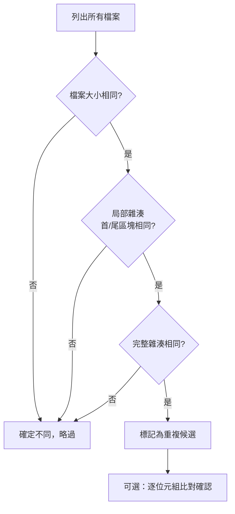
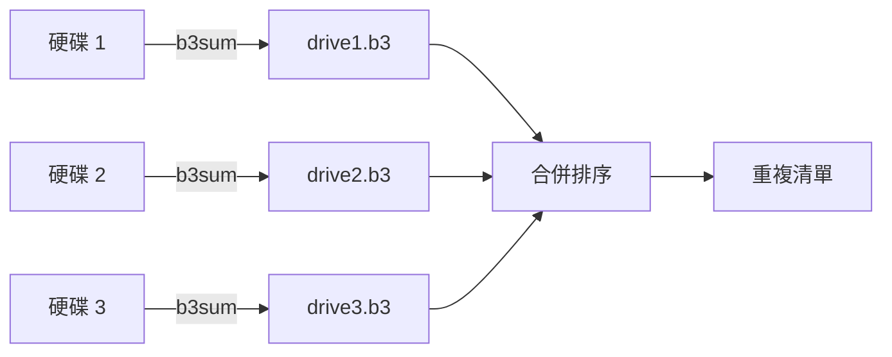
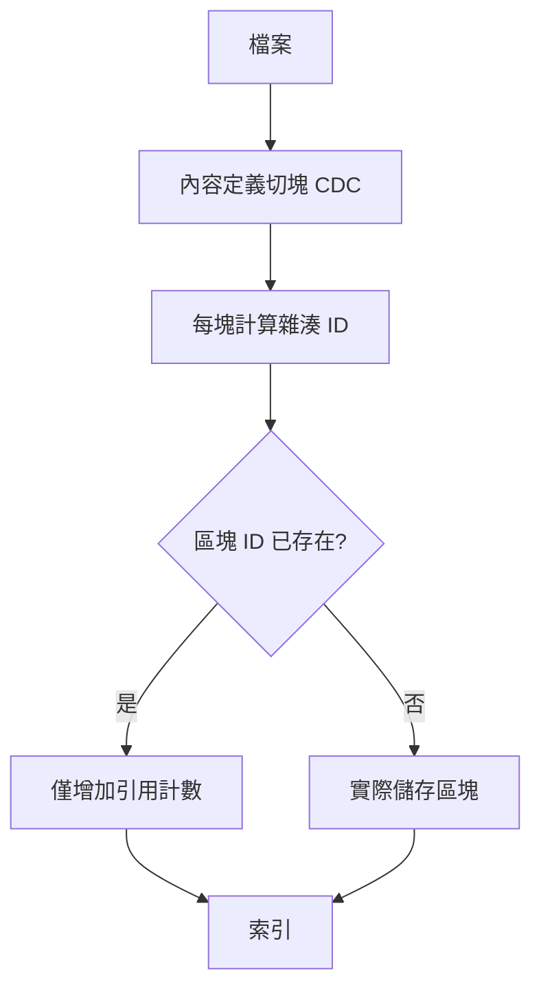

# 多時期備份硬碟的檔案清點與冗餘資料辨識：FOSS 解決方案綜覽

## 1. 問題背景

當手上握有數顆不同時期製作的備份硬碟時，常見困境是：不確定每顆硬碟裡有哪些檔案、哪些檔案彼此重複、哪些是唯一版本。由於硬碟可能無法同時接上主機，「即時比對」不可行，因此需要一套可離線進行的流程：先在每顆硬碟上產生「檔案清單（manifest）」，再將清單合併比對，找出內容相同的檔案[^manifest]。

本文回答兩個問題：

1. 如何清點（inventory）硬碟上的檔案並辨識冗餘資料？
2. 有哪些自由開源軟體（FOSS, Free and Open Source Software）可以處理這件事？

## 2. 辨識重複檔案的核心原理

判斷兩個檔案是否相同，最可靠的依據是**內容（content）**而非檔名或路徑。因為不同時期備份可能改變檔案路徑、資料夾結構或檔名，但內容不變。判斷流程通常採「多階段過濾」以降低 I/O：



此流程之所以有效，在於**檔案大小不同即不可能是相同內容**，這一步只讀取中介資料（metadata），不需讀取檔案內容；而局部雜湊只需讀取檔案開頭與結尾的少量位元組，即可淘汰絕大多數非重複檔案[^prefilter]。

### 2.1 雜湊演算法比較

| 演算法 | 摘要長度 | 安全性 | 速度 | 用途 |
|---|---|---|---|---|
| MD5 | 128 位元 | 已破（碰撞可行） | 快 | 非對抗性的重複偵測仍堪用 |
| SHA-1 | 160 位元 | 已破 | 快 | 建議避免 |
| SHA-256 | 256 位元 | 安全 | 中等 | 通用、相容性最佳 |
| BLAKE3 | 256 位元以上 | 安全 | 極快 | 高吞吐量校驗 |

MD5 自 2004 年起即被證明可構造碰撞，2012 年的 Flame 惡意程式曾利用 MD5 碰撞偽造微軟程式碼簽章憑證[^md5]。然而對「非對抗性」的重複偵測而言，隨機碰撞機率極低，因此多數重複檔案工具仍沿用 MD5 或更快的非加密雜湊（如 xxHash）[^md5]。BLAKE3 於 2020 年發表，採用 Merkle 樹結構，可運用 SIMD 與多執行緒，在 `b3sum` 工具下可比 `sha256sum` 快一個數量級，已被 Bazel、Cargo、Nix、OpenZFS 等採用[^blake3]。

### 2.2 為何需要逐位元組比對

雜湊並非數學上保證無碰撞，因此部分工具在雜湊相同後，仍會做最後的逐位元組 `memcmp()` 比對，作為「真值」確認[^prefilter]。不過若雜湊寬度足夠（如 BLAKE3、SHA-256），實務上直接信任雜湊即可。

## 3. 檔案清點（Inventory）與清單比對

### 3.1 hashdeep / md5deep

`hashdeep`（含 `md5deep`）是歷史悠久的 FOSS 稽核工具，支援 MD5、SHA-1、SHA-256、Tiger、Whirlpool 等雜湊，可遞迴產生稽核清單，並以 `-a`（audit）模式拿既有清單比對目錄，回報相符、碰撞、遺失與新增的檔案[^hashdeep]。授權為公共領域（public domain），最新版本為 4.4（2014 年）[^hashdeep]。

```bash
# 為第一顆硬碟產生可攜清單（-l 使用相對路徑，避免掛載點差異）
hashdeep -r -l /media/backup_drive_1 > drive1.hashdeep
hashdeep -r -l /media/backup_drive_2 > drive2.hashdeep

# 之後用第一顆的清單稽核第二顆
hashdeep -a -k drive1.hashdeep -r /media/backup_drive_2
```

### 3.2 GNU find + 雜湊工具

不需額外軟體，直接用 `find` 搭配 `sha256sum` 或 `b3sum` 產生清單，再以 `sort`／`uniq` 找出重複[^manifest]：

```bash
# 產生 BLAKE3 清單（速度最快）
find /mnt/drive1 -type f -print0 | xargs -0 b3sum > drive1.b3
find /mnt/drive2 -type f -print0 | xargs -0 b3sum > drive2.b3

# 找出跨硬碟重複（同一雜湊出現多次）
cat drive1.b3 drive2.b3 | sort | awk 'seen[$1]++'
```

優點是零額外依賴、彈性高；缺點是每一份清單都需完整讀取一次所有檔案，且沒有內建稽核模式[^manifest]。



## 4. FOSS 重複檔案工具

以下為七款可直接用於掃描硬碟、找出重複檔案的 FOSS 工具。

| 工具 | 語言 | 授權 | 雜湊演算法 | 前端 | GitHub 星數 |
|---|---|---|---|---|---|
| rmlint | C + Python | GPLv3 | xxHash | 無（CLI） | 約 2.4k[^rmlint] |
| fdupes | C | MIT | MD5 | 可選 ncurses | 約 3.0k[^fdupes] |
| jdupes | C | MIT | xxHash | 無 | 原 GitHub 已移除，改至 Codeberg[^jdupes] |
| fclones | Rust | MIT | MetroHash／xxh3／Blake3／SHA | 另有 GUI | 約 3.0k[^fclones] |
| rdfind | C++ | GPLv2 | MD5（可選 xxHash） | 無 | 約 1.3k[^rdfind] |
| czkawka | Rust | MIT／GPLv3 | xxHash、感知雜湊 | Slint／GTK GUI | 約 34.7k[^czkawka] |
| dupeGuru | Python | GPLv3 | xxh128（退回 MD5） | Qt5 GUI | 約 7.9k[^dupeguru] |

### 4.1 rmlint

可找出重複檔案／目錄、非去符號二進位、壞掉的符號連結、空檔案／空目錄等。演算法先依大小分組，再以 xxHash 做局部與完整雜湊，並可開啟 paranoid 模式做逐位元組驗證。支援 BTRFS、快取與重播（replay）、`mtime` 過濾與多種輸出格式[^rmlint]。

### 4.2 fdupes

經典的 CLI 工具，依內容（而非檔名）比對，流程為：先比大小、再比局部 MD5、再比完整 MD5、最後逐位元組比對。支援 SQLite 雜湊快取（`-c`），可省下重複掃描的讀取成本[^fdupes]。

### 4.3 jdupes

fdupes 的加速分支，以 xxHash 取代 MD5。流程為：排除略過檔、依大小過濾、雜湊前 4 KiB、完整雜湊、逐位元組驗證。支援 reflink（copy-on-write）去重、TOCTTOU 保護與雜湊資料庫。原始 GitHub 儲存庫已移除，官方版本現位於 Codeberg[^jdupes]。

### 4.4 fclones

以現代硬體最佳化為目標，支援多種雜湊（MetroHash、xxh3、Blake3、SHA-256/512、SHA3），並依裝置類型（SSD 對 HDD）自動調整 I/O 平行度，對 HDD 會依實際資料擺放順序排序以減少磁頭跳動。支援持久化雜湊快取、JSON／CSV 輸出與 `--transform`（如先去除 EXIF 再比對）[^fclones]。

### 4.5 rdfind

名稱即「redundant data find」。流程為：依大小分組、讀取開頭位元組、讀取結尾位元組，再以 MD5（建置時若有 libxxhash 則可改用 xxHash）比對。輸出 `results.txt` 標示重複集合與優先保留的原件，支援 `-makehardlinks`、`-makesymlinks`、`-deleteduplicates`，並可 undo[^rdfind]。

### 4.6 czkawka

功能最廣的整合型工具，除重複檔案外還能找空資料夾、大檔案、相似圖片／影片／音樂、壞檔、無效符號連結等。以 Rust 撰寫、多執行緒、支援快取。相似圖片使用感知雜湊（perceptual hashing），音樂則可依標籤與內容比對。GUI 版本稱 Krokiet（基於 Slint）[^czkawka]。

### 4.7 dupeGuru

跨平台 GUI 工具，支援精確內容比對、檔名模糊比對、音樂標籤比對與圖片區塊比對。內容模式為：依大小分組，對大於 3 MiB 的檔案抽樣計算部分摘要（取 25%、60% 與結尾區塊），再以 xxh128（退回 MD5）比對[^dupeguru]。

## 5. 內容定址（Content-Addressable）去重備份

若目標不只是「找出」重複，而是「往後不再儲存重複」，可改用內容定址的備份工具。它們將檔案切成「內容定義區塊（content-defined chunking, CDC）」，只儲存尚未存在的區塊，因此全域去重可跨多顆來源硬碟生效[^borg][^restic]。



### 5.1 BorgBackup

以 Buzhash／fastcdc 做內容定義切塊，區塊以 HMAC-SHA256 或帶金鑰的 BLAKE3 計算 ID，查詢區塊快取決定是否去重；另以檔案快取記錄（路徑 → 大小、mtime、區塊清單），未變動的檔案完全不重讀。預設區塊約 2 MiB，支援 lz4／zstd／zlib／lzma 壓縮與認證加密[^borg]。

### 5.2 Restic

以 Rabin 指紋（多項式）做可變大小切塊，各區塊（blob）以 SHA-256 作為儲存 ID，格式為 `sha256(plaintext_blob)`。目錄清單本身也存為 blob，構成 Merkle 樹；索引檔記錄 blob 到 pack 檔的對應。自 0.18.0 起區塊會隨機分配到 pack 檔，以防依區塊大小推測內容[^restic]。Borg 與 Restic 皆支援 FUSE 掛載，並可將多顆硬碟的資料備份進同一個去重儲存庫[^borg][^restic]。

## 6. 建議流程

| 情境 | 建議方案 |
|---|---|
| 一次性清點多顆硬碟並找出重複 | `b3sum` 產生清單 + `sort`／`awk` 比對，或 `hashdeep -a` 稽核 |
| 需互動式清理、圖形介面 | czkawka 或 dupeGuru |
| 大量檔案、追求速度 | fclones、jdupes 或 rmlint |
| 建立往後自動去重的備份庫 | BorgBackup 或 Restic |

實務上可先以最快的 BLAKE3 產生每顆硬碟的可攜清單（相對路徑），合併排序找出跨硬碟重複；確認後再以 GUI 工具（如 czkawka）進行人工複核與刪除，最後導入 Borg／Restic 作為統一的去重備份庫[^manifest][^borg][^restic]。

## 參考文獻

[^manifest]: Manifest (computing). (n.d.). In Wikipedia. Retrieved 2026-11-01, from https://en.wikipedia.org/wiki/Manifest_(computing)

[^prefilter]: Comparison of cryptographic hash functions. (n.d.). In Wikipedia. Retrieved 2026-11-01, from https://en.wikipedia.org/wiki/Comparison_of_cryptographic_hash_functions

[^md5]: MD5. (n.d.). In Wikipedia. Retrieved 2026-11-01, from https://en.wikipedia.org/wiki/MD5

[^blake3]: BLAKE3 team. (n.d.). BLAKE3. Retrieved 2026-11-01, from https://github.com/BLAKE3-team/BLAKE3

[^hashdeep]: hashdeep. (n.d.). In Wikipedia. Retrieved 2026-11-01, from https://en.wikipedia.org/wiki/Md5deep

[^rmlint]: sahib. (n.d.). rmlint. Retrieved 2026-11-01, from https://github.com/sahib/rmlint

[^fdupes]: Lopez-Roche, A. (n.d.). fdupes. Retrieved 2026-11-01, from https://github.com/adrianlopezroche/fdupes

[^jdupes]: Bruchon, J. (n.d.). jdupes. Retrieved 2026-11-01, from https://codeberg.org/jbruchon/jdupes

[^fclones]: Kołaczkowski, P. (n.d.). fclones. Retrieved 2026-11-01, from https://github.com/pkolaczk/fclones

[^rdfind]: Dreik, P. (n.d.). rdfind. Retrieved 2026-11-01, from https://github.com/pauldreik/rdfind

[^czkawka]: qarmin. (n.d.). czkawka. Retrieved 2026-11-01, from https://github.com/qarmin/czkawka

[^dupeguru]: Arsenault, A. (n.d.). dupeGuru. Retrieved 2026-11-01, from https://github.com/arsenetar/dupeguru

[^borg]: BorgBackup. (n.d.). Borg internals. Retrieved 2026-11-01, from https://borgbackup.readthedocs.io/en/stable/internals.html

[^restic]: Restic. (n.d.). References. Retrieved 2026-11-01, from https://restic.readthedocs.io/en/latest/100_references.html
