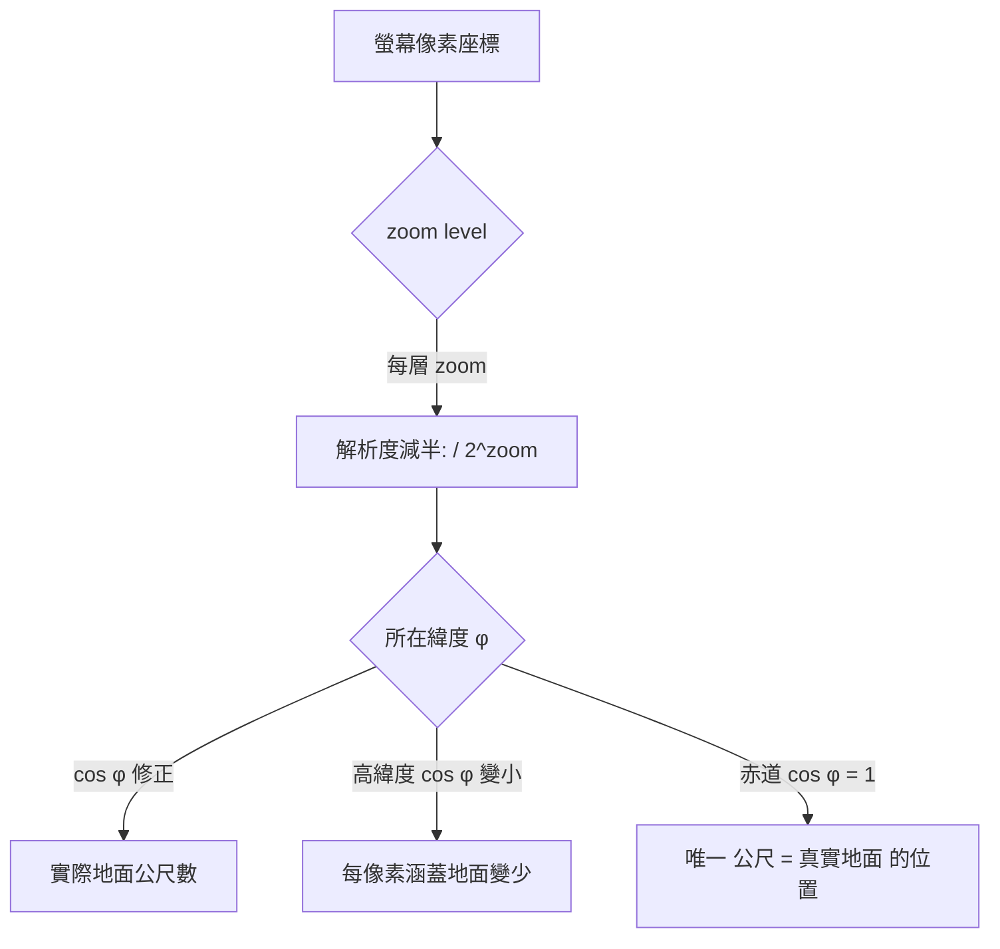

# EPSG:3857 是 pixel 對 meter 的線性映射，還是像 EPSG:4326 一樣有扭曲？

## 摘要

**都不是。** EPSG:3857（WGS 84 / Pseudo-Mercator，網路地圖通用座標系）雖然以「公尺」為單位，但**它不是 pixel 與 meter 之間的線性映射**；同時它也**不像 EPSG:4326 那樣**因為經緯度是角度而產生經線收斂式的扭曲。EPSG:3857 有自己的、獨立的扭曲型態：它是一個投影座標系，嚴格來說只在地球赤道（緯度 0°）上，公尺才等於真實地面距離；緯度越高，地圖被拉伸得越嚴重，比例誤差約為 `1 / cos(緯度)`[^epsgio][^wiki]。因此 pixel 對應的地面距離同時取決於**縮放層級（zoom level）**與**緯度**兩個變數，不存在一條全域的固定換算常數。

本報告將先釐清三個容易混淆的概念（投影座標系 vs 地理座標系、公尺 vs 角度、等角 vs 線性），再給出正確的換算公式與誤差量級。

---

## 一、先釐清：EPSG:3857 與 EPSG:4326 是什麼

### EPSG:4326（WGS 84）

EPSG:4326 是一個**地理座標系（Geographic CRS）**，並非投影。其座標軸的單位是**度（degree）**，分別代表大地緯度與大地經度，座標值描述的是地球橢球面上的位置，而不是平面上的距離[^epsgio]。

因為它描述的是球面/橢球面，**嚴格來說它本身沒有「投影扭曲」**（因為它根本沒有投影到平面上）。但只要有人把它「攤平」畫在螢幕上量測像素距離，就會產生嚴重扭曲，原因在於：

- 1 度緯度約等於 111 公里，大致固定。
- 1 度經度約等於 `111 公里 × cos(緯度)`，在兩極會收斂到 0。

因此若把經緯度當成螢幕上的 x/y 直接量測，高緯度地區的東西向會被嚴重壓縮。[^wiki]

### EPSG:3857（WGS 84 / Pseudo-Mercator）

EPSG:3857 是一個**投影座標系（Projected CRS）**，單位是**公尺（metre）**，座標軸為東距（Easting, X）與北距（Northing, Y），採用的是 Web Mercator（球面墨卡托）投影，也就是 Google Maps、OpenStreetMap、Mapbox、Bing Maps 等幾乎所有線上地圖的通用座標系[^epswiki][^epsgio]。

它有一項關鍵取值：PROJ.4 定義為 `+a=6378137 +b=6378137`，也就是**把長短半軸都設為 6378137 公尺**，將地球當作完美球體處理，這正是「Pseudo（偽）」的由來[^epsgio][^wiki]。EPSG 官方也明白註記「Not a recognised geodetic system」，並說明它相對正統的 WGS 84 / World Mercator（EPSG:3395）會有 0.7% 的比例誤差，以及地圖上高達 43 公里的北距差（地面約 21 公里）[^epsgio]。美國國家地理空間情報局（NGA）甚至宣告此投影「不適合任何官方用途」[^wiki]。

| 特性 | EPSG:3857 | EPSG:4326 |
|---|---|---|
| 類型 | 投影座標系（Projected CRS） | 地理座標系（Geographic CRS） |
| 單位 | 公尺（metre） | 度（degree） |
| 座標軸 | Easting / Northing (X, Y) | 經度 / 緯度 (Lon, Lat) |
| 扭曲型態 | 面積/比例隨緯度膨脹，約 `1/cos φ` | 本身無投影；但攤平後經線收斂 |
| 適用 | 網路地圖顯示、圖磚計算 | 儲存原始 GPS 座標、地理計算 |

---

## 二、Pixel 對 Meter：為什麼不是線性映射

### 2.1 每個 zoom level 決定了「每像素代表幾公尺」

在圖磚（tile）系統中，世界被切成 2^zoom × 2^zoom 個 256×256 像素的圖磚。每一層 zoom，圖磚數量加倍，解析度隨之減半[^osmtiles]。

OpenStreetMap Wiki 給出的水平地面解析度公式為[^osmzoom]：

```
S_tile  = C · cos(latitude) / 2^zoom          （每張圖磚寬度，單位：公尺）
S_pixel = S_tile / 256 = C · cos(latitude) / 2^(zoom + 8)   （每像素寬度，單位：公尺）
```

其中 `C = 40075016.686 公尺`，為 OSM 參考橢球所用的赤道周長（≈ 2π × 6378137）。[^osmzoom]

整理成常見的實用形式：

```
地面解析度（公尺 / 像素） = 156543.03 × cos(緯度) / 2^zoom
```

其中 `156543.03 = 40075016.686 / 256`，是 zoom 0、赤道處每像素所代表的地面距離[^osmzoom][^perrygeo]。

### 2.2 兩個變數同時決定結果

上式清楚顯示，pixel 對 meter 的換算同時受兩個因子影響：

1. **`1 / 2^zoom`**：每一層 zoom，每像素所覆蓋的地面距離就減半，這是一個離散的層級跳躍，不是連續的線性函數。
2. **`cos(緯度)`**：緯度越高，每像素涵蓋的地面距離越短（因為高緯度地面在投影中被拉大、佔用更多像素）。

因此，「1 像素 = 固定 N 公尺」只有在**單一指定的緯度與單一 zoom** 下才成立。只要離開該緯度，誤差就開始累積[^perrygeo][^carto]。



引用 OSM Wiki 的換算表可驗證（赤道處，256 px 圖磚）[^osmzoom][^perrygeo]：

| Zoom | 赤道 (0°) m/px | 30° m/px | 45° m/px | 60° m/px |
|---|---|---|---|---|
| 0 | 156543.03 | 135571.5 | 110692.8 | 78271.5 |
| 10 | 152.87 | 132.37 | 108.07 | 76.44 |
| 12 | 38.22 | 33.09 | 27.03 | 19.11 |
| 14 | 9.55 | 8.27 | 6.75 | 4.78 |
| 18 | 0.597 | 0.517 | 0.422 | 0.299 |

同一 zoom level（例如 14）、不同緯度，每像素涵蓋的公尺數相差可達兩倍以上。這正是「非線性」的鐵證。

### 2.3 「pick 一個參考緯度」的實務提醒

實務上做專題圖（thematic map）時，若要用單一的公尺/像素比例尺，只能在版面的中心緯度評估 `cos(緯度)`。若逕自使用赤道的常數而不修正，在緯度 48 度附近就會高估距離約 33%。[^carto]

---

## 三、EPSG:3857 的扭曲型態：比例因子 1 / cos φ

Web Mercator 之所以會扭曲，是因為墨卡托投影為了保住「局部角度與形狀正確」（等角性），代價就是越往極區拉伸面積越嚴重[^wiki]。其**比例因子（scale factor）**為：

```
比例因子 = 1 / cos(φ)
```

各緯度的比例與面積膨脹倍率如下[^perrygeo]：

| 緯度 | 比例因子 | 面積膨脹 |
|---|---|---|
| 0° | 1.0× | 1× |
| 30° | 1.15× | 1.33× |
| 45° | 1.41× | 2× |
| 60° | 2.0× | 4× |
| 70° | 2.92× | 8.5× |
| 80° | 5.76× | 33× |
| 85° | 11.5× | 132× |

這解釋了為何墨卡托地圖上格陵蘭看起來和非洲一樣大，純粹是投影的面積膨脹假象[^perrygeo]。

另一個常被忽略的重點：**EPSG:3857 並不嚴格等角（conformal）**。因為它的輸入座標是依 WGS 84 橢球體量測，卻用球面公式投影，角度關係會些微改變，雖然肉眼難以察覺，但這使得它不是正統的橢球墨卡托[^wiki]。NGA 因此宣告其不適合官方用途[^wiki]。

---

## 四、直接回答原問題

**Q：EPSG:3857 是 pixel 對 meter 的線性映射關係，還是跟 EPSG:4326 一樣有扭曲？**

**A：兩者皆非，它是第三種情況。**

1. **不是 pixel ↔ meter 的線性映射。** 它雖以公尺為單位，但每像素對應的地面距離 = `156543.03 × cos(緯度) / 2^zoom`，隨 zoom 呈階梯式減半、隨緯度用 `cos φ` 修正，並非常數。只有在赤道（cos 0° = 1）上，投影公尺才恰好等於真實地面公尺。

2. **也「不像」EPSG:4326 那樣的扭曲。** EPSG:4326 本身是角度座標、沒有投影，它的「扭曲」只發生在被強行攤平成平面時（經線收斂）。EPSG:3857 卻是一個真正的投影，它的扭曲內建於投影公式之中，表現為**面積/比例隨緯度以 `1/cos²φ`（面積）膨脹**。

3. **兩者的共同點**：都不能用固定的「像素/度」或「像素/公尺」常數來精確換算，且都必須把「緯度」當成修正因子。

**實務結論：**

| 想做的事 | 正確做法 |
|---|---|
| 求某地某 zoom 的 m/px | `156543.03 × cos(緯度) / 2^zoom` |
| 精確量測距離 | 不要用 EPSG:3857 投影公尺，改用原始經緯度做大地線（Vincenty / Haversine）計算 |
| 計算多邊形面積 | 用等面積投影或球面幾何，切勿用 EPSG:3857 的平方公尺 |
| 高緯度規劃圖磚 | 用當地解析度，不要套用赤道表，否則會過度取樣 |

---

## 參考文獻

[^epsgio]: EPSG.io. (n.d.). *EPSG:3857 WGS 84 / Pseudo-Mercator*. Retrieved 2026-11-01, from https://epsg.io/3857

[^wiki]: Wikipedia. (n.d.). *Web Mercator projection*. Retrieved 2026-11-01, from https://en.wikipedia.org/wiki/Web_Mercator_projection

[^osmzoom]: OpenStreetMap Wiki. (2026, February 6). *Zoom levels*. Retrieved 2026-11-01, from https://wiki.openstreetmap.org/wiki/Zoom_levels

[^osmtiles]: OpenStreetMap Wiki. (n.d.). *Slippy map tilenames*. Retrieved 2026-11-01, from https://wiki.openstreetmap.org/wiki/Slippy_map_tilenames

[^perrygeo]: Perry, M. (n.d.). *Web mercator and scale distortion* [Gist]. Retrieved 2026-11-01, from https://gist.github.com/perrygeo/4478844

[^carto]: Cartographic Design. (n.d.). *Converting web mercator zoom levels to print scale denominators*. Retrieved 2026-11-01, from https://www.cartographic-design.com/automated-cartographic-design-fundamentals/scale-mapping-for-web-and-print/converting-web-mercator-zoom-levels-to-print-scale-denominators/
