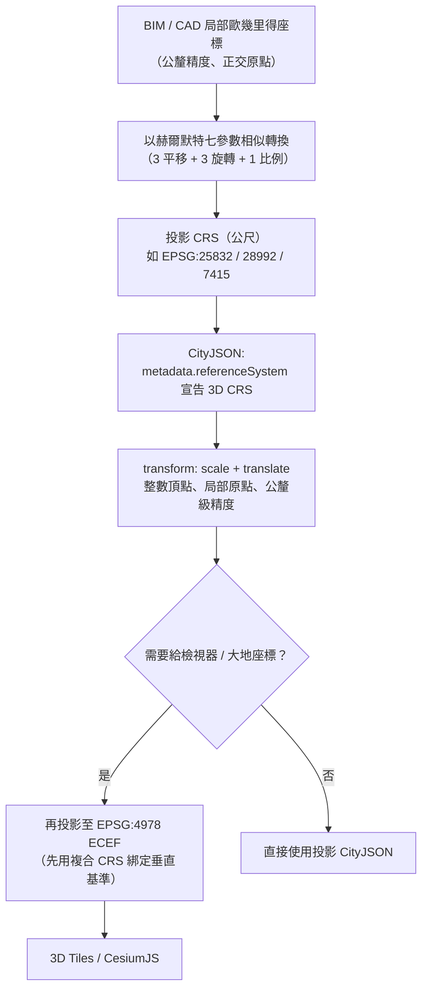

# CityJSON 如何處理麥卡托投影造成的座標系扭曲誤差

## 摘要

建築資訊模型（BIM）與電腦輔助設計（CAD）習慣使用歐幾里得（Euclidean）式的區域直角座標——量尺量到的距離，直接等於座標差值，沒有比例因子。地理資訊系統（GIS）則偏好如 EPSG:4326（WGS 84 經緯度）或 EPSG:3857（Web 麥卡托）等地理／投影座標。兩者混用時會遇到兩個獨立的誤差來源：其一為**球面座標的單位問題**（度 vs. 公尺），其二為**投影造成的比例扭曲**（麥卡托在高緯度把距離誇大）。本報告說明 CityJSON 這個 3D 城市模型交換格式，如何透過「文件層級參考系統宣告」與「TopoJSON 式量化轉換（transform）」兩個機制來處理此一落差，並比較 CityGML 3.0 的 `engineeringCRS` 替代方案，最後給出實務建議。

需要先釐清：CityJSON **本身並不在數學上「修正」麥卡托投影扭曲**——它是一個座標容器格式，採取的策略是「選對 CRS + 用平移把原點移到工地附近」，讓扭曲在資料集範圍內是可忽略的，並讓量化整數座標具備工程級精度。

## 問題背景：兩種座標哲學的衝突

### 歐幾里得／工程座標（BIM、CAD）

在建築與土木領域，模型是以「區域原點（local origin）」建立的直角三維座標系。建築師通常指定一個工地基準點，幾何沿著 X、Y 軸正交繪製[^bonsai]。其特性為：

- 量測到的距離與座標差值完全一致，沒有比例因子
- 常以公釐（millimetre）精度作業
- 右手系、正交、局部

### 地理／投影座標（GIS）

GIS 資料常見兩種：

- **EPSG:4326**（WGS 84 地理座標）：單位是**度**，不是公尺；同一度經度在赤道與高緯度的地面長度不同
- **EPSG:3857**（Web 麥卡托／Pseudo-Mercator）：單位是公尺，但**比例隨緯度嚴重變化**

麥卡托投影的點比例因子（point scale factor）為 `k(φ) = 1/cos(φ)`，僅在赤道為 1.0[^merc]。其線性與面積扭曲隨緯度增加而爆炸性成長：

| 緯度 | 線性比例因子 k | 面積比例因子 k² | 代表城市 |
|------|---------------|----------------|----------|
| 0° | 1.00× | 1.00× | 新加坡、肯亞 |
| 30° | 1.15× | 1.33× | 開羅、紐奧良 |
| 45° | 1.41× | 2.00× | 米蘭、波爾多 |
| 51.5° | 1.61× | 2.58× | 倫敦 |
| 60° | 2.00× | 4.00× | 奧斯陸、赫爾辛基 |
| 80° | 5.76× | 33.2× | 北格陵蘭、斯瓦爾巴 |

[^merc2]

也就是說，在 60°N 的一條 10 公里道路，在 EPSG:3857 投影座標中量起來會是 20 公里——**誤差 100%**。美國國家地理空間情報局（NGA）與 EPSG 註冊資料庫都明確指出 Web 麥卡托僅供「網路製圖與視覺化」，**不得用於量測或法定用途**[^nga][^epsg3857]。

### 為何會互相衝突

一個在 BIM 中完美正交、以公釐量測的 100 公尺建築，投影到地圖網格後，其座標差值會因網格比例因子在工地範圍內變動而產生微妙差異。一份數位孿生選址指南指出，UTM 分帶邊緣的扭曲可達約 400 ppm（1:2,500），而工程用的區域網格則可設計到工地處接近 0 ppm[^choosecrs]。100 ppm 的比例意味著 100 公尺建築會偏差 1 公分——對視覺化可接受，對工程協調則不可接受。

## CityJSON 的兩個核心機制

CityJSON 是 3D 城市模型的交換格式，其規範定義參考系統與座標壓縮方式。它處理上述問題並非靠數學修正，而是靠兩個機制[^cjspec]。

### 機制一：文件層級 CRS 宣告（`metadata.referenceSystem`）

CityJSON 是**CRS 無關（CRS-agnostic）**的格式：參考系統以 OGC URL 形式存放於 `metadata.referenceSystem`，遵循 OGC Name Type 規範[^cjspec]：

```
http://www.opengis.net/def/crs/{authority}/{version}/{code}
```

規範中的範例全部使用**投影（公尺）CRS**，而非經緯度：

- `https://www.opengis.net/def/crs/EPSG/0/7415`——荷蘭 3D 複合 CRS（Amersfoort / RD New 投影 + NAP 高程）
- `https://www.opengis.net/def/crs/EPSG/0/2355`——NAD83(CSRS) / MTM zone 7

規範有兩項關鍵限制[^cjspec]：

1. **CRS 應為三維**——高程必須對應特定基準面（否則會混淆橢球高與正高，可能造成數十公尺的高程錯誤[^reproject]）。
2. **所有 city object 必須使用同一個 CRS**——這與 CityGML 不同，CityGML 允許個別物件甚至單面牆使用不同 CRS。CityJSON 的立場是：*「在 CityJSON 中所有城市物件必須位於同一 CRS。」*[^cjspec]

換句話說，CityJSON 的解方之一是**強制整個資料集統一在一個（實務上為投影、單位為公尺的）CRS**，避免混用地理度座標與投影座標。

### 機制二：量化轉換（`transform`，含 `scale` 與 `translate`）

`transform` 是每個 CityJSON 檔案**必填**的物件，沿用 TopoJSON 的「量化（quantization）」方案，只是多了第三個維度[^cjspec]：

```json
"transform": {
    "scale": [0.001, 0.001, 0.001],
    "translate": [442464.879, 5482614.692, 310.19]
}
```

檔案的頂層 `vertices` 以**整數**儲存，還原公式為[^cjspec]：

```
v[0] = (vi[0] * scale[0]) + translate[0]
v[1] = (vi[1] * scale[1]) + translate[1]
v[2] = (vi[2] * scale[2]) + translate[2]
```

這個設計對麥卡托／投影扭曲問題的意義在於：

- `translate` 通常對齊資料軸對齊邊界框（AABB）的最小值，**等於在巨觀投影座標系內，建立了一個以工地附近為原點的局部工程框架**。
- `scale` 為 `[0.001, 0.001, 0.001]` 時，若 CRS 單位為公尺，代表保留公釐級精度[^cjspec]。
- 由於頂層座標是「相對平移點的整數偏移」，即使選用投影座標，資料在檔案內也享有**局部原點＋定點精度的工程級表示**。

CityJSON 的合規測試集中有一項 `coordinates_precision_local` 案例，描述為「原點處的局部工程 CRS、次公釐（0.1 mm）精度，往返（roundtrip）漂移必須低於 1e-4 公尺」[^conformance]，證實 CityJSON 能在局部原點下達到工程精度。

### 單位並非硬編碼

規範**不硬性規定單位為公尺**，而是說單位由 CRS 隱含決定。規範原文以「若 CRS 單位為公尺，則為公釐級」的條件式描述 `scale`[^cjspec]。這意味著若真的使用 EPSG:4326，`scale: [0.001, 0.001, 0.001]` 會變成**毫度**精度而非公釐。因此：

- 若用 EPSG:4326，scale 需設為如 `[1e-9, 1e-9, ...]` 等級才能對應公釐（1 度 ≈ 111 公里，故 1e-6 度 ≈ 0.11 公尺）
- 高程 z 軸需另外設定適當比例

但這**並非建議做法**。規範範例與真實資料集都使用投影 CRS；CityJSON 規範 issue #181「Support for compound-CRS?」指出，地理座標＋高程（如 `EPSG:4326+3855`）缺乏單一 EPSG 代碼，目前**無法正確表示**[^issue181]。

## 與 CityGML 3.0 的對照：`engineeringCRS`

CityGML 3.0 提供了另一條路線，直接以標準描述局部工程座標系：在 `CityModel` 上使用 `core:engineeringCRS`[^engcrs]。

其組成包含[^engcrs2]：

1. 一個三維直角座標系（單位公尺的 X、Y、Z 軸）
2. 一個工程基準（Engineering Datum），內含 `anchorDefinition`
3. 錨點以已知 CRS 表達（例如德國座標 `458868.0 5438343.0 112.0`，對應 EPSG:25832+5783）

OGC 官方範例說明：*「局部 CRS 的定義編碼在 CityModel 的 core:engineeringCRS 元素中，描述一個 3D 直角參考系統；其原點對應一個錨點，該錨點指向地球表面上的一點。」* 範例註解並指出：*「本範例提供一個隱含轉換，是從局部座標系平移至錨點定義所指定的錨點。範例不含旋轉與縮放；依據 ISO 19111 與 ISO 19136，更複雜的轉換（含旋轉與縮放）亦可表達。」*[^engcrs2]

對照之下：

| 面向 | CityJSON | CityGML 3.0 |
|------|----------|-------------|
| 局部座標表達 | `transform`（scale + translate），隱含局部原點 | `core:engineeringCRS` + `anchorDefinition` |
| 是否支援旋轉 | `transform` 不支援旋轉，隱含軸對齊 | 原則上可（ISO 19111），範例未示範 |
| 是否支援縮放 | `scale` 為逐軸量化比例，非投影修正比例 | 可（ISO 19111） |
| CRS 數量 | 每份檔案單一 CRS | 允許逐物件 CRS |
| 主要訴求 | 精簡、量化、可壓縮 | 標準完備、語意完整 |

## 真正的數學橋樑：赫爾默特／相似轉換

無論 CityJSON 或 CityGML，把局部工程座標接到投影 CRS 的數學工具都是**赫爾默特轉換（Helmert transformation）**，即七參數相似轉換[^interop]：

- 3 個平移（X、Y、Z 位移）
- 3 個旋轉（繞 X、Y、Z 軸）
- 1 個均勻比例因子

Bonsai BIM 文件說明了 IFC 的做法：*「當使用局部工程座標時，建築師通常指定一個局部原點，模型幾何沿 X、Y 軸正交繪製。」*[^bonsai] IFC 標準透過 `IfcProjectedCRS`（宣告目標 CRS）、`IfcMapConversion`（東距、北距、正交高、比例、旋轉）、`IfcSite`（工地參考經緯度與高程）等實體攜帶其局部框架[^ifc]。CAD/GIS/BIM 互通指南指出，均勻比例約束正是相似轉換與一般仿射轉換的區別，因為它保留角度與相對距離——這正是 BIM 出圖標準與 CAD 製圖慣例所依賴的兩個性質[^interop]。

各用途的控制點 RMSE 目標[^interop]：

| 用途 | RMSE 目標 | 最大殘差 |
|------|----------|----------|
| 基地規劃／GIS 疊圖 | ≤ 50 mm | ≤ 100 mm |
| 結構 BIM 協調 | ≤ 5 mm | ≤ 10 mm |
| 地籍／法定邊界 | ≤ 20 mm | ≤ 40 mm |
| 數位孿生／竣工 | ≤ 10 mm | ≤ 25 mm |

實務上，荷蘭的 RDNAPTRANS（現行版本 RDNAPTRANS 2018）就是官方用來在 RD/NAP 國家座標（EPSG:28992 + EPSG:5709）與 ETRS89 之間轉換的網格式轉換，負責把荷蘭的工程座標映射到歐洲大地基準[^rdnaptrans]。對應 EPSG 代碼包括 9282（Amersfoort 到 ETRS89 的水平分量）與 7001（ETRS89 到 NAP 高程的垂直分量）[^rdnaptrans]。

## 真實資料集怎麼選 CRS

實際的 CityJSON 資料集幾乎都使用**投影／公尺 CRS**，而非地理位置[^cjspec]：

- **3D BAG（荷蘭）** 使用 EPSG:7415。3DBAG 網路服務文件明載：*「目前唯一支援的 CRS 是 Amersfoort / RD New + NAP height（EPSG:7415）。」*[^3dbag]
- 規範的 CityJSON 範例本身即以 EPSG:7415 作為荷蘭 3D 國家 CRS 的代表[^cjspec]。

CityJSON 規範 issue #35 中，使用者困惑於紐約資料集（EPSG:2263 投影）套用 transform 後仍非經緯度；規範編輯 Hugo Ledoux 回應：*「這是投影 CRS……你需要用像 PROJ 之類的函式庫轉換座標」*，並提供 `cjio assign_epsg` 後接 `cjio reproject` 轉到 EPSG:4326 的流程[^issue35]。

再投影到大地座標的常見管線，會以 **EPSG:4978（ECEF，地心固連座標）**作為中立中間框架，供 3D Tiles／CesiumJS 等檢視器使用。再投影指南警告[^reproject]：

- ECEF 的邊界三軸都會是百萬級數值——若某資料仍顯示 691,000 與 5,335,000，代表 `crs_reproject` 根本沒執行。
- 橢球高與正高的區分是重大錯誤來源；把帶正高的複合 CRS 未指定垂直基準就再投影到 ECEF，可能產生 **47 公尺的高程誤差**。
- `crs_assign` 只改宣稱的 CRS、不動任何座標；`crs_reproject` 才真正轉換。用 `assign` 當作 `reproject` 會讓幾何留在舊框架卻貼著新標籤——是最糟的結果。

## 建議流程



實務建議：

1. **不要用 EPSG:3857 或 EPSG:4326 做城市尺度的幾何儲存**。麥卡托比例在高緯度可達 100% 以上失真[^merc2][^nga]。
2. **選介於 GIS 與工程之間的投影 CRS**——國家網格或區域低失真橫麥卡托。選址指南建議全基地範圍內的點比例因子維持在約 1:10,000（≈100 ppm）內，市政數位孿生可接受到約 250 ppm[^choosecrs]。
3. **用 CityJSON 的 `transform` 把原點平移到工地附近**，使整數頂點具工程級精度；`scale` 依 CRS 單位設定（公尺 CRS 用 0.001）[^cjspec]。
4. **確保 CRS 是三維並綁定垂直基準**，避免橢球高／正高混淆造成數十公尺高程錯誤[^reproject][^cjspec]。
5. **BIM 對接時使用七參數相似轉換**並以控制點驗證 RMSE 是否符合用途容差[^interop]。
6. **需要大地座標的場合，用 ECEF（EPSG:4978）作為中間框架**，並注意 `assign` 與 `reproject` 的區別[^reproject]。

## 結論

CityJSON 面對麥卡托投影扭曲與「BIM 歐幾里得 vs. GIS 地理座標」落差，並**不提供數學上的扭曲修正**，而是採取三層策略：(1) 強制整個資料集統一在單一（實務上為投影、單位公尺的）三維 CRS；(2) 以 `transform` 的平移與量化，把巨觀投影座標轉為**局部原點的整數座標**，取得工程級精度與壓縮效益；(3) 把真正的座標框架轉換（赫爾默特／相似轉換、再投影到 ECEF）留給上游工具鏈處理。要讓這套機制成立的關鍵，是**選一個在資料集範圍內比例扭曲可忽略的投影 CRS**，而非直接使用地理座標或 Web 麥卡托。

[^bonsai]: Bonsai BIM (n.d.). Georeferencing. Retrieved 2026-11-01, from https://docs.bonsaibim.org/

[^merc]: Wikipedia. (n.d.). Mercator projection. Retrieved 2026-11-01, from https://en.wikipedia.org/wiki/Mercator_projection

[^merc2]: Spatial Workflow (n.d.). Choosing a map projection for display: What Web Mercator distorts. Retrieved 2026-11-01, from https://www.spatialworkflow.io/map-projection-for-display-explained/

[^nga]: National Geospatial-Intelligence Agency (2014-02-18). NGA advisory notice on "Web Mercator". Retrieved 2026-11-01, from https://web.archive.org/web/20170329065451/https://earth-info.nga.mil/GandG/wgs84/web_mercator/index.html

[^epsg3857]: EPSG.io (n.d.). WGS 84 / Pseudo-Mercator (EPSG:3857). Retrieved 2026-11-01, from https://epsg.io/3857

[^choosecrs]: 3D Geospatial (n.d.). How to choose CRS for urban digital twins. In 3D geospatial fundamentals for digital twins. Retrieved 2026-11-01, from https://www.3d-geospatial.com/3d-geospatial-fundamentals-for-digital-twins/coordinate-reference-systems-for-3d-assets/how-to-choose-crs-for-urban-digital-twins/

[^cjspec]: CityJSON (2022-11-25). CityJSON specifications 1.1.3. Retrieved 2026-11-01, from https://www.cityjson.org/specs/1.1.3/

[^reproject]: 3D Geospatial (n.d.). Reprojecting and upgrading CityJSON files. In 3D geospatial fundamentals for digital twins. Retrieved 2026-11-01, from https://www.3d-geospatial.com/3d-geospatial-fundamentals-for-digital-twins/citygml-and-cityjson-processing/reprojecting-and-upgrading-cityjson-files/

[^conformance]: 3DGI (n.d.). CityJSON corpus: coordinates_precision_local. Retrieved 2026-11-01, from https://3dgi.github.io/cityjson-corpus/cases/conformance/v2_0/coordinates_precision_local/

[^issue181]: CityJSON (2023). Support for compound-CRS? [Issue #181]. Retrieved 2026-11-01, from https://github.com/cityjson/specs/issues/181

[^issue35]: CityJSON (2018). How to get Latitude/Longitude [Issue #35]. Retrieved 2026-11-01, from https://github.com/cityjson/specs/issues/35

[^engcrs]: Bérenger (n.d.). engineeringCRS. In CityGML LinkML schema. Retrieved 2026-11-01, from https://bereba.github.io/citygml-linkml/engineeringCRS/

[^engcrs2]: Open Geospatial Consortium (n.d.). LocalCRS_CityGML3.gml. In CityGML 3.0 GML encoding: Examples. Retrieved 2026-11-01, from https://github.com/opengeospatial/CityGML3.0-GML-Encoding/blob/main/resources/examples/Core/LocalCRS_CityGML3.gml

[^interop]: CAD-GIS-BIM Interop (n.d.). Scale and rotation synchronization. Retrieved 2026-11-01, from https://www.cad-gis-bim-interop.org/coordinate-transformation-spatial-alignment/scale-and-rotation-synchronization/

[^ifc]: IFC Viewer Online (n.d.). IFC coordinates and georeferencing. Retrieved 2026-11-01, from https://www.ifcvieweronline.eu/blog/ifc-coordinates-georeferencing/

[^rdnaptrans]: Geodetische Infrastructuur (n.d.). crs-transformation-examples. Retrieved 2026-11-01, from https://github.com/GeodetischeInfrastructuur/crs-transformation-examples

[^3dbag]: 3D BAG (n.d.). Webservices. Retrieved 2026-11-01, from https://docs.3dbag.nl/en/delivery/webservices/
