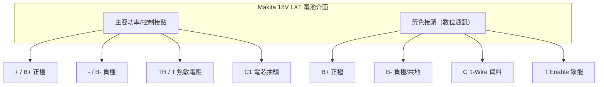

# Makita 電池的 4 個 pin 分別是什麼？

## 摘要

Makita 18V LXT 鋰電池與工具／充電器之間的電氣介面，依不同世代的拆解與逆向工程資料，常被描述為「4 個接點」。但這個「4 pin」其實對應到兩個容易混淆卻不同的東西：

1. **工具端主要功率／控制接點**：`+`（B+，正極）、`-`（B−，負極）、`TH`（T，熱敏電阻／溫度）、`C1`（電芯分壓抽頭）。
2. **數位通訊的 4 條訊號線**：`B+`、`B−`、`C`（Communication，1-Wire 資料線）、`T`（Enable，匯流排致能）。

兩者共享同樣的命名（B+、B−、T），但 `C`／`T` 的實際功能在不同來源中有分歧，這是本主題最需要小心的地方。以下分別說明，並在文末說明來源衝突。

---

## 一、工具端 4 個主要接點：`+`、`-`、`TH`、`C1`

多數 Makita 18V LXT 電動工具只與電池上的三個主要接點相接，但完整的電池介面實際上包含第四個接點 `C1`[^gearhack][^wdh]。

### `+`（B+，正極）

電池組正極，提供工具主電源。18V LXT 電池為 5 串鋰電池（5S），額定電壓 18V，充滿時約 21V[^wdh][^toolpase]。

### `-`（B−，負極）

電池組負極，作為接地參考點（0V）[^gearhack][^wdh]。

### `TH`（T，Thermistor，熱敏電阻／溫度）

內部連接 NTC（負溫度係數）熱敏電阻，於 25°C 時典型阻值約 10 kΩ，溫度上升時阻值下降，用於監測電池溫度以避免過熱充／放電[^gearhack][^wdh]。

**關鍵安全行為**：若 `TH` 開路（工具偵測不到溫度訊號），多數 Makita 工具會拒絕運作。市售的電池轉接器常以一個電阻將 `+` 接到 `TH` 來「騙過」工具——GearHack 拆解一款 Hitachi→Makita 轉接器，內部只有一顆約 1–1.5 Ω 的電阻跨接 `+` 與 `TH`[^gearhack]。

### `C1`（Cell group tap，電芯分壓抽頭）

連接電池組中第一組電芯與第二組電芯之間的接點（從負極起算第一串電芯的正極），相對於 `-` 約為單顆電芯電壓（約 3.7V）。此接點主要供充電器進行電芯平衡相關的量測[^wdh][^toolpase]。

### 工具端接點總結

| 標記 | 名稱 | 功能 | 典型值 |
|---|---|---|---|
| `+` / B+ | 正極 | 主電源輸出 | 18V–21V |
| `-` / B− | 負極 | 接地參考 | 0V |
| `TH` / T | 熱敏電阻 | NTC 溫度監測 | 25°C 時約 10 kΩ 至 B− |
| `C1` | 電芯抽頭 | 電芯分壓／平衡量測 | 約 3.7V 至 B− |

---

## 二、數位通訊的 4 條訊號：`B+`、`B−`、`C`、`T`

Makita LXT 電池另有一個用於資料通訊的「黃色接頭」，社群常見的命名方式把它歸納為 4 條訊號線：

### `B+`（正極）

同上述正極，為主電源[^synrais]。

### `B−`（負極）

同上述負極，並作為通訊線的接地參考；微控制器（MCU）的地必須與電池 `B−` 共地[^done][^synrais]。

### `C`（Communication，1-Wire 資料線）

數位資料線，使用 Makita 專有的 1-Wire 變體協定。需以約 4.7 kΩ 電阻上拉至邏輯電壓（3.3V 或 5V）。透過此線可讀取電池型號、各電芯電壓、溫度、充電狀態、循環次數與鎖定狀態等[^rosvall][^synrais][^done]。

### `T`（Enable，匯流排致能）

在充電器／工具端被拉高（active high）以喚醒 BMS 並啟用 1-Wire 匯流排通訊，同樣建議以約 4.7 kΩ 電阻上拉[^rosvall][^synrais][^done]。

### OBI 專案的 JST-PH 6-pin 觀點

值得注意的是，開放原始碼專案 Open Battery Information（OBI，GitHub 星數約 1.8k）對 Makita 的黃色接頭給出的是一組 **6-pin JST-PH** 的定義，且其視角與上述 4 線命名略有不同[^obi]。此差異正是「C／T」命名混亂的來源，詳見下節。

| Pin | 訊號 | 功能 |
|---|---|---|
| 1 | +5V（Vin） | BMS 微控制器電源，**非** GPIO 致能線 |
| 2 | NC | 未連接 |
| 3 | Battery Detect | 電池偵測／充電狀態（開汲極） |
| 4 | EOC | 充電結束訊號 |
| 5 | OneWire / Data | BMS 資料線 |
| 6 | GND | 接地（接至 BAT−） |

---

## 三、來源衝突與釐清

本主題在不同來源間存在明顯的命名與功能分歧，這點必須誠實指出：

- **`C` 與 `T` 的定義不統一**：synrais 的專案將介面直接歸納為「B+、B−、C、T」4 pin，其中 `C` 為 1-Wire 資料、`T` 為 Enable[^synrais]。但 OBI 專案則指出，被部分人當成「Enable」的腳位其實是 BMS 微控制器的 **+5V 電源腳**，不應由 GPIO 驅動，否則可能損壞微控制器[^obi]。
- **`T` 是否為熱敏電阻**：在較舊的 Makita 鎳鎘電池上，`T` 指的是熱敏電阻腳；但在 LXT 世代，同一個字母被不同來源用來指涉「Enable」或「溫度」[^done][^toolpase]。
- **接點數量的計法**：若把「工具端 4 接點（+, −, TH, C1）」與「黃色接頭的 6 或 7 個腳位」分開計算，總接觸點更多；「4 pin」是社群為了方便溝通而做的簡化歸納，並非單一權威定義[^toolpase][^done]。

### 物理外觀

Done.Land 的技術頁指出：標準黃色接頭有 6 個連接腳（缺 1 腳）。`Enable` 位於缺腳旁的腳位，`1-Wire` 位於對側第 2 腳，其餘腳位功能不明、通常可直接剪除[^done]。若要自行與電池通訊，只需接 `B+`、`B−`（共地）、`C`（1-Wire）、`T`（Enable）這 4 條，並各以 4.7 kΩ 上拉即可[^done][^synrais]。

---

## 四、實務提醒

- 若目的是**自製轉接器驅動工具**：必須處理 `TH`（不可開路），否則工具拒絕運作[^gearhack]。
- 若目的是**讀取電池資料**：只需 `B+`、`B−`、`C`、`T` 四線，並以 4.7 kΩ 上拉；部分電池因深度睡眠需在 `B+` 與 `B−` 間加約 1 kΩ 負載電阻才會回應[^synrais][^done]。
- 邏輯電壓：Makita 使用 **3.3V** 邏輯，並非 5V；5V 上拉只是為配合 Arduino 閾值的權宜作法[^done]。
- 切勿將 BMS 電源腳（OBI 所指的 +5V）當成可由 GPIO 驅動的 Enable 腳，以免損壞裝置[^obi]。

---

## 參考資料

[^gearhack]: GearHack. (n.d.). Makita 18V LXT power tools battery interface. Retrieved 2026-11-01, from https://www.gearhack.com/myink/ViewPage.php?file=docs/Power%20Tools/Battery%20Conversion/Makita%2018V%20LXT%20Power%20Tools%20Battery%20Interface

[^wdh]: Wiring Diagram Hub. (n.d.). Makita 18V battery pinout wiring diagram battery interface. Retrieved 2026-11-01, from https://wiringdiagramhub.com/makita-18v-battery-pinout-wiring-diagram-battery-interface/

[^toolpase]: ToolPase. (n.d.). Anyone got a clean breakdown of the Makita 18V battery pinout? Retrieved 2026-11-01, from https://toolpase.com/threads/anyone-got-a-clean-breakdown-of-the-makita-18v-battery-pinout.146/

[^rosvall]: Rosvall. (2024). makita-lxt-protocol: Various notes on how to communicate with Makita 18V batteries [Computer software]. Retrieved 2026-11-01, from https://github.com/rosvall/makita-lxt-protocol

[^synrais]: Synrais. (n.d.). Makita-LXT-Battery-Monitor-Unlocker [Computer software]. Retrieved 2026-11-01, from https://github.com/synrais/Makita-LXT-Battery-Monitor-Unlocker

[^obi]: Mnh-jansson. (n.d.). open-battery-information [Computer software]. Retrieved 2026-11-01, from https://github.com/mnh-jansson/open-battery-information

[^done]: Done.Land. (n.d.). Makita LXT digital interface — Hardware and interface specifications. Retrieved 2026-11-01, from https://done.land/components/power/powersupplies/battery/toolbatteries/makita/makitalxtdigitalinterface/1.hardware
