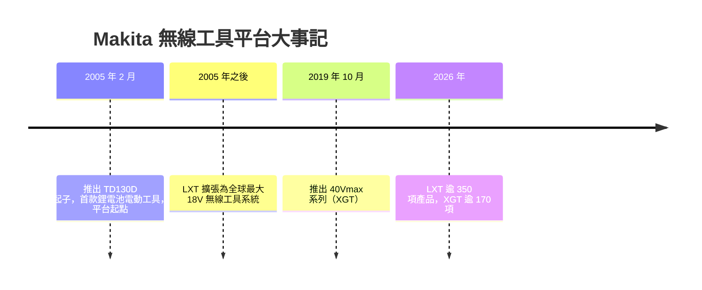

# Makita LXT 是什麼？

## 摘要

Makita LXT 是日本電動工具製造商 Makita（牧田）所推出的 18V 鋰電池無線電動工具平台品牌。Makita 官方將 LXT 系統描述為「世界上最大的相容無線工具系統，採用 18V 滑軌式（slide-style）電池供電」，並表示其產品線超過 350 項[^makitalxt]。此平台於 2005 年隨 Makita 推出全球首款鋰電池衝擊起子而誕生，日後成為該公司在通用型電動工具市場的主力系統[^bl1820][^history][^wiki]。

## LXT 名稱與定位

Makita 在官方網站上以註冊商標形式使用「LXT®」，並未在現行官方頁面中明文展開該縮寫[^makitalxt]。產業界與第三方資料普遍將其理解為「Lithium-Ion eXtreme Technology」（鋰離子極限技術）的縮寫，但查證後無法在 Makita 官方頁面找到逐字展開的說明，應視為業界慣用解釋而非官方定義[^wiki]。

Makita 目前並行經營三個無線工具系統品牌[^makitalxt]：

| 系統 | 電壓 | 產品數（2026 年） |
|------|------|-------------------|
| CXT® | 12V max | 70+ |
| LXT® | 18V（含 36V 的 X2 雙電池） | 350+ |
| XGT® | 40V max／80V max | 170+ |

LXT 定位為涵蓋各工種通用的主力系統；XGT 則針對過去需仰賴有線電源、燃油或氣動的高負載應用[^makitalxt]。

## 歷史沿革

Makita 於 2005 年 2 月推出 TD130D 無線衝擊起子，這是該公司首款鋰電池電動工具[^history]。BL1820B 產品頁亦記載「Makita 在 2005 年開創了 18V 鋰電池無線電動工具類別」[^bl1820]。此後 LXT 逐步擴張為全球規模最大的 18V 無線工具系統[^makitalxt]。2019 年 10 月，Makita 進一步推出 40Vmax 系列（後稱 XGT）[^history]。

## 18V 電池與架構

LXT 系統以 18V（標示上亦見 20V max）滑軌式鋰電池為核心，全部工具共用同一電池平台[^makitalxt]。系統內另包含兩種衍生架構：

- **LXT X2（36V）**：讓工具同時使用兩顆 18V LXT 電池串聯供電，達到 36V 輸出，用於高負載工具。所有電池仍屬同一 LXT 系統。
- **Sub-Compact LXT**：較小、較輕的 18V 工具，訴求「12V 手感、18V 相容」。

常見 LXT 電池容量包含 2.0Ah、3.0Ah、4.0Ah、5.0Ah、6.0Ah 等規格，皆具備整合式 LED 電量指示、16 個接觸端子，並可在低至約 -20°C 的環境下維持穩定輸出[^bl1850][^bl1860]。

## Star Protection Computer Controls™ 與 XPT

**Star Protection Computer Controls™** 是 Makita 的電池與工具通訊技術，讓工具與電池即時交換資料，用於防止過載（overloading）、過放電（over-discharging）與過熱（overheating）[^bl1820]。相容的工具與電池會以「Star Symbol™」或工具底部的黃色電池座標示；較高容量電池（3.0Ah 以上）僅能搭配支援 Star Protection 的工具使用[^bl1820]。

**XPT（eXtreme Protection Technology）** 則是 Makita 提升工具防塵防潑水能力的工程設計，常見於戶外或高強度作業環境的工具上[^makitalxt]。

## LXT 與 XGT 的差異

XGT 並非取代 LXT，而是與其互補的平行系統[^makitalxt]。主要差異如下：

| 項目 | LXT® | XGT® |
|------|------|------|
| 電壓 | 18V（36V X2） | 40V max（80V max X2） |
| 推出時間 | 2005 年 2 月 | 2019 年 10 月 |
| 產品數（2026 年） | 350+ | 170+ |
| 目標應用 | 通用型、涵蓋多數工種 | 高負載、取代有線／燃油／氣動工具 |
| 電池互通 | 不可與 XGT 互通 | 不可與 LXT 互通 |

Makita 官方對兩者關係的說明為：LXT 系統能處理大多數應用，但對於過去使用有線、燃油或氣動電源的高負載應用，XGT 系統提供更高功率的解決方案[^makitalxt]。

## 批判性反思

本報告的產品數量（LXT 350+、XGT 170+）幾乎全數來自 Makita 自家網站，屬於廠商行銷資料，可能隨時間變動，且潛在帶有推廣立場，數值應以官方最新公告為準[^makitalxt]。「LXT 等於 Lithium-Ion eXtreme Technology」的說法雖廣見於業界，但未見於 Makita 官方頁面逐字說明，故本報告僅以「業界慣用解釋」呈現，並未視為官方定義[^wiki]。歷史時點（2005 年 TD130D、2019 年 10 月 40Vmax）則同時見於 Makita 官方沿革頁與產品頁，交叉印證可信度較高[^history][^bl1820]。

## 參考文獻

[^makitalxt]: Makita U.S.A., Inc. (n.d.). *LXT® System*. Retrieved 2026-11-01, from https://www.makitatools.com/products/lxt
[^bl1820]: Makita U.S.A., Inc. (n.d.). *18V LXT® Lithium-Ion Compact 2.0Ah Battery (BL1820B)*. Retrieved 2026-11-01, from https://www.makitatools.com/products/details/BL1820B
[^bl1850]: Makita U.S.A., Inc. (n.d.). *18V LXT® Lithium-Ion 5.0Ah Battery (BL1850B)*. Retrieved 2026-11-01, from https://www.makitatools.com/products/details/BL1850B
[^bl1860]: Makita U.S.A., Inc. (n.d.). *18V LXT® Lithium-Ion 6.0Ah Battery (BL1860B)*. Retrieved 2026-11-01, from https://www.makitatools.com/products/details/BL1860B
[^history]: Makita Corporation. (n.d.). *History*. Retrieved 2026-11-01, from https://www.makita.biz/company/history.html
[^wiki]: Wikimedia Foundation. (n.d.). *Makita*. Wikipedia. Retrieved 2026-11-01, from https://en.wikipedia.org/wiki/Makita
