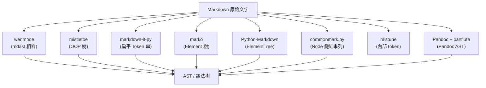

# mdast 的 Python 替代方案

## 摘要

`mdast` 是 JavaScript 生態系中由 `syntax-tree` 組織維護的「Markdown 抽象語法樹 (Abstract Syntax Tree, AST) 格式」規範[^mdast]。它定義了 Markdown 文件解析後的樹狀資料結構，節點型別包括 `root`、`paragraph`、`heading`、`text`、`strong`、`link`、`list`、`code` 等[^mdast]。此規範本身與語言無關，但官方實作與周邊工具集中於 JavaScript/TypeScript。

本報告調查 Python 生態系中可作為 mdast 替代方案（或等價工具）的 Markdown 解析器，重點關切「是否產生可程式化檢視的 AST」，並列出各專案的 GitHub 星數與維護狀態。

截至 2026-11-01，`syntax-tree/mdast` 擁有約 1,485 顆星[^mdast]。在 Python 中，**沒有任何函式庫原生實作完全相同的 mdast 規範**；最接近的是由 Mistune 作者所開發的新專案 `wenmode`，其明確標榜輸出「mdast 相容 (mdast-compatible) 的 AST」[^wenmode]。其餘函式庫則各自提供等價但結構不同的語法樹。

## 背景：mdast 是什麼

mdast 是 `unist`（Universal Syntax Tree，通用語法樹）規範家族的一員，由 unified collective (`syntax-tree` org) 維護[^mdast]。它的核心特徵是：

- **與語言無關的資料格式**：以純 JSON 物件描述節點，每個節點有 `type` 欄位，可選的 `children`、`value`、`position` 等[^mdast]。
- **生態系完整**：搭配 `mdast-util-from-markdown`（解析）、`mdast-util-to-markdown`（序列化）、`mdast-util-to-hast`（轉 HTML）等工具[^mdast]。
- **AST 為中心的工作流**：解析、轉換、序列化分離，便於 lint、格式化、靜態分析。

在 Python 中尋找「替代方案」，實務上等價於尋找「能夠把 Markdown 解析成可遍歷樹狀結構」的函式庫；因為資料格式無法完全對齊，故多數替代方案在節點命名與樹狀模型上與 mdast 相異。

## 各替代方案比較



### 1. wenmode（最接近 mdast 規範）

由 Mistune 作者 Hsiaoming Yang (`lepture`) 開發，是 Mistune 設計經驗的重寫版，**明確以「輸出 mdast 相容的 AST」為賣點**[^wenmode]。`parse()` 回傳的樹呼叫 `to_ast()` 後可得符合 mdast 結構的字典，例如：

```python
from wenmode import Wenmode
wen = Wenmode()
ast = wen.parse('A [link](https://example.com).').to_ast()
# {'type': 'root', 'children': [{'type': 'paragraph', ...}]}
```

舉凡 `paragraph`、`heading`、`text`、`strong`、`emphasis`、`link`、`image`、`code`、`inlineCode`、`blockquote`、`list`、`listItem`、`blockquote`、`thematicBreak`、`html` 等節點型別皆遵循 mdast 命名[^wenmode]。設定 `positions=True` 可輸出 `start`/`end` 的行、欄與位元組位移，供編輯器整合與診斷使用[^wenmode]。

- GitHub：<https://github.com/lepture/wenmode>，約 49 顆星[^wenmode]
- 維護狀態：**非常活躍**，2026 年 6 月建立，2026 年 10 月已至 `1.0.0rc1`[^wenmode]
- 授權：BSD-3-Clause[^wenmode]
- 附註：由於原生支援 mdast，是「Python 版 mdast」需求的首選，惟專案極新、星數低。

### 2. mistletoe

純 Python、CommonMark 相容的解析器，**設計上即先產生 AST 再渲染**[^mistletoe]。

- 樹狀模型：物件導向樹，根節點為 `Document`，包含區塊節點（`Heading`、`Paragraph`、`CodeBlock`、`List`、`Table`、`ThematicBreak`、`Quote` 等）與行內節點（`Strong`、`Emphasis`、`InlineCode`、`Link`、`Image`、`RawText`、`AutoLink` 等）[^mistletoe]。
- 內建 `AstRenderer` 可印出樹狀結構以便除錯；並提供 HTML、LaTeX、Markdown 渲染器[^mistletoe]。
- GitHub：<https://github.com/miyuchina/mistletoe>，約 1,071 顆星[^mistletoe]
- 維護狀態：**活躍**，最新版 `1.6.0`[^mistletoe]
- 授權：MIT[^mistletoe]

### 3. markdown-it-py

JavaScript `markdown-it` 的 Python 移植版，CommonMark 完整支援並具豐富外掛生態[^mditpy]。

- 樹狀模型：**扁平 Token 串**，`md.parse()` 回傳 `Token` 清單，以 `nesting`/`level` 表達階層，非直接可遍歷的節點樹；區塊與行內層級靠 `children` 連結[^mditpy]。
- 外掛：`mdit-py-plugins`（footnote、front matter、container 等）[^mditpy]。
- GitHub：<https://github.com/executablebooks/markdown-it-py>，約 1,388 顆星[^mditpy]
- 維護狀態：**非常活躍**，最新版 4.x，為 Executable Books 專案成員[^mditpy]
- 授權：MIT[^mditpy]

### 4. marko

純 Python、CommonMark v0.31.2 相容，強調**高擴充性**[^marko]。

- 樹狀模型：物件導向 `Element` 樹，根為 `Document`，區塊元素（`Paragraph`、`Heading`、`FencedCode`、`Quote`、`List`、`ListItem`、`Table` 等）與行內元素（`Strong`、`CodeSpan`、`Link` 等）[^marko]。
- 內建擴充：footnote、toc、pangu、codehilite，另有 GFM 解析器[^marko]。
- GitHub：<https://github.com/frostming/marko>，約 470 顆星[^marko]
- 維護狀態：**活躍**，最新版 `2.2.4`[^marko]
- 授權：MIT[^marko]

### 5. Python-Markdown

最早的 Python Markdown 實作，遵循 Gruber 原始規格而非 CommonMark，外掛生態龐大[^pymd]。

- 樹狀模型：內部以 `xml.etree.ElementTree` 表示，非 CommonMark AST；樹可透過 treeprocessors 或 `Markdown.serializer` 存取[^pymd]。
- GitHub：<https://github.com/Python-Markdown/markdown>，約 4,257 顆星[^pymd]
- 維護狀態：**非常活躍**，最新版 `3.10.3`[^pymd]
- 授權：BSD-3-Clause[^pymd]
- 附註：廣泛用於 MkDocs、Pelican 等專案。

### 6. commonmark.py（已棄用）

`commonmark.js` 的 Python 移植版，具備 `Node` 鏈結串列樹與 `walker()` 遍歷 API（與 mdast 的 walker 模式相當接近）[^cmkpy]。

- GitHub：<https://github.com/readthedocs/commonmark.py>，約 236 顆星[^cmkpy]
- 維護狀態：**已棄用 (deprecated)**，儲存庫已於 2026-05-29 封存，官方建議改用 `markdown-it-py`[^cmkpy]
- 授權：其他 (NOASSERTION)[^cmkpy]

### 7. mistune

由同一作者 (`lepture`) 開發的快速解析器，CommonMark 完整相容[^mistune]。

- 樹狀模型：內部採 tokenizer 架構，主要為 HTML 渲染而設計，AST 未如 mistletoe 般直接暴露[^mistune]。
- GitHub：<https://github.com/lepture/mistune>，約 3,081 顆星[^mistune]
- 維護狀態：**活躍**，最新版 `3.3.4`[^mistune]
- 授權：BSD-3-Clause[^mistune]
- 附註：其後繼專案 `wenmode` 原生輸出 mdast。

### 8. Pandoc + panflute / pandocfilters

`panflute` 與 `pandocfilters` 並非獨立解析器，而是操作 **Pandoc AST** 的過濾器框架，需先安裝 Pandoc[^panflute][^pandocfilters]。

- 樹狀模型：Pandoc 原生 AST（`Para`、`Header`、`CodeBlock`、`BulletList`、`Emph`、`Str` 等）；`panflute` 提供 Python 類別包裝，`pandocfilters` 則以字典表示[^panflute][^pandocfilters]。
- GitHub：`panflute` 約 553 顆星[^panflute]；`pandocfilters` 約 561 顆星[^pandocfilters]
- 維護狀態：`panflute` **維護中但節奏較慢**（2026-02 仍有推送）[^panflute]；`pandocfilters` 自 2025-09 後未再推送[^pandocfilters]
- 授權：兩者皆 BSD-3-Clause[^panflute][^pandocfilters]

### 9. MyST-Parser

延伸 CommonMark 的解析器，用於技術文件，橋接至 docutils/Sphinx[^myst]。

- 樹狀模型：產出 docutils `document` 樹，而非通用 Markdown AST[^myst]。
- GitHub：<https://github.com/executablebooks/MyST-Parser>，約 899 顆星[^myst]
- 維護狀態：**非常活躍**[^myst]
- 授權：MIT[^myst]

## 綜合比較表

| 函式庫 | 產出 AST | 樹狀模型 | 符合 mdast 規範 | 星數 | 狀態 |
| --- | --- | --- | --- | ---: | --- |
| **wenmode** | 是 | mdast 相容字典 | **是** | ~49 | 非常活躍 (2026) |
| **mistletoe** | 是 | OOP 樹 (Document→區塊→行內) | 否 | ~1,071 | 活躍 |
| **markdown-it-py** | 是 | 扁平 Token 串 | 否 | ~1,388 | 非常活躍 |
| **marko** | 是 | OOP Element 樹 | 否 | ~470 | 活躍 |
| **Python-Markdown** | 內部 | ElementTree | 否 | ~4,257 | 非常活躍 |
| **commonmark.py** | 是 | Node 鏈結串列 | 否 | ~236 | **已棄用** |
| **mistune** | 部分 | 內部 token 串 | 否 | ~3,081 | 活躍 |
| **panflute** | Pandoc AST | Pandoc 類別 | 否 (Pandoc) | ~553 | 維護中 |
| **pandocfilters** | Pandoc AST | 字典 | 否 (Pandoc) | ~561 | 低度維護 |
| **MyST-Parser** | docutils | docutils 樹 | 否 (Sphinx) | ~899 | 非常活躍 |

## 選型建議

- **若需求是「Python 版的 mdast」**：唯一原生選項為 **wenmode**，其 `to_ast()` 直接輸出 mdast 節點結構[^wenmode]。惟專案極新（2026 年成立、約 49 星），導入前應評估穩定性風險。
- **若要成熟的 OOP AST 樹**：**mistletoe** 的節點模型最自然，適合程式化檢視與轉換[^mistletoe]。
- **若要最完整的外掛生態與社群規模**：**markdown-it-py** 是 Python 移植的 `markdown-it`，外掛豐富、維護強健[^mditpy]。
- **若工作流以 Pandoc 為中心**：直接採用 Pandoc AST 搭配 **panflute**[^panflute]。
- **避免**：**commonmark.py** 已正式棄用並封存，官方建議改用 `markdown-it-py`[^cmkpy]。

## 批判性反思

- **規範 vs. 實作**：mdast 是資料格式規範，不是解析器；「Python 替代方案」本質上無法做到逐欄位完全對等，只能做到結構功能等價。`wenmode` 是目前唯一明確對齊 mdast 命名者，但其 API 穩定性與長期維護仍待觀察[^wenmode]。
- **星數偏誤**：Python-Markdown 與 mistune 星數最高，但其 AST 並非主打功能，與「mdast 替代」目標不對等；讀者不應僅以星數判斷適配性。
- **專案新舊**：`wenmode` 的星數低（<100）源於建立時間極短，而非品質低落；其作者同時是 mistune 作者，具備可信背景[^wenmode][^mistune]。故本報告仍納入，並標註其新創屬性。
- **來源時效**：所有星數與維護狀態均為 2026-11-01 查詢結果，數字會隨時間變動。

## 參考資料

[^mdast]: syntax-tree. (n.d.). *mdast: Markdown Abstract Syntax Tree format* [Computer software]. GitHub. Retrieved 2026-11-01, from https://github.com/syntax-tree/mdast

[^wenmode]: lepture. (n.d.). *Wenmode: A fast, composable Markdown parser and renderer toolkit* [Computer software]. GitHub. Retrieved 2026-11-01, from https://github.com/lepture/wenmode

[^mistletoe]: miyuchina. (n.d.). *mistletoe: A fast, extensible and spec-compliant Markdown parser in pure Python* [Computer software]. GitHub. Retrieved 2026-11-01, from https://github.com/miyuchina/mistletoe

[^mditpy]: executablebooks. (n.d.). *markdown-it-py: Markdown parser, done right* [Computer software]. GitHub. Retrieved 2026-11-01, from https://github.com/executablebooks/markdown-it-py

[^marko]: frostming. (n.d.). *marko: A markdown parser with high extensibility* [Computer software]. GitHub. Retrieved 2026-11-01, from https://github.com/frostming/marko

[^pymd]: Python-Markdown. (n.d.). *Python-Markdown: A Python implementation of John Gruber's Markdown with Extension support* [Computer software]. GitHub. Retrieved 2026-11-01, from https://github.com/Python-Markdown/markdown

[^cmkpy]: readthedocs. (n.d.). *commonmark.py: DEPRECATED: Python CommonMark parser* [Computer software]. GitHub. Retrieved 2026-11-01, from https://github.com/readthedocs/commonmark.py

[^mistune]: lepture. (n.d.). *mistune: A fast yet powerful Python Markdown parser with renderers and plugins* [Computer software]. GitHub. Retrieved 2026-11-01, from https://github.com/lepture/mistune

[^panflute]: sergiocorreia. (n.d.). *panflute: A Pythonic alternative to John MacFarlane's pandocfilters* [Computer software]. GitHub. Retrieved 2026-11-01, from https://github.com/sergiocorreia/panflute

[^pandocfilters]: MacFarlane, J. (n.d.). *pandocfilters: A python module for writing pandoc filters* [Computer software]. GitHub. Retrieved 2026-11-01, from https://github.com/jgm/pandocfilters

[^myst]: executablebooks. (n.d.). *MyST-Parser: An extended commonmark compliant parser, with bridges to docutils/sphinx* [Computer software]. GitHub. Retrieved 2026-11-01, from https://github.com/executablebooks/MyST-Parser
