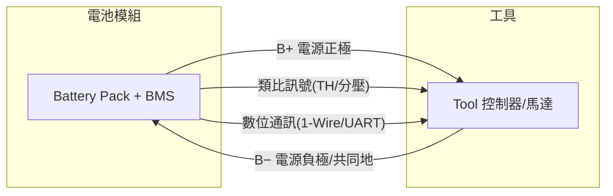
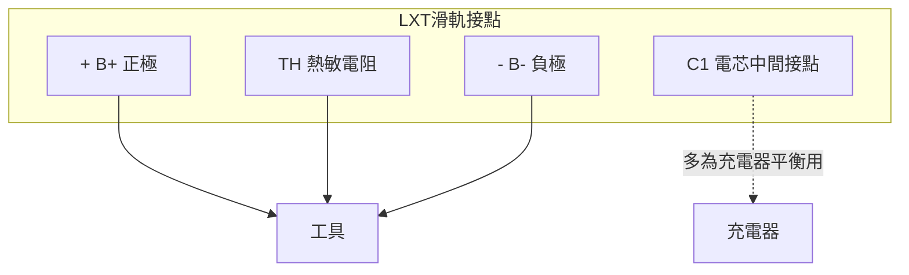
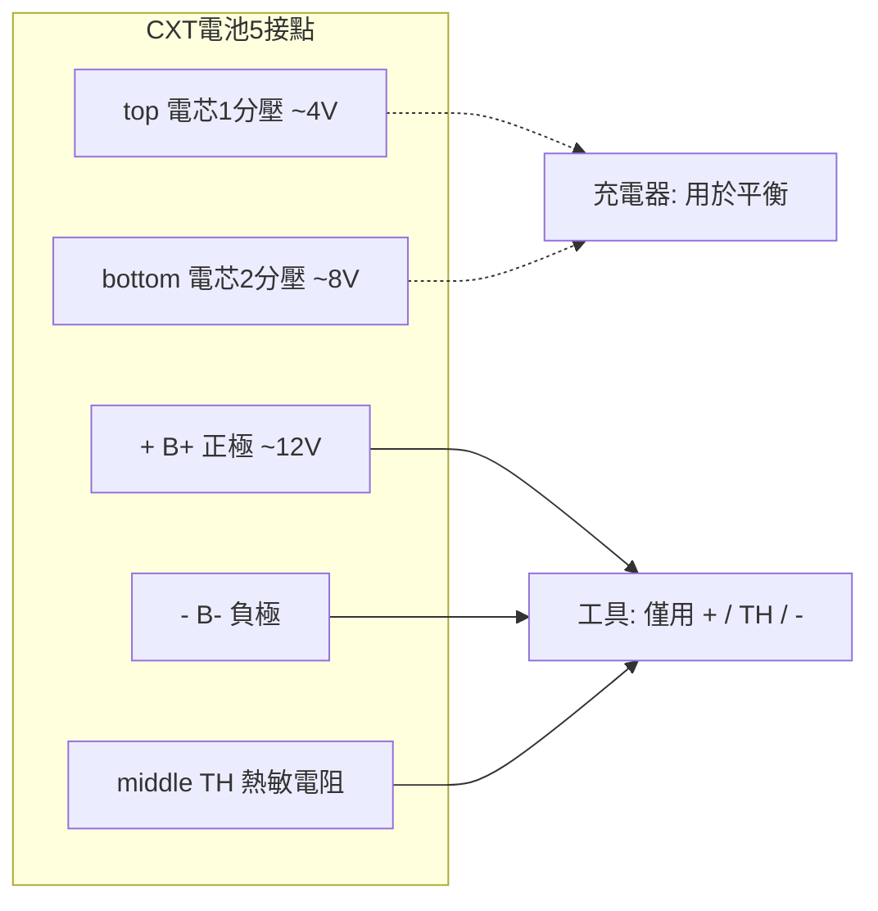
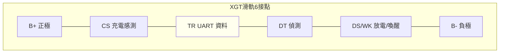

# Makita 電池模組與工具之間的電氣連接

## 研究範圍與定義

本報告僅描述 **Makita 電池模組（battery pack）與工具（tool）之間的介面接點**，也就是兩者接合時實際接觸、傳遞電能或訊號的導電接點。

以下內容**不包含**：

- 電池模組內部的線路（電芯串並聯、BMS 電路板、保險絲、MOSFET 等）。
- 工具內部的線路（馬達、控制器、開關、配線等）。
- 充電器（charger）與電池之間的專屬連接（僅在說明接點用途時附帶提及）。

Makita 目前有三個互不相容的滑軌式電池平台：**CXT（10.8V/12V）**、**LXT（18V）** 與 **XGT（40V Max）**。三者的接點數量與訊號種類不同，需分別討論。

## 接點分類的共通概念

無論哪個平台，電池與工具之間的接點可歸為三類：

1. **電源接點（power contacts）**：承載大電流的正極（B+）與負極（B−）。
2. **類比訊號接點**：例如熱敏電阻（thermistor, TH）溫度訊號、電芯中間分壓點（cell tap）等。
3. **數位通訊接點**：BMS 與工具／充電器交換資料的序列匯流排（例如 1-Wire 或 UART）。

## LXT（18V）平台

### 滑軌上的主要接點（blade terminals）

LXT 電池插入工具時，最先接觸的是滑軌面上的**主接點**。根據對第三方轉接座（Black+Decker 轉 Makita）的拆解，工具側主要接觸三個接點[^gearhack]：

| 接點 | 名稱 | 功能 |
| --- | --- | --- |
| `+` | B+ | 電池正極，約 18V（滿電約 21V） |
| `TH` | Thermistor | NTC 熱敏電阻溫度訊號，供工具判斷電池是否過熱 |
| `−` | B− | 電池負極，同時是整個介面的共同參考地 |

對電池本體（而不是工具側）的逆向量測則顯示滑軌面共有**四個**板狀接點：`+`、`−`、`TH`，以及 `C1`[^wdh]。其中 `C1` 是電芯群之間的接點（對地約 3.7V，即 5 串電芯中的一段），主要供**充電器**做電芯監控與平衡之用，一般工具不見得會接觸它[^wdh][^gearhack]。

### 黃色訊號連接器（1-Wire 資料）

除了滑軌接點，LXT 電池側面另有一個**黃色（橙色）專有訊號連接器**，用於 BMS 與工具／充電器之間的數位通訊。此連接器為 2.54mm 間距的專有多腳連接器，不同來源對腳位數的描述略有出入：原始逆向工程文件描述為 8 腳連接器（列舉 1–7 腳，第 7 腳標記為 N/C）[^rosvall]；而實際使用的轉接板則採用 6 腳 JST-PH 接頭[^pocketobi]。實務上只有少數幾腳被使用：

| 腳位 | 功能 |
| --- | --- |
| 2 | **1-Wire 資料線**（DATA），需外部上拉電阻（3.3V/4.7kΩ 或更低） |
| 6 | **致能（Enable）**，需被拉高才會進行通訊 |
| 其餘腳位 | 多為未連接或未定用途 |

第 1 腳位置最靠近電池負極接點，且第 2、6 腳皆以電池負極（B−）為參考電位[^rosvall]。BMS 回報的各種資訊（電芯電壓、溫度、型號字串、電量等）都透過這條 1-Wire 匯流排傳送[^rosvall][^pocketobi]。

值得注意的是，部分來源主張 LXT 的**溫度與電芯資訊是數位回報，而非獨立熱敏電阻接點**[^pocketobi]；這與滑軌接點上確實存在 `TH` 的量測結果[^gearhack][^wdh]並存，代表不同世代／型號的 LXT 電池其硬體實作可能不同，是本研究中的一個不確定處（見下文）。

### Star Protection 與舊式工具

Makita 的「Star Protection」功能讓工具能與電池即時交換溫度、過載等資訊，這類工具才會用到黃色資料連接器。較舊或較簡單的工具僅靠 `+`、`TH`、`−` 三個接點運作；若將 `TH` 遮蔽，工具通常不會動作，因此第三方轉接座常以一個約 1–1.5Ω 的電阻把 `+` 接到 `TH` 來「騙過」工具[^gearhack]。

## CXT（10.8V/12V）平台

CXT 電池的滑軌面共有 **5 個**板狀接點，排列如下（電池平放、白色釋放卡榫朝左、`−` 極朝上時）[^graham]：

| 位置 | 接點 | 功能 |
| --- | --- | --- |
| top | 第一顆電芯分壓 | 對地約 4V |
| − | B− | 負極／共同地 |
| middle | TH | 熱敏電阻對地（17°C 時約 18.5kΩ，推測為 10k NTC） |
| + | B+ | 正極，對地約 12V（3 串，標稱 10.8V） |
| bottom | 第二顆電芯分壓 | 對地約 8V |

CXT 工具本身通常只接觸 **3 個**接點：`+`、`TH`、`−`（由鑽機底部可見到三個接點佐證）[^graham]。另外兩個電芯分壓接點主要由**充電器**使用，以監控與平衡各電芯[^graham]。

CXT 平台**沒有數位通訊接點**，其介面為純類比（電源 + 熱敏電阻 + 電芯分壓）[^graham]。

## XGT（40V Max）平台

XGT 電池滑軌上有 **2 個長的電源刀片接點**，以及夾在兩者之間的 **4 個較小的訊號接點**，合計 6 個接點[^malvineous][^belik]。

| 接點 | 名稱 | 功能 |
| --- | --- | --- |
| B+ | 正極 | 40V 級（10 串，實測端子電壓約 30V 放電到約 42–43V 滿電）[^belik] |
| B− | 負極／共同地 | 所有訊號接點的參考地 |
| CS | Charge Sense（充電感測） | 最靠近 B+；表示是否允許充電，電壓與充電電流相關（`Ichg = 28.9 − 7.7·Vcs`）[^malvineous] |
| TR | Transmit/Receive（收發） | **數位 UART 資料線**，承載所有遙測與指令[^malvineous] |
| DT | Detection（偵測） | 偵測是否已接上電池；滿電電池在此輸出約 34.3V，電壓低至 3.3V 即足以令充電器開始通訊[^malvineous] |
| DS/WK | Discharge/Wake（放電/喚醒） | 表示電池是否可安全放電；亦可作為喚醒已停機 BMS 的 Vdd 輸入[^malvineous] |

實體排列上，靠近灰色釋放卡榫的兩個小接點是 `CS` 與 `TR`（`CS` 較靠近 B+，`TR` 較靠近 B−），離釋放鈕較遠的兩個則是 `DT` 與 `DS`（`DT` 較靠近 B+，`DS` 較靠近 B−）。整體順序由 B+ 往 B− 為：`B+ → CS → TR → DT → DS → B−`[^malvineous]。

XGT 的通訊使用**單線雙向 UART**，格式為 9600/8-E-1（even parity），但**訊號邏輯反相**：匯流排閒置時為 0V，傳送 0-bit 時拉高至約 5V；訊息以 `0xA5A5` 開頭，每組 16-bit 字組為 big-endian[^malvineous]。此為與 LXT（1-Wire）截然不同的數位通訊方式。

## 三平台比較

| 項目 | CXT（10.8V/12V） | LXT（18V） | XGT（40V Max） |
| --- | --- | --- | --- |
| 標稱電壓 | 10.8V / 12V | 18V | 36V（40V Max） |
| 電芯組態 | 3 串 | 5 串 | 10 串 |
| 滑軌總接點數 | 5 | 3 或 4（視定義） | 6 |
| 電源接點 | B+、B− | B+、B− | B+、B− |
| 類比訊號 | TH、2 個電芯分壓 | TH（可能含 C1 分壓） | 無（溫度由數位回報） |
| 數位通訊 | 無 | 1-Wire（黃色訊號連接器） | UART（單線雙向、反相） |
| 專有訊號腳 | 無 | DATA、ENABLE 等 | CS、TR、DT、DS/WK |
| 工具僅需接點 | +、TH、− | +、TH、−（Star Protection 工具另用資料線） | B+、B−、及必要時 TR |
| 平台間互通 | 否 | 否 | 否 |

## 來源批判與不確定處

- **LXT 滑軌接點數 3 或 4 的歧異**：`gearhack` 的拆解以工具側轉接座為對象，僅見 3 個主接點；`wiringdiagramhub` 拆解電池本體則量到 4 個（含 `C1`）。兩者並非矛盾，而是分別描述「工具側接觸」與「電池側存在」兩種視角，且 `C1` 主要供充電器使用[^gearhack][^wdh]。
- **LXT 是否具獨立 TH 接點**：`gearhack` 與 `wiringdiagramhub` 皆指出滑軌有 `TH`；但 `PocketOBI` 文件主張「連接器上沒有獨立熱敏電阻腳，溫度由 BMS 經資料線回報」[^pocketobi]。合理推論是**不同世代／型號的 LXT 電池實作不同**（舊式類比 TH vs. 新式數位回報），此點尚未有單一權威來源可完全定論。
- **黃色連接器腳位數**：原始文件描述 8 腳（含 1 腳 N/C）[^rosvall]，實務轉接採 6 腳 JST-PH[^pocketobi]，商用轉接座亦有 7 腳之說[^wdh]。此差異可能是量測標的（電池側插座 vs. 轉接座插頭）不同所致。
- **來源性質**：上述接點資訊多來自社群逆向工程（GitHub 專案、EEVblog 論壇、部落格），並非 Makita 官方文件；Makita 未公開官方針腳定義。部分資訊可能涉及 Makita 專利[^malvineous]。所有數值（電壓、電阻）皆為特定樣本的量測結果，型號差異可能導致不同讀值。
- **安全性**：這些接點中，XGT 的訊號接點在異常情況（例如副廠電池）可能出現遠高於邏輯準位、甚至接近 40V 的電壓[^malvineous][^belik]，任何介接電路都必須具備耐壓保護。

## 參考文獻

[^gearhack]: GearHack. (n.d.). *Makita 18V LXT power tools battery interface*. Retrieved 2026-11-02, from https://www.gearhack.com/myink/ViewPage.php?file=docs/Power%20Tools/Battery%20Conversion/Makita%2018V%20LXT%20Power%20Tools%20Battery%20Interface

[^wdh]: Ward, A. (2025). *Makita 18V battery pinout wiring diagram (battery interface)*. Wiring Diagram Hub. Retrieved 2026-11-02, from https://wiringdiagramhub.com/makita-18v-battery-pinout-wiring-diagram-battery-interface/

[^rosvall]: Rosvall, T. (n.d.). *Notes on how to communicate with Makita 18V batteries*. Retrieved 2026-11-02, from https://codeberg.org/rosvall/makita-lxt-protocol

[^pocketobi]: TheRepairforge. (n.d.). *PocketOBI — Hardware / PCB notes* [Computer software documentation]. GitHub. Retrieved 2026-11-02, from https://github.com/TheRepairforge/PocketOBI/blob/main/HARDWARE.md

[^graham]: Whaley, G. (n.d.). *Makita CXT 10.8v/12v battery details*. GitHub. Retrieved 2026-11-02, from https://github.com/grahamwhaley/Makita_CXT_batteries

[^malvineous]: Malvineous. (n.d.). *Makita XGT "40V Max" communication protocol*. GitHub. Retrieved 2026-11-02, from https://github.com/Malvineous/makita-xgt-serial

[^belik]: Belik1982. (n.d.). *Hardware: wiring, connector, and power supply* [Computer software documentation]. In *esp32-makita-xgt-bms-reader*. GitHub. Retrieved 2026-11-02, from https://github.com/Belik1982/esp32-makita-xgt-bms-reader/blob/master/docs/HARDWARE.md
