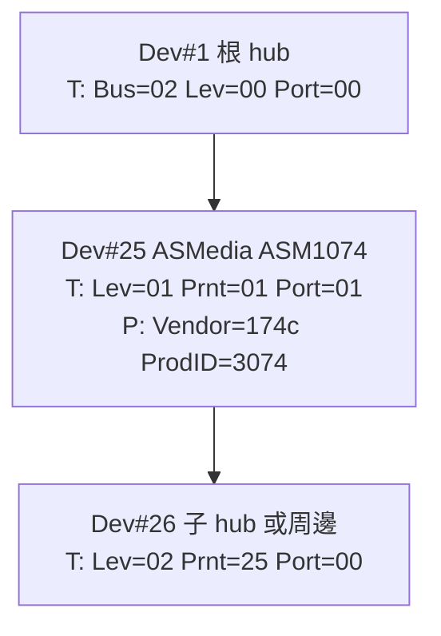

# 結合 USB 拓撲樹與裝置身分：lsusb 的參數與替代指令

## 問題陳述

在 Linux 上檢視 USB 裝置時，常見兩種輸出各有所長、卻也各有所短：

- `lsusb -t` 能畫出人類易讀的樹狀拓撲（匯流排、埠、速度、驅動），但**不顯示**廠商:產品 ID 與可讀名稱，因此看不出「這顆 hub 是哪一家的晶片」[^man-lsusb][^src-lsusb-t]。
- `lsusb`（無 `-t`）能列出 `ID xxxx:xxxx` 與廠商/產品名稱（例如 `ASMedia Technology Inc. ASM1074`），但輸出是**平坦清單**，不呈現裝置掛在哪個埠、隸屬哪顆 hub 之下[^man-lsusb]。

本文探討如何讓拓撲樹同時具備裝置身分資訊，並整理原生參數與替代指令。

## 方法一：`lsusb -t` 搭配 `-v`（推薦、無需安裝其他工具）

`lsusb` 的樹狀模式支援「提高詳細度」，關鍵在 man page 的說明：樹狀輸出「可用 `-v` 選項增加詳細度兩次」（Verbosity can be increased twice with the `-v` option），且 `-v`「可與 `-t` 併用」（Can be used with the -t option）[^man-lsusb]。

不同詳細度會在每個節點下方插入額外資訊列，其實作定義於 `lsusb-t.c`[^src-lsusb-t]：

| 指令 | 額外顯示內容 |
|---|---|
| `lsusb -t` | 僅拓撲：`Bus/Port、Dev、Class、Driver、速度` |
| `lsusb -t -v` | 每個裝置多一行 `ID xxxx:xxxx 廠商 產品名稱` |
| `lsusb -t -vv` | 再加 sysfs 路徑與裝置節點 `/dev/bus/usb/BBB/DDD` |
| `lsusb -t -vvv` | 再加裝置描述元字串（Manufacturer/Product/Serial） |

`-v` 每多一層即對應原始碼中的 `verblevel`：`>=1` 印出 `ID %04x:%04x %s %s`，`>=2` 印出 sysfs 與裝置節點路徑，`>=3` 印出製造商/產品/序號字串[^src-lsusb-t]。

### 實際效果

以一台同時含 ASMedia ASM1074 與 Genesys Logic GL3523 hub 的機器為例，`lsusb -t -v` 會在原拓撲上補上身分列[^src-lsusb-t]：

```text
/:  Bus 002.Port 001: Dev 001, Class=root_hub, Driver=xhci_hcd/4p, 20000M/x2
    ID 1d6b:0003 Linux Foundation 3.0 root hub
    |__ Port 001: Dev 002, If 0, Class=Hub, Driver=hub/4p, 5000M
        ID 05e3:0620 Genesys Logic, Inc. GL3523 Hub
        |__ Port 002: Dev 004, If 0, Class=Communications, Driver=cdc_ncm, 5000M
            ID 0b95:1790 ASIX Electronics Corp. AX88179 Gigabit Ethernet
    |__ Port 002: Dev 025, If 0, Class=Hub, Driver=hub/4p, 5000M
        ID 174c:3074 ASMedia Technology Inc. ASM1074 SuperSpeed hub
        |__ Port 001: Dev 026, If 0, Class=Hub, Driver=hub/4p, 5000M
            ID 174c:3074 ASMedia Technology Inc. ASM1074 SuperSpeed hub
```

如此一來，拓撲與晶片身分即在同一份輸出中呈現，`ASMedia Technology Inc. ASM1074` 就出現在對應的樹節點之下。名稱來自 udev 硬體資料庫（usb.ids）[^man-lsusb]。

> 注意：`lsusb -t -v` 對同一裝置的**每個介面**（interface）都會各重印一次該身分列，因此像多介面的音效裝置會看到 `ID` 行重複多次，屬正常行為[^src-lsusb-t]。

## 方法二：`lsusb.py`

`lsusb.py` 是 usbutils 套件附帶的 Python 工具（部分發行版需另外安裝或不在 `PATH`）。其 man page 指出：相較於 `lsusb`，它能顯示更多資訊，包括介面速度、每個裝置介面的細節、繫結的驅動，以及驅動所提供的 Linux 裝置與端點細節[^man-lsusb-py]。

- 它使用 **usb.ids** 檔案對應廠商與產品 ID 的可讀名稱[^man-lsusb-py]。
- 預設輸出即為**樹狀**且帶身分名稱，在終端機上還可著色。
- 常用選項：`-i` 顯示各裝置介面（不含 hub）、`-I` 連 hub 介面一併顯示、`-u` 隱藏空 hub、`-U` 隱藏所有 hub、`-e` 顯示端點、`-c`/`-C` 開啟/關閉顏色、`-f` 指定 usb.ids 路徑[^man-lsusb-py]。

若要**只保留拓撲骨架、過濾掉 hub**，可用：

```bash
lsusb.py -U
```

若要**看到每個裝置繫結的驅動與介面**：

```bash
lsusb.py -i
```

## 方法三：`usb-devices`

`usb-devices` 是 usbutils 內的一個 shell script，**沒有任何命令列選項**，執行後即輸出所有 USB 匯流排與裝置的細節[^man-usb-devices]。它走訪 `/sys/bus/usb/devices/usb*` 組出輸出，格式仿舊的 `/proc/bus/usb/devices` 或 debugfs 的 `/sys/kernel/debug/usb/devices`[^man-usb-devices]。若 sysfs 未掛載，會回傳非零結束碼[^man-usb-devices]。

其輸出以單字母標籤分行，欄位語意由核心文件定義[^proc-usb-info]：

| 標籤 | 意義 |
|---|---|
| `T:` | 拓撲：`Bus、Lev、Prnt、Port、Cnt、Dev#、Spd、MxCh` |
| `B:` | 頻寬（僅根 hub） |
| `D:` | 裝置描述元（USB 版本、Class、Sub、Prot…） |
| `P:` | **產品 ID**：`Vendor=xxxx ProdID=xxxx Rev` |
| `S:` | 字串描述元：Manufacturer / Product / SerialNumber |
| `C:` | 設定描述元（`*` 表示作用中的設定） |
| `I:` | 介面描述元（含 `Driver=` 繫結的驅動） |
| `E:` | 端點描述元 |

與 `lsusb` 不同，`usb-devices` **不會**把 ID 解析成人類可讀名稱，只顯示十六進位 ID；但它同時提供驅動繫結、端點與設定等完整描述[^man-usb-devices][^proc-usb-info]。此外，它只列出「作用中」的介面（即舊格式中以 `*` 標記者）[^man-usb-devices]。

### 用 `usb-devices` 重建拓撲

核心文件的 `T:` 行欄位（`Lev、Prnt、Port、Cnt`）本就是設計用來重建拓撲圖的[^proc-usb-info]。可先只取拓撲行：

```bash
usb-devices | grep '^T:'
```

要將身分（`P:`/`S:`）與拓撲（`T:`）綁在一起的人類可讀視圖，可合併取出：

```bash
usb-devices | grep -E '^(T|P|S):'
```

**重要陷阱**：`T:` 行的 `Port` 值**永遠比實際連接埠少 1**，例如插在 port 4 的裝置會顯示 `Port=03`；這是歷史遺留的設計[^proc-usb-info]。用於自行撰寫腳本重建樹狀結構時必須注意。

## 方法四：以 Bus/Dev 編號自行交叉比對

由於 `lsusb -t`（不含 `-v`）輸出含有 `Bus NNN` 與 `Dev NNN`，而平坦的 `lsusb` 輸出亦以 `Bus NNN Device NNN:` 開頭，可用一個小腳本把兩者對應，達到「樹狀 + 身分」的效果[^man-lsusb][^src-lsusb-t]：

```bash
lsusb -t | sed -E 's/(Bus|Dev) ([0-9]+)/\1 \2/g'
# 搭配 lsusb 的 "Bus X Device Y: ID vvvv:pppp name" 以 (bus,dev) 為鍵 join
```

不過這僅是 `lsusb -t -v` 的土法重造，除非有特殊排版需求，否則建議直接用方法一。

## 方法五：直接讀 sysfs / debugfs

若 debugfs 已掛載，可直接讀取核心產生的檔案：

```bash
cat /sys/kernel/debug/usb/devices
```

此檔含有 `T/D/P/S/C/I/E` 完整資訊，且與 `usb-devices` 不同，**會包含未作用中的介面**（以空白而非 `*` 標示）[^man-usb-devices][^proc-usb-info]。sysfs 亦可直接查詢單一屬性，例如：

```bash
cat /sys/bus/usb/devices/usb2/2-2/product
```

## 比較總覽

| 指令 | 拓撲樹 | Vendor:Product ID | 可讀名稱 | 驅動/介面 | 端點 |
|---|---|---|---|---|---|
| `lsusb` | 否（平坦） | 是 | 是 | 否 | 否 |
| `lsusb -t` | 是 | 否 | 否 | 部分 | 否 |
| **`lsusb -t -v`** | **是** | **是** | **是** | 部分 | 否 |
| `lsusb -t -vv(v)` | 是 | 是 | 是 | 部分 | 路徑 / 字串 |
| `lsusb.py` | 是 | 是 | 是 | 是（`-i`） | `-e` |
| `usb-devices` | 隱含（`T:`） | 是（十六進位） | 否 | 是 | 是 |
| `/sys/kernel/debug/usb/devices` | 隱含（`T:`） | 是 | 否 | 是 | 是 |

## 拓撲與身分對應示意

下圖說明一顆 root hub 底下掛著外接 hub，再由該 hub 連出裝置時，`T:` 與 `P:`/`S:` 資訊如何拼成一個節點：



## 結論

- 想要**一份原生輸出同時具備拓撲與身分**，最簡單的答案就是 `lsusb -t -v`（等價寫法 `lsusb -tv`），必要時逐層加 `-v` 取得路徑與描述元字串[^man-lsusb][^src-lsusb-t]。
- 想要更豐富的介面/驅動/端點資訊且維持樹狀呈現，改用 **`lsusb.py`**（注意其不一定在預設 `PATH`）[^man-lsusb-py]。
- 想要可腳本化解析的完整描述元，使用 **`usb-devices`**，但別忘了 `Port` 少 1 的陷阱，且它不解析可讀名稱[^man-usb-devices][^proc-usb-info]。

## 參考資料

[^man-lsusb]: Michael Kerrisk. (2019-02-11). lsusb(8) — Linux manual page. Retrieved 2026-11-02, from https://www.man7.org/linux/man-pages/man8/lsusb.8.html

[^src-lsusb-t]: Kroah-Hartman, G. (n.d.). usbutils/lsusb-t.c. Retrieved 2026-11-02, from https://raw.githubusercontent.com/gregkh/usbutils/master/lsusb-t.c

[^man-lsusb-py]: Michael Kerrisk. (2024-01-03). lsusb.py(1) — Linux manual page. Retrieved 2026-11-02, from https://www.man7.org/linux/man-pages/man1/lsusb.py.1.html

[^man-usb-devices]: Michael Kerrisk. (2009-06-23). usb-devices(1) — Linux manual page. Retrieved 2026-11-02, from https://www.man7.org/linux/man-pages/man1/usb-devices.1.html

[^proc-usb-info]: Linux Kernel Documentation. (2010-09-13). /proc/bus/usb filesystem output (proc_usb_info.txt). Retrieved 2026-11-02, from https://www.kernel.org/doc/Documentation/usb/proc_usb_info.txt
