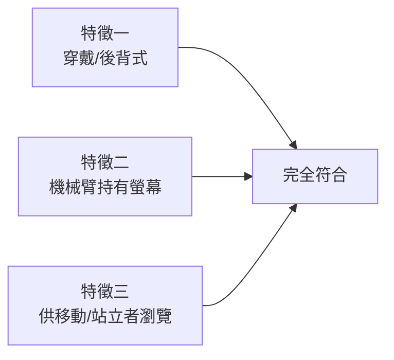
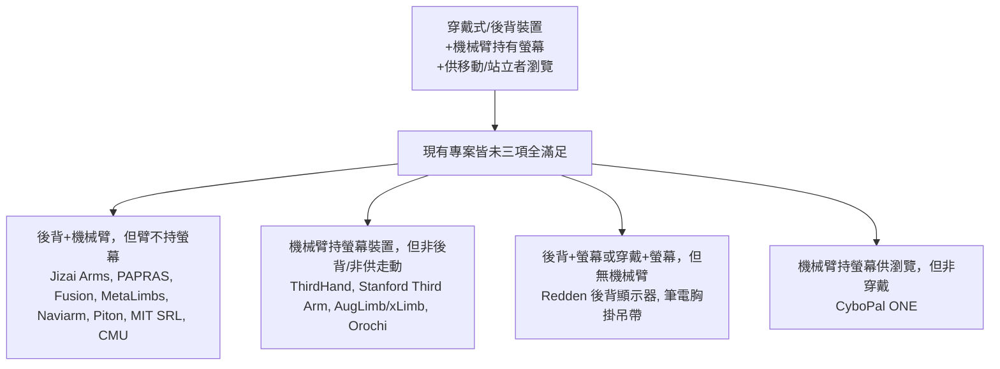

# 穿戴式／後背式機械手臂持螢幕供移動中使用者瀏覽：現況調查

## 摘要

本報告調查是否存在同時滿足以下三項特徵的**官方（學術／商業）或 DIY 專案**：

1. 穿戴式或後背式（backpack）裝置；
2. 機械手臂能持有螢幕（顯示器／平板／手機）；
3. 使移動中或站立的人仍能瀏覽由機械手臂支撐的螢幕。

調查結論是：**目前沒有找到一個「三項全部明確滿足」且以此為主要設計目的之專案**。最接近的是一批「穿戴式額外機械肢（Supernumerary Robotic Limbs, SRL）」研究，它們具備「後背／腰間穿戴 + 機械臂」的形態，但機械臂的用途多為**抓取、支撐、導引或遠端遙現（telexistence）**，而非「把螢幕舉到使用者眼前供其瀏覽」。以下依「最接近程度」分類整理，並指出各案與目標特徵的差距。

> 註：本報告所有事實均附註腳來源；凡屬推測（例如「理論上可改裝成持螢幕」）均明確標示為推測，未列為既有事實。

---

## 一、評分標準

為避免「看起來像就當成符合」，本報告以三軸逐一檢核每個專案：

- **特徵一（Wearable）**：裝置是否穿戴於身體或背負於背後。
- **特徵二（Arm-holds-screen）**：機械臂的末端是否**主動舉持一個實體螢幕**並呈現給穿戴者（而非相機、工具、投影）。
- **特徵三（Mobile-viewing）**：設計情境是否允許穿戴者**站立或走動時**觀看該螢幕。

---

## 二、最接近的專案（具備「後背＋機械臂」但用途非持螢幕）

### 1. Jizai Arms（東京大學，2023）[^jizai]

Jizai Arms 是一個**後背式底座**，最多可安裝六支**可拆換機械臂**，總重約 14 公斤；手臂由穿戴者的身體動作觸發，設計目的為**多人之間的社交互動（交換手臂、擁抱、協助）**[^jizai]。它完全符合**特徵一**（後背式），但公開資料以「抓取、社交」為主，**未記載以持螢幕供瀏覽為用途**（特徵二、三不成立，僅屬推測可改裝）。

### 2. PAPRAS: Backpack（伊利諾大學香檳分校 KIMLAB，2023）[^papras]

PAPRAS（Plug And Play Robotic Arm System）的後背版本，可裝**最多四支機械臂**，由穿戴者上半身動作控制，用於展示「擴增肢體能力」[^papras]。符合**特徵一**；手臂為通用操作臂，公開示範**非持螢幕**。

### 3. Fusion（慶應義塾大學，SIGGRAPH 2018）[^fusion]

Fusion 是**後背式遠端臨場（telexistence）機器人**：含一個三軸機器頭（雙鏡頭＋雙耳麥）與**兩支機械臂**，讓遠端操作者透過 HMD 看見、聽見並操控穿戴者周遭[^fusion]。符合**特徵一**。其「頭部」是**相機**（把影像串流給遠端使用者），**不是**把螢幕呈現給穿戴者，故**特徵二明確不成立**。

### 4. MetaLimbs / MetaArms（東京大學／慶應，2017–2018）[^metalimbs]

以**後背式底座**提供兩支機械臂，**由腳部動作對應控制**，探索「身體圖式」（body scheme）的擴張[^metalimbs]。符合**特徵一**；用途為操作與身體映射，**非持螢幕**。

### 5. Naviarm（東京大學、慶應、早稻田，AH 2019）[^naviarm]

**後背式機械臂系統**，透過**觸覺導引**教導動作技能：先記錄專家的手臂軌跡，再回放以引導初學者[^naviarm]。符合**特徵一**，但目的為動作教學，**不持螢幕**。

### 6. Piton（早稻田大學，Sensors 2022）[^piton]

**後背架（backpack rack）上的蛇形穿戴式遠端臨場機器人**，末端為**立體相機（ZED Mini）**，供遠端操作者透過 HMD 觀看[^piton]。符合**特徵一**；末端是相機而非螢幕，**特徵二不成立**。

### 7. MIT Supernumerary Robotic Limbs（SRL，2012–2016）[^mit]

**腰間／後背式**穿戴機器肢，用於飛機裝配、施工、步行平衡輔助，可支撐工件或鑽孔[^mit]。符合**特徵一**；用途為工業操作，**非螢幕呈現**（特徵二、三不成立）。

### 8. CMU 後背機械臂（卡內基美隆大學，2019）[^cmu]

模組化蛇形機械臂安裝於**背包**上、跨越肩部，作為「第三隻手」在工業情境中**替使用者扶住工件**，讓雙手可進行其他作業[^cmu]。符合**特徵一**；能力上「可扶住物體於使用者面前」，但公開資料**未以瀏覽螢幕為目的**（特徵二僅屬「能力上可行」，非設計事實）。

---

## 三、具備「持手機／平板」能力、但非後背式或非供走動瀏覽的專案

### 9. ThirdHand（台灣大學／慶應，SIGGRAPH Asia 2015）[^thirdhand]

**腕戴式 5 自由度機械臂**，與智慧手機／平板實體結合，提供力回饋並支援單手操作（可觸及遠處按鈕、裝置背面觸控、空中手勢）[^thirdhand]。這是**少數明確「機械臂持有螢幕裝置」**的例子，符合**特徵二**；但它是**腕戴式、且主要用於坐姿遊戲情境**，並非供站立／走動者瀏覽（特徵一、三不成立）。

### 10. Stanford Third Arm（史丹佛大學，專利 2019 申請／2021 核發）[^stanford]

穿戴式關節機械臂，具專利化的四態煞車機構，可**替使用者握住物件**（手電筒、飲料、盤子、個人用品），讓雙手進行其他任務，安裝位置在**髖部**[^stanford]。能力上可持物於身前，但**以握物為目的，非持螢幕供瀏覽**（特徵二為「握物」而非「持螢幕」）。

### 11. AugLimb / xLimb（JAIST 等，2021–2022）[^auglimb]

**上臂穿戴式**的輕巧機械臂，具夾爪，可收折、號稱「像智慧手錶般普及」的日常額外肢，用途為**持物**（可能含手機）[^auglimb]。符合**特徵一（部分，非後背）**；夾爪可持物，但**公開資料未以持螢幕供瀏覽為設計目的**。

### 12. Orochi（筑波／早稻田，AH 2019）[^orochi]

蛇形**多段穿戴式**額外肢，研究使用者對「日常多功能額外肢」的期待，其中**包含持手機／裝置的使用情境**[^orochi]。屬概念／需求研究，未落地為持螢幕供走動瀏覽的成品。

---

## 四、涉及「螢幕／顯示」但形態不符的相鄰案例

| 專案 | 形態 | 與三特徵的關係 |
|---|---|---|
| **Redden 等（2010，美國陸軍研究實驗室）**[^redden] | **後背式顯示器**供士兵在移動中操控機器人 | 符合「後背＋移動中看螢幕」，但**螢幕非由機械臂持**（特徵二不成立） |
| **CyboPal ONE（2026）**[^cybopal] | **桌上型** 6 軸機械臂＋27 吋 4K 螢幕，可追蹤人臉移動 | 符合「機械臂持螢幕供瀏覽」，但**非穿戴、非後背**（特徵一不成立） |
| **筆電／平板胸前吊帶**（多款商用產品）[^harness] | 胸前吊帶固定筆電或平板 | 符合「穿戴＋站立／走動中看螢幕」，但**為被動吊帶，無機械臂**（特徵二不成立） |
| **褲帶／桌上顯示器支架手臂** | 被動支臂 | 無機械臂、非穿戴 |

其中，**筆電胸掛吊帶**與 **CyboPal ONE** 分別命中了本題三項條件的不同兩項，但都不滿足「穿戴機械臂持螢幕」的完整組合。

---

## 五、學術面：穿戴式額外機械肢的系統性回顧

2023 年《Journal of Intelligent & Robotic Systems》的系統性回顧〈Wearable Extra Robotic Limbs: A Systematic Review〉整理了 80 餘個「穿戴式額外機械肢」專案（肩掛式、後背式、腰間式等），其用途歸類多為**操作支援、負重、平衡、觸覺回饋**[^review]。該回顧中**並未收錄以「持螢幕供穿戴者瀏覽」為主要用途的系統**，佐證此組合仍屬未被充分開發的設計空間。

---

## 六、DIY／自造圈現況

搜尋 Hackaday、Hackster.io、Instructables、GitHub 等自造平台，**未找到**以「後背機械臂持螢幕供走動中瀏覽」為完整目標的公開自造專案；僅有零星相近作品（例如胸掛式雙臂機器人、以手機為控制器等），其手臂末端多為**夾爪或控制器**，而非舉持螢幕[^wearablearm]。

> 推測（非事實）：理論上，任何具備夾爪的穿戴式機械臂（如 Jizai Arms、PAPRAS、xLimb）都可**自行改裝**夾持平板／外接螢幕，但**這些改裝在公開文獻與自造平台上皆未被記載或驗證**。

---

## 七、結論

- 就**官方（學術）專案**而言，**後背式機械臂**領域成熟（Jizai Arms、PAPRAS、Fusion、MetaLimbs、Naviarm、Piton、MIT SRL、CMU 等），但其機械臂任務為**操作、支撐、教學、遠端臨場**，不是「舉螢幕給穿戴者瀏覽」。
- 就**「機械臂持有螢幕」**而言，確實存在（ThirdHand 持手機／平板、CyboPal ONE 持大螢幕、Stanford Third Arm 可持物），但**均非為走動或站立中瀏覽而設計**。
- 就 **DIY** 而言，沒有找到三項全滿足的公開作品。
- 因此，「**穿戴／後背式機械臂持螢幕，讓移動或站立者瀏覽**」目前仍是一個**尚未有明確既有專案**的設計空間。

若要落地，最務實的路線是：以現成的後背式 SRL（如 PAPRAS 或 Jizai Arms 之架構）為載具，將夾爪末端改為螢幕固定座，並加入穩定控制；惟此屬工程整合提案，並非現成專案。

---

## 參考文獻

[^jizai]: Yamamura, N., Uriu, D., Muramatsu, M., Kamiyama, Y., Sakamoto, S., & Yamanaka, S. (2023). *Jizai Arms: A supernumerary robotic limb system with detachable robotic arms*. Proceedings of the 2023 CHI Conference on Human Factors in Computing Systems. Retrieved 2026-11-02, from https://dl.acm.org/doi/10.1145/3544548.3581169

[^papras]: KIMLAB, University of Illinois Urbana-Champaign. (2023). *PAPRAS: Backpack — plug and play robotic arm system*. Retrieved 2026-11-02, from https://uiuckimlab.github.io/papras-pages/playground?robot=backpack ; see also Moon, C., et al. (2023). *PAPRAS*. arXiv:2302.09655. Retrieved 2026-11-02, from https://arxiv.org/abs/2302.09655

[^fusion]: Saraiji, M. H. D. Y., Sasaki, T., Matsumura, R., Minamizawa, K., & Inami, M. (2018). *Fusion: Full body surrogacy for collaborative communication*. ACM SIGGRAPH 2018 Emerging Technologies. Retrieved 2026-11-02, from https://dl.acm.org/doi/10.1145/3214907.3214912

[^metalimbs]: Sasaki, T., Saraiji, M. H. D. Y., Fernando, C. L., Minamizawa, K., & Inami, M. (2017). *MetaLimbs: Multiple arms interaction metamorphism*. ACM SIGGRAPH 2017 Emerging Technologies. Retrieved 2026-11-02, from https://dl.acm.org/doi/10.1145/3084822.3084837

[^naviarm]: Maekawa, A., Takahashi, S., Saraiji, M. H. D. Y., Wakisaka, S., Iwata, H., & Inami, M. (2019). *Naviarm: Augmenting the learning of motor skills using a backpack-type robotic arm system*. Proceedings of the 10th Augmented Human International Conference. Retrieved 2026-11-02, from https://doi.org/10.1145/3311823.3311849

[^piton]: Iskandar, A., Al-Sada, M., Miyake, T., Saraiji, Y., Halabi, O., & Nakajima, T. (2022). Piton: Investigating the controllability of a wearable telexistence robot. *Sensors*, 22(21), 8574. Retrieved 2026-11-02, from https://doi.org/10.3390/s22218574

[^mit]: MIT d'Arbeloff Laboratory. (n.d.). *Supernumerary robotic limbs (SRL)*. Retrieved 2026-11-02, from https://darbelofflab.mit.edu/robotics-research/supernumerary-robotic-limbs-srl/

[^cmu]: Whitman, J. (2019). *Wearable collaborative arms*. Retrieved 2026-11-02, from https://www.julianwhitman.com/robots ; see also TechCrunch. (2019, April 5). *CMU's robotic arm attaches to a backpack to lend a helping hand*. Retrieved 2026-11-02, from https://techcrunch.com/2019/04/05/cmus-robotic-arm-attaches-to-a-backpack-to-lend-a-helping-hand/

[^thirdhand]: Liao, Y.-C., Yang, S.-Y., Liang, R.-H., Chan, L., & Chen, B.-Y. (2015). *ThirdHand: Wearing a robotic arm to experience rich force feedback of mobile devices*. SIGGRAPH Asia 2015 Emerging Technologies. Retrieved 2026-11-02, from https://yichiliao.com/portfolio/5-thirdhand/

[^stanford]: Stanford University Office of Technology Licensing. (2021). *Third arm: A smart wearable robotic device* (U.S. Patent No. 10,941,821). Retrieved 2026-11-02, from https://techfinder.stanford.edu/technology/third-arm-smart-wearable-robotic-device

[^auglimb]: Ding, Z., Yoshida, S., Torii, T., & Xie, H. (2021). *AugLimb: A compact robotic limb for human augmentation*. arXiv:2109.00133. Retrieved 2026-11-02, from https://arxiv.org/abs/2109.00133 ; see also JAIST. (2021). *xLimb: Wearable robot arm with storable and extendable mechanisms*. Retrieved 2026-11-02, from https://dl.acm.org/doi/10.1145/3460881.3460936

[^orochi]: Al-Sada, M., Höglund, T., Khamis, M., Urbani, J., & Nakajima, T. (2019). *Orochi: Investigating requirements and expectations for multipurpose daily used supernumerary robotic limbs*. Proceedings of the 10th Augmented Human International Conference. Retrieved 2026-11-02, from https://dl.acm.org/doi/10.1145/3328756.3328773

[^redden]: Redden, E. S., Pettitt, R. A., Carstens, C. B., & Elliott, L. R. (2010). *Scaling robotic displays: Displays and techniques for dismounted movement with robots* (ARL Technical Report). U.S. Army Research Laboratory. Retrieved 2026-11-02, from https://www.academia.edu/download/94335805/1ff8fa3a53464845375b9ab36bdd66044b36.pdf

[^cybopal]: CyboPal. (2026). *CyboPal ONE: The world's first active-tracking AI robotic monitor*. Retrieved 2026-11-02, from https://cybopal.com/ ; see also CyboPal. (2026). *CyboPal ONE* [Kickstarter campaign]. Retrieved 2026-11-02, from https://www.kickstarter.com/projects/cybopal/cybopal-worlds-first-active-tracking-ai-robotic-monitor

[^harness]: Amazon. (n.d.). *Wearable laptop harness for walking* [Product listings]. Retrieved 2026-11-02, from https://www.amazon.com/s?k=wearable+standing+desk+harness+monitor

[^review]: Yang, B., Huang, J., Chen, X., & Xiong, C. (2023). Wearable extra robotic limbs: A systematic review. *Journal of Intelligent & Robotic Systems*, 109, 16. Retrieved 2026-11-02, from https://link.springer.com/article/10.1007/s10846-023-01940-0

[^wearablearm]: r488it. (2026). *Wearable-SO-ARM* [Source code repository]. GitHub. Retrieved 2026-11-02, from https://github.com/r488it/wearable-so-arm ; see also Hackaday. (n.d.). *Backpack* [Tag archive]. Retrieved 2026-11-02, from https://hackaday.com/tag/backpack/
