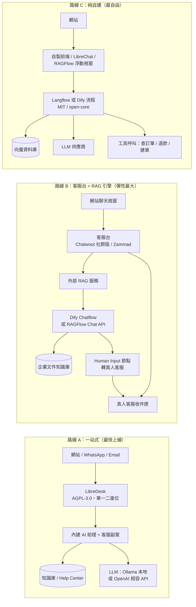

# LLM 驅動客服機器人（客服聊天機器人）的自由開源軟體方案調查

## 摘要

本報告調查 2025–2026 年間，可用於建構「以大語言模型（Large Language Model, LLM）驅動的客服機器人／支援聊天機器人」的自由暨開源軟體（Free and Open-Source Software, FOSS）方案。此類需求通常由兩種元件構成：一是「客服台／服務台（helpdesk）」前端，負責多渠道收件、工單、真人客服派工與知識庫；二是「LLM／檢索增強生成（Retrieval-Augmented Generation, RAG）」引擎，負責理解問題、檢索知識庫並生成回答。

調查將方案分為三類：

1. **全功能客服台（內建 AI）**：本身即為客服系統，並整合 LLM 助理。
2. **RAG／聊天機器人平台（可作為客服大腦）**：專注於 LLM 應用編排與知識庫問答，需自行接上客服前端或嵌入式聊天視窗。
3. **對話式 AI 框架（開發者工具）**：提供意圖辨識、對話管理、渠道串接等底層框架。

需特別注意：本領域的「開源」一詞常被寬鬆使用。許多專案採用 **open-core（開放核心）** 模式（如 Chatwoot、Dify），或採用 **非 OSI 認證的原始碼可得授權**（如 Typebot 的 FSL、n8n 的 Sustainable Use License）。本報告逐一標示每一方案是否為「純 FOSS」或有商業授權限制。

---

## 一、如何判斷一個方案是否「真的」開源

正因為本領域充斥行銷語言，以下為判斷準則：

| 判準 | 說明 |
|---|---|
| 授權條款 | MIT、Apache-2.0、AGPL-3.0 為 OSI 認證的標準開源授權；「Sustainable Use License」、「FSL」、「Business Source」、「Community License」等通常附帶商用或競業限制 |
| 目錄切割 | 若程式碼分為 `enterprise/` 或 `.ee.` 目錄，且該目錄另有商業授權，即為 open-core |
| 品牌條款 | 部分授權（如 Open WebUI）禁止移除品牌標識，除非使用者數低於門檻或另購企業授權 |
| 多租戶條款 | 部分授權（如 Dify、FastGPT）禁止在未經授權下以原始碼營運多租戶 SaaS |

---

## 二、全功能客服台（內建或可整合 AI）

### 2.1 LibreDesk

- **GitHub**：`abhinavxd/libredesk`，約 **3,117 顆星**（2026-11-04 檢視）[^libredesk-gh]
- **授權**：AGPL-3.0，**純 FOSS，無付費分級**[^libredesk-gh][^libredesk-readme]
- **部署**：以單一 Go 二進位檔發佈，另提供 Docker 與 Railway 一鍵部署[^libredesk-readme]
- **AI 能力**：內建 **AI 助理（AI assistant）**（依知識庫回答線上聊天問題、必要時轉真人）與 **客服副駕（agent copilot）**（草擬回覆、摘要對話、查找答案）[^libredesk-readme]
- **支援的模型供應商**：任何 OpenAI 相容端點，官方預設包含 OpenAI、Anthropic、OpenRouter、Groq、Together AI、Ollama（可自架本地模型）；分為「Completion」與「Embedding」兩類供應商，後者用於知識庫與標籤的向量化[^libredesk-docs-ai]
- **其他**：共用收件匣（email、線上聊天、WhatsApp）、說明中心、自動化規則、巨集、SLA、CSAT、REST API 與 Webhook、OIDC／SSO[^libredesk-readme]

**適合**：想要「一套裝到好、完全免費、可自架、支援本地模型」的中小型團隊。以星數而言社群規模仍小，但由 Zerodha Tech 相關開發者主導，近期發版活躍（最新為 v2.9.2，2026-10-31）[^libredesk-release]。

### 2.2 Bytedesk（微語）

- **GitHub**：`Bytedesk/bytedesk`，約 **530 顆星**（2026-11-04 檢視）[^bytedesk-gh]
- **授權**：GitHub 授權偵測顯示為 **AGPL-3.0**，且倉庫內 `LICENSE` 檔案內容為 AGPL-3.0 全文[^bytedesk-gh][^bytedesk-license]
- **授權疑義（批判性觀察）**：該倉庫 README 檔頭的註解仍警告使用者注意「Business Source License 1.1 (BSL)」限制，明文禁止「販售、轉售或以服務形式代管 Bytedesk IM」，並指向同一份 `LICENSE` 連結[^bytedesk-readme]。此處存在**文件與實際授權檔不一致**的情形：檔頭註解所稱之 BSL 與實際 `LICENSE` 內的 AGPL-3.0 條款互相矛盾。由於 BSL 並非開源授權，建議商業使用前直接向專案方確認適用條款。
- **AI 能力**：原生 **AI Agent** 模組，支援與 Ollama、DeepSeek、ZhipuAI 等模型對話、**RAG（與知識庫對話）**、Function Calling 與 **MCP**[^bytedesk-readme]
- **其他**：團隊 IM（Slack 替代）、工單與 SLA、知識庫（內部文件／HelpCenter／FAQ）、工作流引擎、FreeSWITCH 呼叫中心、WebRTC 視訊客服、多語言 SDK[^bytedesk-readme]
- **技術棧**：Java（Spring Boot）Maven 多模組 monorepo；企業級功能置於 `enterprise/` 目錄下，但仍隨主倉庫發佈[^bytedesk-readme]

**適合**：需要「IM＋客服＋工單＋AI」一體化的大型組織。但社群規模小、系統龐大、授權狀態須釐清，導入前應審慎評估。

### 2.3 Chatwoot

- **GitHub**：`chatwoot/chatwoot`，約 **38,843 顆星**（2026-11-04 檢視）[^chatwoot-gh]
- **授權**：MIT（核心）＋ `enterprise/` 目錄採獨立商業授權，即 **open-core**[^chatwoot-license]
- **AI 能力**：**Captain AI**，包含「AI 助理（Agent）」與「客服副駕（Copilot）」，另提供 Memories、回覆建議、摘要、內容缺口分析、監控、分流、Scenarios 等功能[^chatwoot-pricing]
- **關鍵限制**：**Captain AI 不包含在免費的自架社群版（Community Edition）中**。自架版欲使用 Captain AI 需升級至 **Premium Support（US$19／客服／月）** 或 **Enterprise（US$99／客服／月）**；雲端版則自 Startups 方案（US$19／客服／月）起提供，並有每月 credits 額度，超出後每 1,000 credits 收 US$20[^chatwoot-pricing]
- **其他**：全渠道收件匣（線上聊天、email、WhatsApp、社群等）、說明中心、自動化規則、SLA、報表、Slack／Shopify／Linear 整合[^chatwoot-gh]

**適合**：重視成熟度與社群規模，且可接受為 AI 功能付費的團隊。若堅持零成本，則需以 API 自行串接外部 LLM。

### 2.4 FreeScout

- **GitHub**：`freescout-help-desk/freescout`，約 **4,636 顆星**（2026-11-04 檢視）[^freescout-gh]
- **授權**：AGPL-3.0[^freescout-gh]
- **定位**：自助架設的全渠道「AI 驅動服務台」與共用信箱，以 PHP（Laravel）撰寫，為 Help Scout 的開源替代品[^freescout-gh]
- **技術棧**：PHP／Laravel，模組化外掛架構

**適合**：PHP 生態、需共用信箱與工單的團隊。AI 功能於專案描述中提及，但官方文件中對其 AI 能力與授權細節揭露有限，導入前宜進一步查證。

### 2.5 Zammad

- **GitHub**：`zammad/zammad`，約 **6,076 顆星**（2026-11-04 檢視）[^zammad-gh]
- **授權**：AGPL-3.0（軟體本身為開源）[^zammad-gh]
- **AI 能力**：Zammad 具備 AI 功能（如產生工單摘要），但**屬於付費加購**：僅在 Professional 與 Plus 的**代管方案**中提供，且按每次 AI 呼叫加收 **€0.03**[^zammad-pricing]
- **自架授權方案**：Business（€2,999／年）、Enterprise（€5,999／年）、Corporation（€9,999／年），性質為支援與訂閱服務，**並未列出包含 AI 功能**[^zammad-pricing]
- **其他**：完整工單系統（email、聊天、電話、社群）、知識庫、SLA 管理、升級規則、報表、REST API[^zammad-gh]

**適合**：企業級、成熟穩定的工單需求；但若重點在 LLM 客服機器人，Zammad 本身需自行整合外部 LLM。

### 2.6 Tiledesk

- **GitHub**：`Tiledesk/tiledesk`，約 **326 顆星**（2026-11-04 檢視）[^tiledesk-gh]
- **授權**：MIT（社群版），但**企業版需向官方索取憑證才能拉取私有 Docker 映像檔，屬 open-core**[^tiledesk-gh][^tiledesk-readme]
- **AI 能力**：原生支援 LLM 的聊天機器人引擎，提供視覺化 **Design Studio** 流程編輯器，可在 LLM 無法解決時轉接真人[^tiledesk-gh]
- **渠道**：Web、Android、iOS、WhatsApp、Facebook Messenger、Telegram[^tiledesk-gh]
- **部署**：Docker Compose 與 Kubernetes（Helm）[^tiledesk-readme]

**適合**：需要視覺化對話設計、並可接受企業功能需付費的團隊。社群規模偏小。

---

## 三、RAG／聊天機器人平台（作為客服大腦）

此類平台本身不是客服台，而是提供「知識庫問答＋工作流編排＋可嵌入聊天視窗」，可與上述客服台或自家網站整合。

### 3.1 Dify

- **GitHub**：`langgenius/dify`，約 **160,386 顆星**（2026-11-04 檢視）[^dify-gh]
- **授權**：**Dify Open Source License**（以 Apache-2.0 為基礎，附加條件），屬 **open-core**：可商用，但未經書面授權**不得以原始碼營運多租戶環境**，且不得移除前端 LOGO 與版權資訊[^dify-license]
- **客服相關能力**：
  - **Chatflow** 應用類型：具對話層的 Agentic 工作流，適合互動式助理與引導式問答[^dify-docs-embedding]
  - **嵌入網站**：提供 **Chat Bubble Widget**（浮動按鈕）、iframe、JavaScript 控制三種方式，官方明確建議客服情境使用聊天氣泡[^dify-docs-embedding]
  - **Human Input 節點**：可暫停工作流、交付表單給真人處理，支援 Web 應用與 email 兩種交付方式，可用 API 驅動，屬「人在迴路（human-in-the-loop）」機制[^dify-docs-human-input]
  - **Agent 節點與工具呼叫**：支援 Function Calling 與 ReAct 兩種策略，新版 Agent 節點可作為工作流中的一步，並以輸出路由決定分支（例如「回覆」或「升級」）[^dify-docs-agent]
- **API**：發佈的應用即為 REST API，具備傳送訊息、停止生成、建議問題、對話管理、檔案上傳、語音轉寫／合成、Human Input 等端點[^dify-api]

**適合**：想要視覺化流程、內建嵌入聊天視窗與人工介入節點的團隊。生態最大、更新最活躍。

### 3.2 RAGFlow

- **GitHub**：`infiniflow/ragflow`，約 **93,483 顆星**（2026-11-04 檢視）[^ragflow-gh]
- **授權**：**Apache-2.0**（核心引擎）[^ragflow-gh]
- **客服相關能力**：
  - 內建**可嵌入的浮動聊天視窗**（Intercom 風格），支援 `full`、`button`、`window`、`master` 四種模式，並可透過 URL 參數自訂標題、副標題、頁尾與配色[^ragflow-widget]
  - 深度文件理解（PDF、掃描件、Word、PPT、Excel、圖片、網頁）與 Agentic Retrieval[^ragflow-gh]
- **API**：`POST /api/v1/chat/completions` 為主要問答端點，另提供 OpenAI 相容端點 `POST /api/v1/openai/{chat_id}/chat/completions`、Chat Assistant 管理（`/api/v1/chats`）與 session 管理，串流模式下會回傳引用（reference）文件區塊[^ragflow-api]

**適合**：文件量龐大、需要高保真檢索與引用溯源的公司。需自行接上客服台或以其浮動視窗作為客服入口。

### 3.3 FastGPT

- **GitHub**：`labring/FastGPT`，約 **29,990 顆星**（2026-11-04 檢視）[^fastgpt-gh]
- **授權**：**FastGPT Open Source License**（Apache-2.0 為基礎，附加條件）：允許商用，但未經授權不得營運多租戶 SaaS 服務，且不得移除 LOGO 與版權資訊[^fastgpt-license]
- **能力**：視覺化 AI 工作流、RAG 檢索與知識庫管理、混合檢索與重排序、Agent 技能與外掛（含 MCP）、可嵌入的聊天視窗與分享連結[^fastgpt-gh]

**適合**：以知識庫問答為核心、偏中文生態（Next.js）的團隊。授權為客製條款，非標準 OSI 授權。

### 3.4 Langflow

- **GitHub**：`langflow-ai/langflow`，約 **156,318 顆星**（2026-11-04 檢視）[^langflow-gh]
- **授權**：**MIT**[^langflow-gh]
- **能力**：視覺化拖放式 AI 工作流與多代理編排、內建 API 與 MCP 伺服器（可將任一流程變成工具）、可觀測性整合[^langflow-gh]

**適合**：開發者想以 MIT 授權自由打造客製客服流程。本身不含客服台功能。

### 3.5 Flowise（已封存，不建議新專案採用）

- **GitHub**：`FlowiseAI/Flowise`，約 **55,545 顆星**，**已於 2026 年 8 月封存（archived），倉庫轉為唯讀**[^flowise-gh][^flowise-readme]
- **授權**：Apache-2.0（`packages/server/src/enterprise` 目錄另有商業授權）[^flowise-license]
- **結論**：曾廣泛使用，但已停止開發，官方建議改用替代方案[^flowise-gh]。新專案應避免採用。

### 3.6 Coze Studio

- **GitHub**：`coze-dev/coze-studio`，約 **21,806 顆星**（2026-11-04 檢視）[^coze-gh]
- **授權**：**Apache-2.0**[^coze-gh][^coze-readme]
- **能力**：一站式視覺化 AI Agent 開發（prompt、RAG、外掛、工作流）、模型管理、API 與 Chat SDK[^coze-readme]
- **官方明示差異**：部分功能（如語氣客製）屬商業版專屬；官方另警告若部署於公網需評估安全風險（帳號註冊、程式碼執行環境、SSRF、權限提升等）[^coze-readme]

**適合**：想以 Apache-2.0 自由打造視覺化 Agent 的團隊。需注意公網部署安全。

### 3.7 AnythingLLM

- **GitHub**：`Mintplex-Labs/anything-llm`，約 **67,919 顆星**（2026-11-04 檢視）[^anythingllm-gh]
- **授權**：**MIT**[^anythingllm-gh]
- **能力**：本地優先（local-first）LLM 應用，內建 RAG、AI Agent、MCP、無程式碼流程編輯器、多使用者權限；**可嵌入網站的聊天視窗（需 Docker 版）**；支援多種向量資料庫[^anythingllm-gh]

**適合**：重視「資料不出本地」與可嵌入客服視窗的團隊。

### 3.8 Open WebUI

- **GitHub**：`open-webui/open-webui`，約 **157,730 顆星**（2026-11-04 檢視）[^openwebui-gh]
- **授權**：**Open WebUI License**（BSD 系為基礎，附加條件）：**禁止移除或替換「Open WebUI」品牌標識**，除非 30 日滾動期內終端使用者不超過 50 人、或取得書面／企業授權[^openwebui-license]
- **能力**：支援 Ollama 與 OpenAI 相容 API 的使用者介面、內建 RAG、MCP、多使用者權限[^openwebui-gh]

**適合**：內部知識助理。若作為對外客服並想自訂品牌，須注意品牌條款。

### 3.9 LibreChat

- **GitHub**：`LibreChat-AI/LibreChat`，約 **46,720 顆星**（2026-11-04 檢視）[^librechat-gh]
- **授權**：**MIT**[^librechat-gh]
- **能力**：類 ChatGPT 介面，支援 Agents、MCP、多模型供應商（OpenAI、Anthropic、Gemini、AWS 等）、Code Interpreter、多使用者認證、Presets[^librechat-gh]

**適合**：想以 MIT 授權自架、自由改造為客服介面的團隊。

### 3.10 其他可參考平台

| 專案 | 星數（2026-11-04） | 授權 | 備註 |
|---|---|---|---|
| DocsGPT（`arc53/DocsGPT`） | 18,353 | MIT | 私有 AI 平台，內建 Agent Builder、文件分析、企業搜尋[^docsgpt-gh] |
| Langchain-Chatchat（`chatchat-space/Langchain-Chatchat`） | 38,714 | Apache-2.0 | 本地知識庫 LLM 的 RAG 與 Agent 應用，偏中文生態[^langchain-chatchat-gh] |
| Onyx（`onyx-dot-app/onyx`） | 33,201 | MIT＋`ee/` 目錄商業授權 | 開源 AI 平台，主打企業搜尋與 RAG 聊天[^onyx-gh][^onyx-license] |
| Verba（`weaviate/Verba`） | 7,694 | BSD-3-Clause | 由 Weaviate 驅動的 RAG 聊天機器人，**已封存**[^verba-gh] |
| LobeHub／LobeChat（`lobehub/lobehub`） | 83,833 | LobeHub Community License（Apache-2.0 附加條件） | 若要以 LobeChat 開發並散布衍生作品需取得商業授權[^lobehub-gh][^lobehub-license] |

---

## 四、對話式 AI 框架（開發者工具）

### 4.1 Rasa

- **GitHub**：`RasaHQ/rasa`，約 **21,369 顆星**（2026-11-04 檢視）[^rasa-gh]
- **授權**：Apache-2.0[^rasa-gh]
- **重要狀態**：**Rasa Open Source 已進入維護模式（maintenance mode）**。官方明言 Rasa 建構 AI Agent 的未來方向為 **Hello Rasa** 與 **CALM**（Conversational AI with Language Models）引擎，改以 LLM 處理對話理解、以程式碼強制業務規則，不再需要訓練 NLU intents[^rasa-readme]

**建議**：新專案不應再以傳統 Rasa OSS 為主軸；若偏好 Rasa 生態，應評估 CALM／Hello Rasa（注意其雲端與商業化傾向）。

### 4.2 Botpress

- **GitHub**：`botpress/botpress`，約 **14,977 顆星**，授權 **MIT**[^botpress-gh]
- **重要狀態**：此倉庫現為 **Botpress Cloud 的 SDK／CLI／整合**，並非傳統可自架的 v12。自架版位於獨立倉庫 `botpress/v12`（AGPLv3 與專有授權雙軌），但自 2025 年 4 月起幾近停止更新，官方重心已全面轉向雲端產品[^botpress-gh]

**建議**：若需自架，Botpress 已非理想選項。

### 4.3 Typebot

- **GitHub**：`baptisteArno/typebot.io`，約 **10,605 顆星**（2026-11-04 檢視）[^typebot-gh]
- **授權**：**Functional Source License 1.1（FSL-1.1-Apache-2.0）**，**並非 OSI 認證之開源授權**：允許內部使用、非商業教育與研究，但禁止「競爭性使用（Competing Use）」，即不得將其作為商業產品或服務提供；授權會在軟體釋出滿兩年後自動轉為 Apache-2.0[^typebot-license]
- **能力**：視覺化聊天機器人編輯器、34+ 積木、內建 OpenAI 整合、條件分支、腳本、A/B 測試、可嵌入（容器／彈出／聊天氣泡）、分析與 Stripe 付款[^typebot-gh]

**注意**：以「開源」稱之需保留，因其為「原始碼可得（source-available）」而非 FOSS。

### 4.4 n8n

- **GitHub**：`n8n-io/n8n`，約 **209,530 顆星**（2026-11-04 檢視）[^n8n-gh]
- **授權**：**Sustainable Use License**（fair-code，非 OSI 認證）：僅允許為**自身內部業務目的**或非商業／個人用途使用；免費散布僅限非商業目的；`.ee.` 檔案與 `LICENSE_EE.md` 另需企業授權[^n8n-license]
- **能力**：視覺化工作流自動化，內建 AI 能力、MCP client／server、400+ 整合[^n8n-gh]

**適合**：以工作流串接 LLM 與客服系統的內部自動化。若你打算代管給外部客戶使用，須檢視授權限制。

### 4.5 Chainlit（已封存）

- **GitHub**：`Chainlit/chainlit`，約 **12,506 顆星**，授權 **Apache-2.0**，**已封存**[^chainlit-gh]
- **備註**：曾廣泛用於快速建立對話式 AI 介面，現已停止維護。

---

## 五、方案對照總表

以下星數皆為 2026-11-04 檢視值。

| 方案 | 類別 | 星數 | 授權 | 是否純 FOSS | 內建 LLM／RAG | 適合客服機器人的關鍵點 |
|---|---|---|---|---|---|---|
| **LibreDesk** | 客服台 | 3,117 | AGPL-3.0 | 是 | 是（助理＋副駕） | 免費、單一二進位、AI 含在內、支援 Ollama |
| **Bytedesk** | 客服台 | 530 | AGPL-3.0（README 另有 BSL 註記） | 待釐清 | 是（RAG＋MCP） | 功能最全，但授權矛盾、社群小 |
| **Chatwoot** | 客服台 | 38,843 | MIT＋`enterprise/` | 否（open-core） | 是（Captain，**需付費**） | 生態最大，但 AI 不含在免費自架版 |
| **FreeScout** | 客服台 | 4,636 | AGPL-3.0 | 是 | 有限 | PHP 生態、共用信箱 |
| **Zammad** | 客服台 | 6,076 | AGPL-3.0 | 是（軟體） | 是（**付費加購 €0.03／次**） | 企業級工單，AI 須加購 |
| **Tiledesk** | 客服台 | 326 | MIT | 否（open-core） | 是（Design Studio） | 視覺化對話設計，社群小 |
| **Dify** | RAG 平台 | 160,386 | Dify OSL | 否（open-core） | 是 | Chatflow＋氣泡嵌入＋Human Input 節點＋API |
| **RAGFlow** | RAG 引擎 | 93,483 | Apache-2.0 | 是 | 是（核心） | 深度文件理解＋浮動聊天視窗＋Chat API |
| **FastGPT** | RAG 平台 | 29,990 | FastGPT OSL | 否（客製） | 是 | 知識庫問答＋工作流＋可嵌入 |
| **Langflow** | 流程編排 | 156,318 | MIT | 是 | 是 | 純 MIT，適合客製流程 |
| **Flowise** | 流程編排 | 55,545 | Apache-2.0 | 是 | 是 | **已封存，勿用於新專案** |
| **Coze Studio** | Agent 平台 | 21,806 | Apache-2.0 | 是 | 是 | 視覺化 Agent，注意公網安全 |
| **AnythingLLM** | 本地 AI | 67,919 | MIT | 是 | 是 | 可嵌入聊天視窗（Docker 版）、本地優先 |
| **Open WebUI** | LLM 介面 | 157,730 | Open WebUI License | 否（品牌條款） | 是 | 品牌不可移除，除非 ≤50 使用者 |
| **LibreChat** | LLM 介面 | 46,720 | MIT | 是 | 是 | MIT、多模型、可自由改造 |
| **DocsGPT** | RAG 平台 | 18,353 | MIT | 是 | 是 | Agent Builder、文件分析 |
| **Langchain-Chatchat** | RAG 平台 | 38,714 | Apache-2.0 | 是 | 是 | 本地知識庫、中文生態 |
| **Onyx** | 企業搜尋 | 33,201 | MIT＋`ee/` | 否（open-core） | 是 | 企業搜尋＋RAG 聊天 |
| **Verba** | RAG 聊天 | 7,694 | BSD-3-Clause | 是 | 是 | **已封存** |
| **LobeHub** | LLM 介面 | 83,833 | LobeHub Community License | 否（商用限制） | 是 | 衍生作品須商業授權 |
| **Rasa** | 對話框架 | 21,369 | Apache-2.0 | 是 | 否（CALM 為新方向） | **維護模式** |
| **Botpress** | 對話框架 | 14,977 | MIT | 是（但為雲端 SDK） | 是 | 自架 v12 幾近停更 |
| **Typebot** | 聊天建置 | 10,605 | FSL-1.1 | **否** | 部分（OpenAI） | 禁止競爭性商業使用 |
| **n8n** | 工作流 | 209,530 | Sustainable Use License | **否** | 是 | 僅限內部業務或非商業用途 |
| **Chainlit** | 對話介面 | 12,506 | Apache-2.0 | 是 | 是 | **已封存** |

---

## 六、建議的組合架構

若要自行組裝一套完全免費、可自架、且可選擇本地模型的 LLM 客服機器人，以下為三種典型路線。

### 路線 A：一站式（最省力、零授權費）

採用 **LibreDesk**。理由：AGPL-3.0 純 FOSS、官方明言所有功能免費且無付費分級、AI 助理與副駕直接內建、支援 Ollama 等本地模型、單一 Go 二進位檔部署極簡[^libredesk-readme][^libredesk-docs-ai]。主要風險是社群規模小（約 3.1k 星），長期維護須評估。

### 路線 B：客服台＋RAG 引擎（彈性最大）

以 **Chatwoot 社群版**（免費、生態最大）或 **Zammad**（企業級工單）作為客服台，另以 **Dify** 或 **RAGFlow** 作為 LLM 大腦，透過 API 串接。此路線可獲得成熟的工單／派工／SLA，同時保有 LLM 流程的完全掌控。缺點是需要自行整合。若採 Dify 的 Human Input 節點，可實作結構化的人工介入[^dify-docs-human-input]。

### 路線 C：純自建（最自由）

以 **Langflow**（MIT）或 **Dify** 設計流程、**RAGFlow**（Apache-2.0）作為檢索與浮動聊天視窗、串接向量資料庫與工具呼叫（查訂單、退款、建單）。此路線的每一個元件授權都較寬鬆（注意 Dify 的多租戶限制），適合有工程能力、想完全掌控的團隊。

---

## 七、重要提醒與風險

1. **「開源」的定義陷阱**：本領域至少有 4 個專案（Typebot、n8n、LobeHub、Open WebUI）使用非 OSI 認證的授權，其中 Typebot 與 n8n 明確禁止特定商業用途[^typebot-license][^n8n-license][^lobehub-license][^openwebui-license]。若你打算「代管給客戶使用（hosting as a service）」或「轉售」，導入前務必逐條檢視授權。
2. **AI 功能常被放在付費牆後**：社群規模最大的兩個客服台（Chatwoot 38.8k、Zammad 6.1k）之 AI 功能皆需付費[^chatwoot-pricing][^zammad-pricing]。真正「免費且內建 AI」的客服台選項相對小眾（以 LibreDesk 最明確）。
3. **已封存專案須排除**：Flowise（2026-08 封存）、Verba、Chainlit、以及實質停更的 Botpress v12 與進入維護模式的 Rasa Open Source，皆不建議用於新專案[^flowise-gh][^verba-gh][^chainlit-gh][^rasa-readme][^botpress-gh]。
4. **授權文件可能自相矛盾**：Bytedesk 的 README 檔頭註記 BSL 限制，但倉庫 `LICENSE` 為 AGPL-3.0，兩者衝突[^bytedesk-readme][^bytedesk-license]。任何商業用途前應直接向專案方書面確認。
5. **星數不等於適用性**：高星專案（如 n8n、Open WebUI、LobeHub）多為通用 LLM 工具，並非客服專用；反之低星專案（LibreDesk、Tiledesk、Bytedesk）反而是「客服＋AI」一體化的選項。
6. **資料主權與模型選擇**：若涉及客戶個資，應優先選擇支援本地模型（Ollama）的方案。本報告中 LibreDesk、Bytedesk、AnythingLLM、RAGFlow、Langchain-Chatchat 皆可搭配本地模型[^libredesk-docs-ai][^bytedesk-readme][^anythingllm-gh][^ragflow-gh][^langchain-chatchat-gh]。

---

## 八、批判性來源反思

- **GitHub 星數與授權欄位以 GitHub REST API 於 2026-11-04 查詢所得**，最能反映當下狀態；但 GitHub 的授權偵測欄位（`license.spdx_id = NOASSERTION` 或 `Other`）僅為自動判斷，仍須以倉庫內 `LICENSE` 檔案原文為準，本報告已對爭議案例（Bytedesk、Dify、FastGPT、n8n）直接查核授權全文。
- **CNCF 風格之廠商文件偏樂觀**：官方網站（如 Chatwoot、Zammad、Dify 的定價與功能頁）本質上為行銷素材，會強調自身優勢。本報告對「哪些功能需付費」特別以官方定價頁為準，以避免將行銷敘述誤認為免費功能。
- **第三方比較文章未採用**：本報告刻意不引用「十大最佳開源客服」之類的 SEO 內容農場文章，所有事實均追溯至 GitHub API、官方倉庫 README／LICENSE 原文，或官方文件與定價頁。
- **未發現具公信力的第三方效能評測**：本領域少有獨立的 LLM 客服機器人準確度或成本基準測試，因此本報告僅比較功能與授權，未對「回答品質」下定論。
- **時效性風險**：本領域專案迭代極快（Flowise 於 2026 年 8 月封存即為明證），且授權條款可能隨時變更。本報告所有數據標示為 2026-11-04 檢視，實際導入前應重新查核。

---

[^libredesk-gh]: abhinavxd. (n.d.). *libredesk* [Source code]. GitHub. Retrieved 2026-11-04, from https://github.com/abhinavxd/libredesk

[^libredesk-readme]: abhinavxd. (n.d.). *libredesk README* [Source code documentation]. GitHub. Retrieved 2026-11-04, from https://github.com/abhinavxd/libredesk/blob/main/README.md

[^libredesk-roadmap]: abhinavxd. (n.d.). *libredesk ROADMAP* [Source code documentation]. GitHub. Retrieved 2026-11-04, from https://github.com/abhinavxd/libredesk/blob/main/ROADMAP.md

[^libredesk-docs-ai]: LibreDesk. (n.d.). *AI configuration*. LibreDesk Documentation. Retrieved 2026-11-04, from https://docs.libredesk.io/configuration/ai

[^libredesk-release]: abhinavxd. (2026, October 31). *libredesk v2.9.2* [Software release]. GitHub. Retrieved 2026-11-04, from https://github.com/abhinavxd/libredesk/releases/tag/v2.9.2

[^bytedesk-gh]: Bytedesk. (n.d.). *bytedesk* [Source code]. GitHub. Retrieved 2026-11-04, from https://github.com/Bytedesk/bytedesk

[^bytedesk-readme]: Bytedesk. (n.d.). *Bytedesk - Chat as a Service* [Source code documentation]. GitHub. Retrieved 2026-11-04, from https://github.com/Bytedesk/bytedesk/blob/main/README.md

[^bytedesk-license]: Bytedesk. (n.d.). *GNU Affero General Public License v3.0* [License file]. GitHub. Retrieved 2026-11-04, from https://github.com/Bytedesk/bytedesk/blob/main/LICENSE

[^chatwoot-gh]: Chatwoot. (n.d.). *chatwoot* [Source code]. GitHub. Retrieved 2026-11-04, from https://github.com/chatwoot/chatwoot

[^chatwoot-license]: Chatwoot Inc. (n.d.). *LICENSE* [License file]. GitHub. Retrieved 2026-11-04, from https://github.com/chatwoot/chatwoot/blob/develop/LICENSE

[^chatwoot-pricing]: Chatwoot. (n.d.). *Pricing*. Retrieved 2026-11-04, from https://www.chatwoot.com/pricing

[^freescout-gh]: freescout-help-desk. (n.d.). *FreeScout* [Source code]. GitHub. Retrieved 2026-11-04, from https://github.com/freescout-help-desk/freescout

[^zammad-gh]: Zammad. (n.d.). *zammad* [Source code]. GitHub. Retrieved 2026-11-04, from https://github.com/zammad/zammad

[^zammad-pricing]: Zammad. (n.d.). *Pricing*. Retrieved 2026-11-04, from https://zammad.com/en/pricing

[^tiledesk-gh]: Tiledesk. (n.d.). *tiledesk* [Source code]. GitHub. Retrieved 2026-11-04, from https://github.com/Tiledesk/tiledesk

[^tiledesk-readme]: Tiledesk. (n.d.). *Tiledesk Introduction* [Source code documentation]. GitHub. Retrieved 2026-11-04, from https://github.com/Tiledesk/tiledesk/blob/master/README.md

[^dify-gh]: LangGenius. (n.d.). *dify* [Source code]. GitHub. Retrieved 2026-11-04, from https://github.com/langgenius/dify

[^dify-license]: LangGenius, Inc. (2025). *Dify Open Source License* [License file]. GitHub. Retrieved 2026-11-04, from https://github.com/langgenius/dify/blob/main/LICENSE

[^dify-docs-embedding]: Dify. (n.d.). *Embedding in websites*. Dify Documentation. Retrieved 2026-11-04, from https://docs.dify.ai/en/cloud/use-dify/publish/webapp/embedding-in-websites

[^dify-docs-human-input]: Dify. (n.d.). *Human Input node*. Dify Documentation. Retrieved 2026-11-04, from https://docs.dify.ai/en/cloud/use-dify/nodes/human-input

[^dify-docs-agent]: Dify. (n.d.). *Agent node*. Dify Documentation. Retrieved 2026-11-04, from https://docs.dify.ai/en/cloud/use-dify/nodes/agent

[^dify-api]: Dify. (n.d.). *Chatflow API*. Dify Documentation. Retrieved 2026-11-04, from https://docs.dify.ai/en/api-reference/guides/chatflow

[^ragflow-gh]: InfiniFlow. (n.d.). *ragflow* [Source code]. GitHub. Retrieved 2026-11-04, from https://github.com/infiniflow/ragflow

[^ragflow-api]: InfiniFlow. (n.d.). *HTTP API reference* [Source code documentation]. GitHub. Retrieved 2026-11-04, from https://github.com/infiniflow/ragflow/blob/main/docs/references/http_api_reference.md

[^ragflow-widget]: InfiniFlow. (n.d.). *Floating chat widget* [Source code]. GitHub. Retrieved 2026-11-04, from https://github.com/infiniflow/ragflow/blob/main/web/src/components/floating-chat-widget.tsx

[^fastgpt-gh]: Labring. (n.d.). *FastGPT* [Source code]. GitHub. Retrieved 2026-11-04, from https://github.com/labring/FastGPT

[^fastgpt-license]: Sealos. (2023). *FastGPT Open Source License* [License file]. GitHub. Retrieved 2026-11-04, from https://github.com/labring/FastGPT/blob/main/LICENSE

[^langflow-gh]: Langflow AI. (n.d.). *langflow* [Source code]. GitHub. Retrieved 2026-11-04, from https://github.com/langflow-ai/langflow

[^flowise-gh]: FlowiseAI. (n.d.). *Flowise* [Source code]. GitHub. Retrieved 2026-11-04, from https://github.com/FlowiseAI/Flowise

[^flowise-readme]: FlowiseAI. (n.d.). *Flowise README* [Source code documentation]. GitHub. Retrieved 2026-11-04, from https://github.com/FlowiseAI/Flowise/blob/main/README.md

[^flowise-license]: FlowiseAI, Inc. (n.d.). *LICENSE.md* [License file]. GitHub. Retrieved 2026-11-04, from https://github.com/FlowiseAI/Flowise/blob/main/LICENSE.md

[^coze-gh]: Coze Dev. (n.d.). *coze-studio* [Source code]. GitHub. Retrieved 2026-11-04, from https://github.com/coze-dev/coze-studio

[^coze-readme]: Coze Dev. (n.d.). *Coze Studio README* [Source code documentation]. GitHub. Retrieved 2026-11-04, from https://github.com/coze-dev/coze-studio/blob/main/README.md

[^anythingllm-gh]: Mintplex Labs. (n.d.). *anything-llm* [Source code]. GitHub. Retrieved 2026-11-04, from https://github.com/Mintplex-Labs/anything-llm

[^openwebui-gh]: Open WebUI. (n.d.). *open-webui* [Source code]. GitHub. Retrieved 2026-11-04, from https://github.com/open-webui/open-webui

[^openwebui-license]: Open WebUI Inc. (n.d.). *Open WebUI License* [License file]. GitHub. Retrieved 2026-11-04, from https://github.com/open-webui/open-webui/blob/main/LICENSE

[^librechat-gh]: LibreChat AI. (n.d.). *LibreChat* [Source code]. GitHub. Retrieved 2026-11-04, from https://github.com/LibreChat-AI/LibreChat

[^docsgpt-gh]: arc53. (n.d.). *DocsGPT* [Source code]. GitHub. Retrieved 2026-11-04, from https://github.com/arc53/DocsGPT

[^langchain-chatchat-gh]: chatchat-space. (n.d.). *Langchain-Chatchat* [Source code]. GitHub. Retrieved 2026-11-04, from https://github.com/chatchat-space/Langchain-Chatchat

[^onyx-gh]: Onyx. (n.d.). *onyx* [Source code]. GitHub. Retrieved 2026-11-04, from https://github.com/onyx-dot-app/onyx

[^onyx-license]: DanswerAI, Inc. (n.d.). *LICENSE* [License file]. GitHub. Retrieved 2026-11-04, from https://github.com/onyx-dot-app/onyx/blob/main/LICENSE

[^verba-gh]: Weaviate. (n.d.). *Verba* [Source code]. GitHub. Retrieved 2026-11-04, from https://github.com/weaviate/Verba

[^lobehub-gh]: LobeHub. (n.d.). *lobehub* [Source code]. GitHub. Retrieved 2026-11-04, from https://github.com/lobehub/lobehub

[^lobehub-license]: LobeHub LLC. (2024). *LobeHub Community License* [License file]. GitHub. Retrieved 2026-11-04, from https://github.com/lobehub/lobehub/blob/main/LICENSE

[^rasa-gh]: RasaHQ. (n.d.). *rasa* [Source code]. GitHub. Retrieved 2026-11-04, from https://github.com/RasaHQ/rasa

[^rasa-readme]: Rasa Technologies GmbH. (n.d.). *Rasa Open Source README* [Source code documentation]. GitHub. Retrieved 2026-11-04, from https://github.com/RasaHQ/rasa/blob/main/README.md

[^botpress-gh]: Botpress. (n.d.). *botpress* [Source code]. GitHub. Retrieved 2026-11-04, from https://github.com/botpress/botpress

[^typebot-gh]: baptisteArno. (n.d.). *typebot.io* [Source code]. GitHub. Retrieved 2026-11-04, from https://github.com/baptisteArno/typebot.io

[^typebot-license]: Typebot. (2024). *Functional Source License, Version 1.1, Apache 2.0 Future License* [License file]. GitHub. Retrieved 2026-11-04, from https://github.com/baptisteArno/typebot.io/blob/main/LICENSE

[^n8n-gh]: n8n GmbH. (n.d.). *n8n* [Source code]. GitHub. Retrieved 2026-11-04, from https://github.com/n8n-io/n8n

[^n8n-license]: n8n GmbH. (n.d.). *Sustainable Use License Version 1.0* [License file]. GitHub. Retrieved 2026-11-04, from https://github.com/n8n-io/n8n/blob/master/LICENSE.md

[^chainlit-gh]: Chainlit. (n.d.). *chainlit* [Source code]. GitHub. Retrieved 2026-11-04, from https://github.com/Chainlit/chainlit
