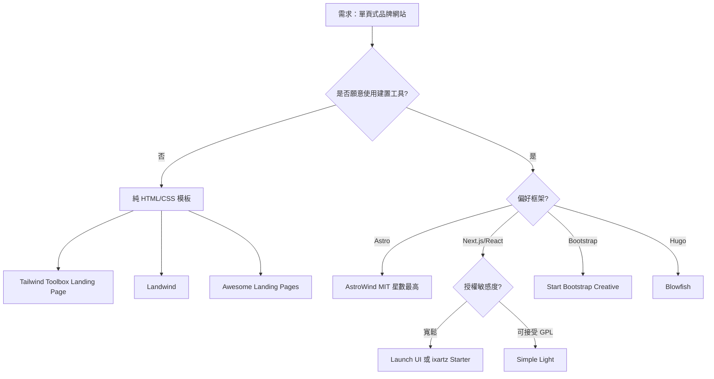

# FOSS 單頁式品牌網站模板研究

## 摘要

本報告調查可用於「單頁式品牌網站（single-page branding site）」的自由與開放原始碼軟體（Free and Open Source Software, FOSS）網站模板。所謂單頁式品牌網站，指以單一捲動頁面呈現品牌識別（logo、標語、核心賣點、行動呼籲）的網站，常見於個人品牌、產品著陸頁（landing page）與獨立開發者頁面。報告依技術棧分類，列出各模板的授權條款、GitHub 星數、維護狀態與適用情境，並提供選擇建議。所有星數資料擷取自 2026-11-04。

---

## 一、評估標準

選擇單頁式品牌網站模板時，應考量以下面向：

| 面向 | 說明 |
| --- | --- |
| 授權條款（License） | 是否允許商用、修改與再散布。MIT 最寬鬆；GPL 要求衍生作品同樣開放原始碼；CC BY 3.0 僅要求標註出處 |
| 技術棧 | 純 HTML/CSS 無需建置工具；Astro、Next.js 等靜態網站產生器需 Node.js 環境 |
| 是否單頁 | 模板是否以單一頁面為核心，或需裁剪多頁結構 |
| 維護活躍度 | 最後推送時間、issue 數量、是否仍接受貢獻 |
| 社群規模 | GitHub 星數與 fork 數可作為採用廣度的代理指標 |
| 客製成本 | 是否內建設計系統（Tailwind、Bootstrap、Bulma）以利品牌色與字體替換 |

---

## 二、候選模板總覽

下表彙整本次調查的主要候選，依技術棧分組，星數截至 2026-11-04。

| 名稱 | 授權 | 星數 | 技術棧 | 單頁 | 儲存庫 |
| --- | --- | --- | --- | --- | --- |
| AstroWind | MIT | 6,117 | Astro v7 + Tailwind v4 | 是（含部落格子頁） | arthelokyo/astrowind |
| Simple Light | GPL-3.0 | 4,530 | Next.js + React + Tailwind | 是 | cruip/tailwind-landing-page-template |
| Pines UI | MIT | 3,416 | Tailwind + Alpine.js | 元件庫 | thedevdojo/pines |
| Blowfish | MIT | 2,928 | Hugo + Tailwind | 個人首頁 + 部落格 | nunocoracao/blowfish |
| Next.js Landing Page Starter | MIT | 2,140 | Next.js 14 + Tailwind 3 + TS | 是 | ixartz/Next-JS-Landing-Page-Starter-Template |
| Creative | MIT | 2,072 | Bootstrap 5 + Pug | 是 | StartBootstrap/startbootstrap-creative |
| Astroship | GPL-3.0 | 1,995 | Astro + Tailwind | 是（含部落格） | surjithctly/astroship |
| Clean Blog | MIT | 1,813 | Bootstrap 5 | 多頁（首頁可單頁） | StartBootstrap/startbootstrap-clean-blog |
| Landing Page | MIT | 1,672 | Bootstrap 5 + Pug | 是 | StartBootstrap/startbootstrap-landing-page |
| Tailwind Toolbox Landing Page | MIT | 1,451 | HTML + Tailwind（CDN） | 是 | tailwindtoolbox/Landing-Page |
| ScrewFast | MIT | 1,433 | Astro + Tailwind + Preline | 是（含部落格） | mearashadowfax/ScrewFast |
| Awesome Landing Pages | MIT | 1,065 | 純 HTML + Tailwind | 是（多款） | PaulleDemon/awesome-landing-pages |
| Landwind | MIT | 1,021 | Tailwind + Flowbite | 是 | themesberg/landwind |
| Launch UI | MIT | 872 | Next.js + shadcn/ui + Tailwind | 是 | launch-ui/launch-ui |
| Astro Landing Page | MIT | 680 | Astro + Tailwind | 是 | mhyfritz/astro-landing-page |

---

## 三、各技術棧詳細分析

### 3.1 純 HTML / CSS（零建置工具）

此類模板只需一個 `index.html` 與少量 CSS/JS，適合不想引入 Node.js 建置流程的使用者，可直接丟到任何靜態主機或 GitHub Pages。

- **Tailwind Toolbox Landing Page**：單一 `index.html` 檔，透過 CDN 載入 Tailwind CSS，無需編譯步驟。作者為 Tailwind Toolbox，採 MIT 授權，星數 1,451。[^ttb]
- **Landwind**：由 Flowbite 團隊（themesberg）製作，以 HTML 與 Tailwind 撰寫，附完整區塊（導覽、英雄區、功能、見證、價格、頁尾），MIT 授權，星數 1,021。[^landwind]
- **Awesome Landing Pages**：一個集合型儲存庫，內含二十餘款獨立單頁模板，涵蓋 SaaS、應用程式、餐廳、律師、房地產、作品集等情境。以純 HTML 加上 Tailwind 撰寫，MIT 授權，星數 1,065。[^alp]

此類模板的優點是可直接編輯文字與色碼，缺點是缺乏元件化結構，長期維護需自行管理樣式重複。

### 3.2 Bootstrap 系

Bootstrap 提供成熟且文件完整的格線與元件系統，適合偏好傳統前端堆疊者。

- **Creative**：Start Bootstrap 出品的單頁 HTML 主題，主打創意工作者（設計師、攝影師、自由工作者）的品牌展示，內含全螢幕英雄區、作品格狀區、聯絡表單。原以 Bootstrap 4 撰寫，採 Pug 預處理，MIT 授權，星數 2,072。[^sbcre]
- **Landing Page**：Start Bootstrap 的通用著陸頁模板，導覽列、英雄區、功能三欄、行動呼籲橫幅、頁尾一應俱全，MIT 授權，星數 1,672。[^sblp]
- **Clean Blog**：以部落格為主的多頁主題，但其首頁可作為單頁品牌首頁，MIT 授權，星數 1,813。[^sbblog]

Start Bootstrap 系列皆為 MIT 授權，商用無虞，是風險最低的選擇。[^sbhome]

### 3.3 Tailwind 系（現代工具鏈）

- **Simple Light**：由 Cruip 製作的免費著陸頁模板，以 React 與 Next.js 完整實作，使用 Tailwind CSS。GitHub 上未標示標準授權欄位，其說明文件標明為 GPL-3.0，星數 4,530。[^cruip] 需注意 GPL 條款對衍生作品的傳染性。
- **Launch UI**：以 React、shadcn/ui 與 Tailwind 打造的著陸頁元件套件，可複製貼上到既有專案。內建深色模式、功能網格、常見問題手風琴、數據統計、行動呼籲等區塊。MIT 授權，星數 872。[^launchui]
- **Pines UI**：雖為元件庫而非完整模板，但提供以 Tailwind 與 Alpine.js 製作的著陸頁元件，可直接組裝成單頁品牌網站。MIT 授權，星數 3,416。[^pines]

### 3.4 Astro 系（靜態網站產生器）

Astro 以「預設零 JavaScript」為號召，適合追求效能與 SEO 的品牌網站。

- **AstroWind**：目前星數最高的 Astro 品牌模板，內含英雄區、功能、價格、見證、部落格等完整區塊，並支援深色模式與 SEO 中繼資料。MIT 授權，星數 6,117。[^astrowind]
- **Astroship**：為新創公司與行銷網站設計的入門模板，內含著陸頁與部落格，採 Astro 與 Tailwind 建構。授權為 GPL-3.0，星數 1,995。[^astroship]
- **ScrewFast**：以 Astro、Tailwind 與 Preline UI 製作的完整行銷網站模板，含著陸頁、部落格、產品目錄與文件，並支援多語系與 GSAP 動畫。MIT 授權，星數 1,433。[^screwfast]
- **Astro Landing Page**：前身為 astro-moon-landing 的極簡範例模板，主打乾淨版面、深色模式與 CSS 變數主題化。MIT 授權，星數 680。[^astrolp]

### 3.5 Hugo / Jekyll 系

適合以 Markdown 撰寫內容、偏好傳統靜態網站產生器的工作流。

- **Blowfish**：Hugo 的個人網站與部落格主題，功能豐富且文件完整，內建首頁英雄區可作單頁品牌首頁。MIT 授權，星數 2,928。[^blowfish]

---

## 四、選擇建議

- **最省事且最寬鬆**：Tailwind Toolbox Landing Page 或 Landwind，兩者皆為 MIT 且為純 HTML，零建置。[^ttb][^landwind]
- **最現代且生態最大**：AstroWind，MIT 授權、星數逾六千，適合長期維護的品牌網站。[^astrowind]
- **React 生態**：Launch UI 可直接複製元件，或 ixartz 的 Next.js Landing Page Starter（MIT、星數 2,140）作為完整專案起點。[^launchui][^ixartz]
- **需注意授權**：Simple Light 與 Astroship 皆為 GPL-3.0，若品牌網站需閉源或再散布，須審慎評估。[^cruip][^astroship]

---

## 五、來源批判與反思

- 本次調查透過 GitHub REST API 直接讀取各儲存庫的 `license`、`stargazers_count`、`pushed_at` 與 `archived` 欄位，授權與星數屬第一手資料，可信度高，但星數為動態值，僅反映擷取時點。[^ghapi]
- 部分模板的 GitHub 授權欄位為空（例如 Simple Light），僅能依其說明文件推斷為 GPL-3.0，此點存在不確定性，採用前應直接檢視儲存庫的 LICENSE 檔案。[^cruip]
- HTML5 UP 系列雖為知名的單頁模板來源，但其授權為 Creative Commons Attribution 3.0，要求標註設計者（HTML5 UP / AJ），且官方並無正式 GitHub 儲存庫，故未列入主要推薦。[^html5up]
- Astro 與 Next.js 等框架版本迭代快速，模板可能綁定特定主版本，實際採用時需確認相依套件相容性。
- 本報告僅涵蓋 GitHub 上具一定社群規模者，小型或非 GitHub 專案可能遺漏，讀者若追求特定設計風格，建議另尋主題市集。

---

## 附註

[^ghapi]: GitHub. (n.d.). GitHub REST API. Retrieved 2026-11-04, from https://api.github.com

[^astrowind]: AstroWind. (n.d.). astrowind [Computer software]. GitHub. Retrieved 2026-11-04, from https://github.com/arthelokyo/astrowind

[^astroship]: Astroship. (n.d.). astroship [Computer software]. GitHub. Retrieved 2026-11-04, from https://github.com/surjithctly/astroship

[^cruip]: Cruip. (n.d.). tailwind-landing-page-template [Computer software]. GitHub. Retrieved 2026-11-04, from https://github.com/cruip/tailwind-landing-page-template

[^sbcre]: Start Bootstrap. (n.d.). startbootstrap-creative [Computer software]. GitHub. Retrieved 2026-11-04, from https://github.com/StartBootstrap/startbootstrap-creative

[^sblp]: Start Bootstrap. (n.d.). startbootstrap-landing-page [Computer software]. GitHub. Retrieved 2026-11-04, from https://github.com/StartBootstrap/startbootstrap-landing-page

[^sbblog]: Start Bootstrap. (n.d.). startbootstrap-clean-blog [Computer software]. GitHub. Retrieved 2026-11-04, from https://github.com/StartBootstrap/startbootstrap-clean-blog

[^sbhome]: Start Bootstrap. (n.d.). Free Bootstrap themes and templates. Retrieved 2026-11-04, from https://startbootstrap.com/

[^ttb]: Tailwind Toolbox. (n.d.). Landing-Page [Computer software]. GitHub. Retrieved 2026-11-04, from https://github.com/tailwindtoolbox/Landing-Page

[^landwind]: Themesberg. (n.d.). landwind [Computer software]. GitHub. Retrieved 2026-11-04, from https://github.com/themesberg/landwind

[^alp]: PaulleDemon. (n.d.). awesome-landing-pages [Computer software]. GitHub. Retrieved 2026-11-04, from https://github.com/PaulleDemon/awesome-landing-pages

[^launchui]: Launch UI. (n.d.). launch-ui [Computer software]. GitHub. Retrieved 2026-11-04, from https://github.com/launch-ui/launch-ui

[^pines]: DevDojo. (n.d.). pines [Computer software]. GitHub. Retrieved 2026-11-04, from https://github.com/thedevdojo/pines

[^screwfast]: mearashadowfax. (n.d.). ScrewFast [Computer software]. GitHub. Retrieved 2026-11-04, from https://github.com/mearashadowfax/ScrewFast

[^astrolp]: mhyfritz. (n.d.). astro-landing-page [Computer software]. GitHub. Retrieved 2026-11-04, from https://github.com/mhyfritz/astro-landing-page

[^blowfish]: Nuno Coração. (n.d.). blowfish [Computer software]. GitHub. Retrieved 2026-11-04, from https://github.com/nunocoracao/blowfish

[^ixartz]: ixartz. (n.d.). Next-JS-Landing-Page-Starter-Template [Computer software]. GitHub. Retrieved 2026-11-04, from https://github.com/ixartz/Next-JS-Landing-Page-Starter-Template

[^html5up]: HTML5 UP. (n.d.). The Creative Commons Attribution 3.0 License. Retrieved 2026-11-04, from https://html5up.net/license
