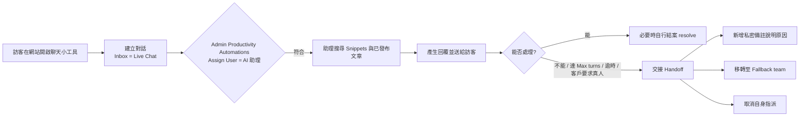

# 如何在 LibreDesk 的即時聊天 (Live Chat) 中啟用 AI 助理

本報告說明如何在開源自架客服系統 LibreDesk 中，讓 AI 助理 (AI Assistant) 自動接手並回覆網站即時聊天的訊息。內容涵蓋系統定位與現況、啟用前的必要條件、完整設定步驟、路由機制、交接 (handoff) 行為、成本與限制，以及安全注意事項。

## 1. LibreDesk 是什麼

LibreDesk 是一套開源、可自架的客服系統，支援電子郵件、即時聊天與 WhatsApp 三種管道，並以單一執行檔 (single binary) 形式散布[^readme]。其後端以 Go 撰寫，前端使用 Vue.js 3 與 Shadcn UI[^readme]。專案採 GNU Affero General Public License v3.0 (AGPL-3.0) 授權[^ghapi]。截至 2026-11-02，GitHub 上約有 3,118 顆星、328 個 fork，程式庫建立於 2024-05-12，最近一次推送為 2026-11-03[^ghapi]。

功能上分為四大類[^intro]：

| 類別 | 主要功能 |
| --- | --- |
| 收件匣與管道 | 共享收件匣、即時聊天、WhatsApp、團隊/標籤/自訂狀態 |
| 說明中心與 AI | 多語知識庫、AI 助理、代理人 copilot |
| 流程與報表 | 自動化規則、巨集 (macros)、自動指派、SLA、CSAT 與分析 |
| 管理與整合 | 角色權限、SSO、活動紀錄、API 與 webhook |

需要特別注意的是：**AI 功能目前仍是 beta**[^ai]。官方文件明確警告，助理的回覆會實際送給客戶，因此應先在低流量收件匣測試[^ai]。

## 2. 兩種不同的「AI」

LibreDesk 的 AI 分為兩層，彼此設定位置相同 (Admin → AI)，但用途不同[^ai]：

- **給代理人的輔助工具**：copilot (側邊欄面板，名為 Juno)、草擬回覆 (Generate reply)、對話摘要、標籤建議、編輯器提示 (editor prompts)。這些只需要 completion provider，且不論是否使用 AI 助理都能運作[^ai]。
- **AI 助理 (AI Assistants)**：以獨立角色直接回覆客戶，會搜尋知識庫、呼叫你的 API，無法處理時把對話交還給真人[^ai]。

本報告聚焦第二種，也就是讓 AI 回應即時聊天的部分。README 對其描述為：「AI assistant: Answer live chat questions using your knowledge base and hand conversations to an agent when needed」[^readme]。

## 3. 啟用前的必要條件

1. **執行中的 LibreDesk 實例**。可用 Railway 一鍵部署、Docker Compose，或下載 binary 自行安裝；安裝後以 `System` 帳號登入管理介面[^readme]。
2. **一個即時聊天收件匣 (Live Chat inbox)**。於 Admin → Inboxes → New inbox → Live Chat 建立，填入名稱、品牌名稱與網站 URL[^livechat]。
3. **已嵌入網站的聊天小工具**。在該收件匣的 Setup 分頁 → Installation 複製 `<script>` 片段，貼到每個需要顯示小工具的頁面的 `</body>` 之前[^livechat]：

```html
<script>
  window.LibredeskSettings = {
    baseURL: 'https://support.example.com',
    inboxID: 'YOUR_INBOX_UUID'
  };
</script>
<script async src="https://support.example.com/widget.js"></script>
```

其中 `baseURL` 是 LibreDesk 實例網址，`inboxID` 是收件匣 UUID (片段中已自動填入)[^livechat]。

4. **一組 OpenAI 相容的模型供應商憑證**。LibreDesk 可對接任何 OpenAI 相容端點，內建 OpenAI、Anthropic、OpenRouter、Groq、Together AI、Ollama 的預設值[^ai]。

## 4. 設定步驟

以下流程以官方「AI」與「Live Chat」文件為依據[^ai][^livechat]。

### 步驟 1：設定供應商 (Providers)

進入 **Admin → AI → Providers**。需要設定兩種 provider[^ai]：

| Provider | 用途 |
| --- | --- |
| Completion | 草擬回覆、copilot、摘要、標籤建議、編輯器提示、助理回覆 |
| Embedding | 把 snippets、說明中心文章與標籤轉為向量以供搜尋 |

- Completion：挑選預設供應商、貼上 API key 並儲存。可設定 Model、Base URL、Temperature (0–2)、Max tokens、Reasoning effort (`none`/`low`/`medium`/`high`)、Custom instructions，以及「Model supports image input」(預設關閉)[^ai]。
- Embedding：**Dimensions 必須與模型輸出維度一致**，例如 `text-embedding-3-small` 為 1536、`text-embedding-3-large` 為 3072、`nomic-embed-text` 為 768[^ai]。
- 兩者都可用 **Test connection** 按鈕送出真實請求驗證，回應會回報供應商的實際訊息，包含維度不符的錯誤[^ai]。

官方提醒：更改 embedding 模型、維度或 base URL 時，既有的 snippets、說明中心文章與標籤會自動重新嵌入[^ai]。

> 模型選擇會影響品質。最便宜的模型會忽略指令與護欄 (guardrails) 並憑空編造；但也不需要最頂尖的模型，Claude Haiku 或 GPT-5.4 Mini 這類中階模型是客服回覆的平衡點[^ai]。

### 步驟 2：建立知識庫 (Snippets)

**Snippets 就是 AI 的知識庫**，助理與 copilot 都靠搜尋它來回答問題；所有助理共用同一份[^ai]。另有兩類內容也會被搜尋：

- 說明中心裡已發布、且該文章開啟 **Allow AI assistants to use this article** 的文章[^ai][^helpcenter]。
- 由已解決對話自動挖掘出來的 FAQ 建議 (需人工核准)[^ai]。

Snippets 有三種加入方式[^ai]：

1. **手動**：New snippet，輸入標題與內容。
2. **從 URL 匯入**：LibreDesk 會抓取頁面、保留可讀內容，並存成可再編輯的 snippet。
3. **Suggestions**：在 **Admin → AI → Suggestions** 開啟 **Learn from resolved conversations**，系統會將真人代理給出可重用答案的已解決對話挖成 FAQ 建議；每則建議顯示問題、草擬答案與來源對話連結，**核准後才進入 snippets**，拒絕則丟棄[^ai]。

撰寫要點：每則 snippet 應是**自成一體的完整答案**，而非片段。「Refund policy」標題搭配完整政策內文可行；從長頁面剪下一行則不可[^ai]。

### 步驟 3：建立 AI 助理 (Assistant)

AI 助理是一個帶有名稱、頭像、語氣、指令與工具集的角色，可依用途建立多個 (例如一個處理帳務、一個處理訂單狀態)[^ai]。可設定欄位如下[^ai]：

| 欄位 | 作用 |
| --- | --- |
| Enabled | 停用時助理不會回覆 |
| Name, avatar | 客戶在回覆中看到的名稱與圖像 |
| Description | 你自己的備註，客戶看不到 |
| Expectation message | 助理處理對話期間對客戶顯示的訊息，例如「我是 AI 助理，來協助你的訂單問題」，交接時消失 |
| Tone, response length | 語氣 (friendly/professional/neutral/casual) 與長度 (concise/balanced/detailed) |
| Max turns | 交接前最多回覆次數，1 至 20 |
| Languages | 可回覆的語言；客戶語言在清單內就配合客戶，否則用第一項；留空則永遠配合客戶 |
| Include article references | 在回覆中附上所使用的說明中心文章連結 |
| Offer handoff to a human | 關閉時絕不提供真人，改為表示無法協助 |
| Fallback team | 交接時對話落入的團隊 |
| Instructions | 回應方式，例如「查詢前務必先確認訂單編號」 |
| Guardrails | 絕不可違反的規則，例如「未經真人代理核准不得退款」 |
| Tools | 此助理可呼叫的工具，只能使用你授予的那些 |

### 步驟 4：指派對話給助理 (最關鍵的一步)

官方文件強調：**只有當對話被指派給某個 AI 助理時，該對話才會得到 AI 回覆**[^ai]。因此必須讓對話進入助理手中，做法有兩種[^ai]：

- **自動化規則 (automation rule)**：Admin → Productivity → Automations；正式環境的建議做法。
- **手動指派**：在介面上直接把對話指派給助理，適合先小規模試用。

## 5. 路由機制：自動化規則

LibreDesk 的自動化引擎定義於程式庫 `internal/automation`，規則型別分為 `new_conversation`、`conversation_update`、`time_trigger` 三種；`conversation_update` 可指定觸發事件，例如 `conversation.user.assigned`、`conversation.team.assigned`、`conversation.status.change`、`conversation.priority.change`、`conversation.message.incoming`、`conversation.message.outgoing`[^automodels]。執行模式有 `all` (評估所有符合規則) 與 `first_match` (首個符合即停止)[^automodels]。

條件 (conditions) 可針對對話欄位或聯絡人自訂屬性，支援最多兩組條件，群組之間與群組內可用 AND/OR 連接；運算子包含 `equals`、`not equals`、`contains`、`not contains`、`set`、`not set`、`greater than`、`less than`、`starts with`[^automodels]。

動作 (actions) 包含 `assign_team`、`assign_user`、`set_status`、`set_priority`、`send_private_note`、`send_reply`、`set_sla`、`add_tags`、`set_tags`、`remove_tags`、`send_csat`、`notify`、`snooze`、`trigger_webhook`[^automodels]。

### 在哪裡設定

自動化規則**不在** Admin → AI 底下，而在管理側邊欄另一個群組。位置如下[^navjs][^router]：

| 項目 | 值 |
| --- | --- |
| 側邊欄群組 | **Productivity** (與 Macro 同一群組)[^navjs] |
| 選單項目 | **Automations** (i18n key: `globals.terms.automation`，圖示 Workflow)[^navjs] |
| 清單頁 URL | `/admin/automations` (路由名稱 `automation-list`)[^router] |
| 新增頁 URL | `/admin/automations/new` (路由名稱 `new-automation`)[^router] |
| 編輯頁 URL | `/admin/automations/:id/edit` (路由名稱 `edit-automation`)[^router] |
| 所需權限 | `automations:manage`，於 Admin → Teammate → Roles 指派給角色[^navjs] |

若在側邊欄看不到 Productivity → Automations，代表目前登入的帳號所屬角色沒有 `automations:manage` 權限；該選單項目會依權限被過濾掉[^sidebar]。

規則編輯頁的結構由上而下為[^createrule]：

1. **Enabled** 開關 (僅在編輯既有規則時出現，新增表單沒有此開關)
2. **Name**、**Description**
3. **Type** 下拉選單：New conversation / Conversation update / Time triggers
4. 若 Type 為 Conversation update，額外出現 **Events** 多選
5. **Match these rules**：兩組條件框 (RuleBox)，中間以 AND / OR 按鈕切換兩組之間的邏輯
6. **Perform these actions**：ActionBox，可新增多個動作
7. Create / Save 按鈕

動作選擇 `assign_user` 時，欄位會渲染成代理人選擇器 (`SelectAgentCombobox`)，其資料來自 `getUsersCompact` 端點；該元件有 `excludeAiAssistants` 參數但預設為 `false`，因此 **AI 助理會與一般代理人一同出現在指派清單中**[^actionbox][^agentcombo]。這正是自動化規則能直接把對話指派給 AI 助理的實作基礎。

> 注意一個實作細節：**Enabled 開關只在編輯既有規則時顯示**[^createrule]。這表示新建規則時若未留意，規則可能以未啟用狀態存在，必須重新進入編輯頁把它打開才會生效。建立後建議立刻回到清單頁確認該規則為啟用狀態。

**把即時聊天接到 AI 助理的典型規則**：建立規則，條件設為「Inbox = 該即時聊天收件匣」(必要時再加上內容關鍵字或工作時間)，動作選 **Assign User (`assign_user`)** 並挑選 AI 助理；因為 AI 助理在指派清單中與一般代理人並列，所以能直接作為被指派者[^ai][^automodels]。



另外 LibreDesk 另有 **Auto assignment** 功能，以輪詢 (round robin) 方式在代理人之間分配對話，並可限制每位代理人的進行中對話數；這與完整的自動化規則引擎是不同機制[^intro]。

## 6. 交接 (Handoff) 行為

助理在下列情況會把對話交給真人[^ai]：

- 判斷自己無法協助，或客戶主動要求真人
- 達到 **Max turns** 上限
- 發生錯誤或逾時
- 在討論串中看到回覆者不是原本的聯絡人

交接時，助理會張貼一則說明原因的**私密備註**，若設有 **Fallback team** 就把對話移轉至該團隊，並**取消指派自己**[^ai]。

執行面的逾時限制：一次助理執行在即時聊天上限為 **90 秒**、在電子郵件為 **3 分鐘**，每次供應商呼叫上限 **60 秒**；觸及上限的執行會交接給真人[^ai]。

這個設計有個常見的取捨：若把「Offer handoff to a human」關閉，助理永遠不會提供真人選項，只會說自己無法協助[^ai]。對於純粹回答 FAQ 的即時聊天可能足夠，但對需要帳務或售後的場景，建議保留開啟。

## 7. 工具 (Tools)：讓助理查詢你的系統

Tools 讓助理在回覆過程中呼叫你自己的 API，例如查訂單、查訂閱狀態或執行取消[^ai]。建立位置為 **Admin → AI → Tools**，再逐助理授予權限；也可開放給代理人在 copilot 與 Generate reply 中使用[^ai]。

主要欄位[^ai]：

| 欄位 | 說明 |
| --- | --- |
| Name | 模型呼叫的函式名稱，允許字母、數字、連字號、底線，最長 64 字元 |
| Description | 模型據此判斷何時呼叫，務必精確描述用途與時機 |
| URL, method | 僅支援 `GET` 或 `POST` |
| Headers | 每次請求都會附帶，值以加密方式靜態儲存 |
| Parameters | 模型可傳入參數的 JSON schema；留空則為單一文字輸入 |
| Require verified contact | 預設開啟 |
| Available in Copilot | 允許 copilot 呼叫 |
| Available in Generate Reply | 允許 Generate reply 呼叫 |
| Require agent approval | 在 copilot 與 Generate reply 中，每次呼叫都需代理人核准 |

`GET` 時參數放在 query string，`POST` 時為 JSON body[^ai]。

工具回應會進入模型上下文，因此官方要求**回傳精簡、平坦的 JSON**，長內容會被截斷；並且**用狀態碼表示請求是否成功，而非是否找到資料**：2xx 被視為資料，助理據以回答；非 2xx 被視為失敗，助理通常會告知客戶無法協助並轉交真人。所以「此客戶沒有訂單」應以 2xx 搭配空清單或短訊息回應，非 2xx 僅保留給真正的服務失敗 (API key 錯誤、缺少識別碼、上游中斷)[^ai]。

## 8. 安全注意事項

官方對工具端點提出三條規則[^ai]：

1. **先驗證自己的密鑰**。在工具上設定如 `X-Api-Key` 的標頭，拒絕未攜帶的請求；工具設定是唯一能證明請求來自 LibreDesk 的東西。
2. **客戶身分一律取自標頭，絕不取自參數**。LibreDesk 在伺服器端注入身分標頭，模型看不到也改不了；請求 body 是模型依客戶輸入產生的，必須視為不可信輸入。
3. **敏感資料必須要求 `X-Libredesk-Contact-Verified` 為 true**。

伺服器端注入的標頭如下[^ai]：

| 標頭 | 值 |
| --- | --- |
| `X-Libredesk-Contact-Id` | LibreDesk 中的聯絡人 ID |
| `X-Libredesk-Contact-Email` | 聯絡人目前的電子郵件 |
| `X-Libredesk-Contact-External-Id` | 你在自家系統中的使用者 ID (若有設定) |
| `X-Libredesk-Contact-Type` | `contact` 或 `visitor` |
| `X-Libredesk-Contact-Verified` | `true` 或 `false`，一律送出 |
| `X-Libredesk-Conversation-UUID` | 該工具呼叫所屬的對話 |
| `X-Libredesk-Inbox-Id` | 對話進入的收件匣 |

`X-Libredesk-Contact-Verified` 為 `true` 的情況有三[^ai]：

- 聯絡人在過去 30 分鐘內通過一次性驗證碼檢查
- 即時聊天聯絡人以簽署過的 JWT 完成身分識別 (identity verification)
- 由代理人在 copilot 或 Generate reply 中發起的呼叫

開啟 **Require verified contact** 時，助理會寄送一次性驗證碼給聯絡人，要求對方貼回後工具才能執行；驗證碼 10 分鐘過期，寄送與嘗試次數都有上限[^ai]。官方警告：即使開啟此選項，請求仍可能以 `X-Libredesk-Contact-Verified` 為 false 抵達端點，因此**端點本身每次呼叫都必須檢查該標頭**[^ai]。

與此相關的是即時聊天小工具的身分驗證機制：若網站使用者已登入你的產品，可由你的伺服器以收件匣 **Secret key** (Setup → Security) 簽發 HS256 (HMAC-SHA256) JWT，透過 `userJWT` 傳給小工具，LibreDesk 驗簽後以 `external_user_id` 找到或建立聯絡人[^livechat]。官方強調**絕不可把收件匣密鑰放進前端程式碼**[^livechat]。

若會接受來自非完全信任對象的工具定義，應開啟 **SSRF protection**；因為工具 URL 是由你的 LibreDesk 伺服器去抓取的[^ai]。對應設定在 `config.toml` 的 `[ssrf]` 區段，`enabled = false` 適合單租戶自架 (允許內部 webhook、OIDC provider 與私有 IP 上的模型端點)，多租戶託管環境則應設為 `true`，並可用 `allowed_cidrs` 放行已知內部主機[^config]。

即時聊天收件匣另有安全設定 (Setup → Security)[^livechat]：

- **Trusted domains**：列出允許嵌入小工具的網域，每行一個；`*.example.com` 只比對子網域，因此裸網域要另外列出；留空等於允許任何網域，正式環境務必設定。
- **Blocked IPs**：以 IP 或 CIDR 封鎖開啟小工具的來源。
- **Session duration**：已驗證使用者的工作階段長度，預設 10 小時，格式接受 `s`、`m`、`h`。

## 9. 成本與執行限制

官方明確指出：每個 AI 功能都會呼叫你的供應商並在你的帳號上產生費用；**Max tokens、max turns、max steps 是控制單一對話花費的設定**[^ai]。

助理的 worker 與執行限制位於 `config.toml` 的 `[ai_agent]` 區段[^ai][^config]：

```toml
[ai_agent]
# Number of workers running autonomous AI assistant responses
worker_count = 10
# Maximum number of AI assistant response jobs that can be queued
queue_size = 1000
# Maximum number of tool calls the assistant can make while working on one reply. (1-20)
max_steps = 6
# Conversation messages sent to the model as history. (5-100)
max_history_messages = 30
```

其中 `max_steps` 是一次回覆中助理可呼叫工具的上限 (1–20)，`max_history_messages` 是送入模型的歷史訊息數 (5–100)[^ai]。另可調整 `[automation]` 的 `worker_count` 與 `time_trigger_lookback_days` (零或負值時以 90 天計)[^config]。

## 10. 測試與成效觀察

助理編輯頁面有兩個額外分頁[^ai]：

- **Test**：送出範例客戶訊息，查看助理會草擬的回覆，以及它引用了哪些 snippets 與文章；不會儲存也不會送出。
- **Performance**：該助理的對話數、回覆數、解決率、交接率、重開率、每對話回覆數與 CSAT。

建議上線路徑：先把助理設為停用或指派給測試收件匣，用 Test 分頁驗證知識庫覆蓋率與護欄，再以手動指派在一兩個真實對話上試跑，最後才建立自動化規則全量上線[^ai]。

## 11. 結論

在 LibreDesk 的即時聊天啟用 AI 助理，關鍵動作只有四步：設定 completion 與 embedding provider、建立 snippets 知識庫、建立並啟用 AI 助理、用自動化規則的 **Assign User** 動作把即時聊天的對話指派給該助理。因為「只有被指派給助理的對話才會得到 AI 回覆」，路由設定是整條鏈路中不可省略的一環[^ai]。自動化規則的位置是 **Admin → Productivity → Automations** (`/admin/automations`)，需要 `automations:manage` 權限；AI 助理會與一般代理人並列在 Assign User 的選擇清單中[^navjs][^router][^agentcombo]。上線時應注意：功能仍是 beta、回覆會實際發送給客戶、每次呼叫都產生供應商費用、以及工具端點必須自行以 `X-Libredesk-Contact-Verified` 標頭把關敏感資料[^ai]。

## 參考文獻

abhinavxd. (2026). abhinavxd/libredesk [Computer software]. GitHub. Retrieved 2026-11-02, from https://github.com/abhinavxd/libredesk

abhinavxd. (2026). internal/automation/models/models.go. Retrieved 2026-11-02, from https://github.com/abhinavxd/libredesk/blob/main/internal/automation/models/models.go

libredesk. (n.d.). AI. libredesk Documentation. Retrieved 2026-11-02, from https://docs.libredesk.io/configuration/ai

libredesk. (n.d.). Help Center. libredesk Documentation. Retrieved 2026-11-02, from https://docs.libredesk.io/configuration/help-center

libredesk. (n.d.). Introduction. libredesk Documentation. Retrieved 2026-11-02, from https://docs.libredesk.io/introduction

libredesk. (n.d.). Live Chat. libredesk Documentation. Retrieved 2026-11-02, from https://docs.libredesk.io/configuration/livechat

libredesk. (2026). config.sample.toml. Retrieved 2026-11-02, from https://github.com/abhinavxd/libredesk/blob/main/config.sample.toml

abhinavxd. (2026). frontend/apps/main/src/constants/navigation.js. Retrieved 2026-11-02, from https://github.com/abhinavxd/libredesk/blob/main/frontend/apps/main/src/constants/navigation.js

abhinavxd. (2026). frontend/apps/main/src/router/index.js. Retrieved 2026-11-02, from https://github.com/abhinavxd/libredesk/blob/main/frontend/apps/main/src/router/index.js

abhinavxd. (2026). frontend/apps/main/src/views/admin/automations/CreateOrEditRule.vue. Retrieved 2026-11-02, from https://github.com/abhinavxd/libredesk/blob/main/frontend/apps/main/src/views/admin/automations/CreateOrEditRule.vue

abhinavxd. (2026). frontend/apps/main/src/features/admin/automation/ActionBox.vue. Retrieved 2026-11-02, from https://github.com/abhinavxd/libredesk/blob/main/frontend/apps/main/src/features/admin/automation/ActionBox.vue

abhinavxd. (2026). frontend/apps/main/src/components/sidebar/Sidebar.vue. Retrieved 2026-11-02, from https://github.com/abhinavxd/libredesk/blob/main/frontend/apps/main/src/components/sidebar/Sidebar.vue

abhinavxd. (2026). frontend/apps/main/src/components/combobox/SelectAgentCombobox.vue. Retrieved 2026-11-02, from https://github.com/abhinavxd/libredesk/blob/main/frontend/apps/main/src/components/combobox/SelectAgentCombobox.vue

## 註腳

[^readme]: abhinavxd. (2026). abhinavxd/libredesk [Computer software]. GitHub. Retrieved 2026-11-02, from https://github.com/abhinavxd/libredesk

[^ghapi]: GitHub REST API 回應 (repo metadata)。Retrieved 2026-11-02, from https://api.github.com/repos/abhinavxd/libredesk

[^intro]: libredesk. (n.d.). Introduction. libredesk Documentation. Retrieved 2026-11-02, from https://docs.libredesk.io/introduction

[^ai]: libredesk. (n.d.). AI. libredesk Documentation. Retrieved 2026-11-02, from https://docs.libredesk.io/configuration/ai

[^livechat]: libredesk. (n.d.). Live Chat. libredesk Documentation. Retrieved 2026-11-02, from https://docs.libredesk.io/configuration/livechat

[^helpcenter]: libredesk. (n.d.). Help Center. libredesk Documentation. Retrieved 2026-11-02, from https://docs.libredesk.io/configuration/help-center

[^automodels]: abhinavxd. (2026). internal/automation/models/models.go. Retrieved 2026-11-02, from https://github.com/abhinavxd/libredesk/blob/main/internal/automation/models/models.go

[^config]: libredesk. (2026). config.sample.toml. Retrieved 2026-11-02, from https://github.com/abhinavxd/libredesk/blob/main/config.sample.toml

[^navjs]: abhinavxd. (2026). frontend/apps/main/src/constants/navigation.js. Retrieved 2026-11-02, from https://github.com/abhinavxd/libredesk/blob/main/frontend/apps/main/src/constants/navigation.js

[^router]: abhinavxd. (2026). frontend/apps/main/src/router/index.js. Retrieved 2026-11-02, from https://github.com/abhinavxd/libredesk/blob/main/frontend/apps/main/src/router/index.js

[^sidebar]: abhinavxd. (2026). frontend/apps/main/src/components/sidebar/Sidebar.vue. Retrieved 2026-11-02, from https://github.com/abhinavxd/libredesk/blob/main/frontend/apps/main/src/components/sidebar/Sidebar.vue

[^createrule]: abhinavxd. (2026). frontend/apps/main/src/views/admin/automations/CreateOrEditRule.vue. Retrieved 2026-11-02, from https://github.com/abhinavxd/libredesk/blob/main/frontend/apps/main/src/views/admin/automations/CreateOrEditRule.vue

[^actionbox]: abhinavxd. (2026). frontend/apps/main/src/features/admin/automation/ActionBox.vue. Retrieved 2026-11-02, from https://github.com/abhinavxd/libredesk/blob/main/frontend/apps/main/src/features/admin/automation/ActionBox.vue

[^agentcombo]: abhinavxd. (2026). frontend/apps/main/src/components/combobox/SelectAgentCombobox.vue. Retrieved 2026-11-02, from https://github.com/abhinavxd/libredesk/blob/main/frontend/apps/main/src/components/combobox/SelectAgentCombobox.vue
