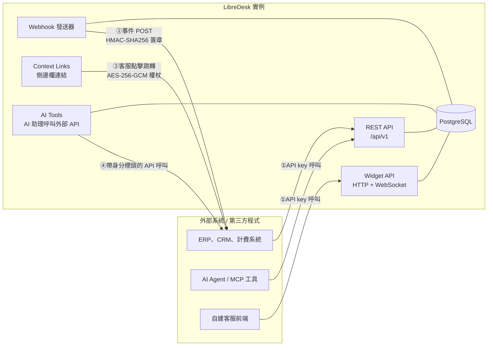
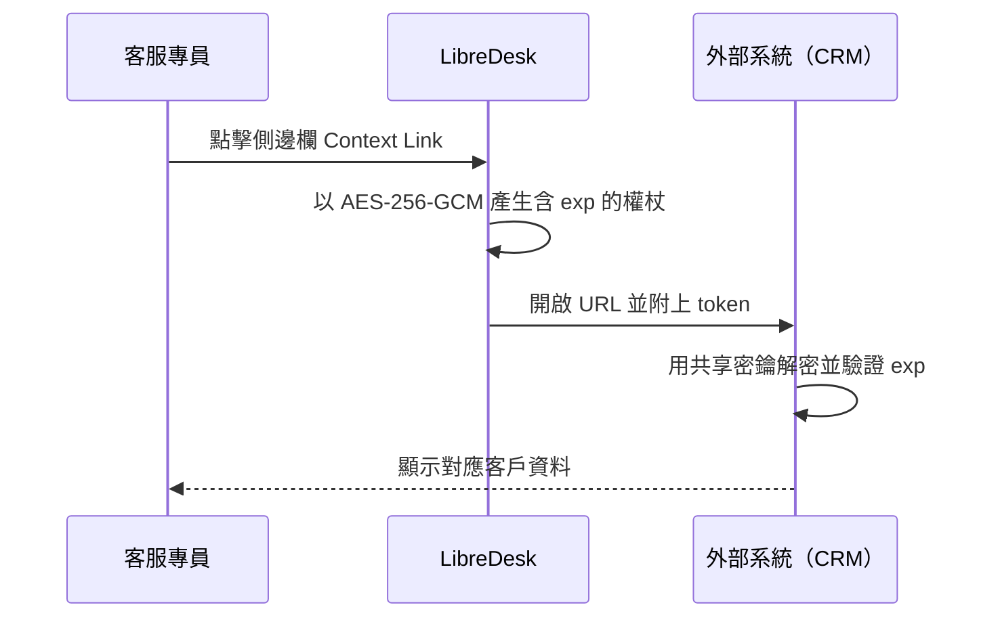
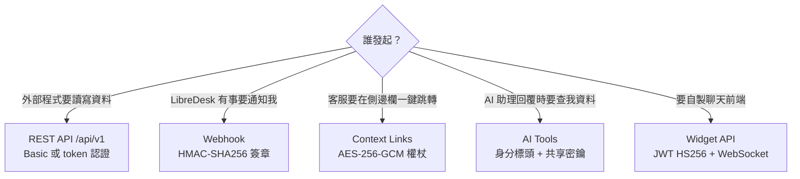

# LibreDesk 是否提供 API 讓第三方程式整合

## 摘要

**是。** LibreDesk 內建一組穩定的 REST API（路徑前綴 `/api/v1`），任何外部程式都可以用「每位客服專員一組」的 API key + secret 呼叫它，藉此讀寫對話、聯絡人、標籤、狀態、報表與 AI 功能[^apidoc][^apiintro]。

除此之外，LibreDesk 還提供四種方向相反或用途不同的整合介面：

| 機制 | 方向 | 用途 |
|---|---|---|
| REST API（`/api/v1`） | 外部程式 → LibreDesk | 主動讀寫資料，最通用的整合方式 |
| Webhook | LibreDesk → 外部程式 | 事件驅動通知（新對話、新訊息等） |
| Context Links | LibreDesk → 外部程式（由客服點擊觸發） | 在側邊欄一鍵跳轉到 CRM 等外部系統 |
| AI Tools | LibreDesk 的 AI 助理 → 外部程式 | AI 助理在回覆過程中呼叫你的 API |
| Widget API | 訪客瀏覽器 → LibreDesk | 自建即時聊天前端 |

LibreDesk **沒有**外掛（plugin）系統、**沒有**官方 SDK，但官方有釋出 OpenAPI 3.0 規格檔，可自動產生客戶端程式庫[^openapi][^readme]。

整合面上有兩個容易誤判的限制需先留意：**Webhook 失敗不重試**（事件會直接遺失）[^wh]，以及**所有整合都只能走網路介面**，無法在行程內擴充[^readme]。

---

## 一、基礎專案資訊

| 項目 | 內容 |
|---|---|
| 專案 | `abhinavxd/libredesk` |
| 描述 | 開源、自架的客服系統（單一執行檔），定位為 Intercom / Zendesk / Chatwoot 的輕量替代品 |
| 授權 | GNU AGPL v3.0 |
| 主要語言 | 後端 Go，前端 Vue.js 3 + Shadcn UI |
| Star 數 | 3,118 |
| Fork 數 | 328 |
| 未解 issue | 133 |
| 最新版本 | v2.9.2（2026-10-31 發佈） |
| 官網 / 文件 | <https://libredesk.io> / <https://docs.libredesk.io> |

[^ghapi]: GitHub. (2026). *Repository metadata for abhinavxd/libredesk* [API response]. Retrieved 2026-11-02, from https://api.github.com/repos/abhinavxd/libredesk
[^ghrelease]: GitHub. (2026). *Release v2.9.2* [API response]. Retrieved 2026-11-02, from https://api.github.com/repos/abhinavxd/libredesk/releases/latest

> Star 數已遠超「可忽略」的門檻（> 3,000），且專案持續發版（v2.9.2 於 2026-10-31 發佈），屬於活躍維護中的專案，值得納入評估[^ghapi][^ghrelease]。

---

## 二、整合架構總覽



圖中四條主要整合路徑（①②③④）各自獨立，可單獨或組合使用。

---

## 三、REST API（外部程式呼叫 LibreDesk）

### 3.1 認證方式

API key 是「每位客服專員（agent）」個別產生的，產生位置為 **Admin → Teammates → Agents → 開啟該 agent → Generate API key**。系統會顯示一組 API key 與 API secret，secret **只顯示一次**，需立即保存；具備 `users:manage` 權限者才能產生金鑰[^apidoc]。

金鑰可隨時在同一頁面重新產生或撤銷。**以某把 API key 發出的請求，其角色與權限等同於擁有該金鑰的客服專員**，因此權限最小化原則必須靠「建立專用帳號 + 專用角色」來實現[^apidoc][^roles]。

官方支援兩種標頭格式[^apidoc]：

```bash
# 方式一：Basic authentication
curl -X GET "https://your-libredesk-instance.com/api/v1/conversations" \
  -H "Authorization: Basic <base64_encoded_key:secret>"

# 方式二：Token authentication
curl -X GET "https://your-libredesk-instance.com/api/v1/conversations" \
  -H "Authorization: token your_api_key:your_api_secret"
```

### 3.2 OpenAPI 規格

文件站提供可直接下載的 OpenAPI 3.0.0 規格檔，標題為 `libredesk API`，共定義 **63 條路徑**，並在文件根層級套用兩組安全性機制[^openapi]：

| 安全性機制名稱 | 類型 | 說明 |
|---|---|---|
| `basicAuth` | HTTP Basic | base64 編碼 `api_key:api_secret` |
| `tokenAuth` | API Key（header `Authorization`） | `token api_key:api_secret` |

> 需要注意的是，規格檔中的 `servers` 欄位指向 `http://localhost:8080`（標註為 "Local development server"），並未帶入實際部署位址。自動產生客戶端時必須手動覆寫 base URL[^openapi]。

### 3.3 端點分組

依官方文件索引，API 涵蓋以下分組[^llms]：

| 分組 | 端點數（約） | 代表端點 |
|---|---|---|
| Conversations | 27 | 建立對話、取得訊息、送出訊息、更新狀態／優先級／指派、下載對話逐字稿、更新標籤 |
| Conversation Status & Priority | 5 | 新增／更新／刪除自訂狀態、列出優先級 |
| Contacts | 7 | 聯絡人 CRUD、封鎖／解封鎖、匯出資料 |
| Contact Notes | 3 | 聯絡人備註 CRUD |
| Agents | 10 | 客服專員 CRUD、取得當前專員、更新上線狀態、產生／撤銷 API key |
| Teams | 5 | 團隊 CRUD |
| AI Completions | 2 | AI 補全、取得 AI prompt |
| Search | 5 | 搜尋對話／聯絡人／訊息（含分頁版本） |
| Media | 2 | 上傳媒體、提供媒體檔案 |
| Tags | 4 | 標籤 CRUD |
| Custom Attributes | 1 | 列出自訂欄位 |
| Inboxes | 1 | 列出收件匣 |
| Reports | 6 | 總覽統計、CSAT、訊息量、SLA、標籤分佈 |
| Help Center | 3 | 公開知識庫樹狀結構、文章、搜尋 |
| Health Check | 1 | 健康檢查 |

[^llms]: LibreDesk. (n.d.). *libredesk Documentation index*. Retrieved 2026-11-02, from https://docs.libredesk.io/llms.txt

官方文件同時明言：「部分端點尚未撰寫文件，歡迎提交 PR 補充」[^apidoc]，因此實際可用的 API 表面可能大於文件所列。

### 3.4 分頁、排序與過濾

列表型端點（對話、聯絡人）支援一致的分頁與過濾參數[^openapi]：

| 參數 | 說明 |
|---|---|
| `page` | 頁碼，最小 1，預設 1 |
| `page_size` | 每頁筆數，預設 30，**上限 500** |
| `order` | `asc` 或 `desc`（不分大小寫） |
| `order_by` | 以 `model.field` 格式指定排序欄位 |
| `filters` | JSON 編碼的過濾條件 |

`filters` 接受兩種形式：一組會被 AND 串接的條件陣列，或帶有 `logic` 與 `rules` 的群組物件（**最多只能有一層巢狀**）。支援的運算子包括 `equals`、`not equals`、`greater than`、`less than`、`set`、`not set`、`in`、`between`、`contains`、`ilike`、`not contains`[^openapi]。

可過濾欄位依模型分組，例如對話支援 `conversations` 的 `status_id`、`priority_id`、`assigned_user_id`、`tags` 等，以及 `conversation_statuses`、`users`、`inboxes` 的關聯欄位[^openapi]。

搜尋端點則使用不同的參數：`query`（**最少 3 個字元**）加上 `limit`。聯絡人搜尋的 `limit` 上限為 15，對話搜尋上限為 1000[^openapi]。

### 3.5 回應格式

所有端點皆回傳 JSON；成功回應將結果包在 `data` 欄位中，錯誤回應則包含 `message` 與 `error_type`[^apiintro]。

---

## 四、Webhook（LibreDesk 主動通知外部程式）

若需求是「LibreDesk 發生事件時，反過來通知我方系統」，則應使用 Webhook，而非輪詢 API。

設定位置：**Admin → Integrations → Webhooks → New webhook**，需填寫名稱、目標 URL、訂閱事件、簽章密鑰（選填）、是否啟用[^wh]。

### 4.1 事件清單

| 類別 | 事件名稱 |
|---|---|
| 對話事件 | `conversation.created`、`conversation.status_changed`、`conversation.assigned`、`conversation.unassigned`、`conversation.tags_changed` |
| 訊息事件 | `message.created`、`message.updated` |
| 測試 | `webhook.test`（可由後台「Send test」按鈕觸發） |
| 自訂事件 | 透過自動化規則的「Trigger webhook」動作發送，事件名稱由使用者自訂 |

值得注意的是，**團隊指派不會觸發 `conversation.assigned`**（僅「指派給個人」才會）；`message.updated` 僅在對外訊息狀態變為 `sent` 或 `failed` 時發出[^wh]。

### 4.2 傳送標頭

| 標頭 | 說明 |
|---|---|
| `Content-Type` | 固定為 `application/json` |
| `User-Agent` | `Libredesk-Webhook/<version>` |
| `X-Libredesk-Signature` | HMAC 簽章（僅在設定密鑰時送出） |

以上標頭依官方文件所列[^wh]。

### 4.3 交付保證與重試（重要限制）

官方文件對此的說明相當直白，且是整合設計時最容易誤判的地方[^wh]：

> Deliveries run in a background worker pool. **Failed deliveries are not retried.** Events are dropped when the delivery queue is full.

也就是說：

| 項目 | 行為 |
|---|---|
| 重試機制 | **完全沒有**。失敗即永久遺失 |
| 回應時限 | 建議 **3 秒內**回應，逾時即視為失敗並丟棄事件 |
| 佇列爆滿 | 事件直接丟棄 |
| 調整方式 | 於 `config.toml` 的 `[webhook]` 區段設定 worker 數量、佇列大小與逾時 |

官方因此明確建議：**收到 webhook 後應先驗簽、立即回 200，再把實際處理工作丟到背景非同步執行**。任何在 HTTP 回應路徑上阻塞的慢速處理，都會導致事件遺失[^wh]。

這代表若要做到 at-least-once 的可靠度，**必須自行在接收端實作持久化佇列與補償機制**（例如定期以 API 輪詢比對），不能依賴 webhook 本身[^wh]。

Webhook 目標 URL 也受 LibreDesk 選配的 SSRF 防護機制涵蓋；該防護**預設為關閉**[^wh][^ssrf]。

[^ssrf]: LibreDesk. (n.d.). *SSRF protection*. Retrieved 2026-11-02, from https://docs.libredesk.io/configuration/ssrf-protection

### 4.4 安全性

設定密鑰後，LibreDesk 會以 HMAC-SHA256 簽署內容，並在 `X-Libredesk-Signature` 標頭以 `sha256=<signature>` 形式傳送，接收端應進行常數時間比對[^wh]：

```python
import hmac
import hashlib

def verify_signature(payload, signature, secret):
    expected_signature = hmac.new(
        secret.encode('utf-8'),
        payload,
        hashlib.sha256
    ).hexdigest()
    return hmac.compare_digest(f"sha256={expected_signature}", signature)
```

驗簽時必須使用**原始請求內容（raw body）**，不可先經過 JSON 解析再重新序列化，否則簽章會不符[^wh]。

---

## 五、Context Links（從對話側邊欄跳轉外部系統）

Context Links 會在對話側邊欄產生連結，客服點擊後開啟外部網址，並自動帶入聯絡人與對話資訊。設定位置為 **Admin → Integrations → Context links**[^cl]。

可用的 URL 樣板變數包括 `{{email}}`、`{{phone}}`、`{{external_user_id}}`、`{{contact_id}}`、`{{first_name}}`、`{{last_name}}`、`{{conversation_uuid}}`，以及 `{{token}}`[^cl]。

其中 `{{token}}` 是關鍵設計：LibreDesk 會產生一組 **AES-256-GCM 加密且具時效性**的權杖，內含上述所有欄位再加上 `agent_id`、`agent_email`、`iat`、`exp`。權杖格式為「12 bytes nonce + ciphertext」再進行 base64 編碼，shared secret 即為 AES-256 金鑰。接收端系統解密後即可一次取得完整 payload，**避免敏感資料直接暴露在 URL 或瀏覽器歷史紀錄中**[^cl]。



---

## 六、Widget API（自建聊天前端）

若目標是「把 LibreDesk 官方聊天元件嵌入自家網站」，只要一行 `<script>` 即可[^livechat]：

```html
<script>
  window.LibredeskSettings = {
    baseURL: 'https://support.example.com',
    inboxID: 'YOUR_INBOX_UUID'
  };
</script>
<script async src="https://support.example.com/widget.js"></script>
```

若需要完全自製前端，官方另提供 **Widget API**：一組公開（無需 agent API key）的 HTTP 端點加上 WebSocket 協定，涵蓋啟動器設定、聊天設定、驗證交換、建立對話、取得對話、送出訊息、更新已讀、下載逐字稿、handoff 表單、行銷活動（campaigns）、媒體上傳等[^wapi]。

訪客身分驗證採用 **HS256（HMAC-SHA256）簽署的 JWT**，由我方伺服器以收件匣的 Secret key 簽發，secret 永不離開伺服器端；LibreDesk 驗簽後，會依 JWT 中的 `external_user_id` 尋找或建立對應聯絡人[^livechat]。

---

## 七、AI Tools（AI 助理呼叫外部 API）

這是容易被忽略但對整合很有用的一條路徑：LibreDesk 的 AI 助理可以在回覆客戶的過程中，**主動呼叫你提供的 HTTP 端點**（例如查訂單、查餘額、取消訂閱）。設定位置為 **Admin → AI → Tools**，再逐一授權給各個助理；工具也可開放給客服用的 copilot 與 Generate reply[^ai]。

工具定義欄位包括名稱（模型的 function name，上限 64 字元、僅限英數與 `-`、`_`）、描述（模型據此判斷何時呼叫）、URL 與方法（僅 `GET` 或 `POST`）、標頭（**內容加密儲存**）、參數（JSON Schema）、是否要求已驗證聯絡人、是否可用於 copilot / Generate reply、以及是否要求客服逐次核准[^ai]。

參數以 JSON Schema 描述，`GET` 時置於 query string，`POST` 時作為 JSON body[^ai]：

```json
{
  "type": "object",
  "properties": {
    "order_id": { "type": "string", "description": "The order ID to look up" }
  },
  "required": ["order_id"]
}
```

### 7.1 伺服器端注入的身分標頭

LibreDesk 會在每次工具請求中**由伺服器端注入**下列標頭，模型看不到也無法修改[^ai]：

| 標頭 | 值 |
|---|---|
| `X-Libredesk-Contact-Id` | 聯絡人在 LibreDesk 的 ID |
| `X-Libredesk-Contact-Email` | 聯絡人目前的 email |
| `X-Libredesk-Contact-External-Id` | 我方系統的聯絡人 ID（若有設定） |
| `X-Libredesk-Contact-Type` | `contact` 或 `visitor` |
| `X-Libredesk-Contact-Verified` | `true` 或 `false`，必定送出 |
| `X-Libredesk-Conversation-UUID` | 所屬對話的 UUID |
| `X-Libredesk-Inbox-Id` | 對話來源收件匣 |

### 7.2 安全注意事項

官方文件提出三條明確規則[^ai]：

1. **先驗自己的密鑰**：在工具上設定如 `X-Api-Key` 的標頭，並拒絕未帶該標頭的請求。端點暴露在網際網路上，工具設定是唯一能證明請求來自 LibreDesk 的依據。
2. **客戶身分一律取自標頭，絕不取自參數**：請求 body 中的內容是模型依客戶輸入所撰寫，必須視為不受信任的輸入。若模型傳入 `account_id=99999`，應忽略該數字，改用標頭中聯絡人所屬的帳號。
3. **敏感資料要求 `X-Libredesk-Contact-Verified` 為 `true`**：訪客可以在聊天中任意聲稱任何 email。此標頭只有在「30 分鐘內通過一次性驗證碼」、「以簽章 JWT 識別的身分」或「客服由 copilot 發起」時才為 `true`。

> 關鍵陷阱：**「Require verified contact」開關只控制 AI 是否先要求輸入驗證碼，並不會阻止請求送達你的端點**。請求仍可能帶著 `X-Libredesk-Contact-Verified: false` 抵達。端點必須每次自行檢查該標頭，僅在其為 `true` 時回傳個人資料[^ai]。

官方 repo 內附有可執行的範例程式位於 `scripts/tools-server`[^ai]。

### 7.3 回應處理與資源上限

回應應為**小型、扁平的 JSON**，過長的 payload 會被截斷。2xx 視為「成功取得資料」（助理據此回答），非 2xx 視為失敗（助理通常會告知無法協助並轉交真人）。「查無資料」應以 2xx 搭配空清單或簡短訊息表示，非 2xx 保留給真正的錯誤（如 API key 錯誤、上游服務中斷）[^ai]。

資源上限設定於 `config.toml` 的 `[ai_agent]` 區段[^ai]：

| 設定 | 說明 | 預設值（範圍） |
|---|---|---|
| `worker_count` | 執行自主 AI 回覆的 worker 數量 | 10 |
| `queue_size` | 可排隊的 AI 回覆工作上限 | 1000 |
| `max_steps` | 單次回覆中可呼叫工具的最大次數 | 6（1–20） |
| `max_history_messages` | 送給模型的歷史訊息則數 | 30（5–100） |

時間上限：單次助理執行在即時聊天為 **90 秒**、在 email 為 **3 分鐘**；每次供應商呼叫上限 **60 秒**。觸及任何上限即轉交真人[^ai]。

需注意官方標明 **AI 功能目前為 beta 狀態**，且助理回覆會實際發送給客戶，建議先在低流量收件匣測試[^ai]。

---

## 八、使用者體驗整合：SSO

LibreDesk 支援以 OpenID Connect 讓客服專員登入（Google、Microsoft 或任意自訂 OIDC 供應商，例如 Keycloak）。設定路徑為 **Admin → Security → SSO**[^sso]。

限制在於：**SSO 不會自動建立帳號**。仍需先在 LibreDesk 內建立 agent，登入時系統以供應商回傳的 email 比對既有 agent[^sso]。這點對「以外部身分系統為單一真相來源」的場景會造成額外的帳號同步工程。

---

## 九、權限模型（整合時最需注意的一環）

權限以 `object:action` 格式命名（例如 `conversations:read_all`）。每個 agent 可被指派多個角色，實際權限為各角色權限的聯集[^roles]。

預設角色有二[^roles]：

| 角色 | 說明 |
|---|---|
| `Admin` | 除 `messages:write_as_contact` 外擁有全部權限。此角色鎖定，不可編輯 |
| `Agent` | 讀取、指派、更新對話，回覆訊息與私人備註，管理自己的檢視 |

與整合最相關的權限包括[^roles]：

- `conversations:read`、`conversations:write`、`conversations:read_all`、`conversations:read_unassigned`、`conversations:read_team_all`
- `messages:read`、`messages:write`、`messages:write_private`、`messages:write_as_contact`
- `contacts:read_all`、`contacts:write`、`contacts:export`
- `users:manage`（產生／撤銷 API key 的必要權限，也是指派角色的必要權限）
- `webhooks:manage`、`context_links:manage`、`reports:manage`

> **重要警告**：官方文件明確指出 `users:manage` 實質上等同完整存取權，因為擁有者可以把任何角色（包含 `Admin`）指派給任何人，包括自己。整合用的 API key 應避免綁定具備 `users:manage` 的帳號[^roles]。

開對話檢視時，agent 需要 `conversations:read` 再加上一個符合該對話指派狀態的清單權限（例如 `conversations:read_assigned` 或 `conversations:read_team_inbox`）[^roles]。

---

## 十、現成的第三方整合

由於沒有外掛系統，社群改以「包裝 REST API」的方式建立整合[^readme][^roadmap]：

| 專案 | Star 數 | 類型 | 狀態 | 說明 |
|---|---|---|---|---|
| `metanmai/libredesk-mcp` | 4 | MCP Server（AI 工具） | npm 套件 v0.1.0（2026-06-28 發佈） | 由 OpenAPI 規格動態產生 54 個 MCP 工具，可讓 Claude、Cursor 等 AI 助理直接操作 LibreDesk。使用 `Authorization: token key:secret` 認證[^npm] |
| `InkaNode/kuraka` | 0 | 多租戶郵件管理面板 | 極早期（2026-11-03 建立） | Stalwart Mail Server 的管理面板，內含 LibreDesk 整合[^kuraka] |
| Telegram 頻道 | — | 原生通道 | PR 進行中 | 列於官方 ROADMAP 的「In Progress」項目[^roadmap] |
| Crowdin | — | 翻譯平台 | 運作中 | 官方指定的社群翻譯平台[^readme] |
| Railway | — | 一鍵部署 | 運作中 | 官方提供含 PostgreSQL 與 Redis 的部署按鈕[^readme] |

### 10.1 關於 MCP Server 的來源考證

這項整合值得單獨說明，因為它與常見的「維護者背書」敘述有落差。在 issue #370 中，LibreDesk 維護者 abhinavxd 回覆「this is great!」（作者關聯標記為 `OWNER`），並表示會把該 MCP server 加進官方文件；但後續對話顯示，因為套件尚未發佈而未能如願，之後作者才補上 npm 發佈[^issue370]。

然而，經檢視官方文件索引 `llms.txt` 與全部文件頁面，**目前 `docs.libredesk.io` 上並未出現任何 MCP 相關頁面或字串**。也就是說，維護者的「會在文件中連結」屬於意圖，尚未落實；此整合仍應視為**未經官方正式收錄的社群專案**。此外該 repo 最後一次 push 為 2026-06-06，且僅有 4 顆星，成熟度與維護活躍度都偏低[^mcp][^llms]。

目前**尚未存在**的整合包括 Zapier、n8n 節點、Slack、Discord、Grafana、行動 App 等；社群曾提出多項相關 feature request[^issue370][^kuraka][^roadmap]。

[^mcp]: metanmai. (2026). *libredesk-mcp* [Computer software]. GitHub. Retrieved 2026-11-02, from https://github.com/metanmai/libredesk-mcp
[^npm]: metanmai. (2026). *libredesk-mcp* [Software package]. npm. Retrieved 2026-11-02, from https://www.npmjs.com/package/libredesk-mcp
[^issue370]: metanmai & abhinavxd. (2026). *MCP server for Libredesk — exposes all 54 API endpoints as LLM tools* [Issue #370]. GitHub. Retrieved 2026-11-02, from https://github.com/abhinavxd/libredesk/issues/370
[^kuraka]: InkaNode. (2026). *kuraka* [Computer software]. GitHub. Retrieved 2026-11-02, from https://github.com/InkaNode/kuraka
[^roadmap]: abhinavxd. (2026). *ROADMAP.md*. GitHub. Retrieved 2026-11-02, from https://raw.githubusercontent.com/abhinavxd/libredesk/main/ROADMAP.md

---

## 十一、結論與選型建議

### 11.1 直接回答問題

> 「LibreDesk 有沒有 API 讓第三方程式整合？」

**有，而且是官方文件化的正式功能**，不是隱藏的內部端點。外部程式只要具備一組 agent API key 與 secret，即可透過 `/api/v1` 進行完整的讀寫操作。README 也把「API 與 Webhook」列為 Administration and integrations 下的正式功能[^readme]。

### 11.2 整合路徑選擇



### 11.3 限制與風險

1. **無外掛系統**：不可能在 LibreDesk 內以程式擴充功能，所有整合都必須走網路介面[^readme]。
2. **無官方 SDK**：需自行以 HTTP 呼叫，或由 OpenAPI 規格自動產生客戶端[^openapi]。
3. **文件尚未完整**：官方自承部分端點未撰寫文件[^apidoc]。
4. **權限即身分**：API key 完全繼承所屬 agent 的權限，切記不要綁定含 `users:manage` 的帳號[^roles]。
5. **AGPL-3.0 授權**：若以修改後的 LibreDesk 提供網路服務，需注意 AGPL 的原始碼釋出義務[^ghapi]。
6. **SSO 不自動建帳號**：外部身分系統無法成為唯一真相來源，需額外同步 agent 資料[^sso]。
7. **Webhook 不重試**：失敗或逾時即永久遺失事件，可靠度須由接收端自行補強[^wh]。
8. **AI 功能為 beta**：AI 助理與工具呼叫仍在 beta，且會實際對客戶發話[^ai]。

### 11.4 進行整合前的檢查清單

| 步驟 | 動作 | 依據 |
|---|---|---|
| 1 | 建立專用的「整合用 agent」帳號，指派自訂的最小權限角色 | [^roles] |
| 2 | 於該 agent 頁面產生 API key 與 secret，secret 立即存入密碼管理器 | [^apidoc] |
| 3 | 由 OpenAPI 規格產生客戶端，並將 base URL 覆寫為實際部署位址 | [^openapi] |
| 4 | 設定 webhook 與密鑰，接收端以 raw body 驗簽並在 3 秒內回 200 | [^wh] |
| 5 | 在接收端加上持久化佇列，補償 webhook 不重試的缺口 | [^wh] |
| 6 | 若需 AI 呼叫自家 API，於工具上設定共享密鑰並強制檢查 `X-Libredesk-Contact-Verified` | [^ai] |

### 11.5 一句話總結

LibreDesk 對第三方整合的態度是「**開放網路介面、封閉執行檔**」：Rest API、Webhook、Context Links、AI Tools、Widget API 等介面足以支撐絕大多數整合需求，但不提供任何形式的行程內擴充能力。

---

## 參考文獻

[^readme]: abhinavxd. (2026). *libredesk — README.md*. GitHub. Retrieved 2026-11-02, from https://github.com/abhinavxd/libredesk
[^apidoc]: LibreDesk. (n.d.). *API Getting Started*. Retrieved 2026-11-02, from https://docs.libredesk.io/getting-started/api-getting-started
[^apiintro]: LibreDesk. (n.d.). *API Introduction*. Retrieved 2026-11-02, from https://docs.libredesk.io/api-reference/introduction
[^wh]: LibreDesk. (n.d.). *Webhooks*. Retrieved 2026-11-02, from https://docs.libredesk.io/configuration/webhooks
[^livechat]: LibreDesk. (n.d.). *Live Chat*. Retrieved 2026-11-02, from https://docs.libredesk.io/configuration/livechat
[^wapi]: LibreDesk. (n.d.). *Widget API*. Retrieved 2026-11-02, from https://docs.libredesk.io/api-reference/widget-api
[^roles]: LibreDesk. (n.d.). *Roles & Permissions*. Retrieved 2026-11-02, from https://docs.libredesk.io/roles/overview
[^cl]: LibreDesk. (n.d.). *Context Links*. Retrieved 2026-11-02, from https://docs.libredesk.io/configuration/context-links
[^sso]: LibreDesk. (n.d.). *SSO Setup*. Retrieved 2026-11-02, from https://docs.libredesk.io/configuration/sso
[^ai]: LibreDesk. (n.d.). *AI*. Retrieved 2026-11-02, from https://docs.libredesk.io/configuration/ai
[^openapi]: LibreDesk. (n.d.). *libredesk API OpenAPI Specification* [OpenAPI 3.0.0 document]. Retrieved 2026-11-02, from https://docs.libredesk.io/api-reference/openapi.json
