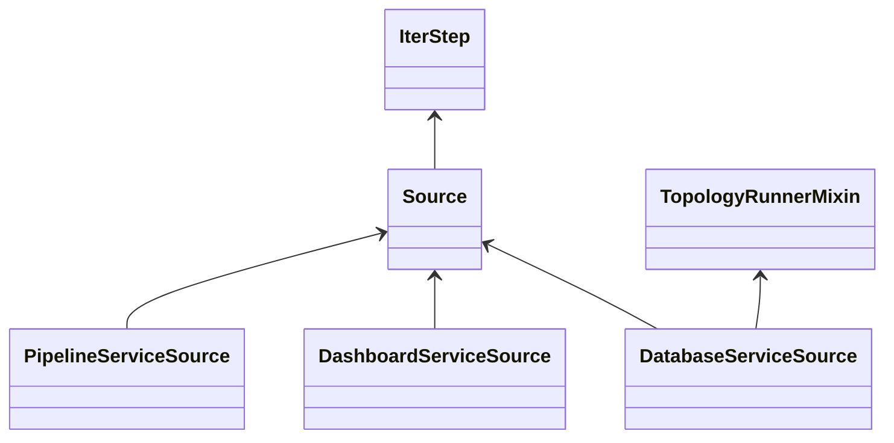
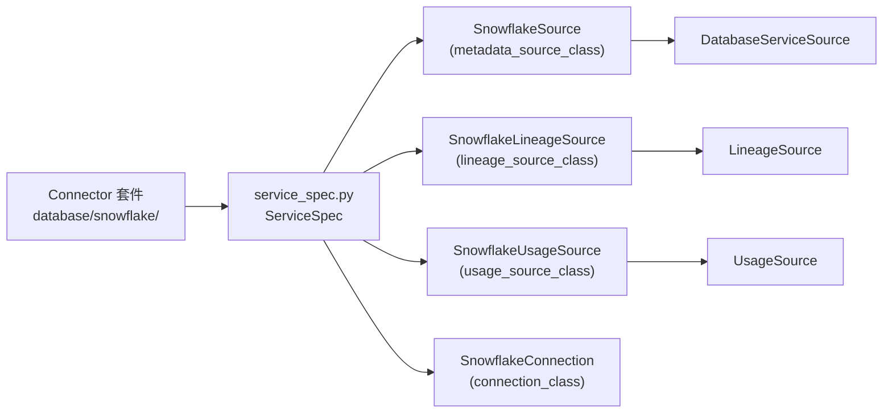

# OpenMetadata 中「一個 Connector 是否可以生成多個 ServiceSource」之研究

## 摘要

本報告探討 OpenMetadata 擷取框架 (Ingestion Framework) 中，單一 Connector 是否可以產生多個 `ServiceSource`。結論是：**在 OpenMetadata 目前的程式碼結構中，並不存在一個名為 `ServiceSource` 的單一基底類別**，而是每個服務類型 (ServiceType) 各自擁有專屬的抽象基底類別，例如 `DatabaseServiceSource`、`DashboardServiceSource` 等[^svc-where]。因此嚴格來說，「多個 ServiceSource」一詞需要先拆解為兩個層次的問題：

- **層次一（服務類型）**：一個 Connector 是否可同時對應多種服務類型 (ServiceType)？答案為**否**，一個 Connector 對應唯一一個服務類型。
- **層次二（Source 實作）**：一個 Connector 是否可產生多個 Source 實作（例如詮釋資料、血緣、使用量）？答案為**是**，透過同一份 `ServiceSpec` 宣告即可。

以下逐節說明技術依據。

## 1. 名詞釐清：OpenMetadata 沒有單一的 `ServiceSource` 類別

在 OpenMetadata 程式碼中，並不存在名為 `ServiceSource` 的類別。實際存在的是「每個服務類型一個」的抽象基底類別，全部位於 `ingestion/src/metadata/ingestion/source/` 之下[^svc-where]。這些類別包含：

| 服務類型 | 抽象基底類別 | 檔案路徑 |
| --- | --- | --- |
| Database | `DatabaseServiceSource` | `ingestion/src/metadata/ingestion/source/database/database_service.py` |
| Dashboard | `DashboardServiceSource` | `ingestion/src/metadata/ingestion/source/dashboard/dashboard_service.py` |
| Pipeline | `PipelineServiceSource` | `ingestion/src/metadata/ingestion/source/pipeline/pipeline_service.py` |
| Messaging | `MessagingServiceSource` | `ingestion/src/metadata/ingestion/source/messaging/messaging_service.py` |
| MlModel | `MlModelServiceSource` | `ingestion/src/metadata/ingestion/source/mlmodel/mlmodel_service.py` |
| Storage | `StorageServiceSource` | `ingestion/src/metadata/ingestion/source/storage/storage_service.py` |
| Search | `SearchServiceSource` | `ingestion/src/metadata/ingestion/source/search/search_service.py` |
| Api | `ApiServiceSource` | `ingestion/src/metadata/ingestion/source/api/api_service.py` |
| Drive | `DriveServiceSource` | `ingestion/src/metadata/ingestion/source/drive/drive_service.py` |
| Security | `SecurityServiceSource` | `ingestion/src/metadata/ingestion/source/security/security_service.py` |

這些類別的繼承模式相同，皆為 `TopologyRunnerMixin` 與 `Source` 的組合，例如 `class CommonDbSourceService(DatabaseServiceSource, ...)`[^common-db]。



因此在後續討論中，「ServiceSource」應理解為「某一服務類型專屬的 `*ServiceSource` 抽象基底類別」。

## 2. ServiceSpec：Connector 的宣告清單

每個 Connector 目錄下都有一份 `service_spec.py`，內含一個 `ServiceSpec` 變數，其型別為 `BaseSpec` 或其子類別（例如 `DefaultDatabaseSpec`）。`BaseSpec` 定義於 `ingestion/src/metadata/utils/service_spec/service_spec.py`，欄位如下[^spec]：

| 欄位 | 必要性 | 說明 |
| --- | --- | --- |
| `metadata_source_class` | 必填 | 主要詮釋資料擷取 Source 類別 |
| `lineage_source_class` | 選填 | 血緣擷取 Source 類別 |
| `usage_source_class` | 選填 | 使用量擷取 Source 類別 |
| `profiler_class` | 選填 | 剖析器介面類別 |
| `test_suite_class` | 選填 | 資料品質測試套件介面類別 |
| `sampler_class` | 選填 | 取樣器類別 |
| `data_diff` | 選填 | 資料差異比對參數類別 |
| `connection_class` | 選填 | 連線處理類別（繼承 `BaseConnection`） |

以 Postgres 為例，其 ServiceSpec 同時宣告了詮釋資料、血緣、使用量三種來源類別[^pg-spec]：

```python
ServiceSpec = DefaultDatabaseSpec(
    metadata_source_class=PostgresSource,
    lineage_source_class=PostgresLineageSource,
    usage_source_class=PostgresUsageSource,
    connection_class=PostgresConnection,
)
```

由此可見，**同一個 Connector 套件確實可以產生多個 Source 類別**，但這些類別分屬不同管線用途，並非多個 `*ServiceSource` 抽象基底。

## 3. 一個 Connector 只對應一個服務類型

ServiceSpec 的載入路徑由 `DefaultSourceLoader` 動態組出，其格式為[^spec]：

```
metadata.{from_}.source.{service_type}.{module_dir}.service_spec.ServiceSpec
```

其中 `service_type.name.lower()` 來自 `ServiceType` 列舉，而 `module_dir` 由 `get_module_dir(source_type)` 產生。`get_module_dir` 的實作是將來源字串以 `-` 分隔後取第一段[^importer]：

```python
def get_module_dir(type_: str) -> str:
    return type_.split(TYPE_SEPARATOR)[0]   # TYPE_SEPARATOR = "-"
```

這代表 `mysql` 與 `mysql-usage` 都指向同一個 `mysql` 目錄，且該目錄下的 ServiceSpec 僅屬於單一服務類型。服務類型本身則由 `get_service_type_from_source_type` 解析，將來源字串清理後對照 `ServiceType` 列舉[^classhelper]。`ServiceType` 列舉共定義了 13 種服務[^servicetype]：

```
Dashboard, Database, Drive, Messaging, Metadata, MlModel,
Pipeline, Storage, Search, Api, Security, LLM, Mcp
```

官方文件亦明確指出 connector 的命名空間路徑為 `metadata.ingestion.source.{service_type}.{source_name}`，每個 Connector 綁定單一服務類型[^docs]。

### 3.1 反例檢查：同一產品跨服務類型時的情況

可能引起混淆的是，某些產品同時出現在兩種服務類型中。例如 Glue 同時是 Database 的 `Glue` 服務類型[^dbservice]，也是 Pipeline 的 `GluePipeline` 服務類型[^pipeservice]。然而這兩者在程式碼中是**兩個各自獨立的 Connector 套件**：

- `ingestion/src/metadata/ingestion/source/database/glue/`（使用 `GlueSource`、`DefaultDatabaseSpec`）[^glue-spec]
- `ingestion/src/metadata/ingestion/source/pipeline/gluepipeline/`（使用 `GluepipelineSource`、`BaseSpec`）[^gluepipe-spec]

因此這不構成「一個 Connector 生成多個 ServiceSource」，而是「同一產品有兩個 Connector」。

## 4. 一個 Connector 產生多個 Source 實作的機制

當同一 Connector 目錄被不同管線觸發時，框架會依 `source.type` 的後綴選用不同的欄位。`import_source_class` 的邏輯為[^spec]：

```python
_, sep, source_class_type = source_type.rpartition(TYPE_SEPARATOR)
if not sep:
    source_class_type = source_type
if source_class_type in ["usage", "lineage"]:
    field = f"{source_class_type}_source_class"
else:
    field = "metadata_source_class"
```

也就是說：

- `source.type = "snowflake"` → 載入 `metadata_source_class`
- `source.type = "snowflake-usage"` → 載入 `usage_source_class`
- `source.type = "snowflake-lineage"` → 載入 `lineage_source_class`

以 Snowflake 為例，其 ServiceSpec 宣告了三個獨立的類別[^sf-spec]：`SnowflakeSource`（詮釋資料）、`SnowflakeLineageSource`（血緣）、`SnowflakeUsageSource`（使用量）。這三者是不同用途的 `Source` 實作，其中血緣與使用量來源繼承自 `LineageSource` / `UsageSource` 等基礎類別，而非再次產生新的 `DatabaseServiceSource`[^lineage-src]。



## 5. 結論

針對「一個 Connector 是否可以生成多個 ServiceSource」：

1. **就 `*ServiceSource` 抽象基底而言，答案為否。** 一個 Connector 綁定唯一一個服務類型 (ServiceType)，因而只會對應到單一 `*ServiceSource` 家族（例如 Database Connector 一律繼承 `DatabaseServiceSource`）[^spec][^classhelper]。
2. **就 Source 實作而言，答案為是。** 一個 Connector 可透過同一份 `ServiceSpec` 宣告多個用途的 Source 類別（詮釋資料、血緣、使用量等），並可搭配剖析、取樣、資料品質等介面類別[^spec][^sf-spec]。
3. **若要「多個服務類型」，必須建立多個 Connector 套件。** 例如 Glue 產品同時具備 Database 與 Pipeline 兩個 Connector，而非單一 Connector 同時生成兩種服務類型的來源[^glue-spec][^gluepipe-spec]。

換言之，OpenMetadata 的設計是「一個 Connector ⟷ 一個服務類型 ⟷ 一個 `*ServiceSource` 家族」，但「一個 Connector → 多個 Source 實作（多條管線）」是官方支援且常見的模式。

## 來源與批判性反思

- **OpenMetadata 官方程式碼為主要依據**：本報告的技術結論主要來自 OpenMetadata 主分支 (main) 的原始碼。程式碼是行為的最終事實來源，優於部落格或二手說明；然而主分支可能隨時變動，故引用時附上擷取日期。
- **官方文件為輔助依據**：文件有助於理解設計意圖，但部分頁面（如 Connectors 索引頁）為動態產生，靜態擷取時內容有限，因此關鍵結構仍以原始碼佐證。
- **專案活躍度**：OpenMetadata 為 Apache-2.0 授權之開源專案，於擷取時擁有 15,677 顆星與 2,502 個分支，維護活躍[^repo]。高活躍度意味著 API 可能持續演進，讀者應以對應版本的原始碼為準。

[^repo]: OpenMetadata. (2026). *open-metadata/OpenMetadata* [來源碼儲存庫]. GitHub. Retrieved 2026-11-04, from https://api.github.com/repos/open-metadata/OpenMetadata
[^svc-where]: OpenMetadata. (2026). *ingestion/src/metadata/ingestion/source* [來源碼目錄]. GitHub. Retrieved 2026-11-04, from https://github.com/open-metadata/OpenMetadata/tree/main/ingestion/src/metadata/ingestion/source
[^spec]: OpenMetadata. (2026). *ingestion/src/metadata/utils/service_spec/service_spec.py* [來源碼檔案]. GitHub. Retrieved 2026-11-04, from https://raw.githubusercontent.com/open-metadata/OpenMetadata/main/ingestion/src/metadata/utils/service_spec/service_spec.py
[^importer]: OpenMetadata. (2026). *ingestion/src/metadata/utils/importer.py* [來源碼檔案]. GitHub. Retrieved 2026-11-04, from https://raw.githubusercontent.com/open-metadata/OpenMetadata/main/ingestion/src/metadata/utils/importer.py
[^classhelper]: OpenMetadata. (2026). *ingestion/src/metadata/utils/class_helper.py* [來源碼檔案]. GitHub. Retrieved 2026-11-04, from https://raw.githubusercontent.com/open-metadata/OpenMetadata/main/ingestion/src/metadata/utils/class_helper.py
[^servicetype]: OpenMetadata. (2026). *openmetadata-spec/src/main/resources/json/schema/entity/services/serviceType.json* [JSON Schema]. GitHub. Retrieved 2026-11-04, from https://raw.githubusercontent.com/open-metadata/OpenMetadata/main/openmetadata-spec/src/main/resources/json/schema/entity/services/serviceType.json
[^dbservice]: OpenMetadata. (2026). *openmetadata-spec/src/main/resources/json/schema/entity/services/databaseService.json* [JSON Schema]. GitHub. Retrieved 2026-11-04, from https://raw.githubusercontent.com/open-metadata/OpenMetadata/main/openmetadata-spec/src/main/resources/json/schema/entity/services/databaseService.json
[^pipeservice]: OpenMetadata. (2026). *openmetadata-spec/src/main/resources/json/schema/entity/services/pipelineService.json* [JSON Schema]. GitHub. Retrieved 2026-11-04, from https://raw.githubusercontent.com/open-metadata/OpenMetadata/main/openmetadata-spec/src/main/resources/json/schema/entity/services/pipelineService.json
[^common-db]: OpenMetadata. (2026). *ingestion/src/metadata/ingestion/source/database/common_db_source.py* [來源碼檔案]. GitHub. Retrieved 2026-11-04, from https://raw.githubusercontent.com/open-metadata/OpenMetadata/main/ingestion/src/metadata/ingestion/source/database/common_db_source.py
[^pg-spec]: OpenMetadata. (2026). *ingestion/src/metadata/ingestion/source/database/postgres/service_spec.py* [來源碼檔案]. GitHub. Retrieved 2026-11-04, from https://github.com/open-metadata/OpenMetadata/blob/main/ingestion/src/metadata/ingestion/source/database/postgres/service_spec.py
[^sf-spec]: OpenMetadata. (2026). *ingestion/src/metadata/ingestion/source/database/snowflake/service_spec.py* [來源碼檔案]. GitHub. Retrieved 2026-11-04, from https://raw.githubusercontent.com/open-metadata/OpenMetadata/main/ingestion/src/metadata/ingestion/source/database/snowflake/service_spec.py
[^lineage-src]: OpenMetadata. (2026). *ingestion/src/metadata/ingestion/source/database/lineage_source.py* [來源碼檔案]. GitHub. Retrieved 2026-11-04, from https://raw.githubusercontent.com/open-metadata/OpenMetadata/main/ingestion/src/metadata/ingestion/source/database/lineage_source.py
[^glue-spec]: OpenMetadata. (2026). *ingestion/src/metadata/ingestion/source/database/glue/service_spec.py* [來源碼檔案]. GitHub. Retrieved 2026-11-04, from https://raw.githubusercontent.com/open-metadata/OpenMetadata/main/ingestion/src/metadata/ingestion/source/database/glue/service_spec.py
[^gluepipe-spec]: OpenMetadata. (2026). *ingestion/src/metadata/ingestion/source/pipeline/gluepipeline/service_spec.py* [來源碼檔案]. GitHub. Retrieved 2026-11-04, from https://raw.githubusercontent.com/open-metadata/OpenMetadata/main/ingestion/src/metadata/ingestion/source/pipeline/gluepipeline/service_spec.py
[^docs]: OpenMetadata. (2026). *Build a Connector* [官方文件]. OpenMetadata Documentation. Retrieved 2026-11-04, from https://docs.open-metadata.org/v2.1.x-SNAPSHOT/api-reference/sdk/python/build-connector
