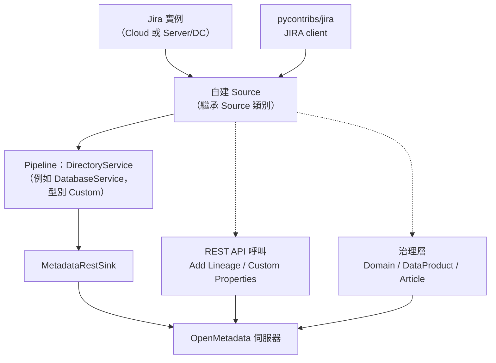

# OpenMetadata Jira Connector 評估與實作計畫（zh_TW）

## 摘要

本報告評估「為 OpenMetadata 建立 Jira Connector」的可行性與實作路徑。方法上，先釐清 OpenMetadata 的 Connector 機制與實體模型，再對照 Jira 的物件模型與可用函式庫，最後推導出可行的對應路線。

三項核心結論：

1. **Jira 在 OpenMetadata 沒有原生 Connector，也沒有任何 ITSM／議題追蹤類的實體型別。** 官方 Connector 清單涵蓋 API、Database、Dashboard、Drive、Messaging、Pipeline、ML Model、Storage、Metadata、Search 等類別，其中並無 Jira、ServiceNow 或任何議題追蹤工具[^om-connectors]。
2. **社群需求真實但長期未落地。** 自 2021 年起多次提出 Jira 相關整合需求，至今沒有可用的官方實作[^om-disc1068][^om-disc2881][^om-issue7108]。
3. **必須使用 Custom Connector，但不能掛在 API 服務（ApiService）底下。** 對 Jira 而言最直覺的映射是「專案→`apiCollection`、議題→`apiEndpoint`」，然而 OpenMetadata 的 API 服務型別列舉只有 `Rest` 與 `WEBHOOK`，沒有 `Custom`，因此無法以自訂 Python 類別產生這兩種實體[^om-apiservice-json][^om-customdir]。可行的 Custom Connector 服務型別只有 Database、Dashboard、Drive、Messaging、Pipeline、MlModel、Search、Storage 八類[^om-steps][^om-constants]。

因此建議路線為：**以支援 Custom Connector 的服務型別（主線為 DatabaseService）承接目錄層，把治理語意交給 Domain／DataProduct／Article，把議題與資料資產的關聯交給血緣邊與 Custom Properties，把議題本身的外部身分交給既有 Task 實體的外部參照欄位。**

**範圍界定：預設只需要一個 ServiceSource。** 交付物是「1 份自建 Python 套件 + 1 個自訂 ingestion 映像 + 1 個服務連線（1 條 pipeline）」，其餘治理層實體不需要額外服務。

---

## 一、背景知識：OpenMetadata 是什麼、Connector 是什麼

OpenMetadata 是一套開源的資料目錄與治理平台，採用 Apache License 2.0，其 GitHub 儲存庫約 15.7k 星，最新穩定版為 v2.0.7[^om-github]。

它的資料模型有兩個層次：

- **服務層（Service）**：代表一個外部系統的連線設定（例如某個 PostgreSQL 實例、某個 Tableau 站台）。每個服務實例是獨立的 ServiceSource。
- **資產層（Asset）**：服務底下被抽出的實體，例如 table、dashboard、pipeline、apiEndpoint。

不同服務型別有固定的容器階層。以資料庫與 API 為例[^om-dataassets]：

| 服務型別 | 階層 |
| --- | --- |
| DatabaseService | Database → Schema → Table → Column |
| APIService | APICollection → APIEndpoint |
| PipelineService | Pipeline → Task |
| DashboardService | Dashboard → Chart |

**Connector 的角色**是把外部系統的物件抽取成這些實體。抽取流程是一個工作流，由 **Source → 處理步驟 → Sink** 組成：Source 是產生器，逐一吐出 `Either` 包裝的請求（成功為右值 `CreateEntityRequest`，失敗為左值 `StackTraceError`）；Sink 收到後呼叫 OpenMetadata REST API 寫入[^om-highlevel][^om-ingestion]。

**增量機制**：每個實體帶有 `sourceHash` 指紋。Sink 依指紋決定動作 — 不存在則 CREATE，存在但指紋不同則 PATCH，指紋相同則 SKIP。這使重複執行不會產生重複資料[^om-ingestion]。

**Custom Connector 機制**：當官方沒有你要的 Connector 時，可以自寫一個繼承 `metadata.ingestion.api.steps.Source` 的 Python 類別，實作 `create`、`prepare`、`test_connection`、`close` 與核心產生器 `_iter`。工作流在執行期以動態匯入載入該類別，來源是服務連線設定中的 `sourcePythonClass` 欄位（完整模組路徑，例如 `my_pkg.my_module.MySource`）。若來源型別字串以 `"custom"` 開頭（`CUSTOM_CONNECTOR_PREFIX = "custom"`），工作流便改走動態匯入路徑[^om-highlevel][^om-steps][^om-constants][^om-customconn]。

---

## 二、Jira 端的可用素材

### 2.1 pycontribs/jira 函式庫

`pycontribs/jira` 是純 Python 的 Jira REST API 包裝函式庫，約 2.1k 星，社群維護、已在生產環境使用多年。單一程式碼基底同時支援 Jira Cloud 與 Jira Server／Data Center，也涵蓋 Jira Software（敏捷）與 Jira Service Management 的 API[^jira-github][^jira-docs]。

| 項目 | 內容 |
| --- | --- |
| 套件名稱 | `jira`（PyPI） |
| 主要類別 | `jira.client.JIRA` |
| 資源基底類別 | `jira.resources.Resource`（子類含 `Issue`、`Project`、`Comment`、`Sprint`、`Board` 等） |
| 連線韌性 | `jira.resilientsession.ResilientSession`（指數退避加抖動，預設重試 3 次，上限 60 秒；處理連線錯誤、HTTP 429、HTTP 503） |
| 例外 | `jira.exceptions.JIRAError`（帶 `status_code`、`url`、`request`、`response`） |
| 最低 Python | 3.10 |
| 認證 | Basic（Cloud 用 email + API token）、PAT（`token_auth`，Self-hosted 8.14+）、OAuth 1.0a、Kerberos、`.netrc` |

[^jira-github][^jira-pyproject][^jira-client][^jira-resilient][^jira-exceptions][^jira-docs]

### 2.2 抽取所需的 API 能力

`JIRA` 類別提供的公開方法覆蓋一個目錄型 Connector 所需的四類中繼資料[^jira-client][^jira-docs]：

- **組織與專案（容器）**：`projects()`、`project(key)`、`project_components()`、`project_versions()`、`project_roles()`、`project_categories()`、`project_permissionscheme()` 等治理配置方法。
- **議題與其階層（主資料物件）**：`issue()`、`search_issues()`、`approximate_issue_count()`、`issue_types()`、`statuses()`、`statuscategories()`、`priorities()`、`resolutions()`、`fields()`、`comments()`、`worklogs()`、`watchers()`、`votes()`、`attachment()`、`issue_link_types()`、`remote_links()`。
- **敏捷層級**：`boards()`、`sprints(board_id)`、`sprint()`、`sprint_info()`、`create_sprint()`、史詩相關操作。
- **使用者與服務台**：`user()`、`search_users()`、`myself()`、`service_desks()`、`request_types()`。

### 2.3 抽取層的設計約束

- **Cloud 與 Server 分岔普遍存在。** `JIRA._is_cloud` 依 `deploymentType` 判斷；使用者身分在 Cloud 為 `accountId`，在 Server 為 `name`[^jira-github][^jira-client]。正規化階段必須處理兩套欄位。
- **分頁機制不一致。** Cloud 走 `nextPageToken`（`_fetch_pages_searchToken`，搭配 `enhanced_search_issues` 與 `search/jql` 端點），Server 走 `startAt`（`_fetch_pages`，`search` 端點）。當偵測為 Cloud 且 `startAt == 0` 時，`search_issues()` 會自動委派給 token 分頁[^jira-client]。
- **資源是 `raw` 的包裝。** `Resource.__getattr__` 會回退到 `self.raw[item]`，自訂欄位（`customfield_XXXXX`）需自行以 `fields()` 取得欄位 ID 與名稱的對應。
- **錯誤統一以 `JIRAError` 表達**，可直接轉成 OpenMetadata 的 `StackTraceError`[^jira-exceptions]。

### 2.4 Atlassian 官方的 OpenAPI 規格

這一點很關鍵，因為 OpenMetadata 內建的 REST Connector 正是靠 OpenAPI 規格運作。

- **Jira Cloud** 提供可下載的 OpenAPI 規格（v2 與 v3），以及 Postman 集合[^atlassian-cloud-v3]。
- **Jira Server／Data Center 沒有提供任何 OpenAPI／Swagger 規格或 Postman 集合**，官方文件只提供人眼可讀的 HTML 頁面；且其 API 版本採產品版號制（v10002、v10003、v10004、v11003），與 Cloud 的 v2／v3 不同[^atlassian-dc]。

---

## 三、核心限制：ServiceSource 與 pipeline 的基數

### 3.1 一條 pipeline 綁定一個服務與一個來源型別

`metadataIngestion/workflow.json` 中的 `source` 物件，其 `type` 與 `serviceName` 都是**單一字串**，`sourceConfig.config` 以 `oneOf` 指向**單一** pipeline 設定檔（例如 `databaseServiceMetadataPipeline.json`），因此 `sourceConfig.config.type` 也是單一值[^om-workflow-json]。

推論：

- 一條 pipeline **不能**同時產生屬於兩個服務類別的實體（例如同時產生 `apiCollection` 與 `table`）。
- 每個服務類別**各自需要一條 pipeline**。

### 3.2 治理層實體不是服務

`Domain`、`DataProduct`、`Article` 都沒有 `service` 屬性，其 FQN 也不含服務名稱：

- Domain 的 FQN 為 `domainName`，子領域為 `parent.child`。
- Data Product 的 FQN 為 `domain.dataProductName`。
- 兩者分別掛在 `/api/v1/domains` 與 `/api/v1/dataProducts` 之下，屬於治理層實體[^om-dataproducts]。

因此它們**不佔用 ServiceSource**，也就不需要額外 pipeline。Custom Properties 與血緣邊同理，都不是服務[^om-cp][^om-addlineage]。

---

## 四、關鍵發現：ApiService 底下無法掛 Custom Connector

對 Jira 而言最直覺的映射，是建立一個 API Service、型別選 Custom、填入 `sourcePythonClass`，讓專案變成 `apiCollection`、議題變成 `apiEndpoint`。原始碼檢視顯示**這條路在現行版本不存在**：

1. **`apiService.json` 的 `apiServiceType` 列舉只有 `"Rest"` 與 `"WEBHOOK"`**，沒有 `"Custom"`[^om-apiservice-json]。
2. **API 連線的 schema 目錄只有四個檔案**（`restConnection.json`、`openAPISchemaURL.json`、`openAPISchemaFilePath.json`、`openAPISchemaS3.json`），**沒有 `customAPIConnection.json`**；而有 Custom 連線的服務型別各有自己的 `custom*Connection.json`，並在其中定義 `sourcePythonClass`[^om-customdir]。
3. **沒有任何 `custom-api` 或 `custom-rest` 來源型別。** 實務上存在的來源型別只有 `custom-database`、`custom-dashboard`、`custom-messaging`、`custom-pipeline`、`custom-mlmodel`、`custom-search`、`custom-storage`、`custom-drive` 八種[^om-steps][^om-constants]。
4. 工作流的動態匯入邏輯要求來源型別以 `"custom"` 開頭，而 API 服務的 `Rest` 型別並非以 `custom` 開頭，因此永遠走內建的 REST Connector 路徑[^om-highlevel]。

**結論：要在 ApiService 底下使用 Custom Connector，必須新增 `CustomApi` 列舉值、新增 `customAPIConnection.json`、在服務 schema 中註冊、視情況新增 Java ClassConverter，並在 UI 的 serviceUtils 加上分支 — 這是一組編譯期變更，屬於上游開發流程，不是執行期設定**[^om-newconnector]。

### 4.1 內建 REST Connector 能做什麼、不能做什麼

既然 API 服務只能走內建 REST Connector，就必須理解它的行為。它以 OpenAPI 規格為輸入[^om-rest]，並依下列規則建立實體[^om-rest-metadata]：

- 依規格根層的 `tags` 陣列建立 `apiCollection`；對未宣告於根層但出現於路徑操作 `tags` 的標籤，會補回集合；完全沒有標籤的操作歸入名為 `default` 的集合。
- 依每個路徑操作建立 `apiEndpoint`，帶上請求方法（GET／POST 等）與請求、回應結構描述，並以 FQN 連結回其父集合。

`apiCollection` 的 FQN 為 `ServiceName.ApiCollectionName`，`apiEndpoint` 為 `ServiceName.ApiCollectionName.ApiEndpointName`[^om-apicollection][^om-apiendpoint]。

**因此把 Jira Cloud 的 OpenAPI 規格直接餵給內建 REST Connector，得到的會是「Jira 這套 API 本身的端點清單」，而不是「組織內部的 Jira 專案與議題清單」。** 這對「盤點 Jira REST API 長什麼樣」有用，對「把議題當成資料資產來瀏覽」則語意不符。此外 Jira Server／Data Center 沒有 OpenAPI 規格，此路完全不可用[^atlassian-dc]。

---

## 五、可行的對應路線

### 5.1 路線總覽



### 5.2 目錄層：哪個服務型別承接

因 ApiService 不可用，目錄層只能在支援 Custom 的八種型別中選。實務上最有語意的是**議題當表**：把某個 Jira 專案對應一個 Database 容器，把議題對應一張表。

| 路線 | 服務型別 | 需要 pipeline | 語意評價 |
| --- | --- | --- | --- |
| **建議主線**：議題當表 | DatabaseService（`custom-database`） | 1 條 | 可用 SQL 血緣、品質測試、欄位層級能力；語意需靠描述補足 |
| 檔案化 | DriveService（`custom-drive`） | 1 條 | 議題附件與討論串當檔案；對議題清單呈現較弱 |
| 流程化 | PipelineService（`custom-pipeline`） | 1 條 | 把議題生命週期當流程；語意勉強 |
| 只做治理 | 不需要服務 | 0 條 | 僅 Domain／DataProduct／Article／Custom Properties，目錄價值低 |

選擇 DatabaseService 的優點是它支援最完整的資產能力，且 `table` 必須隸屬 DatabaseService → Database → DatabaseSchema 階層[^om-dataassets]。

> 注意：若同時還想要 Jira API 端點清單，需要**多加一個服務（ApiService 走內建 Rest）與一條 pipeline**，因為兩者屬於不同服務類別，無法在同一條 pipeline 完成[^om-workflow-json]。

### 5.3 關係層：讓議題與資料資產互相可見

兩種互補手段：

1. **血緣邊**：呼叫 `PUT /v1/lineage`，請求主體為 `edge`，內含 `fromEntity`、`toEntity`（各帶 `id` 與 `type`）與可選的 `description`、`lineageDetails`。此端點具冪等性，重複送出同一個邊不會產生重複[^om-addlineage]。這能讓議題出現在資料資產的血緣圖上。
2. **Custom Properties**：用 `entityReference` 或 `entityReferenceList` 型別的屬性指向資料資產，讓關聯出現在資產屬性區[^om-cp]。

### 5.4 議題的外部身分：既有 Task 實體

OpenMetadata 的 Task 實體（`entity/tasks/task.json`）本來就用於審批、資料存取申請等流程項目，並已內建 `externalReference` 定義，欄位包含[^om-task-json]：

| 欄位 | 型別 | 說明 |
| --- | --- | --- |
| `system` | `string` | 外部系統名稱，描述中明確以 `'jira'` 為例 |
| `externalId` | `string` | 外部系統中的 ID（例如 Jira issue key） |
| `externalUrl` | `href` | 外部系統檢視連結 |
| `syncStatus` | `enum` | `synced`／`pending`／`conflict`／`error` |
| `lastSyncedAt` | `timestamp` | 最後同步時間 |

這代表 OpenMetadata 的模型已預期 Jira 這類外部議題系統的存在。不過官方文件並未說明可經由 Connector 的 `_iter` 產生 Task 實體，因此此路線在實作前需要另行驗證其寫入途徑。

### 5.5 建議的實體映射表

| Jira 物件 | OpenMetadata 目標 | 說明 |
| --- | --- | --- |
| Jira 站台 | DatabaseService（型別 `Custom`） | Connector 的服務容器（第 1 個 ServiceSource） |
| Project | Database（或 DatabaseSchema） | 專案＝容器 |
| Issue（含 type） | Table | 議題＝表；欄位承接 summary、status、assignee 等 |
| Issue 的欄位 | Column | 議題屬性正規化為欄位 |
| Issue 與資料資產的相關性 | 血緣邊（`PUT /v1/lineage`） | 讓議題出現在血緣圖[^om-addlineage] |
| Issue 與資料資產的相關性（替代） | Custom Property `entityReferenceList` | 讓議題出現在資產屬性區[^om-cp] |
| 專案的業務語意 | Domain／DataProduct | 治理層收納，非服務、不需 pipeline[^om-dataproducts] |
| 相關文件、事後檢討 | Article（Context Center） | 長篇脈絡文件[^om-articles] |
| Issue 的外部身分 | Task 的 `externalReference` | `system='jira'`、`externalId`＝issue key[^om-task-json] |
| Issue Type／Status／Priority | Custom Property（`enum`） | 受控值，勿用自由文字[^om-cp] |
| （選）Jira API 端點清單 | ApiCollection／ApiEndpoint（內建 Rest） | 需第 2 個 ServiceSource 與第 2 條 pipeline[^om-rest] |

### 5.6 Custom Properties 規劃

官方最佳實務共八條：一致命名（camelCase）、提供清楚描述、受控值優先 `enum`、不重複標準欄位、規劃治理權責、撰寫文件、驗證資料型別、注意效能（每實體型別少於 20 個）。名稱須符合 `^[a-zA-Z][a-zA-Z0-9_]*$`[^om-cp]。

| 屬性名 | 型別 | 用途 |
| --- | --- | --- |
| `jiraProjectKey` | `string` | 專案鍵（如 `DATA`） |
| `jiraIssueType` | `enum` | Story／Bug／Task／Epic |
| `jiraStatus` | `enum` | 對應 `statuses()` 的受控清單 |
| `jiraPriority` | `enum` | 對應 `priorities()` |
| `jiraResolution` | `enum` | 未解決／已修正／不處理 |
| `jiraAssignee` | `entityReference`（user） | 指向 OpenMetadata 使用者 |
| `jiraReporter` | `entityReference`（user） | 指向 OpenMetadata 使用者 |
| `jiraLinkedAsset` | `entityReferenceList`（table／pipeline／dashboard） | 讓議題與資料資產互相瀏覽 |

---

## 六、Connector 架構設計

### 6.1 Source 類別骨架

自訂 Source 繼承 `metadata.ingestion.api.steps.Source`，核心是 `_iter` 產生器，以 `Either` 包裝請求[^om-customconn][^om-steps]：

```python
from __future__ import annotations

from metadata.ingestion.api.models import Either, StackTraceError
from metadata.ingestion.api.steps import Source
from jira import JIRA


class JiraSource(Source):
    def prepare(self) -> None:
        opts = self.config.serviceConnection.root.config
        self.client = JIRA(
            server=opts.hostPort,
            basic_auth=(opts.username, opts.apiToken),
            validate=True,
        )

    def test_connection(self) -> None:
        self.client.myself()

    def close(self) -> None:
        self.client.close()

    def _iter(self):
        for project in self.client.projects():
            yield Either(right=self._to_database(project))
            for issue in self.client.search_issues(
                f"project={project.key}", fields="key,summary,status,assignee"
            ):
                yield Either(right=self._to_table(issue))
```

### 6.2 打包與部署

官方文件的步驟如下[^om-customconn]：

1. 以 `pyproject.toml` 打包 Connector，並把 `openmetadata-ingestion` 版本鎖定為與部署版本相符，同時將 `jira` 列為相依套件[^om-customconn]。
2. 以官方 ingestion 映像為基底建立自訂映像，在建置階段 `pip install --no-deps .`，避免覆蓋映像內既有的相依[^om-customconn]。
3. 以自訂映像重新啟動 OpenMetadata。
4. 在 UI 建立服務時選擇 Custom 型別，填入 `sourcePythonClass`，例如 `jira_connector.source.JiraSource`。

**但要注意 Custom Drive 的前例**：官方明載「Custom Drive 服務表單並未提供 Source Python Class 欄位」，必須改以 YAML 加上 `sourcePythonClass`，再以 `metadata ingest -c <config.yaml>` 執行[^om-customdrive]。這表示不同服務型別的 UI 支援程度不一致，實作時應先確認目標型別的表單是否暴露該欄位，並保留 YAML 執行路徑。

### 6.3 增量與冪等

Sink 端以 `sourceHash` 指紋決定 CREATE／PATCH／SKIP[^om-ingestion]。Connector 應確保每個實體的產生內容穩定（欄位排序一致、時間戳排除或正規化），否則每次執行都會被誤判為變更。

---

## 七、分階段實作計畫

| 階段 | 目標 | 產出 | 驗收條件 |
| --- | --- | --- | --- |
| P0 探索 | 確認連線與物件模型 | Jira 連線 PoC、物件盤點清單 | `myself()`、`projects()`、`search_issues()` 均成功 |
| P1 最小可用 | 專案與議題進目錄 | `JiraSource` + 容器與表 | 一份專案的所有議題可在 UI 看到 |
| P2 治理維度 | 補齊 Custom Properties | 8 個 Jira 專屬屬性 | enum 受控值正確渲染，可用進階搜尋篩選[^om-cp] |
| P3 關係 | 議題與資料資產關聯 | 血緣邊 + `entityReference` 屬性 | 議題出現在血緣圖或資產屬性區[^om-addlineage] |
| P4 容器化 | 可重複部署 | Dockerfile + 私有套件 | 以自訂映像完成一次完整攝取[^om-customconn] |
| P5 增量與排程 | 支援定期更新 | sourceHash 冪等、排程設定 | 二次執行無重複、正確 SKIP[^om-ingestion] |
| P6（選）上游化 | 若需求通用則貢獻 | 依官方流程提 PR | 通過 JSON Schema 與各語言層建置[^om-newconnector] |

---

## 八、風險與限制

| 風險 | 說明 | 對策 |
| --- | --- | --- |
| ApiService 無 Custom 型別 | `apiServiceType` 只有 `Rest`、`WEBHOOK`，缺少自訂路徑[^om-apiservice-json] | 目錄層改用支援 Custom 的服務型別；勿在 ApiService 上規劃自訂 Source |
| 內建 REST Connector 需 OpenAPI 規格 | 它依規格中的 tags／paths 建實體[^om-rest][^om-rest-metadata] | 僅用於「Jira API 端點盤點」；不作為議題目錄手段 |
| Server／DC 無 OpenAPI 規格 | Atlassian 未提供任何機器可讀規格[^atlassian-dc] | 內建 REST 路線只適用 Cloud；Server／DC 一律走自建 Source |
| 語意落差 | 議題不是資料資產，硬映射成表會造成困惑 | 主軸明確聲明對應關係，並以描述與治理層補足語意 |
| 無原生實體型別 | Project／Issue／Sprint 型別不存在，且新型別屬編譯期變更[^om-newconnector] | 走 Custom Connector + 既有型別對應 |
| UI 欄位不一致 | 部分型別（如 Drive）表單不暴露 `sourcePythonClass`[^om-customdrive] | 保留 YAML + CLI 執行路徑，不以 UI 為唯一入口 |
| Cloud／Server 欄位差異 | 使用者身分為 `accountId` 或 `name`[^jira-github] | 正規化階段統一為 `entityReference` |
| 自訂欄位無固定語意 | `customfield_XXXXX` 需查 `fields()` 對照[^jira-client] | 設定檔提供欄位 ID → 名稱映射，可選支援 |
| API 速率限制 | Jira Cloud 有嚴格限制 | 重用 `ResilientSession` 的重試與退避[^jira-resilient] |
| Custom Property 上限 | 官方建議每型別少於 20 個[^om-cp] | 屬性精簡，其餘走血緣與治理層 |
| Task 寫入途徑未證實 | `externalReference` 支援 `system='jira'`，但未見 Connector 產生 Task 的官方說明[^om-task-json] | 先驗證寫入途徑，再決定是否納入範圍 |
| 維護成本 | Jira REST API 版本演進 | 鎖定 `pycontribs/jira` 版本，遵循其 Cloud／Server 分岔封裝[^jira-github] |

---

## 九、結論

1. **可行性高。** 抽取層可重用成熟的 `pycontribs/jira` 函式庫，開發集中在映射與正規化[^jira-github]。
2. **必須走 Custom Connector。** Jira 在 OpenMetadata 沒有原生型別，官方也沒有相關 Connector[^om-connectors][^om-newconnector]。
3. **目錄層不能掛在 ApiService。** 因 `apiServiceType` 無 `Custom` 且無 `customAPIConnection.json`，必須改用支援 Custom 的服務型別（建議 DatabaseService）[^om-apiservice-json][^om-customdir][^om-steps]。
4. **內建 REST Connector 是另一個目的。** 它能產出 Jira API 的端點目錄（僅 Cloud，因 Server／DC 無 OpenAPI 規格），但不等於議題目錄[^om-rest][^atlassian-dc]。
5. **關係用血緣邊與 Entity Reference 屬性補強。** 這是讓 Jira 議題與資料資產互相可見的關鍵手段[^om-addlineage][^om-cp]。
6. **治理語意放治理層。** Domain／DataProduct／Article 承接專案的業務脈絡，這些都是非服務實體，不佔 ServiceSource[^om-dataproducts]。
7. **一個 Jira 實例預設只對應 1 個 ServiceSource。** 治理層實體、Custom Properties、血緣邊都不是服務；只有當同時要走「Jira API 端點清單」時，才會多出 1 個 ApiService（共 2 條 pipeline）[^om-workflow-json]。
8. **先做 P0 至 P2，再視需求投入 P3 以後。** 最小可用版本即可產生目錄價值。

貫穿整份計畫的原則是：**標準化優先、形狀先於命名、規格驅動優先於手工**。Jira Server／Data Center 沒有 OpenAPI 規格可供內建 REST Connector 直接消費，因此以「自建 Source + 對應既有型別」達成同等的自動化效果[^om-rest][^om-customconn]。

---

## 參考文獻

[^atlassian-cloud-v3]: Atlassian. (n.d.). *Jira Cloud platform REST API v3*. Retrieved 2026-11-04, from https://developer.atlassian.com/cloud/jira/platform/rest/v3/intro/

[^atlassian-dc]: Atlassian. (n.d.). *Jira Data Center REST API*. Retrieved 2026-11-04, from https://developer.atlassian.com/server/jira/platform/rest/v11003/intro/

[^jira-client]: pycontribs. (2026). *client.py* [Source code]. Retrieved 2026-11-04, from https://github.com/pycontribs/jira/blob/main/jira/client.py

[^jira-docs]: pycontribs. (n.d.). *jira documentation*. Retrieved 2026-11-04, from https://jira.readthedocs.io/en/latest/

[^jira-exceptions]: pycontribs. (2026). *exceptions.py* [Source code]. Retrieved 2026-11-04, from https://github.com/pycontribs/jira/blob/main/jira/exceptions.py

[^jira-github]: pycontribs. (n.d.). *jira: Python library for interacting with JIRA via REST APIs*. Retrieved 2026-11-04, from https://github.com/pycontribs/jira

[^jira-pyproject]: pycontribs. (2026). *pyproject.toml* [Data file]. Retrieved 2026-11-04, from https://github.com/pycontribs/jira/blob/main/pyproject.toml

[^jira-resilient]: pycontribs. (2026). *resilientsession.py* [Source code]. Retrieved 2026-11-04, from https://github.com/pycontribs/jira/blob/main/jira/resilientsession.py

[^om-addlineage]: OpenMetadata. (n.d.). *Add Lineage*. Retrieved 2026-11-04, from https://docs.open-metadata.org/v2.0.x/api-reference/lineage/add

[^om-apicollection]: OpenMetadata Standards. (n.d.). *API Collection*. Retrieved 2026-11-04, from https://openmetadatastandards.org/data-assets/apis/api-collection/

[^om-apiendpoint]: OpenMetadata Standards. (n.d.). *API Endpoint*. Retrieved 2026-11-04, from https://openmetadatastandards.org/data-assets/apis/api-endpoint/

[^om-apiservice-json]: OpenMetadata. (2026). *apiService.json* [Data file]. Retrieved 2026-11-04, from https://github.com/open-metadata/OpenMetadata/blob/main/openmetadata-spec/src/main/resources/json/schema/entity/services/apiService.json

[^om-articles]: OpenMetadata. (n.d.). *Articles*. Retrieved 2026-11-04, from https://docs.open-metadata.org/v2.0.x/how-to-guides/context-center/articles

[^om-connectors]: OpenMetadata. (n.d.). *Connectors*. Retrieved 2026-11-04, from https://docs.open-metadata.org/v2.0.x/connectors

[^om-constants]: OpenMetadata. (2026). *constants.py* [Source code]. Retrieved 2026-11-04, from https://github.com/open-metadata/OpenMetadata/blob/main/ingestion/src/metadata/utils/constants.py

[^om-cp]: OpenMetadata Standards. (n.d.). *Custom Properties & Extensions*. Retrieved 2026-11-04, from https://openmetadatastandards.org/metadata-specifications/custom-properties/

[^om-customconn]: OpenMetadata. (n.d.). *Custom Connectors*. Retrieved 2026-11-04, from https://docs.open-metadata.org/v2.0.x/connectors/custom-connectors

[^om-customdir]: OpenMetadata. (2026). *API service connections directory* [Source code directory]. Retrieved 2026-11-04, from https://github.com/open-metadata/OpenMetadata/tree/main/openmetadata-spec/src/main/resources/json/schema/entity/services/connections/api

[^om-customdrive]: OpenMetadata. (n.d.). *Custom Drive Connector*. Retrieved 2026-11-04, from https://docs.open-metadata.org/v2.0.x/connectors/drive/custom-drive

[^om-dataassets]: OpenMetadata Standards. (n.d.). *Data Assets*. Retrieved 2026-11-04, from https://openmetadatastandards.org/data-assets/overview/

[^om-dataproducts]: OpenMetadata. (n.d.). *Domains & Data Products*. Retrieved 2026-11-04, from https://docs.open-metadata.org/v2.0.x/how-to-guides/data-governance/domains-&-data-products

[^om-disc1068]: OpenMetadata. (2021, November 5). *Incident Management* (Discussion No. 1068). Retrieved 2026-11-04, from https://github.com/open-metadata/OpenMetadata/discussions/1068

[^om-disc2881]: OpenMetadata. (2022, February 20). *Supporting Metadata Change Management* (Discussion No. 2881). Retrieved 2026-11-04, from https://github.com/open-metadata/OpenMetadata/discussions/2881

[^om-github]: OpenMetadata. (n.d.). *OpenMetadata*. Retrieved 2026-11-04, from https://github.com/open-metadata/OpenMetadata

[^om-highlevel]: OpenMetadata. (n.d.). *High Level Design*. Retrieved 2026-11-04, from https://docs.open-metadata.org/v2.0.x/main-concepts/high-level-design

[^om-ingestion]: OpenMetadata. (n.d.). *Metadata Ingestion*. Retrieved 2026-11-04, from https://docs.open-metadata.org/v2.0.x/developers/contribute/codebase-deep-dives/metadata-ingestion

[^om-issue7108]: OpenMetadata. (2022, September 1). *Look up, push, edit metadata using Integration with Microsoft Teams / JIRA / ServiceNow* (Issue No. 7108). Retrieved 2026-11-04, from https://github.com/open-metadata/OpenMetadata/issues/7108

[^om-newconnector]: OpenMetadata. (n.d.). *Developing a new Connector*. Retrieved 2026-11-04, from https://docs.open-metadata.org/v2.0.x/developers/contribute/developing-a-new-connector

[^om-rest]: OpenMetadata. (n.d.). *REST API Connector*. Retrieved 2026-11-04, from https://docs.open-metadata.org/v2.0.x/connectors/api/rest

[^om-rest-metadata]: OpenMetadata. (2026). *metadata.py* [Source code]. Retrieved 2026-11-04, from https://github.com/open-metadata/OpenMetadata/blob/main/ingestion/src/metadata/ingestion/source/api/rest/metadata.py

[^om-steps]: OpenMetadata. (2026). *steps.py* [Source code]. Retrieved 2026-11-04, from https://github.com/open-metadata/OpenMetadata/blob/main/ingestion/src/metadata/ingestion/api/steps.py

[^om-task-json]: OpenMetadata. (2026). *task.json* [Data file]. Retrieved 2026-11-04, from https://github.com/open-metadata/OpenMetadata/blob/main/openmetadata-spec/src/main/resources/json/schema/entity/tasks/task.json

[^om-workflow-json]: OpenMetadata. (2026). *workflow.json* [Data file]. Retrieved 2026-11-04, from https://github.com/open-metadata/OpenMetadata/blob/main/openmetadata-spec/src/main/resources/json/schema/metadataIngestion/workflow.json
