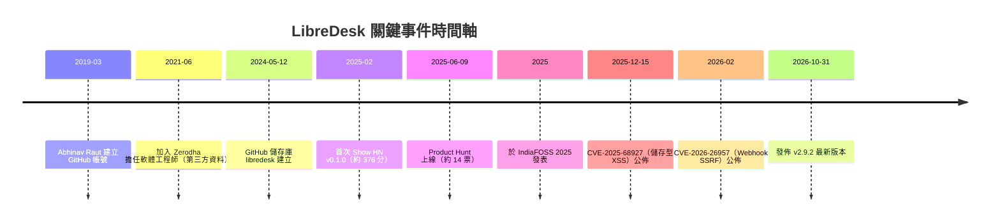

# LibreDesk 專案背景調查：公司、團隊、資金與社群

## 摘要

LibreDesk 是一套開源、可自架（self-hosted）的全通路客服工單系統（helpdesk / customer support desk），以單一執行檔（single binary）形式發佈，常被視為 Intercom、Zendesk、Chatwoot 的輕量替代方案[^gh-repo]。本報告針對專案背後的**組織、團隊、資金、商業模式、社群與外界評價**進行調查。

核心結論：LibreDesk 並非一家創投支持的初創公司，而是一名任職於印度券商 Zerodha 的工程師 **Abhinav Raut**（GitHub 帳號 `abhinavxd`）的個人開源專案，隸屬於 Zerodha 工程師群體的開源品牌「4th Cross Labs」，且已在 Zerodha 內部生產環境使用[^fc-author][^fc-labs][^forklore]。

---

## 一、專案基本資料

| 項目 | 內容 |
|---|---|
| 專案名稱 | LibreDesk |
| 官方網站 | https://libredesk.io |
| 原始碼 | https://github.com/abhinavxd/libredesk |
| 建立日期 | 2024-05-12 |
| 授權條款 | AGPL-3.0 |
| 主要語言 | Go（後端）；Vue.js 3 + Shadcn UI（前端） |
| GitHub Stars | 約 3,118 |
| Forks | 約 328 |
| Watchers | 約 16 |
| Open Issues | 約 133 |
| 最新版本 | v2.9.2（2026-10-31） |
| 定位 | 開源、自架的全通路客服系統，單一執行檔 |

上述統計數據取自 GitHub API 於 2026-11-04 的回傳值[^gh-api-repo]。專案描述為「Open-source, self-hosted customer support desk in a single binary. A lightweight alternative to Intercom, Zendesk, Chatwoot」[^gh-api-repo]。技術上，後端以 Go 撰寫，前端為 Vue.js 3 搭配 Shadcn UI，並需要 PostgreSQL 與 Redis 作為相依服務[^gh-readme][^libredesk-site]。

值得注意的是，官方與社群文宣皆強調「single binary」，但實際部署仍需 PostgreSQL 與 Redis，因此「單一執行檔」指的是應用層的封裝方式，而非零相依的獨立系統[^libredesk-site]。

---

## 二、團隊與組織

### 2.1 主要開發者

LibreDesk 由 **Abhinav Raut**（GitHub：`abhinavxd`）主導。其 GitHub 個人資料顯示[^gh-api-user]：

- 姓名：Abhinav Raut
- 公司欄位（company）：`@zerodha`
- 個人網站：https://abhinavr.me
- 所在地：Bangalore, India（印度邦加羅爾）
- 公開專案數：34
- Followers：約 191
- GitHub 帳號建立於：2019-03-02

其個人簡介平台 Forklore（FOSS United 維護的開源維護者名錄）將其職稱列為「Tech @ Zerodha」[^forklore]。另一份職涯資料指其自 2021 年 6 月起於 Zerodha 擔任軟體工程師，此前曾任職於 go4WorldBusiness[^linkedin]（此項職涯細節來自第三方彙整，未能直接以原始頁面查證，見〈八、來源批判〉）。

### 2.2 貢獻者結構

依 GitHub Contributors API 統計，LibreDesk 的貢獻高度集中於單一作者[^gh-api-contrib]：

| 貢獻者 | 貢獻次數 | 備註 |
|---|---|---|
| abhinavxd | 2,525 | 專案作者 |
| dependabot[bot] | 46 | 自動化依賴更新機器人 |
| csr4422 | 44 | 社群貢獻者 |
| jleroy | 27 | 社群貢獻者 |
| Gumbraise | 18 | 社群貢獻者 |
| 其他 | 多為 2–8 次 | 零星的社群貢獻 |

這顯示專案在程式碼層面本質上仍是「一人專案」，其餘貢獻者多為小型修正或翻譯；社群翻譯則透過 Crowdin 平台進行[^gh-readme]。

### 2.3 4th Cross Labs（所屬開源品牌）

LibreDesk 被收錄於 **4th Cross Labs** 這個「開源駭客共同體（open source hacker collective）」[^fc-labs]。該組織的自我描述為：

> 「我們是一個開源駭客共同體，名字來自 Bengaluru 的 JP Nagar 第 4 Cross 街，十多年前 Zerodha 就是在這裡開始寫程式的。」[^fc-labs]

4th Cross Labs 並非一家公司，而是 Zerodha 技術團隊發佈開源專案的品牌與集合頁。其精選專案包括了 mailing list 工具 listmonk（約 24.1k stars）、logchef、dungbeetle、whatomate 等[^fc-labs]。在 4th Cross Labs 的專案頁上，LibreDesk 標有「Used in production at Zerodha」的 Zerodha 圖示，代表它已在 Zerodha 生產環境中運行[^fc-labs][^fc-author]。

---

## 三、資金與商業模式

### 3.1 沒有創投資金

綜合目前可得的公開資料，**LibreDesk 沒有外部創投、天使投資或任何機構資金**，也找不到公司登記或初創公司的痕跡。專案託管於作者個人的 GitHub 帳號下（`abhinavxd/libredesk`），而非任何公司組織帳號[^gh-repo]。

### 3.2 商業模式：完全免費，無付費層級

官方 FAQ 明確表示[^libredesk-site]：

- 「Is libredesk really free?」→「是的。libredesk 是開源且可免費自架，所有功能都包含在內，沒有付費層級。」
- 「Is there a hosted version?」→「沒有，libredesk 是自架方案。」

換言之，LibreDesk 並非 open-core 模式（不像部分競品把功能鎖在付費模組），而是**全功能開源、零付費**。唯一可見的商業化痕跡，是官網與 README 中指向 Railway 的一鍵部署連結，該連結帶有推薦碼（`referralCode=4gdm5b`），屬於聯盟／推薦性質的導流[^gh-readme][^libredesk-site]。專案同時接受 GitHub Sponsors 贊助。

### 3.3 作者對永續性的態度

在 Forklore 的訪談中，作者被問及「為什麼要做這件事、為什麼要維護 FOSS 專案」，回答是[^forklore]：

> 「為了寫程式的樂趣。……我想要的那個東西、完全照我想要的方式，並不存在，所以我自己做出來。」
>
> 「開源反派起源故事：市面上沒有一個真正免費、現代、高效能的開源 help desk，它們多半過時、是 open-core 且有嚴格限制，或過於複雜難以管理與部署。」

其給年輕版自己的 FOSS 維護者建議是「Ship fast. Ship ugly. Ship again.」[^forklore]

---

## 四、產品與功能輪廓

LibreDesk 主打將電子郵件、即時聊天（live chat widget）與 WhatsApp（透過 Meta Cloud API）整合進同一個共享收件匣[^gh-readme][^libredesk-site]。主要功能包含：

- **全通路共享收件匣**：Email、Live Chat、WhatsApp 單一收件匣
- **Help Center / 知識庫**：可搜尋、支援多語言
- **AI Assistant**：以知識庫為基礎自動回覆即時聊天，必要時轉交真人
- **Agent Copilot**：草擬回覆、摘要對話、查詢知識庫
- **Automations**：依對話事件自動標籤、指派、路由
- **Macros、Auto Assignment、SLA 管理、CSAT 與分析**
- **角色權限（RBAC）與 SSO**：支援 Google、Microsoft 及任意 OIDC 供應商
- **API 與 Webhooks、活動日誌**
- **自訂屬性、標籤、自訂狀態、Snooze**

[^gh-readme][^libredesk-site]

部署方式包含：直接下載二進位檔（Linux、macOS、Windows、FreeBSD、NetBSD、OpenBSD 等）、Docker，或 Railway 一鍵部署[^libredesk-site]。

---

## 五、社群與外界評價

### 5.1 Hacker News

LibreDesk 曾在 Hacker News 上兩度以「Show HN」形式發表[^hn-1][^hn-2]：

- 首次（2025 年 2 月，v0.1.0）：獲得約 **376 分、75 則留言**，反應熱烈，被形容為「乾淨的 UI」、「long overdue」、「非常有潛力」。
- 第二次（約半年後的全通路版本更新）：僅約 **7 分、4 則留言**，聲量明顯偏低；有留言批評著陸頁「基本上是一面白牆」。

社群回饋中反覆出現的**批評與顧慮**包括[^hn-1]：

- **AGPL-3.0 授權**：部分使用者認為比競品 Chatwoot 的 MIT 更嚴格，可能影響企業採用。
- **缺乏商業模式**：擔心作者若無收入來源，專案可能因時間或動機耗盡而停擺。
- **整合生態不足**：客服系統的關鍵在於整合（如 Shopify、WooCommerce），而這正是 Zendesk 的護城河。
- **SLA 功能過於陽春**：有留言指出在多客戶情境下，SLA 需要更完整的日曆、假日等支援。
- **文件與藍圖不足**：初期缺乏文件與可見的 roadmap。
- **相依性**：仍需 PostgreSQL 與 Redis，並非嚴格意義上的零相依系統。

### 5.2 Product Hunt 與 Reddit

- Product Hunt：於 2025-06-09 上線，約 14 票、1 則留言，聲量不大[^ph]。
- Reddit：r/selfhosted 有相關討論串，但整體足跡有限，未形成大型社群[^reddit]。

### 5.3 第三方評測

- **LinuxLinks**（約 2026 年 6 月）以正面、描述性的語氣介紹 LibreDesk，並將其列為免費開源客服／工單軟體之一，同類競品包含 Zammad、osTicket、FreeScout、Frappe Helpdesk 等[^linuxlinks]。
- 一份 FreeScout 與 LibreDesk 的比較文（2026 年 10 月）指出：FreeScout 較成熟但把 SSO、自訂屬性、巨集、API、知識庫、自動化、CSAT 等功能拆成付費模組；LibreDesk 則將這些全部內建，但問世較晚，需要使用者「信任較年輕的軟體」[^systhoughts]。

### 5.4 安全性事件

LibreDesk 在問世首年曾出現至少兩起公開揭露的安全弱點[^cve-xss][^cve-ssrf]：

- **CVE-2025-68927**（2025-12-15 公佈，CVSS v4 約 7.3，High）：儲存型 HTML 注入／XSS，影響 `< 0.8.6-beta`，已於 0.8.6-beta 修補。
- **CVE-2026-26957**（約 2026 年 2 月）：Webhook URL 未驗證導致 SSRF，具「Application Admin」權限者可使伺服器對任意內部位址發送請求；相關 GitHub Advisory（GHSA-wgm6-9rvv-3438）後被撤回，但 CVE 紀錄仍存在。

---

## 六、時間軸概覽

（時間軸中各事件之來源分見對應註腳；2021 年加入 Zerodha 的月份來自第三方職涯彙整，未經原始頁面確認。）

---

## 七、綜合評估

以「公司／創投／團隊／社群／資金」五個維度總結：

| 維度 | 結論 |
|---|---|
| **公司** | 無獨立公司實體；屬於 Zerodha 工程師群體的開源品牌「4th Cross Labs」之下 |
| **創投** | 無任何創投或天使資金 |
| **團隊** | 實質上為一人專案（作者 Abhinav Raut），社群貢獻零散 |
| **社群** | GitHub 約 3.1k stars、328 forks；HN 首發聲量高但後續轉弱；Reddit／Product Hunt 聲量有限 |
| **資金／商業模式** | 完全免費、無付費層級、無 hosted 版本；僅有 Railway 推薦導流與 GitHub Sponsors |

LibreDesk 的優勢在於**單一執行檔的簡潔部署**與**全功能免費**（相對 FreeScout、Chatwoot 等），並有 Zerodha 生產環境的實證背書[^fc-labs]。主要風險則在於**一人維護的永續性**、**整合生態不足**、**較年輕且曾出現安全弱點**，以及 AGPL 授權對部分企業的採用障礙[^hn-1]。

---

## 八、來源批判（Critical Reflection）

為避免誤導，以下說明本報告在證據強度上的限制：

1. **官方自述 vs. 第三方資料**：GitHub API 的星數、貢獻者、版本等屬於可重複查證的一手資料，可信度高；官網與 README 屬官方自述，功能描述可能有行銷成分，但關於「免費、無付費層級、無 hosted」的敘述與第三方比較文一致，可交叉印證。
2. **無資金為「推論」而非「公告」**：本報告「無創投」的結論來自**找不到任何融資證據**（無公司實體、無 Crunchbase 類紀錄、託管於個人帳號），屬於「absence of evidence」的推論，嚴格來說不等於存在一份明確聲明「我們沒有融資」。讀者應理解此為合理但非絕對的判斷。
3. **部分數字來自 AI 摘要**：HN 分數、Product Hunt 票數、Reddit 討論、CVE 細節與第三方評測內容，主要透過 AI 輔助搜尋彙整取得，個別數字（如 HN 376 分）可能隨時間變動或因頁面快取而略有出入；這些屬「可能變動的社群指標」，建議以原始連結覆核。
4. **第三方職涯資料**：作者「2021 年 6 月加入 Zerodha、此前任職 go4WorldBusiness」等細節來自 LinkedIn 類第三方彙整，直接抓取原始頁面時遭封鎖（HTTP 999），故未能以一手來源確認。
5. **時間敏感性**：所有統計數據（stars、forks、issues、版本）皆為 **2026-11-04** 的快照，開源專案變動快速，數週後即可能不同。
6. **立場偏誤**：Forklore、4th Cross Labs 屬推廣性質來源，語氣偏正面；HN 留言則偏向開發者社群觀點，可能低估企業採購情境的需求。本報告盡量並陳正反意見，但讀者仍應留意來源各自的立場。

---

## 參考文獻

4th Cross Labs. (n.d.). *abhinavxd*. Retrieved 2026-11-04, from https://fourthcross.tech/authors/abhinavxd/

4th Cross Labs. (n.d.). *4th Cross Labs / Open source hacker collective*. Retrieved 2026-11-04, from https://fourthcross.tech/

FOSS United. (n.d.). *Abhinav Raut — Forklore*. Retrieved 2026-11-04, from https://forklore.in/maintainers/abhinavxd/

GitHub. (n.d.). *abhinavxd/libredesk*. Retrieved 2026-11-04, from https://github.com/abhinavxd/libredesk

GitHub. (n.d.). *abhinavxd (Abhinav Raut)*. Retrieved 2026-11-04, from https://github.com/abhinavxd

GitHub API. (2026). *Repository metadata: abhinavxd/libredesk* [Data file]. Retrieved 2026-11-04, from https://api.github.com/repos/abhinavxd/libredesk

GitHub API. (2026). *User metadata: abhinavxd* [Data file]. Retrieved 2026-11-04, from https://api.github.com/users/abhinavxd

GitHub API. (2026). *Contributors: abhinavxd/libredesk* [Data file]. Retrieved 2026-11-04, from https://api.github.com/repos/abhinavxd/libredesk/contributors

GitHub API. (2026). *Releases: abhinavxd/libredesk* [Data file]. Retrieved 2026-11-04, from https://api.github.com/repos/abhinavxd/libredesk/releases

GitHub Advisory Database. (2025). *CVE-2025-68927: Stored HTML injection in libredesk*. Retrieved 2026-11-04, from https://github.com/advisories

Hacker News. (2025). *Show HN: Libredesk – Open-source customer support desk. Single binary app*. Retrieved 2026-11-04, from https://news.ycombinator.com/item?id=43158166

Hacker News. (2025). *Show HN: Libredesk – self-hosted, single binary Intercom/Zendesk alternative*. Retrieved 2026-11-04, from https://news.ycombinator.com/item?id=47833870

IndiaFOSS. (2025). *libredesk (IndiaFOSS 2025)* [Slide deck]. Retrieved 2026-11-04, from https://files.fossunited.org/indiafoss-2025/libredesk_abhinav.pdf

LibreDesk. (n.d.). *libredesk — Modern Open Source Omnichannel Customer Support Desk*. Retrieved 2026-11-04, from https://libredesk.io

LinuxLinks. (2026). *LibreDesk — self-hosted omnichannel customer support desk*. Retrieved 2026-11-04, from https://www.linuxlinks.com/libredesk-self-hosted-omnichannel-customer-support-desk/

LinkedIn. (n.d.). *Abhinav Raut*. Retrieved 2026-11-04, from https://in.linkedin.com/in/abhinav-raut

Systematic Thoughts. (2026, October). *FreeScout vs LibreDesk: migrating a self-hosted helpdesk*. Retrieved 2026-11-04, from https://systhoughts.com/

[^gh-repo]: GitHub. (n.d.). abhinavxd/libredesk. Retrieved 2026-11-04, from https://github.com/abhinavxd/libredesk

[^gh-readme]: LibreDesk 專案 README（包含功能清單、技術棧 Go + Vue.js 3、Crowdin 翻譯、Railway 部署連結）。Retrieved 2026-11-04, from https://raw.githubusercontent.com/abhinavxd/libredesk/main/README.md

[^gh-api-repo]: GitHub API. (2026). Repository metadata: abhinavxd/libredesk [Data file]. Retrieved 2026-11-04, from https://api.github.com/repos/abhinavxd/libredesk（stars 3,118；forks 328；open issues 133；created_at 2024-05-12；license AGPL-3.0；language Go）

[^gh-api-user]: GitHub API. (2026). User metadata: abhinavxd [Data file]. Retrieved 2026-11-04, from https://api.github.com/users/abhinavxd

[^gh-api-contrib]: GitHub API. (2026). Contributors: abhinavxd/libredesk [Data file]. Retrieved 2026-11-04, from https://api.github.com/repos/abhinavxd/libredesk/contributors

[^gh-api-releases]: GitHub API. (2026). Releases: abhinavxd/libredesk [Data file]. Retrieved 2026-11-04, from https://api.github.com/repos/abhinavxd/libredesk/releases（最新穩定版 v2.9.2，publish 2026-10-31）

[^libredesk-site]: LibreDesk. (n.d.). libredesk — Modern Open Source Omnichannel Customer Support Desk. Retrieved 2026-11-04, from https://libredesk.io

[^fc-labs]: 4th Cross Labs. (n.d.). 4th Cross Labs / Open source hacker collective. Retrieved 2026-11-04, from https://fourthcross.tech/

[^fc-author]: 4th Cross Labs. (n.d.). abhinavxd. Retrieved 2026-11-04, from https://fourthcross.tech/authors/abhinavxd/

[^forklore]: FOSS United. (n.d.). Abhinav Raut — Forklore. Retrieved 2026-11-04, from https://forklore.in/maintainers/abhinavxd/

[^linkedin]: LinkedIn. (n.d.). Abhinav Raut. Retrieved 2026-11-04, from https://in.linkedin.com/in/abhinav-raut（第三方職涯彙整；原始頁面抓取受限）

[^hn-1]: Hacker News. (2025). Show HN: Libredesk – Open-source customer support desk. Single binary app. Retrieved 2026-11-04, from https://news.ycombinator.com/item?id=43158166

[^hn-2]: Hacker News. (2025). Show HN: Libredesk – self-hosted, single binary Intercom/Zendesk alternative. Retrieved 2026-11-04, from https://news.ycombinator.com/item?id=47833870

[^ph]: Product Hunt 上線資料。Retrieved 2026-11-04, from https://www.producthunt.com/（LibreDesk 於 2025-06-09 上線，約 14 票、1 則留言）

[^reddit]: Reddit. (n.d.). r/selfhosted 討論串。Retrieved 2026-11-04, from https://www.reddit.com/r/selfhosted/

[^linuxlinks]: LinuxLinks. (2026). LibreDesk — self-hosted omnichannel customer support desk. Retrieved 2026-11-04, from https://www.linuxlinks.com/libredesk-self-hosted-omnichannel-customer-support-desk/

[^systhoughts]: Systematic Thoughts. (2026, October). FreeScout vs LibreDesk: migrating a self-hosted helpdesk. Retrieved 2026-11-04, from https://systhoughts.com/

[^cve-xss]: GitHub Advisory Database. (2025). CVE-2025-68927: Stored HTML injection in libredesk. Retrieved 2026-11-04, from https://github.com/advisories

[^cve-ssrf]: GitHub Security Advisories. (2026). CVE-2026-26957: SSRF via webhooks in libredesk. Retrieved 2026-11-04, from https://github.com/abhinavxd/libredesk/security/advisories（GHSA-wgm6-9rvv-3438，後續狀態為 withdrawn）

[^indiafoss]: IndiaFOSS. (2025). libredesk (IndiaFOSS 2025) [Slide deck]. Retrieved 2026-11-04, from https://files.fossunited.org/indiafoss-2025/libredesk_abhinav.pdf（該簡報提及 Zerodha 內部約 500 名客服人員使用需求；此引述來自我方以工具彙整 PDF 內容，未逐頁人工覆核）
