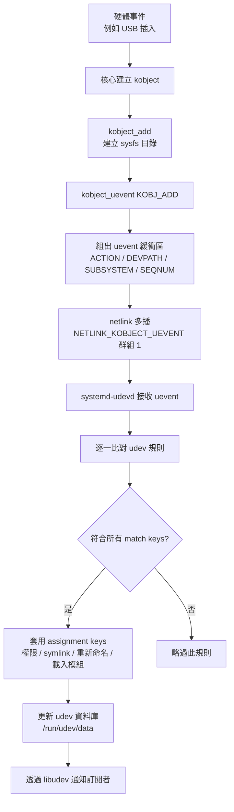
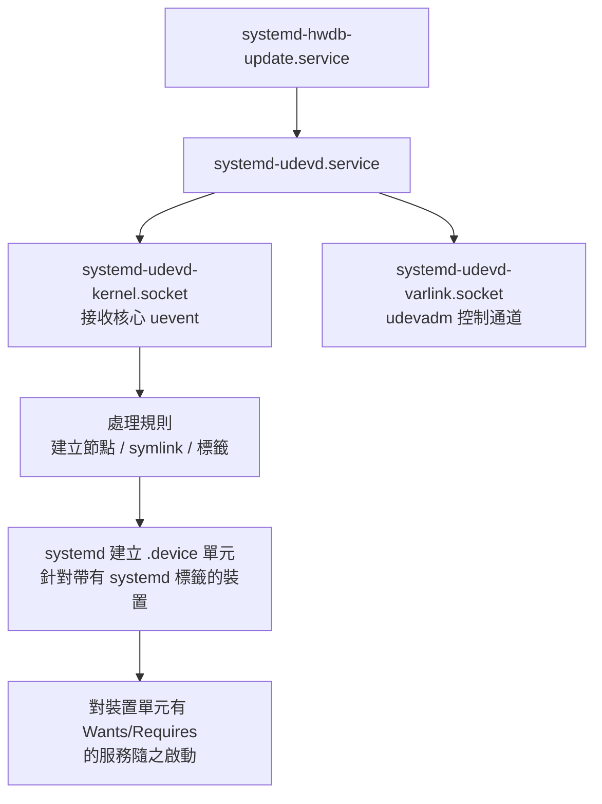

# Linux 中的 udev 介紹

## 摘要

`udev`（user space `/dev` 的縮寫）是 Linux 上負責動態管理裝置節點的使用者空間系統[^udev]. 它的常駐程式 `systemd-udevd` 直接接收核心送出的裝置事件（uevent），並依照設定規則處理裝置命名、權限、符號連結（symlink）、核心模組載入與網路介面重新命名等工作[^udev7]. 本文從歷史脈絡、核心機制、規則語法、工具鏈到與 systemd 的整合，完整介紹 udev 的定位與運作方式。

## 一、什麼是 udev

Linux 核心在偵測到硬體時，通常會依照「被發現的順序」指派難以預測的裝置名稱，例如 `/dev/sda`、`/dev/sdb` 可能在不同開機之間互換[^arch]. udev 的角色就是提供一個使用者空間機制，讓系統管理員能針對裝置事件註冊處理常式，並依據裝置的實際屬性賦予穩定、可預測的名稱與權限[^arch][^udev7].

udev 的主要功能包括[^arch]:

- 對周邊裝置的偵測與熱插拔（hot-plug）作出反應。
- 載入核心模組或裝置韌體（firmware）。
- 調整裝置節點權限，讓非 root 的使用者或群組得以存取。
- 管理 `/dev` 中的裝置節點：新增、建立符號連結與重新命名。

> 重要觀念：udev 是 systemd 專案的一部分，在現代發行版（例如 Arch Linux）中預設安裝[^arch].

## 二、歷史脈絡：從靜態 `/dev` 到 udev

### 2.1 靜態 `/dev` 與 devfs

在動態裝置管理出現之前，Linux 使用「靜態 `/dev`」：由 `MAKEDEV` 之類的腳本呼叫 `mknod`，為每一種「想像得到的」裝置建立節點，不論硬體是否實際存在。這種做法被核心開發者 Greg Kroah-Hartman 形容為「笨重且龐大」，並面臨 major/minor 編號耗盡的問題[^kh].

`devfs`（Device Filesystem）是第一個動態方案，於 2000 年合併進 Linux 2.3.46 核心，並貫穿 2.4 系列[^wiki]. 它在核心空間中自動填充 `/dev`，只列出實際存在的裝置。然而 devfs 有幾項根本缺陷[^kh]:

- 命名政策被寫進核心，違反「核心不應含有政策（no policy in the kernel）」的原則。
- 未遵循 LSB 裝置命名標準。
- 設計上存在無法修補的競爭條件（race condition）。
- 不支援持久化裝置命名（無法指定「這顆磁碟永遠叫 `boot_disk`」）。
- 不具備模組自動載入能力。

2003 年，Christoph Hellwig 將 devfs 標記為過時（obsolete），理由是「沒有人願意接手維護，而我們現在有了 udev 這個正當的替代品」[^lwn50731]. devfs 最終在 2006 年（核心 2.6.18）被移除[^wiki].

### 2.2 核心裝置模型與 sysfs

讓 udev 成為可能的基礎，是 2.5 開發週期引入的 **Linux 核心裝置模型（device model）**[^lwn31185]. 此模型追蹤[^lwn31185]:

- 有哪些裝置存在，以及它們的電源狀態、所連接的匯流排與驅動程式。
- 匯流排拓樸（例如插在 PCI 上的 USB 控制器）。
- 已知的驅動程式，以及它們支援哪些裝置。
- 裝置類別（磁碟、序列埠、滑鼠等）。

此模型建立在 **kobject** 與 **kset** 之上，提供參考計數、父子關係與熱插拔事件通知[^lwn31185]. **sysfs**（通常掛載於 `/sys`）是這個裝置模型在使用者空間的可見代表；它把每個被偵測到的裝置匯出成目錄樹，並以屬性檔案暴露廠商 ID、裝置 ID、子系統、驅動別名與實體拓樸等資訊，供 udev 組織規則使用[^lwn31185]. 換言之，裝置模型與 sysfs 是不同實體：裝置模型沒有 sysfs 也能運作，反之則不然[^lwn31185].

`udev` 於 Linux 2.5 系列問世，由 Greg Kroah-Hartman 與 Kay Sievers 開發[^wiki]. 對照 devfs 的缺陷，udev 的設計目標是[^kh]:

| 需求 | udev 的做法 |
|---|---|
| 動態 `/dev` | 只填充實際存在的裝置 |
| 動態 major/minor 編號 | 支援任何編號方式 |
| 持久化裝置命名 | **主要目標**：依序號、實體路徑命名 |
| 裝置事件通知 | 透過 netlink/D-Bus 發出事件 |
| 核心不帶政策 | **所有命名政策移到使用者空間** |
| 遵循 LSB 標準 | 預設採用 LSB 命名，且易於覆寫 |
| 精簡體積 | 約 49KB 的二進位檔，完全在使用者空間 |

在 Greg 的評語中，這是「devfs 七項中只達成兩項，而 udev 七項全數達成」[^kh].

## 三、核心機制：uevent 與 netlink

udev 之所以能運作，是因為核心會在使用者空間可見的物件發生狀態變化時，主動推送 **uevent** 訊息[^kobject].

### 3.1 kobject 與 uevent 的產生

uevent 的產生起點是 `kobject`——代表核心物件（裝置、驅動程式、網路介面等）的基本資料結構。當 kobject 被加入核心時，核心會呼叫 `kobject_uevent()`；其核心實作 `kobject_uevent_env()`（位於 `lib/kobject_uevent.c`）會組出緩衝區，內容是一連串以 NUL 分隔的 `KEY=VALUE` 字串[^kobject]:

1. 標頭行：`"add@/devices/pci0000:00/.../block/sda"`（動作字串 + `@` + 裝置路徑）。
2. `ACTION`：事件動作（例如 `add`、`remove`、`change`）。
3. `DEVPATH`：完整 sysfs 裝置路徑。
4. `SUBSYSTEM`：子系統（例如 `usb`、`block`、`net`）。
5. 呼叫端提供的額外環境變數。
6. kset 提供的變數（透過 `uevent_ops->uevent()` 回呼）。
7. `SEQNUM`：單調遞增的全域序號，最後附加。

支援的動作類型如下[^kobject]:

| 列舉常數 | 字串 | 意義 |
|---|---|---|
| `KOBJ_ADD` | `add` | kobject 被建立/註冊 |
| `KOBJ_REMOVE` | `remove` | kobject 被銷毀 |
| `KOBJ_CHANGE` | `change` | 狀態改變 |
| `KOBJ_MOVE` | `move` | 在 sysfs 中被移動 |
| `KOBJ_ONLINE` | `online` | 裝置上線 |
| `KOBJ_OFFLINE` | `offline` | 裝置離線 |
| `KOBJ_BIND` | `bind` | 驅動程式綁定至裝置 |
| `KOBJ_UNBIND` | `unbind` | 驅動程式自裝置解除綁定 |

### 3.2 netlink 傳遞

uevent 透過 netlink 通訊端傳給使用者空間，協定家族為 **`NETLINK_KOBJECT_UEVENT`**[^kobject]. 核心端的 `kobject_uevent_net_broadcast()` 會建立 `sk_buff`，設定 `dst_group = 1`（多播群組 1）、`portid = 0`（代表來自核心），接著以 `netlink_broadcast()` 多播給所有監聽者[^kobject]. 緩衝區超載（`ENOBUFS`）與沒有監聽者（`ESRCH`）被視為非致命錯誤[^kobject].

使用者空間的接收方式是[^kobject]:

```c
int sock = socket(AF_NETLINK, SOCK_RAW, NETLINK_KOBJECT_UEVENT);
struct sockaddr_nl addr = {
    .nl_family = AF_NETLINK,
    .nl_groups = 1,    /* 加入多播群組 1 */
};
bind(sock, (struct sockaddr *)&addr, sizeof(addr));
/* 之後以 recvmsg() 接收 uevent 訊息 */
```

此外，使用者空間也能製造「合成 uevent」：例如寫入 sysfs 的 `uevent` 檔案（`echo change > /sys/class/net/eth0/uevent`），或透過 netlink 送出訊息（需具備 `CAP_SYS_ADMIN`）[^kobject]. 核心亦保留一個傳統機制 `CONFIG_UEVENT_HELPER_PATH`，會為每個 uevent 以 `call_usermodehelper()` 執行一個使用者空間 helper（如 `/sbin/hotplug`），但現代系統通常停用[^kobject].

### 3.3 devtmpfs

`devtmpfs` 是核心檔案系統（並非 udev 功能），會在核心偵測到硬體時，自動在 `/dev` 內建立初始裝置節點[^arch]. 核心驅動程式初始化裝置時，裝置節點的預設狀態為 `root:root`、權限 `600`，除非驅動程式本身或使用者空間的 udev 規則改變它[^arch]. 換言之，devtmpfs 提供初始節點，udev 再在其上套用權限、擁有者、符號連結與命名[^arch][^lfs].

## 四、udev 的元件

依 Wikipedia 的整理，udev 可拆成三個部分[^wiki]:

1. **libudev**：提供存取裝置資訊的函式庫（於 systemd 183 被納入系統）。
2. **udevd**（`systemd-udevd`）：管理 `/dev` 的使用者空間常駐程式。
3. **udevadm**：用於診斷、觸發與控制的命令列工具。

### 4.1 `systemd-udevd` 常駐程式

`systemd-udevd.service` 是處理裝置事件的常駐程式。它直接從核心接收 uevent，當收到裝置事件時，會將設定好的規則集合與各種裝置屬性進行比對，以辨識裝置[^udev7][^udevd8]. 規則若相符，可以將裝置資訊存入 udev 資料庫、建立符號連結、設定權限或執行程式[^udev7]. 所有 udev 處理過的裝置資訊都存於 **udev 資料庫**，並透過 `libudev` 發送給事件訂閱者[^udev7].

`systemd-udevd` 的服務單元具有以下特徵[^udevd8]:

- 型別為 `notify-reload`，啟動完成時通知 systemd，並支援重新載入。
- `Restart=always`、`RestartSec=0`。
- 綁定 `systemd-udevd-kernel.socket` 與 `systemd-udevd-varlink.socket`。
- 大量沙箱化設定：`PrivateMounts=yes`、`MemoryDenyWriteExecute=yes`、`RestrictRealtime=yes`、嚴格的 `SystemCallFilter=`、`IPAddressDeny=any` 等。
- OOM 分數 `-1000`，避免被 OOM killer 終止。
- 使用 `Delegate=` 搭配 `DelegateSubgroup=udev`，以 cgroup 管理 worker 行程。

可透過下列方式設定[^udevd8]:

1. `udev.conf(5)` 設定檔（`/etc/udev/udev.conf`），選項含 `udev_log=`、`children_max=`、`exec_delay=`、`event_timeout=`、`resolve_names=`、`timeout_signal=`。
2. 命令列選項：`--children-max=`、`--exec-delay=`、`--event-timeout=`、`--resolve-names=` 等。
3. 核心命令列參數：`udev.log_level=`、`udev.children_max=`、`net.ifnames=` 等。

### 4.2 通訊端（sockets）

`systemd-udevd` 涉及的通訊端如下[^udevd8]:

- **`systemd-udevd-kernel.socket`**：主要輸入通道。它監聽型別為 `kobject-uevent`（多播群組 1）的 netlink 通訊端以接收核心 uevent。其單元設定包含 `ReceiveBuffer=128M`（避免突發事件遺失）、`PassCredentials=yes`、`DeferTrigger=yes`（延後至真正需要時才啟用服務，對開機與 initrd 切換根目錄很重要）、`IgnoreOnIsolate=yes`（避免 isolate 或切換根目錄時遺失事件）。
- **`systemd-udevd-varlink.socket`**：控制/管理通道。早期系統中名為 `systemd-udevd-control.socket`，以傳統 UNIX socket 供 `udevadm control` 使用；現行 systemd 已改名並改用 **Varlink** IPC 協定。它處理規則重新載入、調整日誌等級、動態設定 `children_max`、結束或重新載入常駐程式等管理命令。

## 五、裝置事件流程

下圖總結從硬體事件到 udev 處理的完整流程[^udev7][^kobject][^arch].



### 5.1 冷插拔（coldplug）與事件重播

由於 udev 只處理「啟動後」收到的事件，核心在 udev 啟動前就初始化的裝置會被漏掉。因此需要在開機時進行冷插拔處理[^wiki][^lfs]:

- `udevadm trigger` 會為所有已連接的裝置重播 `add` uevent。
- `udevadm settle` 會等待事件佇列清空。
- `udevadm control --reload` 重新載入規則（僅套用於新事件，不會重新觸發既有裝置）。

歷史上，冷插拔由 **`udevtrigger`** 工具負責，其說明為「觸發核心裝置 uevent，以在系統冷插拔時重播遺失的事件」[^udevtrigger]. 早期 udev 也曾以 **`udevsend`** 作為核心 hotplug 的處理常式；後來改用 netlink 直接監聽，`udevsend` 遂被淘汰[^lfs]. 這些工具如今都在 systemd 系統中被取代[^wiki]:

- `udevadm trigger` 取代 `udevtrigger`。
- `systemd-udevd.service` 直接以 netlink 監聽，取代 `udevsend`。
- `systemd-udev-trigger.service` 在開機時執行冷插拔。

## 六、udev 規則（rules）

### 6.1 檔案位置與優先順序

規則檔從下列目錄讀取，並以**字典序（lexicographic order）**處理[^udev7]:

1. `/etc/udev/rules.d`：**最高優先權**（本機管理）。
2. `/run/udev/rules.d`：揮發性的執行期目錄。
3. `/usr/local/lib/udev/rules.d`。
4. `/usr/lib/udev/rules.d`：系統提供的規則。

同名檔案會互相取代；規則檔必須以 `.rules` 為副檔名。在 `/etc/` 中建立指向 `/dev/null` 的符號連結，即可完全停用某個系統規則檔[^udev7].

### 6.2 規則語法

規則的基本形式為[^udev7]:

```
KEY=="value", KEY=="value", ..., KEY="value"
```

- 以 `#` 開頭的行是註解。
- 每條規則是以逗號分隔的 key-operator-value 運算式清單。
- 若所有 **match keys**（`==`、`!=`）皆相符，則套用 **assignment keys**（`=`、`+=`、`:=`）。

運算子如下[^udev7]:

| 運算子 | 意義 |
|---|---|
| `==` | 比較是否相等 |
| `!=` | 比較是否不相等 |
| `=` | 指派值（重設清單） |
| `+=` | 將值加入清單 |
| `-=` | 從清單移除值 |
| `:=` | 最終指派（不允許後續變更） |

字串值支援[^udev7]:

- 雙引號字串：`"string"`。
- 反斜線轉義引號：`\"`。
- `e"string\n"`：C 風格轉義序列。
- `i"string"`：大小寫不敏感比對（僅限 match keys）。

支援的 shell glob 模式[^udev7]:

- `*`：比對零個或多個字元。
- `?`：比對任一個字元。
- `[]`：字元類別（例如 `tty[SR]`、`[0-9]`）。
- `|`：替代樣式（例如 `abc|x*`）。

### 6.3 Match keys（搭配 `==`/`!=`）

| 鍵 | 說明 |
|---|---|
| `ACTION` | 事件動作名稱（`add`、`remove`、`change` 等） |
| `DEVPATH` | 事件裝置的 devpath |
| `KERNEL` | 事件裝置的名稱（如 `sda`、`ttyUSB0`） |
| `KERNELS` | 沿 devpath **向上**搜尋相符的裝置名稱 |
| `NAME` | 比對網路介面名稱（由較早規則設定） |
| `SYMLINK` | 比對指向節點的符號連結 |
| `SUBSYSTEM` | 事件裝置的子系統（如 `block`、`net`、`usb`） |
| `SUBSYSTEMS` | 沿 devpath 向上搜尋相符的子系統 |
| `DRIVER` | 事件裝置的驅動程式名稱 |
| `DRIVERS` | 沿 devpath 向上搜尋相符的驅動程式名稱 |
| `ATTR{filename}` | 比對事件裝置的 sysfs 屬性值 |
| `ATTRS{filename}` | 沿 devpath 向上搜尋相符的 sysfs 屬性 |
| `SYSCTL{kernel_param}` | 比對核心參數值 |
| `ENV{key}` | 比對裝置屬性值 |
| `CONST{key}` | 比對系統常數（`arch`、`virt`、`cvm`） |
| `TAG` | 比對裝置標籤 |
| `TAGS` | 沿 devpath 向上搜尋相符的標籤 |
| `TEST{mask}` | 測試檔案是否存在 |
| `PROGRAM` | 執行程式；若回傳成功則為真 |
| `RESULT` | 比對上一次 `PROGRAM` 呼叫回傳的字串 |

### 6.4 Assignment keys（搭配 `=`/`+=`/`:=`）

| 鍵 | 說明 |
|---|---|
| `NAME` | 設定網路介面名稱（不能更改裝置節點名稱） |
| `SYMLINK` | 建立指向裝置節點的符號連結 |
| `OWNER`、`GROUP`、`MODE` | 裝置節點的權限 |
| `SECLABEL{module}` | 套用 Linux 安全模組標籤 |
| `ATTR{key}` | 將值寫入 sysfs 屬性 |
| `SYSCTL{kernel_param}` | 將值寫入核心參數 |
| `ENV{key}` | 設定裝置屬性值（`.property` 前綴會對資料庫隱藏） |
| `TAG` | 為裝置附加標籤 |
| `RUN{type}` | 在規則處理後執行程式或 builtin |
| `IMPORT{type}` | 匯入變數為裝置屬性（`program`、`builtin`、`file`、`db`、`cmdline`、`parent`） |
| `LABEL` | 供 `GOTO` 跳轉的具名標籤 |
| `GOTO` | 跳至下一個相符的 `LABEL` |
| `OPTIONS` | 規則/裝置選項 |

`OPTIONS` 的子選項包括[^udev7]:

| 選項 | 說明 |
|---|---|
| `link_priority=value` | 符號連結優先權（較高者勝出） |
| `string_escape=none\|replace` | 控制不安全字元的替換 |
| `static_node=` | 對靜態裝置節點套用權限 |
| `watch` | 以 inotify 監看裝置節點是否在寫入後關閉 |
| `nowatch` | 停用 inotify 監看 |
| `db_persist` | 即使執行 `cleanup-db` 仍保留裝置屬性 |
| `log_level=level` | 設定此裝置事件的日誌等級 |
| `dump` | 傾印事件狀態（除錯用） |

`RUN{type}` 的細節[^udev7]:

- `RUN{program}`：執行外部程式（預設）。
- `RUN{builtin}`：使用內建程式。
- 程式必須是**短時間的前景工作**（不可為常駐程式、不可涉及網路、不可掛載/卸載）。
- 若需長時間執行的行程，應使用 `SYSTEMD_WANTS` 拉起一個 service unit。

### 6.5 替代變數

| 語法 | 意義 |
|---|---|
| `$kernel` / `%k` | 核心裝置名稱 |
| `$number` / `%n` | 核心編號（如 `sda3` 的 `3`） |
| `$devpath` / `%p` | 裝置 devpath |
| `$attr{file}` / `%s{file}` | sysfs 屬性值 |
| `$env{key}` / `%E{key}` | 裝置屬性值 |
| `$major` / `%M` | major 編號 |
| `$minor` / `%m` | minor 編號 |
| `$result` / `%c` | 上一次 `PROGRAM` 呼叫的結果 |
| `$parent` / `%P` | 父裝置節點名稱 |
| `$name` | 目前裝置名稱 |
| `$root` / `%r` | udev_root 值 |
| `$sys` / `%S` | sysfs 掛載點 |
| `$devnode` / `%N` | 裝置節點名稱 |

## 七、udevadm 工具

`udevadm` 是 udev 的管理工具，用於控制常駐程式、查詢資料庫、觸發事件、監看事件與除錯規則[^udev7].

| 命令 | 用途 |
|---|---|
| `udevadm info` | 查詢 udev 資料庫中的裝置資訊，支援 `--query=property`、`--attribute-walk`、`--tree`、`--export-db` |
| `udevadm trigger` | 向核心要求/重播裝置事件（用於冷插拔），支援 `--action=add\|remove\|change\|move`、`--subsystem-match`、`--attr-match` |
| `udevadm settle` | 等待事件佇列清空（預設逾時 120 秒） |
| `udevadm control` | 修改常駐程式執行期狀態：`--exit`、`--reload`、`--log-level=`、`--stop-exec-queue`、`--start-exec-queue`、`--children-max=`、`--ping` |
| `udevadm monitor` | 監聽核心 uevent 與 udev 事件，支援 `--kernel`、`--udev`、`--property`、`--subsystem-match` |
| `udevadm test` | 模擬某裝置的 udev 事件執行（除錯規則用） |
| `udevadm test-builtin` | 執行某裝置的指定 builtin 並印出除錯輸出 |
| `udevadm verify` | 驗證規則檔的語法、語意與風格正確性 |
| `udevadm cat` | 顯示 udev 規則檔或 udev.conf |
| `udevadm wait` | 等待裝置被建立並初始化 |
| `udevadm lock` | 對區塊裝置取得建議性專屬鎖（例如格式化時） |

## 八、udev 資料庫與硬體資料庫（hwdb）

### 8.1 udev 資料庫

所有 udev 處理過的裝置資訊都儲存在 **udev 資料庫**，並發送給可能的事件訂閱者；存取所有儲存資料與事件來源的介面由 `libudev` 提供[^udev7]. 其特性如下[^udevd8]:

- **揮發性**：位於 tmpfs 的 `/run/udev/data/`，重開機即消失，並在冷插拔時重建。
- **以裝置為鍵**：每個裝置有一個以其 sysfs 路徑命名的檔案（例如 major:minor 為 `8:0` 的區塊裝置對應 `b8:0`）。
- **內容**：裝置屬性（規則中 `ENV{key}` 設定的鍵值）、標籤、符號連結資訊與中介資料。
- **持久化旗標**：規則可設定 `OPTIONS="db_persist"`（自 v241 起），讓資料在 `udevadm info --cleanup-db` 後仍保留，對 initrd 轉換至 rootfs 期間的 Device Mapper 裝置特別有用。

### 8.2 硬體資料庫（hwdb）

**hwdb** 是將「類 modalias 鍵」對應到「類 udev 屬性值」的鍵值儲存，主要供 udev 為相符裝置附加屬性（例如鍵盤掃描碼對應、滑鼠 DPI、加速度計安裝矩陣）[^udevd8].

文字來源檔位於[^udevd8]:

| 目錄 | 用途 |
|---|---|
| `/usr/lib/udev/hwdb.d/` | 系統提供的 hwdb 檔 |
| `/etc/udev/hwdb.d/` | 本機覆寫 |
| `/run/udev/hwdb.d/` | 執行期覆寫 |

檔案必須以 `.hwdb` 為副檔名，以字典序排序；`/etc/` 中同名的檔案會覆寫 `/usr/lib/` 者。指向 `/dev/null` 的符號連結可完全停用某檔案[^udevd8].

每個記錄由三部分構成[^udevd8]:

1. **Match 行**：從第 0 欄開始，使用 shell glob 模式（`*`、`?`、`[chars]`）。
2. **鍵值行**：以一個前導空格縮排，格式為 `KEY=value`。
3. **空行**：分隔記錄。

範例[^udevd8]:

```hwdb
# /usr/lib/udev/hwdb.d/60-keyboard.hwdb
evdev:atkbd:dmi:bvn*:bvr*:bd*:svnAcer*:pn*:*
 KEYBOARD_KEY_a1=help
 KEYBOARD_KEY_a2=setup

# /etc/udev/hwdb.d/70-keyboard.hwdb
evdev:atkbd:*
 KEYBOARD_KEY_a2=reserved
```

當多個記錄相符時，較高優先權記錄的鍵會覆寫較低者；優先權由檔名的字典序（越後者越高）與檔案內位置（越後者越高）決定[^udevd8].

`systemd-hwdb(8)` 會將文字檔編譯為二進位資料庫，執行期只使用編譯後的二進位檔以加快查詢[^udevd8]:

```
systemd-hwdb update            # 產生 /etc/udev/hwdb.bin
systemd-hwdb --usr update      # 產生 /usr/lib/udev/hwdb.bin
systemd-hwdb query <MODALIAS>  # 查詢資料庫
```

hwdb 的常見用途包括[^udevd8]:

- **鍵盤掃描碼重映射**：`KEYBOARD_KEY_<scancode>=<keycode>`。
- **滑鼠設定**：`MOUSE_DPI=`、`MOUSE_WHEEL_CLICK_ANGLE=`。
- **輸入裝置辨識**：`ID_INPUT_TRACKBALL=1`、`ID_INPUT_TOUCHPAD=1`。
- **加速度計方向**：`ACCEL_MOUNT_MATRIX=`。
- **指向桿屬性**：`POINTINGSTICK_SENSITIVITY=`。

## 九、核心模組自動載入與 modalias

udev 的核心用途之一是回應周邊偵測與熱插拔，包括把控制權交還核心的動作，例如載入核心模組或裝置韌體[^arch]. 其機制如下[^arch]:

1. 核心偵測到新裝置並發出 uevent。
2. udev 收到事件並比對規則。
3. 依裝置的識別資訊（尤其是 **modalias**），決定要載入哪些核心模組。
4. udev 執行 `modprobe` 載入模組，將控制權交還核心以初始化裝置。

**modalias** 是核心為每個裝置匯出的字串，編碼其識別資訊，例如[^arch]:

```
input:b0003v32ACp0012e0111-e0,1,4,1...
```

其格式編碼了匯流排類型、廠商 ID、產品 ID、版本與裝置能力[^arch]. udev 的硬體資料庫（hwdb）依據 modalias 樣式來指派裝置屬性，「類似於核心模組宣告它們應附掛於哪些裝置」[^arch]. 核心模組本身透過原始碼中的 `MODULE_DEVICE_TABLE` 巨集宣告支援的裝置，編譯成 modalias 別名；當 udev 看到某個裝置的 modalias，便將其字串與所有可用核心模組的別名比對，並透過 `modprobe` 載入相符者[^arch].

需要注意：**核心模組的載入順序不會跨開機保持一致**，因為 udev 以平行方式處理各事件[^arch]. 這正是 `/dev/sda` 可能在下一次開機變成 `/dev/sdb` 的原因，也凸顯了持久化命名的重要性[^arch].

## 十、與 systemd 的整合

udev 與 systemd 深度整合，主要體現在以下幾個層面[^udevd8]:

### 10.1 裝置單元（`.device`）

systemd 會為所有以 `"systemd"` 標籤標記的核心裝置動態建立裝置單元（預設包含所有區塊與網路裝置等）[^udevd8]. 例如 `/dev/sda5` 對應到 `dev-sda5.device`，使裝置能參與 systemd 的相依關係圖。

### 10.2 透過 `SYSTEMD_WANTS` 由裝置觸發服務

在 udev 規則中可設定 `ENV{SYSTEMD_WANTS}="service-name.service"`. 當裝置出現時，systemd 會自動從裝置單元加入 `Wants=` 相依，於裝置可用時啟動該服務[^udevd8]:

```udev
ACTION=="add", SUBSYSTEM=="usb", ENV{ID_VENDOR_ID}=="1234", \
  ENV{ID_MODEL_ID}=="5678", TAG+="systemd", \
  ENV{SYSTEMD_WANTS}="my-usb-service.service"
```

`SYSTEMD_USER_WANTS=` 則用於使用者工作階段的服務管理器[^udevd8]. 這是**從 udev 規則啟動長時間執行行程的建議做法**，相較之下 `RUN+=` 會阻塞事件處理並終止被拉起的行程[^arch].

### 10.3 `SYSTEMD_READY` 與 `SYSTEMD_ALIAS`

有些裝置會先出現在 sysfs、之後才完成初始化。設定 `ENV{SYSTEMD_READY}=0` 可讓 systemd 在後續 `change` uevent 將其設為 1 之前，視該裝置為「未插入」，避免服務在裝置尚不可用時就啟動[^udevd8]. `ENV{SYSTEMD_ALIAS}=` 則可為裝置單元加入別名[^udevd8].

### 10.4 標籤與 `systemd` 標籤

`TAG+="systemd"` 是 udev 與 systemd 之間的關鍵橋樑；裝置必須帶有此標籤，systemd 才會為其建立裝置單元、對 `SYSTEMD_WANTS` 等屬性作出反應，並透過 D-Bus 暴露為 systemd 管理的裝置[^udevd8]. 其他常見標籤包括[^arch]:

| 標籤 | 用途 |
|---|---|
| `TAG+="systemd"` | 指示 systemd 為此裝置建立裝置單元 |
| `TAG+="seat"` | 裝置可參與 seat 指派（systemd-logind） |
| `TAG+="uaccess"` | 授予登入使用者的 ACL 存取權 |
| `TAG+="power-switch"` | 監看蓋子/按鍵事件以觸發休眠 |

`uaccess` 標籤會讓 udev 對裝置節點套用動態使用者 ACL，並與 systemd-logind 協調，使登入使用者可使用該裝置[^arch]. 硬體資料庫則以 `systemd-hwdb update` 管理，其索引通常由發行版的 pacman 掛鉤（如 `30-systemd-hwdb.hook`）在 systemd 升級時自動重建[^arch].

### 10.5 開機順序



`systemd-udevd.service` 宣告 `Before=sysinit.target`，確保在系統初始化完成前，udev 事件處理已在進行；它亦宣告 `Before=soft-reboot.target` 與 `Before=initrd-switch-root.target`，並對這些 target 設定 `Conflicts=`，以避免在狀態轉換期間遺失排隊的 uevent[^udevd8]. 其單元檔並套用 systemd 的多項安全功能，包括 `PrivateMounts=yes`、`RestrictAddressFamilies=AF_UNIX AF_NETLINK AF_INET AF_INET6`、`SystemCallFilter=@system-service @module @raw-io bpf fanotify_init ...`、`IPAddressDeny=any`、`ProtectHostname=yes` 等[^udevd8].

由於 `systemd-udevd.service` 預設以 `PrivateMounts=yes` 與 `IPAddressDeny=` 等限制執行，這會影響 `RUN` 處理常式能做的事[^arch].

## 十一、持久化裝置命名

因為 udev 以平行方式處理事件，`/dev/sda`、`/dev/video0` 等名稱並不穩定；解法是**仰賴 `…/by-id/…`、`…/by-path/…`、`…/by-uuid/…` 等持久識別**，這些是由 udev 規則在 `/dev` 樹中建立的符號連結[^arch]:

- `/dev/disk/by-id/`：依唯一序號。
- `/dev/disk/by-path/`：依實體連接路徑。
- `/dev/disk/by-uuid/`：依檔案系統 UUID。
- `/dev/input/by-id/`、`/dev/input/by-path/`：輸入裝置的持久命名。

以印表機為例[^arch]:

```
SUBSYSTEMS=="usb", IMPORT{builtin}="usb_id"
ENV{ID_SERIAL}=="?*", SYMLINK+="lp/by-id/$env{ID_BUS}-$env{ID_SERIAL}"
IMPORT{builtin}="path_id"
ENV{ID_PATH}=="?*", SYMLINK+="lp/by-path/$env{ID_PATH}"
```

## 十二、實務範例：撰寫 udev 規則

撰寫規則的關鍵步驟如下[^arch]:

1. **辨識裝置**：使用 `udevadm info --attribute-walk --name=/dev/device_name` 往上走訪裝置階層，顯示所有可用的比對屬性。
2. **撰寫規則**：結合該裝置與**恰好一個**父裝置的屬性。
3. **先行測試**：使用 `udevadm test $(udevadm info --query=path --name=device_name) 2>&1`。

一個為特定 USB 網路攝影機建立持久符號連結的規則範例[^arch]:

```
KERNEL=="video[0-9]*", SUBSYSTEM=="video4linux", SUBSYSTEMS=="usb", \
  ATTRS{idVendor}=="05a9", ATTRS{idProduct}=="4519", SYMLINK+="video-cam"
```

此規則以廠商/產品 ID 比對特定 USB 攝影機，並建立穩定的 `/dev/video-cam` 符號連結[^arch].

### 12.1 裝置屬性與事件屬性

- **裝置屬性**（以 `ENV{PROP}=` 設定）會持續存在於裝置上，直到裝置被移除[^arch].
- **事件屬性**是暫時性的，由核心為特定事件設定；可用 `udevadm monitor --property` 觀察[^arch].
- 以 `.` 開頭的事件屬性名稱是合成屬性（由 udev 規則自身設定），不會與核心屬性衝突[^arch].

### 12.2 載入新規則

規則在檔案變更時會自動重新載入，但既有裝置不會被重新觸發；因此需執行[^arch]:

```
udevadm control --reload   # 重新載入規則
udevadm trigger            # 重新觸發所有事件
```

## 十三、`udev`、`eudev` 與其他生態

2012 年起，udev 的程式碼被併入 **systemd**（systemd 183），常駐程式自此更名為 `systemd-udevd.service`[^wiki]. 對於不使用 systemd 的發行版，由 Gentoo 於 2012 年建立的 **eudev** 分支提供獨立於 systemd 的 udev 功能[^wiki]. 在 2000 年代中期，**HAL**（Hardware Abstraction Layer）曾架構在 udev 之上，提供桌面應用程式用的 D-Bus 介面；到了 2010–2011 年，HAL 在多数發行版中被淘汰，其功能部分併入 udev 本身，部分移至專門的常駐程式，例如 **udisks**（儲存）、**upower**（電源管理）與 **NetworkManager**[^wiki].

此外，若要在 udev 規則中掛載磁碟，建議使用 `systemd-mount` 而非 `mount`，因為 udevd 預設執行於獨立的 mount namespace 中；若要觸發桌面通知或其他使用者空間動作，則建議使用 `systemd-run`[^arch].

## 十四、批判性反思

在彙整本文時，筆者對來源的品質與一致性作了以下評估：

- **官方文件優先**：`udev(7)`、`systemd-udevd.service(8)`、`udevadm(8)`、`hwdb(7)` 等 freedesktop.org man 頁面是 udev 行為最直接的權威來源，其對規則語法、資料庫位置與 systemd 整合的描述最為準確[^udev7][^udevd8]. 本文涉及具體語法、路徑與旗標的部分，主要依賴這些來源。
- **核心層面之佐證**：uevent 與 netlink 的機制，以 kernel.org 的官方文件與 `lib/kobject_uevent.c` 原始碼為依據[^kobject]，與 man 頁面互相印證，可信度高。
- **歷史脈絡的來源偏誤**：關於 devfs 缺陷與 udev 設計目標的敘述，主要來自 udev 作者 Greg Kroah-Hartman 於 LWN 發表的文章[^kh]. 此文屬於倡議（advocacy）性質，對 devfs 的評價帶有立場；本文因此以中立措辭轉述其技術論點（如「核心不帶政策」），而非全盤採納其價值判斷。
- **百科與 wiki 的定位**：Wikipedia 與 Arch Wiki 提供了良好的綜覽與實務範例[^wiki][^arch]，但 Arch Wiki 具有發行版特定性（例如 pacman 掛鉤、systemd-mount 建議），未必適用於所有發行版。本文在引用時已標明其語境。
- **文件溯源**：部分次要敘述（例如 `udevtrigger` 的手冊說明）來自較不權威的網站[^udevtrigger]，本文僅將其用於補充歷史工具的用途，未作為核心論點的唯一依據。
- **時效性**：udev 與 systemd 仍在演進（例如控制通訊端由 `systemd-udevd-control.socket` 改為 `systemd-udevd-varlink.socket`）[^udevd8]，讀者應以最新版官方文件為準。

## 參考文獻

[^udev]: systemd. (n.d.). *udev* [Computer software]. Retrieved 2026-11-06, from https://www.freedesktop.org/software/systemd/man/latest/udev.html

[^udev7]: systemd. (n.d.). *udev(7) — Linux manual page*. Retrieved 2026-11-06, from https://www.freedesktop.org/software/systemd/man/latest/udev.html

[^udevd8]: systemd. (n.d.). *systemd-udevd.service(8) — Linux manual page*. Retrieved 2026-11-06, from https://www.freedesktop.org/software/systemd/man/latest/systemd-udevd.service.html

[^udevtrigger]: nixCraft. (n.d.). *udevtrigger(8) — Linux man page*. Retrieved 2026-11-06, from https://www.tutorialspoint.com/unix_commands/udevtrigger.htm

[^arch]: Arch Linux. (n.d.). *udev*. ArchWiki. Retrieved 2026-11-06, from https://wiki.archlinux.org/title/Udev

[^wiki]: Wikipedia contributors. (n.d.). *udev*. In *Wikipedia*. Retrieved 2026-11-06, from https://en.wikipedia.org/wiki/Udev

[^kh]: Kroah-Hartman, G. (2003). *udev and devfs — The final word*. LWN.net. Retrieved 2026-11-06, from https://lwn.net/Articles/65197/

[^lwn50731]: LWN.net. (2003). *The beginning of the end for devfs*. Retrieved 2026-11-06, from https://lwn.net/Articles/50731/

[^lwn31185]: Corbet, J. (2003). *Driver porting: Device model overview*. LWN.net. Retrieved 2026-11-06, from https://lwn.net/Articles/31185/

[^lfs]: Linux From Scratch. (n.d.). *Overview of device and module handling*. Retrieved 2026-11-06, from https://www.linuxfromscratch.org/lfs/view/12.3/chapter09/udev.html

[^kobject]: The kernel development community. (n.d.). *Everything you never wanted to know about kobjects, ksets, and ktypes*. The Linux Kernel documentation. Retrieved 2026-11-06, from https://docs.kernel.org/core-api/kobject.html
