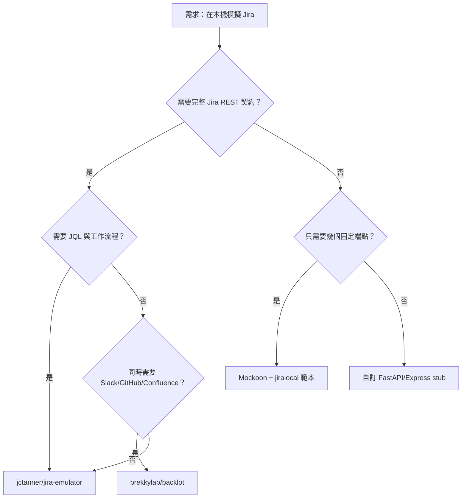

# 開源 Jira API 模擬器（LocalStack 之於 Jira）調查報告

## 摘要

LocalStack 的價值在於：它在本機重現 AWS 的**真實 API 介面**（端點路徑、請求／回應結構、分頁、認證、錯誤碼），讓開發者用官方 SDK 直接對接，而不需要真實雲端帳號[^localstack]。把同樣的問題意識搬到 Atlassian Jira 上，會發現生態明顯稀薄：**目前並不存在一個成熟度、社群規模與 LocalStack 相當的 Jira 模擬器**。本報告整理截至 2026-11-06 可查證的開源方案，並依「是否真的模擬 Jira 線路協定」分類。

結論先講：若需求是「像 LocalStack 一樣、可離線、可用官方 SDK 打、支援 JQL 與工作流程」的單一服務，**`jctanner/jira-emulator` 是目前最接近的專案**（Apache-2.0、Python/FastAPI、SQLite、同時支援 REST API v2 與 v3、內建 JQL 解析器與工作流程引擎、有 Docker 映像）[^jiraemu]。若需求是「同時模擬多個 SaaS（Jira + Slack + GitHub + Confluence…）」，則 `brekkylab/backlot` 是唯一具規模的選擇（Apache-2.0、223 顆星、PyPI 套件）[^backlot]。

---

## 一、問題定義：什麼才算「LocalStack for Jira」

在評估各專案之前，必須先界定判準，否則「mock」與「emulator」會被混為一談。

| 層級 | 做法 | 是否算 LocalStack 等價物 |
|---|---|---|
| L0 | 單元測試中以 `requests-mock`、`nock`、`MSW` 攔截 HTTP | 否，無伺服器、無狀態 |
| L1 | 靜態 stub 伺服器，回傳固定假資料 | 否，無 CRUD、無 JQL |
| L2 | 有狀態的 mock 伺服器，支援 issue CRUD 與部分查詢 | 部分 |
| L3 | 模擬真實 API 契約：路徑、ADF、分頁、認證、錯誤碼、JQL、工作流程 | 是 |

LocalStack 本身屬於 L3：它「重現 response 形狀、分頁、認證、錯誤與存取控制」，讓官方 SDK 只需改 base URL 即可指向本機[^localstack]。以下的分類即依此判準。

---

## 二、主要候選方案

### 2.1 `jctanner/jira-emulator`（最接近 LocalStack 的單一服務）

- **授權**：Apache-2.0[^jiraemu-license]
- **語言／技術**：Python、FastAPI、SQLAlchemy、Pydantic、SQLite（無外部依賴）[^jiraemu]
- **GitHub 星數**：3（4 個 fork）[^jiraemu-api]
- **建立時間**：2026-04-01；最後推送 2026-11-06（撰寫當日仍在更新）[^jiraemu-api]
- **API 覆蓋**：同時提供 `/rest/api/2/`（Server/Data Center）與 `/rest/api/3/`（Cloud），v3 使用 ADF 富文本格式與游標式分頁（`nextPageToken`）[^jiraemu]

功能面涵蓋：

- **Issue CRUD**、專案、留言、轉換（transitions）、關注者（watchers）、issue link、附件、使用者、欄位與 metadata[^jiraemu]
- **JQL 搜尋**：以 Lark 文法實作的解析器，支援 `AND`/`OR`、`IN`、`NOT IN`、`IS EMPTY`、`~` 全文、`ORDER BY`、`now()`/`startOfDay()` 等日期函式、自訂欄位與 `statusCategory`[^jiraemu]
- **工作流程引擎**：可設定的狀態轉換、完成時自動設定 resolution、reopen 轉換、依專案／issue type 對應[^jiraemu]
- **認證**：`permissive`（預設，接受任何憑證）、`strict`（驗證密碼與 token）、`none` 三種模式；支援 Basic、Bearer（PAT）與 session cookie[^jiraemu]
- **附件**：上傳／下載／刪除，支援 `X-Atlassian-Token: no-check`[^jiraemu]
- **JSON 匯入**：可匯入真實 Jira 匯出檔，自動建立專案、使用者、狀態[^jiraemu]
- **資料庫快照**：透過 admin API 備份／還原，便於測試隔離[^jiraemu]
- **MCP Server**：內建 Model Context Protocol 伺服器（port 8081），供 AI 代理操作 issue[^jiraemu]
- **Web UI**：瀏覽專案、issue、執行 JQL[^jiraemu]
- **容器化**：官方映像 `ghcr.io/jctanner/jira-emulator:latest`，預設帶 `JIRA_TOKEN` 與 `admin` 使用者[^jiraemu]

啟動方式（官方 README）：

```bash
docker run -d -p 8080:8080 -p 8081:8081 -v jira-data:/data \
  ghcr.io/jctanner/jira-emulator:latest
```

**限制與風險**：星數僅 3，屬於個人專案，尚無正式 release（GitHub Releases 為空）[^jiraemu-releases]；README 明確聲明「這是供本機開發與 CI 使用的模擬器，不是可公開暴露的服務」[^jiraemu]。因此適合當測試替身，不適合當正式環境。

### 2.2 `brekkylab/backlot`（多 SaaS 模擬器，Jira 只是其中一員）

- **授權**：Apache-2.0（早期版本為 MIT）[^backlot]
- **語言**：Python、FastAPI[^backlot]
- **GitHub 星數**：223（81 個 fork）[^backlot-api]
- **PyPI**：`backlot`，最新版 0.1.0（2026-10-23 發佈）[^backlot-pypi]
- **定位**：在本機同時模擬 Slack、Microsoft Teams、Gmail、Google Drive、GitHub、**Jira**、Confluence、Notion、Linear、HubSpot、Fireflies、S3[^backlot]

Jira 部分掛載於 `/atlassian/rest/api/3`（與 `/2`），已實作的端點包含 `search/jql`、`issue/{key}`、`issue/{key}/comment`、`field`、`issueLinkType`、`project/search`、`project/{key}/role`、`serverInfo`[^backlot-sources]。JQL 支援 `project =` 與 `text`/`summary`/`description` 的 `~` 比對[^backlot-sources]。

**與 LocalStack 的相似度**：backlot 的設計哲學與 LocalStack 幾乎一致——「重現 response 形狀、分頁、認證、錯誤與 per-document ACL，讓官方 SDK 只改 base URL」[^backlot]。它甚至提供 `atlassian-python-api` 的官方 SDK 範例[^backlot]。

**限制**：Jira 端點數僅 14 個，遠少於 `jira-emulator`；不支援 issue 建立／更新（寫入僅部分服務支援）[^backlot-sources]。若只需要「讀取 Jira 資料餵給 RAG 或代理」，backlot 很合適；若需要完整 CRUD 與工作流程，則不足。

### 2.3 `Mesh-AI/mock-jira`（Jira 形狀的 issue tracker，非 Jira API 模擬）

- **授權**：未標示授權檔[^meshai]
- **語言**：Python（FastAPI）+ TypeScript（Kanban UI）[^meshai]
- **定位**：README 自述為「JIRA-shaped issue-tracking API」，供課程使用；提供 `issue-tracker-api`（port 8010）與 `mcp-server`（port 8011），以 Docker Compose 啟動，SQLite 儲存[^meshai]

**關鍵差異**：它模擬的是「Jira 形狀」的自訂 API，而非 Atlassian 官方 REST 契約。端點與回應格式不保證與真實 Jira 一致，因此**不能**直接替換 base URL 讓官方 SDK 使用。適合當作教學或代理測試的假系統，不適合當 LocalStack 等價物。

### 2.4 `sherman94062/jira-mcp-server`（MCP 伺服器，mock 模式為附帶功能）

- **授權**：未標示[^sherman-api]
- **語言**：Python（FastAPI + FastMCP）[^sherman-api]
- **星數**：0；建立 2026-04-11，最後推送 2026-04-12[^sherman-api]
- **定位**：包裝 Jira 的 MCP 伺服器，具 `mock` 模式（內建 40+ 假 issue、3 個專案、8 位使用者、sprint、board、留言、工作流程轉換）與 `live` 模式（代理真實 Jira Cloud REST v3）[^sherman-api]

**評價**：mock 模式資料豐富，但它是 MCP 工具層，不是 Jira REST API 模擬器；無法讓 `jira` Python 客戶端或 `jira.js` 直接對接。且專案僅存活一天即停更，維護風險高。

### 2.5 `ahpex/jira-rest-mock-server`（極簡 stub）

- **授權**：README 標示 MIT，但 repo 無 LICENSE 檔[^ahpex-api]
- **語言**：TypeScript（Express + Faker.js）[^ahpex-api]
- **星數**：0；建立 2024-12-18，最後推送 2024-12-19[^ahpex-api]
- **覆蓋**：僅 `GET /rest/api/v2/search`（回傳 20 筆假資料）與 `GET /rest/api/v2/issue/:key`（任何 key 都回同一筆假 issue）[^ahpex]

**評價**：屬於 L1 靜態 stub，無狀態、無 CRUD、無 JQL。僅適合煙霧測試。

### 2.6 `steveathon/mock-jira-api`（極簡 Cloud mock）

- **授權**：MIT[^steve-api]
- **語言**：JavaScript（Node.js/Express）[^steve-api]
- **星數**：0；建立與最後推送皆為 2025-06-05[^steve-api]
- **覆蓋**：webhook 接收、OAuth token 產生、`GET /rest/api/3/issue/:issueKey`、附件服務[^steve]

**評價**：本質是某個整合專案的測試 fixture，非通用模擬器。

### 2.7 Mockoon 的 JIRA 7.6.1 範例（通用 mock 工具 + 現成範本）

- **授權**：Mockoon 本體為 MIT[^mockoon-api]
- **星數**：8,472（TypeScript，Electron 桌面應用 + CLI）[^mockoon-api]
- **Jira 範本**：`jiralocal`，可直接下載環境檔匯入 Mockoon，或透過 CLI 啟動[^mockoon-jira]

**評價**：Mockoon 是成熟的通用 mock 工具，但 Jira 範本只是靜態路由集合，沒有 JQL、沒有工作流程、沒有狀態機。適合「需要特定幾個端點回固定資料」的情境。

### 2.8 其他已下架或近乎空殼的專案

- `bezeky/mock-jira-server`：曾以 FastAPI + PostgreSQL 實作 Jira Server REST v2，但 GitHub API 回傳 404，已刪除或轉為私有[^bezeky]。
- `xor-ds/jirastub`（Java/Spring Boot）、`swamptea/Jira-emulator`、`EmarianMerigold/JiraEmulator`、`Tolstyak747/Mock-PerfTest`、`lby1024/jira-fake-server-mock`、`qiemingyun/mock-jira-server`、`ZinMar91/fake-jira`、`MF-GP/fake-jira-laravel-5.5`：皆為 0 星、單一 commit 或個人練習專案，無實質 API 覆蓋[^others]。

---

## 三、比較表

| 專案 | 授權 | 星數 | 語言 | Jira API 契約 | JQL | 工作流程 | 寫入 CRUD | 官方 SDK 可直接對接 | 維護狀態 |
|---|---|---|---|---|---|---|---|---|---|
| `jctanner/jira-emulator` | Apache-2.0 | 3 | Python | v2 + v3 | 是（Lark 解析器） | 是 | 是 | 是 | 活躍（2026-11-06） |
| `brekkylab/backlot` | Apache-2.0 | 223 | Python | v2 + v3（14 端點） | 部分 | 否 | 部分 | 是 | 活躍（2026-11-06） |
| `Mesh-AI/mock-jira` | 未標示 | 0 | Python/TS | 否（自訂形狀） | 否 | 否 | 是 | 否 | 中等 |
| `sherman94062/jira-mcp-server` | 未標示 | 0 | Python | 否（MCP 層） | 否 | 部分 | 是 | 否 | 停更 |
| `ahpex/jira-rest-mock-server` | MIT（無 LICENSE 檔） | 0 | TypeScript | v2 子集 | 否 | 否 | 否 | 部分 | 停更（2024-12） |
| `steveathon/mock-jira-api` | MIT | 0 | JavaScript | v3 子集 | 否 | 否 | 否 | 部分 | 停更（2025-06） |
| Mockoon + `jiralocal` | MIT | 8,472 | TypeScript | 靜態路由 | 否 | 否 | 否 | 部分 | 活躍 |

---

## 四、選型建議



**實務提醒**：

1. **不要期待 LocalStack 等級的成熟度**。LocalStack 有 65,125 顆星、企業支持與多年累積[^localstack-api]；Jira 生態中最高者僅 223 顆星（backlot，且 Jira 只是其中一個來源）。這反映的是 Atlassian 生態的商業模式（Jira 本身有免費層與 Cloud 試用），而非技術不可行。
2. **`jctanner/jira-emulator` 的星數低但功能密度高**。依本專案的研究規範，低於約 100 星的專案通常需謹慎；但此處屬於「議題本身極度小眾，僅存在低星專案」的例外，故仍納入並標註風險[^jiraemu-api]。
3. **若用於 CI**，建議鎖定映像 digest 而非 `latest`，並利用其 snapshot API 做測試隔離[^jiraemu]。
4. **若用於 AI 代理測試**，`jira-emulator` 與 `backlot` 都內建 MCP 支援，可直接接上代理框架[^jiraemu][^backlot]。

---

## 五、來源批判與限制

- **GitHub 星數與活躍度**為 2026-11-06 透過 GitHub REST API 取得，屬即時快照，會隨時間變動[^jiraemu-api][^backlot-api][^mockoon-api]。
- **功能描述主要來自各專案 README**，屬作者自述，未經獨立驗證。本報告未實際部署測試任一專案，因此「是否真的與真實 Jira 行為一致」無法保證。`backlot` 的 README 明確承認「只模擬各 API 的文件化子集，未實作的端點會回 404」[^backlot-sources]，這是所有模擬器的共通限制。
- **`bezeky/mock-jira-server` 已無法存取**，僅能從搜尋快照推測其存在，故不列入正式比較[^bezeky]。
- **未發現任何 WireMock 形式的獨立 Jira stub 專案**；WireMock 多被內嵌於各專案的測試套件中，非可重用專案。
- **npm 與 PyPI 上不存在**名為 `jira-mock`、`mock-jira`、`jira-mock-server` 等套件；唯一已發佈的相關套件是 `backlot`[^backlot-pypi]。

---

## 註腳

[^localstack]: LocalStack 是一個在本機完整重現 AWS 雲端堆疊的開源專案，讓開發者離線開發與測試雲端與 Serverless 應用。GitHub 星數 65,125（2026-11-06 取得）。LocalStack. (n.d.). *localstack/localstack*. GitHub. Retrieved 2026-11-06, from https://github.com/localstack/localstack

[^localstack-api]: GitHub REST API 查詢 `repos/localstack/localstack` 之結果，`stargazers_count` 為 65,125，`archived` 為 true。GitHub. (2026). *Repository metadata for localstack/localstack*. Retrieved 2026-11-06, from https://api.github.com/repos/localstack/localstack

[^jiraemu]: Tanner, J. (n.d.). *Jira Emulator* [README]. GitHub. Retrieved 2026-11-06, from https://raw.githubusercontent.com/jctanner/jira-emulator/main/README.md

[^jiraemu-license]: Tanner, J. (2026). *LICENSE* (Apache License 2.0). GitHub. Retrieved 2026-11-06, from https://raw.githubusercontent.com/jctanner/jira-emulator/main/LICENSE

[^jiraemu-api]: GitHub REST API 查詢 `repos/jctanner/jira-emulator` 之結果：`stargazers_count` 3、`forks_count` 4、`created_at` 2026-04-01T02:01:21Z、`pushed_at` 2026-11-06T17:16:55Z、`license.spdx_id` 為 Apache-2.0。GitHub. (2026). *Repository metadata for jctanner/jira-emulator*. Retrieved 2026-11-06, from https://api.github.com/repos/jctanner/jira-emulator

[^jiraemu-releases]: GitHub REST API 查詢 `repos/jctanner/jira-emulator/releases` 回傳空陣列 `[]`，表示尚無正式 release。GitHub. (2026). *Releases for jctanner/jira-emulator*. Retrieved 2026-11-06, from https://api.github.com/repos/jctanner/jira-emulator/releases

[^backlot]: Brekky Lab. (n.d.). *Backlot* [README]. GitHub. Retrieved 2026-11-06, from https://raw.githubusercontent.com/brekkylab/backlot/main/README.md

[^backlot-api]: GitHub REST API 查詢 `repos/brekkylab/backlot` 之結果：`stargazers_count` 223、`forks_count` 81、`created_at` 2026-07-02T11:04:23Z、`pushed_at` 2026-11-06T20:57:39Z、`license.spdx_id` 為 Apache-2.0。GitHub. (2026). *Repository metadata for brekkylab/backlot*. Retrieved 2026-11-06, from https://api.github.com/repos/brekkylab/backlot

[^backlot-pypi]: PyPI JSON API 查詢 `backlot` 之結果：最新版本 0.1.0，`upload_time_iso_8601` 為 2026-10-23T09:14:48.694264Z，`license_expression` 為 Apache-2.0，`requires_python` 為 `>=3.11`。PyPI. (2026). *backlot 0.1.0*. Retrieved 2026-11-06, from https://pypi.org/pypi/backlot/json

[^backlot-sources]: Brekky Lab. (n.d.). *Supported sources*. GitHub. Retrieved 2026-11-06, from https://raw.githubusercontent.com/brekkylab/backlot/main/docs/supported-sources.md

[^meshai]: Mesh-AI. (n.d.). *mock-jira* [README]. GitHub. Retrieved 2026-11-06, from https://raw.githubusercontent.com/Mesh-AI/mock-jira/main/README.md

[^sherman-api]: GitHub REST API 查詢 `repos/sherman94062/jira-mcp-server` 之結果：`stargazers_count` 0、`created_at` 2026-04-11T15:01:22Z、`pushed_at` 2026-04-12T14:15:12Z、`license` 為 null。GitHub. (2026). *Repository metadata for sherman94062/jira-mcp-server*. Retrieved 2026-11-06, from https://api.github.com/repos/sherman94062/jira-mcp-server

[^ahpex]: ahpex. (n.d.). *jira-rest-mock-server* [README]. GitHub. Retrieved 2026-11-06, from https://github.com/ahpex/jira-rest-mock-server

[^ahpex-api]: GitHub REST API 查詢 `repos/ahpex/jira-rest-mock-server` 之結果：`stargazers_count` 0、`created_at` 2024-12-18T07:18:00Z、`pushed_at` 2024-12-19T10:55:20Z、`license` 為 null。GitHub. (2026). *Repository metadata for ahpex/jira-rest-mock-server*. Retrieved 2026-11-06, from https://api.github.com/repos/ahpex/jira-rest-mock-server

[^steve]: steveathon. (n.d.). *mock-jira-api* [README]. GitHub. Retrieved 2026-11-06, from https://github.com/steveathon/mock-jira-api

[^steve-api]: GitHub REST API 查詢 `repos/steveathon/mock-jira-api` 之結果：`stargazers_count` 0、`created_at` 2025-06-05T14:55:23Z、`pushed_at` 2025-06-05T17:04:08Z、`license.spdx_id` 為 MIT。GitHub. (2026). *Repository metadata for steveathon/mock-jira-api*. Retrieved 2026-11-06, from https://api.github.com/repos/steveathon/mock-jira-api

[^mockoon-api]: GitHub REST API 查詢 `repos/mockoon/mockoon` 之結果：`stargazers_count` 8,472、`forks_count` 484、`pushed_at` 2026-11-06T23:55:40Z、`license.spdx_id` 為 MIT。GitHub. (2026). *Repository metadata for mockoon/mockoon*. Retrieved 2026-11-06, from https://api.github.com/repos/mockoon/mockoon

[^mockoon-jira]: Mockoon. (n.d.). *JIRA 7.6.1 API mock sample*. Retrieved 2026-11-06, from https://mockoon.com/mock-samples/jiralocal/

[^bezeky]: GitHub REST API 查詢 `repos/bezeky/mock-jira-server` 回傳 404，表示該儲存庫已刪除或轉為私有。GitHub. (2026). *Repository metadata for bezeky/mock-jira-server*. Retrieved 2026-11-06, from https://api.github.com/repos/bezeky/mock-jira-server

[^others]: 這些專案（`xor-ds/jirastub`、`swamptea/Jira-emulator`、`EmarianMerigold/JiraEmulator`、`Tolstyak747/Mock-PerfTest`、`lby1024/jira-fake-server-mock`、`qiemingyun/mock-jira-server`、`ZinMar91/fake-jira`、`MF-GP/fake-jira-laravel-5.5`）皆為 0 星、單一或少數 commit 的個人練習專案，無實質 API 覆蓋。GitHub. (2026). *Repository search results for "jira mock server"*. Retrieved 2026-11-06, from https://github.com/search?q=jira+mock+server&type=repositories&s=stars&o=desc
