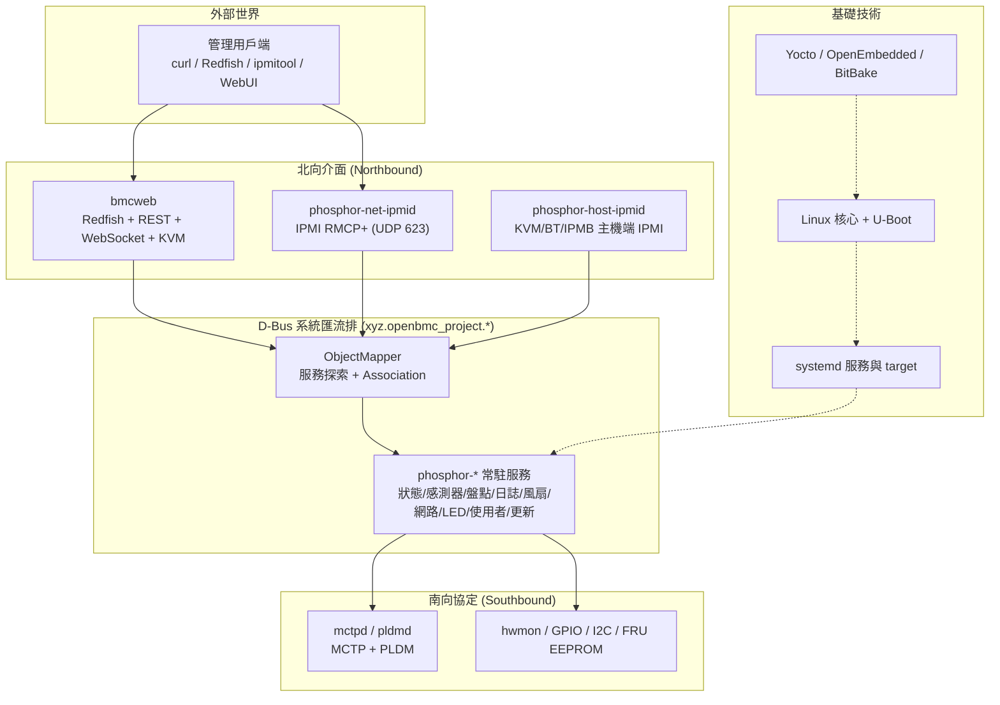

# OpenBMC 領域模型、概念與先備知識總覽

## 摘要

本報告整理 OpenBMC 這個開源 BMC 韌體專案所涉及的**領域模型（domain model）**、**核心概念**與**進入門檻所需的先備知識**。OpenBMC 並非單一程式，而是一個由數十個獨立 Git 儲存庫（repository）與數百個系統服務組成的 Linux 發行版[^repo]。因此本報告不逐一詳解每個服務，而是建立一張「整體圖像」：先說明 OpenBMC 是什麼，再分層拆解其架構，接著逐一介紹構成其領域模型的關鍵抽象（D-Bus 物件模型、ObjectMapper、Association、各命名空間），最後整理出學習者應具備的先備知識與建議的學習路徑。

本報告為獨立文件，所有需要的背景知識都收錄在內，讀者無需任何 OpenBMC 先備經驗即可閱讀。

---

## 一、OpenBMC 是什麼

### 1.1 BMC 與頻外管理

**基板管理控制器（BMC, Baseboard Management Controller）** 是內嵌於伺服器主機板上的一顆獨立微控制器，擁有專屬的韌體與記憶體，獨立於主機的 CPU、BIOS/UEFI 與作業系統之外運作[^bmc]。這種獨立性使 BMC 能夠進行**頻外管理（out-of-band management）**：即使主機作業系統尚未啟動、當機或已關機（只要仍接著電源與網路），管理者仍可透過專屬的管理網路遠端操作伺服器[^bmc]。

BMC 的典型功能包括[^bmc]：

| 功能 | 說明 |
|---|---|
| 電源控制 | 遠端開機、關機、重置、電源循環 |
| 感測器監控 | 監測溫度、電壓、風扇轉速、電源供應器狀態、機箱入侵 |
| 遠端主控台（KVM over IP） | 鍵盤／視訊／滑鼠重導向 |
| Serial over LAN（SOL） | 將主機序列埠主控台重導向到網路上 |
| 虛擬媒體（Virtual Media） | 遠端掛載 ISO／USB 映像，供遠端安裝作業系統 |
| 韌體更新 | 遠端更新 BMC、BIOS/UEFI 或其他韌體 |
| 硬體盤點與日誌 | 查詢 FRU 資訊、SDR 與系統事件日誌（SEL） |
| 看門狗（Watchdog） | 系統無回應時自動復原 |

市面上常見的 BMC 實作除了 OpenBMC 之外，還有 AMI MegaRAC、HPE iLO、Dell iDRAC、Supermicro 的 BMC 等[^bmc]。

### 1.2 OpenBMC 專案的背景

OpenBMC 是 Linux 基金會（Linux Foundation）旗下的開源專案，目標是打造透明、文件完善且經過測試的 BMC 韌體堆疊，以取代長久以來封閉、難以稽核的專有 BMC 實作[^wiki]。其歷史可追溯到 2014 年 Facebook 駭客松的原型，以及 2015 年 IBM 與 Rackspace 的另一套同名專案；兩者於 2018 年 3 月在 Linux 基金會下合併為單一專案，IBM 貢獻了其 OpenBMC 程式碼作為基礎[^wiki]。創始成員包括 Meta（Facebook）、Google、IBM、Intel、Microsoft，之後 Arm 也加入技術指導委員會[^wiki]。專案以 **Yocto Project** 與 **OpenEmbedded** 為建置框架，使用 **systemd** 管理服務、**D-Bus** 作為行程間通訊骨幹[^wiki][^dev]。

OpenBMC 採用寬鬆的授權條款：多數程式碼為 **Apache-2.0**，Yocto 中介資料（metadata）多為 **MIT**，個別 recipe 依其檔案所述授權[^wiki]。

### 1.3 參與的廠商

OpenBMC 的主要儲存庫中包含大量由各廠商維護的 `meta-<vendor>` 層，反映出實際的貢獻者與採用者[^openbmcrepo]：Meta（`meta-facebook`）、Google（`meta-google`）、IBM（`meta-ibm`）、Intel（`meta-intel-openbmc`）、NVIDIA（`meta-nvidia`）、Ampere（`meta-ampere`）、Qualcomm（`meta-qualcomm`）、AMD（`meta-amd`）、HPE（`meta-hpe`）、Supermicro、ASRock、ByteDance、Quanta、Wistron、Yadro 等[^openbmcrepo]。

---

## 二、整體架構總覽

OpenBMC 的架構可用「**一個骨幹、四個基礎技術、兩端介面**」來概括：以 **D-Bus** 為通用服務匯流排，建構在 **Yocto/OpenEmbedded、Linux 核心、systemd、U-Boot** 之上，對外（北向）提供 Redfish／REST／IPMI，對內與硬體及子裝置（南向）透過 MCTP／PLDM 與感測器匯流排溝通[^repo][^dev]。

此圖的核心洞見是：**任何北向介面（Redfish、REST、IPMI）與任何南向協定（MCTP/PLDM、GPIO、hwmon）最終都翻譯成 D-Bus 呼叫**，落在標準化的 `xyz.openbmc_project.*` 介面樹上[^repo]。

---

## 三、先備知識（Prerequisite Knowledge）

要理解 OpenBMC，需先掌握以下四類背景知識。

### 3.1 Linux 系統層

- **systemd**：OpenBMC 中每一個服務（包含所有 phosphor 服務、IPMI 堆疊、bmcweb）都由 systemd 管理，且以 **systemd target** 編排多步驟操作（例如開機）[^repo]。例如啟動 `obmc-host-start@0.target` 會觸發一連串相依的 target 與 service[^repo]。
- **D-Bus**：Linux 上的行程間通訊機制，分為「系統匯流排（system bus）」與「每使用者工作階段的 session bus」；OpenBMC 使用系統匯流排[^dbus]。需理解 **bus name（連線名稱）**、**object path（物件路徑）**、**interface（介面）**、**method（方法）**、**property（屬性）**、**signal（訊號）** 與 **introspection（自我描述）** 等概念[^dbus]。
- **Yocto / OpenEmbedded / BitBake**：OpenBMC 的建置系統。以 `meta-*` 圖層（layer）組成，BitBake 為任務執行引擎，映像檔 recipe 為 `obmc-phosphor-image`[^dev]。

### 3.2 嵌入式與硬體層

- **BMC SoC**：最常見的是 **ASPEED AST2500 / AST2600**。AST2600 採用雙核心 ARM Cortex-A7（另含一顆 Cortex-M3 協處理器），為首款 28nm BMC SoC，支援 Secure Boot 與 ARM TrustZone[^aspeed]。
- **與主機的連接介面**[^aspeed]：
  - **LPC / eSPI**：主機與 BMC 之間的主要通訊匯流排，用於 IPMI KCS/BT 訊息與韌體存取。
  - **VUART**：虛擬 UART，用於將主機序列主控台重導向（SOL）。
  - **I2C / I3C / SMBus**：感測器匯流排，讀取溫度、電壓、風扇、FRU EEPROM，並與衛星管理控制器溝通（IPMB）。
  - **NC-SI**：讓 BMC 透過主機網卡進行邊帶（sideband）網路管理，無需專屬管理埠。
  - **GPIO**：電源／重置控制、機箱入侵偵測、POST code 擷取。
  - **PECI**：讀取 CPU 內部溫度以進行精確熱管理。
- **Flash 佈局**：OpenBMC 映像包含 U-Boot、kernel、唯讀根檔案系統（squashfs）與可寫檔案系統；支援 **static（JFFS2）**、**UBI** 與 **eMMC（ext4）** 等儲存佈局，並可支援 A/B 雙映像冗餘[^flash][^codemgmt]。

### 3.3 伺服器管理協定

- **IPMI（Intelligent Platform Management Interface）**：2004 年發布的頻外管理標準，使用 UDP 623 埠上的 RMCP／RMCP+ 二進位協定；2020 年後不再更新，官方指定 Redfish 為後繼者[^ipmi]。相關概念包含 KCS／BT／SMIC 主機介面、IPMB、SEL（系統事件日誌）、SDR（感測器資料記錄）、FRU（可更換單元）與 SOL[^ipmi]。
- **Redfish**：DMTF 制定的 RESTful 管理標準，使用 HTTPS 與 JSON／OData，為 IPMI 的現代替代方案[^redfish]。其資料模型以 `ServiceRoot` 為根，涵蓋 Systems、Chassis、Managers、UpdateService、AccountService、EventService、SessionService 等資源[^redfish]。
- **MCTP / PLDM / SPDM**：DMTF 定義的「平台管理元件互連（PMCI）」協定族。**MCTP**（DSP0236）為傳輸無關的輕量協定，以 8 位元端點 ID（EID）定址，可承載於 I2C/SMBus、PCIe VDM、USB、Serial、I3C 等[^mctp]。**PLDM**（DSP0240 系列）為應用層資料模型，分為 Type 0 至 Type 6（Base、SMBIOS、平台監控與控制、BIOS 設定、FRU、韌體更新、Redfish 裝置賦能）[^mctp]。**SPDM**（DSP0274）用於裝置身分驗證、證明（attestation）與安全金鑰交換[^mctp]。

### 3.4 程式設計與工具

- **C++**：多數 phosphor 服務與 bmcweb 以 C++ 撰寫，並使用 `sdbusplus`（基於 systemd `sd-bus` 的 C++ D-Bus 綁定庫）[^pdi]。
- **YAML**：D-Bus 介面以 YAML 描述，再由 `sdbus++` 工具產生 C++ 綁定程式碼[^pdi]。
- **Python / Robot Framework**：測試自動化採用 Robot Framework[^dev]。
- **devtool**：Yocto 提供的工具，可將某個 recipe 的原始碼取出到 workspace 修改、單獨重建，再部署到 QEMU 測試[^dev]。

---

## 四、領域模型（Domain Models）

OpenBMC 的「領域模型」核心在於一套**以 D-Bus 物件樹表達系統狀態**的抽象。以下分層說明。

### 4.1 D-Bus 物件模型

OpenBMC 幾乎所有內部應用都透過系統匯流排通訊[^dbus]。其物件模型遵循標準 D-Bus 慣例：

- **物件路徑（object path）**：如檔案系統路徑，OpenBMC 的物件一律以 `/xyz/openbmc_project/` 為根命名空間，路徑區段使用小寫加底線，例如 `/xyz/openbmc_project/sensors/voltage/ps1_input_voltage`[^pdi]。
- **介面（interface）**：採用反向網域名稱慣例，格式為 `xyz.openbmc_project.<Domain>.<SubDomain>.<InterfaceName>`，介面名稱由 YAML 檔案的相對路徑推導而來[^pdi]。
- **服務名稱（service name）**：如 `xyz.openbmc_project.ObjectMapper`、`xyz.openbmc_project.State.Host` 等[^repo]。

### 4.2 ObjectMapper（物件對映器）

**ObjectMapper** 是 OpenBMC 的服務探索中心，於匯流排名稱 `xyz.openbmc_project.ObjectMapper`、物件路徑 `/xyz/openbmc_project/object_mapper` 上提供方法[^mapper]：

| 方法 | 用途 |
|---|---|
| `GetObject` | 查詢某物件路徑由哪些服務實作 |
| `GetSubTree` | 查詢某子樹中所有實作指定介面的物件、服務與介面 |
| `GetSubTreePaths` | 同上，但只回傳物件路徑 |
| `GetAncestors` | 查詢某路徑的所有祖先物件 |
| `GetAssociatedSubTree` 系列 | 依關聯端點過濾子樹物件 |

### 4.3 Association（關聯）

**Association** 是 OpenBMC 的關鍵設計模式，用於連結兩個 D-Bus 物件。應用程式實作 `xyz.openbmc_project.Association.Definitions` 介面，其 `Associations` 屬性為三元組陣列 `[forward_name, reverse_name, target_path]`[^mapper]。當物件 A 宣告 `["foo", "bar", "pathB"]` 時，ObjectMapper 會自動建立兩個關聯物件：`pathA/foo`（正向）與 `pathB/bar`（反向），各帶有 `endpoints` 屬性[^mapper]。

命名慣例要求使用**分詞動詞**：正向用現在分詞（`-ing`，如 `powering`），反向用過去分詞（`-ed`，如 `powered_by`），並需能構成通順語句「The {primary} is {primary_association} the {secondary}」[^pdi]。

### 4.4 phosphor-dbus-interfaces 命名空間

`phosphor-dbus-interfaces` 是 OpenBMC 所有標準 D-Bus 介面的單一真實來源，以 YAML 描述，再由 `sdbus++` 產生 C++ 綁定[^pdi]。其 `yaml/xyz/openbmc_project/` 下依領域劃分命名空間，構成 OpenBMC 的領域模型清單[^pdi][^namespaces]：

| 命名空間 | 領域模型意義 |
|---|---|
| `Inventory` | 硬體盤點項目（Board、Chassis、CPU、DIMM、Fan、PowerSupply 等）與其裝飾介面 |
| `Sensor` | 感測器讀值（`Value`）、臨界值（`Threshold`）、精度、類型、用途 |
| `State` | 系統狀態機（BMC、Host、Chassis、Boot Progress、Watchdog 等） |
| `Software` | 軟體版本、啟用（`Activation`）、套用時機（`ApplyTime`）、冗餘優先序 |
| `Logging` | 錯誤與事件日誌（`Create`、`Entry`、`Event`、`Settings`） |
| `Control` | 控制類介面（電源、開機、風扇、處理器、安全、TPM 等） |
| `Network` | 網路設定（EthernetInterface、IP、DHCP、VLAN、DNS） |
| `Led` | LED 管理（`Physical` 與 `Group` 兩層） |
| `User` | 使用者與帳號管理（Manager、Attributes、AccountPolicy、LDAP、MFA） |
| `Dump` | 傾印收集（`Create`、`Entry`、`NewDump`） |
| `MCTP` / `PLDM` | MCTP 端點與 PLDM 描述記錄 |
| `Attestation` | 平台證明（ComponentIntegrity、MeasurementSet） |
| `Telemetry` | 遙測報告與觸發條件 |
| `VirtualMedia` | 虛擬媒體掛載（MountPoint、Proxy、Legacy、Stats） |
| `Console` | 主控台存取（Access、UART） |
| `BIOSConfig` | 遠端 BIOS 設定 |
| `PFR` | 平台韌體韌性（NIST SP 800-193） |
| `Time` / `Common` / `Object` / `Collection` | 時間、共用與物件生命週期基礎介面 |

設計規則（`requirements.md`）要求[^pdi]：優先使用 `size`／`uint64`／`int64` 而非過小的整數型別；避免使用任意字串做程式化解析；優先使用列舉（enumeration）而非魔術值；若 A 介面文件記錄了對 B 的關聯，則 B 也必須記錄反向關聯。

### 4.5 Entity Manager 配置模型

**Entity Manager（EM）** 是 OpenBMC 的執行期 JSON 驅動系統配置管理器，其目的是將硬體描述與程式碼解耦[^em]。它由三部分組成[^em]：

1. **偵測常駐服務**：如 `fru-device`（掃描 I2C FRU EEPROM）、`peci-pcie`、`smbios-mdr`。
2. **JSON 配置檔**：每個硬體裝置一份，包含 `Name`、`Probe`（D-Bus 比對規則）與 `Exposes`（要發布到 D-Bus 的功能描述）。
3. **反應器（reactor）**：對 EM 建立的 D-Bus 物件作出反應的服務，例如 `dbus-sensors` 會讀取 `Exposes` 記錄並開始掃描感測器。

當 `Probe` 比對成功，EM 會在 `/xyz/openbmc_project/Inventory/Item/<Type>/<Name>` 下建立物件，並依 `PortType` 自動建立 `containing`／`powering`／`probing` 等關聯[^em]。

### 4.6 狀態機模型

`phosphor-state-manager` 追蹤與控制四個物件的狀態：**BMC、Chassis、Host、Hypervisor**，每個物件同時有「目前狀態」（唯讀）與「要求轉換」（可寫）[^psm]。其設計原則是「盡量讓各物件獨立」與「萬物皆用 systemd target，程式碼保持精簡」[^psm]。

| 物件 | 主要介面 | 目前狀態列舉 |
|---|---|---|
| BMC | `xyz.openbmc_project.State.BMC` | NotReady、Ready、UpdateInProgress、Quiesced |
| Chassis | `xyz.openbmc_project.State.Chassis` | Off、TransitioningToOff、On、TransitioningToOn |
| Host | `xyz.openbmc_project.State.Host` | Off、Standby、Running、Quiesced、DiagnosticMode 等 |

運作方式：使用者設定 `Requested*Transition` 屬性 → PSM 啟動對應的 systemd target → target 完成後 PSM 更新 `Current*State`[^psm]。指令列工具 `obmcutil` 提供人性化介面來查詢與設定這些狀態[^psm]。

---

## 五、關鍵概念與元件

### 5.1 phosphor-* 常駐服務

「Phosphor」是一組獨立的 Linux 系統常駐服務（多為 C++），每個負責一個管理領域[^repo]。代表性服務包括：

| 服務 | 職責 |
|---|---|
| `phosphor-state-manager` | BMC／Chassis／Host／Hypervisor 狀態管理 |
| `phosphor-hwmon` / `dbus-sensors` | 將 Linux hwmon 或硬體感測器對映到 D-Bus |
| `phosphor-pid-control`（swampd） | 基於 PID 的熱管理與風扇控制 |
| `phosphor-inventory-manager` | FRU 盤點 |
| `phosphor-logging` | 結構化事件與日誌 |
| `phosphor-networkd` | 網路設定 |
| `phosphor-led-manager` | LED 管理 |
| `phosphor-bmc-code-mgmt` | BMC 與主機韌體更新 |
| `phosphor-debug-collector` | 傾印與除錯資料收集 |
| `phosphor-user-manager` | 使用者帳號管理 |

### 5.2 感測器架構

OpenBMC 提供兩套感測器堆疊，但產生**相同形狀的 D-Bus 介面**，因此上層消費者（Redfish、IPMI）無需區分[^sensor]：

- **phosphor-hwmon**：較舊，將 hwmon sysfs 轉發到 D-Bus，每個 hwmon 裝置一個實例。
- **dbus-sensors**：較新且模組化，每種感測器型別一個獨立常駐服務（ADC、CPU、Fan、PSU 等），可由 D-Bus 執行期重新配置，並作為 Entity Manager 的反應器。

感測器物件路徑為 `/xyz/openbmc_project/sensors/<type>/<sensor_name>`，典型介面包含 `xyz.openbmc_project.Sensor.Value`（`Value`、`Unit`、`MaxValue`、`MinValue`、`UpdatedTime`）與 `xyz.openbmc_project.Sensor.Threshold.Warning`／`.Critical`（臨界值與警報布林值）[^sensor]。當數值跨越臨界值時，會翻轉警報屬性並發出 `PropertiesChanged` 與 `*Asserted`／`*Deasserted` 訊號[^sensor]。

### 5.3 北向介面：bmcweb 與 Redfish

**bmcweb** 是 OpenBMC 的嵌入式網頁伺服器，同時提供四種介面[^repo]：Redfish（`/redfish/v1/`）、OpenBMC D-Bus REST API（`/xyz/openbmc_project/...`）、WebSocket 序列主控台、以及 KVM（透過 WebSocket 的 VNC/RFB）。其認證支援 Basic、Cookie、雙向 TLS、XToken，全部經由 libpam[^repo]。

**Redfish** 的資料模型以資源樹呈現，關鍵服務包含[^redfish]：Systems（`ComputerSystem`）、Chassis（機箱與散熱／電源）、Managers（管理控制器，即 BMC 本身）、UpdateService（韌體更新）、AccountService（帳號與角色）、EventService（事件訂閱）、SessionService（工作階段）。Redfish 相較 IPMI 的優勢在於：使用 HTTPS 與 JSON、安全性較佳（TLS 與憑證）、可規模化聚合、工具鏈現代化[^redfish]。

**webui-vue** 是官方參考網頁介面，以 Vue 3 撰寫，所有管理操作都走 Redfish API，並透過 WebSocket 連接序列主控台、KVM（noVNC）與 D-Bus 事件串流[^webui]。

### 5.4 韌體更新模型

`phosphor-bmc-code-mgmt` 提供韌體與軟體管理，核心為兩個行程[^codemgmt]：**ImageManager**（管理上傳／暫存的映像）與 **ItemUpdater**（管理特定儲存元件，判斷已安裝版本並處理啟用）。其 D-Bus 介面包含 `Software.Version`、`Software.Activation`（狀態機：NotReady、Invalid、Ready、Activating、Active、Failed、Staged）、`Software.RedundancyPriority` 與 `Software.ApplyTime`（Immediate／OnReset）[^codemgmt]。在 AST2500/AST2600 上支援 A/B 雙映像與 golden side 冗餘，並透過 `side-switch` 機制切換 flash bank[^codemgmt]。

Redfish 的更新流程為：用戶端 GET `UpdateService` 取得 `HttpPushUri` → POST 上傳映像 → bmcweb 存入 `/tmp/images` → ImageManager 建立 D-Bus 物件 → ItemUpdater 設為 Ready 並觸發啟用 → 依 `ApplyTime` 決定是否自動重開機[^codemgmt]。

### 5.5 日誌與事件模型

`phosphor-logging` 以 **systemd-journald** 為主要日誌匯，採**結構化日誌**（每個變數以鍵值標記），提供兩種 API：`phosphor::logging::log`（printf 風格）與 `lg2`（C++20 具名佔位符，編譯期檢查）[^logging]。事件日誌為 D-Bus 物件，位於 `/xyz/openbmc_project/logging/entry/<ID>`，核心介面 `xyz.openbmc_project.Logging.Entry` 包含 `Id`、`Timestamp`、`Severity`、`Message`、`AdditionalData`、`Resolution`、`Resolved` 等屬性[^logging]。事件以 YAML 定義，建置時產生 C++ 類別與 **Redfish Message Registry** JSON，供 bmcweb 將日誌轉為 Redfish `LogEntry`[^logging]。`xyz.openbmc_project.Logging.Create` 介面則允許直接透過 D-Bus 建立事件日誌[^logging]。

### 5.6 其他重要子系統

- **主控台與 KVM**：`obmc-console` 將主機 UART 抽象為 Unix 網域通訊端並於 D-Bus 提供 `xyz.openbmc_project.Console.Access`；`obmc-ikvm` 提供 VNC/RFB 遠端畫面；虛擬媒體則透過 NBD 與 USB gadget 將遠端映像呈現為主機的 USB 儲存裝置[^console]。
- **傾印（Dump）**：`phosphor-debug-collector` 提供 BMC dump 與 System dump，透過 `xyz.openbmc_project.Dump` 介面，並由 Redfish 的 LogService 路由暴露[^dump]。
- **安全性**：涵蓋 TLS 設定、憑證管理（`Certs`）、Redfish 動態授權、TLS 使用者認證、憑證撤銷清單、使用者管理（PAM 堆疊、LDAP、MFA）、平台韌體韌性（PFR）與 SPDM 證明等[^security]。

---

## 六、建議的學習路徑

綜合以上，進入 OpenBMC 領域的建議順序如下：

1. **建立伺服器管理背景**：先理解 BMC、頻外管理、IPMI 與 Redfish 的目的與差異[^bmc][^ipmi][^redfish]。
2. **掌握 Linux 系統層**：systemd（service／target）、D-Bus 物件模型、Yocto/OpenEmbedded 建置流程[^dev][^dbus]。
3. **理解 D-Bus 領域模型**：ObjectMapper、Association、`phosphor-dbus-interfaces` 命名空間與 `sdbus++` 綁定產生流程[^mapper][^pdi]。
4. **閱讀架構文件**：OpenBMC 官方 `docs` 儲存庫的 `architecture/` 目錄包含感測器架構、IPMI 架構、ObjectMapper、systemd、程式碼更新、flash 佈局等主題文件，是理解各子系統的最佳入口[^archdocs]。
5. **動手實作**：使用 `setup` 腳本選定機器、`bitbake obmc-phosphor-image` 建置映像，並在 QEMU 中啟動（預設帳號 `root`、密碼 `0penBmc`）[^dev]。
6. **深入特定子系統**：依需求研究 Entity Manager 配置、狀態機、韌體更新、感測器或安全性設計[^em][^psm][^codemgmt][^sensor][^security]。

---

## 七、名詞對照速查

| 縮寫 | 全稱 | 中文 |
|---|---|---|
| BMC | Baseboard Management Controller | 基板管理控制器 |
| IPMI | Intelligent Platform Management Interface | 智慧平台管理介面 |
| SOL | Serial over LAN | 序列埠網路重導向 |
| SEL | System Event Log | 系統事件日誌 |
| SDR | Sensor Data Record | 感測器資料記錄 |
| FRU | Field Replaceable Unit | 可更換單元 |
| KCS | Keyboard Controller Style | 主機與 BMC 的 IPMI 介面之一 |
| MCTP | Management Component Transport Protocol | 管理元件傳輸協定 |
| PLDM | Platform Level Data Model | 平台層級資料模型 |
| SPDM | Security Protocol and Data Model | 安全協定與資料模型 |
| DCMI | Data Center Management Interface | 資料中心管理介面 |
| PFR | Platform Firmware Resilience | 平台韌體韌性 |
| EID | Endpoint ID | MCTP 端點識別碼 |

---

## 參考文獻

[^repo]: OpenBMC. (n.d.). *openbmc/openbmc: Main OpenBMC repository*. GitHub. Retrieved 2026-11-07, from https://github.com/openbmc/openbmc

[^bmc]: Wikipedia. (n.d.). *Baseboard management controller*. Retrieved 2026-11-07, from https://en.wikipedia.org/wiki/Baseboard_management_controller

[^wiki]: Wikipedia. (n.d.). *OpenBMC*. Retrieved 2026-11-07, from https://en.wikipedia.org/wiki/OpenBMC

[^dev]: OpenBMC. (n.d.). *Development documentation*. GitHub. Retrieved 2026-11-07, from https://github.com/openbmc/docs/tree/master/development

[^openbmcrepo]: OpenBMC. (n.d.). *openbmc/openbmc repository file listing*. GitHub. Retrieved 2026-11-07, from https://github.com/openbmc/openbmc

[^aspeed]: ASPEED Technology. (n.d.). *Server management*. Retrieved 2026-11-07, from https://www.aspeedtech.com/server/

[^flash]: OpenBMC. (n.d.). *OpenBMC flash layout and filesystem documentation*. GitHub. Retrieved 2026-11-07, from https://github.com/openbmc/docs/blob/master/architecture/code-update/flash-layout.md

[^codemgmt]: OpenBMC. (n.d.). *phosphor-bmc-code-mgmt*. GitHub. Retrieved 2026-11-07, from https://github.com/openbmc/phosphor-bmc-code-mgmt

[^ipmi]: OpenBMC. (n.d.). *phosphor-host-ipmid*. GitHub. Retrieved 2026-11-07, from https://github.com/openbmc/phosphor-host-ipmid

[^redfish]: DMTF. (n.d.). *Redfish standard*. Retrieved 2026-11-07, from https://www.dmtf.org/standards/redfish

[^mctp]: OpenBMC. (n.d.). *libmctp*. GitHub. Retrieved 2026-11-07, from https://github.com/openbmc/libmctp

[^dbus]: OpenBMC. (n.d.). *The ObjectMapper*. GitHub. Retrieved 2026-11-07, from https://github.com/openbmc/docs/blob/master/architecture/object-mapper.md

[^mapper]: OpenBMC. (n.d.). *The ObjectMapper*. GitHub. Retrieved 2026-11-07, from https://github.com/openbmc/docs/blob/master/architecture/object-mapper.md

[^pdi]: OpenBMC. (n.d.). *phosphor-dbus-interfaces*. GitHub. Retrieved 2026-11-07, from https://github.com/openbmc/phosphor-dbus-interfaces

[^namespaces]: OpenBMC. (n.d.). *phosphor-dbus-interfaces yaml/xyz/openbmc_project directory*. GitHub. Retrieved 2026-11-07, from https://github.com/openbmc/phosphor-dbus-interfaces/tree/master/yaml/xyz/openbmc_project

[^em]: OpenBMC. (n.d.). *entity-manager*. GitHub. Retrieved 2026-11-07, from https://github.com/openbmc/entity-manager

[^psm]: OpenBMC. (n.d.). *phosphor-state-manager*. GitHub. Retrieved 2026-11-07, from https://github.com/openbmc/phosphor-state-manager

[^sensor]: OpenBMC. (n.d.). *dbus-sensors*. GitHub. Retrieved 2026-11-07, from https://github.com/openbmc/dbus-sensors

[^webui]: OpenBMC. (n.d.). *webui-vue*. GitHub. Retrieved 2026-11-07, from https://github.com/openbmc/webui-vue

[^logging]: OpenBMC. (n.d.). *phosphor-logging*. GitHub. Retrieved 2026-11-07, from https://github.com/openbmc/phosphor-logging

[^console]: OpenBMC. (n.d.). *obmc-console*. GitHub. Retrieved 2026-11-07, from https://github.com/openbmc/obmc-console

[^dump]: OpenBMC. (n.d.). *phosphor-debug-collector*. GitHub. Retrieved 2026-11-07, from https://github.com/openbmc/phosphor-debug-collector

[^security]: OpenBMC. (n.d.). *Security documentation*. GitHub. Retrieved 2026-11-07, from https://github.com/openbmc/docs/tree/master/security

[^archdocs]: OpenBMC. (n.d.). *Architecture documentation*. GitHub. Retrieved 2026-11-07, from https://github.com/openbmc/docs/tree/master/architecture
