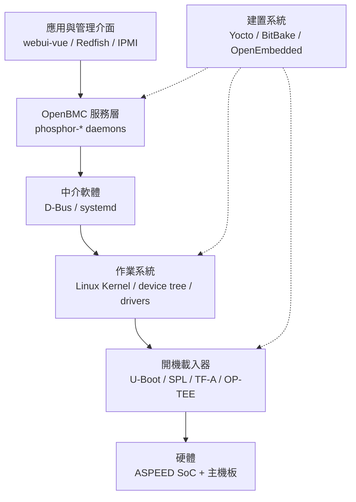
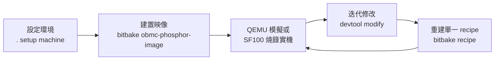
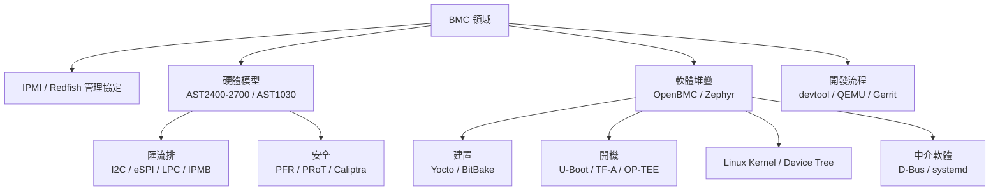

# ASPEED 嵌入式開發領域的模型、概念與先備知識

## 摘要

本報告整理「ASPEED 嵌入式開發」此一技術領域的領域模型（domain model）、核心概念與所需的先備知識。ASPEED（信驊科技）是全球伺服器基板管理控制器（Baseboard Management Controller, BMC）晶片的主要供應商，其晶片與 OpenBMC 開放原始碼韌體堆疊緊密結合，構成一套獨特的嵌入式開發體系。本報告先界定 ASPEED 及其產品線，再逐層拆解硬體模型、軟體堆疊模型、系統管理概念與開發流程模型，最後彙整一份先備知識地圖，供第一次接觸此領域的讀者建立整體心智模型。

本報告為獨立文件，所有需要的背景知識均收錄於報告內。

---

## 一、ASPEED 是什麼

ASPEED Technology Inc.（中文名「信驊科技」）是一家成立於 2004 年 11 月 15 日的無晶圓廠（fabless）IC 設計公司，總部位於台灣新竹科學園區，創辦人為林鴻明[^company]。其股票在台灣證券櫃檯買賣中心掛牌，代號為 5274，並於 2013 年開始交易[^company]。

ASPEED 的核心產品是伺服器遠端管理晶片，也就是基板管理控制器（BMC）。其在伺服器 BMC 晶片市場的市佔率估計超過 70%，客戶包含 Dell、HPE、Supermicro 等主要伺服器製造商[^company]。2016 年 5 月 12 日，ASPEED 以 3,000 萬美元（約新台幣 9.76 億元）收購 Broadcom 的 Emulex Pilot 伺服器遠端管理晶片業務（含 Pilot 4 產品線），進一步鞏固其作為全球最大伺服器遠端管理晶片供應商的地位[^company]。

除了 BMC 之外，ASPEED 也提供 Bridge IC／衛星管理控制器（Satellite Management Controller, SMC）、I/O 擴充晶片，以及 PFR（Platform Firmware Resilience，平台韌體韌性）安全晶片[^company]。其非伺服器產品線還包含 AVoIP（Audio Video over IP）系統單晶片，以及 Cupola360 全景影像拼接處理器[^aspeed_products]。

---

## 二、ASPEED 產品線與硬體領域模型

理解 ASPEED 嵌入式開發，第一步是建立「世代 × 角色」的產品模型。ASPEED 伺服器管理晶片可依世代與用途分為三大類：主 BMC 晶片、衛星管理控制器（Bridge IC），以及安全根信任（PFR）晶片。

### 2.1 主 BMC 晶片世代

| 世代 | 型號 | CPU 架構 | 核心數 | 最高時脈 | 製程 | 記憶體 |
|---|---|---|---|---|---|---|
| 第五代 | AST2400 | ARM926EJ-S（ARM9, ARMv5TEJ） | 1 | 400 MHz | — | DDR2/DDR3 800Mbps，16-bit，最高 512MB 含 ECC |
| 第六代 | AST2500 | ARM1176JZS（ARM11） | 1 | 800 MHz | — | DDR3 800Mbps／DDR4 1600Mbps，16-bit |
| 第七代 | AST2600 | 雙核 ARM Cortex-A7 | 2 | 1.2 GHz | 28nm | DDR4 |
| 第八代 | AST2700 | 四核 ARM Cortex-A35（64-bit）＋ 2× Cortex-M4 | 4＋2 | 1.6 GHz（A35）／400 MHz（M4） | 12nm | DDR5 3200Mbps，16-bit |

AST2400 為第五代伺服器管理處理器，採用 ARM926EJ-S 單核心，內建具 PCIe 介面的 2D 視訊圖形加速器與 iKVM 功能，支援最高 1920×1200 的視訊重導向[^ast2400]。

AST2500 為第六代產品，於 2015 年 7 月推出，採用 ARM11（ARM1176JZS）單核心 @ 800 MHz，支援 DDR4 記憶體遷移[^ast2500]。

AST2600 為第七代產品，於 2019 年 7 月推出，是世界上第一款 28nm 製程的 BMC 系統單晶片，採用雙核 ARM Cortex-A7 @ 1.2 GHz，具備 MMU、浮點運算單元（FPU）與 TrustZone 安全功能[^ast2600]。其子型號 AST2620 為純 BMC（不含 2D VGA）[^aspeed_products]。

AST2700 為第八代產品，是世界上第一款 12nm 製程的 BMC 系統單晶片，採用四核 ARM Cortex-A35 64-bit @ 1.6 GHz 加上兩顆 ARM Cortex-M4 @ 400 MHz，支援 PCIe Gen 4、USB 3.2、1Gb/s LTPI（OCP DC-SCM）、UFS 3.1 儲存與 CAN Bus 2.0B[^ast2700]。相關型號包含 AST2720（與 AST2700 腳位相容的獨立 BMC，無 2D VGA）、AST2750（雙節點監控，一顆 BMC 管理兩個運算節點），以及 AST1700（I/O 擴充晶片）[^aspeed_products]。

### 2.2 衛星管理控制器（Bridge IC / SMC）

AST1030 是一款服務處理器（Service Processor），採用 ARM Cortex-M4F @ 200 MHz，內建 1MB 嵌入式快閃記憶體與 768KB 嵌入式 SRAM，具備安全開機引擎（OTP 支援）、eSPI、I2C/I3C、USB 介面，並以 Zephyr 即時作業系統（RTOS）運行[^ast1030]。其角色為模組化／OCP 伺服器環境中的衛星管理控制器[^ast1030]。同家族還包含 AST1035、AST1840、AST1040 等[^aspeed_products]。

### 2.3 安全根信任晶片（PFR / PRoT）

ASPEED 的 PFR 系統單晶片包含 AST1060、AST1080，為專注於硬體根信任（root of trust）的安全處理器[^aspeed_products]。AST1840 是一款基於 eFPGA 的 SMC，具備 200 個 I/O 腳位、25K LUT、Caliptra 與實體防篡改功能；AST1040 則是新一代 SMC，搭載 Caliptra 安全開機與實體防篡改[^aspeed_products]。

### 2.4 QEMU 硬體模擬模型

QEMU 上游支援多款 ASPEED 機器模型：`ast2600-evb`（AST2600 評估板，Cortex-A7）、`rainier-bmc`（IBM POWER10 BMC）、`ast2700-evb`（AST2700 評估板，Cortex-A35 四核心）、`ast2700fc`（全晶片模型，含 2× Cortex-M4 協同處理器）、`ast1030-evb`（AST1030，Cortex-M4F 評估板）與 `ast1060-evb`（AST1060 PRoT 評估板）[^qemu]。這意味著開發者可以在沒有實體硬體的狀況下進行早期開發與測試。

---

## 三、BMC 核心概念模型

ASPEED 晶片的主要應用場景是 BMC，因此理解 BMC 是整個領域的核心。

### 3.1 BMC 的定位

BMC 是一種嵌入於電腦主機板（通常為伺服器）上的專用微控制器，為 IPMI 架構提供智慧核心。它是一個自主子系統，獨立於主機系統的 CPU、BIOS/UEFI 與作業系統之外運行，因此即使伺服器關機、尚未開機或當機，系統管理者仍可進行管理與監控[^bmc]。BMC 擁有自己專屬的韌體與 RAM[^bmc]。

BMC 透過智慧平台管理匯流排（Intelligent Platform Management Bus, IPMB）與主機板上的其他管理控制器連接，IPMB 是 I²C 的強化實作[^bmc]。

### 3.2 IPMI（智慧平台管理介面）

IPMI 是一組標準化的電腦介面規範，用來定義一個獨立於主機 CPU、韌體與作業系統之外的自主管理子系統，可實現頻外管理（out-of-band management）[^ipmi]。其主要能力包含：遠端電源循環、監控溫度／電壓／風扇／電源供應器／機殼入侵、檢視硬體日誌、掛載 ISO 映像檔以遠端安裝作業系統、遠端設定 BIOS，以及設定看門狗計時器[^ipmi]。

IPMI 版本演進如下[^ipmi]：

- **v1.0**（1998-09-16）：基礎規範。
- **v1.5**（2001-02-21）：新增 IPMI over LAN、序列／數據機連線與 LAN 警示。
- **v2.0**（2004-02-12）：新增 Serial over LAN（SOL）、群組管理系統、強化認證、韌體防火牆與 VLAN 支援。
- **v2.0 Rev 1.1**（2013-10-01）：新增 IPv6 支援。

IPMI 的關鍵元件包含[^ipmi]：

| 元件 | 全名 | 用途 |
|---|---|---|
| BMC | Baseboard Management Controller | IPMI 的「大腦」，執行感測器監控、告警與指令處理 |
| IPMB | Intelligent Platform Management Bus | I²C 的強化實作，連接 BMC 與衛星控制器 |
| SEL | System Event Log | 非揮發性系統事件記錄，記錄溫度超標、風扇故障等 |
| SDR | Sensor Data Record | 感測器資料記錄，描述每個感測器的屬性與門檻值 |
| FRU | Field-Replaceable Unit | 可更換單元清單，記錄廠商、序號、料號等 |
| SOL | Serial over LAN | 將序列埠主控台輸出透過網路重導向 |

IPMI 使用 RMCP（Remote Management Control Protocol）協定，運行於 UDP 之上；IPMI 2.0 增加了 RMCP+ 與更強的認證加密（RAKP+）[^ipmi]。

### 3.3 Redfish

Redfish 是由 DMTF（Distributed Management Task Force）於 2015 年 8 月發表的標準，用於取代 IPMI[^ipmi]。與 IPMI 的二元、不透明指令不同，Redfish 是建構於 HTTPS 之上的 RESTful API，使用 JSON 資料模型[^bmc]。它提供人類可讀、易於腳本化的伺服器管理介面，支援對受管資源（Systems、Chassis、Managers 等）的 CRUD 操作[^bmc]。OpenBMC 透過 `bmcweb` 元件原生支援 Redfish[^bmc]。

### 3.4 其他 BMC 職責

- **KVM over IP**：透過瀏覽器或專用客戶端遠端存取伺服器的鍵盤、視訊與滑鼠，ASPEED BMC 晶片內建的入門級 2D GPU 即為此用途[^bmc]。
- **感測器監控**：持續監控溫度、電壓、風扇轉速、機殼入侵、電源供應狀態等[^bmc]。
- **風扇控制**：依溫度讀值以 PID（比例－積分－微分）控制迴路動態調整風扇轉速[^bmc]。
- **電源管理**：遠端開關機、監控功耗、電源上限（power capping）、看門狗計時器與開機電源時序控制[^bmc]。

---

## 四、軟體堆疊領域模型

ASPEED BMC 的軟體堆疊可用分層模型來理解。



### 4.1 OpenBMC

OpenBMC 是 Linux Foundation 的協作開放原始碼專案，產出 BMC 韌體堆疊的開源實作[^openbmc]。它是一個為 BMC 設計的 Linux 發行版，旨在跨異質系統運作，涵蓋企業、高效能運算（HPC）、電信與雲端規模資料中心[^openbmc]。

其歷史沿革為：2014 年 Facebook 駭客松誕生第一個 OpenBMC 原型；2015 年 IBM 與 Rackspace 合作開發另一個同名堆疊；2018 年 3 月 OpenBMC 成為 Linux Foundation 專案，並收斂至 IBM 的堆疊[^openbmc]。創始組織為 Microsoft、Intel、IBM、Google 與 Facebook[^openbmc]。授權條款為 Apache License 2.0[^openbmc]。

技術特徵包含：以 Yocto Project 作為底層建置與發行版產生框架、韌體基於 U-Boot、使用 D-Bus 作為行程間通訊（IPC）、包含網頁應用程式，並支援 Redfish 硬體管理[^openbmc]。

### 4.2 建置系統：Yocto、OpenEmbedded 與 BitBake

| 概念 | 說明 |
|---|---|
| Yocto Project | 建置客製化嵌入式 Linux 發行版的傘狀開源框架 |
| OpenEmbedded（OE） | Yocto 所基於的底層建置系統／中介資料框架 |
| BitBake | 建置引擎／任務執行器，主要指令為 `bitbake <target>` |
| Recipe（`.bb`） | 描述如何取得、設定、編譯與安裝軟體的檔案 |
| Append（`.bbappend`） | 擴充或覆寫既有 recipe 而不修改原始檔 |
| 設定檔 | `local.conf`、`bblayers.conf`、`machine.conf` |
| `setup` 指令 | OpenBMC 的環境初始化腳本，用法如 `. setup romulus` |

此部分為 OpenBMC 官方開發文件所定義之內容[^dev]。

### 4.3 Meta-Layer 架構

meta-layer 是 recipe、設定與中介資料的集合，用於新增或覆寫功能[^dev]。OpenBMC 高度分層，常見層包含：`meta-openbmc-bsp`（特定硬體的板級支援套件層）、`meta-phosphor`（OpenBMC 核心層，含 `obmc-phosphor-image` 目標）、`meta-phosphor/common` 與 `meta-phosphor/classes`[^dev]。`bblayers.conf` 由 `setup` 腳本產生，列出所有啟用中的層[^dev]。

針對 ASPEED 硬體，另有 `meta-aspeed` 層，提供 U-Boot、Linux 核心與板級設定的 recipe[^metaaspeed]。上游 `openbmc/meta-aspeed` 已於 2022 年 3 月 31 日封存（archive）並轉為唯讀[^metaaspeed]。ASPEED 的活躍開發已轉移至其 fork 的 `AspeedTech-BMC/openbmc`（`aspeed-master` 分支，約 126 顆星），其中包含 `meta-aspeed`、`meta-aspeed-sdk` 與 `meta-zephyr` 等層，以及針對 Intel、AMD、Facebook、IBM、Google、NVIDIA 等 OEM 的平台層[^aspeed_openbmc]。

### 4.4 開機流程模型

不同世代的 ASPEED 晶片有不同的開機鏈。

AST2600 採用標準 U-Boot 開機序列：**BootROM → SPL → U-Boot → Linux 核心**[^aspeed_openbmc]。

AST2700 則具有更複雜的多階段開機架構。其完整開機鏈為：**BootROM → U-Boot SPL（IBex RISC-V 開機微控制器）→ TF-A BL31 → OP-TEE（BL32）→ U-Boot（BL33，Cortex-A35）→ Linux 核心**[^aspeed_openbmc]。其中 U-Boot SPL 由整合於 AST2700 的 IBex RISC-V 32-bit CPU 於 M-mode 執行，Trusted Firmware-A 以 `make CROSS_COMPILE=aarch64-linux-gnu- PLAT=ast2700 SPD=opteed` 建置[^aspeed_openbmc]。

### 4.5 ASPEED 的開發套件（SDK）

ASPEED 為 AST2600 與 AST2700 提供基於 OpenBMC 的 SDK，託管於 `AspeedTech-BMC/openbmc` 的 `aspeed-master` 分支[^aspeed_openbmc]。SDK 內含 `meta-aspeed-sdk`（ASPEED 自訂的 OpenEmbedded/Yocto BSP 層）、`meta-aspeed`（ASPEED 晶片的上游合併層）與預建韌體映像檔，並可搭配 QEMU 執行以進行早期開發[^aspeed_openbmc]。

### 4.6 Zephyr RTOS 支援

針對以 Cortex-M4F 為核心的 AST1030／AST1060，ASPEED 提供 Zephyr RTOS 支援。其 Zephyr fork 為 `AspeedTech-BMC/zephyr`（基於上游 Zephyr RTOS v3.7.0 左右）[^aspeed_openbmc]。應用專案 `AspeedTech-BMC/aspeed-zephyr-project` 使用 `west` 建置系統，支援的板級目標包含 `ast1030_evb`（AST1030）、`ast1060_dcscm`（AST1060 DCSCM 示範板）、`ast1060_prot`（PRoT 模組）、`ast2700_dcscm`（AST2700 DCSCM）與 `ast2700_dual_flash_amd` 等[^aspeed_openbmc]。

Zephyr 上的關鍵應用包含：`apps/aspeed-pfr`（平台韌體韌性 PFR 韌體）、`apps/preload-fw`（製造預載韌體）、`apps/mcu-runtime`（AST27xx 開機 MCU 韌體）、`apps/spdm`（DMTF/LibSPDM 模擬器）與 `apps/aspeed-irot`（初始根信任韌體）[^aspeed_openbmc]。上游 Zephyr 亦正式支援 `ast1030_evb` 板[^aspeed_openbmc]。

### 4.7 Linux 核心支援

AST2600 的 Linux 核心支援最初於 Linux 5.4（2019 年 9 月）合併，驅動包含 ASPEED 視訊驅動（KVM、多框／差分壓縮）、PWM／風扇轉速計驅動（`aspeed-g6-pwm-tach`）、I2C 控制器與 `drivers/soc/aspeed/` 下的 SoC 驅動[^aspeed_openbmc]。AST2700 為 64-bit ARM SoC，使用 ARM64 核心架構，支援於近期核心週期合併[^aspeed_openbmc]。ASPEED 維護 Linux fork 於 `AspeedTech-BMC/linux`（約 68 顆星）[^aspeed_openbmc]。

---

## 五、開發流程與工具鏈模型

### 5.1 完整建置流程

OpenBMC 官方文件的標準流程如下[^dev]：

```bash
git clone https://github.com/openbmc/openbmc.git
cd openbmc
. setup romulus
bitbake obmc-phosphor-image
```

建置產物位於 `build/tmp/deploy/images/<machine>/obmc-phosphor-image-<machine>.static.mtd`[^dev]。首次建置約需 30 至 120 分鐘；建議至少 8 執行緒、16 GB RAM、200 GB 磁碟[^dev]。可使用 `DL_DIR` 與 `SSTATE_DIR` 快取目錄加速後續建置[^dev]。

### 5.2 迭代開發：devtool

`devtool` 是 Yocto 的命令列工具，用於迭代開發。它允許開發者取出 recipe 原始碼、修改、建置，並替換至映像檔中，而不需重新複製或下載整份原始碼[^dev]：

| 指令 | 用途 |
|---|---|
| `devtool modify <recipe>` | 取出 recipe 原始碼至 `workspace/sources/<recipe>` 供編輯 |
| `devtool add <path>` | 從外部原始碼樹新增 recipe |
| `devtool update-recipe <recipe>` | 將變更套回原始 recipe |
| `devtool reset <recipe>` | 移除 workspace 中的變更 |
| `devtool build <recipe>` | 於 workspace 中單獨建置該 recipe |
| `devtool build-image <image>` | 建置含 workspace 變更的完整映像檔 |

### 5.3 QEMU 模擬工作流

OpenBMC 使用 QEMU 的 fork（`qemu-system-arm`）模擬 BMC 硬體，標準目標為 Romulus（ARM BMC 參考平台）[^dev]。啟動映像檔範例[^dev]：

```bash
./qemu-system-arm -m 256 -M romulus-bmc -nographic \
    -drive file=./obmc-phosphor-image-romulus.static.mtd,format=raw,if=mtd \
    -net nic \
    -net user,hostfwd=:127.0.0.1:2222-:22,hostfwd=:127.0.0.1:2443-:443,hostfwd=udp:127.0.0.1:2623-:623,hostname=qemu
```

連接埠轉送：2222 對應 SSH、2443 對應 HTTPS/Web UI、2623 對應 IPMI（UDP）[^dev]。預設登入帳密為 `root` / `0penBmc`[^dev]。

### 5.4 SDK（軟體開發套件）

Yocto SDK 是跨編譯工具鏈加上函式庫、標頭檔與 sysroot 的組合，讓開發者無需執行完整 BitBake 建置即可為目標 BMC 編譯應用程式[^dev]。產生指令為 `bitbake -c populate_sdk obmc-phosphor-image`，產物為 `tmp/deploy/sdk/` 下的安裝腳本，安裝後提供跨編譯工具鏈、目標 sysroot 與環境設定腳本[^dev]。另有可擴充 SDK（eSDK, `do_populate_sdk_ext`），內含 devtool，可在主要建置之外新增／修改 recipe[^dev]。

### 5.5 網頁介面與程式碼審查

OpenBMC 有兩套網頁介面框架：`phosphor-webui`（AngularJS，已於 2021 年 6 月 EOL，屬舊版）與 `webui-vue`（Vue.js 搭配 Redfish API，現行版本）[^dev]。程式碼審查使用 Gerrit（`gerrit.openbmc.org`），而非直接使用 GitHub PR，提交時推送至 `refs/for/master` 並使用 Change-Id[^dev]。CI 由 Jenkins（`jenkins.openbmc.org`）執行，系統層測試採用 Robot Framework[^dev]。

### 5.6 ASPEED 硬體開發工具

- **SF100 SPI Flash 燒錄器**：用於將韌體燒錄至 SPI 快閃記憶體，例如 AST2700 的 SPL 需燒錄於 SPI 快閃記憶體位移 `0x80`[^aspeed_openbmc]。
- **J-Link／JTAG／SWD**：用於 AST1030／AST1060／AST2700-M4 目標的除錯[^aspeed_openbmc]。
- **West**：Zephyr 的 meta 工具，用於建置 ASPEED Zephyr 專案[^aspeed_openbmc]。
- **imgtool**：以 RSA-2048 金鑰簽署預載韌體（MCUboot）[^aspeed_openbmc]。



---

## 六、先備知識地圖

下表彙整進入 ASPEED 嵌入式開發領域所需的先備知識，並說明其在領域中的角色。

### 6.1 必要基礎

| 知識領域 | 為何重要 |
|---|---|
| Linux 命令列 | 所有開發皆在 Linux 終端進行 |
| Git | 複製儲存庫、分支、提交與 Gerrit 工作流 |
| 嵌入式 Linux 概念 | 跨編譯、開機載入器、核心、裝置樹、快閃映像檔 |
| BMC 基礎 | IPMI、KVM、SOL、感測器監控、電源控制 |
| Yocto Project 基礎 | recipe（`.bb`）、append（`.bbappend`）、層（`meta-*`）、`local.conf`、BitBake 任務 |

### 6.2 進階與周邊知識

| 知識領域 | 為何重要 |
|---|---|
| C／C++ | 多數 BMC 常駐程式（phosphor-*）以 C++ 撰寫 |
| Python | BitBake 本身、測試自動化（Robot Framework）與部分工具 |
| systemd | 服務單元檔、單元管理、journalctl 日誌 |
| D-Bus | OpenBMC 的主要 IPC 機制，所有服務透過 D-Bus 溝通 |
| REST API／Redfish | 網頁介面與外部管理介面 |
| JavaScript／Vue.js | 網頁介面開發（webui-vue） |
| 網路概念 | SSH、IPMI、DHCP、MAC 位址、VLAN，BMC 本身即網路裝置 |
| QEMU | 測試用的模擬工作流 |
| 硬體知識 | GPIO、I2C、SPI、LPC、PWM 風扇、溫度感測器 |
| 裝置樹（Device Tree） | 描述 ASPEED SoC 與主機板硬體給 Linux 核心 |
| I²C／SMBus／IPMB | BMC 與感測器、FRU EEPROM、衛星控制器間的基本低階匯流排 |
| GPIO／LPC／eSPI | 主機 CPU 與 BMC 間的低階介面，用於電源時序、重置與邊帶通訊 |
| 安全 | TLS/HTTPS、認證（PAM、RADIUS、LDAP）、角色型存取控制、安全開機 |
| 韌體更新（OTA） | 雙映像（A/B）更新機制與快閃記憶體佈局 |
| 序列主控台／SOL | UART 設定與序列主控台網路重導向 |

### 6.3 關鍵技術概念補充

**裝置樹（Device Tree）**：一種描述電腦系統硬體元件（CPU、記憶體、匯流排、周邊、中斷控制器、GPIO 等）的資料結構，供作業系統核心理解並使用[^dt]。原始碼格式為 DTS（`.dts`）與 DTSI（`.dtsi`），經裝置樹編譯器（DTC）編譯為二進位 DTB，由開機載入器載入並傳給核心[^dt]。其存在原因是 ARM SoC 本身不具自我描述能力（不像 x86 有 ACPI 或 PCI 列舉），裝置樹將硬體描述移出核心二進位，使單一核心可支援多種板子[^dt]。自 2012 年起，裝置樹對所有新的 ARM SoC 為強制要求[^dt]。在 ASPEED 開發中，修改 `.dts`／`.dtsi` 以新增 I²C 裝置、感測器、GPIO 等是常見工作。

**eSPI（Enhanced Serial Peripheral Interface）**：由 Intel 於約 2013 年定義的序列匯流排，作為舊式 LPC 匯流排的現代替代品[^espi]。使用 5 至 8 根腳位、1.8V I/O、20 至 66 MHz 時脈，並透過 Virtual Wire 通道將邊帶訊號轉為帶內訊息[^espi]。具備四個通道：Peripheral、Virtual Wire、OOB（帶外，可通道化 SMBus 封包）與 Flash Access（主機與從屬如 EC、BMC 共享 SPI 快閃存取）[^espi]。常用於連接嵌入式控制器、BMC、Super-I/O 與 TPM[^espi]。

**LPC（Low Pin Count）**：Intel 於 1998 年推出、作為 ISA 匯流排軟體相容替代品的舊式匯流排[^espi]。具 7 根必要訊號與最多 6 根選用邊帶訊號，3.3V I/O、固定 33 MHz[^espi]。eSPI 已成為現代 x86 與 ARM 伺服器／嵌入式平台低速周邊通訊的主流，LPC 則逐漸式微[^espi]。

### 6.4 概念關聯圖



---

## 七、來源批判與局限

本報告的資料來源主要分為三類：一為 ASPEED 官方網站與維基百科等第一手或社群整理資料；二為 OpenBMC 官方文件與 GitHub 儲存庫；三為 QEMU、U-Boot、Zephyr 等開源專案文件。

需注意的局限如下：

1. **時效性風險**：ASPEED 產品線世代更迭快速，AST2700 系列的規格（如量產時程）在其官方頁面標示為「樣品 2024 年初、預計 2025 年量產」，實際狀態可能已變動[^ast2700]。讀者應以 ASPEED 官方最新公告為準。
2. **星數門檻考量**：本報告涉及之 GitHub 專案中，`AspeedTech-BMC/openbmc` 約 126 顆星，`AspeedTech-BMC/linux` 約 68 顆星，其餘如 `zephyr`（約 26 顆星）、`u-boot`（約 28 顆星）、`aspeed-zephyr-project`（約 23 顆星）皆低於 100 顆星[^aspeed_openbmc]。這類低星數專案並非社群熱度指標，而是因為 ASPEED 嵌入式開發本質上屬於相對小眾且由廠商主導的領域，只有這些專案存在，故仍予以收錄並附上脈絡說明。
3. **權威性差異**：維基百科內容屬社群編輯，可能存在延遲或錯誤；ASPEED 官方頁面屬第一手來源但可能有行銷取向；OpenBMC 與 QEMU 官方文件權威性較高。本報告已儘量以多來源交叉印證，但仍建議關鍵決策時查證官方規格書（datasheet）。
4. **語言與命名**：部分專有名詞（如 PRoT、PFR、DC-SCM、LTPI）在中文圈尚無統一譯名，本報告保留英文原文以避免歧義。

---

## 參考文獻

[^company]: 信驊科技. (n.d.). 信驊科技. Retrieved 2026-11-07, from https://zh.wikipedia.org/wiki/信驊科技

[^aspeed_products]: ASPEED Technology. (n.d.). Server management / Bridge IC products. Retrieved 2026-11-07, from https://www.aspeedtech.com/server/ and https://www.aspeedtech.com/bic/

[^ast2400]: ASpeed. (n.d.). AST2400 server management processor. Retrieved 2026-11-07, from https://www.aspeedtech.com/server_ast2400/

[^ast2500]: ASpeed. (n.d.). AST2500 server management processor. Retrieved 2026-11-07, from https://www.aspeedtech.com/server_ast2500/

[^ast2600]: ASpeed. (n.d.). AST2600 integrated remote management processor. Retrieved 2026-11-07, from https://www.aspeedtech.com/server_ast2600/

[^ast2700]: ASpeed. (n.d.). AST2700 remote management server processor. Retrieved 2026-11-07, from https://www.aspeedtech.com/server_ast2700/

[^ast1030]: ASpeed. (n.d.). AST1030 service processor. Retrieved 2026-11-07, from https://www.aspeedtech.com/server_ast1030/

[^bmc]: Baseboard management controller. (n.d.). In Wikipedia. Retrieved 2026-11-07, from https://en.wikipedia.org/wiki/Baseboard_management_controller

[^ipmi]: Intelligent Platform Management Interface. (n.d.). In Wikipedia. Retrieved 2026-11-07, from https://en.wikipedia.org/wiki/Intelligent_Platform_Management_Interface

[^openbmc]: OpenBMC. (n.d.). In Wikipedia. Retrieved 2026-11-07, from https://en.wikipedia.org/wiki/OpenBMC

[^dev]: OpenBMC. (n.d.). OpenBMC development documentation. Retrieved 2026-11-07, from https://github.com/openbmc/docs/blob/master/development/README.md

[^metaaspeed]: OpenBMC. (n.d.). meta-aspeed layer. Retrieved 2026-11-07, from https://github.com/openbmc/meta-aspeed

[^aspeed_openbmc]: ASpeedTech-BMC. (n.d.). ASpeed OpenBMC SDK and related repositories. Retrieved 2026-11-07, from https://github.com/AspeedTech-BMC/openbmc and https://github.com/AspeedTech-BMC

[^qemu]: QEMU. (n.d.). Aspeed ASPEED SoC machines. Retrieved 2026-11-07, from https://www.qemu.org/docs/master/system/arm/aspeed.html

[^dt]: Devicetree. (n.d.). In Wikipedia. Retrieved 2026-11-07, from https://en.wikipedia.org/wiki/Devicetree

[^espi]: Total Phase. (2021, September). What is the eSPI protocol and how does it improve upon LPC? Retrieved 2026-11-07, from https://www.totalphase.com/blog/2021/09/what-is-the-espi-protocol-and-how-does-it-improve-upon-lpc/
