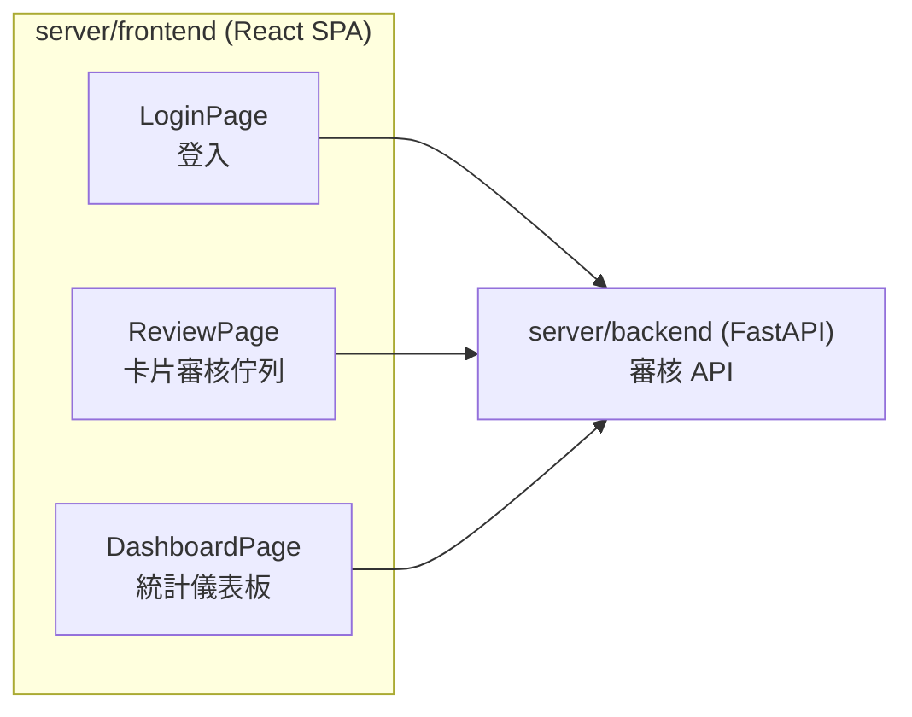
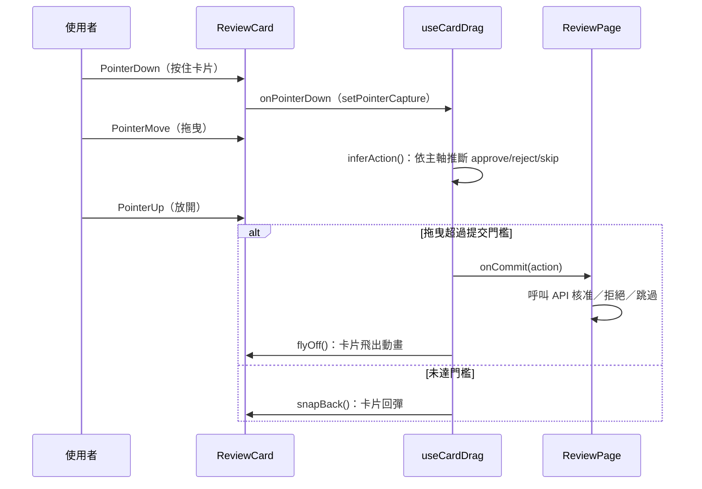

# cq 伺服器前端 Review UI 的設計來源調查：原創還是有所參考？

## 摘要

本報告調查 Mozilla.ai 的開源專案 **cq**（`mozilla-ai/cq`）中，`server/frontend` 這個「團隊審核介面（team review UI）」的設計究竟屬於原創，還是參考或受啟發自特定外部對象。結論是：**就公開的 commit 紀錄、Issue 與 Pull Request 討論來看，該 Review UI 的互動與視覺設計被描述為專案團隊自行定義與實作的原創工作，沒有任何一處明文標註、致謝或引用特定的外部產品、設計系統或第三方元件庫作為設計來源**。不過，其核心的「卡片左右滑動＝核准／拒絕」互動隱喻，與約會 App Tinder 所普及的卡片滑動（card swipe）範式高度相似；這是一種廣為流傳的通用 UX 慣例，因此更準確的描述是「獨立實作、但沿用一個既有的通用互動隱喻」，而非「複製某個特定產品」。

---

## 1. 研究對象的背景

cq 是一個「共享代理學習（shared agent learning）」的開放標準，讓 AI 代理能持久化、分享與查詢集體知識，避免各自重複踩到相同的錯誤[^repo]。截至 2026-11-07，該專案在 GitHub 上約有 **1,296 顆星**、73 個 fork，主要語言為 Go，採用 Apache-2.0 授權[^repo]。

`server/frontend` 是專案內的一個 React 19 + TypeScript + Vite 單頁應用，作為「團隊層（team tier）」的人工審核（human-in-the-loop, HITL）介面。它提供登入、審核佇列（review queue）與儀表板（dashboard）三種視圖，並使用 Tailwind CSS 4 與 Recharts 進行樣式與圖表呈現[^pkgjson]。

---

## 2. Review UI 的設計演進（依 commit 與 PR 時序）

要判斷設計是否原創，最直接的方法是追溯其演進歷程。

### 2.1 初版：鍵盤操作為主的審核頁

Review UI 首度出現於 PR #57「Add team review UI for knowledge unit approval workflow」（2026-03-14 合併）。該 PR 由專案成員 Peter Wilson（GitHub 帳號 `peteski22`）提交，摘要中描述前端的範圍為：「React 19 + Vite 8 + Tailwind CSS 4 SPA，含登入、審核頁（鍵盤快捷鍵、quick mode）與儀表板（domain 長條圖、信心度直方圖、提交趨勢圖、活動表格）」[^pr57]。此階段尚未出現滑動互動，操作以鍵盤快捷鍵與一個會自動確認選項的「quick mode」為主。

### 2.2 設計階段的來源：內部設計流程與設計規格文件

在實作之前，專案以 Issue #52「Design team UI components and interactions」（2026-03-13）規劃設計工作。該 Issue 明確寫道：

> 「使用 **frontend-design skill** 來定義團隊 UI 的詳細元件設計、版面與互動模式，然後才開始實作。」[^issue52]

其 Scope 列出審核卡片版面、滑動／核准／拒絕 UX、儀表板面板、登入頁、導覽列、色彩／字體／間距、空狀態與行動裝置的滑動 UX 等[^issue52]。Issue 內亦註明其設計依據為一份規格文件（spec）：

> `docs/plans/2026-03-12-team-tier-review-ui-design.md` — Frontend section[^issue52]

這顯示 Review UI 的設計是在專案內部、由一份自製規格文件與一個名為「frontend-design skill」的內部工具所產出的，而非取自外部設計稿或外部產品的逆向工程。**值得注意的是，該 Issue 與其規格文件全文中，並未提及任何外部設計的參考或致敬對象。**

### 2.3 改版：滑動互動模型的引入

滑動互動模型是在 PR #67「Redesign review UI with drag/swipe interaction model」（2026-03-15 合併，同樣由 `peteski22` 提交）中引入[^pr67]。觸發原因是 Issue #65：使用者回報在「quick mode」下按右方向鍵會一次核准多筆待審項目，因此團隊決定**移除 quick mode，改以拖曳／滑動互動模型取代**[^pr67][^issue65]。

PR #67 的摘要描述新互動為[^pr67]：

- **拖曳／滑動**：卡片向左拖曳＝拒絕、向右＝核准、向上／向下＝跳過，並有顏色轉換、旋轉、陰影與螢幕邊緣指示器等視覺回饋。
- **桌面按鈕**：三鍵列（Reject / Skip / Approve），採兩段式點擊確認，並透過 `pointer: fine` 媒體查詢在觸控裝置隱藏。
- **鍵盤**：方向鍵選擇、Space/Enter 確認、S 立即跳過、Escape 取消。

值得強調的是，PR #67 的摘要與 diff 中**沒有任何一處提及 Tinder、任何約會 App、任何 UI 元件庫，或任何外部設計作為靈感來源**。其敘述一律以功能需求（避免誤觸、支援行動與桌面）來合理化設計，而非以「模仿某產品」來描述。

### 2.4 後續的迭代

- PR #78（2026-03-15）：修正拖曳時卡片被容器裁切的問題，將 `overflow-x-hidden` 從 ReviewPage 移到根層 Layout div，讓卡片能橫跨整個視窗寬度移動[^pr78]。
- PR #167（2026-03-29，由外部貢獻者 jonathanKingston 提交，**未合併**）：嘗試改善行動裝置的卡片捲動與滑動手勢，讓水平意圖在拇指軌跡垂直飄移時仍能維持；但維護者測試後認為會讓桌面拖曳行為異常，最終因停滯而關閉[^pr167]。

這些迭代全部圍繞自製的互動邏輯除錯，並未出現「改用某個既有設計」的轉向。

---

## 3. 實作層面的原創性證據

判斷是否「沿用第三方設計」的另一個角度，是檢視其技術實作是否仰賴現成的設計元件或滑動函式庫。

### 3.1 未使用任何第三方滑動／卡片元件庫

`server/frontend/package.json` 的執行期依賴僅有四項[^pkgjson]：

| 依賴 | 版本 | 用途 |
|---|---|---|
| `react` | ^19.2.4 | UI 框架 |
| `react-dom` | ^19.2.4 | DOM 渲染 |
| `react-router` | ^8.3.0 | 路由 |
| `recharts` | ^3.8.0 | 圖表 |

其中**沒有任何滑動、手勢或卡片堆疊相關的函式庫**（例如 react-tinder-card、framer-motion、react-swipeable 等）[^pkgjson]。

### 3.2 滑動邏輯為手寫的原生 Pointer Events 實作

滑動的核心邏輯位於 `server/frontend/src/hooks/useCardDrag.ts`，這是一個自行撰寫的 React Hook，使用原生 **Pointer Events API**（`onPointerDown` / `onPointerMove` / `onPointerUp` / `onPointerCancel`）搭配 `setPointerCapture` 進行拖曳追蹤[^usecarddrag]。其設計參數（如水平提交比例 0.4、垂直提交比例 0.3、最大旋轉 3 度、飛出動畫 300ms、回彈 200ms）皆為自訂常數[^usecarddrag]。

`ReviewCard.tsx` 被重構為「純視覺」元件，接收拖曳狀態與事件處理器作為 props；`DragIndicators.tsx` 則繪製固定於螢幕四邊的核准／拒絕／跳過指示器[^reviewcard][^dragindicators]。這些都是針對本專案需求量身打造的元件，而非套用現成模板。

### 3.3 文字與註解中無任何致謝或來源標註

在 `server/frontend` 的原始碼、README 與設定檔中，未發現任何向外部設計、產品或個人致謝（credit）、標註靈感來源（inspired by / based on）或授權引用的文字。前端 README 亦僅是 Vite 官方模板的預設內容[^fereadme]。

---

## 4. 與 Tinder 式卡片滑動範式的關係

雖然缺乏任何明文的參考對象，Review UI 的互動隱喻——**卡片在畫面上左右滑動、左＝拒絕、右＝核准、方向與顏色回饋、飛出動畫**——在業界被普遍聯想為約會 App **Tinder** 所普及的「卡片滑動（card swipe / swipeable card stack）」範式。

需要嚴謹區分的是：

- **「沿用通用隱喻」**：Tinder 式的左右滑動決策，早已是行動與網頁介面中的通用慣例，被廣泛應用於內容分級、審核、推薦回饋等場景。採用此隱喻本身，與「複製某個特定產品」是兩回事。
- **「引用特定對象」**：在本專案的所有公開紀錄（commit、Issue、PR、程式碼註解）中，**找不到任何一處把 Tinder 或其他產品指名為設計來源**[^pr67][^issue52][^issue65]。

因此，最嚴謹的結論是：**這是專案團隊獨立設計與實作的成果，但其選用的互動隱喻屬於一個既有的通用範式**；就「是否參考或受啟發於特定對象」而言，公開證據不支持「有特定參考對象」的主張，只能說它與通用卡片滑動慣例一致。

---

## 5. 來源批判性反思

在解讀上述證據時，需注意以下限制：

1. **缺乏設計稿原始檔**：Issue #52 所引用的規格文件 `docs/plans/2026-03-12-team-tier-review-ui-design.md` 已不在現行 `main` 分支的 `docs/plans/` 目錄中（該目錄現僅存 `2026-03-04-craic-mvp-poc-design.md`）[^plans]。因此無法直接檢視該設計文件是否含有外部參考清單。這使得「原創」的判斷主要建立在「缺乏引用痕跡」而非「設計文件明文聲明原創」之上。
2. **「frontend-design skill」的性質**：Issue #52 提到的「frontend-design skill」看似為一套內部（很可能為 AI 輔助）的設計方法論，而非外部設計公司或產品[^issue52]。這進一步支持設計出自專案內部流程的判斷，但其具體內容未見於公開紀錄。
3. **作者集中**：Review UI 的設計與主要實作幾乎全由 `peteski22`（Peter Wilson，Mozilla.ai）一人主導[^pr57][^pr67]。單一作者的設計決策較不易從 commit 訊息中看出靈感來源，因為致謝外部靈感並非其 commit 慣例。
4. **缺乏明確否定聲明**：沒有任何一處明言「本設計為原創、未參考任何外部對象」。本報告的結論是**基於現有公開證據的推論**，而非來自設計者的直接聲明。

---

## 6. 結論

針對「該 Review UI 的設計是原創的，還是有參考或受啟發的對象？」這個問題，答案是：

- **公開紀錄顯示其為專案內部原創設計**：由 Mozilla.ai 的 Peter Wilson 主導，經由 Issue #52 所描述的內部設計流程（frontend-design skill + 自製設計規格）產出，並在 PR #57 初版、PR #67 改版為拖曳／滑動模型；全程無第三方滑動元件庫、無致謝或引用標註。
- **互動隱喻沿用通用範式**：其「卡片左右滑動＝核准／拒絕」的互動與 Tinder 式卡片滑動範式一致，但這是廣為流傳的通用 UX 慣例，並無證據指向任何特定的參考對象。
- **一句話總結**：**獨立實作的原創設計，選用了一個既有的通用互動隱喻；沒有證據顯示其參考或受啟發於某個特定外部對象。**

---

## 參考文獻

[^repo]: mozilla-ai. (2026). cq [Source code]. GitHub. Retrieved 2026-11-07, from https://github.com/mozilla-ai/cq

[^pkgjson]: mozilla-ai. (2026). package.json. In cq [Source code]. GitHub. Retrieved 2026-11-07, from https://github.com/mozilla-ai/cq/blob/main/server/frontend/package.json

[^fereadme]: mozilla-ai. (2026). README.md. In cq [Source code]. GitHub. Retrieved 2026-11-07, from https://github.com/mozilla-ai/cq/blob/main/server/frontend/README.md

[^pr57]: Wilson, P. (2026, March 14). Add team review UI for knowledge unit approval workflow (Pull request #57). GitHub. Retrieved 2026-11-07, from https://github.com/mozilla-ai/cq/pull/57

[^pr67]: Wilson, P. (2026, March 15). Redesign review UI with drag/swipe interaction model (Pull request #67). GitHub. Retrieved 2026-11-07, from https://github.com/mozilla-ai/cq/pull/67

[^pr78]: Wilson, P. (2026, March 15). Fix review card clipping during drag (Pull request #78). GitHub. Retrieved 2026-11-07, from https://github.com/mozilla-ai/cq/pull/78

[^pr167]: Kingston, J. (2026, March 29). fix: improve mobile review card scrolling and swipe gestures (Pull request #167). GitHub. Retrieved 2026-11-07, from https://github.com/mozilla-ai/cq/pull/167

[^issue52]: Wilson, P. (2026, March 13). Design team UI components and interactions (Issue #52). GitHub. Retrieved 2026-11-07, from https://github.com/mozilla-ai/cq/issues/52

[^issue65]: Wilson, P. (2026, March 15). Review UI: RIGHT cursor approves all pending KUs at once (Issue #65). GitHub. Retrieved 2026-11-07, from https://github.com/mozilla-ai/cq/issues/65

[^usecarddrag]: mozilla-ai. (2026). useCardDrag.ts. In cq [Source code]. GitHub. Retrieved 2026-11-07, from https://github.com/mozilla-ai/cq/blob/main/server/frontend/src/hooks/useCardDrag.ts

[^reviewcard]: mozilla-ai. (2026). ReviewCard.tsx. In cq [Source code]. GitHub. Retrieved 2026-11-07, from https://github.com/mozilla-ai/cq/blob/main/server/frontend/src/components/ReviewCard.tsx

[^dragindicators]: mozilla-ai. (2026). DragIndicators.tsx. In cq [Source code]. GitHub. Retrieved 2026-11-07, from https://github.com/mozilla-ai/cq/blob/main/server/frontend/src/components/DragIndicators.tsx

[^plans]: mozilla-ai. (2026). docs/plans. In cq [Source code]. GitHub. Retrieved 2026-11-07, from https://github.com/mozilla-ai/cq/tree/main/docs/plans
