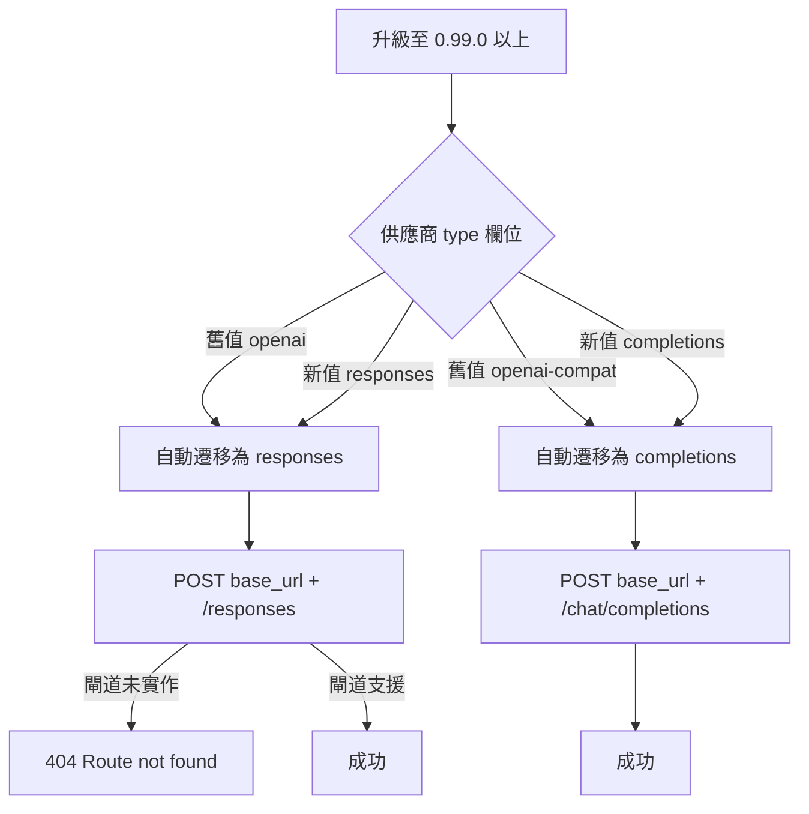

# Crush 從 0.98.1 升級 0.100.0 後出現 `Route not found: POST /openai/v1/responses` 的原因與解法

## 摘要

當 Crush（Charm 推出的終端機 AI 編碼代理）從 0.98.1 升級到 0.100.0 後，若使用者設定了自訂的 OpenAI 相容供應商（custom provider），卻在請求時得到類似 `{"error":"Route not found: POST /openai/v1/responses"}` 的錯誤，其根本原因不是 Crush 壞掉，而是 **0.99.0 版導入的 Catwalk v3 供應商型別（provider `type`）語意變更**：舊的 `type: "openai"` 被自動遷移為「Responses API」，而使用者預期走的是「Chat Completions API」。只要把該供應商的型別明確設為 `completions`，請求就會回到 `chat/completions` 端點，錯誤即可解除。

## 問題現象

使用者升級後看到如下形式的錯誤（實際路徑與前綴依各自的閘道而異）：

```json
{"error":"Route not found: POST /openai/v1/responses"}
```

值得注意的是，**這串錯誤訊息並非 Crush 產生**，而是上游的 OpenAI 相容閘道（gateway／proxy）回傳的。Crush 的問題追蹤系統中搜尋 `Route not found` 字串查無任何結果，可佐證它來自外部服務[^ghsearch]。錯誤的意思是：Crush 把請求送到了 `.../responses` 這條路徑，但該閘道並未實作 OpenAI Responses API，因此回應 404「找不到路由」。

## 背景：Responses API 與 Chat Completions 是兩條不同端點

OpenAI 生態系目前並存兩套 HTTP 介面：

- **Chat Completions API**：端點為 `POST {base_url}/chat/completions`，是最早、最廣泛被相容閘道實作的介面。
- **Responses API**：端點為 `POST {base_url}/responses`，是較新的介面，並非所有自架閘道都支援。

Crush 本身不拼接路徑，而是把使用者設定的 `base_url` 直接交給底層 SDK，由 SDK 依呼叫的方法附加 `/responses` 或 `/chat/completions`[^loadgo]。也就是說，**選錯 API 形式，就會打到閘道不存在的路徑**。

## 升級後行為改變的原因：Catwalk v3

Crush 的模型／供應商目錄由一個名為 Catwalk 的專案提供。0.99.0 版起 Crush 改用 **Catwalk v3**，這是本次問題的關鍵變更點[^v0990][^catwalkv3]。

在 v2 中，供應商的 `type` 欄位代表「要用哪一家廠商的 SDK」，例如 `openai`、`openai-compat`、`anthropic`、`bedrock`、`google` 等，是**廠商導向**的命名。

在 v3 中，`type` 改為代表「這個供應商講哪一種 API 線協議（wire protocol）」，只剩三種值[^catwalkv3][^configdoc]：

- `completions`：OpenAI Chat Completions 形式
- `responses`：OpenAI Responses 形式
- `messages`：Anthropic Messages 形式

Crush 官方在 0.99.0 的說明中寫道：「Crush 現在說 Catwalk v3。供應商 `type` 描述的是供應商使用的 API 格式，而不是誰做的。」並強調設定會自動遷移，`openai`、`openai-compat`、`anthropic` 都能繼續運作[^v0990]。

## 遷移對照表（這是問題核心）

自動遷移的邏輯定義在 Crush 原始碼 `internal/config/load.go` 的 `legacyProviderTypes` 對照表中[^loadgo]：

| 舊型別（v2） | 新型別（v3） | 對應端點 |
|---|---|---|
| `openai` | `responses` | `/responses` |
| `azure` | `responses` | `/responses` |
| `openai-compat` | `completions` | `/chat/completions` |
| `openrouter` | `completions` | `/chat/completions` |
| `vercel` | `completions` | `/chat/completions` |
| `google` | `completions` | `/chat/completions` |
| `google-vertex` | `completions` | `/chat/completions` |
| `anthropic` | `messages` | `/messages` |
| `bedrock` | `messages` | `/messages` |

關鍵在於第一列：**舊的 `type: "openai"` 會遷移成 `responses`，而不是 `completions`**。Catwalk v3.0.0 的相容層原始碼與測試亦印證此對應（v3→v2 反向對照中 `TypeResponses` 對應回 `openai`，`TypeCompletions` 對應回 `openai-compat`）[^catwalkv3]。

因此，若使用者的自訂供應商在舊版設定中寫的是 `type: "openai"`（且閘道其實只支援 Chat Completions），升級後 Crush 便會改打 `.../responses`，於是閘道回傳「找不到路由」。使用者「預期使用 completions」卻得到 responses，正是這個自動遷移的副作用。



## 解法

把該供應商的型別明確指定為 `completions`，即可讓 Crush 回到 Chat Completions 端點。依 Crush 現行設定文件，可用 Bash 形式的 `crushrc` 設定[^configdoc]：

```bash
# 明確聲明此供應商講的是 OpenAI Chat Completions
provider add my-gateway \
  --type completions \
  --base-url "https://my-gateway.example.com/v1" \
  --api-key "$MY_GATEWAY_API_KEY"
```

若沿用舊的 JSON 設定，等價寫法為：

```json
{
  "providers": {
    "my-gateway": {
      "type": "completions",
      "base_url": "https://my-gateway.example.com/v1",
      "api_key": "$MY_GATEWAY_API_KEY"
    }
  }
}
```

反之，若某個閘道**確實實作了 Responses API**，而使用者想走該介面，則應設為 `--type responses`；但務必確認該閘道的 Responses 路徑與 Crush 附加的路徑一致，否則仍會重現 404[^issue3937]。

## 為什麼會「預期 completions 卻拿到 responses」

這裡有一個容易誤解的細節：Crush 官方文件強調「設定會自動遷移，無需修改」，這句話在**多數內建供應商**上成立，因為內建供應商的 v3 型別由 Catwalk 目錄正確帶入。但對**自訂供應商**而言，遷移規則是機械式的字串對照——`openai` 一律變成 `responses`。若使用者的自訂閘道名稱或意圖其實是「OpenAI 相容的 chat completions」，卻沿用了 `openai` 這個舊型別字串，就會被誤導到 Responses 端點。這正是「自動遷移看似無痛、實則改變了行為」的陷阱。

相關的歷史脈絡也值得注意：在 0.99.0 之前，自訂供應商**根本無法**主動選擇 Responses API，因為底層以硬編碼的模型 ID 清單來判斷（`IsResponsesModel` 做的是精確字串比對），命名空間化的模型 ID（例如 LiteLLM 的 `azure/openai/gpt-5.4`）永遠對不上[^issue2586]。使用者曾請求加入 `use_responses_api: true` 這類開關[^issue3937]，維護者回覆「此問題將由 Catwalk v3（#3829）解決」[^issue3937]。換言之，Catwalk v3 同時修好了「想用 responses 卻用不到」與「被迫用 responses 卻想用 completions」這兩類方向相反的問題，代價就是型別語意的一次性重寫。

## 診斷建議

若再次遇到類似錯誤，可依下列順序排查：

1. **確認錯誤由誰產生**：錯誤訊息是 JSON 格式且帶 `Route not found` 字樣時，多半是上游閘道回傳，而非 Crush。
2. **檢查供應商型別**：檢視 `crushrc` 或 `crush.json` 中該供應商的 `type` 欄位實際解析後的值。升級後 `openai` 會等同 `responses`。
3. **確認閘道支援的端點**：以閘道文件確認它實作的是 `/chat/completions` 還是 `/responses`，以及該路徑相對於 `base_url` 的實際位置。
4. **對症設定型別**：支援 completions 就設 `completions`；確實支援 responses 才設 `responses`。
5. **留意路徑前綴**：錯誤訊息中的 `/openai/v1/responses` 這類前綴，反映的是閘道自身的路由結構，須確認 `base_url` 是否已包含正確前綴。

## 來源批判性反思

本報告的主要事實來自第一手來源：Crush 與 Catwalk 的官方發行說明、Crush 官方設定文件，以及 Crush 原始碼 `internal/config/load.go` 中實際的遷移對照表。原始碼層級的證據（`legacyProviderTypes` 映射）權威性最高，因為它直接定義了執行期行為，且與官方發行說明及 Catwalk v3 相容層的測試相互印證。

需注意的是，`Route not found` 的**精確字串**在所有官方議題中皆查無結果，因此「此錯誤由上游閘道產生」是根據錯誤訊息格式與缺乏 Crush 端匹配來源所做的推論，而非官方明確聲明；此推論雖合理，仍屬推斷。此外，本報告未取得使用者實際的 `crushrc`／`crush.json` 內容，故「使用者設定為 `openai` 型別」是基於症狀的最佳解釋假設；若使用者實際設定為其他值，結論中的具體修法需相應調整。

各發行說明與文件多由專案維護者撰寫，可能存在「宣傳自動遷移無痛」的正面偏誤，而低估了自訂供應商情境下的行為落差；本報告已特別標示此落差。建議使用者在套用解法前，先自行核對閘道實際支援的端點，以本報告的推理為指引而非唯一依據。

## 參考文獻

[^ghsearch]: Charmbracelet. (n.d.). Issues and pull requests search results for "Route not found" [GitHub search]. Retrieved 2026-11-07, from https://github.com/charmbracelet/crush/issues?q=%22Route+not+found%22

[^v0990]: Charmbracelet. (2026, October 29). v0.99.0 [Release notes]. Retrieved 2026-11-07, from https://github.com/charmbracelet/crush/releases/tag/v0.99.0

[^catwalkv3]: Charmbracelet. (2026, October 29). Catwalk v3 is here [Release notes]. Retrieved 2026-11-07, from https://github.com/charmbracelet/catwalk/releases/tag/v3.0.0

[^configdoc]: Charmbracelet. (n.d.). Config. Retrieved 2026-11-07, from https://github.com/charmbracelet/crush/blob/main/docs/config/README.md

[^loadgo]: Charmbracelet. (n.d.). internal/config/load.go [Source code]. Retrieved 2026-11-07, from https://github.com/charmbracelet/crush/blob/main/internal/config/load.go

[^issue2586]: Charmbracelet. (2026, April 9). Unable to use responses API for custom providers (Issue #2586). Retrieved 2026-11-07, from https://github.com/charmbracelet/crush/issues/2586

[^issue3937]: Charmbracelet. (2026, September 23). Allow custom OpenAI-compatible providers to opt into the Responses API (Issue #3937). Retrieved 2026-11-07, from https://github.com/charmbracelet/crush/issues/3937
