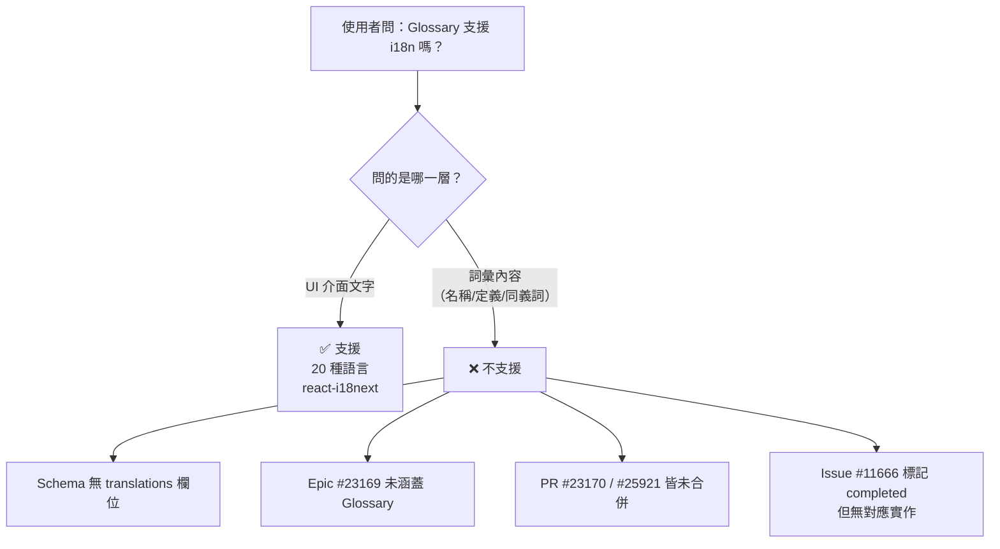

# OpenMetadata Glossary 功能的 i18n 支援現況

## 摘要

OpenMetadata 的 Glossary（詞彙表）功能在 i18n 上必須區分兩個層次，兩者結論相反：

| 層次 | 是否支援 | 說明 |
| --- | --- | --- |
| **UI 介面在地化**（按鈕、標籤、提示文字） | ✅ 支援 | 內建 20 種以上語言，Glossary 相關的介面文字已翻譯 |
| **Glossary 內容翻譯**（詞彙名稱、定義、同義詞的多語版本） | ❌ 不支援 | 資料模型無 `translations` 欄位，相關 PR 全部未合併 |

換句話說：**你可以讓 OpenMetadata 的介面顯示中文，但無法讓同一個 Glossary Term 對中文使用者顯示中文定義、對英文使用者顯示英文定義。**

---

## 一、UI 介面在地化：已支援

OpenMetadata 前端使用 `react-i18next` 與 `i18next` 實作介面多語系，使用者可從介面右上角切換語言[^lang]。官方文件列出 20 種內建語言，包含 English、Korean、French、Simplified Chinese（ZH-CN）、Traditional Chinese（ZH-TW）、Japanese、Portuguese（BR/PT）、Spanish、Galician、Russian、German、Hebrew、Dutch、Persian、Thai、Marathi、Turkish 等[^lang]。

語言檔位於 `openmetadata-ui/src/main/resources/ui/src/locale/languages/`，每個語言一個 JSON 檔（如 `fr-fr.json`、`zh-tw.json`），以 `label.*`、`message.*` 等扁平鍵值組織[^lang]。專案內部的 i18n 規範文件明確要求：UI 不得出現字串字面量，一律透過 `useTranslation()` 的 `t()` 取值；新增鍵後須執行 `yarn i18n` 同步到全部 19 個非英文語言檔[^i18nrule]。

Glossary 相關的介面文字確實已納入此機制。例如 2025 年 6 月有一則 issue 指出韓文把 Glossary 譯為「용어집」（詞彙集，集合名詞），建議改為「용어」（詞彙），對應 PR 修改了 `ko-kr.json` 中多筆 glossary 相關鍵值並已合併[^ko]。這證明 Glossary 的**介面標籤**是走標準 i18n 流程的。

> ⚠️ 注意：這只代表「Glossary 這個字怎麼翻譯」，不代表「Glossary 裡的詞彙內容怎麼翻譯」。

---

## 二、Glossary 內容翻譯：不支援

### 2.1 資料模型層面：沒有 translations 欄位

直接檢視 OpenMetadata 主分支的 JSON Schema 可確認：

- `GlossaryTerm` 實體（`openmetadata-spec/.../entity/data/glossaryTerm.json`）的屬性包含 `name`、`displayName`、`description`、`synonyms`、`relatedTerms`、`references`、`conceptMappings`、`tags`、`reviewers`、`owners`、`domains` 等，**沒有任何 locale 或 translations 相關欄位**[^termschema]。
- `Glossary` 實體（`glossary.json`）同樣只有單一的 `name`、`displayName`、`description`，外加 `namespaces`（供 OWL/SKOS 匯入的 IRI 前綴對應），**沒有多語內容結構**[^glossaryschema]。

`name` 與 `description` 都是單一字串，一個 Glossary Term 只能有一份定義文字。

### 2.2 官方文件層面：無多語 Glossary 章節

Glossary 的官方使用指南（建立詞彙、匯入、匯出、審核流程、樣式、最佳實務）中，完全沒有提及多語內容或 locale 概念[^termdoc][^importdoc]。CSV 匯入格式的欄位為 `parent`、`name`、`displayName`、`description`、`synonyms`、`relatedTerms`、`references`、`tags`，同樣沒有語言欄位[^importdoc]。

### 2.3 社群需求與未實現的實作

**原始需求（2023-05）**：Issue #11666「Allow glossary and classification to be localized」由 NickKellett 提出，明確要求「讓 Glossary 與 Classification 可指定 ISO 文化代碼，法國使用者看到法文階層、英文使用者看到同一階層的英文值」，並建議採用「複合主鍵：詞彙 ID + 文化代碼」的設計[^i11666]。此 issue 於 2025-11-21 被關閉並標記為 completed，但**沒有任何關聯的 PR 或 commit 實作該功能**，關閉原因無法從公開紀錄追溯[^i11666]。

**史詩級需求（2025-08）**：Issue #23169「Feature: Add Multi-Language Translation Support for OpenMetadata Entities」由核心維護者 harshach 提出，設計了一套完整的實體翻譯架構[^i23169]：

- 在實體 schema 加入 `translations` 欄位，儲存 `[{locale, displayName, description}]` 形式的清單
- 新增 `TranslationUtil.java` 套用翻譯、`TranslationPatchUtil.java` 處理帶 locale 的 PATCH
- REST API 的 GET / PATCH 端點加入 `?locale=` 查詢參數，例如 `GET /api/v1/tables/{id}?locale=es`
- locale 回退機制（`es-MX` → `es`），預設 `en` 回傳原文
- 巢狀欄位翻譯（Table 的 column、Topic 的 message schema field 等）

**但該 issue 明列的支援實體只有 Table、Topic、Container、Dashboard Data Model、Search Index，並不包含 Glossary 或 GlossaryTerm**[^i23169]。issue 下方有社群成員直接詢問「能否也支援 glossary terms 的多語」，維護者僅回覆邀請加入 Slack 討論，未承諾納入範圍[^i23169]。

**兩次實作嘗試皆失敗**：

| PR | 標題 | 狀態 | 結果 |
| --- | --- | --- | --- |
| #23170 | Feature: Add Multi-Language Translation Support for OpenMetadata Entities | 2025-08-31 開啟，2026-03-09 關閉 | **未合併**（157 檔案、+14,026 行）[^pr23170] |
| #25921 | Multi lang support for content | 2026-02-16 開啟，2026-03-10 關閉 | **未合併**（120 檔案、+5,055 行）[^pr25921] |

PR #25921 的程式碼審查記錄揭露了多項阻擋性缺陷，可作為「為何未合併」的具體證據[^pr25921]：

1. **安全漏洞**：帶 locale 的 PATCH by ID 直接呼叫 `repository.patchWithTranslations()` 後返回，**完全跳過授權檢查**，任何已認證使用者可修改任意實體的翻譯。
2. **重複寫入**：`convertToTranslationPatch()` 永遠產生 `add` 到 `/translations/translations/-`（陣列尾端附加），同一 locale 重複 PATCH 會累積無限重複項；而 `findTranslation()` 用 `findFirst()`，永遠取到最舊（可能過期）的那筆。
3. **繞過版本控制**：`patchWithTranslations()` 直接 `storeEntity()`，不經 `EntityUpdater`，導致無樂觀鎖、無 `ChangeDescription`、版本無條件遞增。
4. **缺翻譯時清空內容**：請求不存在的 locale 時，`applyTranslations()` 把 `displayName` 與 `description` 設為空字串，而非回退原文，造成回應內容遺失。
5. **效能問題**：約 30 處 `LOG.info()` 帶 "DEBUG" 前綴的除錯語句留在每次實體讀取的熱路徑上。

此外，PR #25921 的 CI 分析顯示 Python 型別檢查、Java checkstyle、UI 覆蓋率測試等多項程式碼問題未修復[^pr25921]。

### 2.4 目前可用的替代方案

在缺乏原生多語支援的情況下，使用者實務上只能採用以下變通做法（皆非官方建議，屬社群慣例）：

- **同義詞（synonyms）**：把其他語言的對應詞塞進 `synonyms` 陣列。缺點是語義上「同義詞」不等於「翻譯」，且無法區分語言。
- **建立多個 Glossary**：例如「Banking Glossary (EN)」與「Banking Glossary (ZH)」，各自維護一份。缺點是階層、關聯、資產綁定全部重複，且無法保證一致性。
- **自訂屬性（Custom Properties）**：透過 `extension` 欄位掛上自訂的多語欄位。缺點是無 UI 支援、無搜尋整合、無 API 的 locale 參數。

---

## 三、結論與判斷

**直接回答**：OpenMetadata 的 Glossary 功能**不支援內容層級的 i18n**。介面本身可以切成 20 種語言，但 Glossary Term 的名稱與定義只有單一語言版本。

**對導入決策的意涵**：

- 若需求僅是「讓非英語使用者看懂操作介面」，OpenMetadata 已滿足，切換語言即可。
- 若需求是「同一個業務詞彙，中英文使用者各自看到母語定義」，OpenMetadata 目前無法滿足，且短期內看不到落地時程——相關實作已兩度嘗試、兩度失敗，且核心設計（`translations` 欄位 + `?locale=` 參數）本身在審查中暴露出授權與資料完整性缺陷，需要重新設計而非單純修補。
- 若此需求為硬性條件，應評估替代方案（多 Glossary 並行 + 外部對照表），或考慮其他支援多語語意層的 catalog 產品。

---

## 註腳

[^lang]: OpenMetadata. (n.d.). *How To Add Language Support*. Retrieved 2026-11-07, from https://docs.open-metadata.org/v2.0.x/developers/how-to-add-language-support

[^i18nrule]: OpenMetadata. (n.d.). *i18n rules* (`.claude/rules/i18n.md`). Retrieved 2026-11-07, from https://github.com/open-metadata/OpenMetadata/blob/main/.claude/rules/i18n.md

[^ko]: Prajwal214. (2025-06-09). *Korean Translation Suggestion - Use "용어" Instead of "용어집" for Glossary* (Issue #21651). GitHub. Retrieved 2026-11-07, from https://github.com/open-metadata/OpenMetadata/issues/21651

[^termschema]: OpenMetadata. (n.d.). *glossaryTerm.json* (JSON Schema, `entity/data/glossaryTerm.json`). Retrieved 2026-11-07, from https://github.com/open-metadata/OpenMetadata/blob/main/openmetadata-spec/src/main/resources/json/schema/entity/data/glossaryTerm.json

[^glossaryschema]: OpenMetadata. (n.d.). *glossary.json* (JSON Schema, `entity/data/glossary.json`). Retrieved 2026-11-07, from https://github.com/open-metadata/OpenMetadata/blob/main/openmetadata-spec/src/main/resources/json/schema/entity/data/glossary.json

[^termdoc]: OpenMetadata. (n.d.). *What is a Glossary Term*. Retrieved 2026-11-07, from https://docs.open-metadata.org/v2.0.x/how-to-guides/data-governance/glossary/glossary-term

[^importdoc]: OpenMetadata. (n.d.). *How to Bulk Import a Glossary*. Retrieved 2026-11-07, from https://docs.open-metadata.org/v2.0.x/how-to-guides/data-governance/glossary/import

[^i11666]: NickKellett. (2023-05-18). *Allow glossary and classification to be localized* (Issue #11666). GitHub. Retrieved 2026-11-07, from https://github.com/open-metadata/OpenMetadata/issues/11666

[^i23169]: harshach. (2025-08-31). *Feature: Add Multi-Language Translation Support for OpenMetadata Entities* (Issue #23169). GitHub. Retrieved 2026-11-07, from https://github.com/open-metadata/OpenMetadata/issues/23169

[^pr23170]: harshach. (2025-08-31). *Feature: Add Multi-Language Translation Support for OpenMetadata Entities* (Pull Request #23170). GitHub. Retrieved 2026-11-07, from https://github.com/open-metadata/OpenMetadata/pull/23170

[^pr25921]: harshach. (2026-02-16). *Multi lang support for content* (Pull Request #25921). GitHub. Retrieved 2026-11-07, from https://github.com/open-metadata/OpenMetadata/pull/25921
