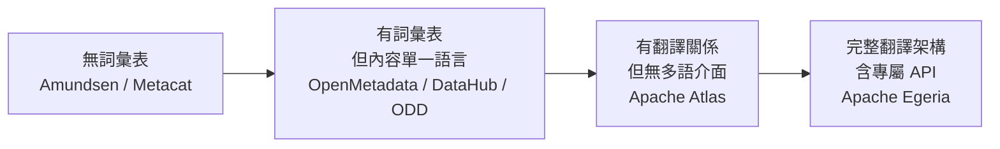

# OpenMetadata 的 FOSS 替代方案：以「詞彙表（Glossary）功能的 i18n 支援」為核心的比較研究

## 摘要

本報告調查自由／開放原始碼軟體（FOSS）生態中，可作為 OpenMetadata 替代方案的資料目錄（data catalog）與中繼資料管理平台，並將焦點放在一個常被忽略但對多語組織至關重要的能力：**業務詞彙表（business glossary）本身的國際化（i18n）支援**，也就是「同一個詞彙術語能否以多種語言儲存名稱與定義，並依使用者語系呈現」。

核心結論如下：

1. **OpenMetadata 本身目前並不支援詞彙表術語的內容翻譯**。它的 i18n 只涵蓋使用者介面字串（按鈕、選單、標籤），詞彙表術語的名稱與描述仍是單一語言欄位[^om-schema][^om-i18n]。
2. **DataHub** 是功能與生態最接近的替代品，同樣具備完整詞彙表與成熟的介面 i18n，但官方文件明確指出「詞彙表術語」屬於「以原樣儲存」的中繼資料，不隨語系改變[^dh-i18n]。
3. **Apache Atlas** 是唯一在資料模型層面原生提供「術語翻譯」關係的專案（`translationTerms` / `translatedTerms`），但它的 Web UI 完全沒有 i18n[^atlas-term][^atlas-glossary]。
4. **Apache Egeria** 提供最完整的翻譯架構（`TranslationDetail` 實體 + `TranslationLink` 關係 + 專屬 Multi Language API），並明確把「詞彙表術語」列為最值得翻譯的候選對象[^egeria-trans][^egeria-api]。
5. **Amundsen 與 Metacat 沒有詞彙表功能**，且 Amundsen 已於 2026 年 9 月封存[^amundsen][^metacat]。

換言之，若「詞彙表 i18n」是硬性需求，目前沒有任何 FOSS 資料目錄能像商業產品那樣「開箱即用」；最接近的是 **Egeria（架構完整但需自建 UI）** 與 **Atlas（有翻譯關係但無多語介面）**。

---

## 一、問題定義：什麼才算「詞彙表支援 i18n」

在比較之前必須先釐清一個常見混淆。資料目錄產品的「多語言」通常指兩件完全不同的事：

| 層次 | 內容 | 典型實作 |
|---|---|---|
| **介面 i18n（UI i18n）** | 按鈕、選單、欄位標籤、錯誤訊息等「產品自己的字串」 | `react-i18next`、locale JSON 檔 |
| **內容 i18n（Content i18n）** | 使用者撰寫的中繼資料本身，例如詞彙表術語的名稱、定義、同義詞 | 實體 schema 中的 `translations` 欄位，或翻譯實體／關係 |

多數產品只做到第一層。真正困難的是第二層：它需要在資料模型（schema）層面支援「一個概念、多個語系表述」，並在 API 與 UI 上依使用者 locale 解析。本報告的比較重點即在此。

---

## 二、基準：OpenMetadata 自身的詞彙表 i18n 現況

### 2.1 資料模型沒有翻譯欄位

OpenMetadata 的 `GlossaryTerm` JSON Schema 定義了 `name`、`displayName`、`description`、`synonyms`、`relatedTerms`、`references`、`conceptMappings` 等屬性，但**沒有任何 `translations` 或 locale 相關欄位**[^om-schema]。`Glossary` 容器實體同樣如此。這代表一個術語只能有一個名稱與一份描述。

### 2.2 介面 i18n 相當成熟

OpenMetadata 的前端使用 `react-i18next` 與 `i18next`，內建 18 種語言，包含英文、韓文、法文、簡體中文、**繁體中文（ZH-TW）**、日文、葡萄牙文（巴西／葡萄牙）、西班牙文、加利西亞文、俄文、德文、希伯來文、荷蘭文、波斯文、泰文、馬拉地文、土耳其文[^om-i18n]。使用者可從右上角切換語言。但這些翻譯檔（`locale/languages/*.json`）只涵蓋介面字串，例如 `"glossary-term": "Glossary Term"`，不涉及使用者建立的術語內容。

### 2.3 社群需求與路線圖

- **Issue #11666**「Allow glossary and classification to be localized」於 2023 年 5 月提出，訴求是「法文使用者看到法文階層，英文使用者看到英文」[^om-11666]。
- **Issue #23169**「Add Multi-Language Translation Support for OpenMetadata Entities」是 2025 年 8 月建立的 epic，設計為在實體 schema 加入 `translations: [{locale, displayName, description}]`，並支援 `GET /api/v1/tables/{id}?locale=es` 這類語系感知 API。然而其列出的支援實體僅有 Table、Topic、Container、Dashboard Data Model、Search Index，**並不包含 GlossaryTerm**[^om-23169]。
- 在該 epic 下，已有使用者於 2025 年 9 月與 2026 年 1 月兩度留言，明確要求把詞彙表術語納入多語支援，維護者僅邀請至 Slack 討論，未給出時程[^om-23169]。

**小結**：OpenMetadata 的詞彙表 i18n 目前是「有需求、有設計、未落地」，且詞彙表甚至不在第一波實作範圍內。

---

## 三、候選替代方案逐一分析

### 3.1 DataHub（最接近的整體替代品）

| 項目 | 內容 |
|---|---|
| 授權 | Apache 2.0[^dh-repo] |
| GitHub 星數 | 約 13,000[^dh-repo] |
| 詞彙表功能 | 完整：Terms 與 Term Groups（可巢狀）、生命週期階段、版本控制、`Contains` / `Inherits` 關係、可透過 Git 管理[^dh-glossary] |
| 詞彙表內容 i18n | **不支援** |
| 介面 i18n | 支援，14 種語系 |

DataHub 的 Business Glossary 文件說明其由 Terms 與 Term Groups 兩個基本元素構成，並可建立 `Contains`（Has-A）與 `Inherits`（Is-A）關係，使詞彙表成為可機讀的業務本體（ontology）[^dh-glossary]。

在 i18n 方面，DataHub 的 Multi-Language Support 文件寫得非常明確：

> 「**Your metadata.** Asset names, descriptions, tags, glossary terms, domains, column names, and platform names are stored exactly as they were entered or ingested, so they appear unchanged.」[^dh-i18n]

也就是說，詞彙表術語被歸類為「以原樣儲存」的中繼資料，切換介面語言不會改變術語內容。介面本身支援英文、德文、西班牙文、葡萄牙文（巴西）、法文、義大利文、挪威文、瑞典文、芬蘭文、匈牙利文、日文、俄文、簡體中文、繁體中文，其中多數標記為 Beta[^dh-i18n]。可透過 `I18N_ENABLED=false` 全域關閉。

**變通做法**：`GlossaryTermInfo` 繼承 `CustomProperties`，理論上可把翻譯塞進自訂屬性（如 `name_fr`），但不會被原生 UI 或搜尋使用；或為同一概念建立多個語系術語並以關係連結，但這會破壞「一個概念一個術語」的語意。

### 3.2 Apache Atlas（唯一原生有「術語翻譯」關係）

| 項目 | 內容 |
|---|---|
| 授權 | Apache 2.0[^atlas-repo] |
| GitHub 星數 | 約 2,200[^atlas-repo] |
| 詞彙表功能 | 完整：Glossary、GlossaryTerm、Category、術語關係 |
| 詞彙表內容 i18n | **部分支援**（透過術語關係） |
| 介面 i18n | **不支援**（純英文） |

Atlas 的 `AtlasGlossaryTerm` 模型定義了兩組專為翻譯設計的關係欄位[^atlas-term]：

```java
private Set<AtlasRelatedTermHeader> translationTerms;  // 本術語是這些術語的翻譯
private Set<AtlasRelatedTermHeader> translatedTerms;   // 這些術語是本術語的翻譯
```

兩者共用 `AtlasGlossaryTranslation` 關係型別。此外 `AtlasGlossary` 具有 `language` 屬性，用來記錄該詞彙表使用的主語言[^atlas-glossary]。批次匯入／匯出的 CSV 也把 `TranslationTerms` 與 `TranslatedTerms` 列為標準欄位，顯示這是正式功能而非實驗性設計[^atlas-csv]。

**運作方式**：為同一概念在不同語言各建一個術語，再用翻譯關係互連。缺點是「一個概念」在系統中變成「多個實體」，且 Atlas 的 Web UI 完全沒有 i18n 基礎建設（無 locale 資源檔、字串硬編碼），無法依使用者語系自動呈現對應翻譯，必須自行開發前端或走 API 整合。

### 3.3 Apache Egeria（翻譯架構最完整）

| 項目 | 內容 |
|---|---|
| 授權 | Apache 2.0[^egeria-repo] |
| GitHub 星數 | 約 926[^egeria-repo] |
| 詞彙表功能 | 完整：Glossary、GlossaryTerm、GlossaryCategory |
| 詞彙表內容 i18n | **支援，且為一等公民設計** |
| 介面 i18n | 無獨立完整 UI（定位為中繼資料交換框架） |

Egeria 的翻譯設計理念在其規劃指南中寫得很清楚：

> 「Egeria supports this by keeping each metadata element in a single **primary language** and attaching translations of its descriptive properties for each additional language. A user interface can then show the translation that matches its user's language, and fall back to the original where there is none.」[^egeria-plan]

同一份文件並明確指出「**Glossary terms** — the business vocabulary is the most widely read part of the catalog」是最值得翻譯的候選對象[^egeria-plan]。

技術實作上，翻譯是獨立的 `TranslationDetail` 實體，透過 `TranslationLink` 關係連到被翻譯的元素；一個元素可以有任意數量的翻譯，同一語言也可有多個地區變體[^egeria-api]。`TranslationDetail` 的屬性包含 `language`（必填，如 Spanish）、`languageCode`（ISO-639，如 `es`）、`locale`（如 `es-ES`）、`displayName`、`description`，以及 `additionalTranslations`（以屬性名為 key 的其他字串翻譯映射）[^egeria-api]。Egeria 另提供專屬的 **Multi Language API**（REST）來設定、取得、清除與列出翻譯[^egeria-api]。

`Glossary` 實體的 `language` 屬性記錄該詞彙表的主語言；`GlossaryTerm` 本身沒有 `language` 屬性，個別術語的翻譯一律走 `TranslationDetail` 機制[^egeria-glossary][^egeria-terms]。文件也提到另一種策略：若某社群完全以另一語言工作，可直接建立該語言的獨立詞彙表，適合「國家專屬詞彙」；而翻譯機制適合「跨組織共用詞彙」[^egeria-plan]。

**限制**：Egeria 是互通性框架而非成品目錄，沒有開箱即用的完整前端，實務上需搭配其他 UI 或自建。

### 3.4 Open Data Discovery（ODD）Platform

| 項目 | 內容 |
|---|---|
| 授權 | Apache 2.0[^odd-repo] |
| GitHub 星數 | 約 1,400[^odd-repo] |
| 詞彙表功能 | 有：Term 實體、術語互連、術語對資料實體與欄位的關聯、反向查詢、7 種 RBAC 權限[^odd-glossary] |
| 詞彙表內容 i18n | **不支援** |
| 介面 i18n | 支援 7 種語系 |

ODD 的 Multilingual UI 文件同樣把界線劃得很清楚：

> 「the localisation applies to the **UI shell** (toolbar labels, page titles, button captions, form field labels, error messages); **operator-authored content (entity descriptions, glossary terms, custom-metadata field names, namespaces, tag names) is rendered verbatim regardless of the active locale.**」[^odd-i18n]

支援的介面語系為英文、西班牙文、中文、法文、烏克蘭文、亞美尼亞文、巴西葡萄牙文，語系選擇存在瀏覽器 `localStorage`[^odd-i18n]。專案維護活躍，最新版本 v0.29.0 於 2026 年 6 月釋出[^odd-repo]。

### 3.5 Amundsen 與 Metacat（不具備詞彙表）

- **Amundsen**：Apache 2.0、約 4,800 星，但**沒有業務詞彙表功能**，全庫搜尋 "glossary" 僅找到一則使用者詢問能否拿它做詞彙表的 issue，程式碼中零匹配；也沒有任何 i18n 基礎建設。該專案已於 **2026 年 9 月 29 日封存**，轉為唯讀[^amundsen]。
- **Metacat**：Apache 2.0、約 1,700 星，定位為「統一中繼資料探索 API 服務」，聯邦化 Hive、RDS、Teradata、Redshift、S3、Cassandra 等來源的中繼資料，**沒有詞彙表、沒有 UI、沒有 i18n**[^metacat]。

兩者皆不適合作為需要詞彙表治理的替代方案。

---

## 四、綜合比較

| 專案 | 授權 | GitHub 星數 | 詞彙表 | 詞彙表內容 i18n | 介面 i18n | 維護狀態 |
|---|---|---|---|---|---|---|
| **OpenMetadata**（基準） | Apache 2.0 | 約 15,700 | 完整 | 無（僅有 epic 設計） | 18 語系 | 非常活躍 |
| **DataHub** | Apache 2.0 | 約 13,000 | 完整 | 無（官方明示不翻譯） | 14 語系 | 非常活躍 |
| **Apache Atlas** | Apache 2.0 | 約 2,200 | 完整 | **部分**（`translationTerms` 關係 + `language` 屬性） | 無 | 中等 |
| **Apache Egeria** | Apache 2.0 | 約 926 | 完整 | **完整架構**（`TranslationDetail` + Multi Language API） | 無完整 UI | 中等 |
| **ODD Platform** | Apache 2.0 | 約 1,400 | 有 | 無（官方明示不翻譯） | 7 語系 | 活躍 |
| **Amundsen** | Apache 2.0 | 約 4,800 | 無 | 不適用 | 無 | **已封存（2026-09）** |
| **Metacat** | Apache 2.0 | 約 1,700 | 無 | 不適用 | 無 | 低度 |

### 詞彙表 i18n 能力階梯



---

## 五、選型建議

### 情境 A：需要「開箱即用的多語詞彙表」

**目前沒有 FOSS 產品能滿足。** 若這是不可妥協的需求，實務上有三條路：

1. **選 Egeria 作為中繼資料骨幹**，自行開發或整合前端，利用其 Multi Language API 依使用者 locale 取翻譯。架構最正確，但工程投入最大。
2. **選 Atlas 並自建前端**，用 `translationTerms` 關係承載翻譯。資料模型夠用，但 UI 需從零開始。
3. **選 DataHub 或 OpenMetadata，用「多術語 + 關係」變通**：為每個語系建立獨立術語，以 `Inherits` / `relatedTerms` 互連。代價是語意稀釋、搜尋結果重複、治理成本上升。

### 情境 B：介面多語即可，術語內容可接受單一語言

**DataHub 是首選替代品**：詞彙表功能完整度與 OpenMetadata 相當，介面 i18n 支援 14 種語系（含繁體中文），生態與社群規模接近，且同樣是 Apache 2.0。若團隊規模較小、偏好輕量部署，**ODD Platform** 是值得考慮的次選。

### 情境 C：以知識本體（ontology）為核心

若詞彙表不只是名詞解釋，而是要成為可機讀的業務本體，**Egeria** 的型別系統與翻譯架構最為契合；OpenMetadata 2.0 新增的 Ontology Explorer 與 OWL/SKOS 匯入也朝此方向發展，但翻譯仍是缺口。

---

## 六、批判性反思：來源品質與時效性

本報告的結論建立在以下幾類來源上，需注意其限制：

1. **官方文件優先**：DataHub 與 ODD 的「不翻譯使用者內容」結論，直接引用其官方文件原文，可信度高。OpenMetadata 的「無 `translations` 欄位」結論，直接來自 `main` 分支的 JSON Schema 原始檔，屬於一手證據。
2. **GitHub Issue 的時效風險**：OpenMetadata 的 epic #23169 仍在開放狀態，功能隨時可能落地。本報告撰寫於 2026-11-07，讀者應重新確認該 issue 與 `glossaryTerm.json` 的現況。
3. **星數與版本為快照**：GitHub 星數與最新版本號為擷取當下的數值，會隨時間變動，僅供相對規模參考，不宜作為絕對指標。
4. **Atlas 與 Egeria 的「支援」需加註解**：兩者的翻譯能力存在於**資料模型與 API 層**，而非**使用者可見的產品功能**。將其標為「支援」容易誤導，本報告已在正文明確區分「模型層支援」與「UI 層支援」。
5. **未涵蓋的專案**：CKAN 等以開放資料入口為主的平台雖有詞彙（vocabulary）概念，但缺乏正式業務詞彙表與術語翻譯，未納入主要比較。商業產品（如 Atlan、Collibra）不在 FOSS 範圍內，故未討論。

---

## 參考文獻

[^om-schema]: OpenMetadata. (n.d.). *glossaryTerm.json* [JSON Schema, main branch]. Retrieved 2026-11-07, from https://raw.githubusercontent.com/open-metadata/OpenMetadata/main/openmetadata-spec/src/main/resources/json/schema/entity/data/glossaryTerm.json

[^om-i18n]: OpenMetadata. (n.d.). *How to add language support*. Retrieved 2026-11-07, from https://docs.open-metadata.org/v2.0.x/developers/how-to-add-language-support

[^om-11666]: OpenMetadata. (2023, May 18). *Allow glossary and classification to be localized* (Issue #11666). GitHub. Retrieved 2026-11-07, from https://github.com/open-metadata/OpenMetadata/issues/11666

[^om-23169]: OpenMetadata. (2025, August 31). *Feature: Add multi-language translation support for OpenMetadata entities* (Issue #23169). GitHub. Retrieved 2026-11-07, from https://github.com/open-metadata/OpenMetadata/issues/23169

[^dh-repo]: DataHub Project. (n.d.). *datahub-project/datahub*. GitHub. Retrieved 2026-11-07, from https://github.com/datahub-project/datahub

[^dh-glossary]: DataHub Project. (n.d.). *Business glossary*. Retrieved 2026-11-07, from https://docs.datahub.com/docs/glossary/business-glossary

[^dh-i18n]: DataHub Project. (n.d.). *Multi-language support*. Retrieved 2026-11-07, from https://docs.datahub.com/docs/features/feature-guides/multi-language-support

[^atlas-repo]: Apache Software Foundation. (n.d.). *apache/atlas*. GitHub. Retrieved 2026-11-07, from https://github.com/apache/atlas

[^atlas-term]: Apache Software Foundation. (n.d.). *AtlasGlossaryTerm.java*. GitHub. Retrieved 2026-11-07, from https://github.com/apache/atlas/blob/master/intg/src/main/java/org/apache/atlas/model/glossary/AtlasGlossaryTerm.java

[^atlas-glossary]: Apache Software Foundation. (n.d.). *AtlasGlossary.java*. GitHub. Retrieved 2026-11-07, from https://github.com/apache/atlas/blob/master/intg/src/main/java/org/apache/atlas/model/glossary/AtlasGlossary.java

[^atlas-csv]: Apache Software Foundation. (n.d.). *GlossaryTermUtils.java*. GitHub. Retrieved 2026-11-07, from https://github.com/apache/atlas/blob/master/repository/src/main/java/org/apache/atlas/glossary/GlossaryTermUtils.java

[^egeria-repo]: ODPi. (n.d.). *odpi/egeria*. GitHub. Retrieved 2026-11-07, from https://github.com/odpi/egeria

[^egeria-plan]: Egeria Project. (n.d.). *Translations planning guide*. Retrieved 2026-11-07, from https://egeria-project.org/guides/planning/translations/overview/

[^egeria-api]: Egeria Project. (n.d.). *Multi language API overview*. Retrieved 2026-11-07, from https://egeria-project.org/services/omvs/multi-language/overview/

[^egeria-glossary]: Egeria Project. (n.d.). *0310 Glossary model*. Retrieved 2026-11-07, from https://egeria-project.org/types/3/0310-Glossary/

[^egeria-terms]: Egeria Project. (n.d.). *0330 Terms model*. Retrieved 2026-11-07, from https://egeria-project.org/types/3/0330-Terms/

[^odd-repo]: Open Data Discovery. (n.d.). *opendatadiscovery/odd-platform*. GitHub. Retrieved 2026-11-07, from https://github.com/opendatadiscovery/odd-platform

[^odd-glossary]: Open Data Discovery. (n.d.). *Business glossary*. Retrieved 2026-11-07, from https://docs.opendatadiscovery.org/features/data-glossary/business-glossary.md

[^odd-i18n]: Open Data Discovery. (n.d.). *Multilingual UI*. Retrieved 2026-11-07, from https://docs.opendatadiscovery.org/features/multilingual-ui.md

[^amundsen]: Amundsen Project. (n.d.). *amundsen-io/amundsen* [Repository archived 2026-09-29]. GitHub. Retrieved 2026-11-07, from https://github.com/amundsen-io/amundsen

[^metacat]: Netflix. (n.d.). *Netflix/metacat*. GitHub. Retrieved 2026-11-07, from https://github.com/Netflix/metacat
