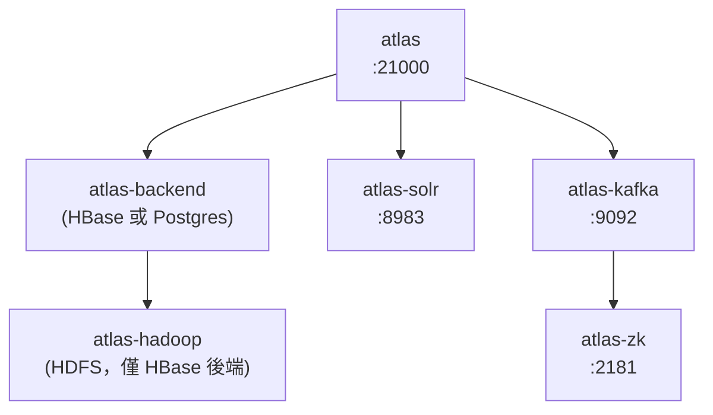

# Apache Atlas 能否以 Docker 容器方式執行？

## 摘要

**可以，但沒有官方發佈的現成映像檔。** Apache Atlas 專案本身在原始碼倉庫中提供了完整的 Dockerfile 與 docker-compose 定義，可自行建置並以容器方式執行；然而 Apache 官方在 Docker Hub 上的 `apache/atlas` 倉庫至今**沒有任何已推送的標籤（tag）**，因此無法直接 `docker pull` 官方映像檔[^hubapi]。若不想自行建置，只能使用社群維護的第三方映像檔，其中以 `sburn/apache-atlas` 最為普及，但其最後更新停留在 2022 年，僅提供到 Atlas 2.3.0[^sburn]。

---

## 一、專案基本背景

Apache Atlas 是一套開放式的中繼資料（metadata）管理與治理框架，提供跨 Hadoop 平台及更廣泛企業資料生態系的資料治理能力，包含資料血緣（lineage）、分類（classification）、稽核（audit）與 RBAC/ABAC 權限控制[^readme]。專案以 Java 撰寫，採用 Apache License 2.0，GitHub 上約有 2,164 顆星、910 個 fork[^ghapi]。

| 項目 | 內容 |
|---|---|
| 倉庫 | https://github.com/apache/atlas |
| 主要語言 | Java |
| 授權 | Apache License 2.0 |
| GitHub 星數 | 約 2,164 |
| 最新正式版本 | 2.5.0（2026-04-30 標記） |
| 進行中版本 | 2.6.0（已至 rc4） |

最新正式版本 `release-2.5.0` 的標籤建立時間為 2026-04-30[^tag250]；其後 `release-2.6.0-rc4` 等候選版本已陸續出現，代表 2.6.0 仍在釋出流程中[^tags]。

---

## 二、官方倉庫中的 Docker 支援

Apache Atlas 主倉庫的 README 明確指出「Instructions to build and run atlas in docker」位於 `dev-support/atlas-docker/README.md`[^readme]，該目錄即為官方提供的容器化方案。

### 2.1 目錄內容

`dev-support/atlas-docker/` 內含多個 Dockerfile 與 docker-compose 檔案，對應 Atlas 的多服務架構[^dir250]：

| 檔案 | 用途 |
|---|---|
| `Dockerfile.atlas-base` | 基礎映像：Ubuntu 20.04 + OpenJDK 8/11/17 + Python + 系統工具 |
| `Dockerfile.atlas` | Atlas 主服務映像，複製建置產物、設定路徑、暴露 21000 埠 |
| `Dockerfile.atlas-build` | 以 Maven 從原始碼建置 Atlas |
| `Dockerfile.atlas-hbase` | HBase 後端服務 |
| `Dockerfile.atlas-hadoop` | HDFS（Hadoop）服務 |
| `Dockerfile.atlas-solr` | Apache Solr 索引服務 |
| `Dockerfile.atlas-kafka` | Apache Kafka 服務 |
| `Dockerfile.atlas-zk` | ZooKeeper 服務 |
| `Dockerfile.atlas-hive` | Hive 整合服務 |
| `Dockerfile.atlas-db` | 資料庫（Postgres）服務 |
| `docker-compose.atlas.yml` | 主 compose 檔，定義 atlas、backend、kafka、solr、zk |
| `docker-compose.atlas-common.yml` | 共用服務（Kafka、Solr、ZooKeeper、DB） |
| `docker-compose.atlas-hbase.yml` / `-hadoop.yml` | HBase 後端組合 |
| `docker-compose.atlas-hive.yml` | Hive 組合 |
| `download-archives.sh` | 預先下載 Hadoop/HBase/Kafka/Hive 發行檔 |

### 2.2 服務架構

Atlas 並非單一進程即可運作的應用，它需要後端儲存（HBase 或 Postgres）、索引引擎（Solr）、訊息佇列（Kafka）與協調服務（ZooKeeper）。官方 compose 檔以 `extends` 方式組合出下列拓撲[^compose]：



`docker-compose.atlas.yml` 中，`atlas` 服務會等待 `atlas-backend` 健康檢查通過，並依序啟動 Kafka、Solr、ZooKeeper；設定檔以唯讀方式從主機掛載 `config/atlas/${ATLAS_BACKEND}/atlas-application.properties` 與 `users-credentials.properties`[^compose]。

### 2.3 建置與啟動步驟

官方 README 的流程如下[^dockerreadme]：

```bash
cd dev-support/atlas-docker
chmod +x download-archives.sh
./download-archives.sh

export DOCKER_BUILDKIT=1
export COMPOSE_DOCKER_CLI_BUILD=1

# 1. 建置基礎映像
docker compose -f docker-compose.atlas-base.yml build

# 2. 從原始碼建置 Atlas（可能長達一小時）
mkdir -p ${HOME}/.m2
docker compose -f docker-compose.atlas-build.yml up

# 3a. 以 Postgres 為後端啟動
export ATLAS_BACKEND=postgres
docker compose -f docker-compose.atlas.yml -f docker-compose.atlas-postgres.yml up -d --wait

# 3b. 或以 HBase 為後端啟動
export ATLAS_BACKEND=hbase
docker compose -f docker-compose.atlas.yml -f docker-compose.atlas-hadoop.yml up -d --wait
```

### 2.4 官方文件並未將 Docker 列為安裝方式

值得注意的是，Apache Atlas 官方網站的文件（Installation 頁面）**並未提及 Docker**，僅說明傳統的 tarball 安裝流程：解壓 `apache-atlas-{version}-server.tar.gz`、設定 `MANAGE_LOCAL_HBASE` / `MANAGE_LOCAL_SOLR` 環境變數、執行 `bin/atlas_start.py`，再以 `curl` 驗證 `http://localhost:21000/api/atlas/admin/version`[^install]。文件列出的前置相依為 Java（8/11/17）、HBase 1.1.x、Solr 5.5.1、Kafka 與 ZooKeeper，Elasticsearch 則標示為技術預覽[^install]。

換言之，Docker 支援存在於**原始碼倉庫的 `dev-support/` 目錄**，屬於開發輔助工具，而非官方文件所認可的正式安裝途徑。這也解釋了為何官方未在 Docker Hub 發佈映像檔。

### 2.5 重要限制與注意事項

- **記憶體需求**：官方要求 Docker 至少配置 **6 GB 記憶體**[^dockerreadme]。
- **建置時間**：從原始碼以 Maven 建置 Atlas 可能耗時**長達一小時**，視 `${HOME}/.m2` 快取狀態而定[^dockerreadme]。
- **映像檔名稱**：建置後本機映像檔標記為 `atlas:latest`，並非從遠端拉取[^compose]。
- **安裝路徑與日誌**：Atlas 安裝於 `/opt/atlas/`，日誌位於 `/var/log/atlas/`[^dockerreadme]。
- **預設帳密**：管理介面 `http://localhost:21000`，預設帳號密碼為 `admin` / `atlasR0cks!`[^dockerreadme]。
- **版本設定**：`.env` 檔在 2.5.0 分支中設定 `ATLAS_VERSION=2.5.0`、`ATLAS_BACKEND=hbase`、Java 版本 8；master 分支則已推進到 `3.0.0-SNAPSHOT` 與 Java 17[^env250][^envmaster]。

---

## 三、官方 Docker Hub 映像檔：不存在

Apache 在 Docker Hub 上確實存在 `apache/atlas` 倉庫，但查詢其 API 的結果為 `{"count":0,"results":[]}`，即**沒有任何已推送的標籤**[^hubapi]。這表示：

- 無法執行 `docker pull apache/atlas` 取得官方映像檔。
- 官方僅提供「自行建置」的路徑，不提供預先打包的發行映像。

這是理解本問題的關鍵：**「能以 Docker 執行」與「有官方 Docker 映像檔」是兩件不同的事**。前者成立，後者不成立。

---

## 四、第三方社群映像檔

由於官方未發佈映像檔，實務上多數使用者改用社群映像。以下為 Docker Hub 上較具代表性的選項：

| 映像檔 | 拉取次數 | 最後推送 | 提供版本 | 說明 |
|---|---|---|---|---|
| `sburn/apache-atlas` | 約 94 萬 | 2022-12-15 | 1.0.0 ~ 2.3.0 | 內嵌 HBase + Solr，已預先初始化，開箱即用 |
| `sonnyhcl/apache-atlas` | 約 100 萬 | 約 5 年前 | 2.1.0、2.2.0 | 基於 CentOS 7，需外部 ZooKeeper/Kafka |
| `sansarip/apache-atlas` | 約 3.6 千 | 約 7 年前 | 2.0 系 | 作者明言僅供開發，不可用於生產 |
| `liupengfei99/apache-atlas` | 約 300 | 約 2 年前 | 2.3.0 | 映像檔達 8.4 GB |
| `robertolaberit/apache-atlas` | 約 80 | 約 1 年前 | 2.3.0 | 精簡版，約 257 MB |

### 4.1 最普及的 `sburn/apache-atlas`

該映像檔由 Vadim Korchagin 維護，GitHub 專案 `sburn/docker-apache-atlas` 約有 144 顆星[^sburngh]。其 Docker Hub 頁面顯示拉取次數約 942,944 次、21 顆星，最後推送時間為 2022-12-15[^sburn]。特性包括：

- 以 Atlas 2.3.0 發行 tarball 建置並修補以適配容器執行[^sburn]。
- 內嵌 HBase + Solr 且已預先初始化，下載後即可使用，無需額外步驟[^sburn]。
- 預設 Web UI 帳密為 `admin` / `admin`（與官方 compose 的 `atlasR0cks!` 不同）[^sburn]。
- 支援以環境變數覆寫設定，例如 `ATLAS_SERVER_OPTS`、`ATLAS_SERVER_HEAP`[^sburn]。
- 支援掛載 `logs`、`conf`、`data` 目錄以持久化與自訂設定[^sburn]。

最簡啟動方式[^sburn]：

```bash
docker run -d -p 21000:21000 --name atlas sburn/apache-atlas
```

### 4.2 第三方映像檔的風險

- **版本落後**：最新正式版為 2.5.0，但主流第三方映像檔最高僅到 2.3.0，落後兩個版本[^sburn][^tag250]。
- **缺乏安全更新**：多數映像檔已數年未更新，不會收到基礎映像與相依套件的安全修補。
- **非官方支援**：這些映像檔不受 Apache 專案背書，遇到問題需向個別維護者反映。
- **生產環境不適用**：多數作者明確標示僅供開發／測試；生產環境應自行以外部 HBase、Solr、Kafka、ZooKeeper 部署。

---

## 五、結論與建議

**結論：Apache Atlas 可以以 Docker 容器方式執行，但必須自行建置，或改用第三方社群映像檔。**

依使用情境建議如下：

| 情境 | 建議做法 |
|---|---|
| 想快速試用、評估功能 | 使用 `sburn/apache-atlas`，`docker run` 一行即可啟動，但需接受版本停留在 2.3.0 |
| 需要最新版本（2.5.0） | 使用官方 `dev-support/atlas-docker` 自行建置，需 6 GB 記憶體與約一小時建置時間 |
| 生產環境 | 自行建置官方映像，並將 HBase/Postgres、Solr、Kafka、ZooKeeper 拆分為獨立受管理的服務 |
| 需要可重現的 CI/CD | 以官方 Dockerfile 為基礎建立自有映像並推送至私有 registry，避免依賴過期的第三方映像 |

整體而言，Apache Atlas 的容器化支援在**原始碼層級是完整且官方維護的**，缺的只是「官方預先建置並發佈的映像檔」這一環。這也是許多 Apache 專案（相對於商業產品）常見的釋出模式。

---

## 註腳

[^hubapi]: Docker Hub API 查詢 `apache/atlas` 倉庫標籤清單，回應為 `{"count":0,"next":null,"previous":null,"results":[]}`，表示尚無任何已推送標籤。Docker, Inc. (n.d.). *apache/atlas repository tags*. Retrieved 2026-11-07, from https://hub.docker.com/v2/repositories/apache/atlas/tags

[^sburn]: Docker, Inc. (n.d.). *sburn/apache-atlas*. Retrieved 2026-11-07, from https://hub.docker.com/r/sburn/apache-atlas

[^sburngh]: GitHub. (n.d.). *sburn/docker-apache-atlas*. Retrieved 2026-11-07, from https://github.com/sburn/docker-apache-atlas

[^readme]: Apache Software Foundation. (n.d.). *Apache Atlas overview (README.md)*. Retrieved 2026-11-07, from https://github.com/apache/atlas/blob/master/README.md

[^ghapi]: GitHub. (n.d.). *apache/atlas repository metadata*. Retrieved 2026-11-07, from https://api.github.com/repos/apache/atlas

[^tag250]: GitHub. (2026). *Tag release-2.5.0 (Apache Atlas 2.5.0), tagged 2026-04-30*. Retrieved 2026-11-07, from https://api.github.com/repos/apache/atlas/git/tags/708ef010fa5589b923988b1036d3d50f2fa5bcc8

[^tags]: GitHub. (n.d.). *apache/atlas tags*. Retrieved 2026-11-07, from https://api.github.com/repos/apache/atlas/tags

[^dir250]: Apache Software Foundation. (n.d.). *dev-support/atlas-docker directory listing at release-2.5.0*. Retrieved 2026-11-07, from https://github.com/apache/atlas/tree/release-2.5.0/dev-support/atlas-docker

[^compose]: Apache Software Foundation. (n.d.). *docker-compose.atlas.yml*. Retrieved 2026-11-07, from https://raw.githubusercontent.com/apache/atlas/master/dev-support/atlas-docker/docker-compose.atlas.yml

[^dockerreadme]: Apache Software Foundation. (n.d.). *Building and running Apache Atlas in Docker (dev-support/atlas-docker/README.md)*. Retrieved 2026-11-07, from https://raw.githubusercontent.com/apache/atlas/master/dev-support/atlas-docker/README.md

[^env250]: Apache Software Foundation. (n.d.). *.env at release-2.5.0*. Retrieved 2026-11-07, from https://raw.githubusercontent.com/apache/atlas/release-2.5.0/dev-support/atlas-docker/.env

[^install]: Apache Software Foundation. (n.d.). *Installation Instruction*. Retrieved 2026-11-07, from https://github.com/apache/atlas/blob/master/docs/src/documents/Setup/InstallationInstruction.md

[^envmaster]: Apache Software Foundation. (n.d.). *.env at master*. Retrieved 2026-11-07, from https://raw.githubusercontent.com/apache/atlas/master/dev-support/atlas-docker/.env
