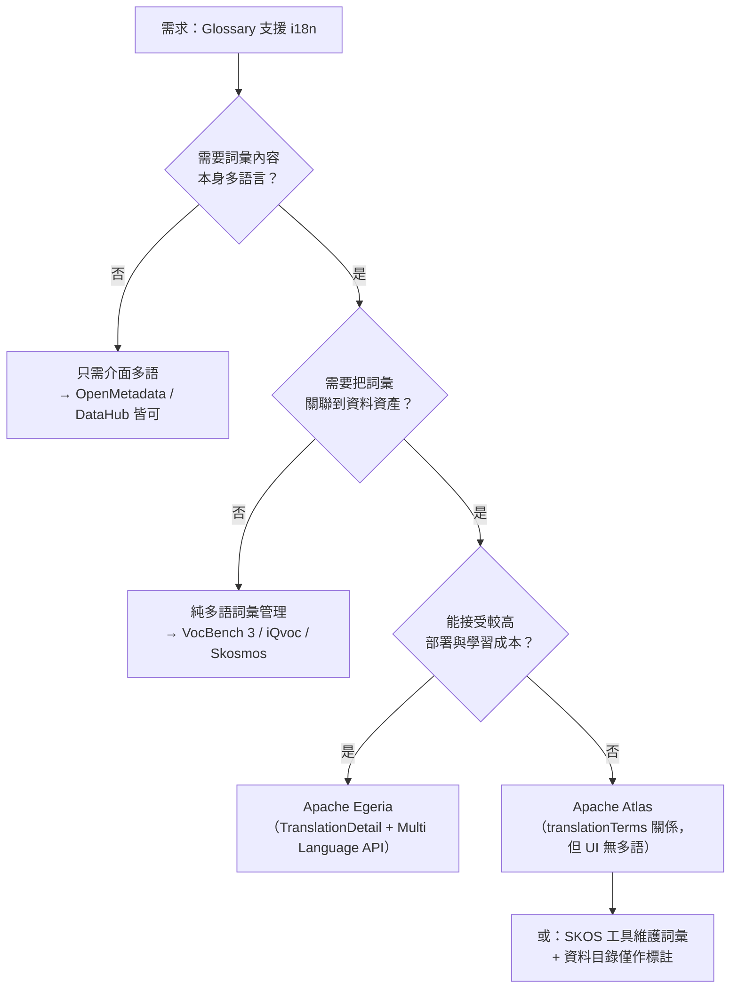

# OpenMetadata 的 FOSS 替代方案：聚焦 Glossary 功能的 i18n（多語系）支援

## 摘要

本報告調查可作為 OpenMetadata 替代品的自由開源軟體（FOSS）資料目錄／中繼資料管理工具，並**只聚焦於 Glossary（業務詞彙表）相關功能是否支援 i18n（多語系）**，資料治理、資料品質、血緣（lineage）等面向不在評估範圍內。

核心結論如下：

1. **OpenMetadata 本身**的 UI 已完整 i18n（含 zh-TW），但**詞彙條目（Glossary Term）的內容本身沒有翻譯模型**，一個 term 只有單一 `name` / `displayName` / `description`。
2. **DataHub** 有成熟的 Business Glossary（Terms / Term Groups），UI 支援 14 種語言（含繁體中文 Beta），但官方文件明確指出「你的中繼資料（含 glossary terms）會以輸入時的原文儲存」，**詞彙條目本身不翻譯**。
3. **Apache Atlas** 在資料模型層面**有**詞彙翻譯關係（`AtlasGlossaryTranslation`，`translationTerms` / `translatedTerms`），但 Web UI 未做介面多語系。
4. **Apache Egeria** 是本次調查中**詞彙 i18n 支援最完整**的方案：具備 `TranslationDetail` 實體、`TranslationLink` 關係、專屬 Multi Language API，且官方文件直接把「Glossary terms」列為最值得翻譯的對象。
5. 若需求本質是「多語系詞彙表／控制詞彙」，**以 SKOS 為基礎的詞彙管理工具**（VocBench 3、iQvoc、Skosmos）在語言標籤（language tag）上是原生設計，語意上比資料目錄的 glossary 更貼近需求。

---

## 1. 問題定義：Glossary 的 i18n 有兩個層次

在比較各工具之前，必須先區分兩種常被混為一談的「i18n」：

| 層次 | 內容 | 說明 |
|---|---|---|
| **A. 介面 i18n（UI localization）** | 選單、按鈕、欄位標籤、日期格式 | 只影響「軟體本身」的顯示語言，與你登打的詞彙內容無關 |
| **B. 內容 i18n（詞彙翻譯）** | 詞彙條目的名稱、定義、同義詞可存在多語言版本 | 這才是「Glossary 功能支援 i18n」的實質需求 |

多數資料目錄只做到 A，卻常被誤認為支援 B。以下逐一檢視。

---

## 2. 基準線：OpenMetadata 自身的現況

### 2.1 介面 i18n：完整

OpenMetadata 的 UI 以 `react-i18next` 實作，主語言檔為 `openmetadata-ui/src/main/resources/ui/src/locale/languages/en-us.json`，並透過 `yarn i18n` 同步到其他語言檔[^om-i18n-rule]。實際存在的語系檔包含 `zh-tw.json`、`zh-cn.json`、`ja-jp.json`、`ko-kr.json`、`de-de.json`、`fr-fr.json` 等共 20 個[^om-locales]。

### 2.2 詞彙內容 i18n：不支援

OpenMetadata 的 `glossaryTerm.json` schema 中，詞彙條目的可讀文字欄位只有 `name`、`displayName`、`description`、`synonyms`，**沒有任何語言標記或翻譯集合欄位**[^om-term-schema]。換言之，一個 term 只能有一種語言的定義。

社群曾提出相關需求：issue #12385「Create Glossary/GlossaryTerms/Classifications/Tag "name" requires multi-language support」要求讓 glossary term 的 `name` 能使用中文等非英語字元，並正確顯示 `displayName`[^om-issue-12385]。該 issue 已關閉，但從 schema 結構可見，其解法是放寬 `name` 的字元限制與顯示 `displayName`，**並非引入多語言翻譯模型**。

> **對照重點**：若你的需求是「同一個詞彙條目要同時有中文與英文定義」，OpenMetadata 目前做不到，必須靠外部欄位（如 `extension` 自訂屬性）自行拼裝。

---

## 3. 主要替代方案比較

### 3.1 總覽表

| 專案 | GitHub Stars | 授權 | 有 Glossary？ | 詞彙內容 i18n（層次 B） | 介面 i18n（層次 A） |
|---|---|---|---|---|---|
| **Apache Egeria** | 926 | Apache-2.0 | 有（Glossary / GlossaryTerm） | **原生支援**（TranslationDetail + Multi Language API） | 部分（UI 為獨立專案） |
| **Apache Atlas** | 2,164 | Apache-2.0 | 有（Glossary / Term / Category） | **有**（`AtlasGlossaryTranslation` 關係） | 無 |
| **DataHub** | 12,963 | Apache-2.0 | 有（Terms / Term Groups） | **無**（官方明示中繼資料不翻譯） | 有（14 語言，含 zh-TW Beta） |
| **OpenMetadata** | 15,705 | Apache-2.0 | 有 | **無** | 有（20 語言，含 zh-TW） |
| **Apache Gravitino** | 3,349 | Apache-2.0 | **無**（僅 Tag；glossary 列為 non-goal） | 不適用 | 不適用 |
| **Amundsen** | 4,785 | Apache-2.0 | **無**（已 archived） | 不適用 | 不適用 |
| **Netflix Metacat** | 1,690 | Apache-2.0 | **無** | 不適用 | 不適用 |
| **CKAN** | 5,151 | 其他（CKAN 授權） | 部分（Tag Vocabularies） | 核心無；需擴充套件 | 有（多語系擴充） |
| **VocBench 3** | 非 GitHub 主庫（Bitbucket） | 開源（授權細節見 Bitbucket 專案頁） | 有（SKOS/SKOS-XL 詞彙） | **原生支援**（語言標籤） | 有 |
| **Skosmos** | 267 | 其他（NOASSERTION） | 有（SKOS 瀏覽器） | **原生支援** | 有 |
| **iQvoc** | 125 | Apache-2.0 | 有（SKOS 詞彙） | **原生支援** | 有 |
| **TemaTres** | 142 | 未標示 | 有（控制詞彙／詞彙表） | 支援 | 有 |
| **Opentheso** | 35 | 其他（NOASSERTION） | 有（多語詞彙表） | **原生支援** | 有 |
| **SkoHub Vocabs** | 45 | Apache-2.0 | 有（SKOS 發佈） | 支援 | 有 |
| **OpenSKOS** | 57 | GPL-3.0 | 有（SKOS） | 原生支援 | 有（**已 archived**） |

Stars 數據取自 GitHub API 於 2026-11-07 之查詢結果[^gh-api]。

---

### 3.2 Apache Egeria：詞彙 i18n 最完整的資料目錄

Egeria 是 ODPi / LF AI & Data 旗下的開放中繼資料與治理平台，其 i18n 設計是**在資料模型層面**解決的，而非事後補丁。

**資料模型**：`TranslationDetail` 實體持有 `language`、`languageCode`（如 ISO-639 的 `es`）、`locale`（如 `es-ES`）、`displayName`、`description`，以及 `additionalTranslations`（以屬性名為 key 的映射，用來翻譯 `summary`、`examples`、`usage` 等欄位）。翻譯透過 `TranslationLink` 關係掛載到被翻譯的元素上，並隨元素刪除而一併刪除[^egeria-0022]。

**API**：Multi Language API 提供 `setTranslation`、`clearTranslation`、`getTranslation`、`getTranslations` 四個操作，全部以元素 GUID 為入口[^egeria-mlapi]。

**Glossary 專屬支援**：`Glossary` 實體本身有 `language` 屬性記錄該詞彙表使用的自然語言；`GlossaryTerm` 則有 `aliases`、`summary`、`examples`、`abbreviation`、`usage` 等可被翻譯的欄位[^egeria-0310][^egeria-0330]。

**官方立場**：Egeria 的翻譯規劃指南明確把「**Glossary terms**」列為最值得翻譯的對象，理由是「業務詞彙表是目錄中被最廣泛閱讀的部分，通常也是其他國家使用者第一個查閱的內容」[^egeria-translations]。同一份文件也指出，若某個社群完全以另一種語言工作，替代方案是建立一個以該語言撰寫的獨立 glossary（利用 `Glossary.language` 屬性），這適合「特定國家專屬的詞彙」，而翻譯機制則適合「跨國共用的詞彙」。

> **適用判斷**：Egeria 的詞彙 i18n 是本次調查中最貼近「Glossary 功能支援 i18n」原始需求的方案。代價是 Egeria 定位為「中繼資料治理平台」而非開箱即用的資料目錄，UI 分散在多個獨立專案（Egeria Explorer、The Catalog 等），部署與學習曲線明顯高於 OpenMetadata。

---

### 3.3 Apache Atlas：有翻譯關係，但 UI 不 i18n

Atlas 的 Glossary 模型在 `AtlasGlossaryTerm` 中定義了 `Relation` 列舉，其中包含：

```java
TRANSLATION_TERMS("AtlasGlossaryTranslation", "translationTerms", true),
TRANSLATED_TERMS("AtlasGlossaryTranslation", "translatedTerms"),
```

這表示 Atlas 在資料模型層面**確實支援**詞彙條目之間的翻譯關係：一個 term 可以透過 `translationTerms` 指向其譯文 term，反向則為 `translatedTerms`[^atlas-term-java]。官方 Glossary 文件的 JSON 範例中也可見到 `"translationTerms": []` 與 `"translatedTerms": []` 欄位[^atlas-glossary-doc]。

**限制**：

- 這是「term 對 term」的關係，而非「同一 term 的多語言屬性」。也就是說，譯文本身是另一個獨立的 glossary term，需要自行維護兩者的一致性。
- Atlas 的 Web UI（`dashboardv2`）**沒有介面多語系**：在 `apache/atlas` 的 `dashboardv2` 目錄下搜尋 i18n 相關檔案，只找到第三方函式庫 `require-handlebars-plugin` 的 `i18nprecompile.js`，並無 Atlas 自身的語言資源檔[^atlas-i18n-search]。
- Atlas 專案活躍度相對低（GitHub Issues 功能已關閉，`has_issues: false`）[^gh-api]。

---

### 3.4 DataHub：Glossary 功能強，但詞彙不翻譯

DataHub 的 Business Glossary 由 **Terms** 與 **Term Groups**（可巢狀的資料夾）組成，支援 `Contains` 與 `Inherits From` 兩種 term 間關係、生命週期階段（Draft / In Review / Published / Deprecated 等）、term 版本化，以及透過 GitHub Action 把 glossary 納入 Git 版控[^datahub-glossary]。

**介面 i18n**：DataHub 的 UI 支援 14 種語言，包含 English、German、Spanish、Portuguese (BR)、French、Italian、Norwegian、Swedish、Finnish、Hungarian、Japanese、Russian、Simplified Chinese、Traditional Chinese（Beta）。可透過 `I18N_ENABLED=false` 環境變數在整個實例關閉[^datahub-i18n]。

**關鍵限制**：同一份文件明確列出「**不翻譯**」的項目，第一項就是：

> **Your metadata.** Asset names, descriptions, tags, glossary terms, domains, column names, and platform names are stored exactly as they were entered or ingested, so they appear unchanged.

在資料模型層面亦可佐證：`GlossaryTermInfo.pdl` 的欄位只有 `id`、`name`、`definition`、`parentNode`、`termSource`、`sourceRef`、`sourceUrl`、`rawSchema`，**沒有任何語言或翻譯 aspect**[^datahub-pdl]。以 `GlossaryTermTranslation` 在 `datahub-project/datahub` 中搜尋，結果為 0 筆[^datahub-sg]。

> **對照重點**：DataHub 的 i18n 是「介面翻譯」，與 OpenMetadata 同級；若需求是詞彙內容多語，DataHub 同樣不適用。

---

### 3.5 不具備 Glossary 的方案（可排除）

- **Apache Gravitino**：定位為聯邦式中繼資料湖 catalog，具備 Tag 機制，但 glossary 明確列為設計文件的 **Non-Goals**：「Automatic membership, glossary and metric designs, and the ABAC policy language」[^gravitino-domain]。以 `glossary` 在 repo 中搜尋，僅找到 `CONTRIBUTING.md` 與 `docs/glossary.md` 的「名詞解釋」章節，非功能實作[^gravitino-sg]。
- **Amundsen**：Lyft 開源的資料發現工具，repo 已於 GitHub 標記為 `archived: true`，且不提供 business glossary 功能[^gh-api]。
- **Netflix Metacat**：定位為 federated metadata service（Hive/S3 等），無 glossary 概念[^gh-api]。
- **CKAN**：有 **Tag Vocabularies**（把相關 tag 群組化成自訂欄位，例如 Genre / Composer），但核心功能中詞彙值本身沒有多語言欄位；多語系需依賴 `ckanext-multilingual` 等擴充，且其多語支援主要針對資料集欄位而非詞彙值[^ckan-vocab]。

---

### 3.6 SKOS 系詞彙管理工具：語意上最貼近「多語詞彙表」

若需求的本質是「維護一份多語系的控制詞彙／詞彙表」，而非「在資料目錄裡標註資料資產」，則以 **SKOS**（Simple Knowledge Organization System，W3C Recommendation）為基礎的工具在設計上就是多語的。

SKOS 的核心設計即為：一個 `skos:Concept` 可以用**任意數量**的詞彙標籤標記，每個標籤帶有 BCP47 語言標籤；同一語言中最多一個 `skos:prefLabel`，其餘為 `skos:altLabel` 或 `skos:hiddenLabel`[^skos]。例如：

```turtle
<MyResource>
  skos:prefLabel "animals"@en ;
  skos:altLabel  "fauna"@en ;
  skos:prefLabel "animaux"@fr ;
  skos:altLabel  "faune"@fr .
```

這正是「一個概念、多語言標籤」的標準做法，且 `skos:definition`、`skos:scopeNote` 等註記屬性同樣可帶語言標籤。

| 工具 | Stars | 授權 | 定位 | 多語支援 | 備註 |
|---|---|---|---|---|---|
| **VocBench 3** | 非 GitHub 主庫（Bitbucket） | 開源（授權細節見 Bitbucket 專案頁） | OWL / SKOS(-XL) / OntoLex 詞彙協作編輯平台 | 原生多語（官方描述即為 "web-based, **multilingual**, collaborative development platform"） | 由歐盟 Publications Office 主導，Tor Vergata 大學 ART Group 開發；原始碼與安裝包託管於 Bitbucket `art-uniroma2/vocbench3`[^vocbench][^vocbench-dl] |
| **Skosmos** | 267 | MIT | SKOS 詞彙瀏覽器（PHP + SPARQL） | 原生多語（以語言標籤呈現 `prefLabel`，支援語言篩選） | 芬蘭國家圖書館維護，偏「瀏覽／發佈」而非編輯[^skosmos] |
| **iQvoc** | 125 | Apache-2.0 | SKOS(-XL) 詞彙管理系統 | 原生多語（README 明列 "multilingual display and navigation in any Web browser"） | Rails engine 形式，Docker 兩容器即可啟動，部署最簡單[^iqvoc] |
| **TemaTres** | 142 | 未標示（GitHub 無 license 欄位） | 輕量控制詞彙伺服器（PHP + MySQL） | 支援多語詞彙 | 功能較基礎，適合小型詞彙表發佈[^tematres] |
| **Opentheso** | 35 | 其他（NOASSERTION，CeCILL-C） | 學術級詞彙表管理（Java + PostgreSQL） | 原生多語，符合 ISO 25964 多語詞彙表標準 | 法國 CNRS 維護，文化遺產／學術場景[^opentheso] |
| **SkoHub Vocabs** | 45 | Apache-2.0 | SKOS 靜態網站產生器（Node.js） | 支援（依瀏覽器語言或 `?lang=` 參數切換） | 僅發佈，非編輯平台[^skohub] |
| **OpenSKOS** | 57 | GPL-3.0 | SKOS 詞彙 RESTful 存取 | 原生多語 | **已 archived**（2025-02 起唯讀），不建議新專案採用[^openskos] |

> **取捨**：SKOS 系工具在「多語詞彙」上遠勝資料目錄，但**不具備**把詞彙關聯到資料表／欄位的中繼資料目錄能力。若你需要「多語詞彙表 + 資料資產標註」兩者兼具，現實做法是**雙系統並存**：以 SKOS 工具維護多語詞彙，再匯入資料目錄作為 tag/term 使用。

> **商業方案對照**：PoolParty Semantic Suite（Semantic Web Company）、TopBraid EDG（TopQuadrant）、Progress Semaphore 同樣具備完整多語 SKOS 支援，但皆為專有商業授權，不符合 FOSS 前提，故不列入候選[^commercial]。

---

## 4. 決策建議



**具體建議**：

1. **若「i18n」指的是介面語言**：OpenMetadata 與 DataHub 都已經做得很好（皆含 zh-TW），無須更換。
2. **若「i18n」指的是詞彙條目本身要有多語言定義**：
   - 首選 **Apache Egeria**，因為它是唯一在資料模型、API、官方文件三個層面都把「詞彙翻譯」當作一等公民處理的資料目錄方案。
   - 次選 **Apache Atlas**，可用 `translationTerms` 關係達成，但需自行承擔 UI 無多語、專案活躍度較低的風險。
   - 若詞彙管理是主要場景、資料資產標註是次要，改用 **VocBench 3** 或 **iQvoc** 會比勉強改造資料目錄更合理。
3. **不建議**為了詞彙 i18n 而選擇 DataHub 或 OpenMetadata，因為兩者的 i18n 都止步於介面層。

---

## 5. 資料來源的批判性反思

- **官方文件 vs. 原始碼**：本報告對「是否支援詞彙翻譯」的判斷，優先採用**原始碼中的 schema / 資料模型**（如 `glossaryTerm.json`、`GlossaryTermInfo.pdl`、`AtlasGlossaryTerm.java`、Egeria 的 `0022-Translations` 模型），而非僅依賴行銷文案或文件描述。這是因為「支援 i18n」在文件上常被模糊使用。
- **文件時效性**：DataHub 與 OpenMetadata 的文件站台皆標示為滾動更新的最新版（DataHub 1.8.0、OpenMetadata v2.0.x），其功能敘述可能與你實際部署的版本有落差，導入前應以目標版本的原始碼為準。
- **Stars 數字的意義有限**：Stars 反映社群關注度，但與「是否支援詞彙 i18n」無關。例如 OpenMetadata（15,705）與 DataHub（12,963）star 數遠高於 Egeria（926），但在詞彙 i18n 上反而是 Egeria 領先。本報告保留 stars 僅供讀者評估專案活躍度。
- **未經驗證的項目**：VocBench 3 的具體授權條款名稱，本次調查未能從一手來源確認。官網首頁與 Downloads 頁面僅說明「原始碼與安裝包託管於 Bitbucket `art-uniroma2/vocbench3`」，未在頁面上明示 license 名稱[^vocbench][^vocbench-dl]。若此項對決策關鍵，建議直接查閱該 Bitbucket 專案的 LICENSE 檔案。
- **Atlas 的翻譯關係成熟度**：`translationTerms` / `translatedTerms` 存在於資料模型，但本次調查未找到官方文件中關於「如何在 UI 中建立翻譯關係」的操作說明，其實際可用性（尤其 UI 是否暴露此功能）存疑，建議實測驗證。

---

## 參考文獻

[^om-i18n-rule]: OpenMetadata. (2026). *i18n — no string literals in the UI, keep locales synced AND translated* [Repository rule file]. Retrieved 2026-11-07, from https://github.com/open-metadata/OpenMetadata/blob/main/.claude/rules/i18n.md

[^om-locales]: OpenMetadata. (2026). *openmetadata-ui/src/main/resources/ui/src/locale/languages* [Directory listing]. GitHub. Retrieved 2026-11-07, from https://github.com/open-metadata/OpenMetadata/tree/main/openmetadata-ui/src/main/resources/ui/src/locale/languages

[^om-term-schema]: OpenMetadata. (2026). *glossaryTerm.json* [JSON Schema]. GitHub. Retrieved 2026-11-07, from https://github.com/open-metadata/OpenMetadata/blob/main/openmetadata-spec/src/main/resources/json/schema/entity/data/glossaryTerm.json

[^om-issue-12385]: Jiongguang. (2023, July 12). *Create Glossary/GlossaryTerms/Classifications/Tag "name" requires multi-language support* (Issue #12385). GitHub. Retrieved 2026-11-07, from https://github.com/open-metadata/OpenMetadata/issues/12385

[^egeria-0022]: Egeria Project. (n.d.). *0022 - Translations*. Retrieved 2026-11-07, from https://egeria-project.org/types/0/0022-Translations/

[^egeria-mlapi]: Egeria Project. (n.d.). *Multi Language API*. Retrieved 2026-11-07, from https://egeria-project.org/services/omvs/multi-language/overview/

[^egeria-0310]: Egeria Project. (n.d.). *0310 Glossary Model*. Retrieved 2026-11-07, from https://egeria-project.org/types/3/0310-Glossary/

[^egeria-0330]: Egeria Project. (n.d.). *0330 Terms*. Retrieved 2026-11-07, from https://egeria-project.org/types/3/0330-Terms/

[^egeria-translations]: Egeria Project. (n.d.). *Translations* [Planning guide]. Retrieved 2026-11-07, from https://egeria-project.org/guides/planning/translations/overview/

[^atlas-term-java]: Apache Software Foundation. (2026). *AtlasGlossaryTerm.java* [Source code]. GitHub. Retrieved 2026-11-07, from https://github.com/apache/atlas/blob/master/intg/src/main/java/org/apache/atlas/model/glossary/AtlasGlossaryTerm.java

[^atlas-glossary-doc]: Apache Software Foundation. (n.d.). *Glossary*. Apache Atlas Documentation. Retrieved 2026-11-07, from https://github.com/apache/atlas/blob/master/docs/src/documents/Glossary.md

[^atlas-i18n-search]: Apache Software Foundation. (2026). *dashboardv2 i18n search results* [Sourcegraph code search]. Retrieved 2026-11-07, from https://sourcegraph.com/search?q=repo:%5Egithub%5C.com/apache/atlas%24+file:dashboardv2/.*i18n

[^datahub-glossary]: Acryl Data. (2026). *Business Glossary*. DataHub Documentation. Retrieved 2026-11-07, from https://docs.datahub.com/docs/glossary/business-glossary

[^datahub-i18n]: Acryl Data. (2026). *Multi-Language Support*. DataHub Documentation. Retrieved 2026-11-07, from https://docs.datahub.com/docs/features/feature-guides/multi-language-support

[^datahub-pdl]: DataHub Project. (2026). *GlossaryTermInfo.pdl* [Pegasus schema]. GitHub. Retrieved 2026-11-07, from https://github.com/datahub-project/datahub/blob/master/metadata-models/src/main/pegasus/com/linkedin/glossary/GlossaryTermInfo.pdl

[^datahub-sg]: DataHub Project. (2026). *GlossaryTermTranslation search results* [Sourcegraph code search]. Retrieved 2026-11-07, from https://sourcegraph.com/search?q=repo:%5Egithub%5C.com/datahub-project/datahub%24+GlossaryTermTranslation

[^gravitino-domain]: Apache Software Foundation. (2026). *domain-design.md* [Design document]. GitHub. Retrieved 2026-11-07, from https://github.com/apache/gravitino/blob/main/design-docs/domain-design.md

[^gravitino-sg]: Apache Software Foundation. (2026). *glossary search results* [Sourcegraph code search]. Retrieved 2026-11-07, from https://sourcegraph.com/search?q=repo:%5Egithub%5C.com/apache/gravitino%24+glossary

[^ckan-vocab]: Open Knowledge Foundation. (2026). *Tag Vocabularies*. CKAN Documentation. Retrieved 2026-11-07, from https://docs.ckan.org/en/latest/maintaining/tag-vocabularies.html

[^skos]: Miles, A., & Bechhofer, S. (Eds.). (2009). *SKOS Simple Knowledge Organization System Reference* (W3C Recommendation 18 August 2009). World Wide Web Consortium. Retrieved 2026-11-07, from https://www.w3.org/TR/skos-reference/

[^vocbench]: ART Research Group, University of Rome Tor Vergata. (n.d.). *VocBench: A Collaborative Management System for OWL ontologies, SKOS(/XL) thesauri, Ontolex-lemon lexicons and generic RDF datasets*. Retrieved 2026-11-07, from https://vocbench.uniroma2.it/

[^vocbench-dl]: ART Research Group, University of Rome Tor Vergata. (n.d.). *VocBench Downloads*. Retrieved 2026-11-07, from https://vocbench.uniroma2.it/downloads

[^iqvoc]: innoQ Deutschland GmbH. (2026). *iQvoc - A SKOS(-XL) Vocabulary Management System for the Semantic Web* [README]. GitHub. Retrieved 2026-11-07, from https://github.com/innoq/iqvoc

[^skosmos]: National Library of Finland. (2026). *Skosmos: Thesaurus and controlled vocabulary browser using SKOS and SPARQL*. GitHub. Retrieved 2026-11-07, from https://github.com/NatLibFi/Skosmos

[^tematres]: TemaTres. (2026). *TemaTres-Vocabulary-Server: Web application for management formal representations of knowledge, like controlled vocabularies, taxonomies, thesauri and glossaries*. GitHub. Retrieved 2026-11-07, from https://github.com/tematres/TemaTres-Vocabulary-Server

[^opentheso]: MOM-CNRS. (2026). *Opentheso: Nouvelle version du logiciel Opentheso avec un nouveau design*. GitHub. Retrieved 2026-11-07, from https://github.com/MOM-CNRS/Opentheso

[^skohub]: SkoHub. (2026). *skohub-vocabs: A lightweight tool to publish SKOS Vocabularies*. GitHub. Retrieved 2026-11-07, from https://github.com/skohub-io/skohub-vocabs

[^commercial]: Semantic Web Company. (n.d.). *PoolParty Semantic Suite*. Retrieved 2026-11-07, from https://www.poolparty.biz/; TopQuadrant. (n.d.). *TopBraid Enterprise Data Governance*. Retrieved 2026-11-07, from https://www.topquadrant.com/; Progress Software. (n.d.). *Progress Semaphore*. Retrieved 2026-11-07, from https://www.progress.com/semaphore

[^openskos]: OpenSKOS. (2023). *OpenSKOS: Provide RESTful access to SKOS vocabularies*. GitHub. Retrieved 2026-11-07, from https://github.com/OpenSKOS/OpenSKOS

[^gh-api]: GitHub. (2026). *Repository metadata for amundsen-io/amundsen, apache/atlas, apache/gravitino, ckan/ckan, datahub-project/datahub, innoq/iqvoc, NatLibFi/Skosmos, Netflix/metacat, odpi/egeria, open-metadata/OpenMetadata, OpenSKOS/OpenSKOS* [REST API responses]. Retrieved 2026-11-07, from https://api.github.com/repos/
