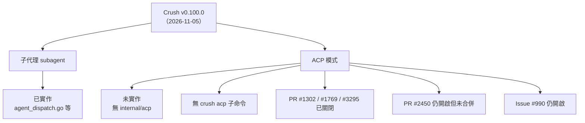

# Charm Crush 是否已支援 ACP（Agent Client Protocol）模式？

## 摘要

截至 2026-11-07，Charmbracelet 的終端機 AI 編碼代理 **Crush** 最新正式版本為 **v0.100.0**（2026-11-05 發佈）[^release100]。該版本確實已內建 **子代理（subagent）** 機制，但**尚未支援 ACP（Agent Client Protocol）模式**：官方主線程式碼中不存在 `internal/acp` 套件，命令列也沒有 `crush acp` 子命令，README 亦未提及 ACP[^readme][^tree][^cmd]。社群曾多次提交 ACP 實作，但全部未合併，其中兩個已於 2026-10-21 因衝突與長期無活動被關閉[^pr3295][^pr1302]。

## 一、背景：什麼是 ACP

ACP（Agent Client Protocol）由 Zed Industries 提出，目的是把「代理的 UI」與「代理的邏輯（提示、工具呼叫）」解耦，讓支援該協定的 IDE（如 Zed）能以統一的 JSON-RPC 介面驅動各種編碼代理，而不必為每個代理各寫一套整合[^issue990]。對 Crush 而言，ACP 支援意味著使用者可以在 Zed 等編輯器內直接使用 Crush，而非只能在終端機 TUI 中操作。

## 二、Crush 目前的版本狀態

| 項目 | 內容 |
| --- | --- |
| 最新正式版 | v0.100.0，發佈於 2026-11-05[^release100] |
| 最新 nightly | 0.101.0-nightly，建置於 2026-11-07[^nightly] |
| 專案星數 | 約 28,984 顆星[^repo] |
| 主要語言 | Go[^repo] |

## 三、子代理（subagent）支援：已存在

Crush 主線程式碼中可明確看到子代理相關實作，包括 `internal/agent/agent_dispatch.go`（派發邏輯）、`internal/agent/agent_dispatch_model.go`（子代理模型覆寫）、`internal/agent/agent_dispatch_status.go`（狀態查詢）、`internal/agent/subagent_name.go`（子代理命名），以及 `internal/agent/templates/` 下的 `agent_dispatch_tool.md`、`agent_send_tool.md`、`agent_status_tool.md`、`agent_stop_tool.md` 等工具提示模板[^tree]。這與「0.100.0 支援 subagent」的說法一致。

## 四、ACP 支援：尚未合併

### 4.1 程式碼層面的證據

- 主線檔案樹中**沒有** `internal/acp` 目錄；直接請求 `https://api.github.com/repos/charmbracelet/crush/contents/internal/acp` 回傳 404[^acp404]。
- `internal/cmd/` 目錄下僅有 `root.go`、`run.go`、`server.go`、`session.go`、`logs.go`、`models.go`、`stats.go`、`update_providers.go` 等檔案，**沒有** `acp.go`[^cmd]。
- `go.mod` 的相依清單中沒有 `github.com/zed-industries/agent-client-protocol` 或任何 ACP SDK[^gomod]。
- 官方 README 的功能清單（Multi-Model、Flexible、Session-Based、LSP-Enhanced、Extensible、Works Everywhere、Industrial Grade）與安裝、設定章節中，**完全沒有** ACP 或 IDE 整合的說明[^readme]。

### 4.2 社群提交紀錄

| PR / Issue | 標題 | 狀態 | 關鍵時間 |
| --- | --- | --- | --- |
| #990 | Enhancement: Support Agent Client Protocol to integrate crush with IDE's | **Open**（97 個 👍） | 2025-09-08 建立，最後更新 2026-07-12[^issue990] |
| #1302 | [Draft] ACP mode | **Closed**（未合併） | 2025-10-25 建立，2026-10-21 關閉[^pr1302] |
| #1769 | feat: run Crush as an ACP server | **Closed**（Draft，未合併） | 2026-01-05 建立，2026-07-30 關閉[^pr1769] |
| #2450 | feat: run Crush as an ACP server | **Open**（未合併） | 2026-03-21 建立，2026-10-17 最後更新[^pr2450] |
| #3295 | Add ACP agent mode | **Closed**（未合併） | 2026-07-13 建立，2026-10-21 關閉[^pr3295] |

其中 #3295 的關閉理由由 Charm 團隊成員明確說明：「此 PR 存在合併衝突，且已超過兩個月沒有活動，因此我們關閉它以維持待處理佇列的整潔。若仍希望合併，請 rebase 到最新的 main 分支後重新開啟。」[^pr3295close] 這表示 ACP 並非被否決，而是缺乏維護者投入與持續 rebase。

值得注意的是，#3295 的實作範圍相當完整，聲稱包含 `crush acp` stdio 代理模式、TUI 與 ACP socket 模式、文字／推理／工具生命週期／計畫／用量的 session 更新、由 ACP 客戶端代理的檔案與終端工具，以及針對 ACP 配接層的測試[^pr3295]。換言之，技術上可行，缺的是上游接受。

### 4.3 相關的 ACP 客戶端需求

另有 issue #2091 提出反向需求：讓 Crush 成為 **ACP 客戶端**，以便用 Crush 的 TUI 去驅動 Claude Code 等 ACP 代理。該 issue 目前仍為 Open，累積 47 個 👍[^issue2091]。這與「Crush 作為 ACP 伺服器」是不同方向，兩者皆未實作。

## 五、結論

**直接回答問題**：Crush 在 v0.100.0 已支援子代理，但**尚未支援 ACP 模式**。若需要在 Zed 等 IDE 中使用 Crush，目前只能等待上游合併（可關注 PR #2450 與 issue #990），或自行以社群分支建置。

## 六、對來源的批判性反思

- **官方來源優先**：本報告關於「有無 ACP」的判斷，主要依據 GitHub 主線檔案樹、`internal/cmd` 目錄清單與 `go.mod`，這些是機器可驗證的一手證據，可信度高於任何部落格或二手報導。
- **PR 描述可能樂觀**：PR #3295 與 #2450 的作者自述功能完整度很高，但作者自評不等於維護者審查通過；#2450 的描述甚至自承「約 90% 完成」且列出多項缺口（無嵌入式上下文、模式切換不影響行為、缺整合測試等）[^pr2450]。因此不宜把 PR 描述當作已交付功能。
- **時間敏感**：Crush 發版頻繁（nightly 每日建置），ACP 狀態可能隨時改變。本報告的結論以 2026-11-07 的觀測為準。
- **未找到的資訊**：未在官方文件、README 或 release notes 中找到任何 ACP 相關說明；這本身即是「未支援」的間接證據，但無法排除存在未公開的實驗分支。

## 參考文獻

[^release100]: Charmbracelet. (2026). *Release v0.100.0 · charmbracelet/crush*. GitHub. Retrieved 2026-11-07, from https://github.com/charmbracelet/crush/releases/tag/v0.100.0

[^nightly]: Charmbracelet. (2026). *Release nightly · charmbracelet/crush*. GitHub. Retrieved 2026-11-07, from https://github.com/charmbracelet/crush/releases/tag/nightly

[^repo]: Charmbracelet. (n.d.). *charmbracelet/crush: Glamourous agentic coding for all*. GitHub. Retrieved 2026-11-07, from https://github.com/charmbracelet/crush

[^readme]: Charmbracelet. (n.d.). *README.md — charmbracelet/crush*. GitHub. Retrieved 2026-11-07, from https://raw.githubusercontent.com/charmbracelet/crush/main/README.md

[^tree]: Charmbracelet. (n.d.). *Repository tree of charmbracelet/crush (main branch)*. GitHub API. Retrieved 2026-11-07, from https://api.github.com/repos/charmbracelet/crush/git/trees/main?recursive=1

[^cmd]: Charmbracelet. (n.d.). *Contents of internal/cmd — charmbracelet/crush*. GitHub API. Retrieved 2026-11-07, from https://api.github.com/repos/charmbracelet/crush/contents/internal/cmd

[^acp404]: Charmbracelet. (n.d.). *Contents of internal/acp — charmbracelet/crush (HTTP 404)*. GitHub API. Retrieved 2026-11-07, from https://api.github.com/repos/charmbracelet/crush/contents/internal/acp

[^gomod]: Charmbracelet. (n.d.). *go.mod — charmbracelet/crush*. GitHub. Retrieved 2026-11-07, from https://raw.githubusercontent.com/charmbracelet/crush/main/go.mod

[^issue990]: Deepak Dinesh. (2025). *Enhancement: Support Agent Client Protocol to integrate crush with IDE's (Issue #990)*. GitHub. Retrieved 2026-11-07, from https://github.com/charmbracelet/crush/issues/990

[^pr1302]: Plandem. (2025). *[Draft] ACP mode (Pull Request #1302)*. GitHub. Retrieved 2026-11-07, from https://github.com/charmbracelet/crush/pull/1302

[^pr1769]: Amolith. (2026). *feat: run Crush as an ACP server (Pull Request #1769)*. GitHub. Retrieved 2026-11-07, from https://github.com/charmbracelet/crush/pull/1769

[^pr2450]: Whatnick. (2026). *feat: run Crush as an ACP server (Pull Request #2450)*. GitHub. Retrieved 2026-11-07, from https://github.com/charmbracelet/crush/pull/2450

[^pr3295]: B-A-M-N. (2026). *Add ACP agent mode (Pull Request #3295)*. GitHub. Retrieved 2026-11-07, from https://github.com/charmbracelet/crush/pull/3295

[^pr3295close]: Andrinoff. (2026). *Comment on Pull Request #3295*. GitHub. Retrieved 2026-11-07, from https://github.com/charmbracelet/crush/pull/3295#issuecomment-6313643166

[^issue2091]: Agent Cooper. (2026). *Crush as an ACP client (Issue #2091)*. GitHub. Retrieved 2026-11-07, from https://github.com/charmbracelet/crush/issues/2091
