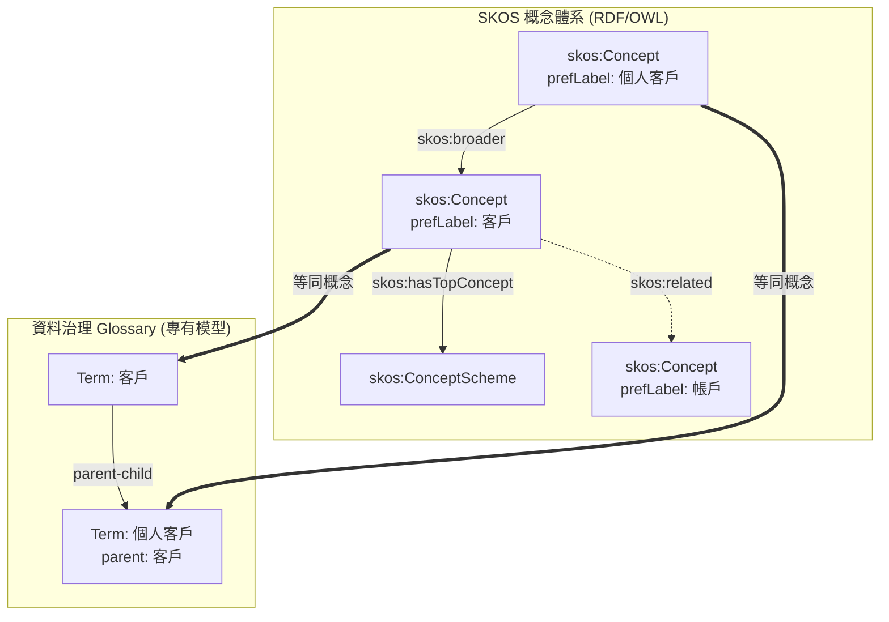
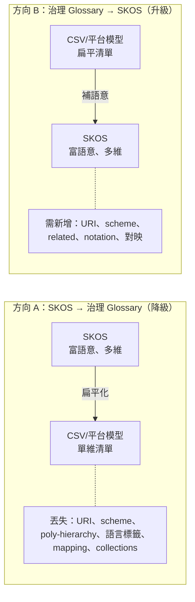

# SKOS 與資料治理 Glossary 的相容性與雙向遷移難度評估

## 摘要

簡單知識組織系統（SKOS, Simple Knowledge Organization System）是一套以 RDF 為基礎的 W3C 建議標準，用來表達詞表、分類法、主題詞表與其他受控詞彙[^skosref]。企業資料治理（Data Governance）平台的「業務詞彙表」（Business Glossary）則通常是專有資料模型、以 CSV/Excel 為主要交換格式的商業軟體功能[^collibra-import]。

本報告指出：兩者在**概念層高度對齊**（術語、同義詞、上下位、定義幾乎可一對一對應），但在**實作層與交換格式層存在結構性落差**，因此：

- 若目標治理平台的 Glossary 原生支援 RDF/SKOS（如 OpenMetadata、DataHub、新版 Alation、Microsoft Fabric Ontology、Atlan Ontology 模組），遷移幾乎無損。
- 若目標平台僅支援 CSV/Excel（如 Collibra、Informatica Axon/CDGC、IBM Knowledge Catalog、傳統 Microsoft Purview），則必須經過「SKOS → CSV → 平台模型」的中介轉換，且**必然發生語意損失**（URI、概念體系、多重上位、語言標籤、對映關係、集合等）。
- 兩個方向的遷移難度不對稱：**治理 Glossary → SKOS（升級）通常比 SKOS → 治理 Glossary（降級／扁平化）容易**，因為升級是「補語意」，降級是「丟語意」。

---

## 1. 背景與名詞界定

### 1.1 什麼是 SKOS

SKOS 是 W3C 於 2009 年 8 月 18 日發布的正式建議標準，設計目的是「為既有知識組織系統提供一條低成本遷移路徑，將詞表等移植到語意網（Semantic Web）」[^skosref]。它建立在資源描述框架（RDF, Resource Description Framework）之上，並以 OWL Full 定義其資料模型[^skosref]。其核心元素包括：

- **概念（Concept）**：知識組織系統中的「思考單元」，以 URI 識別[^skosprimer]。
- **概念體系（ConceptScheme）**：一組概念的聚合，大致對應一個詞表或分類法[^skosref]。
- **詞彙標籤**：`skos:prefLabel`（偏好標籤）、`skos:altLabel`（替代標籤，如同義詞）、`skos:hiddenLabel`（隱藏標籤，供檢索用）[^skosprimer]。
- **語意關係**：`skos:broader` / `skos:narrower`（上下位）、`skos:related`（關聯）[^skosprimer]。
- **文件性質註記**：`skos:definition`（定義）、`skos:scopeNote`（範圍註記）、`skos:example`、`skos:historyNote`、`skos:changeNote`、`skos:editorialNote`[^skosprimer]。
- **對映屬性**：`skos:exactMatch`、`skos:closeMatch`、`skos:broadMatch`、`skos:narrowMatch`、`skos:relatedMatch`，用於跨概念體系對映[^skosprimer]。
- **集合**：`skos:Collection` 與 `skos:OrderedCollection`[^skosprimer]。
- **表示法（notation）**：如分類代碼 `"512"^^ex:UDCNotation`[^skosprimer]。

值得注意的是，SKOS 明言其**不是**形式化的知識表示語言（不像 OWL），詞表中的「知識」不具備形式邏輯語意，僅是「關於詞表本身」的事實[^skosref]。

### 1.2 資料治理的「Glossary」與「資料字典」

在資料治理領域，需區分兩個常被混用的概念：

| 面向 | 業務詞彙表（Business Glossary） | 資料字典（Data Dictionary） |
|---|---|---|
| 對象 | 業務使用者、主管、分析師 | 開發者、資料工程師、DBA |
| 內容 | 業務術語、KPI、指標的語意定義 | 欄位名稱、資料型別、限制、來源系統 |
| 語言 | 業務白話 | 技術／系統語言 |
| 目的 | 建立共識、確保一致性 | 精確實作、報表正確 |
| 後設資料類型 | 語意性（semantic） | 結構性（structural） |

業務詞彙表可被理解為「語意中樞」，而資料字典則描述資料的結構與規則[^dataversity-glossary][^dataversity-dict]。兩者關聯之處在於：成熟的治理實務會把業務詞彙表術語對映到資料字典欄位[^dataversity-dict]。本報告所稱「治理 Glossary」泛指上表的業務詞彙表功能。

---

## 2. SKOS 與資料治理 Glossary 的概念對應

SKOS 與業務詞彙表的概念元素高度重疊。下表為常見的一對一對應關係：

| 資料治理 Glossary 欄位 | SKOS 對應元素 | 備註 |
|---|---|---|
| 術語名稱（Term Name） | `skos:prefLabel` | 主要顯示名稱 |
| 同義詞／別名（Synonyms） | `skos:altLabel` | 替代標籤 |
| 隱藏詞（Hidden terms） | `skos:hiddenLabel` | 僅供檢索 |
| 定義（Definition） | `skos:definition` | 完整語意說明 |
| 使用說明（Usage Note） | `skos:scopeNote` | 使用範圍指引 |
| 上層術語（Parent Term） | `skos:broader` | 階層父項 |
| 下層術語（Child Terms） | `skos:narrower` | 階層子項（常隱含） |
| 相關術語（Related Terms） | `skos:related` | 關聯關係 |
| 代碼（Code / Identifier） | `skos:notation` | 分類代碼 |
| 外部對映（External ID） | `skos:exactMatch` / `skos:closeMatch` | 跨詞表對映 |

換言之，多數治理詞彙表 CSV 匯出遵循「術語 → 上層 → 定義 → 同義詞」的通用模式，此模式可直接對映到 SKOS 的 `prefLabel → broader → definition → altLabel`[^gh-csv-mapping]。

### 概念層對齊的視覺化

概念上可直接對應，但右側模型通常**沒有** URI、概念體系邊界、關聯關係（related）、語言標籤等結構[^h.hedden]。

---

## 3. SKOS 與其他詞表／後設資料標準的關係

理解 SKOS 的相容性，必須先看它與三個相鄰標準的關係。

### 3.1 ISO 25964（詞表與跨詞表互通）

ISO 25964 是詞表的國際標準，分兩部分：Part 1「資訊檢索用詞表」（2011-08 發布）、Part 2「與其他詞表的互通」（2013-03 發布），由 ISO/TC 46/SC 9 制定，秘書處設於 NISO[^iso25964-wiki]。

NISO 官方對兩者關係的說明是：ISO 25964-1 指導「如何選擇與組合概念、術語與關係以建構良好詞表」，SKOS 則處理「下一步：把詞表（或其他『簡單知識組織系統』）移植到網路上」[^niso-25964]。兩者的資料模型**並非完全相同**（因為 ISO 25964 需服務所有詞表需求，SKOS 需服務所有 KOS 類型），但「大致相容」[^iso25964-wiki]。

社群並進一步開發了正式的對應：`http://purl.org/iso25964/skos-thes`，一份以 RDF/OWL 表達 ISO 25964 與 SKOS/SKOS-XL 對應關係的本體，作者為 Antoine Isaac 與 Johan De Smedt 等人，日期 2015-03-17[^iso25964-skos-thes]。它定義了 SKOS 沒有的詞表專門構件，例如把 `skos:broader` 細分為 `broaderGeneric`（屬種）、`broaderPartitive`（整體-部分）、`broaderInstantial`（實例）等子屬性[^iso25964-skos-thes]。ISO 25964-2 定義的對映類型（等價、階層、關聯、精確/非精確/部分等價）則對應到 SKOS 的 `exactMatch`、`closeMatch`、`broadMatch`、`narrowMatch`、`relatedMatch`[^niso-25964]。

### 3.2 ISO/IEC 11179（後設資料登錄）

ISO/IEC 11179 是後設資料登錄（Metadata Registry）標準，核心物件是「資料元素概念」（object class + characteristic）與值域[^iso11179]。它與 SKOS 之間**沒有**類似 ISO 25964 那樣的正式對應表；關係是間接的：11179 的「概念區」（Concept Region，2013 年第三版引入）支援登錄「概念體系」，而 SKOS 概念體系可作為該登錄所引用或分類的外部概念體系[^iso11179]。實務上，業務詞彙表偏語意（近似 ISO 25964/SKOS 思維），資料字典偏結構登錄（近似 ISO 11179 思維）。

### 3.3 ANSI/NISO Z39.19

美國的 ANSI/NISO Z39.19《單語受控詞彙的建構、格式與管理指南》涵蓋清單、同義詞環、分類法與詞表，與 ISO 25964-1 部分重疊且大致相容，但不提供資料模型，也未處理多語與跨 KOS 對映[^iso25964-wiki]。

---

## 4. 資料治理／資料目錄工具的 SKOS 支援現況

下表綜合各平台官方文件與社群資料，整理其對 SKOS/RDF 的原生支援程度。此為本報告最關鍵的實作層事實。

| 平台 | SKOS/RDF 匯入 | SKOS/RDF 匯出 | 主要格式 | 備註 |
|---|---|---|---|---|
| **Collibra** | 否 | 否 | CSV、XLSX、JSON | 官方文件僅列 CSV/XLSX 匯出、JSON 匯入 API[^collibra-import] |
| **Informatica Axon / CDGC** | 否 | 否 | CSV、XML、XMI | 詞彙表以 CSV/XML/XMI 匯入匯出[^informatica-fmt] |
| **IBM Knowledge Catalog** | 否 | 否 | CSV、XML、XMI | 同屬 IBM InfoSphere 血統，無 SKOS[^informatica-fmt] |
| **Apache Atlas** | 否 | 否 | JSON、CSV | 概念上 SKOS-like（synonyms、broader），但格式為專有 JSON[^atlas-glossary] |
| **Microsoft Purview（傳統）** | 否 | 否 | CSV | 傳統詞彙表僅支援 CSV[^purview-legacy] |
| **Microsoft Fabric Ontology（Preview）** | 是 | 是 | .ttl、.rdf、.owl | 對映表含 `skos:altLabel` → Synonyms[^fabric-ontology] |
| **Alation Ontologies（AIOS）** | 是（OWL/RDF/SHACL） | 是（Turtle） | OWL、RDF、SHACL、.ttl | 為 2025/2026 新功能；傳統 Glossary 無[^alation-onto] |
| **Atlan Ontology 模組** | 是 | 是 | Turtle、JSON、JSON-LD | 標準 Glossary 匯入為 CSV[^atlan-onto] |
| **OpenMetadata** | 是 | 是（RDF 投影） | Turtle、RDF/XML、N-Triples | 原生 OWL/SKOS 匯入至 Glossary[^openmetadata-import] |
| **DataHub** | 是 | 是 | RDF、SKOS、Turtle | 有正式 SKOS 原生 RDF 規格（v2.0，2024-12）[^datahub-rdf] |
| **data.world** | 是（RDF 原生） | 是（TTL） | RDF、TTL、SPARQL | 平台本身為知識圖譜架構[^dw-onto] |

### 純詞表／本體管理工具的支援

與治理平台相對，專門的詞表管理工具對 SKOS 為原生支援：

- **VocBench 3**（歐盟資助、開放原始碼）：支援 OWL、SKOS/SKOS-XL、Ontolex-lemon、一般 RDF；匯入含 RDF 反序列化、Excel、Zthes XML；匯出含 RDF、Excel、Zthes、SDMX[^vocbench].
- **PoolParty / Graphwise**（商業）：100% SKOS 原生，概念各有 URI，完整支援 SKOS 屬性，並提供 PoolParty Excel 格式往返（欄位含 `prefLabel@lang`、`altLabel@lang`、`definition@lang` 等）[^poolparty]。
- **Skosmos**（開放原始碼，MIT，GitHub 約 267 星）：詞表瀏覽器，透過 SPARQL 端點讀取 SKOS，並以 RDF/XML、Turtle、JSON-LD 等序列化輸出[^skosmos]。
- **Opentheso**（開放原始碼，CeCILL-C）：符合 ISO 25964-1/-2，支援 SKOS RDF/XML、Turtle、JSON-LD、CSV 匯入匯出[^opentheso]。

### CSV/Excel ↔ SKOS 轉換器（橋接工具）

當目標平台不支援 SKOS 時，需以表格為中介，常見工具包括：

- **SKOS Play / xls2rdf**（Sparna，法國）：最成熟的 Excel → SKOS 轉換器，內含多種範本，支援多語、Collection、OrderedCollection、SKOS-XL；被法國文化部、UNESCO 等採用[^skosplay]。
- **easySKOS**（UPM，西班牙）：提供 Glossary、EUROVOC、Hierarchical Taxonomy 等 CSV/XLSX 範本轉 SKOS[^easyskos]。
- **voc4cat-tool**（NFDI4Cat，德國）：SKOS（turtle）與 Excel（xlsx）雙向轉換，含 SHACL 驗證與 git 來源追溯[^voc4cat]。

---

## 5. 雙向遷移難度分析

### 5.1 方向 A：SKOS → 資料治理 Glossary（降級／扁平化）

若目標平台原生支援 SKOS（OpenMetadata、DataHub、Fabric Ontology 等），遷移近乎無損：例如 OpenMetadata 會把 `skos:Concept` 或 `owl:Class` 轉為詞彙表術語、`skos:broader` 或 `rdfs:subClassOf` 轉為父子階層、`skos:*Match` 轉為概念對映[^openmetadata-import]。

若目標平台僅支援 CSV/Excel（Collibra、Informatica、IBM 等），則須經「SKOS → CSV → 平台模型」的中介管線[^collibra-import][^informatica-fmt]。此路徑**本質上具損失性**。常見的語意損失包括[^gh-csv-mapping]：

1. **完整 URI 識別碼**：SKOS 概念以完整 URI 識別，扁平詞彙表常只保留 slug 或本地名稱，失去與原始資源的連結[^gh-csv-mapping]。
2. **概念體系（ConceptScheme）與其邊界**：扁平詞彙表通常把所有術語倒進一個清單，跨體系的歸屬與邊界資訊消失[^gh-csv-mapping]。
3. **多重上位（poly-hierarchy）**：SKOS 原生支援一個概念有多個 `skos:broader`，但 CSV 的 `broader` 欄位通常只存單一值，多餘關係被靜默丟棄[^gh-csv-mapping]。
4. **SKOS-XL 標籤再化（reification）**：SKOS-XL 把標籤視為第一級資源並可加 URI 與屬性（如 `skosxl:labelRelation`），多數 CSV 工具忽略或需特殊外掛[^skosprimer][^gh-csv-mapping]。
5. **集合與有序集合**：`skos:Collection` / `skos:OrderedCollection` 在簡單工具中不支援[^gh-csv-mapping]。
6. **語言標籤**：SKOS 標籤帶語言標記（如 `"cat"@en`、`"chat"@fr`），扁平 CSV 無原生機制；處理方式有「每語言一欄」或「每語言一列」等[^gh-csv-mapping]。
7. **對映屬性**：`exactMatch`、`closeMatch` 等五種跨詞表對映關係在扁平詞彙表中通常無處可放[^gh-csv-mapping]。
8. **關聯關係（`skos:related`）**：非階層的關聯關係多數 CSV 轉換器不支援[^gh-csv-mapping]。
9. **多數文件性質註記**：除 `definition`、有時 `scopeNote` 外，`example`、`changeNote`、`editorialNote`、`historyNote` 常被丟棄[^gh-csv-mapping]。

值得引用一個具體證據：一份將 SKOS 匯出為 Excel 的開放原始碼腳本，實際上只匯出了 `id`、`language`、`text` 三欄，僅捕捉偏好標籤，其餘 SKOS 屬性全數遺失[^skos2excel]。這說明「SKOS → 表格」的簡化程度取決於工具，落差極大。

### 5.2 方向 B：資料治理 Glossary → SKOS（升級／補語意）

反方向通常較容易。原因是從既有詞彙表 CSV 匯出後，可套用轉換器（如 SKOS Play、easySKOS、voc4cat-tool）產生合法 SKOS[^skosplay][^easyskos]。此時多為「補上語意」的動作：

- 由階層父子關係產生 `skos:broader` / `skos:narrower`。
- 由同義詞欄產生 `skos:altLabel`。
- 由定義欄產生 `skos:definition`。
- 為每個術語鑄造 URI、指派概念體系。

但**升級仍非零成本**，因為來源模型本身可能已缺少 SKOS 需要的資訊：多數治理詞彙表沒有「關聯關係（related）」欄位、沒有語言標籤機制、沒有 `notation`、沒有跨詞表對映，因此在轉成 SKOS 前必須**新增**這些資料，而非單純轉換[^gh-csv-mapping]。此外，扁平清單通常缺乏明確的概念體系邊界，需人為決定如何切分 scheme[^h.hedden]。

### 5.3 為何兩個方向不對稱

降級是「移除結構」，通常不可逆（除非有原始檔備份）；升級是「增加結構」，但需人力補齊來源不存在的中介資料。實務上，最常見的折衷是**以 SKOS 作為中立的中介層（hub）**：治理平台匯出 CSV → 以轉換器升為 SKOS → 跨平台對映與合併 → 再降為目標平台的 CSV。如此可把「N 對 N」的整合問題化簡為「N 對 1 對 N」[^hub-approach]。

---

## 6. 實務建議流程

1. **先界定治理平台是否原生支援 RDF/SKOS**。若支援（OpenMetadata、DataHub、Fabric Ontology、Alation Ontologies、Atlan Ontology），直接走 SKOS/RDF 匯入，損失最小[^openmetadata-import][^datahub-rdf][^fabric-ontology]。
2. **若平台僅支援 CSV**，選擇有明確欄位對映的轉換器，並在意識到損失的前提下進行[^skosplay][^gh-csv-mapping]。
3. **保留一份權威（canonical）SKOS 檔案**作為主來源（source of truth），治理平台視為下游呈現；避免以治理平台的扁平 CSV 作為唯一真相來源，以免語意永久流失[^hub-approach]。
4. **將完整 URI、概念體系、語言標籤、對映關係寫入 SKOS 主檔**，並在治理平台的備註／自訂欄位中盡量保存可保留的部分[^gh-csv-mapping]。
5. **若需跨多平台整合，採「以 SKOS 為中樞」策略**，把治理平台視為端點而非中樞[^hub-approach]。

---

## 7. 結論

- **概念層相容性高**：SKOS 的核心元素（prefLabel、altLabel、hiddenLabel、definition、scopeNote、broader、narrower、related）與治理詞彙表欄位幾乎可一對一對應[^gh-csv-mapping]。
- **實作層相容性分歧**：僅部分現代治理平台原生支援 RDF/SKOS；老牌平台（Collibra、Informatica、IBM、傳統 Purview、Atlas）仍以 CSV/JSON/XML 為主[^collibra-import][^informatica-fmt][^atlas-glossary]。
- **遷移難度不對稱**：SKOS → CSV 治理平台為「有損降級」（URI、scheme、poly-hierarchy、語言標籤、mapping、collections 易失）[^gh-csv-mapping]；治理平台 → SKOS 為「需補語意升級」（多數欄位可自動對映，但 related、notation、對映須新增）[^skosplay]。
- **最佳實務**：以 SKOS 為中立中樞、以 RDF 原生平台為優先端點、以 SKOS 主檔為唯一真相來源。

SKOS 因 ISO 25964 的正式對應關係[^iso25964-skos-thes]與其開放、可擴充、低成本遷移的設計[^skosref]，非常適合充當「SKOS 系統 ↔ 治理 Glossary」之間的橋樑，但橋樑的寬度取決於端點平台是否原生理解 RDF。

---

## 參考文獻

[^skosref]: Miles, A., & Bechhofer, S. (2009). *SKOS Simple Knowledge Organization System Reference* (W3C Recommendation). World Wide Web Consortium. Retrieved 2026-11-07, from https://www.w3.org/TR/skos-reference/

[^skosprimer]: Isaac, A., & Summers, E. (2009). *SKOS Simple Knowledge Organization System Primer* (W3C Working Group Note). World Wide Web Consortium. Retrieved 2026-11-07, from https://www.w3.org/TR/skos-primer/

[^skos-wiki]: Wikipedia. (2026). *Simple Knowledge Organization System*. Retrieved 2026-11-07, from https://en.wikipedia.org/wiki/Simple_Knowledge_Organization_System

[^iso25964-wiki]: Wikipedia. (2026). *ISO 25964*. Retrieved 2026-11-07, from https://en.wikipedia.org/wiki/ISO_25964

[^niso-25964]: National Information Standards Organization. (n.d.). *ISO 25964 — Thesauri and interoperability with other vocabularies*. Retrieved 2026-11-07, from https://www.niso.org/standards-committees/iso-25964

[^iso25964-1]: International Organization for Standardization. (2011). *ISO 25964-1:2011 Information and documentation — Thesauri and interoperability with other vocabularies — Part 1: Thesauri for information retrieval*. Retrieved 2026-11-07, from https://www.iso.org/standard/53657.html

[^iso25964-skos-thes]: Isaac, A., & De Smedt, J. (2015). *ISO 25964 SKOS Thesaurus Ontology (iso-thes)* [RDF/OWL ontology]. Retrieved 2026-11-07, from http://purl.org/iso25964/skos-thes

[^iso11179]: Wikipedia. (2026). *ISO/IEC 11179*. Retrieved 2026-11-07, from https://en.wikipedia.org/wiki/ISO/IEC_11179

[^dataversity-glossary]: Dataversity. (n.d.). *What is a Business Glossary?* Retrieved 2026-11-07, from https://www.dataversity.net/what-is-a-business-glossary/

[^dataversity-dict]: Dataversity. (n.d.). *What is a Data Dictionary?* Retrieved 2026-11-07, from https://www.dataversity.net/what-is-a-data-dictionary/

[^gh-csv-mapping]: 說明 SKOS 欄位（prefLabel、altLabel、broader、definition、scopeNote）與治理詞彙表欄位對映、以及扁平化時語意損失之整理，綜合自：Hedden, H. (2026, January 29). *Demystifying SKOS for practitioners*. Modern Data 101. Retrieved 2026-11-07, from https://moderndata101.substack.com/p/demystifying-skos-for-practitioners ；以及 ads04r. (n.d.). *skos2excel* [Source code]. Retrieved 2026-11-07, from https://github.com/ads04r/skos2excel

[^h.hedden]: Hedden, H. (2026, January 29). *Demystifying SKOS for practitioners*. Modern Data 101. Retrieved 2026-11-07, from https://moderndata101.substack.com/p/demystifying-skos-for-practitioners

[^collibra-import]: Collibra. (2025, September 12). *About asset import and export*. Collibra Product Resource Center. Retrieved 2026-11-07, from https://productresources.collibra.com/docs/collibra/latest/Content/ImportAndExport/to_about-import-and-export.htm

[^informatica-fmt]: IBM. (n.d.). *Import and export file formats* (IBM InfoSphere Information Server documentation, shared lineage with Informatica Axon glossary formats). Retrieved 2026-11-07, from https://www.ibm.com/docs/en/iis/11.3.0?topic=catalog-import-export-file-formats

[^atlas-glossary]: Apache Software Foundation. (2019). *Glossary* (Apache Atlas documentation). Retrieved 2026-11-07, from https://atlas.apache.org/2.0.0/Glossary.html

[^purview-legacy]: Microsoft. (2026, April 22). *Import and export glossary terms (classic)*. Microsoft Learn. Retrieved 2026-11-07, from https://learn.microsoft.com/en-us/purview/legacy/how-to-import-export-glossary

[^fabric-ontology]: Microsoft. (2026, October 23). *Import and export ontologies (preview)*. Microsoft Learn. Retrieved 2026-11-07, from https://learn.microsoft.com/en-us/fabric/iq/ontology/how-to-import-export

[^alation-onto]: Alation. (2025). *Alation Ontologies*. Retrieved 2026-11-07, from https://www.alation.com/aios/ontologies/

[^atlan-onto]: Atlan. (2025). *Ontology get export* (Atlan platform documentation). Retrieved 2026-11-07, from https://platform.atlan.com/tools/mcp/ontology/references/ontology-get-export

[^openmetadata-import]: OpenMetadata. (2025). *Import an OWL/SKOS ontology*. OpenMetadata Documentation. Retrieved 2026-11-07, from https://docs.open-metadata.org/v2.0.x/how-to-guides/data-governance/ontology/import

[^datahub-rdf]: DataHub. (2024, December). *RDF specification* (DataHub metadata ingestion). Retrieved 2026-11-07, from https://docs.datahub.com/docs/metadata-ingestion/src/datahub/ingestion/source/rdf/docs/rdf-specification

[^dw-onto]: data.world. (n.d.). *Extracting the ontologies*. data.world Documentation. Retrieved 2026-11-07, from https://docs.data.world/en/349880-extracting-the-ontologies.html

[^vocbench]: VocBench. (2025). *Loaders, Lifters, Reformatters, Deployers* (VocBench 3 User Manual). Retrieved 2026-11-07, from https://vocbench.uniroma2.it/doc/user

[^poolparty]: PoolParty. (2025). *The PoolParty Excel format* (PoolParty 2025 R2 Help). Retrieved 2026-11-07, from https://help.poolparty.biz/pp2025r1/en/user-guide-for-knowledge-engineers/basic-features/import,-export-and-reporting-with-poolparty/poolparty-excel---csv-tabular-import---export---overview/the-poolparty-excel-format.html

[^skosmos]: National Library of Finland. (2026). *Skosmos* [Source code]. GitHub. Retrieved 2026-11-07, from https://github.com/NatLibFi/Skosmos

[^opentheso]: Miled, R. (n.d.). *Opentheso2* [Source code]. GitHub. Retrieved 2026-11-07, from https://github.com/miledrousset/Opentheso2

[^skosplay]: Sparna. (n.d.). *SKOS Play* [Source code]. GitHub. Retrieved 2026-11-07, from https://github.com/sparna-git/skos-play

[^easyskos]: Ontology Engineering Group, Universidad Politécnica de Madrid. (2022). *easySKOS converter*. Retrieved 2026-11-07, from https://terminoteca.linkeddata.es/converter.html

[^voc4cat]: NFDI4Cat. (n.d.). *voc4cat-tool* [Source code]. GitHub. Retrieved 2026-11-07, from https://github.com/nfdi4cat/voc4cat-tool

[^hub-approach]: 以 SKOS 作為中立中介層、治理平台作為端點之整合策略，綜合自：Atlan. (2026, February). *Data catalog migration best practices*. Retrieved 2026-11-07, from https://atlan.com/know/data-catalog/migration-best-practices/ ；以及 Skosmos 以 SPARQL 端點作為跨平台 SKOS 橋樑之架構。National Library of Finland. (2026). *Skosmos*. Retrieved 2026-11-07, from https://github.com/NatLibFi/Skosmos
