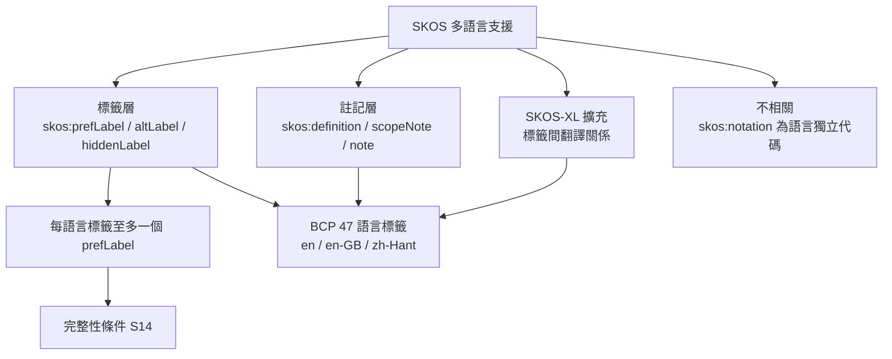

# SKOS（Simple Knowledge Organization System）是否支援 i18n（多語言）？

## 摘要

**是，SKOS 原生支援 i18n（國際化／多語言標示）。** SKOS 是 W3C 於 2009 年發布的知識組織系統資料模型標準，用於表達主題詞表（thesaurus）、分類法與標題表等控制詞彙[^skosref]。其多語言能力並非額外擴充，而是直接建立在底層 RDF 語言標記（language tag）機制之上：同一個概念（concept）可同時擁有多個語言的標籤，每個語言各自的「偏好標籤」（preferred label）至多一個。本文說明其支援方式、規範依據、限制與常見誤解。

## 1. 背景：SKOS 是什麼

SKOS（Simple Knowledge Organization System，簡易知識組織系統）是 W3C 的資料共享標準，目的是把主題詞表、分類法、標題系統與分類體系等「知識組織系統」（KOS）以機器可讀的 RDF 資料形式表達，進而在網路上發布、交換與連結[^skosref]。SKOS 資料以 RDF 三元組表示，可採用 RDF/XML、Turtle 或 JSON-LD 等具體語法序列化[^skosref]。

SKOS 的核心元素包含：

- **概念（`skos:Concept`）**：一個「思想單位」，以 URI 識別。
- **詞彙標籤（lexical label）**：以自然語言字串標示概念。
- **語意關係**：`skos:broader`、`skos:narrower`、`skos:related`。
- **概念體系（`skos:ConceptScheme`）**：概念的集合。
- **對映（mapping）**：跨體系連結概念。

其中與 i18n 直接相關的是**詞彙標籤**與**文件註記（note）**兩類屬性。

## 2. i18n 的技術基礎：RDF 語言標籤

要理解 SKOS 的多語言支援，必須先理解 RDF 的字面值（literal）。

在 RDF 1.1 中，一個字面值由「詞彙形式（lexical form，即 Unicode 字串）」與「資料型別 IRI」組成；若且唯若資料型別為 `rdf:langString` 時，字面值額外帶有一個**語言標籤（language tag）**，且該標籤必須符合 BCP 47 的語法[^rdf11]。這種帶語言標籤的字串稱為「語言標記字串」（language-tagged string）[^rdf11]。

- 語言標籤的值空間一律為小寫[^rdf11]。
- 語言標籤的語法由 IETF 的 **BCP 47** 定義，最新版為 RFC 5646[^bcp47]。
- 常見形式：`en`（英文）、`fr-CA`（加拿大法文）、`zh-Hans`（簡體中文）、`zh-Hant`（繁體中文）等；語言、書寫系統（script）、地區（region）等子標籤可組合[^i18n]。

SKOS 的詞彙標籤正是用這種「字串 + 語言標籤」的 RDF plain literal 來承載。[^skosprimer]

## 3. SKOS 的三個標籤屬性

SKOS Reference 定義三個用於附加詞彙標籤的屬性[^skosref]：

| 屬性 | 語意 | 正式定義 |
| --- | --- | --- |
| `skos:prefLabel` | 偏好標籤（首選詞） | `owl:AnnotationProperty`，`rdfs:label` 的子屬性 |
| `skos:altLabel` | 替代標籤（同義詞、縮寫） | 同上 |
| `skos:hiddenLabel` | 隱藏標籤（供全文檢索用，不顯示） | 同上 |

三者的值域（`rdfs:range`）皆為 RDF plain literal（純字面值），也就是「Unicode 字串 + 可選語言標籤」[^skosref]。這代表**同一個概念可在不同語言下各有一個偏好標籤**。

SKOS Reference 的官方一致性範例（Example 10）即示範同一資源同時具有英文與法文標籤[^skosref]：

```turtle
<MyResource>
  skos:prefLabel "animals"@en ;
  skos:altLabel  "fauna"@en ;
  skos:hiddenLabel "aminals"@en ;
  skos:prefLabel "animaux"@fr ;
  skos:altLabel  "faune"@fr .
```

SKOS Primer 亦說明：「RDF plain literals……SKOS 藉此實現一種簡單形式的多語言標示（a simple form of multilingual labeling）。」[^skosprimer]

## 4. 關鍵完整性條件：每語言至多一個偏好標籤

SKOS 資料模型定義了一條**完整性條件（integrity condition）S14**：

> 「一個資源在每個語言標籤下，`skos:prefLabel` 的值不超過一個。」
> （A resource has no more than one value of `skos:prefLabel` per language tag.）[^skosref]

- 違反此條件即為與 SKOS 資料模型「不一致」。
- 例如 `<Love>` 同時有 `"love"@en` 與 `"adoration"@en` 兩個偏好標籤，即**不一致**（該規範 Example 12）[^skosref]。
- 但 `"love"@en` 與 `"adoration"@en-US`（不同標籤）則可共存。

此外，`skos:prefLabel`、`skos:altLabel`、`skos:hiddenLabel` 三者**兩兩互斥（pairwise disjoint）**：同一字串不能同時是同一語言下的偏好標籤與替代標籤。[^skosref]

## 5. 語言標籤的粒度：en / en-GB / en-US 是三個不同標籤

SKOS Reference 的註記特別強調[^skosref]：

> 「`en`、`en-GB`、`en-US` 是三個不同的語言標籤。」

因此下列資料**一致**（可各視為不同語言的偏好標籤）[^skosref]：

```turtle
<Colour> skos:prefLabel "color"@en , "color"@en-US , "colour"@en-GB .
```

規範並示範以書寫系統區分日文（Example 11）[^skosref]：

```turtle
<AnotherResource>
  skos:prefLabel "東"@ja-Hani ;
  skos:prefLabel "ひがし"@ja-Hira ;
  skos:prefLabel "ヒガシ"@ja-Kana ;
  skos:prefLabel "higashi"@ja-Latn .
```

這對中文尤具意義：可用 `zh-Hans` 與 `zh-Hant` 區分簡繁，或以 `zh-TW`／`zh-HK` 標示地區變體[^i18n]。

## 6. 不只標籤：註記屬性同樣支援多語言

SKOS 的七個文件註記屬性（`skos:note`、`skos:definition`、`skos:scopeNote`、`skos:example`、`skos:historyNote`、`skos:editorialNote`、`skos:changeNote`）值域不限於字面值，但同樣可使用帶語言標籤的字面值，因此**定義與範圍註記也能多語言並存**[^skosprimer]。SKOS Primer 範例[^skosprimer]：

```turtle
ex:pineapples rdf:type skos:Concept;
  skos:prefLabel "pineapples"@en;
  skos:prefLabel "ananas"@fr;
  skos:definition "The fruit of plants of the family Bromeliaceae"@en;
  skos:definition "Le fruit d'une plante herbacée de la famille des broméliacées"@fr.
```

注意：`skos:notation` 是例外。它使用**有型別字面值（typed literal）**而非純字面值，用於與自然語言無關的分類代碼（如 UDC 分類號）；RDF 字面值不可能同時帶語言標籤與資料型別，因此 notation 不帶語言標籤。[^skosref]

## 7. SKOS-XL：把標籤升為一級資源以處理跨語言連結

由於 `skos:prefLabel` 等的值只能是字面值，字面值不能當作 RDF 主詞，因此**無法直接對「標籤」下敘述**。若需要在「某概念的英文標籤」與「其法文標籤」之間建立**翻譯關係**，需使用 SKOS-XL 擴充[^skosprimer]：

- `skosxl:Label` 類別把標籤視為一級 RDF 資源。
- `skosxl:literalForm` 將 Label 連到單一字面值（仍可帶語言標籤）。
- `skosxl:prefLabel` / `skosxl:altLabel` / `skosxl:hiddenLabel` 將 Label 連到概念。
- `skosxl:labelRelation` 連結兩個 Label，可再特化為具方向性的關係（如縮寫、翻譯）。

SKOS Primer 即以「縮寫」關係示範此模式，並指出這正是處理 `"Cow"@en` 與 `"Vache"@fr` 間翻譯連結的方法[^skosprimer]。SKOS-XL 向下相容：若以 `skosxl:altLabel` 連結，其字面值會被推論為標準 `skos:altLabel`。[^skosprimer]

## 8. 概念小結：SKOS 的 i18n 支援層次



## 9. 限制與注意事項

1. **規範不定義語言選用慣例**：SKOS Reference 明確表示「應用與語言特定的標籤與語言標籤使用慣例，不在 SKOS Reference 的範圍內」，其範例僅示意資料模型特性，不必然代表最佳實務[^skosref]。實務上應參考 BCP 47 的「標籤盡可能短」原則[^i18n]。
2. **不做語言標籤的自動比對**：模型本身不規定「查詢 `en` 時是否回傳 `en-GB`」。規範建議應用實作 BCP 47 的 lookup 演算法進行比對，並允許僅提供詞彙形式真正相異的標籤[^skosref]。
3. **`skos:prefLabel` 每語言一值，但同一語言可有 0 或多個 altLabel**；且模型未強制要求每個概念都要有偏好標籤（可只有替代標籤，Example 17）[^skosref]。
4. **語言標籤值一律小寫**：RDF 1.1 規定語言標籤值空間為小寫[^rdf11]。
5. **設計淵源**：SKOS 詞彙設計受標準詞表指引影響，其中 ISO 2788 為單語詞表、**ISO 5964 為多語詞表**指引，後者正是其多語言設計的背景之一[^skosprimer]。

## 結論

SKOS **確實支援 i18n**，而且是「先天的」：每個標籤（以及註記）都是帶 BCP 47 語言標籤的 RDF 字面值，同一概念可平行擁有多種語言的偏好／替代／隱藏標籤，並以完整性條件 S14 保證「每語言一個偏好標籤」。需要更細緻的跨語言標籤關係（如翻譯、縮寫方向）時，則由 SKOS-XL 擴充提供。唯一不帶語言標籤的是作為語言獨立代碼的 `skos:notation`。

---

## 參考文獻

[^skosref]: Miles, A., & Bechhofer, S. (2009, August 18). *SKOS Simple Knowledge Organization System Reference* (W3C Recommendation). Retrieved 2026-11-07, from https://www.w3.org/TR/skos-reference/

[^skosprimer]: Isaac, A., & Summers, E. (2009, August 18). *SKOS Simple Knowledge Organization System Primer* (W3C Working Group Note). Retrieved 2026-11-07, from https://www.w3.org/TR/skos-primer/

[^rdf11]: Cyganiak, R., Wood, D., & Lanthaler, M. (2014, February 25). *RDF 1.1 Concepts and Abstract Syntax* (W3C Recommendation). Retrieved 2026-11-07, from https://www.w3.org/TR/rdf11-concepts/

[^bcp47]: Phillips, A., & Davis, M. (Eds.). (2009, September). *Tags for Identifying Languages* (BCP 47, RFC 5646). Internet Engineering Task Force. Retrieved 2026-11-07, from https://www.rfc-editor.org/rfc/rfc5646.txt

[^i18n]: World Wide Web Consortium. (n.d.). *Language tags in HTML and XML*. W3C Internationalization. Retrieved 2026-11-07, from https://www.w3.org/International/articles/language-tags/
