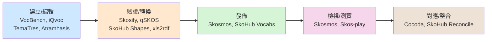

# 用於檢視、編輯與管理 SKOS 的 FOSS 解決方案

## 摘要

SKOS (Simple Knowledge Organization System，簡單知識組織系統) 是 W3C 於 2009 年 8 月 18 日發佈的建議標準 (W3C Recommendation)，用於在網路上分享與連結知識組織系統[^skos-w3c]。它以 RDF 為基礎，主要用來表達索引典 (thesauri)、分類法 (classification schemes)、主題標目 (subject headings)、taxonomy 等類型的主題詞表 (controlled vocabulary)[^skos-w3c][^skos-wiki]。

本報告蒐集目前可用於「檢視、編輯、管理」SKOS 詞表的自由暨開放原始碼軟體 (FOSS，Free and Open Source Software) 解決方案，依用途區分為：**完整詞表管理平台 (web application)**、**檢視／瀏覽器**、**驗證／轉換工具**、**桌面與編輯器整合**，以及**程式庫 (library)** 五類。所有事實均附註腳來源，並於末節進行來源批判性反思。

> **名詞說明**：本報告所稱「FOSS」指以 OSI 認可的開放原始碼授權 (如 MIT、Apache-2.0、GPL、LGPL、BSD、CeCILL) 發佈，且原始碼可公開取得之軟體。商業授權但提供原始碼檢視者不在收錄範圍，例如 PoolParty Semantic Suite 為專有 (proprietary) 商業軟體，本報告將其列為反例說明[^poolparty]。

---

## 一、SKOS 簡介

SKOS 以「概念 (Concept)」為核心，而非以字詞為核心。每個概念是一個 RDF 資源，可附加多種屬性與關聯[^skos-wiki]：

| 類別 | 主要元素 |
| --- | --- |
| 概念 (Concepts) | `skos:Concept`、`skos:ConceptScheme`、`skos:hasTopConcept` |
| 標籤與標記 (Labels & Notation) | `skos:prefLabel`、`skos:altLabel`、`skos:hiddenLabel`、`skos:notation` |
| 文件說明 (Documentation) | `skos:definition`、`skos:scopeNote`、`skos:example`、`skos:historyNote` |
| 語意關聯 (Semantic Relations) | `skos:broader`、`skos:narrower`、`skos:related` |
| 對應關聯 (Mapping) | `skos:exactMatch`、`skos:closeMatch`、`skos:broadMatch`、`skos:relatedMatch` |
| 集合 (Collections) | `skos:Collection`、`skos:orderedCollection`、`skos:member` |

由於 SKOS 詞表通常以 RDF/XML、Turtle (.ttl)、N-Triples 等 RDF 序列化格式儲存，因此編輯 SKOS 的工具大致可分成兩種設計取向：

1. **詞表專用工具**：以 SKOS 資料模型為核心設計介面 (如 VocBench、Skosmos、TemaTres)，操作直覺但功能邊界明確。
2. **通用 RDF/本體工具**：以通用 RDF/OWL 編輯器處理 SKOS (如 Protégé)，彈性高但需具備語意網知識。

下圖說明各類工具在 SKOS 生命週期中的位置：

---

## 二、完整詞表管理平台 (Web Application)

此類工具提供線上編輯、版本控制、多使用者協作與發佈功能，是最常被用來「管理」SKOS 詞表的一類。

### 2.1 VocBench 3

| 項目 | 內容 |
| --- | --- |
| 類型 | Web 應用程式 (Java) |
| 授權 | BSD-3-Clause |
| 官方網站 | https://vocbench.uniroma2.it/ |
| 原始碼 | https://bitbucket.org/art-uniroma2/vocbench3 |

VocBench 是一套以網頁為基礎、支援多語言的協作式開發平台，用於管理 OWL 本體、SKOS(/SKOS-XL) 索引典、Ontolex-lemon 詞彙集 (lexicon) 與一般 RDF 資料集[^vocbench-site]。其商業與資料存取層由開放原始碼平台 Semantic Turkey 實作，該平台由羅馬第二大學 (University of Rome Tor Vergata) 的 ART 研究團隊開發[^vocbench-site]。VocBench 最初由歐盟執委會 ISA² 計畫資助，目前由數位歐洲計畫 (Digital Europe Programme, DIGITAL) 資助，並由歐盟出版局 (Publications Office of the EU) 負責開發管理[^vocbench-site]。其原始碼與執行檔授權為 BSD-3-Clause[^vocbench-license]。

由於 VocBench 的原始碼主要託管於 Bitbucket 而非 GitHub，其 GitHub 上的程式庫多為社群維護的 Docker 封裝 (例如用於快速部署的 `docker-vocbench3` 鏡像)，本身並非官方主線[^vocbench-search]。使用此工具需具備 Java 環境與資料庫 (如 GraphDB、Virtuoso 等三元組儲存)，部署門檻相對較高。

### 2.2 TemaTres

| 項目 | 內容 |
| --- | --- |
| 類型 | Web 應用程式 (PHP + MySQL/MariaDB) |
| 授權 | GNU GPL v2 |
| 官方網站 | https://vocabularyserver.com |
| GitHub | https://github.com/tematres/TemaTres-Vocabulary-Server (約 142 顆星) |

TemaTres 是一套以 PHP 撰寫的網頁應用程式，用於管理形式化的知識表達，如主題詞表、taxonomy、索引典與詞彙表 (glossary)[^tematres-repo]。它支援 SKOS 的匯入與匯出，並提供網路服務 (web services) 供其他系統查詢[^tematres-repo]。其執行環境需求為 PHP 7.4 以上、MySQL 5.0 以上或 MariaDB，以及啟用 mod_rewrite 的 HTTP 伺服器[^tematres-license]。授權為 GNU GPL v2[^tematres-license]。其 GitHub 專案近期仍有提交 (截至 2026 年 11 月仍有 push 紀錄)，屬於活躍維護的專案[^tematres-repo]。

TemaTres 生態系另包含 `PortalThes`，可透過 TemaTres 的網路服務將詞表以入口網站形式發佈[^tematres-portalthes]。

### 2.3 iQvoc

| 項目 | 內容 |
| --- | --- |
| 類型 | Web 應用程式 (Ruby on Rails，亦可產出 Java bytecode) |
| 授權 | Apache License 2.0 |
| 官方網站 | https://iqvoc.net/ |
| GitHub | https://github.com/innoq/iqvoc (約 125 顆星) |

iQvoc 針對 SKOS(-XL) 詞表管理而設計，支援索引典、taxonomy、分類法與主題標目系統[^iqvoc-site]。其功能包含：從 SKOS 格式匯入既有詞表、以直覺網頁介面瀏覽、依據 WAI 無障礙準則設計的多語言介面，以及編輯工作流程 (editorial workflow)——詞表管理員可授權註冊使用者為編輯者，編輯在原有網頁介面中擴充進行，無須額外工具[^iqvoc-site]。iQvoc 為每個概念提供穩定且唯一的識別碼，遵循 W3C 的 Cool URIs 指引[^iqvoc-site]。授權為 Apache License 2.0[^iqvoc-license]。原始碼最近一次提交約在 2026 年 10 月，仍在維護[^iqvoc-repo]。

### 2.4 Atramhasis

| 項目 | 內容 |
| --- | --- |
| 類型 | Web 應用程式 (Python，Pyramid 框架) |
| 授權 | GNU GPL v3 |
| GitHub | https://github.com/OnroerendErfgoed/atramhasis (約 65 顆星) |

Atramhasis 由比利時遺產機構 OnroerendErfgoed 開發，定位為「線上 SKOS 編輯器」[^atramhasis-repo]。它以 Python 撰寫，提供可安裝的 PyPI 套件，並支援作為 Python 應用程式嵌入[^atramhasis-repo]。授權為 GNU GPL v3[^atramhasis-repo]。專案近期仍活躍 (2026 年 11 月仍有提交)[^atramhasis-repo]。

### 2.5 OpenSKOS

| 項目 | 內容 |
| --- | --- |
| 類型 | Web 應用程式 / REST API (PHP) |
| 授權 | GNU GPL v3 |
| 官方網站 | http://openskos.org |
| GitHub | https://github.com/OpenSKOS/OpenSKOS (約 57 顆星，已封存) |

OpenSKOS 提供對 SKOS 詞表的 RESTful 存取，背後以 Solr 與 Jena 為儲存與查詢引擎，並支援 OAI-PMH 收穫協定[^openskos-repo]。授權為 GNU GPL v3[^openskos-repo]。**注意**：該 GitHub 專案已被標記為 archived (封存，唯讀)，最後一次推送約在 2023 年 4 月，屬維護停滯的專案，採用前需評估[^openskos-repo]。

---

## 三、檢視／瀏覽器 (Viewers & Browsers)

此類工具以「唯讀發佈與瀏覽」為主，適合作為詞表的對外查詢介面。

### 3.1 Skosmos

| 項目 | 內容 |
| --- | --- |
| 類型 | Web 應用程式 (PHP + Vue) |
| 授權 | MIT License |
| 官方網站 | https://skosmos.org |
| GitHub | https://github.com/NatLibFi/Skosmos (約 267 顆星) |

Skosmos 是由芬蘭國家圖書館 (National Library of Finland) 開發的索引典與主題詞表瀏覽器，使用 SKOS 與 SPARQL[^skosmos-repo]。它同時提供 REST API 與 Linked Data 存取，是芬蘭國家級詞表服務 Finto.fi 的底層引擎[^skosmos-repo]。授權為 MIT License[^skosmos-license]。Skosmos 是本清單中 GitHub 星數最高的 SKOS 專用工具 (約 267 顆星)，且維護極為活躍 (2026 年 11 月仍有提交)[^skosmos-repo]。

### 3.2 Skos-play (SKOS Play!)

| 項目 | 內容 |
| --- | --- |
| 類型 | Web 應用程式 (Java，前端 d3.js) |
| 授權 | LGPL-3.0 (GitHub 標示) / 網站標示 CC-BY-SA |
| 官方網站 | https://skos-play.sparna.fr |
| GitHub | https://github.com/sparna-git/skos-play (約 84 顆星) |

Skos-play 由 Sparna 公司的 Thomas Francart 開發，可將 SKOS 詞表以 HTML 或 PDF 形式印出，並提供圖形化視覺呈現 (data visualization)、以 Excel 試算表產生 SKOS 檔案等功能[^skosplay-site]。它基於 Eclipse RDF4J 載入 RDF、以 SPARQL 查詢資料、以 d3.js 繪製圖形、以 Apache FOP 產生 PDF[^skosplay-site]。免費且開放原始碼[^skosplay-site]。**授權歧異需注意**：其介紹網頁標示為 CC-BY-SA 授權[^skosplay-site]，但 GitHub 儲存庫標示為 LGPL-3.0[^skosplay-repo]，兩者並不一致，實際採用前應向作者確認。

Skos-play 另有一個線上測試工具 (SKOS testing tool)，用於檢查詞表品質[^skosplay-site]。其姊妹專案 `xls2rdf` 可從 Excel 產生 RDF，適用於以試算表編輯 SKOS 詞表的工作流程[^xls2rdf]。

### 3.3 SkoHub (Vocabs / Pages)

| 項目 | 內容 |
| --- | --- |
| 類型 | 靜態網站產生器 (JavaScript/Node.js) |
| 授權 | Apache License 2.0 |
| 官方網站 | https://skohub.io |
| GitHub | https://github.com/skohub-io/skohub-vocabs (約 45 顆星) |

SkoHub 由德國北萊茵-西發利亞圖書館服務中心 (hbz) 維護，提供以 Git 工作流程管理與發佈 SKOS 詞表的一系列模組[^skohub-site]。其設計理念是「以 Git 進行編輯控制、同時具備人類與機器可讀格式、無須專屬伺服器即可運作 (serverless)」[^skohub-site]。主要模組包括[^skohub-site]：

- **SkoHub Vocabs**：SKOS 靜態網站產生器，可將詞表 HTML 化並提供查詢 API[^skohub-vocabs]。
- **SkoHub Pages**：可直接 fork 的範例儲存庫，用 GitHub Actions 與 Pages 發佈詞表[^skohub-site]。
- **SkoHub Reconcile**：符合 Reconciliation API 規格的對應服務，可與 OpenRefine、Cocoda 等工具整合[^skohub-site]。
- **SkoHub Shapes**：以 SHACL 驗證 SKOS 詞表[^skohub-site]。

授權為 Apache License 2.0[^skohub-vocabs]。其中 PubSub、Editor、Extension 等模組已標記為 Inactive (停止維護)[^skohub-site]。

### 3.4 Protégé 與 WebProtégé

| 項目 | 內容 |
| --- | --- |
| 類型 | 桌面應用程式 / Web 應用程式 (Java) |
| 授權 | 開放原始碼 (BSD 系) |
| 官方網站 | https://protege.stanford.edu/ |

Protégé 是史丹佛大學開發的自由開放原始碼 OWL 本體編輯器，提供桌面版 (Protégé Desktop) 與協作式瀏覽器版 (WebProtégé)[^protege-site]。由於 SKOS 以 OWL 類別為基礎 (例如 `skos:Concept` 基於 OWL `Class`[^skos-wiki])，Protégé 可透過相容的 OWL 機制編輯 SKOS 詞表。世界衛生組織 (WHO) 即以基於 WebProtégé 的環境開發國際疾病分類 ICD-11，美國國家癌症研究所 (NCI) 的索引典亦以 Protégé 開發維護[^protege-site]。適合需要完整本體工程能力、且願意學習語意網技術的使用者。

---

## 四、驗證、轉換與品質工具 (Validation & Conversion)

### 4.1 Skosify

| 項目 | 內容 |
| --- | --- |
| 類型 | 命令列工具 / Python 程式庫 |
| 授權 | MIT License |
| GitHub | https://github.com/NatLibFi/Skosify (約 68 顆星) |

Skosify 與 Skosmos 同為芬蘭國家圖書館團隊作品，用於驗證、轉換與改善 SKOS 詞表[^skosify-repo]。它可將其他格式的詞表轉換為 SKOS、檢查詞表品質並進行自動修復[^skosify-repo]。授權為 MIT License[^skosify-repo]。最後一次推送約在 2021 年 8 月，近期維護較不活躍[^skosify-repo]。

### 4.2 qSKOS

| 項目 | 內容 |
| --- | --- |
| 類型 | 命令列工具 (Java) |
| 授權 | GNU GPL v3 |
| GitHub | https://github.com/cmader/qSKOS (約 76 顆星) |

qSKOS 是一套詞表品質評估工具 (vocabulary quality assessment tools)，可偵測 SKOS 詞表中的結構問題與品質缺陷[^qskos-repo]。授權為 GNU GPL v3[^qskos-repo]。最後一次推送約在 2024 年 6 月[^qskos-repo]。

### 4.3 xls2rdf

| 項目 | 內容 |
| --- | --- |
| 類型 | 命令列工具 / HTTP 服務 / Java API |
| 授權 | LGPL-3.0 |
| GitHub | https://github.com/sparna-git/xls2rdf (約 30 顆星) |

xls2rdf 可從 Excel 試算表產生 RDF 資料，藉此讓人們在熟悉的 Excel 中編輯 SKOS 詞表、知識圖譜實例、SHACL 限制與 OWL 本體[^xls2rdf]。提供 HTTP 服務、上傳表單、命令列與 Java API 等多種使用方式[^xls2rdf]。授權為 LGPL-3.0[^xls2rdf]。

---

## 五、對應與整合工具 (Mapping & Reconcile)

### 5.1 Cocoda

Cocoda 是一套以網頁為基礎的工具，用於在不同知識組織系統之間建立對應 (mapping)[^cocoda]。由德國 GBV 開發，可搭配 SkoHub Reconcile 等服務使用。

### 5.2 SkoHub Reconcile

提供符合 Reconciliation API 規格的 API，可將 SKOS 詞表用於 OpenRefine、Cocoda 等資料對應服務[^skohub-site]。授權 Apache-2.0[^skohub-site]。

---

## 六、桌面與編輯器整合工具

### 6.1 ThManager

| 項目 | 內容 |
| --- | --- |
| 類型 | 桌面應用程式 (Java) |
| 授權 | GNU LGPL v2.1 |
| 歷史網址 | http://thmanager.sourceforge.net |

ThManager 是建立與視覺化 SKOS RDF 詞表的開放原始碼工具[^skos-legacy]。授權為 GNU LGPL v2.1 (或後續版本)[^thmanager-license]。**注意**：其 SourceForge 網站目前已無法直接存取 (回傳 403)，但專案內容仍保存於 Internet Archive Wayback Machine[^thmanager-license]，屬於實質停止維護的專案，僅供歷史參考。

### 6.2 GINCO

GINCO (Gestion Informatisée de Nomenclatures Collaboratives et Ouvertes) 是法國文化部 (ministère de la Culture) 開發的協作式開放詞表管理工具，以 Java 撰寫[^ginco]。它用於管理、出版典藏領域的主題詞表，並支援 SKOS 輸出。**注意**：其 GitHub 專案已標記為 archived (封存)，最後一次推送約在 2023 年 12 月[^ginco]。其 GitHub 授權標示為 "NOASSERTION" (未自動判定)，需查閱專案內檔案才能確認實際授權[^ginco]，因此本報告不列出其授權名稱。

### 6.3 編輯器外掛

- **VS Code SKOS Turtle 編輯器**：`skos-ttl-editor` 為 Visual Studio Code 擴充套件，用於簡化 SKOS Turtle (.ttl) 檔案的編輯[^skos-ttl-editor]。約 11 顆星。
- **Mentor for VS Code**：提供 RDF 語言與知識圖譜編輯支援的 VS Code 擴充套件，支援 SKOS、OWL、SHACL、SPARQL 等[^mentor-vscode]。約 51 顆星。

### 6.4 新興瀏覽器型編輯器

GitHub 上另有數個較新的瀏覽器型 SKOS 工具，值得留意但星數仍低、成熟度待觀察：

- **ThesauRex**：以 Vue 撰寫的 SKOS 本體網頁編輯器，MIT 授權，約 28 顆星[^thesaurex]。
- **intentional-arrangement-skos**：單一自帶檔案 (self-contained) 的瀏覽器型 SKOS taxonomy 建構、驗證、視覺化與發佈工具，具 REST API 與 MCP server，約 111 顆星[^intentional-arrangement]。
- **orionbelt-ontology-builder**：以 Streamlit + rdflib 撰寫的瀏覽器型 OWL/SKOS 工作台，標榜無須 Java、無須 Protégé，內含 22 項 SKOS 驗證檢查，約 223 顆星[^orionbelt]。
- **EVOKS** (Editor for Vocabularies to Know Semantics)：Python 撰寫的詞表編輯器，Apache-2.0 授權，約 7 顆星[^evoks]。

---

## 七、程式庫 (Library)

若需以程式方式檢視、編輯或管理 SKOS，可使用下列函式庫：

| 名稱 | 語言 | 用途 | 授權 |
| --- | --- | --- | --- |
| RDFLib | Python | 通用 RDF 處理，可讀寫 SKOS 三元組 | BSD |
| Apache Jena | Java | RDF/SPARQL 框架，可處理 SKOS | Apache-2.0 |
| Eclipse RDF4J | Java | RDF 處理框架，Skos-play 採用 | BSD |
| kglab | Python | 以 RDFLib、NetworkX 等為基礎的知識圖譜抽象層，支援 SKOS | MIT[^kglab] |

其中 kglab 為 Python 生態中整合多個圖論與 RDF 函式庫的抽象層，主題標籤中包含 `skos`，適合需要以程式化方式操作 SKOS 的開發者[^kglab]。

---

## 八、綜合比較表

| 工具 | 類型 | 授權 | 語言 | GitHub 星數 | 維護狀態 |
| --- | --- | --- | --- | --- | --- |
| VocBench 3 | 管理平台 | BSD-3-Clause | Java | (Bitbucket 託管) | 活躍 |
| TemaTres | 管理平台 | GPL-2.0 | PHP | ~142 | 活躍 |
| iQvoc | 管理平台 | Apache-2.0 | Ruby | ~125 | 活躍 |
| Atramhasis | 管理平台 | GPL-3.0 | Python | ~65 | 活躍 |
| OpenSKOS | 管理平台/REST | GPL-3.0 | PHP | ~57 | 已封存 |
| Skosmos | 檢視器 | MIT | PHP | ~267 | 活躍 |
| Skos-play | 檢視/列印 | LGPL-3.0 (歧異) | Java | ~84 | 活躍 |
| SkoHub Vocabs | 發佈/檢視 | Apache-2.0 | JS | ~45 | 活躍 |
| Protégé | 本體編輯器 | 開放原始碼 | Java | (GitHub org) | 活躍 |
| Skosify | 驗證/轉換 | MIT | Python | ~68 | 趨緩 |
| qSKOS | 品質評估 | GPL-3.0 | Java | ~76 | 趨緩 |
| xls2rdf | 轉換 | LGPL-3.0 | Java | ~30 | 活躍 |
| ThManager | 桌面編輯器 | LGPL-2.1 | Java | (SourceForge) | 停滯 |
| GINCO | 詞表管理 | 未明確標示 | Java | ~42 | 已封存 |

**不屬於 FOSS 的反例**：PoolParty Semantic Suite 為專有商業軟體，其核心產品無公開原始碼，其 GitHub 組織僅有少量輔助工具 (MIT/Apache-2.0)[^poolparty]。ThManager 之歷史資料亦需透過 Wayback Machine 存取[^thmanager-license]。

---

## 九、來源批判性反思

1. **時效性差異顯著**：本報告中部分工具維護狀態差異極大。Skosmos、TemaTres、iQvoc、Atramhasis、VocBench 等在 2026 年仍有提交紀錄，屬活躍專案；而 OpenSKOS、ThManager、Skosify 等則已封存或長期未更新。採用前務必查核專案最新提交時間[^openskos-repo][^skosify-repo][^thmanager-license]。

2. **授權資訊存在歧異**：Skos-play 的官方介紹網頁標示 CC-BY-SA[^skosplay-site]，但 GitHub 儲存庫標示 LGPL-3.0[^skosplay-repo]，兩者矛盾。此外，GitHub 的 API 對部分專案 (如 Skosmos) 回報的授權為 "NOASSERTION" (未自動判定)，需進一步查閱專案內的 LICENSE 檔案才能確認實際授權 (Skosmos 的 LICENSE 檔案明載為 MIT[^skosmos-license])。切勿僅依 GitHub 標籤判斷授權。

3. **權威來源與社群來源的區分**：本報告同時引用了 W3C 官方文件、專案官方網站 (第一手)，以及 GitHub API 與搜尋結果 (第二手)。W3C 的 SKOS 工具清單頁面[^skos-w3c]自 2013 年後幾乎未再更新，其列出的部分工具已失效，因此本報告主要以各專案官方網站與程式庫為事實依據，W3C 頁面僅作背景參考。

4. **星數作為指標的侷限**：GitHub 星數可反映社群關注度，但 SKOS 屬相對小眾領域，多數工具星數在 100 顆上下。VocBench 雖為業界標準工具之一，卻因主要託管於 Bitbucket 而無 GitHub 星數可比較，顯示星數並非評估 SKOS 工具成熟度的可靠單一指標。

5. **未涵蓋範圍**：本報告以「開箱即用的應用程式」為主。以程式庫層級直接操作 SKOS 的完整方案 (如各語言的 RDF 函式庫細節)、以及商業工具的免費方案 (如 PoolParty 的試用版)，不在本報告深入範圍。

---

## 參考資料

[^skos-w3c]: Miles, A., & Bechhofer, S. (2009-08-18). SKOS Simple Knowledge Organization System Reference. W3C. Retrieved 2026-11-07, from https://www.w3.org/TR/skos-reference/

[^skos-wiki]: Wikipedia. (2026). Simple Knowledge Organization System. Retrieved 2026-11-07, from https://en.wikipedia.org/wiki/Simple_Knowledge_Organization_System

[^vocbench-site]: ART Research Group, University of Rome Tor Vergata. (n.d.). VocBench: A Collaborative Management System for OWL ontologies, SKOS(/XL) thesauri, Ontolex-lemon lexicons and generic RDF datasets. Retrieved 2026-11-07, from https://vocbench.uniroma2.it/

[^vocbench-license]: ART Research Group. (n.d.). VocBench 3 source code (LICENSE: BSD-3-Clause). Retrieved 2026-11-07, from https://bitbucket.org/art-uniroma2/vocbench3

[^vocbench-search]: GitHub. (2026). Repository search results for "vocbench". Retrieved 2026-11-07, from https://api.github.com/search/repositories?q=vocbench

[^tematres-repo]: TemaTres. (n.d.). TemaTres-Vocabulary-Server: Web application for management formal representations of knowledge, like controlled vocabularies, taxonomies, thesauri and glossaries. Retrieved 2026-11-07, from https://github.com/tematres/TemaTres-Vocabulary-Server

[^tematres-license]: TemaTres. (n.d.). TemaTres-Vocabulary-Server README (License: GNU GPL v2). Retrieved 2026-11-07, from https://github.com/tematres/TemaTres-Vocabulary-Server

[^tematres-portalthes]: TemaTres. (n.d.). PortalThes: Web tool to publish thesaurus and controlled vocabularies in the web. Retrieved 2026-11-07, from https://github.com/tematres/PortalThes

[^iqvoc-site]: innoQ Deutschland GmbH. (n.d.). iQvoc: A Vocabulary Management System for the Semantic Web. Retrieved 2026-11-07, from https://iqvoc.net/

[^iqvoc-license]: innoQ Deutschland GmbH. (2016). iQvoc LICENSE (Apache License 2.0). Retrieved 2026-11-07, from https://raw.githubusercontent.com/innoq/iqvoc/main/LICENSE

[^iqvoc-repo]: innoQ. (n.d.). iqvoc: iQvoc - A SKOS(-XL) Vocabulary Management System for the Semantic Web. Retrieved 2026-11-07, from https://github.com/innoq/iqvoc

[^atramhasis-repo]: OnroerendErfgoed. (n.d.). atramhasis: An online SKOS editor. Retrieved 2026-11-07, from https://github.com/OnroerendErfgoed/atramhasis

[^openskos-repo]: OpenSKOS. (n.d.). OpenSKOS: Provide RESTful access to SKOS vocabularies. Retrieved 2026-11-07, from https://github.com/OpenSKOS/OpenSKOS

[^skosmos-repo]: National Library of Finland. (n.d.). Skosmos: Thesaurus and controlled vocabulary browser using SKOS and SPARQL. Retrieved 2026-11-07, from https://github.com/NatLibFi/Skosmos

[^skosmos-license]: National Library of Finland. (n.d.). Skosmos LICENSE (MIT License). Retrieved 2026-11-07, from https://raw.githubusercontent.com/NatLibFi/Skosmos/main/LICENSE

[^skosplay-site]: Francart, T. (n.d.). SKOS Play: Thesaurus & Taxonomies. Sparna. Retrieved 2026-11-07, from https://skos-play.sparna.fr/play/about

[^skosplay-repo]: Sparna. (n.d.). skos-play: SKOS-Play allows to print SKOS files in HTML or PDF. Retrieved 2026-11-07, from https://github.com/sparna-git/skos-play

[^xls2rdf]: Sparna. (n.d.). xls2rdf: Create RDF data from Excel spreadsheets. Retrieved 2026-11-07, from https://github.com/sparna-git/xls2rdf

[^skohub-site]: SkoHub / Hochschulbibliothekszentrum des Landes Nordrhein-Westfalen (hbz). (n.d.). SkoHub: Unleash the full potential of controlled vocabularies. Retrieved 2026-11-07, from https://skohub.io/

[^skohub-vocabs]: SkoHub. (n.d.). skohub-vocabs: A lightweight tool to publish SKOS Vocabularies. Retrieved 2026-11-07, from https://github.com/skohub-io/skohub-vocabs

[^protege-site]: Stanford University Division of Computational Medicine. (2026). Protégé: free, open-source OWL ontology editor. Retrieved 2026-11-07, from https://protege.stanford.edu/

[^skosify-repo]: National Library of Finland. (n.d.). Skosify: Validate, convert and improve SKOS vocabularies. Retrieved 2026-11-07, from https://github.com/NatLibFi/Skosify

[^qskos-repo]: Mader, C. (n.d.). qSKOS: Vocabulary quality assessment tools. Retrieved 2026-11-07, from https://github.com/cmader/qSKOS

[^cocoda]: GBV. (n.d.). cocoda: A web-based tool for creating mappings between knowledge organization systems. Retrieved 2026-11-07, from https://github.com/gbv/cocoda

[^skos-legacy]: W3C. (2014-05-30). SKOS/LegacyTools - Semantic Web Standards. Retrieved 2026-11-07, from https://www.w3.org/2001/sw/wiki/SKOS/LegacyTools

[^thmanager-license]: ThManager Project. (2009-07-02). ThManager license (GNU LGPL v2.1). Retrieved 2026-11-07, from https://web.archive.org/web/20251209165153/https://thmanager.sourceforge.io/licencia.html

[^ginco]: culturegouv. (n.d.). ginco: Gestion Informatisée de Nomenclatures Collaboratives et Ouvertes. Retrieved 2026-11-07, from https://github.com/culturegouv/ginco

[^skos-ttl-editor]: dzl-dm. (n.d.). skos-ttl-editor: An extension for Visual Studio Code for simplified editing of SKOS Turtle (.ttl) files. Retrieved 2026-11-07, from https://github.com/dzl-dm/skos-ttl-editor

[^mentor-vscode]: faubulous. (n.d.). mentor-vscode: Visual Studio Code extension providing editing support for RDF languages and knowledge graphs. Retrieved 2026-11-07, from https://github.com/faubulous/mentor-vscode

[^thesaurex]: DH-Center-Tuebingen. (n.d.). ThesauRex: Web based editor for SKOS based ontologies. Retrieved 2026-11-07, from https://github.com/DH-Center-Tuebingen/ThesauRex

[^intentional-arrangement]: jesstalisman-ia. (n.d.). intentional-arrangement-skos: Build, validate, visualize, and publish SKOS taxonomies in your browser. Retrieved 2026-11-07, from https://github.com/jesstalisman-ia/intentional-arrangement-skos

[^orionbelt]: ralforion. (n.d.). orionbelt-ontology-builder: Browser-based ontology workbench for OWL ontologies and SKOS vocabularies. Retrieved 2026-11-07, from https://github.com/ralforion/orionbelt-ontology-builder

[^evoks]: KIT Data Manager. (n.d.). EVOKS (Editor for Vocabularies to Know Semantics). Retrieved 2026-11-07, from https://github.com/kit-data-manager/EVOKS

[^kglab]: DerwenAI. (n.d.). kglab: Graph Data Science abstraction layer in Python. Retrieved 2026-11-07, from https://github.com/DerwenAI/kglab

[^poolparty]: Semantic Web Company / Graphwise. (n.d.). PoolParty Semantic Suite. Retrieved 2026-11-07, from https://www.poolparty.biz/
